# 2주차 1세션: 변수의 개념과 값 할당 📦

## 변수의 개념과 대수학

### 변수의 기원: 프랑수아 비에트와 문자 대수학
코딩에서 말하는 **'변수(Variable)'**라는 개념은 갑자기 하늘에서 뚝 떨어진 것이 아닙니다. 
여러분이 중학교 수학 시간(대수학)에 배우는 **"문자를 사용한 식"**에서 알파벳 $x$나 $y$를 가져와 대입하는 행위와 파이썬 프로그래밍의 변수 선언은 정확히 100% 똑같은 메커니즘을 가집니다.


*(웹툰 비유: 16세기 프랑스의 수학 영웅 '프랑수아 비에트'. 그는 500개가 넘는 적군의 복잡한 스페인 암호를 해독하기 위해 역사상 최초로 계산식에 값이 변할 수 있는 **알파벳 문자($x$, $y$)라는 '투명 상자'**를 도입했습니다. 이 위대한 수학적 상상력이 오늘날 컴퓨터 프로그래밍 '변수(Variable)'의 기원이 되었습니다.)*

---

### 투명 상자와 이름표 비유
파이썬에서 변수란 데이터를 담아두는 **'이름표가 붙은 투명 상자'**와 같습니다. 길이를 모르는 값을 수학에서 $x$ 상자로 두듯, 코드 내에서도 아직 정해지지 않거나 계속해서 변할 수 있는 데이터를 손쉽게 관리하기 위해 이 상자(변수)를 사용합니다.

---

### 리터럴(Literal)과 변수(Variable)의 구분
초보자가 흔히 저지르는 실수 중 하나는 데이터 그 자체와 그것을 가리키는 변수를 혼동하는 것입니다.
* **리터럴 (Literal)**: 변하지 않는 값 그 자체(`3`, `"Hello"`, `3.14`)를 의미하며, 코드에 문자 그대로 쓰여 있습니다.
* **변수 (Variable)**: 그 리터럴 데이터 객체를 지목하고 담아두어 코드 내에서 재사용할 수 있게 만드는 그릇(이름표)을 뜻합니다.

---

## 변수에 값 할당하기 (대입)

### 대입 연산자(=)의 진짜 의미
수학에서 기계 식 $2x + 5$ 의 $x$ 자리에 숫자 $3$을 쏙 집어넣는 것을 **대입(Substitution)**이라고 배웠을 것입니다. 파이썬 프로그래밍에서는 이를 **할당(Assignment)**이라고 부르며, 그 위대한 마법의 지팡이 역할을 하는 것이 바로 **`=` (대입 연산자)** 입니다.


*(다이어그램: 수학에서 수식의 $x$ 구멍 안에 숫자 $3$을 떨어뜨리는 행위가, 파이썬 코드 `x = 3`에서 오른쪽의 숫자 $3$이 왼쪽의 변수 $x$ 상자 안으로 쏙 들어가는 과정과 완전히 동일함을 보여주는 흐름 비교)*

* **주의할 점:** 파이썬 코드에서 `=` 은 수학 시간의 "왼쪽과 오른쪽이 똑같다"라는 뜻표시가 **절대로 아닙니다!** 
* **오른쪽의 데이터(값)를, 왼쪽의 투명 상자(변수) 안에 쏙 집어넣어라!** 라는 강력한 '명령어'입니다.

---

### 변수 상자에 데이터 대입 실습
실습을 통해 변수에 값을 대입하고 변경하는 기초 과정을 연습해 봅시다.

```python
a = 3 
greeting = "안녕하세요!"

print(a)
print(greeting)
```
**출력:**
```
3
안녕하세요!
```

---

### print() 함수의 다양한 출력법
위 실습 코드에서 `print(a)`와 같이 쓰인 **`print()`**는 파이썬에서 가장 많이 사용되는 **기본 출력 함수**입니다. 변수 안에 들어있는 값을 화면(콘솔)에 보여주거나, 문자열을 직접 출력할 때 사용합니다.

```python
print("텍스트 직접 출력")
print(a)           # 변수 안의 값 출력
print("값은:", a)  # 문자열과 변수를 쉼표로 연결하여 한 줄에 출력
```
쉼표(`,`)를 사용하여 여러 개의 변수나 문자열을 나열하면, 파이썬이 알아서 띄어쓰기(공백)를 하나씩 넣어주면서 한 줄로 예쁘게 출력해 줍니다.

---

## 대화형 REPL 모드와 명령줄 셸

### REPL 모드에서의 즉석 코드 실행
파이썬은 한 줄씩 코드를 바로 확인하고 실행하는 **REPL(Read-Evaluation-Print Loop)** 대화형 모드를 정식으로 지원합니다.
터미널에서 `python` 또는 `python3`를 치고 진입하면 `>>>` 프롬프트가 뜨며, 여기서 `a = 5` 처럼 명령어를 입력하면 엔터를 치자마자 실행 결과를 확인할 수 있습니다.

---

### 개발자의 필수 도구: 명령줄 셸(Shell)
컴퓨터 화면의 마우스 클릭을 통한 그래픽 UI(GUI) 환경을 넘어서, 개발자는 텍스트 타이핑만으로 컴퓨터 하드웨어를 직접 제어하는 **셸(Shell)** 환경에 친숙해져야 합니다. macOS의 터미널(Terminal), Windows의 명령 프롬프트(CMD) 또는 PowerShell이 대표적인 셸입니다. 셸을 활용하면 가상환경 세팅, 패키지 설치, 파이썬 파일 실행을 속사포처럼 해낼 수 있습니다.

---

## 파이썬의 값(Value) 처리와 타입 시스템

### 파이썬 값(Value) 처리의 특징
파이썬 엔진은 코드를 한 줄씩 받아 읽으면서 수식이 나타나면 즉시 값을 평가해 임시 힙 공간에 객체를 할당합니다. 자바처럼 엄격하게 사전 컴파일 단계에서 데이터 형식을 제한하지 않고, 실행 중에 값의 형태를 수시로 받아들이고 가리킬 수 있는 유연한 화살표 바인딩 체계를 가지고 있습니다.

---

### 파이썬 문장(Statement)의 기본 규칙
파이썬 코드 한 줄은 컴퓨터에게 지시를 내리는 하나의 **문장(Statement)** 단위입니다.
* 기본적으로 하나의 문장은 한 행에 완전히 끝나야 합니다.
* 세미콜론(가급적 지양)을 사용해 여러 문장을 한 줄에 묶어 적는 것도 가능하지만, 파이썬 스타일 가이드(PEP 8)는 가독성을 이유로 권장하지 않습니다.
* 소괄호, 중괄호, 대괄호 내부 또는 백슬래시(`\`)를 줄 끝에 붙이면 문장을 다음 줄로 나누어 길게 적을 수 있습니다.

---

## 1세션 마무리

### 1세션 코딩 영단어
* **`Variable`**: 변수. (프로그램 실행 중에 값이 계속 변할 수 있는 데이터 저장 공간입니다.)
* **`Assignment`**: 할당, 대입. (오른쪽의 계산된 결과나 값을 왼쪽의 변수라는 상각에 쏙 집어넣는 동작입니다.)
* **`Statement`**: 문장, 구문. (컴퓨터에 특정 명령이나 동작을 시키는 코드의 독립된 한 단위 줄입니다.)

---

### 1세션 Vibe Coding
> **🗣️ 학생 프롬프트 (AI에게 이렇게 명령해 보세요):**
> "파이썬 print() 함수에서 줄바꿈을 하지 않고 이어서 출력하고 싶을 때 쓰는 `end` 매개변수와, 각 출력물 사이에 임의의 문자를 끼워 넣는 `sep` 매개변수의 작동 원리를 실습용 예제 코드와 함께 알기 쉽게 설명해 줘."
