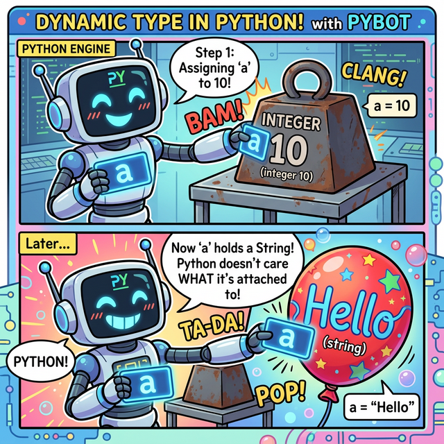
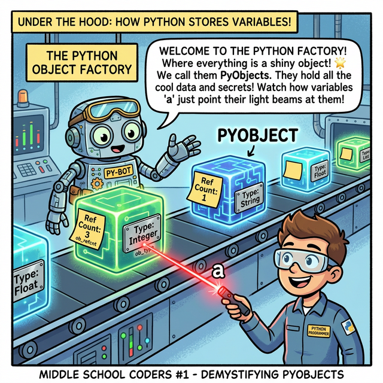

# 2주차 2세션: CPython의 동적 타입과 메모리 구조 🧠

## 파이썬의 동적 타입 (Dynamic Type)

### 동적 타입의 정의와 유연성
파이썬은 **동적 타입(Dynamic Type) 언어**입니다. 
이는 변수를 선언할 때 데이터의 타입(정수, 문자열 등)을 미리 지정할 필요가 없다는 의미입니다. 변수의 타입은 할당되는 값에 따라 **런타임(프로그램 실행 중)**에 자동으로 결정되고 언제든지 바뀔 수 있습니다.


*(파이썬 로봇은 값이 바뀔 때마다 상자를 새로 짜지 않습니다. 그저 이름표 스티커를 무거운 정수 블록에서 가벼운 문자열 풍선으로 휙 옮겨 붙일 뿐이죠!)*

---

### 런타임에 결정되는 자료형의 특성
파이썬은 컴파일러 언어처럼 빌드 전에 모든 변수 타입을 확정 짓지 않습니다. 
인터프리터가 코드를 한 줄씩 해석하다가 대입문(`=`)을 만나는 바로 그 순간, 우변에 평가된 객체의 속성을 룩업하여 런타임 시점에 변수가 가리킬 객체의 진짜 호적(자료형)을 결정합니다.

---

## 타 언어와의 내부 구현 비교

### PHP의 zval 공용체 방식
웹 프로그래밍 언어인 PHP는 C언어 수준에서 변수를 구현할 때 `zval` (Zend Value) 이라는 공용 구조체를 사용합니다.
하나의 `zval` 메모리 영역 내에 정수 필드, 실수 필드, 문자열 포인터 필드가 모두 겹쳐져 선언된 형태(Union)입니다. 변수 타입이 바뀔 때는 이 C 공용체의 타입 플래그(Type Flag) 바이트 값만 스위칭하여 같은 자리의 메모리를 재사용하므로, 메모리 주소값 자체는 유지한 채 값의 종류만 런타임에 유연하게 변경합니다.

---

### JavaScript V8 엔진의 태그 포인터 방식
구글이 만든 크롬 브라우저의 JavaScript V8 엔진은 변수 참조에 있어 극단적인 효율성을 발휘하기 위해 **태그된 포인터(Tagged Pointer)** 아키텍처를 채택했습니다. 
메모리 주소의 하위 1~3비트(64비트 정렬 상태에서 항상 0으로 비어있는 주소 비트들)에 특수한 비트 태그를 켜고 끔으로써, 이 변수가 가리키는 대상이 포인터 힙 메모리인지, 아니면 별도의 객체 생성 없이 즉석에서 비트 단위로 때려 넣을 수 있는 '작은 정수(Smi, Small Integer)'인지를 판별하여 속도를 높입니다.

---

## CPython 내부 객체 모델 (Everything is an Object)

### PyObject 구조체와 CPython 헤더의 비밀
CPython에서 모든 데이터는 `PyObject`라는 C 구조체를 상속하여 힙(Heap) 영역에 생성되는 완전한 독립 객체입니다. 파이썬에는 원시값(Primitive)이 아예 없습니다.


*(웹툰 비유: 파이썬 엔진 공장 라인에 떠 있는 에너지 큐브(`PyObject`)들은 각자 자기 타입(`ob_type`)표를 목에 걸고 있습니다. 그리고 변수 `a`는 그저 큐브를 향해 쏘는 레이저 포인터일 뿐입니다!)*

CPython의 core 헤더 파일인 `object.h`에는 다음과 같은 공통 헤더 매크로가 정의되어 있습니다:
```c
typedef struct _object {
    Py_ssize_t ob_refcnt;        // 참조 카운터
    struct _typeobject *ob_type;  // 타입 정보 포인터
} PyObject;
```

---

### 참조 횟수 카운터(ob_refcnt)의 원리
`ob_refcnt` 변수는 해당 객체를 가리키는 활성 변수나 컨테이너 참조 밧줄의 총개수를 보관합니다.
* 변수에 객체를 새로 대입할 때마다 카운트가 `+1` 상승합니다.
* 변수의 연결이 끊기거나(재할당), 변수가 담긴 스코프(함수 등)가 파괴되어 소멸하면 카운트가 `-1` 감소합니다.
* 최종적으로 참조 카운터가 `0`에 도달하면 CPython 엔진은 이 객체를 즉각 힙 메모리에서 수거해 갑니다.

---

### 객체 타입 신분증(ob_type) 포인터
`ob_type` 포인터는 해당 데이터 객체가 어떤 자료형(클래스) 소속인지를 정의하는 진짜 타입 메타데이터 객체의 메모리 주소를 담고 있는 꼬리표 신분증입니다. 
파이썬 가상 머신(VM)은 연산 시마다 이 `ob_type`을 확인하여 해당 데이터가 `int`인지 `str`인지 검사하고 올바른 연산 메서드를 실시간 동적 호출(Dynamic Dispatch)합니다.

---

### 변수는 포인터(Name Binding) 화살표일 뿐이다
파이썬에서 변수명은 값을 쥐는 물리적 그릇이 아니라, 힙 영역에 띄워진 데이터 객체를 단지 가리키고만 있는 '포인터(참조 화살표)' 주소 레이블(Name Binding)입니다.
따라서 `a = 10` 후 `a = "hello"`로 변경하면, 기존의 10 객체를 개조 수술하는 것이 아니라, 메모리 어딘가에 새롭게 "hello"라는 문자열 객체를 힙에 올리고 `a`라는 이름표 화살표가 가리키는 연결 포인터 주소만 뚝 끊어서 새로운 "hello" 객체로 매핑을 스위칭하는 구조입니다.

---

## 이름(Name)과 네임스페이스

### 이름(Name)과 네임스페이스의 관계
파이썬은 변수의 명칭인 **이름(Name)**과 실제 메모리에 띄워진 객체의 매핑 관계를 **네임스페이스(Namespace)**라고 부르는 파이썬 내부 사전(`dict`) 공간에서 독점 관리합니다. 
우리가 변수 `a`를 불러내면 파이썬은 이 네임스페이스 사전에서 키(Key)인 `'a'`를 찾아서 연결된 주소값을 가져옵니다.

---

### 파이썬 네임스페이스 검색 규칙 (LEGB)
파이썬이 코드 상에서 특정 변수 이름을 탐색할 때는 다음과 같이 4단계로 스코프 사전을 조회하며, 이를 **LEGB 규칙**이라고 칭합니다:
1. **L (Local)**: 현재 실행 중인 함수 내부 지역 영역
2. **E (Enclosed)**: 현재 함수를 감싸고 있는 상위 중첩 함수 영역
3. **G (Global)**: 현재 모듈(파일)의 최상단 전역 영역
4. **B (Built-in)**: 파이썬이 기본으로 제공하는 내장 영역(예: `print`, `type` 등)

---

### 존재하지 않는 이름과 NameError
네임스페이스 사전의 모든 구역(LEGB)을 다 뒤졌음에도 사용자가 호출한 변수명 키(Key)를 발견하지 못했을 때, 파이썬은 `NameError: name 'x' is not defined` 라는 구문 에러를 뿜으며 실행을 즉각 정지시킵니다. 
이를 해결하기 위해 오타를 스캔하거나 해당 변수의 생성 스코프 범위를 적합하게 설계해야 합니다.

---

## 강한 타입(Strong Typing)과 타입 힌트

### 파이썬은 강한 타입(Strong Typing) 언어다
동적 타입 언어라고 해서 아무 타입이나 마구잡이로 합산할 수 있는 것은 아닙니다. JavaScript 같은 약한 타입(Weak Typing) 언어는 `5 + '5'`를 실행하면 문자열 `'55'`로 강제 합산해 버리지만, 파이썬은 **"명시적인 형변환(Casting)이 없다면 절대 암묵적 호환을 거부한다!"**는 완강한 **강한 타입 언어** 규정을 가집니다.
만일 타입 변환 없이 텍스트와 숫자를 산술 합산하려 하면 파이썬은 즉시 런타임에 `TypeError`를 발생시키며 보호 조치를 가합니다.

---

### 타입 힌트(Type Hint) 도입배경과 활용
프로젝트 규모가 거대해지면 변수가 가리키는 진짜 타입의 정체를 눈으로 쫓기 어려워져 동적 타입을 런타임 에러 리스크를 유발합니다. 이를 보완하기 위해 PEP 484 제안에 따라 파이썬 3.5부터 변수명이나 함수 선언부에 예상되는 타입을 명시하는 **타입 힌트(Type Hint)** 가 도입되었습니다:
```python
user_name: str = "Alice"
user_id: int = 1004
```
타입 힌트는 개발 단계에서 IDE 경고나 정적 타입 검사기(mypy)를 통해서만 활용되며, 런타임에는 파이썬 인터프리터가 완전히 무시하므로 프로그램 작동 시의 추가 연산 오버헤드(Runtime Penalty)가 전무한 것이 특징입니다.

---

## 2세션 마무리

### 2세션 코딩 영단어
* **`Dynamic`**: 동적인. (프로그램이 실행 중인 런타임에 유연하게 변동이 가능한 속성을 지칭합니다.)
* **`Namespace`**: 이름공간. (변수 이름들과 그 이름들이 가리키는 실제 메모리 주소를 딕셔너리 형태로 보관하고 묶는 공간입니다.)
* **`Strong Typing`**: 강한 타입. (서로 다른 자료형 간의 암묵적인 형변환을 허용하지 않고 문법 오류를 가혹하게 발생시키는 강력한 타입 시스템 수칙입니다.)

---

### 2세션 Vibe Coding
> **🗣️ 학생 프롬프트 (AI에게 이렇게 명령해 보세요):**
> "파이썬에서 현재 파일의 전역 네임스페이스 전체를 딕셔너리로 반환해 주는 내장 함수 `globals()`와, 지역 네임스페이스를 보여주는 `locals()`의 기능적 특징을 예제 코드로 쉽게 비교 설명해 줘."
