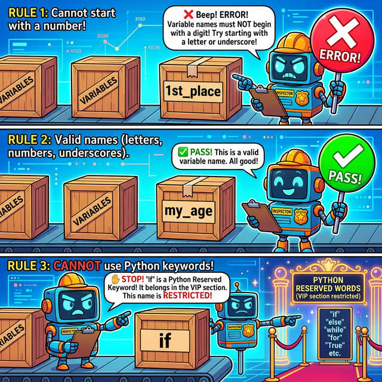
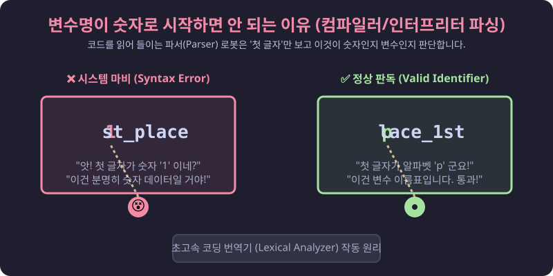

# 2주차 3세션: 다중 대입(Swap)과 메모리 라이프사이클 & PEP 8 작명 가이드 🧠

## 다중 대입과 값 교환 (Swap)

### 다중 대입(Multiple Assignment)의 기초
파이썬은 대입 연산자 `=` 하나를 사용하여 좌변의 여러 변수에 우변의 여러 값을 한꺼번에 대입하는 **다중 대입** 기능을 정식으로 지원합니다:
```python
m, n = 10, 20
```

---

### 임시 변수(temp)를 이용한 전통적 Swap
Java나 C언어 등 타 언어에서는 두 변수의 값을 맞바꾸기(Swap) 위해, 한쪽의 값을 잠시 덜어두어 유실을 방지하는 임시 변수 `temp`가 필수적으로 개입해야 합니다:
```python
temp = m
m = n
n = temp
```
비유하자면 우유 컵(a)과 콜라 컵(b)의 음료를 맞바꾸기 위해, 비어 있는 제3의 물 컵(temp)을 가져와 임시로 옮겨 담으며 교환하는 구조입니다. 이 방식은 불필요하게 코드 라인을 비대화하고 개발 가독성을 저해합니다.

---

### 파이썬의 우아한 한 줄 Swap (a, b = b, a) 원리
파이썬에서는 임시 컵 변수를 개발자가 선언하지 않고도 단 한 줄로 극도로 심플하게 두 변수의 연결을 교환할 수 있습니다:


*(다이어그램: 임시 변수 상자 없이, 두 변수의 값이 X자 형태로 교차하며 한 번에 바뀌는 역동적인 과정을 보여줍니다.)*

```python
m, n = n, m
```
이 한 줄이 실행될 때, 파이썬은 내부적으로 우측의 변수 묶음 `n, m`을 하나의 튜플(Tuple) 구조 데이터로 임시 자동 포장한 뒤, 이를 좌측 변수 묶음 `m, n`에 차례대로 순치적 할당하여 교환을 완성합니다.

---

### 튜플 패킹(Packing)과 언패킹(Unpacking)의 마법
* **패킹(Packing)**: 우변의 `n, m` 처럼 나열된 여러 값들을 괄호가 없어도 파이썬이 자동으로 하나의 `튜플` 묶음으로 압축 결합하는 동작입니다.
* **언패킹(Unpacking)**: 좌변의 `m, n` 처럼 튜플 내부의 요소 개수만큼 변수를 좌측에 도열해 두면, 포장된 튜플 껍데기를 해제하여 위치에 맞춰 데이터를 순서대로 각각 바인딩해 주는 원리입니다.

---

## 바인딩과 메모리 라이프사이클

### 바인딩(Binding)의 동작 원리
파이썬에서 변수에 값을 넣는 행위는 객체에 이름표 밧줄을 매다는 **네임 바인딩(Name Binding)**입니다. 
어떠한 객체에 매달린 밧줄의 개수를 추적하는 것이 바로 **참조 카운팅(Reference Counting)** 메커니즘입니다.

---

### 참조 카운팅(Reference Counting)과 가비지 컬렉터
CPython 가상 머신 내부의 가비지 컬렉션(GC)은 이 참조 카운터를 기반으로 실시간 구동됩니다.
* 변수가 재할당되거나 `del` 지시어로 삭제되면, 객체 머리맡의 `ob_refcnt` 값이 `1`씩 차감됩니다.
* 카운터가 최종적으로 `0`이 되는 즉시, 가비지 컬렉터가 힙 메모리에서 해당 데이터 공간을 원천 해제(Free)합니다.

---

### 순환 참조(Circular Reference)의 맹점과 해결책
단순 참조 카운팅 방식에는 결정적인 약점이 존재합니다. 바로 서로가 서로를 가리켜 참조하는 **순환 참조(Circular Reference)** 상태입니다. 
객체 A가 B를 가리키고, B가 A를 가리키고 있으면 이들을 가리키는 외부의 변수를 모두 `del`하여 없애도 내부 밧줄이 서로 묶여 있어 `ob_refcnt`가 절대 `0`으로 떨어지지 않는 메모리 누수가 터집니다. 
이를 예방하고 정리하기 위해 파이썬은 참조 카운팅 외에, 백그라운드에서 메모리 힙의 고리들을 주기적으로 순회하며 끊어진 순환 구조를 통째로 걷어내는 **세대별 가비지 컬렉션(Generational Garbage Collector)** 알고리즘을 2차 보완책으로 상시 운용하고 있습니다.

---

## Java vs Python 비교

### Java Primitive Stack Slot vs Python Heap Reference
* **Java**: 스택 메모리 세그먼트에 고정 크기(예: int의 경우 4byte)를 박아두고, 자료형이 한 번 고정되면 타입을 절대로 바꿀 수 없는 경직된 물리적 메모리 슬롯 할당을 수행합니다.


*(자바의 기본 타입은 4byte 짜리 철저한 물리적 상자를 만들어 값을 쑤셔 넣지만, 파이썬은 변수라는 이름표(포인터 화살표)를 허공에 둥둥 떠 있는 객체에 밧줄처럼 연결합니다.)*

* **Python**: 기본형이 아예 없어 모든 데이터가 힙(Heap) 공간에 대형 `PyObject`로 뜨고, 변수는 단지 8바이트 크기의 주소 링크를 복제해 나르는 포인터 참조자로 움직입니다.

---

### 다중 대입과 Swap 방식 비교
* **Java**: 문법적 다중 대입을 공식적으로 지원하지 않아 무조건 한 변수씩 순차 대입해야 하며, 값 교환 시 물리 스택 영역의 원시 데이터를 담기 위한 `temp` 임시 로컬 변수 할당문 작성이 강제됩니다.
* **Python**: 튜플 언패킹을 통해 임시 포인터 처리를 내부화하여, 변수가 스왑할 때 물리적으로 중간 temp 변수를 노출하지 않는 고도의 세련된 단일 구문 스왑을 지원합니다.

---

## 변수 작명 규칙과 PEP 8 가이드라인

### 식별자 명명 규칙과 예약어(Keywords)
파이썬에서 변수, 함수, 클래스 등의 고유 식별자 이름을 지을 때는 반드시 문법적 오류를 내는 조건들을 회피해야 합니다:


*(웹툰 비유: 깐깐한 파이썬 로봇 검사관이 변수 이름 상자들을 검사합니다. 숫자로 시작하거나 내부 예약 명령어를 이름으로 쓰면 가차 없이 SyntaxError 도장을 찍습니다.)*

* 알파벳 대소문자, 숫자, 밑줄(`_`)의 조합만 허용합니다. (특수문자와 공백은 절대 불가)
* **첫 글자에 숫자를 기재해서는 안 됩니다.**
* 이미 시스템 문법용으로 독점 사용 중인 **예약어(Keywords)**(예: `if`, `for`, `class`, `True`, `def` 등)는 변수 이름으로 삼을 수 없는 법률입니다.

---

### PEP 8 코딩 컨벤션의 변수 작명 규칙 (snake_case vs CamelCase)
가독성 높은 협업 환경을 구축하기 위해 파이썬은 공식 스타일 가이드인 **PEP 8**을 준수할 것을 적극 권장합니다.

> 📖 **상세 가이드**: 네이밍 규칙, 들여쓰기, 공백 및 임포트 작성 원칙 등 PEP 8에 대한 전체 상세 규칙은 [파이썬 스타일 가이드: PEP 8 핵심 정리](/pep8/) 문서를 참고하세요.


*(다이어그램: 코딩 컨벤션의 차이를 보여줍니다. 뱀처럼 언더바로 이어가는 파이썬과 낙타 등처럼 대문자로 솟아오르는 자바의 스타일 차이를 확인하세요.)*

명명 유형별 규칙은 다음과 같습니다:
* **snake_case**: 변수명, 함수명에 사용하며 모든 글자를 영문 소문자로 적고 단어 사이를 밑줄(`_`)로 연결합니다. (예: `user_profile_name`)
* **PascalCase (UpperCamelCase)**: 클래스명에 사용하며 단어의 첫 글자마다 대문자로 시작하고 결합합니다. (예: `DataModelProcessor`)
* **UPPER_SNAKE_CASE**: 상수(Constant) 성격의 변수에 사용하며 모두 대문자로 적고 밑줄로 이어서 값이 바뀌지 않을 데이터임을 알립니다. (예: `MAX_PIXEL_LIMIT`)

---

### 의미 있는 작명과 boolean 접두사(is_, has_) 규칙
변수의 명칭은 $x, y$처럼 한 글자로 짓는 무의미한 작명을 탈피하고, 이름만 보아도 해당 상자 안에 어떤 데이터가 담겨 있는지 목적을 유추하기 쉽도록 묘사성이 뛰어난 작명을 수행해야 합니다:


*(웹툰 비유: 수학책에서는 식별할 데이터가 한두 개뿐이라 $x, y, z$ 로 충분했지만, 수십만 줄의 코드를 다루는 프로그래머에게 $x=100$은 도무지 알 수 없는 암호입니다. 대신 `player_health = 100` 이라고 길게 적어두면 누구나 체력 게이지임을 단번에 알아차릴 수 있습니다.)*

특히 참/거짓(Boolean)을 담는 변수의 경우에는 `is_` 또는 `has_` 등의 접두사를 의도적으로 덧붙여 선언하면 코드를 읽는 동료가 조건 검사용 불리언 변수임을 즉석에서 직관화하여 알 수 있습니다. (예: `is_active`, `has_permission`)

---

### 💡 (CS TMI) 왜 변수명은 숫자로 시작할 수 없을까?
파이썬 번역기(인터프리터) 내부에서 우리가 작성한 소스 텍스트를 가장 먼저 훑어내는 핵심 파트가 바로 **어휘 분석기(Lexer)와 구문 분석기(Parser)** 로봇입니다. 
이 로봇은 번역 효율성을 위해 코드 상의 토큰 첫 글자 하나만 째려보고(Lookahead) 데이터의 대분류를 즉각 판정해 스코프 창고를 나누는 방식으로 설계되었습니다:


*(다이어그램: 번역기 로봇이 텍스트의 첫 글자를 스캔합니다. 첫 글자가 '알파벳'이면 "아, 얘는 이름표(변수)구나!" 하고 변수 창고로 보내고, 첫 글자가 '숫자'이면 "아, 얘는 데이터 값(정수/실수)이구나!" 하고 계산기 창고로 보냅니다.)*

만일 변수명을 `1st_place` 처럼 숫자로 시작하게 승인하면, Lexer는 첫 글자 `1`을 보자마자 숫자 리터럴 연산으로 간주하여 계산기 메모리 레지스터를 대기시킵니다. 그러나 바로 뒤이어 `st_place`라는 정체불명의 문자가 스캔되는 구조적 모순이 터지면서 번역 로봇은 심각한 해독 불가 마비(`SyntaxError`)에 도달합니다. 이를 방지하고 초고속 스캔 처리를 지원하기 위해, 전 세계 거의 모든 고급 프로그래밍 언어들은 **"변수명의 첫 시작은 절대로 숫자가 될 수 없다"**는 대원칙을 고수하게 되었습니다.

---

## 3세션 마무리

### 3세션 코딩 영단어
* **`Unpacking`**: 언패킹, 압축 해제. (튜플이나 리스트처럼 포장되어 묶여 있는 여러 데이터를 각각 쪼개어 개별 변수에 일괄 할당하는 동작입니다.)
* **`Reference`**: 참조, 지목. (실제 데이터의 실체가 있는 메모리 주소값 링크 그 자체를 지칭하는 정보입니다.)
* **`Convention`**: 관례, 규약. (스타일 가이드처럼 가독성 증대를 위해 여러 사람 간에 맺어진 문법 외적인 작성 수칙 약속입니다.)

---

### 3세션 Vibe Coding
> **🗣️ 학생 프롬프트 (AI에게 이렇게 명령해 보세요):**
> "파이썬에서 여러 변수에 하나의 동일한 값을 일괄적으로 한 번에 대입해 두는 `a = b = c = 0` 과 같은 연쇄 대입(Chained Assignment)의 동작 메커니즘과, 이를 가변 객체(Mutable list 등)에 적용했을 때 발생하는 참조 오염 부작용 위험을 예제를 들어서 쉽게 리뷰해 줘."
