# 3주차: 기본 자료형 (1) - 숫자와 문자열 🔢

지난 시간에는 변수가 어떻게 메모리에 저장되는지(이름표 모델)를 배웠습니다. 이제 그 이름표가 가리키는 실제 데이터, 즉 **자료형(Data Type)**에 대해 자세히 알아보겠습니다. 이번 시간에는 가장 기본이 되는 숫자형과 문자열을 다룹니다.

---

## 데이터와 숫자를 담는 파이썬의 그릇들

파이썬은 다양한 데이터를 프로그래머가 손쉽게 제어할 수 있도록 강력한 분류 체계, 바로 **자료형(Data Types)**을 지원합니다.
숫자형(정수, 실수, 복소수)부터 인간의 언어를 담는 문자형, 그리고 통계 분석의 꽃인 컬렉션 구조까지 방대한 체계를 살펴봅니다. 특히 우리는 현실의 수 체계(자연수, 정수, 실수, 복소수 등) 지식이 어떻게 파이썬 내부 구조와 일대일로 융합되는지 상세하게 탐구하기 위하여 4개의 심화 챕터로 데이터 타입 모듈을 분류하였습니다.

> 📥 **자료형(Data Types)의 이해 실습용 노트북 다운로드 및 실행**: 
> - [로컬 환경용 다운로드](../source/week03/example.ipynb) (VS Code 등에서 실행)
> - <a href="https://colab.research.google.com/github/hojin9/jinysite/blob/master/python/src/01_basic/05_data_types_operators/source/example.ipynb" target="_blank"></a> (웹 브라우저에서 바로 실습)

---

## 1. 수(Number)의 체계와 숫자형 심화

인류의 숫자 발명기부터 자바의 무시무시한 오버플로우 한계를 때려 부수고 회전하는 2차원 우주 평면까지, 아래의 하위 챕터들을 순서대로 학습하며 **수학이야기**의 깊은 지식을 파이썬 메모리로 옮겨와 보세요!

*   [**[3.1.5.1] 수의 체계와 기수법 (Numbers)**](#3151-수의-체계와-기수법-numbers): 인류의 10진법과 컴퓨터 2진법의 만남
*   [**[3.1.5.2] 정수 (Integers)**](#3152-정수-integers): 제로섬 방향성의 발명과 무한히 팽창하는 파이썬 고무줄 `int` 
*   [**[3.1.5.3] 실수 (Real Numbers)**](#3153-실수-real-numbers): 수직선을 메우는 유리/무리수, 64비트가 낳은 부동 소수점(`float`) 오차 딜레마 극복
*   [**[3.1.5.4] 복소수 (Complex Numbers)**](#3154-복소수-complex-numbers): 선에서 평면 우주로 폭발하는 $x^2 = -1$ 상상력 공간, 파이썬이 `complex(a, j)`를 사랑하는 이유
*   [**[3.1.5.5] 문자형과 인코딩 (Char & String)**](#3155-문자형과-인코딩-char-&-string): 문자가 ASCII/유니코드 고유 숫자(Number)로 변환되는 컴퓨팅 아키텍처 원리와 파이썬의 `str`
*   [**[3.1.5.6] 논리형 (Boolean)**](#3156-논리형-boolean): 조건문 if 의 심장을 여닫는 참(`True`)과 거짓(`False`), 그리고 숫자 `1`과 `0`의 진실

---

## 2. 간단한 컬렉션 (Collections) 타입 소개

모래성이 단 한 알 모래가 아니듯, 실전 코딩에는 데이터 뭉치가 쏟아집니다. 파이썬은 여러 개의 값을 끈으로 묶는 **컬렉션** 자료구조를 갖고 있으며, 구체적 활용은 다음 장에서 심도 있게 이어집니다.

*   [리스트(`list`)](../week04/#341-파이썬-리스트-가이드)
`[1, 2, 'a']` 순서가 보장되고 빵처럼 부풀릴 수 있는(가변, Mutable) 동적 배열 방식.
*   [사전(`dict`)](../week04/#342-사전)
`{'이름': '파워', '나이': 99}` 키(Key)와 값 쌍을 이뤄 사전 검색하듯 총알처럼 빠르게 탐색하는(가변, Mutable) 해시맵 구조.
*   [튜플(`tuple`)](../week04/#343-튜플)
`(1, 2)` 생성 후 절대 부술 수 없는(불변, Immutable) 티타늄 방패 같은 고정 데이터 묶음.
*   [집합(`set`)](../week04/#344-집합)
`{1, 2, 3}` 중복을 스스로 뱉어내는 깐깐한 필터링과 무적의 교집합/합집합 수학 교차 연산을 위한(가변, Mutable) 그물망 바구니 구조.

---

## ☕ 맺음말 (type() 함수의 생활화)

코딩 도중 자신이 다루고 있는 물체가 사과(문자)인지 망고(숫자)인지 헷갈리게 되면 프로그램은 곧장 뇌졸중 에러(`TypeError`)에 걸립니다. 항시 `type(변수명)`을 출력(print)해 가며 객체의 본질을 탐구하는 호기심 많은 과학자처럼 데이터를 다루시길 응원합니다!

---

## 학습목표
원시시대 뼛조각부터 시작된 인류의 수 체계를 이해하고, 우리가 사용하는 10진수 자연수가 어떻게 파이썬 내부에서 컴퓨터의 2진수 전기 신호로 번역되는지 파악합니다. 수의 확장 개념을 통해 파이썬이 데이터를 다루는 그릇(Data Types)의 본질을 깨닫습니다.

> 📥 **수의 체계 실습용 노트북 다운로드 및 실행**: 
> - [로컬 환경용 다운로드](../source/week03/example.ipynb) (VS Code 등에서 실행)
> - <a href="https://colab.research.google.com/github/hojin9/jinysite/blob/master/python/src/01_basic/05_data_types_operators/source/example.ipynb" target="_blank"></a> (웹 브라우저에서 바로 실습)

---

## 1. 수(Number)의 확장과 파이썬의 데이터 타입

수학에서 수의 체계는 자연수 $\rightarrow$ 정수 $\rightarrow$ 유리수 $\rightarrow$ 실수 $\rightarrow$ 복소수로 확장되어 왔습니다. 인류가 세상을 더 정밀하게 표현하기 위해 새로운 종류의 숫자를 '발명'할 때마다, 수직선의 빈틈이 메워지고 나아가 2차원 평면으로 차원이 확장되었습니다.

파이썬 역시 현실의 수학적 모델링을 완벽히 모방하기 위해 이 수의 체계를 각각의 전용 **데이터 타입(Data Type)** 클래스로 구현해 두었습니다. 

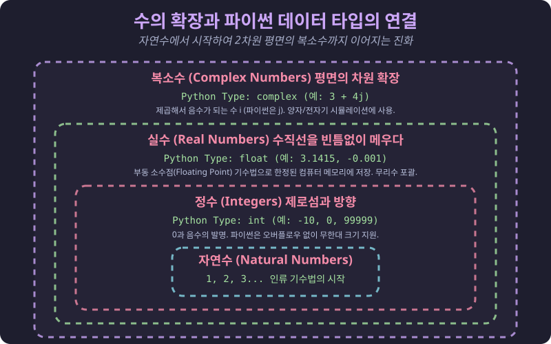
*(다이어그램: 자연수에서 출발하여 복소수까지 이어지는 수 체계의 확장 과정과, 이를 파이썬에서 `int`, `float`, `complex`라는 그릇에 담아내는 일대일 맵핑 관계를 보여줍니다.)*

---

## 2. 기수법 (Numeral Systems): 인류의 언어에서 컴퓨터의 언어로

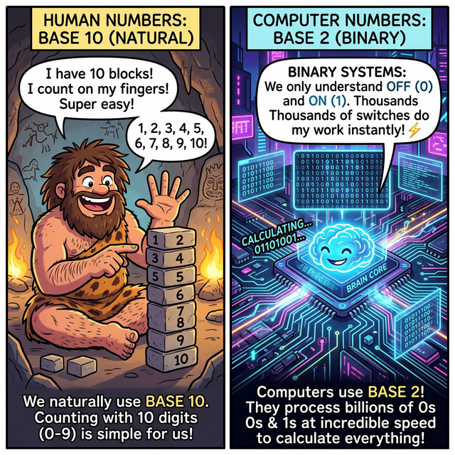
*(웹툰 비유: 손가락 10개로 10진법 기수법을 만든 원시 인류와, 스위치의 켜짐(1)/꺼짐(0) 2진법으로 우주를 시뮬레이션하는 현대 컴퓨터 두뇌의 극적인 대비)*

우리는 어릴 때부터 양손의 손가락 10개를 접어가며 $1, 2, 3...$ 을 세었습니다. 숫자 10개가 꽉 차면 다음 자릿수로 하나 올려주는 이 방식을 **10진법 위치 기수법 (Base 10 Positional Notation)**이라고 합니다. 이것은 인류 역사상 최고의 발명 중 하나입니다.

하지만 스마트폰과 AI 서버를 구성하는 실리콘 반도체 칩은 인간의 수학을 전혀 모릅니다. 컴퓨터의 세상에는 단지 전기가 흐른다(`1`, On)와 흐르지 않는다(`0`, Off)라는 2개의 기호만이 존재합니다. 이를 **2진법 (Binary System, Base 2)**이라고 합니다.

파이썬은 우리가 입력한 10진수 텍스트를 내부적으로 즉시 컴퓨터가 이해할 수 있는 2진법 메모리 스위치 신호로 치환하여 처리합니다. 

### 💡 스토리텔링: 0과 1은 물리적으로 어떻게 저장될까?

눈에 보이지 않는 숫자인 0과 1 쪼가리들이 모여 어떻게 우리가 보는 유튜브 영상이나 거대한 파이썬 인공지능 모델이 될 지 상상해 봅시다. 컴퓨터가 사용하는 2진법은 역사적으로 인간의 노동에서 시작하여 다음과 같은 4단계의 눈부신 하드웨어적 진화를 거치며 세상을 지배했습니다.

#### 1단계: 최초의 기억, 거대한 물리적 스위치 (Switch)


*(웹툰 비유: 땀을 뻘뻘 흘리며 거대한 기계식 스위치 손잡이를 당겨서 간신히 전구에 불을 켜는 초기 프로그래머의 고된 모습)*

인류 최초의 컴퓨터라 불리는 에니악(ENIAC) 시절, 프로그래머들은 모니터나 키보드 없이 일했습니다. 그들은 1 더하기 1을 계산하기 위해 벽면 가득 채워진 수만 개의 물리적인 진공 튜브 스위치들을 직접 손으로 끄고(`0`) 켜며(`1`) 계산을 지시했습니다. 계산이 끝난 후 방에서 나오면 땀범벅이 되었고 불도 자주 났습니다. 인간의 노동으로 컴퓨터의 2진법 스위치가 구동되던 가장 원초적인 시대였습니다.

#### 2단계: 전기가 조종하는 스위치, 트랜지스터 (Transistor)


*(웹툰 비유: 사람 손 없이, 번쩍 하는 전기 자극만 주어지면 마법처럼 다리가 스스로 이어지며 전류가 흐르는 차세대 마법 스위치의 등장)*

손으로 스위치를 누르다 못해 지친 천재들은 획기적인 발명품을 내놓습니다. 물리적인 힘(손) 없이, 그저 한쪽으로 전기가 흐르면(자극) 알아서 다른 쪽 스위치 문을 열어버리는 마법의 부품, **트랜지스터**입니다. 모래(규소)에서 깎아 만든 이 미세한 반도체 조각 하나하나가 사람 손가락을 완벽히 대체하여, 눈에 보이지 않게 스스로 전기를 켜고 끄며 **$1$비트(Bit)**를 물리적으로 표기하는 컴퓨터의 새로운 심장이 되었습니다.

#### 3단계: 시간의 모래시계 회로, 플립플롭 (Flip-Flop)


*(웹툰 비유: 숫자 '1'이 무한히 맴도는 트랙(회로)에 갇혀, 영원히 '1'이라는 형태를 유지하며 빛을 내뿜는 기억의 다람쥐 쳇바퀴)*

스위치를 자동으로 켜고 끄는 기술만으로는 데이터를 '저장'할 수 없었습니다. 전원이 꺼지면 모든 게 사라지니까요. 과학자들은 트랜지스터들을 비비 꼬아서 미로(논리 회로 게이트)를 만들었습니다. 전기가 들어와 빙글빙글 무한히 돌면서 나가지 못하는 쳇바퀴 구조를 만들면, 그 전기는 계속 살아있는 채로 그 자리에 머뭅니다.
이것이 바로 **플립플롭(Flip-Flop)** 회로입니다. 전기가 끊기지 않는 이상 스스로 $0$과 $1$의 상태를 일정 시간 머금고 '기억'할 수 있게 된 혁명적인 발명이자, 우리가 컴퓨터를 켤 때 사용하는 **메모리(RAM)** 반도체의 진짜 근간입니다.

#### 4단계: 8개의 꼬마전구가 뭉쳤다, 바이트 (Byte)의 완성


*(웹툰 비유: 8마리의 1비트 전구 요정들이 한 줄 횡대로 도열하여 어깨동무를 하자, 마침내 $2^8 = 256$가지를 표현할 수 있는 거대한 1바이트 팩토리가 건설되는 장면)*

하지만 플립플롭 하나(1비트)가 내는 $0$ 아니면 $1$이라는 두 가지 목소리로는 십진수 $3$조차도 표현할 수 없었습니다. 그래서 컴퓨터 과학자들은 마치 보따리 장수처럼 이 **$1$비트(Bit)** 전구 8개를 한 줄로 묶어 포장하기로 약속했습니다. 
스위치($0$과 $1$)가 8배로 뻥튀기 된 이 거대한 다발이 바로 **$1$바이트(Byte)**입니다.

$$2^8 = 256$$

1바이트는 무려 256가지의 고유한 그림자(상태)를 표현할 수 있게 되었습니다. 비로소 이 바이트 보따리들을 수십, 수천 개씩 위로 착착 쌓아 올리자 영어 알파벳([아스키코드](#3155-문자형과-인코딩-char-&-string))을 표현하고 파이썬의 무한대 **정수(Integers)**와 우주 공간을 가로지르는 **실수(Floats)** 같은 모든 복잡한 고차원 데이터 타입 객체들을 화려하게 빚어낼 수 있게 된 것입니다.

### 파이썬에서의 진법 치환 실습

파이썬은 데이터 과학자와 프로그래머가 진법 시스템을 자유자재로 넘나들 수 있도록 내장형 함수들을 강력하게 지원합니다. 
가장 대표적으로 사용되는 4가지 진범(10진수, 2진수, 8진수, 16진수)을 완벽하게 변환하고 다시 복원하는 과정을 실습해 봅시다.

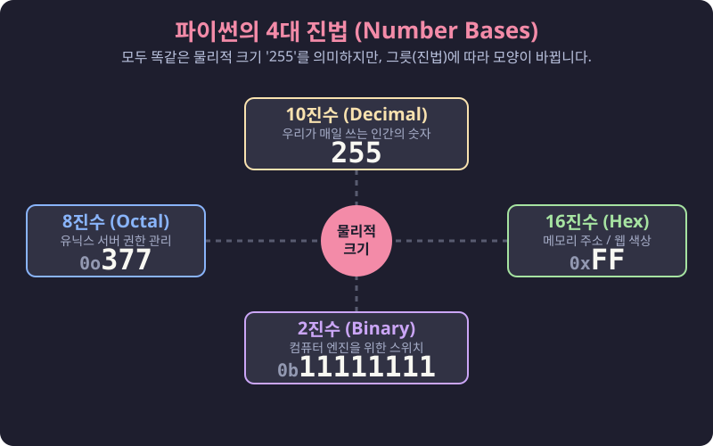
*(다이어그램: `255`라는 물리적 전구 크기는 동일하지만, 각 진법 그릇(10, 2, 8, 16)에 담을 때마다 `0b`, `0o`, `0x` 등 고유의 파이썬 접두사가 붙으며 모양이 변하는 원리)*

#### 1) 10진수 $\rightarrow$ 다른 진수로 변환 (문자열 반환)
컴퓨터가 사용하는 진법의 형태를 시각적으로 확인하기 위해 파이썬은 변환 결과를 문자열(`str`)로 돌려줍니다. 이때 어떤 진법인지 구분하기 위해 숫자 앞에 특별한 **접두사(Prefix)**가 붙습니다.

*   `bin()`: 2진수 (Binary). 접두사 **`0b`**
*   `oct()`: 8진수 (Octal). 접두사 **`0o`**
*   `hex()`: 16진수 (Hexadecimal). 접두사 **`0x`** (16진수는 0~9까지 숫자를 쓰고 10~15는 A~F 알파벳을 씁니다. 메모리 주소나 색상 코드 표기에 가장 널리 쓰입니다.)

```python
# 기준이 되는 인간의 숫자(10진법)
human_number = 255

print(f"--- 10진수 {human_number} 변환 ---")
# 컴퓨터 물리적 전기 신호 (2진법)
computer_binary = bin(human_number)
print(f"2진수 변환 (bin): {computer_binary}    # 11111111")

# 유닉스 권한 설정에 많이 쓰이는 8진법
computer_octal = oct(human_number)
print(f"8진수 변환 (oct): {computer_octal}          # 377")

# 컴퓨터 메모리 주소와 웹 색상코드(RGB)에 쓰이는 16진법
computer_hex = hex(human_number)
print(f"16진수 변환 (hex): {computer_hex}          # ff")
```

#### 2) 다른 진법의 문자열 $\rightarrow$ 10진수로 완벽 복원
서버나 외부 장치에서 '0b1010' 같은 텍스트 형태의 진수 데이터를 전달받았을 때, 파이썬의 `int(문자열, 진법종류)` 함수를 사용하면 우리가 계산할 수 있는 깔끔한 10진수 고유 모델(정수 객체)로 복원됩니다.

```python
print("\n--- 파이썬 객체로 완벽 복원 (int) ---")
# 첫번째 인자는 텍스트, 두번째 인자는 '현재 데이터의 진법'
val_2 = int('1010', 2)
val_8 = int('12', 8)
val_16 = int('A', 16)

print(f"2진수 '1010'의 10진수 정체: {val_2}")
print(f"8진수 '12'의 10진수 정체: {val_8}")
print(f"16진수 'A'의 10진수 정체: {val_16}")
```

**전체 출력 결과:**
```
--- 10진수 255 변환 ---
2진수 변환 (bin): 0b11111111    # 11111111
8진수 변환 (oct): 0o377          # 377
16진수 변환 (hex): 0xff          # ff

--- 파이썬 객체로 완벽 복원 (int) ---
2진수 '1010'의 10진수 정체: 10
8진수 '12'의 10진수 정체: 10
16진수 'A'의 10진수 정체: 10
```

---

## 3. 요약: 데이터 분석에서의 숫자형 분류

파이썬 데이터 분석 생태계(Pandas, Numpy 등)에서는 크게 세 가지의 숫자 파트가 존재함을 명심해야 합니다. 

| 분류명 | 파이썬 타입 | 수학적 의미 | 프로그래밍 용도 |
| :--- | :--- | :--- | :--- |
| **정수형** | `int` | $Z$ (자연수, 0, 음수) | 개수 세기, 인덱스 추적, 오차가 없어야 하는 금융 원장 |
| **실수형** | `float` | $R$ (유리수, 무리수) | 비율, 평균, 기하학적 길이, 머신러닝의 가중치(Weights) |
| **복소수형** | `complex` | $C$ (실수부 + 허수부) | 푸리에 변환, 양자 시뮬레이션, 전자기파 모델링 |

다음 장에서는 가장 기본이 되며, 오차가 존재하지 않는 무한한 팽창력을 가진 파이썬의 **정수(`int`)** 체계에 대해 깊게 들어갑니다.

---

## 학습목표
물리적 개수를 세는 자연수에서, 기준점(0)과 반대 방향(음수)을 나타내는 정수로의 확장을 배웁니다. 더불어 자바(Java) 등 타 언어에서 발생하는 메모리 한계(Overflow) 버그를 파이썬의 `int` 자료형이 어떻게 극복하고 무한대로 팽창하는지 그 위력을 확인합니다.

---

## 1. 음수 방향의 발명과 컴퓨터의 부호 비트(Sign Bit)

자연수(Natural Numbers: 1, 2, 3...)에 머물러 있던 초기 인류는 문명이 발달하면서 심각한 한계에 부딪혔습니다. 기온이 0도 아래로 꽁꽁 얼어붙을 때나, 친구에게 양 두 마리를 빌려 "빚"이 생겼을 때 이를 어떻게 숫자로 표기해야 할까요?

수학자들은 오랜 거부와 진통 끝에, 덧셈에 대한 항등원인 **영($0$)**을 기준점으로 삼아 반대 방향으로 뻗어 나가는 **음수($-$)**를 발명해 냈습니다. 이로써 자연수, 양의 정수, $0$, 음의 정수가 합쳐져 제로섬(Zero-Sum) 줄다리기를 하는 완벽한 **수직선(Number Line)** 위의 **정수(Integers)** 체계가 완성되었습니다.

#### 컴퓨터는 '-' 마이너스 기호를 어떻게 저장할까?
컴퓨터 내부에는 물리적인 스위치($0$과 $1$)만 존재할 뿐, 인간이 쓰는 십자가 모양의 마이너스 기호(`-`) 부품 따위는 없습니다. 그렇다면 수직선의 이 '반대 방향'을 컴퓨터는 어떻게 물리적으로 구현해 냈을까요?

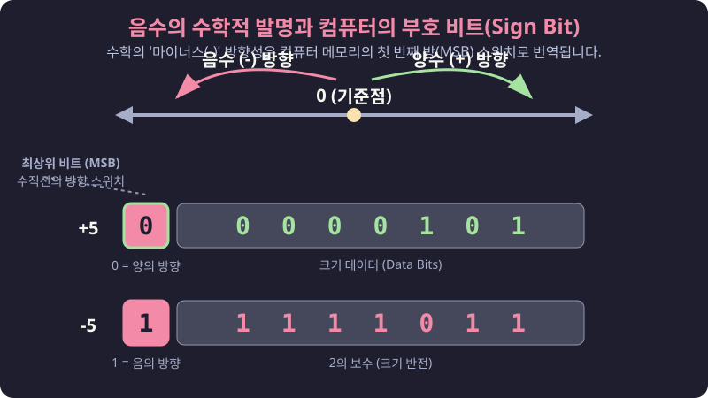
*(다이어그램: 수직선의 양수/음수 방향성이 컴퓨터 바이트의 가장 첫 번째 스위치인 MSB(최상위 비트)에 의해 물리적 논리로 할당되는 원리)*

컴퓨터 과학자들은 1바이트(8비트) 상자를 사용할 때, **가장 첫 번째 방(최상위 비트, MSB: Most Significant Bit)을 '부호 전용 스위치(Sign Bit)'**로 약속했습니다.
*   첫 번째 스위치가 **`0` (Off)이면**: 수직선의 오른쪽으로 가는 **양수(+)** 방향을 의미합니다.
*   첫 번째 스위치가 **`1` (On)이면**: 빚이 존재하거나 수직선의 왼쪽으로 가는 **음수(-)** 방향을 의미합니다.

*결과적으로 파이썬의 정수형(`int`)은 단순한 양의 갯수 카운팅을 넘어서, 시스템 에러 코드(`-1`), 은행 계좌의 마이너스 통장 등 '음수 방향성'을 가진 데이터를 소수점 오차 없이 정확하게 추적하는 최고의 무기로 사용됩니다.*

---

## 2. ☕ Java vs 🐍 Python: 정수의 메모리 한계 (Overflow)

프로그래밍에서 정수를 다룰 때 개발자들이 가장 뼈저리게 느끼는 고통이 있습니다. 바로 공간의 제약으로 숫자가 폭발해 버리는 **오버플로우(Overflow)**입니다.

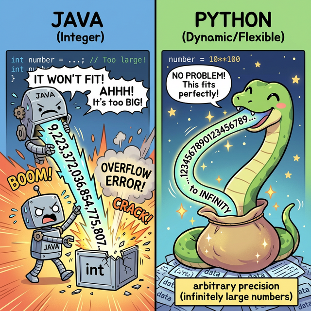
*(웹툰 비유: 4바이트 깡통 상자를 쓰다가 용량이 초과되어 폭발하는 자바 박스와, 고무처럼 쭉쭉 늘어나며 거대한 숫자를 우아하게 다 품어내는 파이썬 마법 주머니의 차이)*

### 자바(Java)의 `int` 폭발
*   C, C++, Java와 같은 언어는 극도의 메모리 계산 효율성을 추구하기 때문에 정수형 `int`에 **`4 Bytes (32 bits)`**라는 딱 정해진 콘크리트 상자를 제공합니다.
*   이 상자가 버틸 수 있는 최대 숫자는 대략 **$21$억**(`2,147,483,647`)입니다. 만약 21억에서 $1$을 더해 상자가 넘치게 되면, 경계를 뚫고 가장 극단의 마이너스 수(`-21억`)로 수의 위상이 뒤집혀 버리는 치명적인 버그가 터집니다. 엄청 큰 수는 개발자가 직접 8 Bytes 크기의 `long` 타입으로 박스 크기를 새로 명시해주어야 합니다.

### 파이썬(Python)의 플렉시블(Flexible) `int`
*   반면 데이터 및 수학 분석에 특화된 파이썬의 `int` 타입 단 한 개만 가지고도 **10경, 100경, 구골플렉스** 이상의 천문학적인 크기까지 계산이 가능합니다.
*   파이썬 엔진(CPython)은 내부 배열 크기를 동적으로 늘려가면서, 컴퓨터 RAM 메모리가 버틸 수 있는 한 그 큰 정수를 제한 없이 모두 온전히 저장해 버리기 때문입니다. 오버플로우 개념 자체가 파이썬에서는 사실상 없습니다.

### 💡 잠깐만요, 파이썬은 호적 신고(int)를 안 하나요?
자바(Java)나 C언어에서는 정수를 만들 때 반드시 앞에 `int money = 10000;` 처럼 자료형(호적)을 먼저 선언해주어야 합니다. 하지만 파이썬은 **동적 타입(Dynamic Typing)**이라는 마법을 씁니다. 그냥 변수에 숫자 `10000`을 던져 넣으면, 파이썬 엔진이 "아, 소수점이 없는 숫자네? 이 녀석의 호적은 `int`구나!" 하고 **스스로 알아서 `int` 객체로 포장해 줍니다.**

그렇다면 파이썬에서 `int` 키워드는 언제 쓸까요? 
파이썬의 `int()`는 주로 외부에서 들어온 텍스트 글자형태의 숫자(`str`)나, 소수점이 있는 실수(`float`)의 껍데기를 강력하게 벗겨내어 순수한 정수로 탈바꿈(Type Casting, 형변환)시킬 때 사용하는 매우매우 중요한 **마법 지팡이(함수)**로 쓰입니다.

```python
# 일반 변수 생성 (알아서 int로 만들어줌)
count = 5 
print("스스로 판단한 타입:", type(count)) # <class 'int'>

# int() 지팡이를 휘둘러서 정수로 강제 변환!
text_number = "100"       # 화면 입력으로 받은 글자 "100"
float_number = 3.1415     # 소수점이 달린 실수

print("\n--- int() 마법 지팡이 사용 결과 ---")
print("1. 글자를 정수로 변경:", int(text_number) + 50)  # 연산이 됨!
print("2. 실수를 정수로 변경:", int(float_number))      # 소수점 아래는 무참히 잘림 (3)
```

---

## 3. 무한의 팽창력 실습

파이썬의 동적 메모리 확장 기능을 맹신하고 우주의 크기만큼 큰 숫자를 정말로 만들 수 있는지 실습을 통해 증명해 봅시다.

```python
# 1. 일반적인 덧셈이나 뺄셈, 정수 확인
money = 10000
debt = -25000
print("현재 자산:", money + debt) # 음수 연산 처리

# 2. 파이썬의 무한대 계산 (거듭제곱 연산자 ** 활약)
# 10의 100제곱 (1 뒤에 0이 100개 붙는 구골, Googol)
googol = 10 ** 100

print(f"구골(Googol) 출력:\n{googol}")
print("구골의 자료형:", type(googol))

# 3. 만약 자바였다면 바로 에러가 나거나 음수가 되지만, 파이썬은...
print("\n거대 숫자에 1을 더하면?")
print(googol + 1)
```

**출력 예측:** `1` 뒤에 무수한 `0`이 찍힌 뒤, 마지막에 `1`이 더해진 완벽한 연산 결과가 에러 메시지 하나 없이 깔끔하게 터미널 창을 채웁니다. 

> 🌌 **참고: 구골(Googol)과 구골플렉스(Googolplex)란?**
> **구골(Googol)**은 1920년에 수학자 에드워드 캐스너의 어린 조카가 우연히 지어낸 단어로, 공식 수식으론 $10^{100}$ (1 뒤에 0이 100개 붙는 엄청난 수)을 뜻합니다. 전 우주의 모든 입자 수보다도 많은 개수죠.
> **구골플렉스(Googolplex)**는 여기서 এক 차원 더 도약한, $10^{\text{Googol}}$ (즉 $10^{(10^{100})}$)을 뜻합니다. 인간의 상상을 벗어날 만큼 무한히 광대한 개수이자, 세계 최대 검색 엔진 회사인 '구글(Google)' 이름의 실제 어원이 된 단어이기도 합니다.
> 원칙적으로 파이썬 `int` 자료구조는 컴퓨터의 물리적 메모리(RAM)만 허용해 준다면 이 구골플렉스 숫자조차 오차 없이 그대로 계산해 담아낼 수 있는 무시무시한 잠재력을 품고 설계되었습니다.

---

## 4. 코딩 영단어 학습 📝

*   **`Integer` (int)**: 완전한 것. 수학이야기(#41) 정수 편에서 배운 소수점이 없는 깨끗한 수를 뜻합니다. 영단어 "Entire(전체의)"와 어원이 동일합니다.
*   **`Overflow`**: 넘쳐 흐르다. 그릇(변수의 메모리 사이즈)의 용량을 초과하는 숫자를 담을 때 발생하는 컴퓨터 시스템의 치명적인 한계 버그를 지칭합니다. 파이썬 `int`는 이 공포에서 자유롭습니다.

---

## 학습목표
피타고라스를 공포로 몰아넣었던 무리수를 포용하여 진짜 수직선을 가득 채우는 실수의 개념을 잡습니다. 그리고 이 광활한 실수의 바다를 한정된 64비트 메모리에 담아내기 위한 파이썬의 **부동 소수점(Floating Point)** 전략과 오차의 필연성을 직시합니다.

---

## 1. 수직선의 빈틈을 메우다: 유리수와 무리수

정수(Integers)들 사이에는 수많은 공간이 텅 비어 있었습니다. 인류는 피자를 절반으로 공평하게 쪼개 먹기 위해 고안한 분수 형태의 **유리수(Rational Numbers)**로 이 거대한 간격을 촘촘히 채우기 시작했습니다. 하지만 이집트와 피타고라스 학파의 천재 기하학자들은 한 변이 $1$인 정사각형의 대각선 길이를 재다가 엄청난 수학적 모순에 직면합니다. 분수로는 도저히 나눠떨어지지 않는 무한한 숫자의 블랙홀, $\sqrt{2}$ 같은 **무리수(Irrational Numbers)**를 발견해 낸 것입니다.

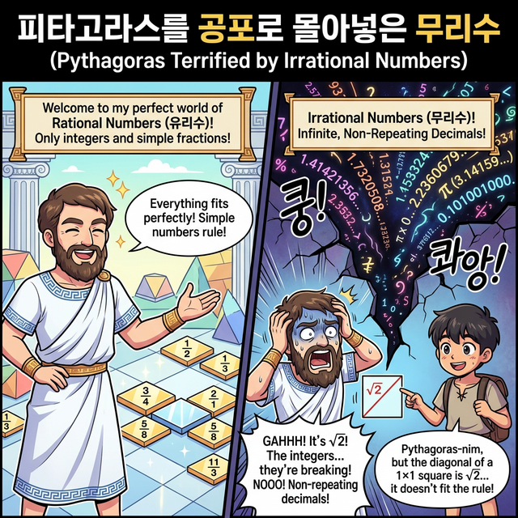
*(웹툰 비유: 딱딱 떨어지는 분수들(유리수)이 완벽하다 믿었던 피타고라스가, $1 \times 1$ 정사각형의 대각선(\sqrt{2})에서 쏟아져 나오는 끝없는 소수의 폭포(무리수)를 보고 공포에 질린 모습)*

무리수는 끝없이 반복조차 되지 않는 영원한 소수점을 가집니다($\pi=3.14159265...$). 유리수와 이 다루기 힘든 무리수 두 세력이 결합하여 드디어 끊어짐 없이 완벽하게 연속된 1차원 수직선인 **실수(Real Numbers)** 세계관이 하나로 완성되었습니다.

*   파이썬의 실수형 데이터 타입의 이름은 `float` 클래스입니다. 
*   `3.14`, `-0.001`, `2.0` 등 소수점이 단 한 개라도 찍히는 숫자는 무조건 메모리에 정수(`int`)가 아닌 실수(`float`)로 배정됩니다.

---

## 2. 부동 소수점(Floating Point)의 딜레마

문제는 끝을 알 수 없는 무리수와 거대한 자리수의 소수점들을 어떻게 우리 눈앞의 유한한 컴퓨터 메모리에 집어넣느냐는 공학적 난제였습니다. 정수처럼 메모리에 그냥 담으려고 고정된 칸막이를 쳐버리면(고정 소수점 방식), 거대한 십진수나 끝없는 소수를 만날 때마다 엄청난 메모리 빈 공간이 낭비되거나 아예 담지 못해서 꼬리 부분이 날아가버립니다.

### IEEE 754: 띄워놓고 잘라버리기 전략

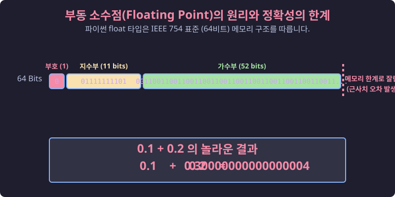
*(다이어그램: 64비트 크기의 파이썬 `float` 객체 내부 구조. $1/3$과 같이 무한 반복되는 소수를 부호(1bit), 지수부(11bits), 가수부(52bits)로 쪼개어 강제로 근사해 우겨넣다보니 미세 오차가 터지는 원리)*

현대 컴퓨터는 **부동 소수점(Floating Point)** 기수법을 채택했습니다. 쉽게 말해 $250000$을 $2.5 \times 10^5$으로 표현하는 과학적 지수 표기법처럼, 고정된 자리를 쓰지 않고 소수점 자체를 물 위에 뜬 부표(Float)처럼 이리저리 둥둥 떠다니게 밀고 당겨서 `한정된 64비트` 메모리 조각에 거대한 숫자를 조약돌처럼 압축하는 방식입니다.

## 3. 부동 소수점 근사 오차 실습 (참값 vs 근삿값)

이 방법은 혁신적이었지만, 메모리 끝단에서 **가장 뒤에 있는 찌끄러기 수들을 억지로 반올림하고 버려야(Truncate) 하는 근사치 저장 모형**이라는 태생적 한계가 생겼습니다. 인간이 알아보기 편한 십진수 소수점을 컴퓨터가 2진수로 바꾸다가 필연적으로 발생하는 **부동 소수점 오차**는 모든 데이터/금융 개발자의 골머리를 썩입니다.

수학이야기 [77. 근삿값과 오차](../../../../math_story/src/26_approximations_and_errors/index.html) 단원에서 배웠듯, 완벽한 이상 세계의 숫자인 **참값(True Value)**과 우리가 측정하거나 컴퓨터로 잘라서 흉내 낸 **근삿값(Approximate Value)** 사이에는 반드시 틈새비율인 **상대 오차(Relative Error)**가 발생합니다.

```python
import math

perfect_real = 0.3    # 인간이 머리속으로 생각한 완벽한 참값
hacked_float = 0.1 + 0.2  # 컴퓨터가 2진수로 변환하다 잘려나간 근삿값의 합

print("1. 인간의 기대 (참값):", perfect_real)
print("2. 컴퓨터의 현실 (근삿값):", hacked_float)

# 두 값이 완벽히 일치하는지(==) 물어보면 컴퓨터는 거짓말을 못하기에 오차를 뱉습니다.
print("\n3. 두 값이 완벽히 똑같은가요? (==):", perfect_real == hacked_float)
```

**출력 예측:** `False`. 
인간의 직관(`0.3`)과 달리, 끝부분 메모리가 허덕이며 쏟아낸 $0.000...04$ 의 쓰레기 값이 남아 수학적 참값과 어긋납니다.

### 수학적 타협: `math.isclose()` 의 위력
프로그래밍과 공학에서 "정확하다"는 것은 오차가 $0\%$임을 뜻하는 것이 아닙니다. 수학이야기에서 배웠듯 **"우리가 합의한 상대 오차선 아래로 들어왔다면 같다고 친다!"** 라는 타협의 기술입니다. 파이썬은 이를 위해 `math.isclose()` 함수를 제공합니다.

```python
# "참값 대비 상대 오차가 0.0000001% (1e-09) 이하로 미세하게 나면 같은 숫자로 인정해 줄게!"
if math.isclose(hacked_float, perfect_real, rel_tol=1e-09):
    print("-> 팩트: 둘의 허용 오차 한계를 통과하여 '같은 값'으로 수학적 타협을 봅니다!")
else:
    print("-> 팩트: 오차가 너무 커서 다른 숫자로 판정!")
```

> 🛡️ **방어 코딩(Vibe Coding):** 실제 은행권의 통화 소수점 단위 계산이나, NASA 같이 로켓 우주 공학 궤도 연산 시뮬레이션에서는 이 미세한 오차가 폭발을 부릅니다. 이에 `float` 대신 오차가 없는 외부 과학 모듈인 `decimal`이나 분수 모듈 `fractions`를 특별히 불러와 사용해야만 합니다.

---

## 4. 정수와 실수 사이의 차원 이동 (Type Casting)

정수(`int`)는 블록처럼 딱딱 끊어지는 **이산적인 점**이고, 실수(`float`)는 소수점으로 꿀처럼 이어지는 **연속적인 1차원 선**입니다. 파이썬은 이 서로 다른 두 생태계를 넘나들 수 있는 강력한 마법 지팡이(형변환 함수)들을 제공합니다.

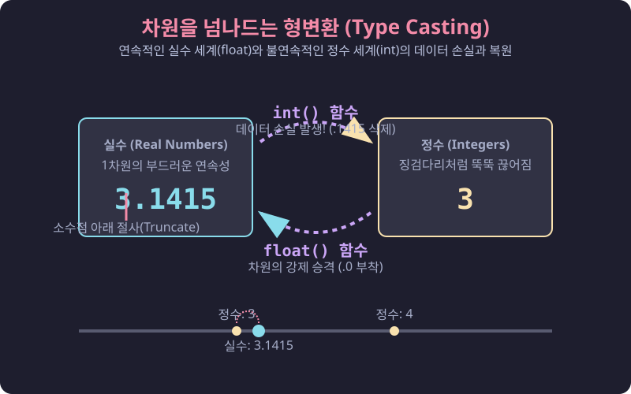
*(다이어그램: `float()` 함수를 쓰면 정수에 `.0` 날개가 달려 1차원 실수로 승격되지만, 반대로 `int()` 함수를 쓰면 소수점 자리가 무참히 잘려(Truncate) 나가는 데이터 손실 패널티를 시각화)*

1.  **`float()` 함수 (승격)**: 정수를 밀어넣으면 즉시 소수점 `.0`이 붙고 연속된 실수 모델(64비트 근사 모델)로 차원이 승격됩니다.
2.  **`int()` 함수 (강등과 손실)**: 반대로 찰랑거리는 실수 데이터를 정수 상자에 밀어넣으면 어떻게 될까요? 파이썬의 `int()`는 반올림 따위를 해주지 않습니다. 소수점 아래 꼬리를 가위로 무참히 잘라 버리는 **버림(Truncate)** 연산을 통해 정수 부분만 추출합니다. 

```python
gravity = 9.81
count = 5

print("--- [ 실수 <-> 정수 형변환 마법 ] ---")

# 1. 정수를 실수로 승격 
# 데이터 손실이 전혀 없이 뒷자리에 .0이 붙어 정확도 유지
cast_float = float(count)
print(f"float({count}) -> {cast_float} (타입: {type(cast_float)})")

# 2. 실수를 정수로 강등 (무자비한 절사 발생!)
# 반올림이 아니라 소수점이 '잘려 나가는' 치명적 데이터 손실에 주의!
cast_int = int(gravity)
print(f"int({gravity}) -> {cast_int} (타입: {type(cast_int)})")
```

**예측 출력 결과:**
```
--- [ 실수 <-> 정수 형변환 마법 ] ---
float(5) -> 5.0 (타입: <class 'float'>)
int(9.81) -> 9 (타입: <class 'int'>)
```

---

## 4. 코딩 영단어 학습 📝

*   **`Float`**: 둥둥 떠다니다. 바다 위 찌와 부표 모양처럼, 소수점 위치를 고정하지 않고 메모리 효율을 위해 앞뒤로 둥둥 떠다니며(`Floating Point`) 숫자를 저장하고 근사시키는 파이썬의 핵심 '실수' 자료구조입니다.
*   **`Rational`**: 수학이야기(#84) 유리수 편에서, 두 정수의 '비율(Ratio)'인 분수로 나타낼 수 있는 깔끔한 숫자들(이성적인, 합리적인)을 뜻합니다.
*   **`Irrational`**: 비율로 나타낼 수 없는, 무한하고 반복성조차 안갯속인 숫자의 블랙홀(무리수, 비이성적인). 컴퓨터의 `float` 한계를 불러온 주범입니다.

---

## 학습목표
루트 기호 안에 들어간 마이너스 기호라는 '불가능(허수)'의 금제에서 탄생하여, 수학을 2차원 복소평면 모델링으로 진화시킨 복소수 원리를 학습합니다. 파이썬이 타 언어가 버거워하는 복소수를 왜 언어 단에서 기본 코어 자료형으로 탑재해 주었는지 공학적 이유를 발견합니다.

---

## 1. 차원을 뛰어넘은 발칙한 상상: 허수 $i$ 의 탄생

수학자들은 수학의 틀에 갇히는 대신 아예 우주의 물리 법칙을 새로 써버리는 버릇이 있습니다. "$x^2 = -1$ 이라는 절대 불가능한 방정식을 기어코 풀고 싶다!"는 열망 구조죠. 똑같은 수를 두 번 곱해서 마이너스가 나오게 하는 마법의 상상 속 숫자, 대수학자 오일러(Euler)가 처음 이름 붙인 **허수(Imaginary Numbers)** 기호 $i$의 탄생입니다.


*(웹툰 비유: 현실 세계(실수)에서는 절대 풀 수 없는 '제곱해서 마이너스가 되는' 저주받은 방정식을 풀기 위해, 오일러가 상상의 마법 파티클 $i$를 교실에 소환하며 당당하게 해법을 선언하는 장면)*

기존 현실이던 1차원 수직선 위 숫자들인 **실수(Real Numbers)**부에 이 상상의 세계 숫자 **허수부**를 결합하여 수식 하나로 하이브리드 한 무적의 숫자가 바로 **복소수(Complex Numbers)**입니다.

*   수학 표현식: $a + bi$ (파이썬 표현식: $a + bj$ — 파이썬과 공학에서는 전류 기호 $I$ 와의 헷갈림을 막기 위해 $j$ 사용)

---

## 2. 왜 굳이 파이썬은 복소수를 지원할까? ($90^{\circ}$ 공간 회전)

일반적인 자바(Java) 프론트엔드나 웹 코딩을 할 때 복소수를 볼 확률은 거의 $0\%$입니다. 그렇지만 파이썬이 복소수 타입을 `complex`라는 당당한 기본 객체로 채택한 이유는 데이터 공학과 빅데이터 물리 엔진을 위한 언어이기 때문입니다.

수학이야기 [32. 복소수](../../../../math_story/src/32_complex_numbers/index.html)에서 배웠듯, 허수가 개입된 복소수 평면은 1차원의 직선을 **2차원(2D 평면 공간)**으로 끌어올립니다. 무엇보다도 $i$ (또는 $j$)를 곱하는 연산은 기존의 '크기 증가'가 아니라, 아름답고 오차가 적은 공간 상의 **$90^{\circ}$ 회전 이동(Rotation)**이라는 엄청난 무기가 됩니다!

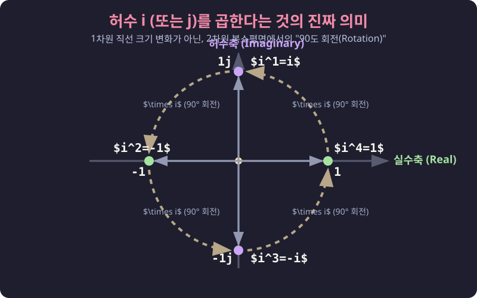
*(다이어그램: 현실 세계의 숫자 $1$에 상상의 마법 가루 $i$ ($j$)를 거듭 곱할 때마다 공간에서 빙글빙글 $90^{\circ}$씩 회전하며 $1 \rightarrow j \rightarrow -1 \rightarrow -j \rightarrow 1$ 사이클을 도는 원리)*

*   **푸리에 변환(신호 처리)**: 우리가 목소리를 남기는 음성 신호나 복잡한 음악, 휴대폰 통신의 와이파이 주파수 파동(Wave) 그래프의 미세한 곡선 위상 처리에 복소수 회전 계산만큼 압도적으로 강력한 것이 없습니다.
*   **양자 컴퓨팅, 우주 궤도**: 전자파 시뮬레이션이나 게임 3D 엔진의 짐벌락(Gimbal Lock) 방지 등, 공간과 차원을 움직이는 공학 모델의 절대 병기입니다. 파이썬은 이 모든 계산을 외부 라이브러리 없이 자체 `complex` 타입만으로 완벽하게 감당합니다.

---

## 3. 파이썬 `complex` 타입 활용 실습

파이썬에서는 변수에 `숫자 + 문자 j`를 붙이는 것만으로 즉시 복소수 객체가 생성되며, 내장 메서드를 통해 실수부와 허수부를 분리해 뽑아먹을 수 있습니다. 놀라운 활용법을 구경합시다!

```python
# 1. 1차원의 실수 더하기 2차원 허수부 결합 (기호 j 사용)
c1 = 3 + 4j
print(c1, "데이터 타입:", type(c1))

# 2. 파이썬 내장함수를 통한 복소수 소환
c2 = complex(1, -2) 

print("\n덧셈 연산:", c1 + c2)
print("곱셈 (2차원 평면의 회전 믹스결과):", c1 * c2)

# 3. 2차원 요소별 객체 분리 추출
print("\n--- 객체 속성 추적 ---")
print("실제 세상 부분 (Real):", c1.real)
print("상상 세상 부분 (Imaginary):", c1.imag)

# 켤레복소수 (허수부의 부호만 거꾸로 엎어 대칭 이동)
print("거울 반전 켤레복소수 (Conjugate):", c1.conjugate())

# 4. [특급 증명] j 를 4번 곱하면 360도로 회전해서 제자리로 올까?
print("\n--- 허수 j 의 90도 뱅글뱅글 4박자 회전 연산 ---")
print("1j 의 1제곱 (90도 회전):", (1j) ** 1)
print("1j 의 2제곱 (180도 회전):", (1j) ** 2) # 충격! 현실의 음수(-1)로 귀환!
print("1j 의 3제곱 (270도 회전):", (1j) ** 3)
print("1j 의 4제곱 (360도 원점):", (1j) ** 4) # 가짜 숫자가 진짜 1 로 완벽 복귀
```

**출력:**
```
(3+4j) 데이터 타입: <class 'complex'>

덧셈 연산: (4+2j)
곱셈 (2차원 평면의 회전 믹스결과): (11-2j)

--- 객체 속성 추적 ---
실제 세상 부분 (Real): 3.0
상상 세상 부분 (Imaginary): 4.0
거울 반전 (Conjugate): (3-4j)

--- 허수 j 의 90도 뱅글뱅글 4박자 회전 연산 ---
1j 의 1제곱 (90도 회전): 1j
1j 의 2제곱 (180도 회전): (-1+0j)
1j 의 3제곱 (270도 회전): (-0-1j)
1j 의 4제곱 (360도 원점): (1+0j)
```

---

## 4. 🚀 [바이브 코딩] 시각화로 확인하는 복소수 회전 (Matplotlib)

지금까지 배운 복소수의 '공간 회전'과 '크기 팽창' 원리를 **Vibe Coding(바이브 코딩)**을 통해 파이썬 시각화 라이브러리인 `matplotlib`로 직접 그려봅시다. 1차원의 평범한 수직선에 묶여있던 숫자 $1$이 허수 $j$의 마법 가루를 품고, 어떻게 점차 커지며 2차원 평면을 돌며 나선형(Spiral) 우주 궤도처럼 뻗어나가는지 볼 수 있습니다.

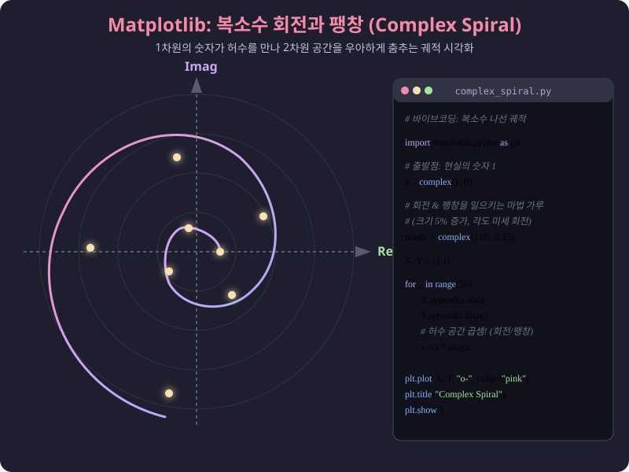
*(다이어그램: 현실 세계의 숫자 $1$에서 출발해, 오일러의 마법 파티클(허수 회전 결합)을 50번 반복 곱셈하며 2차원 공간으로 날아가는 궤적 시각화)*

아래 코드를 복사하여 Google Colab이나 주피터 노트북에서 실행해 보세요. 아름다운 수학적 기하학 패턴이 바로 모니터에 그려집니다.

```python
import matplotlib.pyplot as plt

# 1. 우리의 시작점: 현실의 수직선 위 숫자 1
z = complex(1, 0)

# 도화지 좌표(X, Y)를 저장할 리스트 준비
real_parts = []
imag_parts = []

# 2. 회전과 팽창을 일으키는 마법의 허수 가루 준비
# (크기를 1.05배씩 키우고, 살짝 각도를 들어 올리며 회전시키는 복소수 비율)
magic_dust = complex(1.05, 0.15)

# 3. 마법을 50번 연속으로 부려봅시다
for _ in range(50):
    # 각 지점 좌표 기록
    real_parts.append(z.real)
    imag_parts.append(z.imag)
    
    # 핵심 원리! 복소수끼리의 곱셈 = 회전(Rotation) + 크기 팽창
    z = z * magic_dust

# 4. 파이썬 도화지에 그리기
plt.figure(figsize=(6, 6))
plt.plot(real_parts, imag_parts, marker='o', color='purple', linestyle='-')

# 그리기 꾸미기
plt.title("Complex Space: Rotation & Expansion")
plt.xlabel("Real Axis")
plt.ylabel("Imaginary Axis")
plt.axhline(0, color='gray', linestyle='--')
plt.axvline(0, color='gray', linestyle='--')
plt.grid(True)
plt.show()
```

---

## 5. 코딩 영단어 학습 📝

*   **`Complex`**: 복잡한, 복합적인. 실수(Real)와 거꾸로 도는 상상의 숫자 허수(Imaginary)가 복합적으로 구성되어 만들어진 것을 뜻합니다. 아파트 '단지(Complex)' 건물들이 뒤섞여 합쳐져 모여있는 것처럼 말입니다.
*   **`Real` / `Imag`**: 파이썬 복소수 객체의 내부 속성값 호출 명령어인 실수부(`.real`)와, 비현실 세계의 허수부 상상 요소(`.imag`)입니다.
*   **`Conjugate`**: 결합하다, 짝지어주다. 분수 거듭제곱을 배울 때 항상 써먹는 켤레 쌍(거울 반전 대칭 형태)을 뜻합니다.

---

## 학습목표
눈앞에 보이는 수많은 언어의 '글자'들이 컴퓨터 내부에서는 어떻게 처리되는지 살펴봅니다. 문자는 결국 **고유한 번호가 매겨진 숫자(ASCII, Unicode)**라는 핵심 진리를 깨닫고, 파이썬에서 문자를 숫자로, 숫자를 문자로 상호 변환(`ord()`, `chr()`)하는 강력한 기능을 실습합니다.

---

## 1. 컴퓨터는 글자를 모른다 (ASCII & Unicode)


*(웹툰 비유: 인간이 키보드로 'A'라는 그림(문자)을 입력하면, 컴퓨터 내부의 번역가 로봇이 거대한 비밀 사전(ASCII)을 뒤적여 'A'에 매칭된 고유 번호 '65'를 찾아내어 반도체에 새겨넣는 모습)*

우리가 키보드를 두드려 텍스트를 입력할 때, 컴퓨터(CPU와 RAM)는 이 글자의 모양이나 뜻을 전혀 알지 못합니다. 컴퓨터는 오로지 $0$과 $1$의 전기 스위치로 이루어진 기계 덩어리입니다. 

그래서 전 세계의 천재 과학자들은 큰 테이블표(사전)를 하나 만들었습니다. "우리가 키보드에서 'A'를 누르면 컴퓨터야 너는 그것을 전기 신호 숫자 '65'로 외워라!", "알겠어!" 
이렇게 글자와 숫자를 1:1로 매칭시킨 전 세계적인 약속표를 **문자 인코딩(Character Encoding)** 체계라고 부릅니다.

### 1단계: 1Byte 우물 안 개구리 (ASCII)
**아스키코드(ASCII)**는 아주 옛날 미국에서 만든 표준 코드입니다. 오직 알파벳 대소문자, 숫자, 키보드 특수기호 등 $128(2^7)$개의 문자만을 $0$번부터 $127$번까지 숫자로 1:1 매칭시킨 가장 기초적인 비밀 사전입니다. 이 시절에는 불과 `1 Byte(8 비트)` 메모리만으로도 세상(미국)의 모든 글자를 담기에 충분했습니다.
*(예: 알파벳 대문자 `A` = `65`, 대문자 `B` = `66`, 소문자 `a` = `97`, 엔터키 = `10`)*

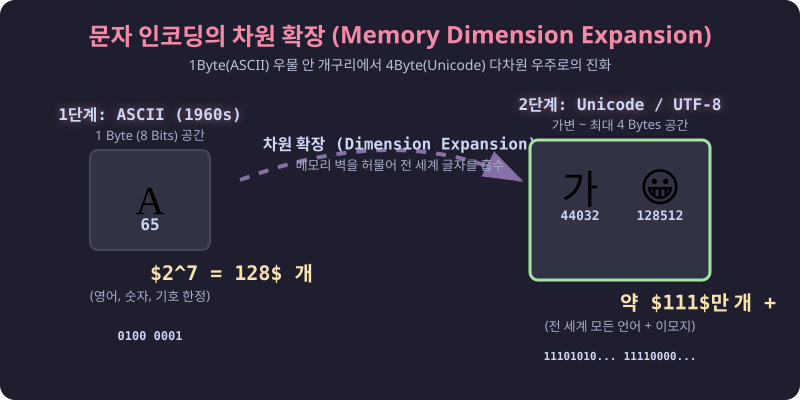
*(다이어그램: 수학 역사에서 $x^2 = -1$ 이라는 한계를 뚫기 위해 1차원 수직선에서 2차원 허수 평면으로 차원이 확장된 것처럼, 컴퓨터 구조 또한 수만 개의 다국어와 이모지를 담기 위해 메모리 한계를 부수고 4Byte 우주로 차원을 폭발적으로 확장한 흐름)*

### 2단계: 다차원 우주의 개막 (Unicode)
시간이 흘러 컴퓨터가 전 세계로 퍼졌지만, 1Byte짜리 아스키코드로는 한국어, 일본어, 아랍어, 심지어 😀이모지까지 세상의 모든 글자를 표현하기 턱없이 부족했습니다. 

마치 실수에서 복소수로 차원을 넓히듯, 컴퓨터 과학자들은 글자를 담는 메모리의 차원을 **최대 4 Bytes** 공간까지 폭발적으로 늘려 용량을 넉넉하게 확보했습니다. 전 세계의 모든 글자에 수십만 개의 고유 번호를 넉넉히 부여한 이 거대한 우주방위군 사전이 바로 **유니코드(Unicode)**와 그의 표현방식인 **UTF-8**입니다.

결론적으로 프로그래머의 시선에서 **문자(Character)는 눈에 보이는 그림 껍데기일 뿐, 본질은 철저하게 숫자(Number)**입니다.

---

## 2. 문자 $\leftrightarrow$ 숫자 양방향 변환 애니메이션

파이썬은 문자를 숫자로, 숫자를 문자로 상호 번역해주는 내장 함수(`ord()`, `chr()`)를 강력하게 지원합니다.

*(다이어그램: `ord()` 함수를 통과하면 인간의 문자가 컴퓨터 고유의 십진법 숫자로 번역되고, 그 숫자가 다시 `bin()`이나 `hex()`를 거쳐 컴퓨터 반도체의 2/16진법 전기 신호로 저장되는 데이터 파이프라인 흐름도)*

---

## 3. 파이썬 `ord()`와 `chr()` 실습

데이터 크롤링(웹 수집), 텍스트 자연어 처리(NLP), 암호학(Cryptography)에서는 이 변환 기술이 가장 기본이 됩니다. 파이썬의 변환 함수들은 유니코드 체계를 기반으로 하여 전 세계 모든 언어와 기호를 오차 없이 완벽히 지원합니다.

```python
# 1. ord() 함수 (Ordinal): 문자를 넣으면 컴퓨터 고유 번호(숫자)로 변환
print("--- [ ord(): 문자 -> 숫자 ] ---")
print("'A'의 번호 (ASCII 구역):", ord('A'))
print("'a'의 번호 (ASCII 구역):", ord('a'))
print("'가'의 번호 (Unicode 구역):", ord('가'))
print("'😀' 이모지의 번호 (Unicode 구역):", ord('😀'))

# 2. chr() 함수 (Character): 숫자를 넣으면 매칭되는 문자로 번환
print("\n--- [ chr(): 숫자 -> 문자 ] ---")
print("번호 66 에 맵핑된 글자 껍데기:", chr(66))
print("번호 44033 에 맵핑된 글자 껍데기:", chr(44033))

# 3. 암호화 원리 (시저 암호, Caesar Cipher 흉내내기)
# 문자를 숫자로 바꾼 뒤, 숫자 연산(수학)을 하고, 다시 문자로 덮어씌우는 완벽한 해킹(Hacking)
my_letter = 'H'
secret_code_number = ord(my_letter) + 3  # 'H'(72) 번호에서 3을 더해 75로 조작!
print(f"\n원본 '{my_letter}' 를 암호화하여 3칸 뒤로 밀면? -> '{chr(secret_code_number)}'")
```

**예측 출력:**
```text
--- [ ord(): 문자 -> 숫자 ] ---
'A'의 번호 (ASCII 구역): 65
'a'의 번호 (ASCII 구역): 97
'가'의 번호 (Unicode 구역): 44032
'😀' 이모지의 번호 (Unicode 구역): 128512

--- [ chr(): 숫자 -> 문자 ] ---
번호 66 에 맵핑된 글자 껍데기: B
번호 44033 에 맵핑된 글자 껍데기: 각

원본 'H' 를 암호화하여 3칸 뒤로 밀면? -> 'K'
```

---

## 4. 파이썬의 문자열형 데이터 타입 (`str`)

*   C나 Java 같은 언어는 문자 딱 하나만 담는 `char` 자료형과, 여러 글자를 기차처럼 엮은 문자열 `String` 자료형을 엄격하게 구분합니다.
*   하지만 유연함을 추구하는 데이터 분석용 **파이썬에는 `char` 자료형 자체가 없습니다.** 문자 1개이든, 100만 줄짜리 엄청난 길이의 뉴스 소설이든 모두 하나의 **문자열형(`str`)** 타입으로 퉁쳐서 관리합니다.

#### 간단한 결합과 반복
`str` 객체는 `+` 연산자로 문장들을 이어 붙이고, `*` 연산자로 특정 글자를 반복하여 프린트할 수 있는 편의 기능을 제공합니다.

```python
# 파이썬은 한 글자도, 여러 글자도 모두 <class 'str'>
c = 'A'
s = "Hello World"
print("타입 확인:", type(c), type(s))

# 빠른 문자열 수식
laugh = "하"
print(laugh * 5)  # 하하하하하
```

---

## 5. 텍스트 버그: 문자열 안의 숫자 꺼내기 (형변환)

데이터 분석이나 웹 크롤링을 하다 보면, 화면에는 분명히 숫자로 보이지만 파이썬 내부에서는 **따옴표로 묶인 문자열 글자(String)**인 경우가 허다합니다. 이 글자들을 그대로 더하면 수학적 덧셈이 아니라, 기차처럼 문자가 옆으로 이어붙는 대참사가 발생합니다.

반드시 파이썬의 형변환 캐스팅(Type Casting) 함수인 `int()`와 `float()`를 사용하여 **글자 껍데기를 벗겨내고 순수한 수학 숫자로 구출**해야 합니다.

```python
str_num1 = "10"
str_num2 = "20"

print("--- [ 1. 문자열 덧셈의 대참사 ] ---")
print("문자 병합 (+):", str_num1 + str_num2)  # 출력: 1020 (글자가 이어짐)

print("\n--- [ 2. 구출! 문자를 진짜 숫자로 (Type Casting) ] ---")
# int() 로 정수 구출
real_int1 = int(str_num1)
real_int2 = int(str_num2)
print("진짜 수학 덧셈 (int):", real_int1 + real_int2)  # 출력: 30

# float() 로 실수(소수점) 구출
str_float = "99.9"
real_float = float(str_float)
print("진짜 실수 연산 (float):", real_float + 0.1)  # 출력: 100.0
```

**예측 출력:**
```text
--- [ 1. 문자열 덧셈의 대참사 ] ---
문자 병합 (+): 1020

--- [ 2. 구출! 문자를 진짜 숫자로 (Type Casting) ] ---
진짜 수학 덧셈 (int): 30
진짜 실수 연산 (float): 100.0
```

---

## 6. 코딩 영단어 학습 📝

*   **`Char` (Character)**: 글자, 기호, 성질. (프로그래밍에서는 하나의 글자 껍데기를 지칭합니다.)
*   **`String` (str)**: 줄, 끈. (개별 글자들이 구슬처럼 끈으로 엮여서 만들어진 의미 있는 문장 데이터를 뜻합니다.)
*   **`Type Casting`**: 자료 형변환. (마치 금속을 녹여 다른 틀(캐스트)에 붓듯이, 문자열 `"10"`을 정수 `10` 모양틀(`int()`)로 부어 강제로 형태를 바꾸는 진화 마법입니다.)
*   **`ASCII`**: American Standard Code for Information Interchange. (세상에서 가장 유명한 128짜리 문자-숫자 변환 매칭 테이블표입니다.)
*   **`ord()`**: Ordinal (서수, 순서). (문자가 전체 백과사전에서 몇 번째 순서(고유 숫자)인지 꺼내오는 파이썬 함수입니다.)
*   **`chr()`**: Character. (순서 번호를 주면 그 자리에 매칭되어 있는 문자 껍데기를 꺼내오는 파이썬 함수입니다.)

---

## 학습목표
파이썬에서 참(True)과 거짓(False)만을 다루는 논리형 객체(`bool`)가 실제로는 컴퓨터 하드웨어의 $1$(ON)과 $0$(OFF) 스위치에서 기원했음을 이해합니다. 단순한 참/거짓을 넘어 숫자 데이터와 어떻게 호환되는지 핵심 원리를 학습합니다.

---

## 1. 세상에서 가장 단순한 데이터: 참과 거짓

컴퓨터 안의 수많은 복잡한 영상, 인공지능 알고리즘, 화려한 게임도 결국 그 밑바닥으로 내려가 보면 수백억 개의 초미세 전기 스위치들이 **"전기가 통한다(ON)"** 혹은 **"전기가 끊겼다(OFF)"** 두 가지 상태로만 움직이고 있습니다.

영국의 수학자 조지 불(George Boole)은 인간 논리의 참과 거짓을 이 두 가지 스위치 상태로 완벽히 수학적으로 치환할 수 있다는 '불 대수(Boolean Algebra)'를 창시했습니다. 이를 기리기 위해 프로그래밍 언어들은 참/거짓 데이터를 가리켜 **불리언(Boolean, 파이썬에선 `bool`)**이라고 부릅니다.


*(웹툰 비유: 수많은 데이터들이 저울에 올라가고, 중앙 통제실의 거대한 재판관 로봇(CPU)이 가차 없이 초록색 합격(True)과 빨간색 불합격(False) 판정 도장을 쾅쾅 찍으며 갈림길(if문)을 제어하는 모습)*

파이썬에서 `bool` 자료형은 단 두 개의 고유한 값만을 가집니다.
*   **`True` (참)**: 수학적으로는 $1$, 물리적으로는 전기 ON
*   **`False` (거짓)**: 수학적으로는 $0$, 물리적으로는 전기 OFF

> ⚠️ **주의 (자바와의 차이점):** Java 나 C 언어에서는 소문자로 `true`, `false` 라고 적지만, 파이썬에서는 반드시 첫 글자를 대문자로 한 **`True`**, **`False`** 로 적으셔야 문법 에러가 나지 않습니다.

---

## 2. 조건문(if)의 문을 여닫는 스위치

이 단순한 Boolean 값은 프로그래밍의 핵인 **제어문(if, while)**의 문지기 역할을 전담합니다. 조건식을 평가하여 그 결과가 `True`일 때만 코드가 실행되도록 흐름을 완전히 지배합니다.


*(다이어그램: 중앙의 거대한 제어 스위치에 $0$이 들어가면 빨간색 불합격 선이 켜지고 전류가 차단되며, $1$이 들어가면 초록색 스위치가 위로 올라붙어 전구(if문 실행)가 들어오는 전기 회로 애니메이션)*

### 파이썬 활용 실습

파이썬 코드에서 조건식(비교 연산)을 던지면 컴퓨터는 반드시 `bool` 객체 조각을 뱉어냅니다.

```python
# 1. 명시적인 논리형 변수 선언
is_raining = True
is_sunny = False
print(f"오늘은 비가 오나요? {is_raining} (타입: {type(is_raining)})")

# 2. 비교 연산이 만들어내는 논리 판결
math_score = 95
print("\n--- [ CPU 재판관의 판결 ] ---")
print("수학 90점 이상인가요?:", math_score >= 90) # 결과: True
print("수학 100점 만점인가요?:", math_score == 100) # 결과: False
```

**예측 출력:**
```text
오늘은 비가 오나요? True (타입: <class 'bool'>)

--- [ CPU 재판관의 판결 ] ---
수학 90점 이상인가요?: True
수학 100점 만점인가요?: False
```

---

## 3. 놀라운 사실: True는 숫자 1 이다! (Subclass of Integer)

파이썬의 구조적 철학에서 아주 독특하고 재밌는 지점이 있습니다. 파이썬에서 논리형(`bool`)은 사실 **정수형(`int`)의 새끼(서브 클래스)**로 특별 대우를 받으며 하드 코딩되어 있습니다.

문자에 숫자가 매칭되었듯(ASCII), 파이썬은 내부적으로 `True`를 숫자 `1`로, `False`를 숫자 `0`으로 완벽히 취급하여 사칙연산 수학 계산까지 허용합니다. (빅데이터 분석 시, '합격자 수'를 셀 때 배열의 `True` 값들을 그냥 다 더해버리면 인원수가 나오는 엄청난 비법이 됩니다.)

```python
# [바이브 코딩] 논리값과 숫자의 충격적인 덧셈 연산
print("True 더하기 True 는?", True + True)     # 1 + 1 = 2
print("True 빼기 False 는?", True - False)   # 1 - 0 = 1
print("False 곱하기 100 은?", False * 100)   # 0 * 100 = 0

# 메모리 객체가 아예 같은지 샅샅이 뒤져보는 함수 issubclass()
print("\n파이썬 철학 검증: bool은 정말 int의 자식인가요?:", issubclass(bool, int))
```

**예측 출력:**
```text
True 더하기 True 는? 2
True 빼기 False 는? 1
False 곱하기 100 은? 0

파이썬 철학 검증: bool은 정말 int의 자식인가요?: True
```

---

## 4. 코딩 영단어 학습 📝

*   **`Boolean` (bool)**: 조지 불(George Boole)의 이름에서 따온 수학 용어입니다. 컴퓨터에서는 참/거짓만을 다루는 논리 체계를 뜻합니다. (영국 발음으로는 불리언에 가깝고, 파이썬 예약어로는 `bool` 로 단축해서 씁니다.)
*   **`True` / `False`**: 진실(참)과 거짓입니다. (명제 논리학에서 파생된 절대적인 긍정과 부정을 의미합니다.)
*   **`Subclass`**: 하위 클래스(자식 클래스). (부모의 유전자를 그대로 이어받은 종속된 종류라는 뜻입니다. 파이썬에서 `bool`은 부모인 `int`(정수)의 계산 기능을 모두 물려받았습니다.)

---

## 학습목표
본 장에서는 컴퓨터 프로그래밍에서 데이터를 조작하고 계산하기 위해 없어서는 안 될 요소인 연산자(Operators)의 개념부터, 기본적인 산술 계산을 수행하는 사칙연산, 나눗셈의 몫과 나머지를 구하는 파이썬 특유의 산술 연산자, 그리고 프로그램의 분기점(조건)을 만들어내는 '비교 연산자'와 '논리 연산자(and, or, not)'의 융합 원리를 포괄적으로 학습합니다.


---

## 파이썬 주요 연산자 요약

| 분류 | 파이썬 연산자 | 타 언어(C/R) 비교 참고 |
| --- | --- | --- |
| 사칙연산 | `+`, `-`, `*`, `/` | C 언어와 일치 |
| 나머지 / 몫 / 지수 | `%`, `//`, `**` | R언어: `%%`, `%/%`, `^` |
| 관계 연산자 | `>`, `<`, `>=`, `<=`, `==`, `!=` | C 언어와 일치 |
| 논리 연산자 | `and`, `or`, `not` | C 언어: `&&`, `||`, `!` |
| 대입 연산자 | `=` | R언어: `<-` |

---

## 세부 연산자 학습

아래 링크를 통해 세부 연산자의 동작 원리와 실습을 진행해 보세요.

*   [**[3.1.6.1] 연산자의 개념 및 동작 원리**](#3161-연산자의-개념-및-동작-원리): 연산자와 피연산자의 정의, 수학 연산자와 컴퓨터 연산자의 결정적 철학 차이(`=` 대입의 의미)
*   [**[3.1.6.2] 산술 연산자**](#3162-산술-연산자): 사칙연산, 파이썬 특유의 몫(`//`)과 나머지(`%`), 거듭제곱(`**`) 활용
*   [**[3.1.6.3] 비교 연산자**](#3163-비교-연산자): 조건을 판별하기 위한 양팔 저울(`>`, `<`, `==`, `!=`)
*   [**[3.1.6.4] 논리 연산자**](#3164-논리-연산자): 복합 논리를 위한 참과 거짓의 수도관 밸브 연결(`and`, `or`, `not`)
*   [**[3.1.6.5] 연산자 우선순위와 컴퓨터의 수식 표기법**](#3165-연산자-우선순위와-컴퓨터의-수식-표기법): 괄호의 마법과 평가 순서 서열, 컴퓨터 구조 속 Infix, Prefix, Postfix 표기법 원리
*   [**[3.1.6.6] Java vs Python 연산자 비교**](../week12/#06-java-vs-python-예외-처리-비교): 정적 타입 언어와 동적 타입 언어의 연산 시 데이터 타입 처리 방식 차이 파악
*   [**[3.1.6.7] 시각화 실습 및 코딩 영단어**](#3167-시각화-실습-및-코딩-영단어): Matplotlib 거듭제곱 그래프 실습, 단락 평가(Short-Circuit) AI 질문하기

---


## 정리
기본 수학의 사칙연산에서 출발한 파이썬의 연산자는 이제 **비교**와 **논리**의 영역으로 확장되어, 컴퓨터가 스스로 복잡한 조건("만약 A이고 B가 아니라면?")을 깐깐하게 판단할 수 있게 해주는 핵심 두뇌 스위치 역할을 합니다. 여기서 익힌 `==`, `!=`, `and`, `or` 등의 기호들은 곧이어 배울 조건문(if)과 반복문(while)에서 쉼 없이 사용될 가장 중요한 뼈대입니다.

---

## 연산자(Operator)란 무엇인가요?
연산자란 **'주어진 데이터(재료)를 가지고 특정한 연산(가공)을 수행하여 새로운 결과물(생산품)을 만들어내는 기계 혹은 지시어'**입니다. 이 과정은 여러분이 수학 시간에 배운 **"식의 계산(Evaluation)"** 방식과 그 원리가 완전히 동일합니다.

이때 연산의 재료가 되는 데이터나 변수를 **피연산자(Operand)**라고 부릅니다. 
예를 들어 `5 + 3`이라는 식에서 `+`는 덧셈을 지시하는 **연산자**이고, `5`와 `3`은 덧셈 기계에 들어가는 재료인 **피연산자**입니다. 수학에서 수식 $2x + 5$의 문자에 값을 대입(Substitution)하여 척척 하나로 계산(Evaluation)해 내듯, 파이썬의 연산자 기계들도 여러 개의 피연산자를 집어삼키고 단 하나의 최종 결과를 뱉어냅니다!

*(다이어그램: 피연산자(재료)가 컨베이어 벨트를 타고 연산자(기계)에 들어가 결과값으로 가공되어 나오는 과정을 묘사한 애니메이션입니다.)*


> 📥 **다양한 연산자 실습용 노트북 다운로드 및 실행**: 
> - [로컬 환경용 다운로드](../source/week03/example.ipynb) (VS Code 등에서 실행)
> - <a href="https://colab.research.google.com/github/hojin9/jinysite/blob/master/python/src/01_basic/06_various_operators/source/example.ipynb" target="_blank"></a> (웹 브라우저에서 바로 실습)

## 연산자의 탄생과 진화

우리가 일상적으로 사용하는 사칙연산 기호(`+`, `-`, `*`, `/`)는 수학의 오랜 역사 속에서 어떻게 하면 복잡한 수식을 간결하게 표현할 수 있을까에 대한 인류의 고민 끝에 탄생한 '표준화된 약속'입니다.

*   `+` (덧셈) / `-` (뺄셈): 15세기 말 독일의 수학자 요하네스 비드만이 상업 장부에서 무겁고 가벼움을 표시하기 위해 처음 쓰기 시작하며 대중화되었습니다.
*   `*` (곱셈): 영국의 수학자 윌리엄 오트레드가 1631년 알파벳 X와 비슷한 형태의 곱셈 기호를 처음 제안했습니다.
*   `/` (나눗셈): 1659년 스위스의 수학자 하인리히 란이 가로줄 위아래 점을 찍어 나눗셈을 직관적으로 표현하면서 널리 쓰이게 되었습니다.

### 수학의 연산자 vs 컴퓨터 프로그래밍의 연산자 (결정적 차이점)

수학의 연산자와 파이썬(컴퓨터)의 연산자는 비슷하게 생겼지만, 그 내부 동작 철학은 완전히 다릅니다. 이 차이를 이해하는 것이 프로그래밍 기초의 핵심입니다.

1.  **등호(`=`)의 의미가 완전히 다릅니다:** 
    *   **수학**: "양쪽의 값이 서로 같다"는 '상태(상등)'를 나타냅니다.
    *   **컴퓨터(`=`)**: "오른쪽의 결과값을 왼쪽의 변수라는 상자 안에 집어넣어라"라는 강력한 **'대입(명령)'**의 의미입니다. (컴퓨터에서 '같다'는 `==`라는 두 개의 등호를 사용합니다.)
2.  **시간의 흐름(절차)이 존재합니다:** 
    *   **수학**: `x = x + 1` 이라는 수식은 수학적으로 성립할 수 없는 모순된 문장입니다.
    *   **컴퓨터**: `x = x + 1` 은 매우 정상적이며 자주 쓰이는 코드입니다. 컴퓨터는 등호를 기준으로 **무조건 오른쪽 연산을 먼저 전부 끝낸 뒤**, 그 최종 결과물을 마지막에 왼쪽 변수 `x`에 덮어씌웁니다.
3.  **데이터 타입의 엄격함:** 
    수학에서는 사람의 맥락에 따라 숫자와 문자가 섞여도 유연하게 해석되지만, 컴퓨터 연산자는 "숫자는 숫자끼리, 문자는 문자끼리"라는 데이터 타입 클래스(`type`)의 엄격한 규칙 아래에서만 작동합니다.

### 2) 파이썬만의 독특한 "무한의 상자"

반면 **파이썬(Python)**의 변수 구조는 완전히 새로운 철학으로 설계되었습니다. 파이썬에게 숫자 `3`이나 `5`는 변수라는 빈 상자에 쇳덩이처럼 담기는 값이 아닙니다. 대신, 저 텅 빈 우주 공간에 `3`이라는 거대한 별(객체, Object)이 이미 존재하고 있고, 변수 `x`는 그저 **그 별을 가리키는 레이저 포인터(이름표)**일 뿐입니다. 

그래서 파이썬 세상에서는 무한대처럼 큰 숫자가 나타나도 변수 상자가 터지지 않고 부드럽게 그 값을 가리킵니다. 수학자의 무한한 사고방식을 컴퓨터 안에 가장 아름답게 구현해 낸 것이 바로 파이썬의 연산자와 데이터 구조입니다.

이러한 파이썬의 놀라운 구조는 [**[3.1.6.6] Java vs Python 연산자 비교**](../week12/#06-java-vs-python-예외-처리-비교) 파트에서 이어지는 웹툰과 예시를 통해 더욱 생생하게 다뤄볼 것입니다.

---

## 요약정리
* **연산자(Operator)**: 데이터를 주무르는 마법의 기호들 (`+`, `-`, `=`, `and` 등)
* **피연산자(Operand)**: 기호의 명령을 충실히 따르는 데이터 재료 (`10`, `"Hello"` 등)
* 컴퓨터 코딩에서 나타나는 `=` (할당 연산자)는 수학의 "서로 같다"는 뜻이 결코 아니며, "오른쪽에서 계산을 다 끝낸 결과를 왼쪽 이름표 장부에 기록하라"는 매우 계산적인 지시어입니다.

---

## 코딩 영단어 학습 📝

*   **`Operator`**: 조작자, 연산자. (`+`, `-`, `and` 등에게 "이 데이터를 볶고 지져라!" 라고 지시하는 부호입니다. 기계를 조작하는 사람을 오퍼레이터라고 부르는 것과 같습니다.)
*   **`Operand`**: 피연산자. (수술(`Operation`)을 당하는 대상, 즉 연산 기계에 들어가는 재료 값(`3`, `5`)을 뜻합니다.)

---

## 산술 연산자


*파이썬의 마법 연산자 `**` 기계에 아주 작은 숫자 `2`를 넣었더니 거대한 폭발과 함께 엄청나게 큰 결과값이 쏟아져 나오는 웹툰입니다.*

가장 기본적인 수학 계산을 수행합니다. 

### 실습
실습을 통하여 산술 연산자 데이터 타입을 확인해 봅시다.
```python
# 3.1.6 기본 산술 연산자 실습
a = 10
b = 3.3

print("덧셈 (a + b) =", a + b)       # 13.3
print("뺄셈 (a - b) =", a - b)       # 6.7
print("곱셈 (a * b) =", a * b)       # 33.0
print("나눗셈 (a / b) =", a / b)     # 3.0303030303030303 (실수로 반환)

# 3.1.6 파이썬 특유의 산술 연산자 활용
time_seconds = 4000
hours = time_seconds // 3600         # 몫 연산자 (//)를 이용한 시간 계산
remaining = time_seconds % 3600      # 나머지 연산자 (%)를 이용한 잔여 초 계산
minutes = remaining // 60
seconds = remaining % 60

print(f"4000초는 {hours}시간 {minutes}분 {seconds}초 입니다.")

# 3.1.6 괄호를 이용한 연산자 우선순위 제어
result_1 = 3 * 4 - 2                 # 곱셈이 먼저: 12 - 2 = 10
result_2 = 3 * (4 - 2)               # 괄호 안이 먼저: 3 * 2 = 6
print("result_1 =", result_1, ", result_2 =", result_2)
```
**출력 예측 결과:**
```
덧셈 (a + b) = 13.3
뺄셈 (a - b) = 6.7
곱셈 (a * b) = 33.0
나눗셈 (a / b) = 3.0303030303030303
4000초는 1시간 6분 40초 입니다.
result_1 = 10 , result_2 = 6
```

---

## 코딩 영단어 학습 📝

*   **Arithmetic**: 산술. (덧셈, 뺄셈, 곱셈, 나눗셈 등 기초적인 수학 계산을 의미합니다.)
*   **Modulo**: 나머지. (파이썬의 % 연산자를 가리키며, 반복되는 패턴을 찾거나 요일을 계산할 때 매우 자주 쓰입니다.)

---

## 비교 연산자

비교 연산자는 두 값의 관계를 평가하여 논리형 데이터인 `True` 또는 `False`를 결과로 남깁니다. 마치 두 개의 값을 양팔 저울에 올려두고 한쪽이 무거운지 같은지를 재는 것과 같습니다. 이 연산자들은 뒤에서 배울 조건문(if)과 반복문(while)에서 '어느 쪽으로 흐를지 지시하는 핵심 스위치' 역할을 수행합니다.


*수학의 부등식 판별 원리를 양팔 저울로 시각화했습니다. `10 > 5` 검사 시 10이 더 무거우므로 화면 왼쪽에 초록색 `True` 패널이 팝업되는 웹툰입니다.*

| 연산자 | 기호 | 예시 | 의미 |
| :--: | :--: | :--- | :--- |
| **같음** | `==` | `a == b` | a와 b가 정확히 같은가? |
| **다름** | `!=` | `a != b` | a와 b가 다른가? |
| **크다 / 작다** | `>`, `<` | `a > b` | a가 b보다 큰가? |
| **크거나 같다 / 작거나 같다** | `>=`, `<=` | `a >= b` | a가 b보다 이상인가? |

### 실습
실습을 통하여 비교 연산자 데이터 타입을 확인해 봅시다.

```python
# 3.1.6 숫자 비교
a = 10
b = 20
print("a와 b는 완전히 같습니까? (a == b) :", a == b)    # False
print("a가 b보다 엄격히 작습니까? (a < b) :", a < b)    # True

# 3.1.6 문자열 비교 (알파벳 사전순 비교)
word1 = "apple"
word2 = "banana"
print("apple은 banana보다 앞서나요? :", word1 < word2)  # True (사전순)

# 3.1.6 사용자 검증 필터링 로직 예제
user_age = 25
required_age = 18
is_adult = user_age >= required_age
print(f"사용자의 나이는 {user_age}세 입니다. 성인 인증 결과: {is_adult}")
```
**출력 예측 결과:**
```
a와 b는 완전히 같습니까? (a == b) : False
a가 b보다 엄격히 작습니까? (a < b) : True
apple은 banana보다 앞서나요? : True
사용자의 나이는 25세 입니다. 성인 인증 결과: True
```

---

## 코딩 영단어 학습 📝

*   **Comparison**: 비교. (두 개의 값을 양팔 저울에 올려놓고 어느 쪽이 큰지, 작은지 재고 따지는 행위입니다.)
*   **Equal**: 같다. (= 기호는 대입이고, 진짜로 양쪽이 같은지 비교할 때는 항상 == (이퀄 이퀄)을 씁니다.)

---

## 논리 연산자

### 논리 연산자와 조지 불(George Boole)


*(웹툰 비유: 영국의 거장 수학자 조지 불은 철학의 '참/거짓 구조'를 수학 방정식 기호로 재창조했습니다. 그의 '불리언(Boolean)' 수학 모델은 수십 대 뒤 오늘날 컴퓨터 파이프라인의 핵심인 논리 밸브(`AND`, `OR`)의 뿌리가 되었습니다.)*

논리 연산은 1930년대에 일찍이 천재 수학자 조지 불이 완성한 **불대수학(Boolean Algebra)**에서 시작되었습니다. 불대수학은 철학의 명제가 '참(1)'인지 '거짓(0)'인지를 더하고(OR) 곱하여(AND) 수학적으로 연산하는 방법을 다루며, 이것이 오늘날 그대로 파이썬의 연산자로 이식되었습니다.

### 논리 연산 처리 원리 (수도관 밸브 모델)

논리 연산자는 위에서 배운 불리언 값(`True`, `False`)들을 재조합하여 더 거대한 조건을 설계할 때 사용됩니다. AND, OR, NOT 세 가지의 핵심 연산자가 있으며, 물이 통과하는 수도관의 최첨단 밸브(`True`=열림, `False`=닫힘)를 상상해 보세요!

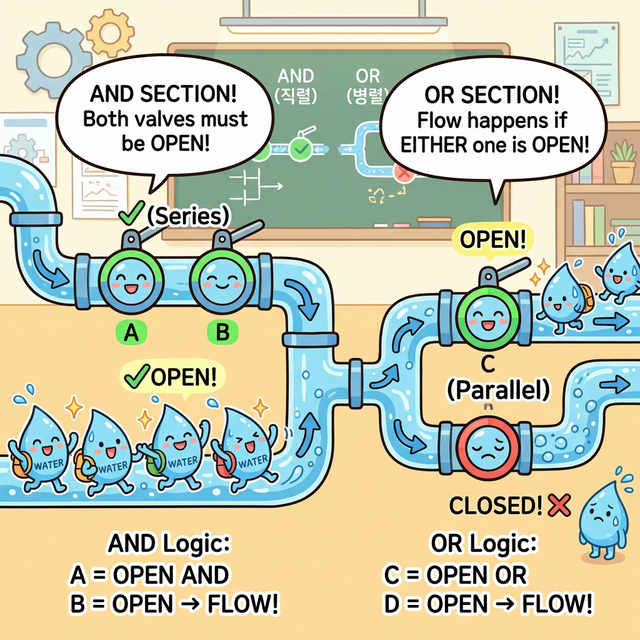
*`AND`는 논리 파이프라인에 밸브 2개가 직렬로 묶여 있어 무조건 둘 다 열려야(True) 물이 통과하지만, `OR` 연산자는 파이프가 2갈래의 병렬로 찢어져 하나만 열려 있어도 물이 통과하는 수도관 모양의 웹툰입니다.*

- **`and` 연산자 (직렬 연결)**: 좌/우측의 평가 값이 **모두 참(`True`)일 때만** 안전문이 열려 `True`를 뱉어냅니다 (수학에서의 교집합/곱).
- **`or` 연산자 (병렬 연결)**: 좌/우측의 평가 값 중 **단 하나라도 참(`True`)이면** 언제나 쿨하게 `True`로 통과시킵니다 (수학에서의 합집합).
- **`not` 연산자 (신호 반전)**: 원래의 진리 값을 거꾸로 뒤집는 인버터 역할을 합니다. (참$\to$거짓, 거짓$\to$참)

### 논리 연산자 실습
실습을 통하여 논리 연산자 데이터 타입을 확인해 봅시다.

```python
# 3.1.6 기본 논리 연산
a = True
b = False
print("a and b (둘 다 참이어야 True) :", a and b)   # False
print("a or b  (하나라도 참이면 True) :", a or b)   # True
print("not a   (a 값을 반전)          :", not a)    # False

# 3.1.6 실무 응용: 복합 논리 평가 (할인 대상자 판별기)
# 조건: 총 구매 금액이 5만 원 이상이거나, VIP 등급 회원이어야 할인 적용
total_price = 45000
is_vip_member = True

# OR 연산자를 통해 둘 중 하나만 만족해도 True 반환
is_discount_eligible = (total_price >= 50000) or is_vip_member
print("할인 대상자 입니까? :", is_discount_eligible)

# 3.1.6 실무 응용: 유효한 범위 논리 평가
# 조건: 점수가 0점 이상 100점 이하의 정상적인 값인지 확인
score = 85
is_valid_score = (score >= 0) and (score <= 100)
print(f"입력된 점수 {score}는 정상 범위 통과 여부: {is_valid_score}")
```
**출력 예측 결과:**
```
a and b (둘 다 참이어야 True) : False
a or b  (하나라도 참이면 True) : True
not a   (a 값을 반전)          : False
할인 대상자 입니까? : True
입력된 점수 85는 정상 범위 통과 여부: True
```

---

## 코딩 영단어 학습 📝

*   **Logical**: 논리적. (두 개 이상의 조건이 맞물려서 돌아갈 때 판단하는 방식을 뜻합니다.)
*   **Boolean (bool)**: 불리언. (참/거짓 구조를 창시한 천재 수학자 조지 불(George Boole)의 이름에서 따온 수학 용어입니다. 파이썬에서는 ool이라고 줄여 씁니다.)

---

## 1. 수학에서의 "식의 계산"과 우선순위

사칙연산(`+`, `-`, `*`, `/`)이 복잡하게 뒤섞인 수식을 만났을 때, 우리는 초등학교 때부터 배운 엄격한 수학적 약속인 **식의 계산 순서(Order of Operations)**를 따릅니다.
수학이야기 [식에도 값이 있다고! (Value of Expressions)](../../../../math_story/src/09_algebraic_expressions/02_value_of_expressions.html)에서 배웠듯, 식을 계산할 때는 거대한 덩어리들을 먼저 묶어서 풀어내는 우선순위가 정해져 있습니다.

> **수학의 기본 계산 순서 (BODMAS / PEMDAS)**
> 1. **괄호 (Brackets / Parentheses)**
> 2. **지수/거듭제곱 (Orders / Exponents)**
> 3. **곱셈과 나눗셈 (Multiplication & Division)** (왼쪽에서 오른쪽으로)
> 4. **덧셈과 뺄셈 (Addition & Subtraction)** (왼쪽에서 오른쪽으로)

예를 들어 $3 + 4 \times 2$ 라는 수식이 있을 때, 덧셈을 먼저 해서 $7 \times 2 = 14$ 를 만들면 완전히 틀린 답이 됩니다. 수학 규칙에 따라 **곱셈을 먼저 방어막처럼 묶어서** $3 + (4 \times 2) = 11$ 로 계산해야 올바른 **식의 값**을 도출할 수 있습니다.

컴퓨터 프로그래밍 역시 수학의 이 위대한 규칙을 그대로 물려받았습니다. 하지만 파이썬에는 수학의 사칙연산 말고도 앞서 배운 비교 연산자(`>`, `==`)나 논리 연산자(`and`, `or`), 대입 연산자(`=`) 등 수많은 기호가 섞여 있습니다.


*강력한 왕을 상징하는 괄호 `( )`가 평민 연산자들(`+`, `-`, `*`)을 제치고 가장 먼저 위풍당당하게 행진하는 웹툰입니다.*

만약 여러분이 괄호 없이 모든 기호를 한 줄에 쏟아부으면, 파이썬 인터프리터는 내부적으로 정해진 **연산자 우선순위 서열표**에 입각하여 차근차근 계산을 해치워 나갑니다.

### 파이썬 핵심 연산자 서열표 (위로 갈수록 왕족, 아래로 갈수록 평민)

| 순위 | 연산자 기호 | 설명 |
| :---: | :--- | :--- |
| **1 (최우선)** | `( )` | **괄호**: 모든 규칙을 씹어먹는 절대적인 보호막 방패. 무조건 괄호 안쪽이 우주 1순위로 계산됩니다. |
| **2** | `**` | **거듭제곱 (지수)** |
| **3** | `+x`, `-x` | **단항 부호**: 양수/음수를 나타내는 기호 |
| **4** | `*`, `/`, `//`, `%` | **곱셈, 나눗셈, 몫, 나머지** |
| **5** | `+`, `-` | **덧셈, 뺄셈** |
| **6** | `<`, `<=`, `>`, `>=`, `!=`, `==` | **비교 연산자**: 계산 결과를 바탕으로 크거나 같은지를 필터링합니다. |
| **7** | `not` | **논리 반전** |
| **8** | `and` | **논리 곱 (직렬)** |
| **9** | `or` | **논리 합 (병렬)** |
| **10 (꼴찌)** | `=` | **할당 (대입) 연산자**: 오른쪽의 길고 긴 모든 계산과 평가가 끝날 때까지 묵묵히 기다렸다가 마지막에 변수 상자에 집어넣습니다. |

### 혼합 계산 실습

```python
# 1. 산술 + 비교 + 논리가 섞인 끔찍한(?) 혼종 수식
x = 5
y = 10
# 괄호가 없어도 파이썬이 알아서 아래 순서대로 쪼갭니다:
# 1: 산술 (x*2 = 10), (y/2 = 5)
# 2: 비교 (10 > 5), (5 == 5) -> True, True
# 3: 논리 (True and True) -> True
# 4: 마지막으로 result 에 제일 마지막으로 담깁니다.
result = x * 2 > 5 and y / 2 == 5  
print("복합 수식 결과:", result)  # True

# 2. 괄호 ( ) 의 마법: 연산자 세계의 폭군!
# 거듭제곱(**)이 원래 더 세지만, 괄호가 쳐지면 평민인 덧셈이 먼저 실행됩니다!
normal_calc = 2 + 3 ** 2     # 2 + 9 = 11
magic_calc = (2 + 3) ** 2    # 5 ** 2 = 25
print("기본 우선순위:", normal_calc, "/ 괄호 강제:", magic_calc)
```

**⚠️ 전문가의 조언 (Best Practice):** 
실무에서 프로그래머들은 컴퓨터가 아무리 서열표를 잘 안다고 해도, 저렇게 괄호 없이 길게 늘어쓰는 것을 극도로 혐오합니다. 코드의 가독성을 높이고 인간(자신과 동료)의 뇌가 헷갈려 에러를 내지 않도록, **애매할 때는 언제나 괄호 `( )`를 듬뿍 사용하여 묶어주는 것**이 훌륭한 코딩 습관입니다. `((x * 2) > 5) and ((y / 2) == 5)` 처럼 말이죠.

---

## 3. 컴퓨터 내부의 수식 표기법 아키텍처 (Infix, Postfix, Prefix)

우리가 평소 수학 시간에 노트에 적는 `3 + 4` 와 같은 수식은 사람의 눈에 가장 읽기 편한 형태입니다. 하지만 CPU와 메모리로 구성된 컴퓨터의 내부 알고리즘에서 이를 해석(Parsing)하려면, 괄호 쌍을 추적하고 연산자 우선순위를 앞뒤로 확인해야 해서 대단히 비효율적입니다.

그래서 컴퓨터 과학자들은 괄호라는 복잡한 장치 없이도 수식의 우선순위가 완벽히 보장되는 혁신적인 수식 표기 배열법들을 발명했습니다. 컴퓨터 구조(Architecture)나 자료구조(Data Structure) 과목의 핵심이 되는 이 3가지 표기법을 살펴봅니다.

### 1) 중위 표기법 (Infix Notation) : 인간의 언어
*   **형태:** `연산자`가 두 개의 `피연산자` **가운데(In)**에 위치합니다.
*   **예시:** `A + B * C`
*   **특징:** 우리 인간에게 가장 친숙하고 가독성이 뛰어납니다. 하지만 컴퓨터가 이를 풀려면 어느 연산자(`+`, `*`)를 먼저 할지 몰라 왔다 갔다 하며 괄호나 서열표를 체크해야 하는 복잡한 계산기(파서)가 필요합니다. 파이썬 코드 에디터에 적는 모든 수식은 중위 표기법입니다.

### 2) 전위 표기법 (Prefix / Polish Notation) : LISP의 영혼
*   **형태:** `연산자`가 피연산자들의 **가장 앞(Pre)**에 튀어나와 위치합니다. 폴란드 수학자 얀 우카시에비치가 고안하여 보통 폴리쉬 표기법이라고도 부릅니다.
*   **방식:** "더해라! A와 B를" 처럼 동사(명령어)가 먼저 나오는 구조입니다.
*   **예시:** `+ A * B C` (의미: B와 C를 곱한 뒤, 그 결과에 A를 더해라!)
*   **특징:** LISP나 Scheme 계열의 인공지능 탐색 함수형 프로그래밍 언어들이 이 표기법을 뼈대로 삼고 있습니다. 

### 3) 후위 표기법 (Postfix / Reverse Polish Notation) : 스택(Stack) 머신의 심장
*   **형태:** `연산자`가 피연산자들의 **가장 뒤(Post)**에 따라붙습니다. 
*   **방식:** "A랑 B를... 더해라!" 처럼 재료를 먼저 던져놓고 늦게 지시하는 형식입니다.
*   **예시:** `A B C * +` (의미: B와 C를 먼저 `*`로 묶어서 처리하고, 남은 A와 앞서 구한 덩어리를 `+` 묶어라!)
*   **특징:** 괄호 기호 `( )`가 아예 존재할 이유가 사라집니다! 보이는 순서(왼쪽 $\to$ 오른쪽)대로 '스택(Stack)'이라는 그릇 형태의 자료구조에 데이터를 넣었다(Push) 뺐다(Pop) 하면서 순서대로 연산자를 만나면 펑펑 계산만 하면 됩니다.
*   **실제 활용:** 자바 가상 머신(JVM)의 바이트코드, HP 공학용 계산기, 그리고 화려한 PDF/프린터 출력용 언어인 어도비(Adobe)의 포스트스크립트(PostScript) 기술이 이 후위 표기법의 절대적인 연산 속도를 사용합니다.

### 💡 후위 표기법(Postfix) 스택 연산 시뮬레이션
수식 `3 4 2 * +` 가 컴퓨터 안의 그릇(Stack)에서 어떻게 처리되는지 상상해 봅시다.
1. `3`을 그릇에 넣습니다. `[3]`
2. `4`를 그릇에 넣습니다. `[3, 4]`
3. `2`를 그릇에 넣습니다. `[3, 4, 2]`
4. `*` 기호를 만났습니다! 컴퓨터는 기뻐하며 그릇 맨 위 숫자 2개(`4`와 `2`)를 빼내어 곱한 뒤($4 \times 2 = 8$), 다시 던져 넣습니다. `[3, 8]`
5. `+` 기호를 만났습니다! 방금처럼 맨 위 2개를 빼내어 더합니다($3 + 8 = 11$). 최종 그릇엔 결과 `[11]` 값 하나만 남고 끝납니다. 
이처럼 괄호의 방위 체계 없이 1차원으로 끝내버리는 경이로운 속도를 갖춥니다. 

## 요약정리
파이썬 소스코드 창에서는 우리가 인간답게 괄호를 친 **중위 표기법**으로 수식을 넘겨주지만(예: `a + (b * c)`), 똑똑한 파이썬 인터프리터 컴파일러는 이 문장을 제일 먼저 분석하여 컴퓨터가 계산하기 편한 **후위 표기법(추상 구문 트리)**으로 번역하여 메모리 안에서 한 치의 오차도, 괄호의 얽힘도 없이 초고속으로 계산을 완료해 낸다는 사실을 기억해 두세요!

---

## 코딩 영단어 학습 📝

*   **Precedence**: 우선순위. (여러 연산자가 동시에 등장했을 때, 누구부터 먼저 처리할지 등급을 매겨놓은 공식 서열표를 뜻합니다.)

---

## ☕ Java vs 🐍 Python 스나이퍼 비교

### 1. 연산 후 데이터 타입의 탈바꿈 (동적 타입 vs 정적 타입)


*(웹툰 비유: 자바 로봇은 딱 정해진 'int' 철제 상자에 거대한 숫자를 욱여넣으려다 펑 하고 터져버리지만(오버플로우), 유연한 파이썬 뱀파우치는 숫자가 아무리 커져도 마법처럼 무한히 스르륵 늘어납니다!)*

*   **Java (엄격함)**: 처음 변수를 선언할 때 만들어둔 상자(메모리)의 크기와 타입을 절대 바꿀 수 없습니다. 만약 `int` 상자 두 개를 나누기 연산(`/`)하면 소수점은 무자비하게 버려지고 억지로 정수만 남깁니다. 행여나 곱셈이나 거듭제곱 연산 결과가 너무 거대해져서 상자 허용치를 초과하면 데이터가 엉뚱한 값으로 파괴되는 **'오버플로우(Overflow)'** 대참사가 발생합니다. 또한, 실수(`double`) 연산 결과를 정수(`int`) 상자에 넣으려 하면 **컴파일 시스템 에러**가 뿜어져 나옵니다.
*   **Python (유연함)**: 연산 결과에 따라 **데이터의 타입이 물 흐르듯 아주 자연스럽게 변신**합니다. 파이썬의 나눗셈 연산자 `/`는 정수끼리 나누더라도 소수점 아래를 잃지 않고 **무조건 실수(`float`) 타입으로 자동 변환**하여 깔끔하게 내어줍니다. 파이썬의 상자(변수)는 정수형(int)이던 변수에 오늘 실시한 나눗셈 결과(float)를 담아도 전혀 에러가 나지 않습니다. 숫자가 1만 자리가 넘어가도 파이썬이 알아서 무한대 크기(Arbitrary-precision)로 늘려주므로 **오버플로우 폭발이 아예 존재하지 않습니다.**

### 2. 파이썬만의 독특하고 훌륭한 산술 연산자
*   **Java**: 몫만 정확히 구하거나(정수 나눗셈 외), 거듭제곱을 하려면 `Math.pow()` 같은 복잡한 외부 수학 클래스를 불러와야 합니다.
*   **Python**: 데이터 분석 최적화 언어답게 몫 연산자 `//` (버림 나눗셈)와 거듭제곱 연산자 `**`를 기본 문법 자체에 내장하고 있습니다. (`2 ** 3 = 8`)

### 3. 논리 연산자 (Word 연산어)
*   **Java**: 기호 기반의 논리 연산자 `&&` (AND), `||` (OR), `!` (NOT) 을 사용합니다.
*   **Python**: 사람이 읽기 편하도록 영단어 그대로 **`and`**, **`or`**, **`not`**을 사용합니다. 가독성이 압도적으로 높습니다.

---

## 📊 Matplotlib 맛보기: 거듭제곱 연산자(`**`)의 무서움 시각화

지수 성장을 일으키는 파이썬의 `**` 연산자가 얼마나 폭발적으로 증가하는지 그래프로 확인해 보겠습니다.

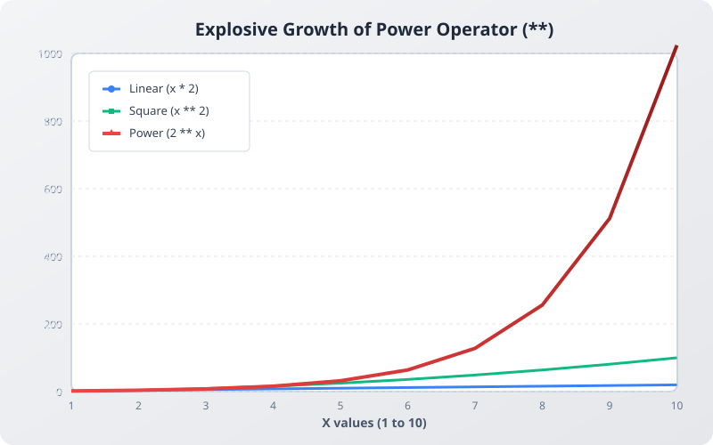
*파이썬의 지수 연산자(`**`)가 선형, 혹은 제곱 연산에 비해 얼마나 무서운 속도로 치솟는지 보여주는 시각화 자료입니다.*

```python
import matplotlib.pyplot as plt

# 시간(x)에 따른 세 종류의 성장 곡선 (y)
x_values = range(1, 11)   # 1부터 10까지
y_linear = [x * 2 for x in x_values]     # 2배씩 선형 증가 (x * 2)
y_square = [x ** 2 for x in x_values]    # 제곱 증가 (x^2)
y_power = [2 ** x for x in x_values]     # 2의 거듭제곱 (지수 증가, 2^x)

plt.figure(figsize=(8, 5))
plt.plot(x_values, y_linear, label='Linear (x * 2)', marker='o')
plt.plot(x_values, y_square, label='Square (x ** 2)', marker='s')
plt.plot(x_values, y_power, label='Power (2 ** x)', marker='^', color='red')

plt.title("Explosive Growth of Power Operator (**)")
plt.xlabel("X values")
plt.ylabel("Y values")
plt.legend()
plt.grid(True)
plt.show()
```

---

## 🎧 Vibe Coding

단락 평가(Short-Circuit Evaluation)라는 고급 프로그래밍 스킬을 AI에게 물어봅시다.


*OR 논리 게이트에서 첫 번째 방어문이 True로 열리자, 뒷길은 아예 무시해버리고 신나게 논리 미로를 탈출하는 파이썬 로봇 웹툰입니다.*

> **🗣️ 학생 프롬프트 (AI에게 이렇게 명령해 보세요):**
> "파이썬의 논리 연산자 `and`와 `or`를 쓸 때 발생하는 '단락 평가(Short-Circuit)'라는 특징이 뭐야? 이게 왜 프로그램의 성능(속도)을 높여주고 에러를 방지해 주는지 쉬운 예제 코드 2개랑 같이 설명해 줘."

---

## ✍️ 이번 주 연습 문제

**문제 1.** 다음 코드의 결과는 무엇일까요?
```python
a = 0.1 + 0.2
print(a == 0.3)
```
결과가 왜 그렇게 나오는지 '부동 소수점 오차' 개념을 사용하여 설명해 보세요.

**문제 2.** 자신의 이름(영문)을 변수에 저장하고, 슬라이싱을 사용하여 이름의 첫 글자와 마지막 글자만 출력하는 프로그램을 작성해 보세요.

**문제 3.** (심화) `sys.getsizeof()` 함수를 사용하여, 정수 `0`과 정수 `1000000000000`의 메모리 크기를 비교해 보세요. 숫자가 커질수록 메모리 사용량이 어떻게 변하는지 관찰해 보세요.

---

## 📖 교재 상세 학습: 06 데이터의 종류: 숫자와 문자열

## 06 데이터의 종류: 숫자와 문자열

파이썬이 메모리를 할당하고 데이터를 가공하는 기본 원리를 깨우치기 위해서는 제일 먼저 자료의 '본질적인 형태(Data Type)'를 완벽히 구분할 줄 알아야 합니다. 무수히 많은 타입 중에서도 가장 뿌리가 되는 쌍벽은 바로 숫자형(Number) 데이터와 문자열(String) 데이터입니다.

#### 리터럴(Literal): 코드에 직접 적어넣은 고정된 값
우리가 변수에 값을 집어넣을 때, 키보드로 타이핑해서 고정된 형태로 직접 입력한 10이나 "Hello" 같은 데이터를 **리터럴(Literal)**이라고 부릅니다. 파이썬은 이런 리터럴을 보자마자 즉시 고유한 객체(Object) 값으로 인식합니다.

**데이터 타입과 리터럴 예제: number.py**
```python
language = 'Python'  # 겉에 따옴표가 둘러져 있으므로 의심의 여지 없이 문자열 리터럴입니다.
version = 3          # 따옴표라는 옷을 입지 않은 순수한 숫자(정수) 리터럴입니다.

print(language, '버전은', version, '입니다.')
```

우리의 눈으로 바라보기엔 숫자를 나타내는 기호 `3`일지언정, 코드 속의 `3`과 따옴표로 감싸인 `'3'`은 파이썬 엔진 내부에서는 완전히 다른 세계의 거주자처럼 엄격하게 구별되어 관리됩니다. 
가장 결정적이고 치명적인 차이는 뒤에 이어지는 수학적 '재조합(연산)'이 가능한가에 있습니다.

---

#### 표현식(Expression)과 연산 원리
하나의 값(리터럴)만 쓸 때도 있지만, 보통은 여러 값을 엮어서 특정한 수학적결과를 만들어냅니다. 이렇게 연산자(`+`, `-` 등)와 엮여 결국 '단 하나의 결과 값'으로 귀결되는 수식의 덩어리를 **표현식(Expression)**이라고 부릅니다.

숫자 데이터는 우리가 익히 아는 산수 시간처럼 사칙연산을 자연스레 지원하여 표현식을 구성합니다.

**연산 예제**
```python
plus = 5 + 2      # 합계: 7 (이 수식 전체가 하나의 표현식입니다)
minus = 5 - 2     # 차이: 3
multiply = 5 * 2  # 곱: 10 (참고: 알파벳 x가 아닌 별표 * 기호를 곱셈에 사용)
divide = 5 / 2    # 비율: 2.5 (참고: 특수기호 ÷가 아닌 슬래시 / 기호 사용)
power = 5 ** 2    # 지수승: 25 (5를 자신과 한 번 더 곱함)
remainder = 5 % 2 # 모듈러 연산: 1 (5를 2로 나눈 후 몫을 버리고 남은 나머지 값)

print(plus, minus, multiply, divide, power, remainder)
```

이와 대조적으로 문자열 데이터끼리 덧셈 기호(`+`)를 맞대면 수학 계산을 하는 것이 아니라, 앞뒤 텍스트 덩어리를 강력한 접착제로 붙인 것처럼 텍스트 자체를 물리적으로 이어 붙여줍니다.

**문자열 덧셈 예제**
```python
str_sum = '20' + '24'
num_sum = 20 + 24

print('문자열끼리 결합:', str_sum)
print('숫자끼리 수리 계산:', num_sum)
```

**결과 확인**
```text
문자열끼리 결합: 2024
숫자끼리 수리 계산: 44
```

여기서 초보자가 가장 흔히 범하는 금기 사항을 짚고 넘어가겠습니다. 바로 **문자열 데이터와 숫자 데이터를 억지로 `+` 기호로 더하려 드는 행위입니다. 파이썬은 즉시 혼란에 빠져 요란한 에러(TypeError)**를 발생시킵니다. 시스템 입장에서는 글자에 숫자를 뒤이어 붙여 쓰라는 소리인지, 글자 모양을 띤 숫자를 수학적으로 더하라는 소리인지 절대 간파할 수 없기 때문입니다.

---

### 💻 미니 실습: 연산자 가지고 놀기

**Quiz 1** 변수 `x`에는 10이 담겨있고 `y`에는 3이 담겨있다고 가정합니다. 빈 여백을 올바른 수식으로 채워 결과를 도출해 보세요.
```python
x = 10
y = 3

plus_result = _____       # 두 변수값의 덧셈
multi_result = _____      # 두 변수값의 곱셈
remain_result = _____     # 큰 수 x를 작은 수 y로 나눴을 때 남는 조각(나머지)
```

**Quiz 2** 문자열로 쪼개진 두 단어 상자를 덧셈 연산자로 바짝 이어 붙여 콘솔에 "HelloPython"이 나오게 연결해 주세요.
```python
word1 = "Hello"
word2 = "Python"
combined = ____________
print(combined)
```

---
<details>
<summary><b>모범 답안 보기</b></summary>

**풀이 1**
```python
plus_result = x + y
multi_result = x * y
remain_result = x % y
```

**풀이 2**
```python
combined = word1 + word2
```
</details>


---

## 📖 교재 상세 학습: 16 문자열을 내 마음대로, 포매팅(Formatting)

## 16 텍스트를 자유자재로 다루기, 포매팅(Formatting)

지금까지는 변수의 값과 일반 텍스트 문장을 이어 붙일 때 `print()` 안에 쉼표(`,`)를 나열하거나 덧셈 기호(`+`)를 동원했습니다. 하지만 문장이 길어지고 들어갈 데이터가 많아질수록, 구멍 난 텍스트 사이사이에 변수를 끼워 넣다가 잦은 오타나 띄어쓰기 실수를 내기 십상입니다. 이 번거로움을 한 번에 날려줄 우아한 기술이 바로 **문자열 포매팅**입니다.

가장 대중적이고 활용도가 높은 파이썬의 `.format()` 패턴을 살펴보겠습니다.

**예제 코드: format_test.py**
```python
# 기존의 낡고 복잡한 방식
year = 2026
month = 3
day = 15

print('오늘은', year, '년', month, '월', day, '일입니다.')

# 🌟 스마트하게 진화된 format() 방식
template = '오늘은 {}년 {}월 {}일입니다.'
print(template.format(year, month, day))
```

**결과 화면**
```text
오늘은 2026년 3월 15일입니다.
오늘은 2026년 3월 15일입니다.
```

원리는 아주 직관적입니다. 텍스트 문자열 안에서 나중에 변수로 채워질 자리를 빈칸 채우기 하듯 중괄호 `{}`로 구멍을 뻥 뚫어둡니다. 그다음 문자열 맨 끝에 마침표(`.`)를 연결하고 `format(첫번째변수, 두번째변수...)` 형태로 구멍 개수에 맞게 데이터를 넘겨주면 알아서 차례대로 찰떡같이 채워집니다!

물론 문장을 미리 따로 빼두지 않고 `print()` 명령어 안에서 텍스트와 `.format`을 한 호흡에 연달아 작성해도 전혀 무방합니다.

**게임 전투 결과 포매팅하기**
```python
player = '용사'
monster = '슬라임'
damage = 999

print('[전투 결과] {}가 {}에게 {}의 타격을 주었습니다!'.format(player, monster, damage))
```

> **💥 구멍(중괄호) 개수와 변수 개수가 어긋난다면?**
> 문자열 속에 뚫어둔 구멍 `{}`은 3개인데 `format`에 넘겨주는 재료(변수)가 2개밖에 없다면 파이썬은 당황하며 곧바로 에러(`IndexError`)를 뿜어냅니다. 반드시 앞뒤 개수를 딱 맞게 채워주어야 합니다!

---

#### 🌟 파이썬의 최신 표준: f-문자열 (f-string)
최근 파이썬 3.6 버전 이후로는 `.format()` 방식조차 길다며 새롭게 등장한 `f-string`이 절대적인 대세로 자리 잡았습니다. 따옴표를 열기 전 맨 앞에 `f` 하나를 붙이고, 뚫어놓은 중괄호 `{}` 안에 들어갈 변수 이름을 통째로 입력해 버리는 가장 직관적이고 연산 속도도 빠른 문법입니다!

```python
score = 85
# format() 없이 바로 변수를 끼워넣습니다.
print(f'오늘은 {year}년 {month}월 {day}일입니다. 제 점수는 {score}점입니다.') 
```

---

### 16.1 숫자와 텍스트의 정교한 정렬 꾸미기

f-문자열이나 `.format()` 방식 내부에서는 콜론(`:`) 뒤에 포매팅 기호를 추가하여 좌/우 정렬, 소수점 자릿수 제한, 천 단위 콤마 등을 전문가처럼 제어할 수 있습니다.

#### 공간 확보와 정렬 기호
- **`<`**: 좌측 정렬 (기본값)
- **`>`**: 우측 정렬
- **`^`**: 중앙 정렬

```python
title = "파이썬"

# 10칸의 빈 공간을 만들고 중앙(^)에 정렬. 남는 공백은 '_' 로 채움
print(f"[{title:_^10}]") # [___파이썬____]
```

#### 소수점 제어와 천 단위 콤마 (금액 표시)
숫자를 표시할 때는 실수의 소수점(반올림)을 제한하는 `.nf` 기호와, 큰 금액을 표시하는 콤마(`,`) 기호가 매우 유용합니다.

```python
pi = 3.14159265
salary = 2500000

print(f"원주율: {pi:.2f}") # 소수점 둘째 자리까지만. 출력: 3.14
print(f"내 월급: {salary:,} 원") # 3자리마다 콤마 찍기. 출력: 2,500,000 원
```

#### 날짜와 시간 다루기
알아보기 힘든 컴퓨터 날짜 형식도 포매팅 기호를 쓰면 원하는 모양으로 손쉽게 치환됩니다. (`%Y`: 4자리 연도, `%m`: 숫자 월, `%d`: 숫자 일, `%H`: 시간)

```python
from datetime import datetime
now = datetime.now() # 예: 2026-10-25 14:30:15

print(f"현재 접속 시간: {now:%Y-%m-%d %H:%M}") 
# 결과: 현재 접속 시간: 2026-10-25 14:30
```


---

## 📖 교재 상세 학습: 17 줄바꿈이 있는 긴 텍스트 다루기

## 17 줄바꿈이 포함된 장문 텍스트 통째로 다루기

시 구절이나 소프트웨어 사용자 약관처럼 중간에 자주 줄바꿈(엔터)이 들어가는 굉장히 긴 문장 덩어리를 화면에 그대로 출력하고 싶다면 어떻게 코드를 짜야 할까요?
파이썬에서는 무려 따옴표 세 개를 연달아 찍는 방식(`'''` 혹은 `"""`)을 지원합니다. 이 삼중 따옴표 사이에 작성된 텍스트들은 띄어쓰기나 줄바꿈, 심지어 특수문자 조합까지 에디터에 적힌 시각적 형태 그대로 기억되는 마법을 선보입니다.

**예제 코드: 여러 줄 문장 출력하기**
```python
long_text = '''어느 나른한 오후,
컴퓨터가 나에게 물음을 던졌다.
"너는 버그 잡는 것을 즐기니?"
나는 '물론이지!' 라고 외치며 웃었다.'''

print(long_text)
```

이 삼중 따옴표 구문의 또 다른 매력 포인트는, 긴 문자열 내부에 평범한 큰따옴표(`"`)나 작은따옴표(`'`)를 눈치 보지 않고 마음껏 혼용하여 섞어 쓸 수 있다는 편리함에 있습니다. 문단 안에 대화나 인용구가 많은 장문을 다룰 때 최고의 무기입니다.


---

## 📖 교재 상세 학습: 18 디테일이 다르다: 정수(int)와 실수(float)

## 18 디테일이 생명이다: 정수형(int)과 실수형(float)

통장 잔고 '1,000달러'와 나의 체중 '65.4킬로그램'. 우리의 일상에서는 같은 숫자의 범주로 통용되지만, 컴퓨터 내부의 파이썬 엔진은 이 두 가지 데이터를 하늘과 땅 차이로 구별하여 처리합니다.

파이썬 숫자 데이터의 근간을 이루는 두 축은 소수점이 아예 존재하지 않는 딱 떨어지는 수 **정수(Integer, `int`)**와, 소수점 이하까지 미세하게 표현해 내는 **실수(Floating Point, `float`)**로 나뉩니다. 두 자료형 모두 한 번 созда되면 값이 변하지 않는 '불변(Immutable)' 객체라는 특징이 있습니다.

```python
score = 100       # 소수점이 없는 깨끗한 정수
weight = 65.4     # 소수점을 포함하는 실수
exact_num = 100.0 # 뒤에 '.0' 하나만 붙어도 파이썬은 무조건 실수 세계의 주민으로 판별합니다.
```

#### 💡 파이썬 숫자 메모리 참조의 비밀 (`is` vs `==`)
파이썬은 메모리를 아끼기 위해 1에서 256 사이의 작은 정수들은 시스템이 켜질 때 미리 만들어 두고 재사용합니다. 
```python
a = 10
b = 10
print(a is b) # True (동일한 객체 공간을 가리킴)

c = 1000
d = 1000
print(c is d)  # False (숫자가 크면 재사용하지 않고 별도 공간 생성)
print(c == d)  # True (하지만 안의 값은 완벽히 동일함)
```
따라서 두 숫자의 값이 같은지 비교할 때는 주소를 묻는 `is` 대신 무조건 형태를 비교하는 **`==` 연산자**를 써야 합니다.

---

### 18.1 산술 연산과 연산자 우선순위

덧셈, 뺄셈, 곱셈(`+, -, *`)같이 일반적인 사칙연산을 수행할 때 정수끼리의 계산 결과는 당연히 정수로 깔끔하게 튀어나옵니다. 하지만, 오직 **나눗셈(`/`) 연산**에 한해서는 특별한 룰이 존재합니다. 나누어떨어지든 아니든 결과는 무조건 '실수' 타입으로 강제 변환되어 출력됩니다.

**나눗셈 연산의 법칙 확인**
```python
print(10 / 2)   # 결과: 5.0 (정수 5가 아닌 실수로 바뀝니다)
print(7 / 3)    # 결과: 2.3333333333333335
```

초등학교 산수 시간처럼 소수점 아래는 무시하고 온전한 '몫' 부분의 정수만 발라내고 싶다면 슬래시를 두 번 연달아 입력하는 `//` (버림 나눗셈) 연산자를 사용해야 합니다. 몫을 뺀 나머지 찌꺼기만 돌려주는 `%` (모듈러) 연산자와 함께 묶어 외우면 좋습니다.

**몫과 나머지 연산**
```python
print(10 // 3)  # 정수로 떨어지는 몫만 반환. 결과: 3
print(10 % 3)   # 딱 맞게 나누고 남은 나머지 부분. 결과: 1
```

> **📌 연산자 우선순위 (Operator Precedence)**
> 수식이 길고 복잡해지면 컴퓨터는 `**`(거듭제곱) ➔ `*, /, //, %`(곱셈/나눗셈 류) ➔ `+, -`(덧셈/뺄셈) 순으로 강력한 우선순위를 발동합니다. 가장 확실한 방법은 먼저 계산하고 싶은 부분을 언제나 `()` 괄호로 묶어주는 것입니다.

---

### 18.2 형 변환과 한계 없는 정수 표기

파이썬의 가장 놀라운 장점 중 하나는 자바나 C언어와 달리 **정수형(`int`)의 크기에 제한이 없다**는 것입니다. 메모리가 모자라지 않는 한 수백 자리 단위의 어마어마한 숫자도 계산할 수 있습니다. 

간단한 소수점 처리나 데이터 통일을 위해 우리는 숫자의 자료형을 강제로 바꿀(Type Conversion) 줄 알아야 합니다.
* `int(3.8)` -> `3` (반올림 같은 건 무시하고 소수점 아래를 무자비하게 싹둑 베어내어 정수로 만듭니다)
* `float(5)` -> `5.0` (깔끔한 정수에 소수점을 억지로 붙여 실수로 탈바꿈시킵니다)
* `bin(10)`, `oct(10)`, `hex(10)` 메서드를 쓰면 단숨에 2진수, 8진수, 16진수 문자열로도 변환 가능합니다.

> **🧠 깊게 알기: 컴퓨터 실수의 딜레마와 Decimal 모듈**
> 파이썬 부동소수점(`float`)으로 `print(0.1 + 0.1 + 0.1 == 0.3)` 이라는 식을 던지면 놀랍게도 결과는 참이 아닌 `False`가 나옵니다! 이는 이진수 번역 과정 중에 아주 미세한 오차가 누적되는 컴퓨터의 오랜 숙명 때문입니다.
> 이런 0.00001의 오차도 용납할 수 없는 은행, 금융 프로그램 등을 짤 때는 파이썬 기본 장착 모듈인 **`decimal.Decimal`** 클래스를 불러와서, 숫자를 문자열 객체로 건네주어 완벽한 초정밀 계산을 구현합니다. (`decimal.Decimal("0.1")`)

---

### 💻 미니 실습: 몫 계산 및 자료형 캐스팅

**Quiz 1** 숫자 `25`를 `4`로 나누었을 때 나오는 평범한 소수점이 아닌 가장 큰 몫의 정수 부분만 잘라내어 `quotient` 변수 안에 담는 코드를 작성해 보세요.

---
<details>
<summary><b>모범 답안 보기</b></summary>

**풀이 1**
```python
quotient = 25 // 4
print("구해진 몫은:", quotient)
```
</details>


---

## 📖 교재 상세 학습: 19 소통하는 프로그램 만들기: 사용자 입력(`input`)

## 19 질문하고 답을 듣는 즐거움: 사용자 입력(`input`)

코드 작성의 백미는 바로 사용자와의 '소통'에 있습니다. 시키는 일만 주르륵 화면에 뱉어내고 끝나는 것이 아니라, 사용자가 타이핑해 주는 진짜 데이터를 동적으로 삼켜먹고 그 상황에 알맞은 다음 동작을 펼쳐 나가는 것이 진정한 소프트웨어의 묘미입니다. 이 마법 같은 대화의 창구는 무척 단순하게도 `input()`이라는 내장 함수 하나가 책임집니다.

**예제 코드: user_input.py**
```python
print('여러분이 가장 좋아하는 파이썬의 문법은 무엇인가요?')
answer = input()
print('훌륭한 안목이시군요!', answer, '기능에 아주 푹 빠지셨군요!')
```

위의 스크립트를 구동시키면 터미널 창에 첫 번째 질문이 표시된 다음, 이내 파이썬 프로그램의 심장이 일시 정지 상태로 전환되며 **깜빡이는 커서와 함께 무한 대기 모드**에 들어갑니다. 바로 키보드 앞에 앉아 있는 당신의 타자 입력을 기다리는 중입니다.

여기에 아무 텍스트나 입력하고 `[Enter]` 키를 누르는 그 찰나! 터미널에 쳤던 모든 글자가 통째로 `answer`라는 이름의 변수 박스로 전달되며, 얼어붙어 있던 코드가 그 아래 줄부터 다시 쌩쌩하게 동작을 이어갑니다.

여기서 한 발짝 더 나아가 직관성을 높이자면, `input()`의 빈 괄호 사이에 사용자에게 띄워줄 '알림 메시지(프롬프트 텍스트)'를 쏙 집어넣을 수 있습니다. 코드 줄 수도 줄이고 가독성도 좋아지는 멋진 기능입니다.

**간결하게 합쳐진 입력 대기 프롬프트**
```python
user_name = input('현재 접속 중인 분의 성함을 입력해 주세요: ')
print(f'환영합니다, {user_name} 용사님!')
```

**동작하는 시나리오 화면**
```text
현재 접속 중인 분의 성함을 입력해 주세요: 김파이썬 (사용자가 타이핑 후 엔터)
환영합니다, 김파이썬 용사님!
```

> **🚨 비상 대피 요령: 무한 루프나 대기 상태 강제 폭파**
> 간혹 코드를 잘못 짜서 영원히 대기 상태에 빠진 채 콘솔이 멈춰버렸거나, 입력을 기다리는 도중에 마음이 바뀌어 그냥 셸 창을 꺼버리고 싶다면 개발자들의 비상 탈출기인 **`Ctrl` + `C`** 조합 버튼을 강하게 누르세요! 이것은 파이썬 엔진에 키보드 강제 중단 신호(KeyboardInterrupt)를 날려 고착 상태의 프로그램을 단숨에 종료(Kill)시켜주는 무적의 치트 키입니다.


---

## 📖 교재 상세 학습: 20 문자열 분해하고 조립하기 (String Methods)

## 20 텍스트 가공의 마술사, 문자열 메서드(String Methods)

우리가 사용하는 문자열은 한 번 메모리에 만들어지면 내부의 글자 하나만 쏙 빼서 바꿀 수 없는 변경 불가(Immutable) 자료형입니다. 하지만 파이썬은 문자열 객체를 다채롭게 깎고 다듬을 수 있는 수많은 내장 기능(메서드)을 기본적으로 품고 있습니다. 

단, 이 기능들을 사용하면 원본을 수정하는 것이 아니라 **항상 깔끔하게 가공된 "완전히 새로운 문자열"을 뱉어낸다**는 사실을 기억하세요!

### 1. 대소문자 마음대로 바꾸기
영어 텍스트를 정리할 때 유용하게 쓰이는 삼총사입니다.

- **`upper()`**: 모든 문자를 화난 듯이 대문자로 만듭니다.
- **`lower()`**: 모든 문자를 조용히 소문자로 만듭니다.
- **`title()`**: 띄어쓰기를 기준으로 각 단어의 첫 글자만 대문자로 바꿔줍니다.

```python
title = "WONDER WOMEN"
print(title.lower()) # "wonder women"
print(title.title()) # "Wonder Women"
```

### 2. 문자 검색 및 출현 횟수 파악
특정 단어가 있는지, 있다면 어디에 숨어있는지 탐색하는 기능입니다.

- **`count(문자)`**: 문자열 안에 해당 문자가 몇 번이나 숨어있는지 세어줍니다.
- **`find(문자)`**: 찾고 싶은 글자가 몇 번째 위치(인덱스)에 있는지 알려줍니다. (없으면 `-1` 반환)
- **`startswith()`**: 특정 문자로 정확히 시작하는지 검사하여 불리언(`True`/`False`) 값을 돌려줍니다.

```python
msg = "파이썬 프로그래밍은 아주 재밌는 프로그래밍입니다."
print(msg.count("프로그래밍")) # 결과: 2
print(msg.find("아주"))       # 결과: 10
```

### 3. 문자열 쪼개고 합치기 (매우 중요 ⭐️)
가장 핵심적이고 밥 먹듯이 자주 쓰는 가공 패턴 두 가지입니다. 크롤링한 텍스트를 다룰 때 필수적입니다.

#### 문자열 쪼개기 (`split`)
기준이 되는 틈새(공백, 쉼표 등)를 바탕으로 하나의 긴 문자열을 여러 조각으로 쪼개어 리스트(List) 박스에 담아줍니다. 
```python
sentence = "빈 문자열로 분리하고 결합하기"
word_list = sentence.split(" ")  # 띄어쓰기(공백)를 기준으로 싹둑 자릅니다.
print(word_list) # ['빈', '문자열로', '분리하고', '결합하기']
```

#### 리스트를 문자열로 하나로 뭉치기 (`join`)
`split`의 정반대입니다. 흩어져 있는 조각들을 강력한 접착제를 발라 다시 하나의 긴 문자열로 떡지게 이어 붙입니다.
```python
# 공백(" ")이라는 접착제로 앞서 쪼갰던 배열(word_list)을 이어 붙입니다.
combined = " ".join(word_list)
print(combined) # "빈 문자열로 분리하고 결합하기"
```

### 4. 컴퓨터가 이해하는 언어로 변환 (`encode` 와 `decode`)
인터넷 망을 통해 다른 컴퓨터로 데이터를 쏘거나 파일로 저장할 때, 사람의 글자(유니코드 스트링)를 그대로 보낼 수 없습니다. 컴퓨터 칩셋이 바로 이해할 수 있는 순수한 숫자 바이트(Bytes) 덩어리로 변환하는 작업이 필요합니다.

- **암호화(`encode`)**: 사람이 읽는 유니코드 문자열 ➔ 기계가 읽는 바이트 리스트 (`bytes`)
- **복호화(`decode`)**: 기계가 읽는 바이트 리스트 ➔ 사람이 읽는 문자열 복원

```python
s = "파이썬"

# 1. 텍스트를 컴퓨터용 바이트 구조로 변환 (UTF-8 규칙 적용)
b_data = s.encode("utf-8")
print(b_data) # b'\xed\x8c\x8c\xec\x9d\xb4\xec\x8d\xac' (한글이 바이트화 됨)

# 2. 바이트 구조를 다시 사람이 읽을 수 있는 유니코드로 복원
text_data = b_data.decode("utf-8")
print(text_data) # "파이썬"
```


---

## 📖 교재 상세 학습: 5. 파이썬 내장 객체(Built-ins)

## 5. 파이썬 내장 객체(Built-ins)

우리가 이전에 다루었던 `int`, `float`, `list`와 같은 기본 자료형 클래스들이나 `print()`, `dir()`, `help()` 같은 필수 함수들은 우리가 별도로 `import` 선언을 하지 않아도 언제나 전역에서 자유롭게 꺼내 쓸 수 있습니다. 

어떻게 파이썬은 이런 일들을 내부적으로 처리하고 있는 걸까요? 정답은 바로 파이썬의 핵심 내장 모듈인 **`__builtins__`** 공간에 있습니다.

### 5.1 `__builtins__` 네임스페이스 이해하기

파이썬 인터프리터가 실행되면서 가장 먼저 메모리에 적재되는 시스템 모듈이 `__builtins__` 입니다. 이 모듈 안에는 프로그래밍에 필수적인 모든 내장 객체들이 담겨 있습니다.

파이썬 엔진은 사용자가 어떤 식별자(함수명, 변수명)를 호출할 때, 우리가 만든 일반적인 변수 네임스페이스를 먼저 뒤져본 뒤, 찾을 수 없으면 최후의 수단으로 이 `__builtins__` 공간을 검색합니다.

#### 내장 자료형 스캔 예제

실제로 이 모듈의 내부 딕셔너리(`__dict__`)를 열어보면, 우리가 자주 쓰던 클래스들이 등록되어 있는 것을 확인할 수 있습니다.

```python
# 자주 쓰이는 내장 자료형(클래스) 이름 리스트
type_names = ['int', 'float', 'complex', 'str', 'list', 'tuple', 'dict', 'bytes', 'bytearray']

# __builtins__ 공간을 뒤져서 각 이름이 가리키는 실제 클래스 객체를 출력
print("■ 내장 자료형 목록 확인 ■")
for t_name in type_names:
    actual_class = __builtins__.__dict__[t_name]
    print(f"{t_name} -> {actual_class}")
```
*(실행 시 `<class 'int'>`, `<class 'list'>` 등의 원본 클래스 메타 정보가 매핑되어 있는 모습을 볼 수 있습니다.)*

---

### 5.2 내장 함수 스캔 예제

함수 역시 동일한 원리로 관리됩니다. `print`, `help`, `isinstance` 같은 호출형 도구들도 모두 이 내장 딕셔너리에 등록되어 있습니다.

```python
# 기본 내장 함수들의 이름 리스트
func_names = ['dir', 'help', 'print', 'isinstance']

print("■ 내장 함수 목록 확인 ■")
for f_name in func_names:
    actual_function = __builtins__.__dict__[f_name]
    print(f"{f_name} -> {actual_function}")
```
*(실행 시 `<built-in function print>` 와 같이 파이썬 코어로 구현된 네이티브 함수 정보가 표시됩니다.)*

> **📌 핵심 요약**  
> 파이썬의 모든 '기본 제공' 요소들은 마법처럼 허공에서 나타나는 것이 아니라, `__builtins__` 라는 거대한 부품 상자(모듈) 안에 체계적으로 정리되어 배포되는 일반적인 파이썬 객체일 뿐입니다.


---

## 📖 교재 상세 학습: 3. 내장 숫자 클래스 심화

## 3. 내장 숫자 클래스 심화

파이썬의 숫자는 단순한 값이 아니라 모두 내장 클래스로부터 파생된 어엿한 객체(Instance)들입니다. 

기본적으로 제공되는 정수(`int`), 불리언(`bool`), 실수(`float`), 복소수(`complex`) 외에도, 수치 정밀도를 완벽히 통제해야 하는 금융/과학 계산을 위해 파이썬은 `fractions`와 `decimal` 같은 강력한 모듈들을 기본적으로 내장하고 있습니다.

### 3.1 정수 ( `int` )

수학의 정수와 동일하며, 파이썬 3부터는 메모리 허용치 안에서 자릿수 제한 없이(`long` 타입이 폐지되어 `int`로 통합됨) 무한대의 정수를 다룰 수 있습니다.

내부적으로 `bit_length()` 메서드를 포함해 정수의 이진수 길이를 확인하거나, 바이트(Byte) 배열로부터 곧바로 정수를 추출해 내는(`from_bytes`) 유용한 기능들을 내포하고 있습니다.

---

### 3.2 불리언 ( `bool` )

참과 거짓을 판별하는 `True`, `False` 값은 파이썬 내부적으로 **`int` 클래스를 상속받아 만들어진 정수의 일종**입니다. 즉 `True`는 사실상 `1`, `False`는 `0`과 동일하게 동작합니다. 

```python
# bool은 int의 자식 클래스입니다.
print(issubclass(bool, int)) # True

# 따라서 산술 연산도 통과합니다 (권장하지는 않음)
print(True + True) # 2
print(False * 10)  # 0
```

---

### 3.3 실수 ( `float` ) 와 복소수 ( `complex` )

#### 부동소수점 실수 (float)
소수점을 지닌 숫자이며, 내부적으로 C 언어의 `double` 에 준하는 배정밀도(8바이트)로 처리됩니다. `float` 구조상 무한 소수를 유한한 메모리에 담아야 하므로, 필연적으로 **미세한 반올림 오차(정밀도 이슈)**가 발생합니다.

- `is_integer()`: 소수부 값이 `.0` 으로 딱 떨어지는지 검사합니다.
- `as_integer_ratio()`: 해당 실수를 기약분수 형태의 (분자, 분모) 튜플로 반환합니다.

#### 복소수 (complex)
수학과 달리 허수 단위를 기호 `j` 로 표기합니다. 
- 복소수 속성: `real` (실수부), `imag` (허수부)
- `conjugate()`: 허수부의 부호가 역전된 켤레복소수를 반환합니다.

---

### 3.4 분수와 초정밀 실수 연산 ( `fractions`, `decimal` )

#### 분수 모듈 (`fractions.Fraction`)
실수의 근사치 오차를 원천 차단하고 싶을 때, 아예 숫자를 분자/분모 형태의 유리수로 유지하며 계산하는 모듈입니다.

```python
import fractions

# 인자: (분자, 분모)
fraction_val = fractions.Fraction(3, 4)
print(fraction_val) # 3/4
```

#### 십진 초정밀 모듈 (`decimal.Decimal`)
금융/은행권 처리처럼 단 0.000000001의 소수점 오차도 허용 불가능할 때 사용하는 최고 정밀도 객체입니다. 전역 컨텍스트(`getcontext().prec`)를 수정하여 소수점 아래 무한 자릿수까지 정밀도를 통제할 수 있습니다.

> [!WARNING]
> `Decimal`을 생성할 때 일반 `float` 자료형을 그대로 집어넣으면, 이미 `float` 자체에 스며들어 있던 오차가 그대로 전달됩니다. 따라서 반드시 **문자열(String) 형태의 숫자**로 초기화해야 절대 정밀도를 보장받을 수 있습니다.

```python
import decimal

# 나쁜 예 (float 오차 발생)
bad_dec = decimal.Decimal(0.1)

# 좋은 예 (오차 원천 차단)
good_dec = decimal.Decimal("0.1") 
```


---

## 📖 교재 상세 학습: 4. 연산자 우선순위와 산술 연산

## 4. 연산자 우선순위와 산술 연산

프로그램에서 여러 개의 복합적인 연산자가 하나의 수식(표현식) 안에 혼재되어 있을 경우, 파이썬은 내부적으로 정해진 강력한 **연산자 우선순위(Operator Precedence)** 규칙에 따라 순차적으로 값을 평가합니다. 

원하는 가장 정확한 계산 결과를 도출하기 위해서는 이 우선순위를 인지하거나 괄호 `()` 를 적극적으로 활용해야 합니다.

### 4.1 연산자 우선순위 표

파이썬이 수식을 평가하는 순위는 아래와 같으며, 위로 갈수록 가장 먼저 실행(최우선 순위)됩니다.

|  순위  | 구분                | 연산자 기호 형태            | 설명                                |
| :----: | :------------------ | :-------------------------- | :---------------------------------- |
| **0**  | **그룹핑**          | `( )`                       | 괄호 연산 (가장 강력한 최우선 순위) |
| **1**  | **함수 호출**       | `f(args)`                   | 함수나 메서드 실행                  |
| **2**  | **참조 (슬라이싱)** | `x[start:end]`              | 시퀀스의 부분 범위 읽기             |
| **3**  | **참조 (인덱싱)**   | `x[index]`                  | 단일 원소 참조                      |
| **4**  | **속성 참조**       | `x.attribute`               | 점(`.`)을 이용한 내부 속성 접근     |
| **5**  | **산술 (제곱)**     | `**`                        | 거듭제곱 계산                       |
| **6**  | **비트 연산**       | `~x`                        | 비트 반전 (NOT)                     |
| **7**  | **부호 (단항)**     | `+x`, `-x`                  | 양수와 음수 부호 지정               |
| **8**  | **산술 (곱/나눔)**  | `*`, `/`, `//`, `%`         | 곱셈, 나눗셈, 몫, 나머지            |
| **9**  | **산술 (합/차)**    | `+`, `-`                    | 덧셈, 뺄셈                          |
| **10** | **비트 이동**       | `<<`, `>>`                  | 좌우 시프트(Shift) 연산             |
| **11** | **비트 연산**       | `&`                         | 비트 AND                            |
| **12** | **비트 연산**       | `^`                         | 비트 XOR                            |
| **13** | **비트 연산**       | <code>&#124;</code>         | 비트 OR                             |
| **14** | **비교 연산**       | `in`, `is`, `<`, `==`, `!=` | 크기/동등성/포함 여부/메모리 식별   |
| **15** | **논리 연산**       | `not x`                     | 논리형 부정                         |
| **16** | **논리 연산**       | `and`                       | 논리형 곱                           |
| **17** | **논리 연산**       | `or`                        | 논리형 합 (가장 낮은 우선순위)      |

> [!TIP]
> **표현식이란?** 연산자와 리터럴(데이터)이 결합된 하나의 구문을 뜻합니다. 파이썬에서는 문자열에서 문자를 꺼내는 인덱싱(`[]`)이나, 점(`.`)을 찍는 행위조차 내부적으로는 스페셜 메서드(`__getitem__`, `__getattribute__` 등)를 호출하는 일종의 연산자로 취급받습니다.

---

### 4.2 산술 연산 (Arithmetic)

수학 연산과 완전히 동일하게 작동하지만, 프로그래밍 편의를 위해 `operator` 내장 모듈 함수들과 기능이 일대일로 매칭되어 있습니다. 람다(Lambda)나 함수형 프로그래밍(Functional Programming)을 작성할 때 연산자 기호 대신 모듈 함수를 넘길 수 있어 유용합니다.

#### 이항 연산 메서드 매핑
- **덧셈 (`+`)**: `operator.add(a, b)`
- **뺄셈 (`-`)**: `operator.sub(a, b)`
- **곱셈 (`*`)**: `operator.mul(a, b)`

#### 나눗셈의 세분화 처리
파이썬의 나눗셈 기호는 연산 목적에 따라 엄격히 나뉘어집니다.

1. **파이선 나눗셈 (`/` 또는 `operator.truediv()`)**  
   어떤 수를 나누든 항상 결과가 무한 소수를 지원하는 **실수(`float`)**로 타입 캐스팅되어 반환됩니다.
   ```python
   print(10 / 2) # "5.0"
   ```
2. **몫 연산 ( `//` 또는 `operator.floordiv()` )**  
   정수 나눗셈 시, 실수로 도출되는 소수점 아래 꼬리를 완전히 잘라버리고 **오로지 정수 몫**만을 얻어냅니다.
   ```python
   print(10 // 3)   # "3" 
   print(10.6 // 3) # "3.0" (숫자 형태 자체는 따라가되 소수점 이하는 절삭)
   ```


---

## 📖 교재 상세 학습: 1. 데이터와 연산자 (Operator)

## 1. 데이터와 연산자 (Operator)

파이썬 프로그램은 수많은 데이터 객체(Data Object)들을 메모리에 띄우고, 이들 간의 상호작용을 통해 목적을 달성합니다. 데이터를 조작하고 가공하는 가장 근본적인 수단이 바로 **연산자(Operator)**입니다.

여기서는 파이썬에서 제공하는 산술, 비교, 비트, 논리 연산자들의 동작 방식을 살펴봅니다. 참고로 파이썬 내장 모듈인 `operator`를 활용하면 이러한 덧셈, 뺄셈 기호들을 순수 함수(Function) 형태로 대체해서 사용할 수도 있습니다.

### 1.1 산술 연산 (Arithmetic)

일반적인 사칙연산(`+`, `-`, `*`, `/`) 외에도 몫과 나머지를 전문적으로 구하는 연산자들이 존재합니다.

- **`//` (몫, Floor Division):** 나눗셈 결과에서 소수점 이하를 버리고 정수 몫만 반환합니다.
- **`%` (나머지, Modulo):** 나눗셈 이후 나누어 떨어지지 않고 남은 나머지를 반환합니다.

> [!TIP]
> 몫과 나머지가 동시에 필요하다면 내장 함수 `divmod(a, b)` 를 사용하는 것이 효율적입니다. 결과로 `(몫, 나머지)` 쌍의 튜플 반환값을 갖습니다.

---

### 1.2 비교 연산 (Comparison)

두 데이터의 크기나 동일성을 비교하며, 그 여부에 따라 언제나 `True` 또는 `False` 불리언 값을 반환합니다. 

- `>` (크다), `<` (작다)
- `>=` (크거나 같다), `<=` (작거나 같다)
- `==` (값 자체가 완전히 같다), `!=` (다르다)

조건문(`if`, `while`)의 흐름을 통제하는 가장 핵심적인 역할을 수행합니다.

---

### 1.3 비트 연산 (Bitwise)

수학 연산과 달리, 숫자를 2진수(0과 1) 구조로 완벽히 해체한 뒤 스위치를 다루듯 각 자릿수별로 연산하는 방식입니다. 주로 파이썬의 정수(`int`) 타입에서만 동작합니다.

- **`&` (AND / 논리곱):** 두 비트가 모두 1일 때만 1 반환.
- **`|` (OR / 논리합):** 두 비트 중 하나라도 1이면 1 반환.
- **`^` (XOR / 배타적 논리합):** 두 비트가 서로 다를 때만 1 반환.
- **`~` (NOT / 반전):** 비트 0을 1로, 1을 0으로 완전히 뒤집음 (부호가 바뀝니다).
- **`<<`, `>>` (Shift / 밀기):** 비트 전체를 좌/우로 지정한 칸만큼 이동시킵니다.
   - `<< 1` 은 숫자에 2를 곱하는 것과, `>> 1` 은 2로 나누는 몫과 연산 결과가 동일합니다.

---

### 1.4 논리 연산과 단축 평가 (Logical & Short-circuit)

데이터 간의 복잡한 참, 거짓 문맥을 하나로 엮어냅니다.

- **`and`**: 양쪽 표현식이 모두 참이어야 최종 `True`.
- **`or`**: 어느 한 쪽만 참이라도 최종 `True`.
- **`not`**: 현재의 논리 상태를 반전시킵니다. (`True` -> `False` / `False` -> `True`)

#### 단축 평가 (Short-Circuit Evaluation)
파이썬의 논리 연산은 불필요한 계산을 방지하기 위한 '단축 평가' 방식으로 동작합니다.

예를 들어, `A and B` 에서 이미 `A`가 거짓(`False`)으로 판명되었다면 굳이 뒤쪽의 `B` 수식을 계산하지 않고 그 즉시 연산을 멈추고 `A`의 평가값을 반환해 버립니다. 반대로 `A or B` 에서 `A`가 이미 참(`True`)이라면, 더 이상 보지 않고 바로 `A`의 평가값을 반환합니다.


---

## 📖 교재 상세 학습: 2. 숫자 자료형의 특징과 형 변환

## 2. 숫자 자료형의 특징과 형 변환

파이썬에서 **숫자(Number)**는 단일한 값을 유지하는 원자형(Atomic) 데이터 구조이며, 한 번 메모리에 적재되면 그 값이 절대로 변하지 않는 '불변(Immutable)' 객체이기도 합니다. 

### 2.1 숫자별 메모리 참조(Reference) 규칙

파이썬이 메모리를 최적화해서 다룰 때 작은 정수들은 매번 객체를 새로 만들지 않고 하나의 동일한 객체 주소를 여러 변수가 돌려씁니다. 이를 확인하기 위해 메모리 위치가 완벽히 동일한지 판별하는 `is` 연산자와, 단순 '값'만 동일한지 비교하는 `==` 연산자의 차이를 비교해 볼 수 있습니다.

```python
# 1. 작은 정수 (메모리 재사용 O)
a = 10
b = 10
print(a is b) # True (동일한 객체 공간을 가리킴)

# 2. 큰 정수 (메모리 재사용 X -> 별도 객체 생성)
c = 1000
d = 1000
print(c is d)  # False (다른 객체 공간)
print(c == d)  # True (하지만 값은 동일함)
```

> [!WARNING]
> 위와 같은 특성 때문에, 단순히 두 정수 데이터가 내부적으로 동일한지를 비교할 목적이라면 절대 `is` 연산자를 쓰지 말고 **언제나 `==` 연산자**를 사용해야 안전합니다.

---

### 2.2 숫자 형 변환 (Type Conversion)

데이터 분석이나 연산을 하다 보면 실수(Float)를 정수(Int)로 전환하거나 그 반대의 과정을 거쳐야 할 때가 흔합니다. 이 형 변환 규칙 속에도 "불변 객체"라는 비밀이 숨어있습니다. 파이썬은 기존 숫자의 형태를 뜯어고치는 것이 아니라, 변환된 값을 가진 **온전히 새로운 숫자 객체를 창조**해 반환합니다.

#### 정수, 실수, 복소수 변환

단순히 원하는 자료형의 클래스 이름(`int()`, `float()`, `complex()`)으로 다른 데이터를 감싸주기만 하면 됩니다.

```python
# 실수 -> 정수 (소수점 이하 버림 발생)
f_val = 100.99
i_val = int(f_val) 
print(i_val) # 100

# 정수 -> 복소수
c_val = complex(i_val)
print(c_val) # (100+0j)
```

#### 문자열(String)을 숫자로 치환

웹 폼에서 입력된 나이(Age) 데이터나 파일에서 읽어 들인 텍스트 수치는 기본적으로 '문자열' 포맷을 갖습니다. 연산을 하려면 이를 정수로 전환해야 하는데, 만약 문자열 안에 소수점이 포함되어 있다면 반드시 실수를 먼저 거쳐야만 에러를 피할 수 있습니다.

```python
# 1. 문자열을 즉시 정수로 (성공)
print(int("100"))

# 2. 소수점이 찍힌 문자열을 즉시 정수로 (실패)
# print(int("100.11")) -> ValueError 예외 발생!

# 3. 소수점 문자열 -> 실수 -> 정수 (성공)
print(int(float("100.11"))) # 100
```

---

### 2.3 진법 변환 함수 (기수 변환)

파이썬의 가장 강력한 장점 중 하나로, 십진수를 즉각적으로 이진수(Binary), 8진수(Octal), 16진수(Hexadecimal)로 자유자재로 다룰 수 있는 내장 함수를 제공합니다. 단, 변환된 결과물은 텍스트(문자열) 타입으로 반환된다는 점을 주의하세요.

```python
x = 100

# 2진 변환 (Binary)
print(bin(x)) # "0b1100100" (문자열 반환)

# 8진 변환 (Octal)
print(oct(x)) # "0o144"

# 16진 변환 (Hexadecimal)
print(hex(x)) # "0x64"

# 다시 10진수로 복귀하려면 base 매개변수 명기
print(int(bin(x), 2)) # 다시 100 정수로 복원
```

---

### 2.4 파이썬 숫자의 무제한 범위 스펙

타 프로그래밍 언어들은 `int` 의 범위를 32bit나 64bit로 제한하여 이 한계를 넘는 숫자를 계산하면 오버플로(Overflow) 결함이 터집니다. 반면 **파이썬의 정수형(`int`) 자료형은 크기에 제한이 없습니다.** (메모리가 부족해질 때까지 확장됩니다).

```python
# 매우 큰 수(10의 3000제곱)도 거뜬히 연산하고 보관합니다.
huge_number = 10 ** 3000
print(type(huge_number)) # <class 'int'>
```

단, 기하급수적으로 소수점 아래를 표현하는 **실수(`float`)**는 물리적인 한계가 정의되어 있으며, 이 상한을 벗어나면 시스템에서 `OverflowError: math range error` 가 발생합니다.


---

## 📖 교재 상세 학습: 4. 문자열 출력 포매팅 (String Formatting)

## 4. 문자열 출력 포매팅 (String Formatting)

변수에 담겨있는 데이터(숫자, 문자, 날짜 등)를 우리가 원하는 형태의 문장 구조로 예쁘게 끼워 넣어 텍스트로 완성하는 작업을 **포매팅(Formatting)**이라고 합니다.

파이썬은 과거부터 현재에 이르기까지 크게 3가지 방식의 포매팅 기술을 제공해왔으며, 현재 실무에서는 압도적인 편의성을 자랑하는 **f-문자열(f-string)** 방식이 표준처럼 사용됩니다.

### 4.1 포매팅의 3가지 시대적 발전 과정

#### 1) 1세대: `%` 연산자 방식 (Old Style)
C언어의 `printf` 구조를 그대로 빌려온 구형 방식입니다. 문자열 내부에 `%s`(문자열), `%d`(정수), `%f`(실수) 등의 기호(포매팅 코드)를 적고, 뒤에 `%` 연산자를 붙여 순서대로 값을 매칭합니다.

```python
name = "전민수"
age = 30

# 단점: 변수 타입에 맞춰 %s, %d 를 정확히 암기해야 하며 길이가 길어지면 복잡해집니다.
old_format = "이름: %s, 나이: %d" % (name, age)
print(old_format) # 이름: 전민수, 나이: 30
```

#### 2) 2세대: `.format()` 메서드 방식
파이썬 3 초기 버전에 추가된 방식으로, 데이터 타입 구분 없이 무조건 중괄호 `{}`를 구멍으로 뚫어두고 꼬리에 `.format()` 메서드를 달아 데이터를 끼워 넣습니다. 인덱스 번호나 변수명 매칭이 가능해졌습니다.

```python
# 단점: 여전히 코드가 길고, 변수 이름을 두 번씩 적어야 하는 번거로움이 있습니다.
new_format = "이름: {0}, 나이: {1}".format(name, age)
print(new_format) # 이름: 전민수, 나이: 30
```

#### 3) 3세대: f-문자열 (f-string) 방식 (파이썬 3.6+)
현재 가장 강력하고 널리 쓰이는 방식입니다. 문자열 따옴표 바로 앞에 알파벳 **`f`** 를 붙이면 인터프리터가 중괄호 `{}` 안의 **실제 변수명이나 파이썬 식을 그 자리에서 즉시 평가**하여 문자로 치환해버립니다.

```python
# 장점: 직관적이고 코드가 가장 짧으며, 연산 속도마저 빠릅니다!
f_string = f"이름: {name}, 나이: {age}"
print(f_string) # 이름: 전민수, 나이: 30
```

---

### 4.2 숫자와 텍스트의 정교한 정렬 꾸미기

f-문자열이나 `.format()` 방식 내부에서는 콜론(`:`) 뒤에 포매팅 기호를 추가하여 좌/우 정렬, 소수점 자릿수 제한, 천 단위 콤마 등을 자유롭게 꾸밀 수 있습니다.

#### 공간 확보와 정렬 기호
- **`<`**: 좌측 정렬 (기본값)
- **`>`**: 우측 정렬
- **`^`**: 중앙 정렬

```python
title = "파이썬"

# 10칸의 빈 공간을 만들고 중앙(^)에 정렬. 남는 공백은 '_' 로 채움
print(f"[{title:_^10}]") # [___파이썬____]
```

#### 소수점 제어와 천 단위 콤마
숫자를 다룰 때는 실수의 소수점을 제한하는 `.nf` (n째 자리까지 반올림) 패션과, 큰 금액을 표시하는 콤마(`,`) 패션이 유용합니다.

```python
pi_value = 3.14159265
salary = 2500000

# 소수점 둘째 자리(.2f)까지만 출력
print(f"원주율: {pi_value:.2f}") # 원주율: 3.14

# 3자리마다 콤마(,) 찍기
print(f"내 월급: {salary:,} 원") # 내 월급: 2,500,000 원
```

---

### 4.3 날짜와 시간의 다채로운 포매팅

`datetime` 객체의 데이터도 f-문자열 구멍 안에서 특수 기호를 통해 원하는 형태의 날짜 문자열로 간단히 치환할 수 있습니다.

- `%Y` (4자리 연도), `%m` (숫자 월), `%d` (숫자 일)
- `%H` (24시간), `%M` (분), `%S` (초)

```python
from datetime import datetime

now = datetime.now() # ex: 2026-10-25 14:30:15

# 원하는 포맷대로 자유롭게 배치 (년-월-일 시간:분)
print(f"현재 접속 시간: {now:%Y-%m-%d %H:%M}") 
# 현재 접속 시간: 2026-10-25 14:30
```


---

## 📖 교재 상세 학습: 2. 문자열 (String)

## 2. 문자열 (String)

파이썬 3에서 문자열은 전 세계의 모든 언어를 표현할 수 있는 **유니코드(Unicode)** 기반으로 동작합니다. 텍스트 데이터를 처리하는 가장 핵심적인 자료형이며, 앞서 배웠듯 한 번 생성되면 내부 문자를 바꿀 수 없는 변경 불가(Immutable) 자료형입니다.

### 2.1 문자열 생성 방법

문자열은 따옴표(리터럴 표기법)를 사용하거나 내장 함수 `str()`을 통해 생성할 수 있습니다.

```python
# 1. 인용 기호를 사용한 리터럴 생성
text = "파이썬"
print(type(text)) # <class 'str'>

# 2. 다른 자료형을 문자열로 강제 변환
num_str = str(123.00) 
print(num_str) # "123.0"
```

---

### 2.2 문자열 주요 내장 메서드

문자열 객체는 데이터를 가공하고 꾸미기 위한 수많은 메서드를 기본적으로 내장하고 있습니다. 이때 원본 문자열 객체 자체는 불변이므로, 메서드를 실행하면 **항상 변경된 내용이 담긴 "완전히 새로운 문자열" 객체가 반환**됩니다.

#### 대소문자 변환
- **`upper()` / `lower()`**: 모든 문자를 대문자 혹은 소문자로 전부 변환합니다.
- **`title()`**: 띄어쓰기를 기준으로 각 단어의 첫 글자만 대문자로 변환합니다. (제목 스타일)
- **`capitalize()`**: 문장 전체의 맨 첫 글자만 대문자로 변환합니다.

```python
title = "WONDER WOMEN"
print(title.lower()) # "wonder women"
print(title.title()) # "Wonder Women"
```

#### 위치 정렬 및 패딩 (채우기)
특정 출력 너비 안에서 글자를 정렬하고 남는 빈 칸을 원하는 문자로 채웁니다.

- **`center(너비, 채울문자)`**: 텍스트를 중앙에 배치합니다.
- **`ljust(너비, 채울문자)`**: 텍스트를 좌측으로 밀착합니다.
- **`rjust(너비, 채울문자)`**: 텍스트를 우측으로 밀착합니다.

```python
word = "안내"
# 10칸의 공간 안에 글자를 가운데 정렬하고 나머지를 '-'로 채움
print(word.center(10, "-")) # "----안내----"
```

#### 문자 검색 및 출현 횟수 파악
- **`count(문자)`**: 문자열 안에 해당 문자가 몇 번 등장하는지 세어줍니다.
- **`find(문자)`**: 해당 문자가 있는 첫 번째 인덱스를 찾아 반환합니다. (없으면 `-1` 반환)
- **`index(문자)`**: `find`와 같지만, 문자를 찾지 못하면 `ValueError` 에러를 발생시킵니다.
- `startswith()`, `endswith()`: 특정 문자로 시작하거나 끝나는지 검사하여 불리언(`True`/`False`) 값을 돌려줍니다.

---

### 2.3 문자열 분리와 결합

문자열 데이터를 다룰 때 가장 빈번하게 사용되는 가공 패턴입니다.

#### 문자열 쪼개기 ( `split` )
기준이 되는 구분자(공백, 쉼표 등)를 바탕으로 문자열을 쪼개어 리스트(List) 형태로 반환합니다.

```python
sentence = "빈 문자열로 분리하고 결합하기"
word_list = sentence.split(" ")
print(word_list) # ['빈', '문자열로', '분리하고', '결합하기']
```

#### 리스트를 문자열로 합치기 ( `join` )
`split`의 반대 동작입니다. 리스트의 수많은 문자열 원소들을 하나로 이어 붙입니다. 호출하는 본체 문자열이 '접착제(구분자)' 역할을 합니다.

```python
# 공백(" ")을 접착제로 사용하여 배열 데이터 합치기
combined = " ".join(word_list)
print(combined) # "빈 문자열로 분리하고 결합하기"
```

---

### 2.4 문자 코딩 변환 (encode와 decode)

통신망으로 데이터를 전송하거나 파일에 기록할 때는, 문자열 텍스트가 아닌 컴퓨터가 즉시 이해할 수 있는 순수 바이트(Bytes) 덩어리로 변환하는 작업이 필수적입니다.

- **인코딩 (`encode`)**: 유니코드 문자열 ➡ 바이트 배열 (`bytes` 클래스)
- **디코딩 (`decode`)**: 바이트 배열 ➡ 유니코드 문자열 (`str` 클래스)

```python
s = "파이썬"

# 1. 텍스트를 바이트 단위 구조로 암호화(인코딩)
b_data = s.encode("utf-8")
print(b_data) # b'\xed\x8c\x8c\xec\x9d\xb4\xec\x8d\xac' (한글이 UTF-8 바이트로 치환됨)

# 2. 바이트 구조를 다시 사람이 읽을 수 있는 유니코드로 복호화(디코딩)
text_data = b_data.decode("utf-8")
print(text_data) # "파이썬"
```
