# 4주차: 기본 자료형 (2) - 컨테이너 자료형 📦

지난 시간에는 숫자와 문자열이라는 단일 값을 저장하는 자료형을 배웠습니다. 하지만 실제 프로그래밍에서는 수많은 데이터를 묶어서 관리해야 할 때가 훨씬 많습니다. 이번 시간에는 파이썬의 강력한 **컨테이너 자료형(Container Types)**인 리스트, 튜플, 셋, 딕셔너리를 배웁니다.

---


숫자 하나나 문자열 하나가 아닌, 수많은 데이터를 한 번에 담고 효율적으로 관리하기 위한 파이썬의 강력한 내장 자료구조(컬렉션)들을 학습합니다.

## 학습목표
본 장에서는 현실 세계의 다양한 데이터 형태를 프로그래밍 언어 안에 담백하게 녹여내는 파이썬의 4대 핵심 컬렉션(`리스트`, `딕셔너리`, `튜플`, `집합`)의 쓰임새와 차이점을 명확히 인지하고 적재적소에 활용하는 안목을 기릅니다.

## 📚 세부 학습 목차

### [3.4.1 리스트 (List)](#341-파이썬-리스트-가이드)
데이터를 넣고, 빼고, 자르고, 마음대로 주무를 수 있는 파이썬에서 가장 유연하고 강력한 '만능 고무 기차'입니다. 자바의 정적 배열(Array)과 리스트(ArrayList)의 한계를 뛰어넘는 파이썬 리스트만의 막강한 슬라이싱(Slicing) 기능과, 개발자를 울리는 '참조형(Reference) 얕은 복사 버그'의 원인을 파헤칩니다.

### [3.4.2 딕셔너리 (Dictionary)](#342-사전)
'이름표(Key)'와 '알맹이(Value)'를 한 쌍으로 묶어, 수십만 개의 데이터 속에서도 이름표만 부르면 단 1초 만에 알맹이를 꺼내주는 마법의 서랍장입니다. JSON 형식과 100% 호환되며, 데이터 분석 실무에서 가장 압도적으로 많이 쓰이는 특급 컬렉션의 10가지 실전 조작법을 익힙니다.

### [3.4.3 튜플 (Tuple)](#343-튜플)
한 번 데이터가 들어가면 절대 쪼개거나 훼손할 수 없는 '다이아몬드 철갑 금고'입니다. 데이터의 보안과 불변성(Immutable)을 보장하는 튜플의 근본 이유와, 변수 여러 개를 단 한 줄로 마법처럼 교환하고 묶어버리는 패킹(Packing)과 언패킹(Unpacking)의 우아한 예술을 경험합니다.

### [3.4.4 세트 (Set)](#344-집합)
똑같은 데이터를 수만 개 밀어 넣어도 오직 '고유한(Unique) 1개'만 남겨두고 중복을 철폐해 버리는 냉혹한 나이트클럽 지도부입니다. 복잡한 for문 없이 단 한 번의 기호(`&`, `|`, `-`)만으로 합집합, 교집합, 차집합을 1초 만에 연산해 내는 수학적 벤 다이어그램의 파괴력을 체감합니다.

### [3.4.5 수정 불가(Immutable)와 메모리의 진실: hash()와 id()](#345-수정-불가능immutable과-함수-hash-id)
"왜 리스트는 딕셔너리의 Key나 세트(Set) 안에 들어갈 수 없을까?" 파이썬 초보자들의 최대 미스터리를 파헤칩니다. 데이터의 불변성과 해시(Hash) 바코드 스캐너의 관계, 그리고 변수가 실제로 살고 있는 컴퓨터 물리 메모리의 집 주소(`id()`)를 눈으로 직접 확인하며 파이썬 코어의 심연을 들여다봅니다.


## 정리
데이터 양이 방대해지는 기계학습이나 분석의 첫 단계는 무조건 '데이터를 어떤 그릇(자료 구조)에 어떻게 담아낼 것인가'부터 고민하는 곳에서 시작합니다. 파이썬이 기본 제공하는 이 4대 자료 구조만 깊이 있게 응용할 줄 안다면 향후 마주칠 거대한 `pandas` 데이터프레임 구조도 큰 어려움 없이 분해하고 조립할 수 있게 됩니다.

---

## 학습목표
본 장에서는 무한히 늘어나고 줄어드는 마법의 고무 기차인 **'리스트(List)'**를 자유자재로 다루기 위해, 개념부터 생성, 칼질(슬라이싱), 내부 조작과 고난이도 압축 기법인 리스트 컴프리헨션까지 5가지 세부 파트로 쪼개서 심도 있게 마스터합니다.

---

## 📚 리스트 완전 정복 목차

### [1. 파이썬 리스트의 탄생과 배열(Array)과의 차이](#3411-파이썬-리스트의-탄생과-배열과의-차이)
C/Java 등의 딱딱하고 크기가 고정된 '배열(Array)'과 파이썬의 동적이고 타입 호환이 완벽한 '리스트(List)'의 본질을 비교합니다. 대괄호 `[ ]` 와 `list()`, `range()` 내장 함수를 활용하여 리스트를 초고속으로 찍어내는 법을 학습합니다.

### [2. 리스트: 타겟 조준과 마법의 슬라이싱](#3412-리스트-인덱싱과-마법의-슬라이싱)
내가 원하는 원소만 젓가락으로 집어내는 인덱싱(`[0]`, `[-1]`)과, 거대한 파이썬 샌드위치의 허리를 통째로 도려내어 복제본을 만들어내는 슬라이싱(`[1:4]`)의 강력함을 시각적 애니메이션으로 관찰합니다.

### [3. 리스트 내부 조작 메서드 4대장과 도우미](#3413-강력한-리스트-조작-메서드-모음)
가장 근본적인 리스트 생존 메서드인 추가(`append`, `insert`), 제거(`remove`, `pop`) 동작 방식을 익히고, 두 리스트의 지퍼를 채우는 `zip`, 자동으로 번호표를 매겨 꺼내는 `enumerate` 등 파이썬 도우미 함수들을 학습합니다.

### [4. 가장 치명적인 함정: 리스트 메모리와 얕은 복사](#3414-리스트-메모리와-얕은-복사의-함정)
파이썬 초보자 99%가 눈물을 흘리는 메모리 참조(`Reference`) 함정! `b = a`를 했을 때 왜 원본 도화지가 같이 폭발하는지, 그리고 슬라이싱 `[:]` 을 통한 얕은 복사와 `deepcopy()`를 통한 깊은 복사 방패를 배우는 핵심 장소입니다.

### [5. 지상 최강의 압축 마법: 리스트 컴프리헨션](#3415-파이썬의-꽃-리스트-컴프리헨션)
길쭉한 `for`와 `if` 반복문 4~5줄을 단 한 줄의 시원한 1라인 코드로 납작하게 짓눌러버리는 **파이썬 데이터 분석의 꽃(Comprehension)**을 완벽히 흡수합니다.

### [6. 1차원의 세계: 리스트와 수학적 벡터(Vector)](#3416-1차원-리스트와-수학적-벡터vector)
단순한 1차원 리스트 `[ ]` 가 수학의 벡터(Vector)와 어떻게 연결되는지, 기찻길 위를 달리는 1차원 좌표 탐색의 원리를 이해합니다.

### [7. 면(Plane)의 탄생: 2차원 리스트와 행렬(Matrix)](#3417-2차원-리스트와-행렬matrix-구조)
1차원 선들을 차곡차곡 쌓아 올려 만든 엑셀 표 형태의 2차원 중첩 리스트 `[[ ]]` 를 학습합니다. 행(Row)과 열(Col)을 겨냥하는 십자 저격 다차원 인덱싱을 익힙니다.

### [8. 차원을 넘다: 3차원 리스트와 텐서(Tensor) 공간](#3418-3차원-리스트와-텐서tensor-공간)
깊이, 행, 열의 3차원 입체 큐브를 구현하는 3중 리스트 `[[[ ]]]` 의 원리를 배우고, 이것이 어떻게 동영상이나 3D 게임, 인공지능의 다차원 텐서(Tensor) 구조와 직결되는지 거시적 관점에서 파악합니다.

---

## ☕ Java vs 🐍 Python 스나이퍼 요약 비교

*   **Java**: `int[] arr = new int[5];` 처럼 최초 선언 시 무덤을 파야 합니다. 동적으로 길이를 늘리거나 줄이려면 무거운 `ArrayList` 장비를 번거롭게 불러와 써야 합니다.
*   **Python**: `arr = []` 이거면 끝입니다. 알아서 메모가 끝까지 늘어나고, 숫자와 글자를 짬뽕으로 넣어도 운영체제가 평온하게 웃으며 받아줍니다.
*   **컴프리헨션**: 자바는 Stream API 필터를 써서 여러 줄 거쳐 세팅해야 할 것을, 파이썬은 단축 문법 기계(`[x for x in list if..]`) 하나에 넣어 모든 로직을 1줄에 끝냅니다.

---

## 🎧 Vibe Coding

> **🗣️ 학생 프롬프트 (AI에게 이렇게 명령해 보세요):**
> "파이썬 리스트 컴프리헨션을 써서 1부터 100까지 홀수의 3배수만 구해서 리스트 안에 쓸어 담아 출력해 봐. 그리고 방금 배운 `enumerate`를 사용해서 그 리스트를 `1번째 결과: 3`, `2번째 결과: 9` 하는 식으로 콘솔에 수직으로 출력해 주는 코드를 작성해 줘."

---

## 학습목표
본 장에서는 순차적인 데이터들을 하나로 묶어 관리하는 **'리스트(List)'**의 본질을 파헤칩니다. 타 프로그래밍 언어의 '배열(Array)'이 가진 한계점을 파이썬이 어떻게 극복하여 유연하고 마법 같은 자료구조로 재탄생시켰는지, 시각적인 애니메이션과 명확한 코드 예제로 체감합니다.

---

## 1. 다른 언어는 배열(Array)인데, 왜 파이썬은 리스트(List)일까?

자바(Java)나 C언어를 배우다 온 학생들은 파이썬에 '배열(Array)'이라는 기본 자료형이 없다는 사실에 종종 당황합니다. 파이썬은 왜 배열 대신 **리스트(List)**라는 이름을 고집할까요?

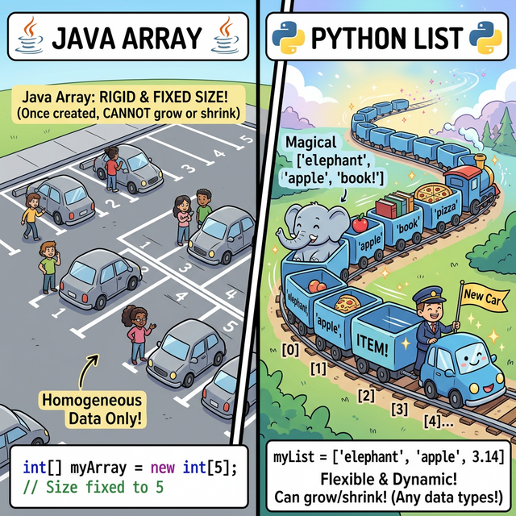
> 💡 **웹툰 비유:** 왼쪽 흑백의 'Java Array' 구역은 네모 반듯하고 딱딱한 시멘트 주차장입니다. "차량 5대 제한!"이라고 입구에 박혀있고 크기를 절대 늘릴 수 없으며, 화물차만 모이도록 강제됩니다. 반면 오른쪽의 'Python List' 구역은 마법의 무한 고무 기차입니다. 칸이 모자라면 기차가 쭈욱 늘어나서 새로운 칸을 무한히 만들어내고, 한 칸에는 무거운 정수를, 다음 칸에는 가벼운 글자를, 다른 칸에는 강아지를 욱여넣어도 기차는 활짝 웃으며 달립니다.

---

## 2. 시멘트 배달부와 고무 기차의 동작 원리

컴퓨터 메모리 관점에서 배열과 리스트의 시각적인 작동 방식을 비교해 보겠습니다.

> 💡 **다이어그램 해석:** 
> *   **왼쪽(Array)**: 처음에 방을 3개만 예약했기 때문에, 4번째 데이터를 넣으려 하면 메모리 한계선(Wall)에 머리를 부딪혀 `ERROR!`를 뿜어냅니다. 또한 색깔이 모두 파란색(순수 int)으로 고정되어 있습니다.
> *   **오른쪽(List)**: 숫자(`10`), 글자(`"Hi"`), 불리언(`True`) 등 형태와 크기가 전혀 다른 데이터들이 줄줄이 연결(화살표)되어 기차를 이룹니다. 새로운 값이 들어올 때마다 파이썬 엔진이 알아서 새로운 칸을 뒤에 자동(`Auto`)으로 생성하여 연결해 줍니다. 

### 🧱 타 언어 배열 (Array)의 한계점
1. **크기 고정선언**: `int[] arr = new int[5];` 처럼 처음에 5개의 방을 파겠다고 선언하면, 나중에 6번째 손님을 모시지 못합니다. (아예 이사해서 집을 새로 부수고 지어야 합니다.)
2. **단일 타입 강제**: 숫자 전용 주차장에는 숫자가 아닌 문자나 객체가 절대 들어올 수 없습니다.

### 🚂 파이썬 리스트 (List)만의 혁신
1. **무한한 신축성(Dynamic Array)**: 동적 배열. 요소를 빼면 알아서 줄어들고, 계속 집어넣으면 운영체제 메모리가 허락하는 한 무한히 팽창합니다. 개발자가 메모리 관리를 신경 쓸 필요가 없습니다.
2. **타입의 해방**: 파이썬 리스트 안에는 숫자, 글자, 함수, 심지어 **또 다른 리스트까지 모두 짬뽕으로 욱여넣을 수 있습니다.** 파이썬에게 리스트는 단순한 값 덩어리가 아니라 **'객체 메모리 주소(Reference)들의 모음집'**이기 때문입니다.

---

## 3. 리스트 실전 생성법과 확인

파이썬에서 리스트를 세상 밖으로 꺼내는 기초적인 두 가지 방법과, 내장 함수 `range()`를 이용한 초고속 대량 생산 기법을 알아봅니다.

```python
# 1. 대괄호 [ ] 를 사용하는 가장 흔하고 직관적인 방법
empty_list = []                  # 아무것도 없는 텅 빈 리스트 (방만 파놓음)
numbers = [1, 2, 3, 4, 5]        # 정수만 깔끔하게 들어있는 리스트
mixed = [1, "Apple", 3.14, True] # 짬뽕 리스트 (숫자, 글자, 소수, 논리형 혼합)
nested = [1, 2, ["A", "B"]]      # 리스트 안에 품어진 또 다른 리스트 (중첩)

print(mixed)
# 출력: [1, 'Apple', 3.14, True]
```

`list()` 껍데기 변환 기계를 사용하면, 글자 배열 뭉치나 범위를 강제로 잘게 찢어 리스트 방 안에 하나씩 배정해 줍니다.

```python
# 2. list() 변환 함수 사용 (문자열 폭파)
word = list("Python") 
print(word)
# 출력: ['P', 'y', 't', 'h', 'o', 'n'] (알파벳 한 글자씩 분해되어 리스트에 조립됨)

# 3. range()를 활용한 초고속 순차 번호 리스트 공장
zero_to_four = list(range(5))       # 5 튕기기 전까지 (0, 1, 2, 3, 4)
odd_numbers = list(range(1, 10, 2)) # 1부터 9까지 2칸씩(보폭) 건너뛰어!

print("0~4:", zero_to_four)
print("홀수:", odd_numbers)
```

위의 예제들에서 보듯 파이썬 리스트는 생성의 제약이 거의 없습니다. 마음만 먹으면 어떠한 형태의 데이터 덩어리든 `[ ]` 괄호 하나로 가둬서 연속된 순서를 부여할 수 있습니다. 이것이 파이썬 데이터 전처리와 빅데이터의 가장 근본적인 뼈대가 되는 이유입니다.

---

## 학습목표
파이썬 리스트의 가장 큰 무기인 '단일 원소 저격(Indexing)'과 '원하는 범위 도려내기(Slicing)' 기술을 마스터합니다. 음수 인덱스를 활용하여 파이썬 특유의 직관적인 코딩 스타일을 익히고, 보폭(Step)을 조절하여 리스트를 자유자재로 다루는 패턴을 학습합니다.

---

## 1. 타겟 조준 타격! 인덱싱 (Indexing)

수조 안에 나란히 들어있는 물고기들 중 특정한 위치에 있는 녀석만을 정확히 집어내는 기술입니다.
가장 중요한 규칙은 방 번호가 1이 아니라 **무조건 0번**부터 시작한다는 점입니다.

```python
inventory = ["물약", "단검", "방패", "투구", "지도"]

print(inventory[0])   # 앞에서 첫 번째 방: 물약
print(inventory[1])   # 앞에서 두 번째 방: 단검
print(inventory[2])   # 앞에서 세 번째 방: 방패
```

### 🔥 파이썬만의 사기 기술: 음수 인덱스
C나 자바에서는 전체 길이값을 알아내서 `length - 1` 과 같은 복잡한 수식을 거쳐야 맨 뒤의 아이템을 꺼낼 수 있습니다. 하지만 파이썬은 **음수 인덱스(-1, -2)**를 지원하여 뒤에서부터 거꾸로 매우 직관적으로 셀 수 있습니다.

```python
# 전체 길이를 몰라도 맨 뒤, 그 앞의 아이템을 척척 꺼냅니다.
print(inventory[-1])  # 맨 뒤에서 1번째 녀석: 지도
print(inventory[-2])  # 맨 뒤에서 2번째 녀석: 투구
print(inventory[-5])  # 맨 뒤에서 5번째 (맨 앞): 물약
```

---

## 2. 무자비한 칼날! 슬라이싱 (Slicing)

원소 하나만 꺼내는 것을 넘어, 거대한 리스트의 허리를 잘라 **내가 원하는 덩어리(Sub-list)만 새로운 접시에 담아내는 기술**입니다.

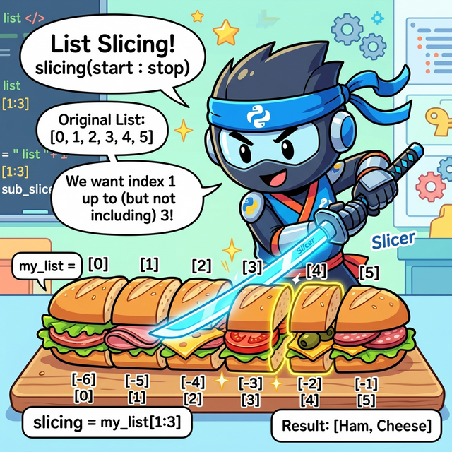
> 💡 **웹툰 비유:** 멋진 파이썬 로고를 단 닌자 로봇이 길다란 샌드위치(리스트)를 레이저 카타나(검)로 `[1:4]` 정확히 분할하여 토막 냅니다. 앞부분에는 양수 번호표(0, 1, 2...), 꼬리 부분에는 음수 번호표(-1, -2...)가 붙어있어 닌자가 앞뒤 가리지 않고 칼질을 하는 유쾌한 장면입니다.

슬라이싱의 기본 문법은 `[시작:끝:보폭]` 입니다.
시작점은 포함(Include)되지만, 끝점은 반드시 1칸 이전에 멈춥니다(Exclude). 

> 💡 **다이어그램 해석:** `numbers[1:4]` 명령을 내렸을 때, 레이저가 1번 방(20) 앞에서 시작하여 4번 방 앞에서 정확히 멈추며 `[20, 30, 40]` 3개의 엘리먼트만 쏙 뽑아 복사해 내는 시각적 과정입니다. (원본 데이터는 절대 손상되지 않고, 잘린 덩어리의 **복사본**을 반환합니다.)

```python
numbers = [10, 20, 30, 40, 50, 60]

print(numbers[1:4])   # 1번칸 시작 ~ 3번칸 끝 (4번칸 직전 컷!): [20, 30, 40]
print(numbers[:3])    # 처음부터 2번칸 끝(3번 앞): [10, 20, 30]
print(numbers[3:])    # 3번칸부터 끝까지: [40, 50, 60]
print(numbers[:])     # 처음부터 끝까지 통째로 (원본 복제본 생성 시 가장 많이 씀): [10, 20, 30, 40, 50, 60]
```

### 3. 보폭(Step) 점프와 리스트 뒤집기의 예술
슬라이싱의 숨겨진 세 번째 파라미터 `보폭`을 조절하면, 징검다리를 건너뛰듯 아이템을 뽑아내거나 기차 방향을 통째로 돌려버릴 수 있습니다.

```python
# 1. 징검다리 건너뛰기
print(numbers[::2])   # 처음부터 끝까지 2칸씩 점프: [10, 30, 50]
print(numbers[1::2])  # 1번칸부터 끝까지 2칸씩 점프 (짝수 번째 녀석들): [20, 40, 60]

# 2. 세상에서 가장 우아하고 역동적인 리스트 뒤집기 스킬
# 보폭으로 -1을 주는 순간, 파이썬 엔진은 거꾸로 달려가며 데이터를 뒤집어 담습니다.
print(numbers[::-1])  # 역순 배열: [60, 50, 40, 30, 20, 10]
```

---

## 4. 슬라이싱의 특수 능력: 통째로 갈아치우기

슬라이싱 방식을 `=` (대입 연산자) 장비와 결합하면, 리스트 안락사의 일부분을 들어내고 완전히 다른 덩어리로 **치환(Replace)**해 버리는 고급 기법이 가능합니다.

```python
colors = ["빨강", "주황", "초록", "파랑", "보라"]

# 1번 ~ 2번(초록) 자리를 칼로 도려내고, 그 빈 자리에 거대한 덩어리를 우겨 넣습니다.
colors[1:3] = ["노랑", "황금", "은색"]

print(colors) 
# 출력: ['빨강', '노랑', '황금', '은색', '파랑', '보라'] (길이가 자동으로 늘어나는 기적!)

# 🚨 주의: 인덱싱 하나로 대입하면 리스트 전체가 통으로 구겨져 하나로 들어갑니다.
colors[0] = ["블랙", "화이트"]
print(colors) 
# 출력: [['블랙', '화이트'], '노랑', '황금', '은색', '파랑', '보라']
```

---

## 학습목표
한 번 만들어진 리스트 안에 값을 자유롭게 밀어 넣고, 중간에 새치기를 하며, 값을 색출해 파괴하거나 끄집어내는 **리스트 고유 생존 메서드(`append`, `insert`, `remove`, `pop`)**를 마스터합니다. 또한 데이터를 분석할 때 포장과 해체를 돕는 강력한 도우미 함수 `zip`과 `enumerate`의 동작을 이해합니다.

---

## 1. 값을 욱여넣고 뽑아내는 메서드 4대장

리스트 데이터를 뒤쪽으로 밀어 넣거(`append`)나 중간에 새치기(`insert`)하는 원리, 그리고 지목해서 삭제(`remove`)하거나 맨 뒷사람 멱살을 잡고 꺼내는(`pop`) 원리를 그림과 함께 살펴봅니다.

> 💡 **다이어그램 해석:** 
> *   `append("물병")`: 기차 맨 뒤쪽 꼬리에 얌전하게 새로운 칸이 하나 추가됩니다.
> *   `insert(0, "횃불")`: 0번이라는 선두 자리에 무자비하게 비집고 들어갑니다. 기존에 있던 사람들은 모두 뒤쪽으로 한 칸씩 강제로 밀려납니다. 

```python
pack = [] # 텅 빈 인벤토리 가방

# 1. 꼬리에 밀어넣기 (가장 빠르고 대중적인 방법)
pack.append("지도")
pack.append("물병")  # ['지도', '물병']

# 2. 중간에 새치기 삽입 (0번 자리에 횃불을 쑤셔 넣습니다)
pack.insert(0, "횃불") # ['횃불', '지도', '물병']

# 3. 데이터 자체를 지명 수배하여 삭제
# 만약 "지도"가 여러 개면 가장 앞에 있는 하나만 삭제합니다.
pack.remove("지도")    # ['횃불', '물병']

# 4. 맨 뒷사람 목덜미를 잡고 밖으로 끄집어내기 (pop)
# 데이터를 리스트에서 지우는 동시에, 그 지워진 값을 돌려받아 다른 변수에 저장할 수 있습니다!
dropped_item = pack.pop()
print("떨군 아이템:", dropped_item) # 물병
print("남은 가방:", pack)         # ['횃불']
```

---

## 2. 유용한 리스트 도우미 내장 함수 (zip, enumerate)

리스트를 썰어서 분석판 위에 올릴 때 압도적으로 코드를 줄여주는 파이썬 전용 마법사들입니다.

### 2.1 zip() 지퍼 채우기 (데이터 조합)
서로 다른 출석부의 이름 리스트와 점수 리스트를 양쪽 지퍼 톱니바퀴 맞물리듯 위에서부터 착착 쌍으로 짝지어(Tuple 묶음) 줍니다.

```python
names = ['철수', '영희', '민수']
scores = [90, 85, 100]

# 자바처럼 굳이 0부터 i를 돌리지 않고 리스트 2개를 통째로 물려버립니다.
for name, score in zip(names, scores):
    print(f"학생 이름: {name}, 점수: {score}")

# 결과:
# 학생 이름: 철수, 점수: 90
# 학생 이름: 영희, 점수: 85
# 학생 이름: 민수, 점수: 100
```

### 2.2 enumerate() 번호표 발급기
단순히 값만 꺼내는 게 아니라, 은행 창구 번호표 기계처럼 **"현재 몇 번째 티켓표를 끊으며 값을 꺼내는 중인지"** 번호표 숫자 인덱스(`index`)를 매번 자동으로 덧붙여 줍니다.

```python
movies = ['인셉션', '기생충', '인터스텔라']

# i 에는 자동 0, 1, 2 번호가, movie 에는 영화 이름이 동시에 들어옵니다.
for i, movie in enumerate(movies):
    print(f"{i}번 랭킹 영화: {movie}")

# 결과:
# 0번 랭킹 영화: 인셉션
# 1번 랭킹 영화: 기생충
# 2번 랭킹 영화: 인터스텔라
```

---

## 학습목표
타 프로그래밍 언어에서 파이썬으로 넘어온 개발자들이 가장 많이 당황하고 피를 토하는 '리스트 메모리 참조(Reference)' 현상을 완벽히 파악합니다. 원본 데이터를 보존하며 안전하게 복제판을 떠내는 슬라이싱 트릭과 얕은/깊은 복사(Shallow vs Deep Copy)의 원리를 이해합니다.

---

## 1. 🚨 리스트 메모리 주의보 (Shallow Copy Bug)

우리가 파이썬에서 `a = [1, 2, 3]` 이라고 적을 때, 파이썬은 변수 `a` 안에 `[1, 2, 3]`이라는 무거운 상자 전체를 집어넣지 않습니다. 
대신, 저 멀리 안전한 창고(메모리힙) 공간에 `[1, 2, 3]` 상자를 하나 놔두고, 변수 `a`에게는 그 상자를 가리키는 **빨간색 레이저 포인터(메모리 주소, Reference)** 만 쥐여줍니다.

### 예제: 원본이 파괴되는 얕은 복사의 공포
이 특징을 모른 채, 아무 생각 없이 `b = a` 형태로 다른 변수에 백업본을 만들려다가 대참사가 발생합니다.

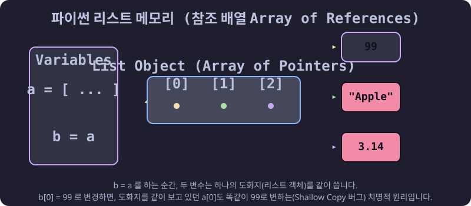
> 💡 **다이어그램 해석:** `b = a` 라는 명령어를 치는 순간, `b` 변수는 a의 리스트 도화지를 공들여 새롭게 복사(Ctrl+C)해 오지 않습니다! 단순히 a가 들고 있던 똑같은 레이저 포인터를 복사받아, **결국 a와 완전히 동일한 도화지를 노려보게 됩니다 (Shallow Copy)**. 이 상태에서 누군가 `b[0] = 99` 라고 값을 바꾸면, a는 건드리지도 않았는데 `a[0]`마저 `99`로 폭발해 버리며 치명적인 논리적 오류를 남깁니다.

```python
a = [1, 2, 3]
b = a          # 🚨 위험! 데이터 복사가 아니라, 뇌파(주소)를 동기화한 것입니다.

b[0] = 99      # B가 자기 소유인 줄 알고 0번 방을 99로 바꿨더니...

print("b 리스트:", b) # [99, 2, 3] -> 당연히 변했습니다.
print("a 리스트:", a) # [99, 2, 3] -> 😱 충격! 건드리지도 않은 원본 a까지 변질되었습니다!
```

---

## 2. 해결책: 진짜 복사본 뜨기 (원본을 지키는 방패)

원본 `a`는 소중하게 지키면서 `b`가 마음껏 놀 수 있도록 하려면 어떻게 해야 할까요?
a의 내용물 요소들만 똑같이 베껴서, 레이저 포인터가 가리키는 방향을 아예 다른 곳에 있는 **새로운 도화지(독립된 메모리 방)**로 만들어주어야 합니다.

### 방법 1: 가장 파이썬다운 슬라이싱 방어 `[:]`
가장 흔히 쓰이는 테크닉입니다. 시작점부터 끝점까지 전부 잘라서 '복사본'을 뱉어내는 슬라이싱의 특성을 이용하여 빈 방으로 던져줍니다.
```python
a = [1, 2, 3]
b = a[:]       # [:] 는 "내용물만 똑같이 베껴서 아예 새 방을 파줘!" 라는 뜻입니다.

b[0] = 99
print("원본 a:", a) # [1, 2, 3] -> 복사본인 b가 난리를 쳐도 a는 평화롭습니다!
print("복사본 b:", b) # [99, 2, 3]
```

### 방법 2: 명시적인 `.copy()` 메서드
가독성을 높이기 위해 직관적인 함수를 호출할 수도 있습니다.
```python
a = [1, 2, 3]
c = a.copy()   # 원리가 슬라이싱 [:] 과 완전히 같습니다.

c[1] = 88
print("원본 a:", a) # [1, 2, 3]
print("복사본 c:", c) # [1, 88, 3]
```

---

## 3. 심화: 이중 리스트와 깊은 복사 (Deep Copy)

하지만 얕은 복사(`[:]` 나 `.copy()`)마저 무력화되는 최악의 상황이 있습니다. 바로 **"리스트 안에 또 리스트가 있는 경우(중첩 리스트)"** 입니다. 
얕은 복사는 가장 바깥쪽에 있는 껍데기 상자만 새로 만들 뿐, 그 상자 안에 들어있는 내부 리스트의 레이저 포인터까지 끊어주지는 못합니다. 

이럴 때는 파이썬 기본 장착 모듈인 `copy` 라이브러리의 무적기 **`deepcopy()`** 를 꺼내야만 내부의 내부 메모리까지 완벽하게 분리 절단해 냅니다.

```python
import copy

matrix_a = [[1, 2], [3, 4]]

# 1. 얕은 복사 실패 사례 (내부 연결이 끊기지 않아 원본이 또 파괴됨)
matrix_b = matrix_a.copy()
matrix_b[0][0] = 99
print("내부가 파괴된 matrix_a:", matrix_a) # [[99, 2], [3, 4]]

# 2. 깊은 복사 성공 사례 (완벽한 복제 클론 생성)
matrix_target = [[1, 2], [3, 4]]
matrix_c = copy.deepcopy(matrix_target)
matrix_c[0][0] = 99
print("안전하게 보호된 matrix_target:", matrix_target) # [[1, 2], [3, 4]]
```

---

## 학습목표
파이썬이 오늘날 빅데이터와 인공지능 분야의 표준 언어로 군림할 수 있었던 가장 강력한 문법적 특징 중 하나인 '리스트 컴프리헨션'을 배웁니다. 지루한 4~5줄의 반복/조건 로직을 단 1줄의 우아한 예술적인 구문으로 압축하는 마법을 체감합니다.

---

## 1. 컴프리헨션(Comprehension)이란?

컴프리헨션(Comprehension)의 원래 사전적 의미는 '이해력, 함축'입니다. 프로그래머 사이에서는 방대한 `for` 반복문과 `if` 조건문의 덩어리를 고압축 기계에 밀어 넣어, **단 1줄짜리 대괄호 `[ ]` 문장으로 '함축/내포'시켜 새로운 리스트를 동적으로 창조했다는 뜻**으로 통합니다.

> 💡 **다이어그램 해석:** 파이썬 뱀 마법사가 `for`와 `if`가 세로로 뚱뚱하게 늘어선 4줄짜리 지루한 코드를 강력한 프레스 압축 기계에 집어넣어, 순식간에 `[결과 for 변수 in 박스 if 조건]` 이라는 얇고 날렵한 1줄짜리 황금빛 띠(리스트)로 찌그러뜨리는 시각적 과정입니다.

---

## 2. 기본 문법의 해부 구조

문법을 읽을 때는 제일 왼쪽 수식이 가장 마지막에 실행되며, 오른쪽 방향(`for` -> `if`) 순서로 문장이 해석된다고 생각하면 편합니다.

> `[ (1.여기에 모을 결괏값) (2.값을 계속 뽑아낼 for문) (3.필터링할 if 조건문) ]`

```python
# 문법 기본 원형
# list_name = [ <expression> for <item> in <iterable> if <condition> ]
```

---

## 3. 예제 1: 구식 코드와 파이썬 장인의 1줄 비교

`0부터 9까지의 숫자 중, '짝수'들만 골라서 각각 '제곱'을 한 리스트를 만들어라!` 라는 지시사항을 프로그래밍 해봅시다.

### ❌ 자바(Java)/C언어 관성의 지루한 코드 (총 5줄 차지)
```python
result = []
for x in range(10):          # 1. 0~9 번 반복하면서 
    if x % 2 == 0:           # 2. 짝수인지 검사하고
        result.append(x ** 2) # 3. 제곱해서 빈 리스트 꼬리에 차곡차곡 넣는다.

print("구식 방법:", result) # [0, 4, 16, 36, 64]
```
수행 시간도 상대적으로 느리고, 코드가 너무 길고 뚱뚱합니다.

### 🐍 파이썬 장인의 리스트 컴프리헨션 (단 1줄!)
```python
# 읽는 순서: (2번: x를 0~9 돌리면서) -> (3번: 짝수이면) -> (1번: x**2만 결과로 모아라!)
magical_result = [x ** 2 for x in range(10) if x % 2 == 0]

print("마법의 1줄:", magical_result) # [0, 4, 16, 36, 64]
```
코드가 짧아져 보기 좋을 뿐만 아니라, C 기반의 최적화된 내부 C루틴을 타기 때문에 직접 `.append()`를 연타하는 것보다 실행 속도도 훨씬 빠릅니다.

---

## 4. 예제 2: 조건에 따라 글씨 다르게 찍기 (if-else 분기)

컴프리헨션 안에서 조건을 걸어 필터링(삭제)만 하는 게 아니라, `if-else` 삼항 연산자를 활용하여 데이터의 모습을 180도 뒤집어 박아 넣을 수도 있습니다. `else`가 등장하면 문법 순서가 앞쪽으로 당겨지니 주의하세요!

> `[ (<조건참이면_출력> if <조건> else <거짓이면_출력>) for <변수> in <박스> ]`

```python
# 1부터 5까지 숫자를 꺼내면서, 짝수면 'Even', 홀수면 'Odd'라는 글씨표를 붙입니다.
binary_labels = ['Even' if i % 2 == 0 else 'Odd' for i in range(1, 6)]

print(binary_labels) 
# 출력 결과: ['Odd', 'Even', 'Odd', 'Even', 'Odd']
```

이런 우아한 1줄짜리 기법 덕분에 파이썬은 데이터 과학자들이 가장 사랑하는 파트너 언어가 되었습니다. 세상에 존재하는 모든 수치 데이터 행렬(Matrix) 구조를 단 1줄 만에 갈아 마셔버릴 수 있기 때문입니다.

---

## 학습목표
`math_story`의 [차원(Dimension)](../../../../math_story/src/72_dimensions/index.html) 개념과 파이썬 데이터 구조를 연결합니다. 가장 기초적인 파이썬의 단일 리스트 `[ ]` 구조가 수학적으로 어떻게 방향성을 지닌 1차원 **벡터(Vector)**로 매핑되는지, 컴퓨터가 데이터를 어떻게 기찻길(선) 위의 개미처럼 인식하는지 철학적이고 수학적으로 이해합니다.

---

## 1. 차원(Dimension)이란 무엇인가?

우리는 흔히 4차원, 11차원이라는 단어를 마법이나 공상과학 영화의 전유물로 생각하지만, 수학과 컴퓨터 과학에서 '차원'의 정의는 매우 건조하고 명확합니다.

> **차원(Dimension):** 어떤 공간에서 특정 물체의 위치를 완벽하게 집어내기 위해 **구별해야 하는 '독립적인 숫자(좌표)'의 개수**입니다.

*   **0차원 (점)**: 위치를 설명할 필요가 없는 상태 (숫자 0개)
*   **1차원 (선)**: 기찻길 위의 개미 (위치를 잡기 위해 `x`라는 **거리 숫자 1개** 필요)
*   **2차원 (면)**: 빙판 위의 스케이터 (좌우 `x`, 앞뒤 `y` **숫자 2개** 필요)

파이썬의 가장 기본적인 대괄호 `[ ]` 리스트는 인덱스 번호표(`[0]`, `[1]`, `[2]`) **단 하나만 있으면** 특정 데이터를 정확히 저격할 수 있습니다. 즉, **완벽한 '1차원 궤도'** 인 것입니다.


> 💡 **다이어그램 해석:** 단일 대괄호 1차원 선(Vector)에서 시작하여, 리스트가 리스트를 낳아 2차원 면(Matrix)이 되고, 다시 그 면을 겹겹이 쌓아 3차원 입체 공간(Tensor)으로 진화하는 파이썬 배열 차원(Depth)의 확장을 보여줍니다. 

---

## 2. 1차원 배열 = 수학의 벡터(Vector)

단일 대괄호 안에 나열된 숫자들의 모음 `[10, 20, 30]`을 파이썬에서는 '1차원 리스트'라 부르지만, 고등 수학이나 머신 러닝에서는 이를 **벡터(Vector)**라고 부릅니다. 

벡터는 단순히 '값을 담아둔 상자'가 아니라, 공간 상의 **크기와 방향을 가리키는 화살표** 역할을 합니다. 

```python
# 1. 일상생활의 데이터 (단순 나열형 1차원 배열)
grocery_prices = [1500, 3000, 1000] 

# 2. 물리/공간 수학에서의 벡터 (3D 공간 상의 좌표 점 도착지를 향하는 화살표)
# (x축으로 10, y축으로 5, z축으로 7만큼 뻗어나간 화살표)
velocity_vector = [10, 5, 7] 
```

만약 게임 캐릭터가 2D 공간의 `(x: 3, y: 4)` 위치에 서 있다면, 이는 `[3, 4]` 라는 2개의 엘리먼트를 가진 **1차원 리스트(길이가 2인 1D 벡터)**로 깔끔하게 표현됩니다.

### 🐍 파이썬 1D 벡터 제어하기
```python
# 방향성을 지닌 1차원 벡터
player_pos = [3, 4]  

# 1차원 공간이므로, 인덱스(좌표축) 번호 단 1개만 주면 값을 정확히 추출합니다.
x_coordinate = player_pos[0]  # x축 값 (3) 뽑아내기
y_coordinate = player_pos[1]  # y축 값 (4) 뽑아내기

print(f"플레이어는 가로 {x_coordinate}, 세로 {y_coordinate} 좌표에 위치합니다.")
```

---

## 3. 왜 인공지능은 1차원을 사랑할까? (선형대수학의 시작)

인간은 이미지를 2차원의 가로/세로 사각형으로 바라봅니다. 하지만 가장 원시적이고 강력한 인공지능 신경망(Deep Learning)의 입구는 **무조건 1차원의 일렬로 길게 늘어선 기차 형태(Flattened Vector)**만을 받아들입니다.

예를 들어, `28 x 28` 픽셀을 가진 손글씨 이미지 데이터 (총 784개의 점)가 있다면, 컴퓨터는 이를 `[0, 255, 12, ... ]` 처럼 대괄호 하나에 784개의 숫자가 쭉 달린 **초거대 길이의 1차원 리스트(784차원 벡터)** 로 강제로 펴버린 뒤 신경망에 주입합니다.

우리가 아무렇지 않게 사용하는 기본 파이썬 `[]` 리스트는, 사실 컴퓨터가 가장 빠르고 완벽하게 계산할 수 있는 선형(Linear) 메모리의 본질 그 자체이며 머신러닝의 가장 기본이 되는 데이터 단위입니다.

다음 장에서는 이렇게 길게 누워 있던 1차원 선(Vector)들을 여러 개 쌓아 올려 평면을 만드는 **2차원 행렬(Matrix)**의 세계로 차원을 하나 도약해 보겠습니다.

---

## 학습목표
1차원 선(Vector) 여러 개를 차곡차곡 쌓아 올려 2차원 평면(Plane)을 만드는 파이썬 **중첩 리스트** 기술을 습득합니다. 이는 수학 교과서에서 배우는 **행렬(Matrix)** 개념과 완벽히 일치하며, 엑셀 표의 행/열 데이터를 처리하거나 고전 보드게임을 개발하는 핵심 좌표계(X, Y) 지식입니다.

---

## 1. 리스트를 품은 리스트 (Nested Lists)

이전 챕터에서 1차원 선(Vector)을 다루었다면, 이제 그 선들을 통째로 배열 안에 갈무리하여 2차원 표(Grid)를 구성해 봅니다. 파이썬 리스트는 요소 자체에 '어떤 자료형이든 들어갈 수 있는 유연함'을 가지므로, 단순 변수가 아닌 **또 다른 리스트의 기억상자(주소표)**를 품는 구조가 가능합니다.

가장 대표적인 2차원 형태가 바로 여러분이 익숙하게 다루는 **엑셀(Excel) 스프레드시트** 혹은 게임의 **바둑판 맵**입니다.

```python
# 1. 벡터(선)들 선언
row_0 = [1, 2, 3]  # 0번 행 아파트
row_1 = [4, 5, 6]  # 1번 행 아파트
row_2 = [7, 8, 9]  # 2번 행 아파트

# 2. 선들을 차곡차곡 모아 '면(Matrix)' 행렬을 결성
matrix = [
    row_0,  
    row_1,  
    row_2   
]

# 아래와 같이 한 번의 거대한 2D 배치를 통해 바로 선언하는 것이 일반적입니다.
matrix_shortcut = [
    [1, 2, 3],  # [0번 동]
    [4, 5, 6],  # [1번 동]
    [7, 8, 9]   # [2번 동]
]
```

---

## 2. 레이저 십자 저격: 2D 행렬 타겟팅 (다차원 인덱싱)

1개의 축(`x`축) 기찻길만 있던 1차원 세상에서는 숫자 번호 1개만 있으면 위치 특정이 가능했습니다.
하지만 2차원 엑셀 표에서는, **"몇 번째 줄(Row, 행)에 있는, 몇 번째 칸(Column, 열)"** 인가? 즉, **2개의 연속된 숫자(좌표)** 가 필요해졌습니다.

파이썬에서는 대괄호를 두 번 연속 `[][]` 붙여 좌표 십자 저격 레이저를 구현합니다.

> 💡 **다이어그램 해석:** 파이썬 마법사가 `matrix[2][1]` 이라는 주문을 외냅니다.
> 1) 파란색 레이저가 세로축(행, `y`축)에서 아파트 **2번째 동**(`[7, 8, 9]`)을 먼저 찾습니다. 
> 2) 이어진 초록색 레이저가 가로축(열, `x`축)에서 **1번째 호수**(정중앙 바로 아래칸)를 스캔합니다.
> 두 레이저가 십자선으로 정확하게 교차하는 지점의 데이터 **8**이 추출됩니다.

### 예시: 엑셀 좌표에서 데이터 뽑기
```python
grid = [
    [10, 20, 30], # 0행
    [40, 50, 60], # 1행
    [70, 80, 90]  # 2행
]

# 1단계 추출: 덩어리(행) 전체를 뜯어내기 (2D -> 1D 로 차원 강등)
print(grid[1])  # 출력: [40, 50, 60]

# 2단계 십자 저격: 뜯어낸 덩어리 안에서 원소 하나만 도려내기 (1D -> 0D 스칼라 추출)
print(grid[0][0])  # 제일 앞 가장 윗칸 (0행 0열): 10
print(grid[2][2])  # 오른쪽 맨 하단 (2행 2열): 90
print(grid[1][2])  # 1행의 맨 오른쪽 (1행 2열): 60
```

---

## 3. 심화: 수학적 행렬 연산의 모태

수학교과서에 나오는 행렬(Matrix)의 연산이나 픽셀 이미지의 선형 변환은 결국 파이썬의 이 2차원 배열과 알고리즘 궤도가 수학적으로 완벽하게 맞닿아 있습니다.

### 💻 2차원 리스트 좌표계 이중 순회 탐색법
보드판 전체의 안개(Fog)를 거둬내며 스캔하려면, **이중 for문(Nested Loop)**이라는 문을 통과해야 합니다.
바깥쪽 톱니바퀴가 층(Row)을 서서히 하나씩 내릴 때, 안쪽 톱니바퀴가 오른쪽으로 미친듯이 훑고(Col) 지나가는 스캐닝 방식입니다.

```python
# 틱택토, 픽셀 맵 등을 스캔하는 기본 원형 패턴
for r, row in enumerate(grid):        # 1. 층 단위로 내려가며
    for c, cell in enumerate(row):    # 2. 한 층을 오른쪽으로 탐색하며
        print(f"좌표 ({r}, {c})의 값은 {cell} 입니다.")

# 실행 결과:
# 좌표 (0, 0)의 값은 10 입니다.
# 좌표 (0, 1)의 값은 20 입니다. ...
```

단순한 리스트가 2번 겹쳐 2차원 면이 되었다면, 이것을 세로축(z계)으로 한 번 더 감싸게 된다면 어떤 세상이 펼쳐질까요? 
다음 챕터에서 3차원 **텐서(Tensor)** 공간과 현실 세계의 시뮬레이션을 위한 데이터 구조를 배워보겠습니다.

---

## 학습목표
`math_story`에서 다뤘던 x, y, z 를 파괴하는 **차원의 확장** 개념을 파이썬 리스트의 대괄호 중첩 극한 `[[[ ]]]` 모델로 이해합니다. 3차원 배열 구조가 현실 세계의 동영상, 3D 모델 게임(마인크래프트 등), 의료 CT 스캔 데이터를 어떻게 완벽히 컴퓨터 메모리에 시뮬레이션 해내는지 학습합니다.

---

## 1. 3차원(3D Dimension) 세계와 데이터 덩어리

이전 장에서 확인한 2차원 행렬(Matrix)은 엑셀이나 평면 사진을 다루기에 충분하지만, '높이'나 '시간'이라는 축이 개입하면 결국 3차원으로 진화해야 합니다.

*   1차원 (선): `[1, 2, 3]`
*   2차원 (면): `[ [1, 2], [3, 4] ]`
*   **3차원 (공간): 면을 겹겹이 포개어 입체 큐브(Cube)로 만듭니다. `[ [ [1], [2] ] ]`** 

수학과 머신러닝의 인공지능 연구소에서 이러한 거대한 다차원의 데이터 보따리를 **텐서(Tensor)**라고 칭합니다. Гугл(Google)의 그 유명한 인공지능 프레임워크인 `TensorFlow`의 이름 또한 이 데이터가 흘러가는(Flow) 구조라는 뜻에서 유래했습니다.


> 💡 **웹툰 비유:** 해커가 공중에 떠 있는 빛나는 입체 데이터를 향해 `[Z][Y][X]` 타겟팅을 시도하는 모습입니다. 2차원의 평면이 시간, 깊이 등 새로운 변수(축)를 만나 겹겹이 쌓아 올려지면 이처럼 거대한 3D 정보의 빌딩(Tensor)이 완성됩니다.

---

## 2. 3중 중첩 리스트: 대괄호 속의 대괄호 속의 리스트

이 구조는 마인크래프트(Minecraft)처럼 3차원 좌표계(가로X, 세로Y, 높이Z)로 이루어진 우주 공간을 완벽히 모방해 냅니다.

```python
# 1개의 2차원 매트릭스 (면 1장)
plane_1 = [
    [1, 2], 
    [3, 4]
]

# 또 하나의 2차원 매트릭스 (면 1장)
plane_2 = [
    [5, 6], 
    [7, 8]
]

# 2D 면(Plane) 2장을 높이/깊이 축으로 겹쳐서 '3D 큐브/텐서' 창조!
tensor_3d = [
    plane_1,  # Z축의 0번 깊이에 있는 평판
    plane_2   # Z축의 1번 깊이에 있는 평판
]

# 한 덩어리로 시각화한 거대한 3D 리스트 아키텍처
cube = [
    [ # Z = 0 층
        [1, 2], # Y=0 (X=0, X=1)
        [3, 4]  # Y=1 (X=0, X=1)
    ],
    [ # Z = 1 층
        [5, 6],
        [7, 8]
    ]
]
```

---

## 3. 좌표 파괴: 3차원 레이저 공간 타겟팅 (Z-Y-X)

3개의 독립된 화살표(차원)가 생겼으므로, 원하는 상자 안의 물건을 끄집어내려면 3개의 주소가 연달아 필요합니다. 파이썬 순수 리스트 계층에서는 **높이(깊이 Z) -> 행(Y) -> 열(X)** 순으로 바깥 대괄호부터 안쪽으로 껍질을 벗기며 접근합니다.

> 💡 **다이어그램 해석:** `cube[1][1][1]` 명령 프롬프트에 맞춰 해커의 프로그램이 입체 큐브를 해체합니다.
> 1) 🔴 **Z 레이저 (`[1]`)**: 앞/뒤 두 장의 평면(Plane) 중 **뒤쪽(Z=1층)** 판넬을 선택.
> 2) 🟢 **Y 레이저 (`[1]`)**: 선택된 판넬의 2줄 중 **아래쪽 행(Y=1)** 을 스캔.
> 3) 🔵 **X 레이저 (`[1]`)**: 해당 행의 두 칸 중 **오른쪽 열(X=1)** 에 정확히 십자선을 꽂아 넣어 최종 타겟 숫자 `8`을 황금빛으로 빼냄.

```python
# cube[깊이_Z층][세로_Y열][가로_X열] 로 3번의 타겟팅 도약이 필요합니다.

# 1. 0층(Z) 블록 더미 통째로 분리 (3D -> 2D 뜯어내기)
print(cube[0]) # 출력: [[1, 2], [3, 4]]

# 2. 0층의 가장 앞(Y=0) 줄기 분리 (2D -> 1D 로 뜯어내기)
print(cube[0][0]) # 출력: [1, 2]

# 3. 마침내 값 추출! (가장 깊숙한 내부 알맹이 1D -> 0D 스칼라 도출)
print(cube[0][0][0]) # 출력: 1

# [실전 연습]
# 1층(Z=1) 뒤편(Y=1) 가장 우측(X=1)의 데이터를 찍어보세요!
print(cube[1][1][1]) # 출력: 8
```

---

## 4. 인공지능이 세계를 인식하는 관점 (N-차원)

3차원 배열을 초과하는 아인슈타인의 시공간이나 초끈 이론의 11차원 같은 수학적 개념들도 컴퓨터에게는 전혀 무섭지 않습니다. 사람 머리로는 4차원 우주의 시계(Hypercube, 튜서랙트)를 그림으로 상상하기 불가능하지만, 파이썬에게는 단순히 **대괄호 껍질 `[` 문자를 하나 더 바깥으로 감싸는 것**으로 **4차원**, **5차원**, **11차원 텐서**를 0.001초 만에 창조해 내기 때문입니다.

```python
# 4차원 텐서 (스칼라 값 0의 세계를 표현)
# 사람: 이건 3D 정육면체를 감싸고 있는 4차원의 시간 축인가?! 너무 복잡하다!
# 파이썬: 훗, 그냥 대괄호가 4번 열렸네 ([[[[0]]]]) 쉽네.

tensor_4d = [[[[0]]]]
print(tensor_4d[0][0][0][0]) # 0 출력
```

**[정리]**
컴퓨터 과학 관점의 데이터 전처리(Data Structure)에서:
*   **1D 리스트:** 고객의 장바구니 품목들 (Vector)
*   **2D 리스트:** 엑셀 표와 같은 데이터 행/열의 집계 시트 (Matrix)
*   **3D 리스트:** 동영상(시간의 흐름에 따른 2D 사진 뭉치), 3D 스캔 (Tensor)
*   **4D~11D 텐서:** 복잡한 기계학습 모델 내부에 숨겨진 다양한 특징 벡터의 가중치 행렬들.

이처럼 파이썬 `[ ]` 배열의 무한한 중첩 포용력은 인공지능과 수학이 복잡하고 기괴한 N차원의 세계를 컴퓨터 메모리 안에서 가지고 놀게 해주는 절대적인 힘의 원천입니다.

---

## 📌 학습 목차

### [1. 딕셔너리의 본질: 해시 매핑과 수학적 함수 f(x) = y](#3421-해시-매핑과-수학적-차원의-이해)
파이썬 딕셔너리가 다른 언어의 딱딱한 규칙인 '연관 배열(HashMap)'을 벗어던지고 어떻게 수학적 1:1 대응 원리(사상)를 이루는지 학습합니다. 입력한 암호인 방 번호로 변환시키는 경이로운 `해시(Hash) 알고리즘`의 속도를 시각적으로 배웁니다.

### [2. 딕셔너리 사물함 사용법: 생성 규칙과 조작 수술 (C.R.U.D)](#3422-딕셔너리-생성과-crud-규칙)
딕셔너리 금고를 만들고 데이터를 관리하는 4대 절대 원칙(생성, 읽기, 수정, 삭제)을 마스터합니다. 변하는 것은 통과시켜주지 않는 '단단한 키(Key) 불변성 원칙'의 진정한 의미를 파헤칩니다.

### [3. 딕셔너리 방어선 구축: 생명 연장을 위한 핵심 메서드](#3423-현업-필수-방어막-딕셔너리-고급-메서드)
한 줄의 에러가 전 세계 유저들을 마비시키는 서버 스톱을 막기 위해 프로그래머가 쳐두는 방어막 `get()` 메서드의 위력을 학습합니다. 데이터 융합을 위한 `update()`와 리스트 분해를 위한 `items()` 메서드를 체득합니다.

### [4. 단 한 줄의 미학: 딕셔너리 컴프리헨션(Comprehension)](#3424-지상-최강의-압축-딕셔너리-컴프리헨션)
수학식처럼 단 한 줄의 코드로 무수한 데이터를 필터링하고 걸러내는 파이썬 특유의 압축 병합 기술 `컴프리헨션`과 의류 지퍼처럼 리스트 모양을 한데 엮는 `zip()` 테크닉의 콜라보레이션을 완성합니다.

---

## 학습목표
`math_story`에서 다루는 공간의 변환과 매핑 개념을 파이썬의 **딕셔너리(Dictionary)**와 연결합니다. 다른 프로그래밍 언어의 낡고 긴 '해시맵(HashMap)' 코드를 마법의 수학적 함수기호 $f(x)=y$ 에 빗대어 완벽하게 이해하고, 입력된 열쇠(`Key`)를 메모리 주소로 압축 변환하는 해시(Hash) 알고리즘의 우수성을 깨닫습니다.

---

## 1. 수학적 함수(Function) 와 딕셔너리의 평행이론

우리가 중학교 수학에서 배우는 함수의 가장 기초적인 형태는 $y = f(x)$ 입니다.
어떤 상자(f)에 $x$ 라는 원인(입력값)을 집어넣으면, 무조건 $y$ 라는 결과(출력값)가 튀어나온다는 **1:1 변환 매핑(Mapping)의 법칙**입니다.

*   수학의 함수: 입력값 **정의역(Domain) $x$** $\rightarrow$ 결과값 **치역(Range) $y$**
*   파이썬 딕셔너리: 입력값 **열쇠(Key)** $\rightarrow$ 결과값 **내용물(Value)**

결국, 파이썬의 딕셔너리는 데이터를 $f(Key) = Value$ 라는 수학적 변환 상자로 감싸 놓은 가장 완벽하고 직관적인 "데이터 매핑 구조체"입니다. 이런 이유로 C 언어나 자바 개발자들이 사용하는 딱딱한 기계식 이름인 **'연관 배열(Associative Array)'** 텍스트를 버리고, 우리가 모르는 영어 단어(`x`)를 찾으면 뜻(`y`)이 즉시 튀어나오는 마법의 책, **사전(Dictionary)** 이라는 정식 명칭을 붙이게 되었습니다.

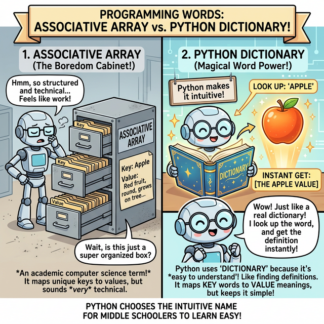
> 💡 **웹툰 비유:** 왼쪽은 `HashMap`이라 적힌 차가운 철제 사물함 공간입니다. 오른쪽은 꼬마 마법사가 사전(Dictionary)을 펼쳐 열쇠(`x`)를 읽자마자 사과(`y`) 홀로그램이 튀어나오는 거대한 수학적 사상(Mapping)의 공간입니다.

---

## 2. 해시(Hash) 알고리즘: 0.001초의 메모리 도약

그렇다면 파이썬은 1억 개의 단어가 들어있는 거대한 딕셔너리 사전 속에서 어떻게 단 1초도 안 걸리고 내가 원하는 단어(`x`)의 뜻(`y`)을 꺼내오는 것일까요? 리스트처럼 처음부터 끝까지 책장을 1억 번 넘겨보는(검색하는) 것일까요? 아닙니다. 여기서 **해시(Hash)** 라는 천재적인 암호화 수학 기법이 등장합니다.

> 💡 **다이어그램 해석:** `x = "Apple"` 이라는 글자(Key)를 `Hash Function(해시 기계)` 에 던져 넣습니다. 이 기계는 글자를 갈아 으깨어 `0x1A2B` 라는 고유한 메모리 방 번호(암호)로 순간 변환시킵니다. 그러면 파이썬은 책장을 처음부터 넘길 필요 없이 텔레포트(O(1) 속도)하여 바로 지정된 방 번호에 숨겨진 `y = "사과"` (Value)를 쏘아 올려 줍니다.

### 🔪 해시(Hash)의 원래 뜻은 '다지다' 
해시브라운 포테이토할 때의 그 감자 으깨기(Hash)입니다. 방대한 크기의 글자나 데이터 덩어리들을 컴퓨터가 알아들을 수 있는 고정된 16진수 메모리 숫자 암호로 **잘게 다져 압축해 버리는 과정**을 뜻합니다. 

이 해시 변환 덕분에 파이썬 딕셔너리 검색 속도는 데이터가 10개든 100만 개든 **항상 동일한 속도(O(1))** 를 자랑하는 사기적인 성능을 발휘합니다. 다차원 텐서들의 거대한 좌표를 관리하는 검색 인덱스의 핵심 메커니즘이기도 합니다.

---

## ☕ Java vs 🐍 Python 스나이퍼 관점 비교

*   **Java의 딱딱한 규칙**: 자바에서 이 해시 다지기 기계를 수동으로 만들기 위해, 항상 무시무시한 구문을 치며 선언해야만 합니다.
    `Map<String, Integer> map = new HashMap<>();` (X는 무조건 글자고, Y는 무조건 숫자야! 라고 제네릭을 지정해야만 동작합니다.)
*   **Python의 우아한 마법**: 수학에서 $f(x)=y$ 에 딱히 숫자인지 글자인지 구구절절 쓰지 않듯, 파이썬 역시 중괄호 `{ }` 하나면 자동으로 내부 해시 계산 엔진이 알아서 `x`와 `y` 타입을 판단해 즉시 텔레포트 망을 엮어줍니다.

다음 장에서는 이 수학적 $f(x)$ 매핑 상자를 실제로 코드상에서 어떻게 만들어내고 조립하는지, 그리고 어떤 변수는 열쇠(`x`)가 될 수 있고, 왜 어떤 변수는 열쇠가 될 수 없는지를 그 원리와 함께 배워보겠습니다.

---

## 학습목표
`f(x)=y` 해시 매핑의 논리를 실제 파이썬 코드상에서 어떻게 만들어내고 부수는지 `C.R.U.D`(생성, 탐색, 수정, 삭제) 4단계 동작을 통해 배웁니다. 더불어 자물쇠(Key)가 되기 위한 절대적인 파이썬 문법의 자격 요건(불변성 Immutable)을 심도 있게 파헤칩니다.

---

## 1. 사물함의 열쇠(Key)에 박힌 절대 마법 규칙 

딕셔너리의 열쇠(Key) 자물쇠에는 아무 단어나 들어갈 수 없습니다. 파이썬 사물함 금고는 **"절대 모양이 변하지 않는 단단한(불변, Immutable) 재질의 열쇠만"** 금고키로 꽂도록 허락합니다.

만약 고무찰흙처럼 크기가 쭉쭉 변하는 '리스트(List)' 같은 걸 열쇠로 박아두면, 나중에 파이썬 해시(Hash) 스캐너가 열쇠의 해시 암호를 계산할 때 값이 이리저리 뒤틀려 영영 금고를 못 열게 되기 때문입니다.

> **✅ 허락되는 단단한 열쇠 후보군:**
> `문자열("Apple")`, `정수(42)`, `실수(3.14)`, `튜플((1, 2))` 등은 안의 내용물이 변하지 않아 통과됩니다.
> 
> **🚨 절대 불가능한 금지 열쇠 후보군:**
> `리스트([1, 2])`, `딕셔너리({'a':1})`, `집합({1})` 등은 크기가 변하므로 자리에 꽂자마자 `TypeError`를 토해냅니다.

*(물론 열쇠가 아닌 내용물 **Value** 자리에는 크기가 변하는 코끼리든 리스트든 또 다른 딕셔너리든 전부 다 때려 넣을 수 있습니다. 무한한 포용력을 자랑합니다.)*

---

## 2. 딕셔너리의 C.R.U.D (Create, Read, Update, Delete)

프론트엔드와 백엔드 등 모든 프로그램의 기본은 정보를 **만들고(C), 읽고(R), 고치고(U), 지우는(D)** 4단계뿐입니다.
딕셔너리의 기본 사물함 역시 이 체계적인 4동작을 직관적으로 수행합니다.

> 💡 **다이어그램 해석:** 단 하나의 문법 체계(`dict["Key"]`)만으로 이 4가지 조작 수술을 전부 다 처리하는 경이로운 파이썬 다용도 칼날의 시각적 형태입니다. 새로운 값을 넣고, 빼고, 덮어쓰고, 문을 날려버리는 과정을 관찰하세요.

### ① 생성 (Create): 빈 금고를 짓고 물건 넣기
중괄호 `{ }`가 딕셔너리의 영혼입니다. 리스트는 대괄호 `[ ]` 였죠. 
반드시 `열쇠 : 값`의 콜론 짝꿍 형태로 방을 설계해야 합니다.

```python
# 1. 텅 빈 사물함 계약하기
inventory = {} 

# 2. 계약하자마자 사물함에 데이터 쓸어 담기! (콤마로 구분)
character = {
    "name": "홍길동",  # 문자열 키
    "level": 1,      # 동일하게 문자열 키
    99: "max_hp"     # 숫자도 키로 꽂을 수 있습니다.
}
```

### ② 추가 및 수정 (Update / Insert 똑같음)
딕셔너리의 세계에서는 방 번호(0번 방)의 개념이 없기 때문에 방을 '추가'하는 명령어나 '수정'하는 명령어가 **동일합니다.** 
> "해당 열쇠가 이미 있다면 값을 덮어써 수정하고, 처음 보는 열쇠라면 즉시 새로운 사물함을 건설하라!" 

```python
profile = {"job": "전사", "hp": 100}

# [수정] 이미 hp 마크가 박힌 방이 있으므로, 안의 내용물만 50으로 교체(Update)
profile["hp"] = 50 

# [추가] mp 마크가 달린 방은 없으므로, 즉시 새로 벽을 허물어 방을 만듦(Insert)
profile["mp"] = 300 

print(profile) # {'job': '전사', 'hp': 50, 'mp': 300}
```

### ③ 읽기 탐색 (Read)
가장 많이 쓰이는 작업입니다. 원하는 값을 보기 위해 오직 `Key`라는 네임택 만을 스캐너에 밀어 넣습니다.

```python
print(profile["job"])  # 출력: 전사
# print(profile[0])    # 🚨 리스트 버릇대로 0번 방을 찾으면 즉시 KeyError 사망!
```

### ④ 무자비한 철거: 폭파 (Delete)
해당 사물함 정보가 아예 쓸모없어졌을 때 `del` 키워드의 C4 폭탄을 달아 사물함을 메모리에서 통째로 소멸시킵니다.
```python
del profile["hp"]

print(profile) # {'job': '전사', 'mp': 300} -> hp 방이 아예 흔적 없이 날아감
```

단순한 이 4가지의 무빙만으로도 딕셔너리는 거의 모든 형태의 게임 프로필, 앱 데이터, 주소록을 완벽하게 관장할 수 있는 지배력을 손에 쥐게 됩니다. 다음 장에서는 서버를 안정적으로 지켜내는 실무 방어막 기술들을 배워보겠습니다.

---

## 학습목표
에러(KeyError)가 한 번 터지면 전체 서버가 마비되는 상용 서비스에서 개발자들의 생명줄이 되어주는 절대 방어막 **`.get()` 탐색 기술**을 체화합니다. 또한 다가오는 JSON 데이터 파싱과 API 교류에 특화된 두 딕셔너리의 합병 **`.update()`** 와, 리스트처럼 덩어리를 잘라내는 **`.items()`** 분석 도구를 마스터합니다.

---

## 1. 🛡️ 딕셔너리 최대 무기: `.get()` 생명 보호막

초보 개발자와 프로 개발자를 구분하는 가장 강력한 잣대 하나를 꼽으라면 바로 `dict["없는키"]` 를 쓰느냐, `dict.get("없는키")` 를 쓰느냐입니다. 우리가 무지성으로 일반 대괄호를 사용해 없는 단어를 사물함에서 꺼내려 하면, 파이썬은 자비 없이 `KeyError`를 화면에 토해내며 **서버의 심장을 즉시 멈춰(다운) 버립니다.**

> 💡 **다이어그램 해석:** 일반 인덱싱(대괄호 폭탄)이 없는 키를 찾으려 들이박으면, 내부에서 감당하지 못하고 `KeyError` 대폭발을 일으켜 서버가 정지합니다. 반면, 우측의 초록색 `.get()` 방어막은 잘못된 키가 들어와도 부드럽게 튕겨내며 시스템 폭발을 흡수하고 **지정한 안전모(기본값)**를 돌려보내 줍니다.

### [실전 예제] 백엔드 유저 프로필 조회 시스템 방어

```python
user_login_info = {
    "id": "jinydev",
    "email": "jiny@test.com"
} # 🚨 이 유저는 phone 번호가 없습니다!

# ❌ 초보자의 실수: 프로그램 사망 트리거
# print(user_login_info["phone"]) -> KeyError 발생! 뒤 라인부터 코드 아예 실행 불가능!

# O 프로의 방패 전개: "phone이라는 열쇠로 열되, 없으면 쿨하게 '010-0000-0000'이라고 쳐 줘!"
safe_phone = user_login_info.get("phone", "010-0000-0000")

print(f"가입자 전화번호: {safe_phone}") 
# 결과: "가입자 전화번호: 010-0000-0000" (자연스럽게 에러 없이 대처 완료)

# 만약 기본값을 안 주면 파이썬은 조용히 None (빈 껍데기)을 쥐여줍니다.
empty_check = user_login_info.get("address")
print(empty_check) # 결과: None
```

`.get()`은 특히 공공 API에서 데이터를 긁어와(JSON) 내 데이터베이스에 저장할 때, **데이터가 구멍 났을까 봐 조마조마하며 수십 개의 if 문을 도배하는 대신** 단 1줄의 우아한 방어 코드로 끝낼 수 있어 백엔드 서버 개발 시 숨 쉬듯 코딩하게 되는 절대 마법입니다.

---

## 2. 융합과 병합: `.update()` 스킬

여러 경로에서 수집된 두 개의 거대한 딕셔너리 정보판(예: 사용자 기본 정보 + 결제 정보)을 하나로 융합하고 싶을 때가 있습니다. 파이썬에서는 `.update()` 함수를 써서, A 금고 위에 B 금고 내용물을 통째로 시원하게 들이부을 수 있습니다.

> **⚠️ 병합 충돌 규칙:**
> "먼저 온 놈이 왕이 아니다. 가장 **나중에 들어온(Update된) 데이터**가 중복된 키(Key)의 왕좌를 무자비하게 덮어써서 차지한다!"

```python
# A 데이터베이스 (기존 시스템)
old_system = {'x': 1, 'y': 2}

# B 데이터베이스 (방금 도착한 새로운 업데이트 패치 요약본)
new_patch = {'y': 99, 'z': 4}  # y가 중복된다!

# 낡은 시스템에 새로운 패치 금고를 들이붓기
old_system.update(new_patch)

# y의 값이 2에서 가장 최신인 99로 자연스럽게 덮어 씌워졌습니다!
print(old_system) 
# 결과: {'x': 1, 'y': 99, 'z': 4}
```

---

## 3. 부검 해체기: `.keys()`, `.values()`, `.items()`

우리가 리스트(배열)를 좋아하던 이유는 `for` 반복문을 썼을 때 순서대로 차례차례 이빨을 뽑듯 데이터를 열람하기 좋았기 때문입니다. 파이썬 딕셔너리도 이 세 가지 부검 칼날을 쓰면 자신을 분해해 순차적인 리스트 묶음처럼 동작하게 만들어 줍니다.

```python
mart = {'라면': 1200, '과자': 800, '물': 500}

# 1. 뼈 날대(열쇠)들만 수집하기
print(mart.keys())    
# 결과: dict_keys(['라면', '과자', '물']) -> 장바구니 품목명만 검사할 때

# 2. 내장(값)들만 수집하기
print(mart.values())  
# 결과: dict_values([1200, 800, 500]) -> 쇼핑 총 가격 합산할 때 ( sum(mart.values()) )

# 3. 뼈와 살을 묶어서(Tuple) 통째로 꺼내기 (🌟 가장 많이 씀)
print(mart.items())   
# 결과: dict_items([('라면', 1200), ('과자', 800), ('물', 500)])
```

### 💡 `.items()` 와 `for` 문의 궁극의 콤보
실무에서 딕셔너리의 내용물을 화면에 출력할 때 90% 이상은 무조건 이 공식 구문을 사용합니다. `items()`가 뱉어내는 튜플 덩어리를 2개의 변수(`item`, `price`)가 찢어 받습니다.

```python
# 영수증 출력 기계
for item, price in mart.items():
    print(f"상품명: {item} / 계산하실 금액: {price}원")

# 출력결과:
# 상품명: 라면 / 계산하실 금액: 1200원
# 상품명: 과자 / 계산하실 금액: 800원
```

다음 장에서는 우리가 `01_list` 편에서 보았던 궁극의 1줄짜리 요약 압축기능인 **딕셔너리 컴프리헨션(Dictionary Comprehension)**을 통해 초고속으로 사물함을 조립하는 마법을 살펴보겠습니다.

---

## 학습목표
`for`문 여러 줄을 사용해 딕셔너리 금고를 하나씩 채우던 원시적이고 장황한 코드를 버리고, 파이썬 특유의 압축 기술인 **컴프리헨션(Comprehension)** 과 여러 리스트의 짝을 찾아 지퍼(Zip)를 채우는 **`zip()` 함수**를 결합하여 단 한 줄 만에 대형 딕셔너리를 생산하는 고급 테크닉을 익힙니다. 

---

## 1. 두 쌍의 리스트를 뭉쳐서 사전으로 만들기 (`zip()`)

실무를 하다 보면, 데이터베이스 테이블이나 외부 파일에서 키(Key) 묶음과 형태가 다른 값(Value) 묶음을 각각 분리된 리스트 조각으로 전달받을 때가 많습니다. 이것들을 짝꿍끼리 묶어 하나의 거대한 딕셔너리로 결합해야 비로소 데이터 처리가 편해집니다.

이때 옷의 양쪽 지퍼를 서로 엇갈리게 맞물려 하나로 잠그는 **`zip()` 내장 함수**가 환상적인 활약을 합니다.

> 💡 **다이어그램 해석:** 파란색 열쇠(문자열 그룹)와 초록색 값(가격 숫자 그룹)이 컴프리헨션과 `zip()` 결합 기계를 통과하면, 위아래로 한 쌍씩 찰싹 달라붙으며 노란색의 단단한 통짜 딕셔너리 블록 `{Key: Value}` 으로 재탄생합니다.

### 🐛 `for`루프를 쓴 고전적인(비효율적인) 융합 방식
```python
names = ['Apple', 'Banana', 'Cherry']
prices = [1.2, 0.5, 2.5]

# 고전 시대의 4줄짜리 노가다 방식
mart_dict = {}                          # 1. 일단 빈껍데기를 만들고
for n, p in zip(names, prices):         # 2. 두 리스트를 zip으로 묶어 하나씩 뽑으면서
    mart_dict[n] = p                    # 3. 빈껍데기에 수동으로 계속 밀어 넣는다

print(mart_dict)
# {'Apple': 1.2, 'Banana': 0.5, 'Cherry': 2.5}
```

### 🦋 딕셔너리 컴프리헨션 (1라인 단축 마법)
위 4줄짜리 코드를 파이썬의 꽃, 컴프리헨션(Comprehension)을 쓰면 그저 중괄호 `{ }` 안에 공장 조립 라인을 구겨 넣는 것만으로 한 번에(1줄) 처리가 끝납니다!

```python
names = ['Apple', 'Banana', 'Cherry']
prices = [1.2, 0.5, 2.5]

# "n(이름)을 키로 삼고, p(가격)를 값으로 삼아라! 단, names와 prices를 zip으로 순환하면서!"
fast_mart = { n : p for n, p in zip(names, prices) }

print(fast_mart)
# {'Apple': 1.2, 'Banana': 0.5, 'Cherry': 2.5}
```

---

## 2. 조건부 딕셔너리 컴프리헨션 (필터링)

컴프리헨션 기계 안에 단순히 루프만 돌리는 게 아니라, `if` 문의 거름망(필터)을 한 겹 더 끼워 넣어서 **특정 조건을 만족하는 쓸모 있는 데이터만 통과시켜** 딕셔너리를 압축 건조할 수도 있습니다.

### [실전 예제] 적자 매출 매장만 솎아내어 사전 리스트 만들기

```python
branches = ['Seoul', 'Busan', 'Jeju', 'Daegu']
profits = [5000, -1200, 300, -50] # 마이너스는 적자

# "지점명을 키(b)로, 수익을 값(p)으로 뽑아라. 단, 수익(p)이 0보다 작은(적자) 녀석들만 골라서 넣어라!"
deficit_branches = { b : p for b, p in zip(branches, profits) if p < 0 }

print(deficit_branches)
# 결과: {'Busan': -1200, 'Daegu': -50} -> 적자 매장 2곳만 깔끔하게 추려짐!
```

---

## 🎧 Vibe Coding (프롬프트 활용법)

딕셔너리와 컴프리헨션을 배웠다면 이제 AI에게 복잡한 데이터를 던져주고 한 줄 압축 스나이퍼 코드를 뽑아달라고 지시할 수 있습니다.

> **🗣️ 학생 프롬프트 (AI에게 이렇게 명령해 보세요):**
> "파이썬 `zip()`과 딕셔너리 컴프리헨션을 활용해서 코드 1줄짜리 요약본을 만들어줘.
> 1. `employees = ['John', 'Jane', 'Tom', 'Alice']`
> 2. `sales = [300, 500, 150, 600]`
> 3. 이 두 개의 리스트를 융합화대, 판매량(sales)이 400개 이상인 우수 직원만 걸러낸 `{이름: 판매량}` 형태의 우수 실적자 딕셔너리를 단 **1줄의 코드**만 써서 추출하고 결과를 `print()` 시켜줘."

**[정리]**
딕셔너리는 속도 지연(O(N))을 허용하지 않는 **천재적인 O(1) 해시(Hash) 스캐너**이자, 수학의 $f(x)=y$ 사상(Mapping)을 실현하는 파이썬 최고의 무기입니다. 앞서 배운 생명줄 `.get()`과 오늘 다룬 `Comprehension` 1라인 병합기를 마스터한다면 어떤 데이터 전처리 작업에서도 코드가 뻗어버리는 일 없이 우아하게 살아남으실 수 있습니다!

---

## 📌 학습 목차

### [1. 튜플의 본질과 불변성(Immutability)](#3431-튜플의-본질과-불변성immutability)
내용물이 자유롭게 변하는 고무 기차 리스트(List)와 달리, 데이터가 용접되어 절대 모양이 뒤틀리지 않는 튜플의 단단한 성질, 즉 **'불변성(Immutability)'**을 다이아몬드 금고 비유와 에러(Bomb) 애니메이션을 통해 시각적으로 깊이 통찰합니다. 더불어 1개짜리 튜플 생성 시 흔히 발생하는 쉼표(Trailing Comma) 생략 함정을 회피하는 법을 배웁니다.

### [2. 파이썬 코드를 예술로: 패킹(Packing)과 언패킹](#3432-튜플-패킹packing과-언패킹)
개발자들이 파이썬을 사랑하는 가장 큰 이유, 괄호조차 없이 수많은 변수를 단 하나의 튜플 보따리에 압축해서 던지는 **패킹**과 이를 1:1 빈 상자들에 다시 찢어 소분하는 **언패킹**의 마력에 빠져봅니다. 임시 변수 한 개 없이 코드를 단 한 줄로 데이터 교환(Swap)해버리는 경이로운 테크닉이 펼쳐집니다.

### [3. 튜플의 조작법과 가변성 함정(Inner List)](#3433-튜플의-조작법과-가변성-함정)
단단한 튜플을 복사하고 도려내고 새로운 우주를 창조하는 문법 조작법과 함께, 리스트와 튜플을 오가는 자유로운 형 변환(Casting) 기술을 숙련합니다. 특히 초보 백엔드 엔지니어들이 가장 빈번하게 서버를 다운시키는 **"다이아몬드 튜플 금고 안에 들어간 말랑말랑한 젤리(List)"** 의 가변성 함정을 애니메이션으로 파헤쳐 안전성을 확보합니다.

### [4. 오직 튜플만 허락되는 성소: 딕셔너리의 다중 열쇠 (Key)](#3434-딕셔너리의-유일한-복합-열쇠-hashable)
왜 리스트는 절대 딕셔너리의 열쇠 구멍에 들어갈 자격을 받지 못하는지 그 해시 매핑(Hash Mapping)의 수학적 근원 속으로 들어가, 형태가 변질되지 않는 튜플만이 허락받은 유일한 **다차원(X, Y, Z) 좌표계 복합 열쇠** 능력을 게임 공간 데이터 프로그래밍 사례와 연결 짓습니다.

---

## 학습목표
리스트와 거의 똑같이 생겼지만 **'절대 변하지 않는(Immutable)'** 성질 하나로 존재 가치를 입증하는 튜플의 생성 규칙과 본질을 파악합니다. 또한 1개짜리 튜플을 만들 때 발생하는 함정(Trailing Comma)을 완벽하게 피하는 방법을 배웁니다.

---

## 1. 튜플(Tuple) = 수정이 불가능한 강철 리스트

기차 칸처럼 데이터를 일렬로 세우는 '리스트(List)' 가 있는데, 왜 굳이 '튜플(Tuple)' 이라는 또 다른 배열 구조체가 파이썬에 존재할까요? 

리스트가 요소를 자유롭게 뺐다 꼈다 할 수 있는 '고무 기차'라면, 튜플은 한 번 내용물이 들어가면 완전히 용접되어 절대 모양이 뒤틀리지 않는 **'강철 다이아몬드 금고'** 이기 때문입니다. 이 성질을 전문 용어로 **불변성(Immutability)** 이라고 부릅니다.

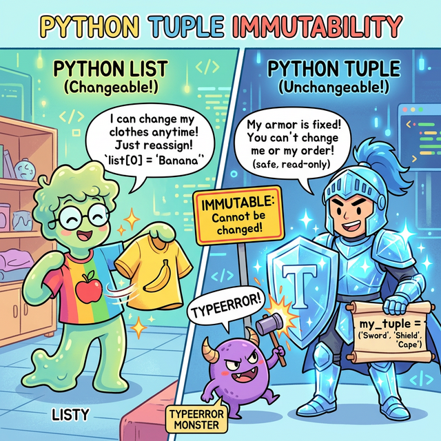
> 💡 **웹툰 비유:** 왼쪽의 '리스트' 소년은 젤리처럼 말랑말랑해서 "사과" 옷을 입었다가 1초 만에 "바나나" 옷으로 휙휙 갈아입으며 즐거워합니다. 반면 오른쪽의 '튜플' 기사는 다이아몬드로 된 철벽 갑옷을 입고 있습니다. 악당 해커(버그 몬스터)가 기사의 검(데이터)을 훔쳐서 억지로 바꾸려(수정 시도) 공격하지만, 다이아몬드 방패에 튕겨 나가며 "TypeError!"를 외치며 쓰러집니다. 튜플의 완벽한 읽기 전용(Read-Only) 보안을 상징합니다.

### 🛡️ 왜 귀찮게 튜플을 써야 할까?
*   **보안 방패 (Read-Only)**: 시스템 설정값, 서버의 IP 주소 좌표, 색깔의 RGB 치수 등 **'절대 중간에 프로그램이 해킹당하거나 버그가 나서 변하면 안 되는 핵심 상수들'**을 지킬 때 반드시 튜플을 씁니다.
*   **메모리 다이어트**: 수정 기능(`append`, `del` 등)이 지원되지 않으므로, 파이썬 입장에선 미래의 확장을 대비한 넉넉한 예비 메모리 공간을 남겨둘 필요 없이 변수 크기를 타이트하게 압축할 수 있습니다. 즉 리스트보다 더 빠르고 가볍습니다.

---

## 2. 시각적 구조 확인: 리스트 vs 튜플

> 💡 **다이어그램 해석:** 좌측의 리스트(`[10, 20]`)는 점선으로 된 느슨한 주머니라서 외부에서 데이터(99)를 집어넣으면 내부가 뚫리며 원본이 변질됩니다. 그러나 우측의 튜플(`(10, 20)`)은 견고한 **다이아몬드 에너지 쉴드**가 씌워져 있어, 외부 조작 공격을 완벽히 튕겨내며 `TypeError` 보호막을 전개합니다.

### 🚨 파괴 행위의 결과 (TypeError 폭발)
인덱스 번호로 읽어오기(`print(tp[0])`)는 가능하지만, 내용을 무력으로 고치려 들면 치명적 에러가 터집니다.

```python
tp = (10, 20, 30)

print(tp[0]) # 10 (꺼내 읽어보는 건 전혀 문제 없음)

# tp[0] = 99  # 🚨 주석 해제 시 TypeError: 'tuple' object does not support item assignment 터짐!
# tp.append(40)  # 🚨 AttributeError 폭발 (추가 불가)
# del tp[0]      # 🚨 TypeError 폭발 (삭제 불가)
```

---

## 3. 튜플의 기본 문법과 생성 규칙

리스트가 뾰족한 대괄호 `[ ]`였다면, 튜플은 동그란 **소괄호 `( )`**를 사용합니다. 때로는 괄호조차 벗어 던질 수 있습니다.

*   빈 튜플 생성: `()` 또는 `tuple()`
*   기본 형태: `(item1, item2, item3)`

```python
empty_tp = ()           # 텅 빈 튜플
tp_normal = (10, 20, 30) # 평범한 튜플
```

### 💣 [치명적 함정] 1개짜리 튜플 생성의 배신
파이썬 내장 수학 계산기 때문에 빈번하게 터지는 버그입니다. 데이터가 딱 1개만 있을 때, 소괄호 감싸기를 시전하면 파이썬은 이를 튜플로 인식하지 않고 **단순한 산수 묶음용 괄호**로 오해해 버립니다.

```python
trap = (5) 
print(type(trap)) # 🚨 <class 'int'> 출력!! 파이썬: "음, 이건 그냥 정수 숫자 5군."
```

이 오해를 피하려면 데이터가 1개일 지라도 **무조건 뒤에 꼬리 쉼표(Trailing Comma)**를 붙여서 "나열된 튜플 데이터의 형태"임을 명확히 증명해야 합니다.

```python
safe_tp = (5,) # 뒤에 빈 쉼표를 달아줌!
print(type(safe_tp)) # ✅ <class 'tuple'> 정상 확인!!
```

다음 장에서는 튜플 특유의 느슨하고 유연한 성질을 이용해 데이터를 아주 우아하게 뭉치고 찢는 마법, **패킹(Packing)과 언패킹(Unpacking)**을 배워보겠습니다.

---

## 학습목표
튜플의 소괄호가 생략 가능하다는 유연한 규칙을 이용해, 여러 개의 변수를 한 보따리에 싸고(Packing) 다시 여러 변수에게 한 번에 1:1로 찢어 담는(Unpacking) 파이썬 특유의 우아한 문법을 마스터합니다. 별표(`*`)를 기용해 남은 데이터를 유연하게 담는 고급 테크닉까지 학습합니다.

---

## 1. 괄호가 없어도 우리는 하나다 (패킹, Packing)

파이썬에서 튜플은 리스트와 다르게 굳이 소괄호 `()` 로 감싸지 않아도, 값들이 **쉼표(`,`)**로 연결되기만 하면 자동으로 하나의 튜플 보따리로 묶입니다. 이를 **'패킹(Packing)'** 이라고 부릅니다. 여러 개의 짐을 가방 하나에 쑤셔 넣는 것과 같습니다.

> 💡 **다이어그램 해석:** 
> *   **좌측 (Packing):** 흩어져 있던 10, 20, 30 이라는 3개의 숫자가 `bag` 이라는 단 하나의 변수(튜플 보따리) 안으로 압축되어 들어갑니다.
> *   **우측 (Unpacking):** 튜플 보따리(`bag`) 안에 들어있던 3개의 숫자가 폭발하듯 찢어져서 `a`, `b`, `c` 라는 3개의 독립된 빈 상자(변수)에 정확히 1:1로 분주되어 담깁니다.

```python
# 괄호 없이 쉼표만으로 던졌지만, 파이썬이 알아서 튜플로 '패킹' 해줍니다.
my_bag = 10, 20, 30 

print(my_bag)       # (10, 20, 30) (출력될 땐 소괄호가 보임)
print(type(my_bag)) # <class 'tuple'>
```

---

## 2. 보따리 1:1 해체 작업 (언패킹, Unpacking)

이번에는 거꾸로, 튜플 안에 들어있는 데이터들을 여러 개의 변수에 한방에 쏟아부어 나누어주는 **'언패킹(Unpacking)'** 입니다. 타 언어 개발자들이 가장 충격과 부러움을 느끼는 파이썬 최고의 문법입니다.

```python
# 3개의 물건이 든 튜플 가방
my_bag = (10, 20, 30)

# 가방 안의 물건들을 한 번에 좌변의 새 변수들에게 1:1로 찢어서 줍니다 (Unpacking)
a, b, c = my_bag

print(a) # 10
print(b) # 20
print(c) # 30
```

### 🔀 궁극의 스킬: 변수 값 맞바꾸기 (Swap)
C 언어나 Java에서 `a`와 `b` 두 컵의 내용물을 바꾸려면, 반드시 내용물을 잠시 덜어둘 세 번째 임시 컵(`temp`)이 필요했습니다. 파이썬에서는 패킹과 언패킹의 동시 발동 메커니즘을 통해 마법처럼 1줄로 크로스 체인지를 시전합니다.

```python
a = 10
b = 99

# 우변에서 (99, 10) 으로 튜플 패킹된 뒤, 좌변 a, b에게 순서대로 언패킹됨!
a, b = b, a 

print(f"a: {a}, b: {b}") # a: 99, b: 10 (완벽하게 교체됨)
```

---

## 3. 별표(`*`) 마법: 데이터 개수가 부족할 때의 대처법

언패킹을 할 때 가장 짜증 나는 에러는 **'보따리 안의 물건 개수(5개)'**와 **'받아낼 변수의 개수(3개)'**가 맞지 않을 때 발생하는 `ValueError` 입니다.

```python
tp = (1, 2, 3, 4, 5)

# 🚨 ValueError: too many values to unpack (물건이 너무 많아 변수가 다 못 받아요!) 폭발.
# a, b, c = tp 
```

이럴 때 덜 중요한 나머지 데이터 변수 앞에 **`*` (별표, 애스터리스크)**를 달아주면, "나머지 떨이들은 싹 다 모아서 리스트(`[]`) 보따리로 감싸서 나한테 병합해라!" 라는 마법의 블랙홀 지시어가 됩니다.

```python
tp = (1, 2, 3, 4, 5)

# 앞에 2개만 각각 a, b에 담고, 남은 찌꺼기는 다 모아서 others 리스트로 만들어라!
a, b, *others = tp

print(a)       # 1
print(b)       # 2
print(others)  # [3, 4, 5] (튜플 출신이지만 떨이 병합 시 '리스트'로 반환됨에 주의)

# 응용: 양 끝단만 살리고 가운데 떨이 처리도 가능합니다!
first, *middle, last = tp

print(first)   # 1
print(middle)  # [2, 3, 4] (가운데 3개를 포진)
print(last)    # 5
```

이 압도적인 언패킹 기술 덕분에 파이썬은 여러 개의 결과를 동시에 `return` 반환해야 하는 복잡한 수학 연산계산 함수나, 데이터베이스 파싱 작업에서 타 언어 대비 코드를 절반 이상 극단적으로 소거할 수 있습니다. 다음 장에서는 불변의 튜플과 젤리 같은 리스트가 만났을 때 생기는 메모리 함정과 변환 함수들을 다루겠습니다.

---

## 학습목표
내부 요소를 수정할 수 없는 튜플의 한계를 극복하기 위해 `list()` 와 `tuple()` 형태를 자유롭게 넘나드는 형 변환(Casting) 기술을 익힙니다. 또한, 초보자들이 가장 많이 당하는 "다이아몬드 금고 안의 말랑말랑한 젤리(List)" 함정을 시각적으로 명확히 이해하여 버그를 완벽히 차단합니다.

---

## 1. 튜플의 자유로운 도마술 (조회 및 융합)

튜플 자체의 알맹이는 바꿀 수 없지만, 내용물을 구경하거나, 복사본을 떠내거나, 다른 튜플과 합쳐 **'아예 새로운 거대한 튜플'**을 창조하는 방식의 조작은 얼마든지 허용됩니다. 리스트와 완전히 동일한 문법을 공유합니다.

### ① 타겟팅(Indexing)과 도려내기(Slicing)
```python
colors = ("Red", "Green", "Blue", "Black")

# 구경(Reading)은 리스트와 똑같습니다.
print(colors[0])    # Red
print(colors[1:3])  # ('Green', 'Blue') 
print(colors[::-1]) # ('Black', 'Blue', 'Green', 'Red') -> 원본은 다치지 않은 '복사본' 탄생
```

### ② 튜플 덧셈과 곱셈 (새로운 세계 창조)
```python
t1 = (1, 2)
t2 = (3, 4)

t3 = t1 + t2 
print(t3) # (1, 2, 3, 4) -> 기존 t1, t2를 건드리지 않고 새로운 t3 세계가 열렸습니다.

t4 = t1 * 3 # 3번 반복 복제 (메모리를 새로 할당받음)
print(t4) # (1, 2, 1, 2, 1, 2)
```

---

## 2. 자유로운 형 변환 (Casting): 얼음과 물의 관계

데이터를 보존해야 할 땐 단단한 얼음(Tuple)으로 굳혀두고, 데이터를 추가하거나 믹스해야 할 빈번한 수정 작업이 생기면 잠시 물(List)로 녹였다가, 작업이 끝나면 다시 얼음으로 돌려놓는 **형 변환 스위칭**이 실무에서 애용됩니다.

```python
tp = (1, 2, 3)

# 1. 앗! 숫자 4를 급하게 추가해야 한다! -> 물(List)로 녹입니다.
ls = list(tp) 
ls.append(4)  # 젤리 상태이므로 정상적으로 4 추가 성공! [1, 2, 3, 4]

# 2. 수정이 끝났으니 다시 버그 방지를 위해 얼음(Tuple)으로 굳혀버립니다.
tp_secured = tuple(ls) 

print(tp_secured) # (1, 2, 3, 4) 완벽한 작전 성공.
```

---

## 3. 🚨 치명적 함정: 다이아몬드 금고 안의 젤리 (Inner List)

이 개념은 파이썬뿐만 아니라 자바스크립트의 `const` 배열에서도 똑같이 발생하는 프로그래밍 언어의 공통적인 함정 객체(Reference) 원리입니다. 면접 질문으로도 단골 출제됩니다.

**"튜플은 겉이 다이아몬드 상자라서 형태를 부술 수 없지만, 그 상자 안에 말랑말랑한 젤리(리스트) 봉지가 들어있다면, 젤리 봉지 자체를 찢어버릴 순 없어도 그 안의 '젤리 알맹이'는 교묘하게 파먹거나 바꿀 수 있습니다!"**

> 💡 **다이어그램 해석:** 
> 1. `trap[0]`인 방어막(10)을 깨부수려 하면, 바깥쪽 녹색 다이아몬드 쉴드에 튕겨 에러가 납니다.
> 2. `trap[2]`는 파란색 젤리 상자(List)입니다. 이 상자를 금고 밖으로 던져버리거나 통째로 딴 걸로 바꿀 순(수정) 없지만, 상자 안에 몰래 손을 집어넣어 내용물 `[1]`을 `[99]`로 뒤틀어 버리는 건 기가 막히게 허용됩니다!

```python
# [1, 2]는 변경 가능한 리스트입니다!
trap_tuple = (10, 20, [1, 2])

# ❌ 방어 성공: "10을 99로 바꿔라!" -> 리모컨 줄이 끊어집니다.
# trap_tuple[0] = 99  --> 🚨 TypeError 폭발!

# ❌ 방어 성공: "젤리 상자 자체를 문자열 'hello'로 교체해라!" 
# trap_tuple[2] = 'hello' --> 🚨 TypeError 폭발! (튜플 인덱스 2번의 물건 자체가 바뀌면 안 됨)

# 👿 해킹 성공: "2번 젤리 상자 안으로 들어가서, 첫번째 젤리(1)를 99로 변질시켜라!"
trap_tuple[2][0] = 99 

print(trap_tuple) 
# 출력 결과: (10, 20, [99, 2]) -> 튜플 내부의 내용물이 교묘하게 해킹되었습니다!!
```

### 왜 이런 일이 벌어지는가?
튜플 입장에서 자기가 손에 쥐고 있는 것은 오로지 파란색 상자의 **'주소(리모컨)'**일 뿐입니다. 파란 상자가 찌그러지든 내용이 바뀌든 튜플 입장에서는 "나는 여전히 파란 상자를 가리키는 리모컨을 똑같이 쥐고 있으니, 내 모양은 변하지 않았어!" 라고 착각하기 때문입니다. 

이를 방지하려면 튜플 안에는 리스트 같은 가변 객체(Mutable) 대신, 완전히 쪼개지지 않는 숫자나 또 다른 튜플만을 이중으로 품게 설계해야 합니다. (예: `(10, 20, (30, 40))`)

다음 장에서는 이렇게 단단하고 변형이 불가능한 속성 덕분에, 튜플이 딕셔너리의 고급 열쇠(Key)로 취직할 수 있는 원리를 알아보겠습니다.

---

## 학습목표
`[리스트]`는 절대 들어갈 수 없는 금지 구역인 딕셔너리의 열쇠(Key) 자리에, 어째서 `(튜플)`만 들어갈 수 있는지 그 **'해시 가능성(Hashable)'**의 근본적인 이유를 컴퓨터 그래픽스(X, Y 좌표계) 등 실무 사례와 함께 마스터합니다.

---

## 1. 딕셔너리 열쇠(Key)의 절대 자격 요건: 불변성(Immutable)

이전 딕셔너리(`02_dictionary`) 차트에서 우리는 마법의 변환 과정인 **해시(Hash) 알고리즘**을 배웠습니다. 
딕셔너리의 사물함 명찰(Key)은 파이썬 내부에서 분쇄 기계(Hash Function)를 거쳐 절대 바뀌지 않는 고유한 메모리 암호 숫자로 다져집니다.

따라서 딕셔너리의 열쇠 구멍에 넣을 수 있는 데이터는 **자신이 태어난 순간부터 파괴될 때까지 절대 안의 내용물이 변하지 않는 단단한 자료형**이어야만 합니다. 


*(앞서 딕셔너리 단원에서 배운 해시 매핑 동작입니다. 이 암호화 기계에 형태가 변하는 젤리(List)를 넣으면 해시에러가 터집니다.)*

*   **합격 (Hashable)**: `정수(10)`, `실수(3.14)`, `문자열("Hello")`, 그리고 바로 **`튜플((1, 2))`**
*   **탈락 (Unhashable)**: 내용물이 언제든 팽창, 수축할 수 있는 `리스트([1, 2])`, `딕셔너리({'a':1})`, `집합({1, 2})`

---

## 2. 튜플이 없었다면 발생했을 끔찍한 게임 코딩 (X, Y 좌표계)

만약 여러분이 2D 격자 맵(그리드)을 탐험하는 게임을 만들고, 맵의 특정 `X`, `Y` 좌표에 어떤 몬스터나 보물이 있는지를 딕셔너리 사물함에 기록해 두고 싶다고 가정해 봅시다.

만약 튜플이 없었다면, 우리는 좌표 2개의 숫자를 열쇠(Key)로 만들기 위해 "X좌표_Y좌표" 형태의 기괴한 문자열로 억지로 본딩(결합)하는 작업을 해야 했을 것입니다.

```python
# 튜플이 없었을 때의 고전적인 (그리고 지저분한) 코딩 방식
map_data = {}

x = 10
y = 20

# 두 숫자를 억지로 문자열 "10_20" 이라는 이름의 키로 용접해서 저장
map_data[str(x) + "_" + str(y)] = "Dragon"

# 나중에 드래곤을 찾을 때도 다시 억지로 용접해서 찾아야 함
target = str(x) + "_" + str(y)
print(map_data[target]) 
```

---

## 3. 튜플을 활용한 우아한 복합 열쇠 (Multi-Key) 체계

하지만 우리에게는 절대 깨지지 않는 다이아몬드 상자인 **튜플**이 있습니다! 앞서 배운 **패킹(Packing)**의 원리를 이용해, 숫자 2개(X, Y)를 괄호로 단숨에 튜플 묶음으로 압축하여 딕셔너리의 단단한 열쇠구멍에 부드럽게 꽂아 넣을 수 있습니다.

```python
map_data = {}

# (위도, 경도) 또는 (X, Y) 형태의 튜플은 값이 영원히 불변하므로 딕셔너리의 열쇠로 당당히 합격!
map_data[(37.5, 126.9)] = "Seoul"
map_data[(35.1, 129.0)] = "Busan"
map_data[(10, 20)] = "Dragon"       # 게임 좌표의 몬스터 데이터 저장

# ❌ 젤리(List)를 억지로 키로 넣으려 하면 즉시 사망!
# map_data[[10, 20]] = "Slime"     # 🚨 TypeError: unhashable type: 'list' 폭발!

# 찾을 때도 튜플 모양 그대로 우아하게 조회!
print(map_data[(37.5, 126.9)]) # 출력: Seoul
print(map_data[(10, 20)])      # 출력: Dragon
```

### 💡 실무 적용 팁
인공지능이나 데이터 사이언스에서 어떤 물체의 거대한 **3차원 텐서 (Z, Y, X)** 공간 좌표계를 기록해야 할 때, 이 튜플 열쇠 기법 하나만으로 딕셔너리와 완벽하게 결합하여 1초 만에 몬스터, 픽셀 RGB, 장애물 텍스처 등의 데이터를 검색하고 추출(Read)할 수 있습니다. 

---

## 🎧 Vibe Coding (프롬프트 활용법)

튜플의 궁극적 성질을 마스터했다면, 이제 AI에게 이 성질을 십분 활용한 복잡한 구조체의 코딩을 바로 지시해 볼 수 있습니다.

> **🗣️ 학생 프롬프트 (AI에게 이렇게 명령해 보세요):**
> "파이썬 튜플과 딕셔너리를 사용해서 우리 반 학생들의 2학기 체육, 수학, 영어 점수를 관리하는 코드를 짜줘. 열쇠(Key)로는 학생의 `("학년", "반", "번호")` 3개를 하나로 합친 튜플을 쓰고, 값(Value)으로는 해당 학생의 실명 문자열 `name`을 딕셔너리에 저장해. 그 후 `(1, 3, 15)` 라는 1학년 3반 15번 튜플 열쇠를 검색해서 그 학생의 이름을 찾아 콘솔창에 띄워줘."

**[최종 정리]**
**튜플(Tuple)**은 그저 리스트의 하위 호환 쌍둥이가 아닙니다. 
데이터가 훼손되지 않도록 지켜내는 **다이아몬드 방어막**, 패킹 언패킹의 유연성, 그리고 딕셔너리 깊숙한 곳의 열쇠(Key) 자리를 차지하는 **파이썬 불변성(Immutability) 철학의 심장**입니다. 리스트로 모든 걸 해결하려는 초보자를 지나, 적재적소에 튜플로 코드를 잠가내는 멋진 파이써니스타로 성장하시길 바랍니다!

---

## 📌 학습 목차

### [1. 나이트클럽 문지기: 집합(Set)과 고유성(Uniqueness)](#3441-집합의-본질과-중복-제거-원리)
수만 건이 밀려들어와도 중복된 클론(Clone) 방문객을 가차 없이 쫓아내는 '나이트클럽 문지기' 비유를 통해 세트가 지닌 '고유한 불변의 가치(Unique)'를 학습합니다. 빈 세트를 만들 때 터지는 딕셔너리와의 기호(`{}`) 충돌 함정도 피해 가세요.

### [2. 마법 주머니 다루기: 생성과 조작(CRUD)](#3442-세트의-생성-규칙과-삭제crud)
리스트처럼 순서대로 줄을 세우지 않고, 그냥 빈 허공에 구슬을 휙 던져 넣는 세트 주머니의 `add()` 동작을 다룹니다. 특히 실무 서버 방식을 결정짓는 자비로운 무시 삭제 `discard()`와 단두대 에러 삭제 `remove()`의 치명적 차이점을 완벽 숙달합니다.

### [3. 단 한 줄의 수학적 마법: 벤 다이어그램 연산](#3443-세트의-벤-다이어그램-연산)
이중 `for` 루프 지옥을 뚫고 지나가던 옛날 언어의 방식을 폐기하고, 오직 파이썬만 허락한 우아한 단 한 글자의 교집합(`&`), 합집합(`|`) 기호들의 미학을 맛봅니다. 해시 테이블을 써서 100만 명 중에 내 이름을 0.001초 만에 찾는 `in` 연산자의 존재 이유를 체득할 수 있습니다.

---

## 학습목표
투입된 순서 따위는 신경 쓰지 않고 오로지 세상에 단 하나뿐인 **'고유한 본질(Unique)'** 데이터만 담아두어 중복을 완전히 철폐시켜 버리는 파이썬 **세트(Set)**의 존재 이유와 작동 원리를 학습합니다.

---

## 1. 세트(Set) = 중복을 허락하지 않는 마법의 주머니

딕셔너리가 국어사전이고 튜플이 다이아몬드 상자라면, 세트(Set)는 무엇에 비유할 수 있을까요? 
세트는 중복된 클론 인간들을 무자비하게 돌려보내는 수학적 **'나이트클럽 문지기(Bouncer)'** 혹은 구슬을 섞어 넣는 **'마법 주머니'**에 비유할 수 있습니다.


> 💡 **웹툰 비유:** 왼쪽 그림의 턱시도를 입은 철통같은 문지기(Python Set)는 문 앞에서 똑같은 옷, 똑같은 얼굴을 한 중복 손님(Clone)들의 입장을 단호하게 거부하며 "No Duplicates Allowed!"를 외칩니다. 오직 그동안 1번도 입장하지 않았던 유니크(Unique)한 사람만 들여보내 줍니다. 

### 🛡️ 왜 귀찮게 세트를 써야 할까?
수만 건 이상의 난잡한 유저 접속 로그인 데이터, 혹은 중구난방의 엑셀 데이터 속에서 **"딱 한 번이라도 방문한 적 있는 독립적인 유저 명단"**을 뽑아내려면 어떻게 해야 할까요? 
과거에는 구질구질하게 리스트를 하나하나 꺼내보며(for문) "이 사람이 목록에 있나?" 일일이 대조를 해야 했습니다. 하지만 파이썬에서는 모든 데이터를 세트 용광로에 던져넣기만 하면, 단 1초 만에 찌꺼기 중복이 타서 없어지고 빛나는 알맹이만 남게 됩니다.

---

## 2. 세트의 시각적 작동 원리 (문지기 애니메이션)

> 💡 **다이어그램 해석:** 
> 1. 좌측의 대기열(List)에는 숫자 1, 2, 3이 있고, 그 뒤로 또 다른 숫자 3 복제본들이 줄을 서 있습니다.
> 2. 숫자들이 하나씩 문지기(Set 함수)를 통과하여 우측의 클럽 스테이지 내부로 입장합니다.
> 3. 이미 클럽 안에 숫자 3이 입장해 있는 상태에서 뒤따라온 **복제본 숫자 3들은 문지기의 가차 없는 킥에 맞아 입장 컷(거절)** 당합니다. 이로써 세트 안에는 1, 2, 3만 유일하게 존재하게 됩니다.

---

## 3. 세트의 기본 형태와 2가지 치명적 제약상황

딕셔너리와 똑같이 중괄호 `{ }`를 쓰지만, 콜론(`:`) 짝맞춤 없이 그냥 구슬(값)들만 쉼표로 흩뿌려진 형태입니다.

*   기본 형태: `my_set = {1, 2, 3, 4}`

하지만 세트를 사용할 때는 2가의 매우 치명적인 물리적 규칙(제한)을 숙지해야 합니다.

### 제약 1. 빈 세트를 `{}`로 만들면 딕셔너리로 오해받음
중괄호 `{ }` 기호의 원조 주인은 딕셔너리입니다. 따라서 값 없이 빈 중괄호만 치면 파이썬은 무조건 그것을 빈 딕셔너리로 취급합니다.

```python
# 🚨 딕셔너리와의 기호 충돌 주의
empty_trap = {}
print(type(empty_trap)) # <class 'dict'> (세트가 아님!)

# ✅ 진정한 빈 세트의 소환법
real_empty_set = set()
print(type(real_empty_set)) # <class 'set'>
```

### 제약 2. 인덱스(순서)의 완벽한 붕괴
리스트나 튜플은 먼저 들어간 데이터가 `0`번 기차 칸에 탄다는 확고한 질서(순서)가 있습니다. 하지만 세트는 거대한 둥근 주머니입니다. 안에 넣고 손으로 휘휘 섞는 것과 같아서, 어떤 놈이 `0`번째인지 파이썬 자체도 모르게 됩니다.

```python
lottery = {45, 2, 33, 15}

# 🚨 세트에는 몇 번째 방이라는 개념 자체가 성립하지 않습니다!
# print(lottery[0]) # TypeError: 'set' object is not subscriptable 폭발!
```

이러한 무질서 덕분에 데이터가 어디에 있든 상관없이 순서를 지은 메모리 족쇄가 풀려있어, 앞서 배운 마법의 암호화 기술인 **해시(Hash)** 탐색과 결합하여 데이터 검색 속도가 기가 막히게 빨라집니다. 

다음 장에서는 이렇게 순서 없는 세트 주머니에서 데이터를 어떻게 안전하게 넣고 빼는지, 핵심 조작법과 메서드들을 살펴보겠습니다.

---

## 학습목표
중괄호 `{ }`의 원주인인 딕셔너리와의 충돌을 피하여 진짜 빈 세트를 소환하는 방법을 명확히 익힙니다. 또한 세트 안에 데이터를 추가하는 `add()`, `update()`와 데이터를 제거할 때 에러 유무에 따라 골라 써야 하는 `remove()`, `discard()` 메서드의 차이점을 완벽하게 이해합니다.

---

## 1. 세트 추가/수정의 시각적 메커니즘

인덱스(순서)가 존재하는 리스트 배열은 무조건 '맨 끝에' 덧붙여지는 `append()` 라는 단어를 쓰지만, 순서 없이 커다란 호주머니 같은 모양을 띈 세트(Set)는 데이터 구슬을 그냥 스윽 허공에 던져넣는 **`add()`** 라는 단어를 사용합니다. 당연히 몇 번째 위치에 떨어질지는 파이썬 마음입니다.

> 💡 **다이어그램 해석:** 세트(`myset`)라는 거대한 바운더리 구역 안에 3가지 조작이 들어옵니다.
> 1. **`add(99)`**: 파란색 새 구슬(99)이 허공에서 툭 떨어져 안착합니다.
> 2. **`remove(10)`**: 들어있던 구슬(10)을 지목하자 폭발하며 사라집니다. 단, 만약 주머니에 애초에 10이 없었다면 프로그램 전체가 터집니다(KeyError).
> 3. **`discard(50)`**: 50을 없애라고 지시했지만, 주머니 안을 뒤져보니 50이 없습니다. 그래도 조용히 🛡️방어막(무시)을 치며 다음 코드로 무사히 넘어갑니다.

---

## 2. 세트의 생성과 추가 (`add`, `update`)

기본적으로 세트를 만들 때는 리스트인 척 감싸주거나, 데이터들을 중괄호 기호로 나열하면 됩니다. 하지만 **리스트, 딕셔너리처럼 형태가 변할 수 있는 객체는 세트 안에 넣으려 시도하면 에러가 납니다.** 오직 문지기를 통과할 수 있는 '불변의 객체'만 허락됩니다.

```python
# 1. 일반적인 텍스트 구슬들을 넣은 집합
basket = {'apple', 'orange'}

# 2. 새로운 구슬 한 알 추가! (add)
basket.add('banana')
print(basket) # {'apple', 'banana', 'orange'} (순서는 역시 무작위 배치됩니다)

# 3. 여러 개의 구슬 묶음을 한방에 쏟아 붓기! (update)
basket.update(['mango', 'grape', 'apple']) 
print(basket) # 'apple'은 중복되어 튕겨나가고 (무시), 나머지만 새롭게 유입됩니다.
```

---

## 3. 원소 삭제법의 양대 산맥: `remove` vs `discard`

이 차이점은 코딩 테스트나 실무 서버 방어 로직에서 매우, 매우 중요합니다.

### 💣 파괴적 단두대 제거: `remove()`
내가 확신하고 지시한 데이터가 주머니 안에 정확히 있을 때만 씁니다. 만약 없으면 프로그램이 파괴적인 에러를 뿜으며 멈춥니다.
```python
s = {1, 2, 3}

s.remove(2) # 정상 삭제 -> {1, 3} 남음
# s.remove(99) # 🚨 주석 해제 시 KeyError: 99 에러 폭발! 없는 걸 빼달라 했다며 화를 냅니다.
```

### 🛡️ 자비로운 무시 제거: `discard()`
"혹시 있으면 지워주고~ 없으면 그냥 넘어가~" 라는 식의 부드러운 삭제입니다. 실버 총알(Silver Bullet)처럼 실무 코딩에서 에러 방어용으로 훨씬 많이 쓰이며, 초보자들이 반드시 익혀야 할 핵심 메서드입니다.
```python
s = {1, 2, 3}

s.discard(99) # 99 번은 불행히도 주머니에 없습니다. 그러나 파이썬은 에러 없이 평온하게 웃으며 무시해 넘깁니다!
print(s) # 여전히 {1, 2, 3} 무사 통과!
```

---

## 4. 특수 제거 메서드 (`pop`, `clear`)

### 🎲 러시안룰렛 무작위 뽑기: `.pop()`
리스트에서 배운 `pop()`은 '무조건 맨 뒤 꼬리칸의 녀석'을 잡아오지만, 세트는 앞뒤 순서가 없으므로 **정말 로또 볼을 뽑듯이 무작위로 아무거나 하나가 튀어나와서 소멸합니다.**

```python
s = {'사과', '바나나', '포도'}

sacrificed = s.pop() # 누군가 하나 랜덤으로 추출되어 영원히 주머니 속에서 사라집니다!
print("희생된 제물:", sacrificed)
print("남은 세트 통:", s)
```

### ☢️ 핵폭탄 초기화: `.clear()`
더 이상 세트 데이터가 필요 없거나 메모리를 비루어주고 싶을 때, 내용물을 모조리 증발시켜 빈 깡통으로 리셋합니다.

```python
s = {1, 2, 3}
s.clear()

print(s) # set() 이라는 텍스트가 뜨며, 진짜 오리지널 빈 세트가 되었음을 확인시켜 줍니다.
```

다음 장에서는 세트를 쓰는 진정한 이유이자 핵심 백미인 $A \cup B, A \cap B$ 등 수학 시간에 배웠던 **벤 다이어그램 연산**을 기호 하나로 순식간에 끝내버리는 파이썬 기적의 수학 연산자들을 다룹니다.

---

## 학습목표
`for` 루프와 `if` 문을 덕지덕지 발라 10줄의 코드로 짜던 두 데이터 그룹 간의 교차/차이 비교 로직을, 파이썬 특유의 **단 1글자 수학 기호(`|`, `&`, `-`)**로 우아하게 끝내버리는 궁극의 세트 연산법을 마스터합니다. 또한, 해시 알고리즘 덕분에 빛보다 빠른 속도를 자랑하는 `in` 연산자의 위력도 체험합니다.

---

## 1. 노가다를 파괴하는 세트 연산자 기호

자바(Java)나 C언어에서 A 반 학생 리스트와 B 반 학생 리스트가 있을 때, **"두 반 모두 축구부에 가입한 공통 학생(교집합)을 찾아라"** 라는 코드를 짠다고 생각해 보세요. A 리스트를 처음부터 끝까지 돌면서, 그 하나하나를 가지고 B 리스트를 또 전부 뒤져보는 이중 `for` 루프 지옥에 빠지게 됩니다.

하지만 파이썬에서는 두 데이터 그룹을 **세트(Set)**로 묶어주기만 하면 중학교 수학 시간에 배운 **벤 다이어그램(Venn Diagram) 기호** 하나로 모든 연산이 0.1초 만에 끝나버립니다. 이 우아함 하나만으로도 데이터 사이언티스트들이 파이썬을 사랑할 이유는 충분합니다.

> 💡 **다이어그램 해석:** 녹색 불빛이 이동하는 4가지 수학 연산의 흐름을 보여줍니다.
> 1. **합집합 `|`**: A와 B의 모든 구역을 비춥니다 (단, 겹치는 가운데 3번 영역이 중복 카운트 되지 않습니다).
> 2. **교집합 `&`**: 양쪽 모두가 겹치는 한가운데 코어 영역(3)만 비춥니다.
> 3. **차집합 `-`**: A에서 B 쪽으로 넘어간 파이를 도려낸 순수 A 구역(1, 2)만 비춥니다.
> 4. **대칭 차집합 `^`**: 양쪽 다 걸쳐있는 박쥐 구역(3)을 도려내고, 순수하게 한 쪽에만 속한 변두리(1, 2, 4, 5)만 합쳐 비춥니다.

---

## 2. 실전 코드로 보는 4대 벤 다이어그램 연산

```python
A = {'민수', '영희', '철수'} # A반 축구부
B = {'영희', '철수', '길동'} # B반 농구부

# 1. 합집합 (Union) | 
# 축구나 농구 적어도 하나는 하는 모든 학생
print(A | B) 
# 결과: {'민수', '길동', '철수', '영희'} (중복된 영희, 철수는 1명씩만 남음!)

# 2. 교집합 (Intersection) & 
# 축구와 농구 둘 다 하는 괴물 체력 학생은?
print(A & B) 
# 결과: {'철수', '영희'}

# 3. 차집합 (Difference) - 
# A반 학생 중에서 농구부랑 겹치는 애 빼고 순수 축구파만!
print(A - B) 
# 결과: {'민수'}

# 4. 대칭 차집합 (Symmetric Difference) ^ 
# 겹치는 애들(철수, 영희) 제외하고, 한 가지 운동만 파는 순수파 집합
print(A ^ B) 
# 결과: {'민수', '길동'}
```

### 💡 [참고] 영어 단어 메서드를 써도 됩니다!
기호가 헷갈리거나 협업 과정에서 모두가 코드를 읽기 편하게 만들고 싶다면, 영어 단어로 된 전용 메서드를 사용해도 결과는 100% 똑같습니다.
*   합집합: `A.union(B)`
*   교집합: `A.intersection(B)`
*   차집합: `A.difference(B)`
*   대칭 차집합: `A.symmetric_difference(B)`

---

## 3. 빛보다 빠른 포함 여부 검사기 (`in` 연산자)

집합 연산만큼이나 실무에서 세트를 쓰는 압도적인 이유가 하나 더 있습니다. 바로 **어떤 물건이 들어있는지 뒤져보는 '탐색 속도'**입니다.

만약 가입자 명단 리스트에 100만 명의 이메일이 들어있다고 칩시다. "jinydev@test.com 이 가입되어 있나?" 하고 리스트 끝에서부터 찾으면, 최악의 경우 100만 번을 들춰봐야 합니다. 

하지만 **데이터를 딕셔너리처럼 해시 테이블 통에 부어서 으깨놓은 세트(Set)**를 사용하면, 내부 인덱스 순서 따윈 무시하고 계산식 단 한 번에 **0.001초 단위인 O(1)의 속도**로 그 사람이 있는지 없는지 즉각 판별해 냅니다.

```python
# 100만 개가 들어있다고 상상해 봅시다.
certified_users = {'john', 'jane', 'jinydev', 'alice'} 

# ⚡ 마법의 in 연산자: "이 통 안에 jinydev 가 있습니까?"
if 'jinydev' in certified_users:
    print("인증된 유저입니다! 패스!") 
```
*`in` 연산자는 리스트에서도 쓸 수 있지만, 속도 면에서 세트(Set)의 발끝에도 미치지 못합니다. "존재 유무"만 빠르게 필터링하려면 반드시 세트를 쓰세요.*

---

## 🎧 Vibe Coding (프롬프트 활용법)

> **🗣️ 학생 프롬프트 (AI에게 이렇게 명령해 보세요):**
> "파이썬 세트 연산자 기호를 써서 다음 문제를 1줄로 풀어줘.
> 넷플릭스 영화를 본 사람 명단이 들어있는 두 리스트가 있어. 
> `movie_A_viewers = ['민수', '지아', '철수', '민수', '하늘']`  (1탄 본 사람)
> `movie_B_viewers = ['지아', '길동', '하늘', '보미']` (2탄 본 사람)
> 일단 각각의 리스트를 세트로 변환해서 중복된 사람을 날려버리고, '1탄과 2탄을 모두 끝까지 정주행 한 진성 팬(교집합)'이 누구누구인지 `print()` 해주는 가장 짧은 코드를 작성해 줘."

**[최종 정리]**
**투입 순서는 무시하고 오직 유니크(Unique)함만 남기는 마법의 주머니!** 
수만 개의 파편화된 데이터를 뭉쳐서 분석하거나, 방대한 군집 사이클에서 '공통분모'와 '차이점'을 1초 만에 뽑아내 주는 이 세트의 강력한 벤 다이어그램 무기를 잘 활용한다면, 여러분은 데이터 사이언스의 첫걸음을 아주 훌륭하게 떼신 것입니다.

---

## 학습목표
본 장에서는 "왜 리스트는 딕셔너리의 열쇠(Key)나 세트(Set)의 원소가 될 수 없는가?"라는 파이썬 최대의 미스터리를 해결원격 심층 분석합니다. 데이터가 절대 변하지 않는다는 **불변성(Immutable)**, 그 데이터를 컴퓨터만의 암호로 변환하는 **`hash()`**, 그리고 데이터가 실제로 살고 있는 물리적 집 주소인 **`id()`** 함수를 통해 파이썬 수면 아래 작동하는 거대한 메모리의 진실을 마주하게 됩니다.

---

## 💡 TL;DR (1분 핵심 요약): 해시(Hash)가 대체 뭔가요?

1. **불변성 (Immutable)**: 한 번 태어나면 자기 내용을 죽을 때까지 바꿀 수 없는 고집불통 데이터입니다. (숫자, 글자, 튜플)
2. **해시 (Hash)**: 데이터의 "주민등록번호(바코드)"입니다. 오직 내용이 **변하지 않는(Immutable)** 데이터만이 이 바코드를 발급받을 수 있습니다.
3. **딕셔너리와 세트의 절대 규칙**: 파이썬의 `Dictionary Key`와 `Set`는 데이터를 빛의 속도로 찾기 위해 **반드시 이 '해시 바코드'가 있는 녀석들만** 입장을 허락합니다. (리스트처럼 내용이 자꾸 변하는 녀석은 바코드를 발급해 줄 수 없으므로 입구 컷 당합니다!)

---

## 1. 해시 출입국의 심사대 (왜 리스트는 입구 컷 당할까?)

파이썬의 딕셔너리(사전)와 세트(집합)는 수백만 개의 데이터 중에서도 내가 원하는 것을 **단 1초(O(1))** 만에 찾아내는 마법의 속도를 자랑합니다. 그 비결이 바로 **'해시(Hash)'**라는 고유 바코드 시스템 덕분입니다.

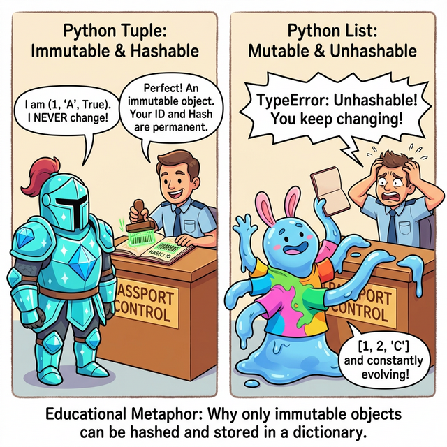
*(웹툰 비유: 심사대(Dictionary) 직원이 출입국 검사를 하고 있습니다. 왼쪽의 '튜플' 기사는 다이아몬드 철갑(Immutable)을 입고 있어 얼굴이 영원히 변하지 않으므로, 직원이 안심하고 영구적인 '해시 바코드' 여권 도장을 찍어 통과시킵니다. 반면 오른쪽의 '리스트' 젤리 소년은 1초 전엔 사과 옷을, 지금은 바나나 옷을 입으며 자꾸 모양을 바꿉니다(Mutable). 직원은 "네 얼굴이 계속 바뀌어 신분증 사진을 찍을 수가 없잖아!"라며 `TypeError(Unhashable)` 도장을 찍어 입구에서 쫓아냅니다.)*

---

## 2. 불변성(Immutable)과 `hash()` 함수의 관계

`hash()` 내장 함수는 데이터를 통째로 믹서기에 갈아서 컴퓨터만의 **고유한 정수 지문(숫자)**으로 만들어 반환해 줍니다. 

**오직 수정 불가능한(Immutable) 객체만 `hash()` 지문을 찍을 수 있습니다.**


### 예제 1: 튜플 vs 리스트의 운명 (해시 스캐너)
```python
# 1. 불변하는 튜플 (통과!)
tp = (1, 2, 3)
print(hash(tp)) # -3550055125485641917 (컴퓨터마다 숫자는 다르게 나옵니다)

# 2. 불변하는 문자열 (통과!)
word = "Python"
print(hash(word)) # 8746231012391238

# 3. 변하는 리스트 (적발 및 입구 컷! 🚨)
my_list = [1, 2, 3]

# print(hash(my_list))
# 🚨 주석 해제 시 TypeError: unhashable type: 'list' 에러 폭발!
```

이것이 바로 `my_list`가 딕셔너리의 열쇠(Key)나 세트(Set)의 원소가 될 수 없었던 진짜 이유입니다. 그들은 입장하려면 해시 지문이 필요한데, 리스트는 지문을 찍어줄 수가 없기 때문입니다.

---

## 3. 메모리의 진짜 집 주소, `id()` 함수

`hash()`가 데이터를 갈아 만든 '바코드 지문'이라면, **`id()`는 그 데이터가 컴퓨터의 RAM 소자 어딘가에 살고 있는 실제 '집 주소(메모리 위치)'**를 정수 값으로 알려줍니다.

### 예제 2: 파이썬의 정수 캐싱 (Integer Caching) 절약술
파이썬은 메모리를 아끼기 위해, 사람들이 자주 쓰는 작은 숫자(보통 -5 ~ 256)들은 미리 메모리에 하나만 예쁘게 만들어 놓고, 여러 변수가 **다 같이 그 집을 공유해서 바라보게(레이저 포인터)** 만듭니다.

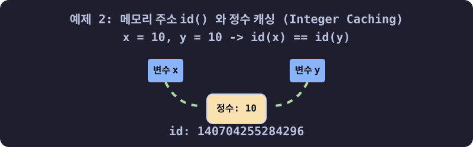

```python
x = 10
y = 10

# x와 y는 내용물(10)만 같은 게 아니라, 아예 100% 동일한 집 주소를 공유합니다!
print("x의 주소:", id(x)) # 예: 140704255284296
print("y의 주소:", id(y)) # 예: 140704255284296

# 그래서 집 주소가 같니? 라고 물어보면 True 가 나옵니다.
print(x is y) # True (값(==)만 같은 게 아니라, 아예 동일한 '존재'입니다)
```

### 예제 3: 큰 숫자나 리스트의 집 주소는 다릅니다
자주 안 쓰는 큰 숫자나, 내용이 자꾸 변하는 리스트는 똑같은 모양으로 쌍둥이를 만들어도 파이썬이 아예 **서로 다른 두 채의 집**을 지어버립니다.

```python
a = [1, 2, 3]
b = [1, 2, 3]

print(id(a)) # 예: 2530182410240
print(id(b)) # 예: 2530182390144 (분명 내용은 똑같은데, 집 주소가 다릅니다!)

print(a == b) # True  (안에 들어있는 내용물 쌍둥이의 얼굴이 똑같니? -> 네!)
print(a is b) # False (둘이 아예 같은 집에 사는 동일 인물이니? -> 아니요!)
```

---

## ☕ Java vs 🐍 Python 스나이퍼 비교

### 1. `==` 와 `is` 의 극명한 철학 차이 (초당황 주의 🚨)
이 부분에서 자바 개발자들이 파이썬을 배울 때 가장 크게 비명을 지릅니다. 작동 방식이 **정확히 정반대**이기 때문입니다!

*   **Java**: `a == b` 연산자가 **'메모리 주소(id)'**를 비교합니다. `a.equals(b)`를 써야 내용물을 비교합니다. 그래서 자바에서는 문자열이 같은지 볼 때 실수로 `==`를 썼다가 피를 보는 경우가 허다합니다.
*   **Python**: `a == b` 연산자가 **'내용물(값)'**을 친절하게 비교합니다!! 그리고 굳이 메모리 주소가 100% 똑같은지 하드웨어 집 주소를 집요하게 묻고 싶을 때만 `is` 연산자(`id(a) == id(b)`)를 씁니다. 파이썬이 훨씬 인간 친화적입니다.

### 2. 해시 함수의 오버라이딩 (Overriding)
*   **Java**: 커스텀 클래스를 해시맵 테이블(HashMap)에 넣으려면 `hashCode()`와 `equals()` 메서드를 개발자가 둘 다 강제로 오버라이딩해서 외우듯 구현해야 합니다.
*   **Python**: 객체의 고유 정보를 바탕으로 `__hash__()` 매직 메서드 하나만 우아하게 정의해 주면 끝납니다.

---

## 🎧 Vibe Coding

> **🗣️ 학생 프롬프트 (AI에게 이렇게 명령해 보세요):**
> "파이썬으로 `student1 = {'name': 'Alice', 'age': 20}` 딕셔너리와, `student2 = {'name': 'Alice', 'age': 20}` 딕셔너리를 두 개 만들어줘. 내용물은 완전히 똑같아. 그 다음 콘솔 출력으로 1) 두 딕셔너리를 `==` 로 비교한 결과, 2) 두 딕셔너리를 `is` 로 비교한 결과, 3) 두 변수의 `id()` 최종 출력값을 순서대로 띄워주는 코드를 짜줘. 그리고 왜 `==` 결과와 `is` 결과가 다르게 나오는지 주석으로 아주 쉽게 설명해 줘."

---

## 코딩 영단어 학습 📝

*   **Immutable**: 불변의. (Im(아니다) + Mutable(변하다). 한 번 메모리에 집을 짓고 입주하면, 죽을 때까지 성형수술(값 변경)이 불가능한 강철 같은 데이터입니다. 정수, 플로트, 문자열, 튜플이 여기에 속합니다.)
*   **Hash**: 잘게 썰어 섞다. (해시 포테이토할 때의 그 해시입니다. 아무리 긴 소설책 데이터라도, 해시 함수 믹서기에 넣고 갈아버리면 항상 똑같은 길이의 고정된 암호 숫자(지문) 덩어리가 튀어나오는 마법의 암호화 기술입니다.)
*   **ID (Identifier)**: 식별자. (너와 나를 구별하는 고유한 번호표입니다. 파이썬에서는 `id()` 함수를 통해 변수라는 포인터가 가리키고 있는 데이터 덩어리의 **진짜 물리적인 RAM 메모리 주소(번지수)**를 10진수로 꺼내 보여줍니다.)

---

## ✍️ 이번 주 연습 문제

**문제 1.** 다음 리스트에서 중복된 숫자를 제거하고 오름차순으로 정렬하여 출력하는 코드를 작성해 보세요.
`nums = [5, 2, 9, 1, 5, 2, 1, 10]`

**문제 2.** 튜플과 리스트의 차이점을 '메모리'와 '안전성' 관점에서 설명해 보세요.

**문제 3.** (심화) 딕셔너리의 키(Key)로 사용할 수 있는 자료형과 사용할 수 없는 자료형은 무엇일까요? 2주차에 배운 **가변(Mutable) vs 불변(Immutable)** 개념과 연결하여 생각하고 그 이유를 설명해 보세요.

---

## 📖 교재 상세 학습: 42 리스트를 주무르는 마법의 메서드 총정리

## 42 리스트를 떡 주무르듯 다루는 강력한 도구상자

지금까지 기초 단계에서 리스트 꼬리에 데이터를 붙일 땐 `.append()`, 지울 땐 `del` 명령어를 주로 썼습니다. 하지만 파이썬은 이 밖에도 리스트를 자유자재로 해체하고 조립할 수 있는 무수한 전용 메서드(함수)들을 기본 장착하고 있습니다.

* **`.index(찾을값)`**: 내가 찾는 데이터가 정확히 몇 번째 칸(방 번호)에 숨어있는지 인덱스를 위치추적합니다. (단, 리스트 평면상에 없는 값을 무턱대고 찾으려 들면 곧바로 에러가 폭발하므로, 사전에 `in` 키워드로 먼저 존재 여부를 찔러보는 안전 수칙이 필수입니다.)
* **`.extend(새리스트)`**: 기존 리스트 뒤통수에 아예 새로운 리스트를 통째로 용접해 하나로 이어 붙입니다. 덧셈 `+` 연산자와 결과는 엇비슷해 보이나, 이 녀석은 원본 리스트 자체의 덩치를 실제로 키워버린다는 차이가 큽니다.
* **`.insert(방번호, 값)`**: 꼬리표 붙이듯 맨 뒤로 가는 게 아니라, 내가 원하는 방 번호 정중앙에 새치기해서 쏙 값을 밀어 넣습니다. 당연히 기존에 있던 세입자(값)들은 방을 비워주기 위해 오른쪽으로 한 칸씩 밀려나는 굴욕을 겪습니다.
* **`.sort()` & `.reverse()`**: 리스트 통 안에 든 데이터를 깔끔하게 오름차순(가나다순, 알파벳순, 123순)으로 예쁘게 줄 세워 정렬하거나, 아예 현재 순번을 물리적으로 거꾸로 와장창 뒤집어버리는 강력한 셔플 기능입니다.

**REPL 실습 창: 도구상자 마법 총동원**
```python
>>> bag = ["목검", "나무방패", "빨간포션"]
>>> bag.index("나무방패")
1
>>> bag.insert(1, "너덜너덜한 지도")
>>> bag
['목검', '너덜너덜한 지도', '나무방패', '빨간포션']
>>> bag.sort()
>>> bag
['나무방패', '너덜너덜한 지도', '목검', '빨간포션'] # 한글 가나다 오름차순으로 자동 정렬 완료
```


---

## 📖 교재 상세 학습: 43 서로 꼭 닮은 쌍둥이: 문자열과 리스트

## 43 문자열과 리스트의 평행이론: 완벽한 쌍둥이

파이썬 세상에서 `"Hello"`라는 텍스트 문자열은 사실 깊게 파고들면 `['H', 'e', 'l', 'l', 'o']` 꼴로 한 글자씩 쪼개진 알파벳들의 리스트 모음집과 소름 돋게 똑같은 취급을 받습니다.
따라서 우리는 텍스트를 상대로도 리스트의 접근법인 인덱싱(`"Hello"[1] = 'e'`), 혹은 데이터 소속 감별법(`"H" in "Hello"`) 등 거의 100% 동일한 스킬을 구사할 수 있습니다.

뿐만 아니라 이 둘은 서로의 형태를 마법처럼 자유롭게 트랜스폼(변형) 할 수도 있습니다! 실무 텍스트 처리에 밥 먹듯이 쓰이는 이 변환 연산자 두 개는 반드시 외워야 합니다.

#### 1. 칼질하기: `.split("구분자")` (문자열 ➜ 리스트로 변신)
단단히 뭉쳐 있는 문자열 덩어리를 특정 기준점(글자 기호나 띄어쓰기) 단위로 산산이 조각내어 어엿한 리스트로 탈바꿈시킵니다. 웹의 난해한 데이터를 해체하거나 쉼표 단위로 엮인 엑셀 파일(CSV)을 읽어 들일 때 없어서는 안 될 핵심 스킬입니다.
```python
>>> raw_data = "개,고양이,판다"
>>> raw_data.split(",")
['개', '고양이', '판다'] 
```

#### 2. 본드 칠하기: `"접착제".join(리스트)` (리스트 ➜ 문자열로 변신)
반대로 파편처럼 흩어진 리스트 조각들을 순서대로 가져와, 그 사이사이에 본드(접착 문자)를 발라 길고 예쁜 하나의 완전체 텍스트 문자열로 납땜시킵니다.
```python
>>> pets = ['개', '고양이', '판다']
>>> " 💖 ".join(pets)
'개 💖 고양이 💖 판다'
```


---

## 📖 교재 상세 학습: 44 데이터를 덩어리째 썰어내는 쾌감: 슬라이싱(Slice)

## 44 데이터를 도마 위에 놓고 썰어내는 칼잡이 기술, 슬라이스(Slice)

기본 편에서 리스트 기차나 문자열 객체 안에 든 데이터를 뽑아 쓸 때는 고작 한 칸씩 집게로 집어오는 수준이었습니다(`list_name[2]`). 하지만 답답하게 낱개로 뽑지 않고, 아예 구간을 시원하게 지정해 덩어리째 도려내 가져오는 스킬이 바로 **슬라이싱(Slicing)**입니다.

* 슬라이싱 핵심 공식: `데이터[시작하는 인덱스 : 끝나는 인덱스]` (주의: 끝 인덱스가 가리키는 방의 **직전 칸**까지만 썰립니다!)
* 과감한 생략의 묘미: 만약 앞쪽 숫자를 비워두면 묻지도 따지지도 않고 "맨 처음부터", 뒤쪽을 생략하면 "맨 끝 칸까지 싹 다"라는 쿨한 의미로 통합니다.

**REPL 실습 창: 과감하게 썰어보기 맛보기**
```python
>>> my_string = "백엔드파이썬개발자"
>>> my_string[0:3]
'백엔드'
>>> my_string[:3] # 어차피 0부터 출발하니 앞을 생략해도 결과는 완벽히 똑같습니다.
'백엔드'
>>> my_string[3:] # 뒤를 공란으로 두니 마지막 글자까지 남김없이 쓸어옵니다.
'파이썬개발자'
>>> my_string[:] # 콜론 양옆을 싹 다 비워버리면 쿨하게 원본 데이터를 통째로 Ctrl+C, Ctrl+V(복사본 생성) 해버립니다.
'백엔드파이썬개발자'
```


---

## 📖 교재 상세 학습: 45 듬성듬성 징검다리 썰기 (스텝, Step)

## 45 보폭을 넓혀 듬성듬성 썰어내기 (스텝, Step)

매번 리스트나 문자열을 무조건 1칸 간격으로 답답하게 자르는 것이 지루하다면, 숨겨진 마법의 3번째 칸(스텝 파라미터)을 과감히 활용해 보세요. 이 스텝 칸에 특정 배수 숫자를 적어 넣으면, 슬라이서가 징검다리를 건너뛰듯 시원하게 겅중겅중 띄어 넘어가며 알짜배기 데이터만 수확해 옵니다.

* **고급 슬라이싱 공식**: `추출할데이터[시작기점 : 끝나는지점 : 징검다리보폭수]`

**REPL 실습 창: 스텝(Step)의 마법 활용하기**
```python
>>> num_list = [0, 1, 2, 3, 4, 5, 6, 7, 8, 9]

# "0번 인덱스부터 출발해서, 10번 인덱스에 닿기 전까지, 정확히 2칸씩(짝수 간격으로) 점프하면서 뽑아와라!"
>>> num_list[0:10:2] 
[0, 2, 4, 6, 8]
```

---

### 역방향 뒤집기 마법: 음수 스텝 (`-1`)

스텝 파라미터가 가진 진정한 강력함은 바로 음수 `-1`을 사용할 때 나타납니다. 
파이썬 인터프리터에게 `-1` 보폭을 지시하면 배열 맨 끝에서부터 역방향으로 데이터를 긁어와 순서가 완벽히 뒤집힌 새로운 복사본을 만들어줍니다.

```python
>>> text = "파이썬 최고"
>>> text[::-1] # 문자열을 거꾸로 뒤집는 가장 파이썬다운 기법!
'고최 썬이파'
```

> [!NOTE]
> 음수 보폭을 사용할 때 시작점과 끝점을 수동으로 명시한다면, **시작 인덱스가 끝 인덱스보다 커야만** 정상 작동합니다. (예: `text[4:0:-1]`)


---

## 📖 교재 상세 학습: 46 슬라이스 기법을 통달한 리스트 대수술

## 46 슬라이스의 꽃: 리스트 덩어리 교체 대공사

슬라이싱 기법이 가진 잠재력 중 가장 기가 막힌 매직은, 단순히 데이터를 오려오는(추출) 용도에 그치지 않고 **그 썰어낸 텅 빈 공간에 새로운 뭉텅이 데이터를 통째로 쑤셔 넣을 수 있다**는 점입니다! 
더 소름 돋는 점은, 내가 도려낸 방 크기가 3칸인데 무리하게 5개의 새 원소를 밀어 넣어도 파이썬 엔진이 불평 없이 기존 3칸을 헐어버리고 유연하게 방학장을 거쳐 5개를 예쁘게 우겨 넣어준다는 사실입니다.

**REPL 실습 창: 뭉텅이로 갈아 끼우는 대수술**
```python
>>> data_boxes = [10, 20, 30, 40, 50]

# 1번 방부터 3번 방(40이 들어있는 방 직전)까지의 구역을 시원하게 날려버리고, 
# 그 텅 빈 자리에 완전히 새로운 리스트 파츠를 통째로 이식합니다!
>>> data_boxes[1:3] = [999, 888, 777] 
>>> data_boxes
[10, 999, 888, 777, 40, 50] # 방 개수가 원래보다 하나 더 늘어난 상태로 자연스레 병합되었습니다.

# 반대로 뭉텅이 데이터를 통째로 소각(삭제)하고 싶을 때는 del 명령어와 슬라이스를 영리하게 조합합니다.
>>> del data_boxes[:2] # 맨 처음부터 1번 방까지의 그룹을 무자비하게 날려버려라!
>>> data_boxes
[888, 777, 40, 50]
```

축하합니다! 이제 여러분은 파이썬이 자랑하는 가장 가공할 만한 무기인 리스트와 슬라이싱 검술을 모두 득도했습니다. 데이터 통나무들을 매일 도마 위에 올리고 거침없이 썰어(Slice)보는 노력을 반복할수록 개발 내공이 수직 상승할 것입니다!

---

### 보너스: 파이썬 내장 `slice()` 객체 활용하기

우리가 흔히 쓰는 `my_list[0:5]` 문법은 사실 파이썬 내부적으로 `slice(0, 5)`라는 클래스 객체를 생성해 전달하는 축약형 문법입니다. 

문자열 로그나 고정된 데이터를 파싱할 때, 슬라이스 설계도를 변수에 미리 저장해두면 마치 도장처럼 찍어 여러 번 유용하게 재활용할 수 있습니다.

```python
# 정형화된 데이터 원본
csv_data = "문성혁,아토규브,1000000"

# 미리 텍스트를 파싱할 구역(도장)을 변수에 할당해 둡니다.
NAME_AREA = slice(0, 3)
COMPANY_AREA = slice(4, 8)

# 여러 번 반복 사용할 때 슬라이스 변수만 던져줍니다!
print(csv_data[NAME_AREA])    # "문성혁"
print(csv_data[COMPANY_AREA]) # "아토규브"
```


---

## 📖 교재 상세 학습: 66 파워업 딕셔너리와 튜플: collections 모듈

## 66 파워업 딕셔너리와 튜플: `collections` 모듈

기본 딕셔너리와 튜플만으로는 뭔가 아쉬운 적이 있었나요? 파이썬은 **`collections` (컬렉션즈)**라는 마법의 부품 상자를 기본으로 제공합니다. 이 안에는 아주 신기하고 유용한 자료구조들이 가득 들어있어, 코드를 확 줄여주고 성능을 높여줍니다.

### 1. 불평 없는 자상한 딕셔너리: `defaultdict`

기본 딕셔너리에서는 없는 키(Key)를 찾으려고 하면, 파이썬이 `KeyError`라며 버럭 화를 냈었죠? `defaultdict`(디폴트딕트)는 아주 너그러워서 없는 키를 찾으면 에러를 내는 대신 **알아서 지정해 둔 '기본값'을 짠! 하고 만들어줍니다.**

```python
from collections import defaultdict

# '빈 리스트'를 기본값으로 뱉어내는 defaultdict 생성
my_dict = defaultdict(list)

# '사과'라는 키는 없지만, 값을 넣으려 하자마자 자동으로 빈 리스트 []를 먼저 깔아줍니다!
my_dict['사과'].append("맛있어")
my_dict['바나나'].append("길어")

print(my_dict)
# 출력: defaultdict(<class 'list'>, {'사과': ['맛있어'], '바나나': ['길어']})

# 만약 정수 0을 기본값으로 하고 싶다면? (개수 셀 때 유용)
score_dict = defaultdict(int)
score_dict['철수'] += 50 # 0에서 시작해서 50이 됨
```

---

### 2. 순서를 기억하는 딕셔너리: `OrderedDict`

파이썬 옛날 버전(~3.6)까지는 딕셔너리에 데이터를 넣으면 제멋대로 섞였습니다. (물론 최신 파이썬 3.7부터는 넣은 순서를 기억하긴 합니다). 그래도 순서와 관련된 특별하고 섬세한 기능들을 쓰고 싶을 때는 `OrderedDict`(오더드딕트)가 정답입니다!

```python
from collections import OrderedDict

# 평범한 딕셔너리를 OrderedDict 로 업그레이드!
d = {'a': 1, 'b': 2, 'c': 3}
od = OrderedDict(d)

# move_to_end() : 이 마법은 특정 키를 아예 대기줄 맨 뒤로 보내버립니다!
od.move_to_end('a')
print(od)
# 출력: OrderedDict([('b', 2), ('c', 3), ('a', 1)]) 
```

---

### 3. 빛의 속도 개표기: `Counter`

문자열이나 리스트 안에 똑같은 값이 몇 개씩 들어있는지 세고 싶을 때, 무식하게 `for` 문을 돌리며 변수를 더해줄 필요가 없습니다. `Counter`(카운터)를 쓰면 1초 만에 개표가 완료됩니다!

```python
from collections import Counter

# 데이터들을 카운터 상자에 쏟아부어 버립니다.
votes = Counter("aaabbbbcccddddaaaa")

print(votes)
# 출력: Counter({'a': 7, 'b': 4, 'd': 4, 'c': 3}) 

# 1등과 2등만 뽑아볼까요? (가장 많이 득표한 것 찾기)
print(votes.most_common(2))
# 출력: [('a', 7), ('b', 4)]
```
`Counter`끼리는 덧셈(`+`), 뺄셈(`-`), 교집합(`&`) 연산도 상식적으로 척척 해내는 아주 똑똑한 개표기입니다!

---

### 4. 이름이 있는 튜플: `namedtuple`

튜플은 `(10, 20)` 처럼 인덱스 번호(`튜플[0]`)로만 안의 값을 꺼낼 수 있어서 가끔 헷갈렸죠? `namedtuple`(네임드튜플)을 쓰면 각 칸에 이름표를 예쁘게 달아 무거운 객체(Class)처럼 우아하게 사용할 수 있습니다!

```python
from collections import namedtuple

# '이름'과 '나이'칸을 가진 'Person' 이라는 네임드튜플 설계도(공장) 만들기
Person = namedtuple("Person", ["name", "age"])

# 공장에서 튜플 사람 하나 생산
p = Person("홍길동", 33)

# 인덱스로도 꺼내고, 직관적인 이름(점 연산자)으로도 꺼낼 수 있습니다!
print(p[0])       # 홍길동
print(p.name)     # 홍길동 
print(p.age)      # 33
```
딕셔너리보다 시스템 메모리도 훨씬 적게 먹으면서, 점(`.`) 연산자로 편리하게 접근할 수 있는 가벼운 객체가 필요할 때 최고의 선택입니다!


---

## 📖 교재 상세 학습: 20 데이터를 하나로 묶는 마법, 리스트

## 20 수많은 데이터를 한 바구니에 담기: 리스트(List)

리스트(List)는 그 이름이 암시하듯 여러 개의 연관된 데이터를 한 줄로 늘어놓은 '목록' 자료형입니다.
파이썬에서 리스트를 생성하는 규칙은 극도로 직관적입니다. 대괄호 `[ ]`를 열고 그 안에 저장하고 싶은 값들을 쉼표(`,`)로 구별지어 나열하기만 하면 완성됩니다.

**예제 코드: 무지개 색상과 복권 번호**
```python
color_list = ['빨강', '주황', '노랑', '초록', '파랑', '남색', '보라']
lucky_numbers = [7, 12, 23, 31, 40, 45]

print(color_list)
print(lucky_numbers)
```

**출력 결과**
```text
['빨강', '주황', '노랑', '초록', '파랑', '남색', '보라']
[7, 12, 23, 31, 40, 45]
```

리스트를 덩어리째로 훑어볼 수도 있지만, 실무에서는 거대한 리스트 안에서 특정 데이터 딱 한 개만 정밀하게 솎아내어(추출하여) 사용해야 할 일이 빈번합니다. 이럴 때는 리스트 변수명 바로 뒤에 대괄호를 똑같이 붙이고, 원하는 데이터의 **'순번 위치(인덱스, Index)'**를 기입해 주면 됩니다.

**원하는 데이터 콕 집어오기**
```python
color_list = ['빨강', '주황', '노랑', '초록', '파랑', '남색', '보라']
print(color_list[1])
```

> **🚨 초보자 최대의 함정: 파이썬의 카운팅은 0에서 출발합니다!**
> 위 코드를 실행했을 때 내심 '빨강'이 첫 번째니까 나오겠지 기대했다면, 야속하게도 화면엔 **'주황'**이 찍힙니다.
> 우리의 일상적인 셈법은 1부터 시작하지만, 파이썬을 비롯한 수많은 프로그래밍 언어 컴퓨터 과학의 뿌리에 따라 숫자를 **0부터 카운팅**합니다.
> 고로 리스트 맨 앞의 첫 데이터는 `0번 인덱스`를 부여받고, 두 번째 항목이 비로소 `1번 인덱스`가 되는 것입니다.

만일 7개의 원소가 든 색상 리스트에서 무리하게 `print(color_list[7])`을 요구하면 어떻게 될까요? 파이썬 엔진은 "7번 인덱스는 비어있습니다!"라며 에러(`IndexError`)를 요란하게 발생시킵니다. (원소 7개의 위치 번호는 0번부터 6번으로 끝납니다.)

**뒤에서부터 세기: 음수 인덱스 마법**
파이썬이 자랑하는 엄청나게 편리한 문법 중 하나는 바로 '뒤로 가기'가 가능한 음수(-) 매대입니다.
리스트 속 데이터 개수가 수백만 개라도 개수를 일일이 셀 필요 없이, 쿨하게 `-1`을 호출하면 맨 끝에 있는 마지막 값을 순식간에 데려옵니다.

```python
print(color_list[-1])  # 꼬리에서 첫 번째 요소 추출: '보라'
print(color_list[-3])  # 꼬리에서 세 번째 요소 추출: '파랑'
```

---

### 💻 미니 실습: 리스트 요소 추출하기

**Quiz 1** 아래에 준비된 과일 바구니 리스트를 활용해 지정된 과일들을 변수에 각각 담아 보세요.
1. `first_fruit` 변수에는 리스트 최상단(첫 번째) 과일을 지정합니다.
2. `last_fruit` 변수에는 리스트 최하단(맨 마지막) 과일을 지정합니다. (반드시 편리한 음수 인덱스를 활용해 보세요)

```python
fruit_basket = ['사과', '바나나', '포도', '딸기', '수박']
```

---
<details>
<summary><b>모범 답안 보기</b></summary>

**풀이 1**
```python
fruit_basket = ['사과', '바나나', '포도', '딸기', '수박']
first_fruit = fruit_basket[0]
last_fruit = fruit_basket[-1]

print(f"시작 과일: {first_fruit}, 끝 과일: {last_fruit}")
```
</details>


---

## 📖 교재 상세 학습: 21 자유자재로 다루는 리스트 조작법

## 21 자유자재로 다루는 리스트 조작법

리스트는 한 번 값이 정해졌다고 영원히 변하지 않는 단단한 바위가 아닙니다. 차라리 찰흙에 가까워서 언제든 내용물을 바꾸거나, 새 요소를 더하고 빼는 것이 자유롭습니다.

#### 1. 데이터 교체하기 (수정)
가장 빈번하게 일어나는 일람 업데이트는 특정 칸에 담긴 내용물을 다른 값으로 갈아 끼우는 일입니다. 변수를 재할당하는 것과 전혀 다를 바가 없습니다. 인덱스로 위치를 지정해 준 뒤 새로운 값을 대입 연산자(`=`)로 덮어씌우면 됩니다.

```python
shopping_cart = ['우유', '빵', '계란']
shopping_cart[1] = '시리얼'  # 1번 인덱스(두 번째 칸)의 '빵' 기각, '시리얼' 투입
print(shopping_cart)  # 출력 결과: ['우유', '시리얼', '계란']
```

#### 2. 새로운 데이터 밀어 넣기 (append & + 연결)
리스트 맨 뒷부분에 깜빡 잊은 항목을 새로 이어 붙일 때는 주로 다음 두 가지 방식이 동원됩니다.

* **`.append()` 내장 함수 사용**: 해당 리스트 전용 도구인 `.append()`를 불러와서 소괄호 안의 값을 꼬리 부분에 찰싹 붙입니다.
* **`+` 결합 연산자 사용**: 기존 리스트에 또 다른 리스트를 수학의 덧셈처럼 이어 붙입니다. (문자열 두 개를 합치는 방식과 복사판입니다.)

```python
num_list = [1, 2, 3]

# 방식 1: 전용 무기인 append()로 뒤에 덧붙이기
num_list.append(4)
print(num_list)  # [1, 2, 3, 4]

# 방식 2: + 연산자로 배터리 이어붙이듯 배열 만들기
expanded_nums = num_list + [5, 6]
print(expanded_nums)  # [1, 2, 3, 4, 5, 6]
```
> 주의할 점: `.append()`는 기존의 원본 바구니 크기 자체를 늘려서 물건을 집어넣는 형태이고, `+` 연산자는 두 개의 기존 바구니 내용물을 합쳐서 완전히 '새로운 거대한 바구니' 변수를 창조하는 행위입니다.

#### 3. 요소 존재 여부 탐색하기 (`in` 키워드)
수십 개의 아이템 중 내가 방금 '사과'를 샀는지 안 샀는지 헷갈리면 어떻게 찾을까요? 파이썬은 자연어 문법을 훔쳐 온 것만 같은 명료한 `in` 키워드를 제공합니다. 이 검사의 반환값은 명쾌하게 `True` 아니면 `False` 팩트체크 결괏값입니다.

```python
shopping_cart = ['우유', '시리얼', '계란']

if '계란' in shopping_cart:
    print("계란 아이템이 장바구니에 이미 담겨 있습니다!")
```

#### 4. 불필요한 데이터 폐기하기 (`del` & `.remove()`)
방금 잘못 담은 물건은 얼른 버려야 합니다. 버리는 방법도 두 갈래로 나뉩니다.

* **인덱스 번호로 자객 보내기 (`del`)**: 내가 지울 데이터가 몇 번째 칸에 정확히 있는지 안다면, 파이썬 예약어인 `del`을 써서 해당 칸 자체 파괴합니다.
* **데이터 이름표로 색출해 지우기 (`remove`)**: 도대체 몇 번째 칸인지 세기 귀찮다면, 직접 값의 이름을 던져주어 알아서 찾아 지우라고 지시합니다.

```python
rpg_inventory = ['나무 방패', '빨간 포션', '철검', '빨간 포션']

# 정확한 좌표로 타격하여 소멸시킴 (1번 칸 포션 삭제)
del rpg_inventory[1]
print(rpg_inventory)  # ['나무 방패', '철검', '빨간 포션']

# 이름표를 달아 수배령. 가장 먼저 마주친 '빨간 포션' 딱 하나만 제거됨
rpg_inventory.remove('빨간 포션')
print(rpg_inventory)  # ['나무 방패', '철검']
```
> `.remove()` 함수는 리스트 내부에 스파이처럼 똑같은 값이 여러 개 숨어있더라도 제일 처음 발견되는 녀석 단 한 명만 지우고 미련 없이 탐색을 마쳐버리니, 이 점을 꼭 명심하세요.

---

### 💻 미니 실습: 리스트 주무르기 훈련

**Quiz 1** 아무것도 들어있지 않은 빈 리스트 `my_list`가 선언되어 있습니다. 전용 함수 `.append()`를 써서 숫자 `10` 하나를 조용히 넣어 보세요.
**Quiz 2** 리스트 내부를 뒤져 숫자 `7`이 있는지 `in` 키워드로 색출하고, 혹여나 존재한다면 "럭키 세븐!"을 화면에 외치세요.
**Quiz 3** 맨 앞 0번 칸의 자리를 `del` 예약어로 무자비하게 지워 보세요.

```python
my_list = []
# 1번 과제: 10을 먼저 채워넣습니다.

# 2번 과제: 숫자 7의 유무를 in으로 파악해 if 문을 짭니다 (미리 7을 수동으로 넣어둬도 좋습니다).

# 3번 과제: 0번 칸 퇴출 명령을 내립니다.

```

---
<details>
<summary><b>모범 답안 보기</b></summary>

**풀이 1**
```python
my_list = []

# 과정 1
my_list.append(10)
my_list.append(7) # 과정 2 테스트를 위해 일부러 추가해 봄

# 과정 2
if 7 in my_list:
    print("럭키 세븐!")

# 과정 3
del my_list[0]
```
</details>


---

## 📖 교재 상세 학습: 22 리스트의 함정: 메모리 참조와 복사

## 22 🚨 초보자가 반드시 겪는 함정: 리스트 메모리와 복사

파이썬의 리스트는 요소를 자유롭게 바꿀 수 있는 **변경 가능(Mutable)**한 특성 덕분에 엄청나게 편리하지만, 이 특성 때문에 초보자들이 가장 많이 당황하는 "유령 버그"를 만들어내기도 합니다.

파이썬에서 변수에 리스트를 할당하는 것은 값을 통째로 복사해서 넣는 것이 아니라, **"실제 데이터가 있는 메모리 위치를 가리키는 이름표(참조, Reference)를 붙이는 행위"**입니다.

### 1. 운명 공동체: 별칭(Alias)의 함정

단순히 대입 연산자(`=`)를 사용해 기존 리스트를 새로운 변수에 할당해 보겠습니다.

```python
original = [1, 2, 3]

# 값을 복사한 것이 아니라, 같은 메모리를 가리키는 이름표(별칭)만 하나 더 달았습니다.
alias_list = original 

# 별칭 리스트의 첫 번째 원소만 바꿨다고 생각했는데...
alias_list[0] = 999 

# 원본 리스트도 같이 오염되어 버렸습니다!
print(original) # [999, 2, 3]
```

원인은 파이썬 시스템 내부에 존재하던 단 하나의 `[1, 2, 3]`이라는 실체에 두 개의 끈(`original`, `alias_list`)이 연결되어 있기 때문입니다. 한쪽에서 끈을 당기면 반대쪽에서도 흔들릴 수밖에 없는 운명 공동체입니다.

### 2. 분리 독립 선언: `copy()` 메서드

이 끈을 완전히 끊고 완벽하게 독립적인 "나만의 복사본"을 만들고 싶다면, 리스트 전용 도구인 `.copy()` 메서드를 사용해야 합니다.

```python
original = [1, 2, 3]
copied = original.copy()  # 원본과 똑같이 생긴 "독립된" 새로운 바구니 생성

copied[0] = 999
print(original) # [1, 2, 3] (원본은 타격받지 않고 안전함)
```

### 3. 심화: 얕은 복사(Shallow Copy)의 한계

그런데 만약 바구니 안에 또 다른 바구니가 들어있는 복잡한 형태, 즉 **중첩 리스트(2차원 배열)**라면 `copy()` 만으로는 100% 분리가 불가능합니다. 

`copy()`는 겉을 둘러싼 가장 큰 껍데기만 새로 만들어줄 뿐, 그 안에 담긴 "내부 바구니"들은 여전히 똑같은 메모리 주소를 공유하기 때문입니다. 이를 **얕은 복사**라고 부릅니다.

```python
# 내부에 또 다른 리스트를 품은 2차원 리스트
matrix = [[1, 2], [3, 4]]

# 겉 껍데기만 복사
shallow = matrix.copy()

# 내부 리스트의 값을 건드리는 순간?
shallow[0][0] = 999

# 원본 내부까지 같이 오염됩니다!
print(matrix) # [[999, 2], [3, 4]]
```

이러한 중첩 구조에서 뼛속까지 샅샅이 뒤져 "완벽히 독립된 допppelgänger(도플갱어)"를 만들어야 할 때는 파이썬 표준 모듈인 `copy`를 불러와 `deepcopy()` (깊은 복사) 기능을 사용해야만 합니다.

```python
import copy
matrix_safe = copy.deepcopy(matrix) # 완벽한 영혼의 분리!
```

### 4. 보너스: 리스트 곱셈 초기화 버그
리스트 크기를 한 번에 늘릴 때 정수 곱셈(`*`)을 사용할 때도 똑같은 참조 문제가 발생합니다.

```python
# [3, 3, 3] 을 만들고, 그걸 3번 반복해서 2차원 리스트를 만듦
matrix = [[3] * 3] * 3
print(matrix) # [[3, 3, 3], [3, 3, 3], [3, 3, 3]]

# 첫 번째 행, 첫 번째 열딱 한 칸만 99로 바꿨는데...
matrix[0][0] = 99

# 모든 행의 앞줄이 99로 바뀝니다! 거울 속 쌍둥이 복제였던 것입니다.
print(matrix) # [[99, 3, 3], [99, 3, 3], [99, 3, 3]]
```

이를 피하기 위해서는 (후반부에 배울) '리스트 컴프리헨션(List Comprehension)' 같은 안전한 방법을 사용해야 합니다.


---

## 📖 교재 상세 학습: 28 이름표로 부르는 수납장: 딕셔너리

## 28 이름표를 달아 관리하는 데이터 보관소: 딕셔너리(Dictionary)

이전에 배운 리스트 구조에서는 저장된 데이터를 꺼낼 때 오직 `0번`, `1번` 같은 숫자형 방 번호(인덱스)로만 접근할 수 있었습니다. 하지만 현실 세계에서 "김철수의 전화번호" 같은 데이터를 몇 번째 방에 뒀는지 숫자로 외우고 다니는 것은 불가능에 가깝습니다. 애매한 번호 대신 '김철수'라는 명확한 의미의 이름표(키, Key)를 달아주고 데이터를 직관적으로 꺼내 쓰고 싶을 때 가장 완벽한 자료형이 바로 **딕셔너리(Dictionary)**입니다.

**예제 코드: 딕셔너리 구조 만들기**
```python
# 여러 개의 '키': '값' 쌍들을 중괄호 {} 로 감싸서 딕셔너리를 생성합니다.
# 각 쌍 사이는 쉼표로 구별하여 나열합니다.
address_book = {
    '김철수': '010-1234-5678',
    '이파이썬': '010-9876-5432'
}

# 보관된 값을 꺼낼 때는 대괄호 안에 모호한 번호가 아닌 명확한 '이름표(키)'를 넣습니다.
print(address_book['이파이썬'])
```

**출력 화면**
```text
010-9876-5432
```
정말 신기하게도 이름표 하나만 제시하면 거기에 매칭된 정확한 데이터를 척척 뽑아줍니다. 
식별자 역할을 하는 키(Key) 위치에는 문자열이나 숫자를 자유롭게 쓸 수 있고, 실제 데이터 영역인 값(Value) 쪽에는 숫자나 글자는 물론 또 다른 리스트 같은 복잡한 요소들도 마음껏 구겨 넣을 수 있습니다.


---

## 📖 교재 상세 학습: 29 딕셔너리 요리하기 (수정, 추가, 삭제)

## 29 딕셔너리 레시피 (데이터 추가, 변형, 안전한 삭제 테크닉)

딕셔너리 자료형 역시 리스트 못지않게 유연해서 만들어둔 구조 안에 내용을 쉽게 밀어 넣고 빼고 수정할 수 있습니다.
그런데 리스트처럼 `.append()` 같은 전용 함수를 쓰기보다는 조금 더 직관적이고 변수를 다루듯 명료한 방식을 채택하거나 딕셔너리만의 전용 메서드를 활용합니다.

#### 1. 데이터 변경 및 신규 런칭 (대입 연산자 & `update`)
딕셔너리의 특징은 새로운 이름표를 대괄호에 넣고 새 값을 대입(`=`)하면 파이썬이 알아서 방을 만들어 입실시켜 준다는 점입니다. 만약 이미 동일한 이름표(키)를 사용하는 방이 존재한다면, 기존 값이 파기되고 새로운 값으로 매정하게 덮어써집니다.

```python
monster_hp = {'슬라임': 10, '고블린': 50}

# 수정 조작: 원래 있던 '고블린'의 체력(값)을 30으로 업데이트
monster_hp['고블린'] = 30

# 추가 조작: 아예 명단에 없던 '드래곤'이라는 키를 추가
monster_hp['드래곤'] = 9999
```

만약 다른 딕셔너리 데이터를 한꺼번에 통째로 집어넣어 병합하고 싶다면 **`update()`** 메서드를 사용합니다. 겹치는 키는 새 값으로 갱신되고, 새로운 키는 추가됩니다.

```python
new_monsters = {'뱀파이어': 150, '고블린': 100}
monster_hp.update(new_monsters)
# '고블린' 체력은 100으로 갱신되고, '뱀파이어'가 새롭게 등록됩니다.
```

---

#### 2. 에러 없이 안전하게 값 꺼내오기 (`get` & `setdefault`)
딕셔너리의 값을 읽을 땐 대괄호 `[]` 사이에 찾고자 하는 Key를 명시합니다. (예: `monster_hp['오크']`) 하지만 **딕셔너리에 해당 Key가 없으면 파이썬은 즉시 죽어버리며 `KeyError`를 냅니다.** 이를 방어하기 위해 파이썬은 철저한 '방어용 메서드'를 제공합니다.

* **안전한 조회 방패 (`get`)**: 키가 없어도 시스템이 뻗지 않고 조용히 `None`(비어있음)을 돌려줍니다. "키가 없을 때 대신 쓸 기본값"을 세팅해 둘 수도 있습니다.
* **조회와 동시에 빈방 파주기 (`setdefault`)**: 이 키를 찾아보고 없으면 기본값으로 방을 하나 새로 배정해버려! 라는 뜻입니다.

```python
cart = {'apple': 3}

# 'banana'가 없어도 에러 대신 0(기본값)을 뱉습니다. (원본 불변)
print(cart.get('banana', 0)) # 0

# 'banana'가 없으니 즉시 추가하고 1을 할당해 줍니다. (원본 변경됨!)
cart.setdefault('banana', 1) 
print(cart) # {'apple': 3, 'banana': 1}
```

---

#### 3. 불필요한 데이터 폐기 (`del`, `pop()`, `clear()`)
항목을 청소할 때도 불분명한 번호가 아니라 '정확한 이름표' 딱 하나만 통보해서 해당 방을 통째로 증발시킬 수 있습니다.

```python
# 파이썬 내장 명령어 del을 동원해 항목 자체 파괴
del monster_hp['슬라임']

# pop() 함수를 사용하면 뽑아내서 지우는 동시에, 그 지워진 값을 돌려받습니다.
slain_dragon_hp = monster_hp.pop('드래곤') 

# 안의 모든 데이터를 휴지통에 버리고 완벽한 빈 딕셔너리 {} 로 폐업처리
monster_hp.clear()
```


---

## 📖 교재 상세 학습: 30 딕셔너리와 for 반복문의 완벽한 조화

## 30 딕셔너리와 for 반복문의 환상적인 앙상블

딕셔너리 안에 저장된 수많은 쌍의 데이터를 화면에 차례대로 뿌려주려면 `for` 반복문을 돌리는 것이 가장 정석입니다. 다만, 단일 아이템만 들어있는 리스트와 달리 딕셔너리는 '키(Key)'와 '값(Value)'이라는 앞뒷면 요소가 존재하므로 반복문을 돌리는 타기팅 방식도 목적에 따라 세 가지로 세분화됩니다.

1. **키(Key) 부분만 추출할 때**: `for key in dict_name.keys():` (참고로 뒤에 `.keys()`를 빼고 그냥 딕셔너리 이름만 써도 기본적으로 키만 뽑힙니다)
2. **값(Value) 부분만 추출할 때**: `for value in dict_name.values():`
3. **키와 값을 동시에 페어로 뽑을 때**: `for key, value in dict_name.items():` (실무에서 가장 많이, 그리고 요긴하게 쓰이는 패턴입니다!)

**실습 코드: 딕셔너리 루프 돌리기**
```python
exam_scores = {'국어': 90, '수학': 100, '영어': 85}

# .items() 전용 메서드를 호출하면 과목명(키)과 해당 취득 점수(값) 쌍이 한 번에 튀어나옵니다.
for subject_name, score_point in exam_scores.items():
    print(f'나의 {subject_name} 과목 점수는 자랑스러운 {score_point}점 이다!')
```


---

## 📖 교재 상세 학습: 31 리스트 vs 딕셔너리 총정리

## 31 핵심 요약: 리스트(List)와 딕셔너리(Dictionary)의 차이점

실무 코딩을 하다 보면 데이터를 담을 때 리스트를 쓸지 딕셔너리를 쓸지 고민하게 됩니다. 두 자료형의 핵심 차이를 명확히 짚어봅니다.

* **데이터에 접근하는 열쇠**: 리스트는 숫자로 된 `인덱스(0, 1, 2...)`를 쓰고, 딕셔너리는 문자열 등 직관적인 `이름표(키, Key)`를 사용합니다.
* **새로운 데이터 항목 추가**: 리스트는 맨 뒤에 덧붙이는 `.append()` 메서드가 주력이고, 딕셔너리는 `dict_name['새로운키'] = 값` 형태로 즉시 대입해 만듭니다.
* **두 뭉치의 데이터 병합**: 리스트는 직관적인 더하기 연산자 `+`를 써서 줄줄이 이어 붙이지만, 딕셔너리는 전용 메서드 `.update()`를 통해 한쪽을 다른 쪽에 통째로 엎어 칩니다.

```python
# 딕셔너리의 .update() 병합 시 주의사항: 똑같은 '키'가 양쪽에 존재하면 얄짤없이 나중 값으로 덮어써 버림!
dict_one = {'사과': 1000}
dict_two = {'사과': 2000, '포도': 3000}

# dict_one에 dict_two의 내용을 쏟아붓습니다.
dict_one.update(dict_two)

# 기존 '사과'의 1000원 값은 소멸하고 2000원으로 갱신됩니다.
print(dict_one) # {'사과': 2000, '포도': 3000}
```


---

## 📖 교재 상세 학습: 32 절대 변하지 않는 단단한 상자: 튜플(Tuple)

## 32 수정 불가! 철벽 방어 데이터 보관소: 튜플(Tuple)

파이썬에는 대괄호 `[]`를 쓰는 리스트와 형제처럼 닮았으면서, 대신 소괄호 `()`를 두르는 특별한 자료형이 존재합니다. 그 이름은 바로 **튜플(Tuple)**입니다.

튜플이 리스트와 구별되는 가장 치명적이자 유일한 차이점은 바로 **"탄생과 동시에 내부 데이터가 영구적으로 고정되어 절대 추가, 변경, 삭제를 불허한다(Immutable)"**는 점입니다. 

```python
# 소괄호와 쉼표를 이용해 튜플 생성
fixed_tup = (1, 2, 3)

# 인덱스를 통한 데이터 조회(읽기)는 리스트처럼 자유자재로 가능합니다.
print(fixed_tup[0]) # 1 출력

# 하지만 아래 코드처럼 값을 갈아치우거나 증발시키려 들면 무자비하게 TypeError를 냅니다.
# fixed_tup[0] = 99  # 절대 불가!
# del fixed_tup[1]   # 절대 불가!
```

코딩 시 괄호를 생략하고 값만 쉼표로 나열해도 암묵적으로 튜플로 변환되며, 주의할 점은 단 1개의 요소만 가진 튜플을 만들 때는 수학의 단순 괄호와 구분하기 위해 반드시 끝에 쉼표 `,`를 꼬리표처럼 달아주어야 합니다. (예: `(1,)`)

그렇다면 이렇게 딱딱하고 제약이 많은 튜플을 도대체 왜, 언제 쓰는 걸까요?
1. 프로그램 실행 도중 절대로 위변조되어서는 안 되는 민감한 시스템 설정값이나 좌표 데이터를 안전하게 가둬둘 때
2. 리스트보다 메모리를 적게 차지하는 가벼운 성질을 이용해 함수 등에서 결괏값 묶음을 쾌속으로 던져줄 때

---

#### 🚨 튜플 내부에 잠입한 리스트 (불변성 파훼의 함정)
튜플은 "내가 품고 있는 원소들의 레퍼런스(메모리 연결선)를 절대 바꾸지 않겠다"라고 굳게 약속합니다. 하지만 만약 튜플 안에 **가변 객체인 '리스트'**를 품고 있다면 어떻게 될까요?

```python
# 튜플의 3번째 요소 위치에 가변 객체인 '리스트'가 들어왔습니다.
t = (1, 2, [10, 20])

# 튜플의 연결선 자체를 끊어버리려는 시도는 실패합니다.
# t[2] = [99, 99] -> 당연히 에러 작렬!

# 하지만 튜플이 품고 있는 '리스트 내부'를 몰래 조작하는 것은 막지 못합니다!
t[2][0] = 99
print(t) # 결과: (1, 2, [99, 20]) - 튜플 안의 데이터가 바뀌어 버렸다!
```
이러한 얕은 수준의 불변성 때문에, 프로그램에서 데이터가 절대 변하지 않음을 100% 보장하려면 튜플 내부에 삽입되는 모든 원소 역시 숫자나 문자열처럼 완전히 불변(Immutable)하는 데이터로만 꽉 채워야 한다는 점을 잊지 마세요.


---

## 📖 교재 상세 학습: 33 언패킹(Unpacking) 마술과 두 변수 맞바꾸기

## 33 언패킹(Unpacking) 마법과 변수 교체 탈옥기

튜플의 성질을 십분 활용하면 몹시 흥미롭고 세련된 파이썬 특유의 고급 문법을 구사할 수 있습니다.
가장 대표적인 것이 여러 개의 변수 묶음을 단숨에 해체하거나 역으로 조립해 내는 기법입니다.

**코드: 두 변수 안의 내용물 스웝(Swap) 하기**
```python
value_a = 10
value_b = 20

# C나 자바 같은 타 언어에서는 임시 상자(temp) 역할을 할 제3의 변수가 필요하지만, 파이썬은 튜플 덕에 단 한 줄로 교환이 끝납니다!
value_a, value_b = value_b, value_a

print("a:", value_a, "/ b:", value_b)  # a: 20 / b: 10
```
이 밖에도 함수에서 한 번에 2개 이상의 결괏값을 바깥으로 던져줄(`return`) 때 파이썬이 이를 알아서 튜플로 단단히 포장해 주고(`Packing`), 받는 쪽에서 여러 변수에 나눠 담아 포장을 푸는 행위(`Unpacking`) 역시 모두 이 튜플 시스템 덕에 가능한 편리한 기능들입니다.


---

## 📖 교재 상세 학습: 34 튜플의 숨겨진 비기: 별표(*) 폭발 연산자

## 34 튜플의 봉인을 해제하는 열쇠: 별표(*) 언패킹 연산자

만일 튜플이라는 단단한 껍질 안에 결속된 값들을 통째로 끄집어내어 독립적인 낱개 파츠들로 분배하고 싶다면, 튜플 변수 맨 앞에 마치 기폭장치처럼 별표 `*` 기호를 달아주면 펑! 하고 시원하게 해체됩니다. 
이를 파이썬 전문 용어로는 **언패킹 연산자(Unpacking Operator)**라고 칭합니다. 실무에서 빈번히 마주치는 쏠쏠한 기법이니 꼭 눈도장을 찍어두세요!

**활용 코드: 별표(*)를 달아 파츠별로 분해하기**
```python
player_data = ("홍길동", "한양", "도적")

# 튜플 덩어리를 통째로 넘기지 않고, * 를 붙임으로써 각각의 빈칸 중괄호 {} 포맷에 알맞게 털어 넣습니다.
greet_msg = "유저명: {}, 지역: {}, 클래스: {}".format(*player_data)
print(greet_msg)
```

이 장을 기점으로 우리는 리스트부터 시작해 딕셔너리, 그리고 튜플까지 파이썬 데이터를 통제하는 핵심 3대 자료구조를 모두 섭렵했습니다. 확보한 데이터들을 내 입맛대로 묶어보고, 이름표를 달아보며 논리적인 데이터 핸들링 능력을 한 단계 끌어올려 보세요!


---

## 📖 교재 상세 학습: 1. 단일 원소 정수 검색 (Indexing)

## 1. 단일 원소 정수 검색 (Indexing)

시퀀스(Sequence) 자료형이나 매핑(Mapping) 자료형의 인스턴스가 지닌 수많은 데이터 중에서, 특정 위치의 값 하나만을 가리켜 모셔오는 행위를 **단일 검색(Indexing)**이라고 부릅니다.

조회할 때 뿐만 아니라 검색된 위치에 새로운 값을 대입(`=`)하여 내부データを 갱신하거나, 삭제(`del`)할 때도 동일한 검색 기법이 사용됩니다.

### 1.1 시퀀스 자료형의 정방향과 역방향 (Index)

리스트나 문자열처럼 일렬로 나열된 데이터들은 데이터의 주소값 역할을 하는 **'정수 인덱스(Index)'**를 가집니다.

- **정방향 (0부터 시작)**: 앞에서부터 검색할 때는 무조건 `0`부터 출발합니다. (원소가 n개라면 `0`부터 `n-1`까지 접근 가능)
- **역방향 (-1부터 시작)**: 맨 뒤에서부터 찾고 싶을 때는 특수하게 음수를 사용하여 `-1`부터 시작할 수 있습니다. 문자열 길이를 몰라도 맨 뒤 문자를 즉시 알아낼 수 있는 파이썬만의 강력한 기능입니다.

```python
message = "역방향 검색"

# 1. 정방향: 0부터 5까지 (띄어쓰기도 1칸을 차지)
print(message[0]) # "역"
print(message[2]) # "향"

# 2. 역방향: 맨 뒤 문자는 길이가 얼마든 무조건 -1
print(message[-1]) # "색"
print(message[-2]) # "검"
```

> [!CAUTION]
> 만약 데이터 범위를 벗어난 번호(예를 들어, 개수가 10개인데 `[15]`를 호출)를 할당하면, 즉시 프로그램이 멈추며 `IndexError` 예외가 발생합니다.

---

### 1.2 딕셔너리의 키(Key) 검색 특징

딕셔너리는 '순서(정수 인덱스)'라는 개념이 없으므로, 값을 꺼내올 때 오로지 고유한 **해시 키(Key)**만을 사용해 추적합니다. 

```python
user_score = {'math': 90, 'english': 85}

print(user_score['math']) # 90
# print(user_score['science']) -> 존재하지 않는 키를 호출하면 KeyError 폭발!
```

#### 치명적인 검색 예외 대처법 (operator getter, get)
대괄호 `[]` 방식은 찾고자 하는 것이 없으면 자비 없이 즉시 에러를 발생시킵니다. 시스템 다운을 방지하기 위해서는 안전장치 기능이 내장된 메서드를 사용해야 합니다.

1. **`dict.get(표적, 기본값)`**: 위에서 배운 메서드로, 값이 없어도 에러 대신 안전하게 `None` 이나 지정된 기본값을 반환합니다.
2. **`operator.itemgetter(표적들)`**: `operator` 표준 라이브러리가 제공하는 이 함수는 여러 개의 키나 여러 위치의 인덱스를 한 번에 뽑아낼 때 매우 유용합니다. 하지만 값이 없으면 여전히 에러를 발생시킵니다.

```python
from operator import itemgetter

scores = {'a': 100, 'b': 80, 'c': 50}

# a키와 c키의 값을 한꺼번에 빼오는 전용 함수(getter) 생성
combo_getter = itemgetter('a', 'c')

# 결과는 (100, 50) 형태의 튜플로 반환됨
print(combo_getter(scores)) 
```

---

### 1.3 검색 위치의 데이터 갱신 및 삭제

변경 가능한 객체(리스트, 딕셔너리)의 경우, 위치를 나타내는 대괄호 연산자 구조 그대로 데이터의 교체 수정이나 완전 삭제(`del` 키워드) 명령을 결합할 수 있습니다.

```python
# ==================== (1) 갱신 (Update) ====================
my_list = [10, 20, 30]
my_list[1] = 999 
print(my_list) # [10, 999, 30] (1번 인덱스가 교체됨)

my_dict = {'a': 1}
my_dict['a'] = 100
my_dict['b'] = 200 # 딕셔너리는 없는 키를 할당하면 새로운 항목이 "추가"됩니다.
print(my_dict) # {'a': 100, 'b': 200}


# ==================== (2) 삭제 (Delete) ====================
del my_list[0] 
print(my_list) # [999, 30] (0번 인덱스가 터지면서 뒤 요소들이 앞으로 당겨짐)

del my_dict['a']
print(my_dict) # {'b': 200}
```


---

## 📖 교재 상세 학습: 2. 범위 자르기 슬라이싱 (Slicing)

## 2. 범위 자르기 슬라이싱 (Slicing)

하나의 원소만 끄집어내는 정수 인덱싱(`[0]`)과 달리, **슬라이싱(Slicing)**은 시퀀스 자료형(리스트, 문자열 등)의 특정 범위 전체를 한 번에 복사해서 떼어내는 기술입니다.

파이썬의 슬라이싱은 단순히 조회를 넘어서, 리스트의 특정 구간의 값들을 일괄적으로 다른 배열로 치환해버리는 매우 강력한 갱신 메커니즘을 제공합니다.

### 2.1 슬라이싱의 기본 문법 `[시작:끝:간격]`

대괄호 안에 콜론(`:`)을 넣어 구역을 지정합니다. 명시한 '시작 인덱스'부터 **'끝 인덱스 - 1'**까지 처리되는 점에 유의해야 합니다. (끝 인덱스 자체는 포함되지 않음)

- **`[:]` (전체 복사)**: 시작과 끝을 생략하면 배열의 처음부터 끝까지 새로운 복사본을 만들어 반환합니다. (`copy()` 와 동일한 효과)
- **`[start:end]`**: `start` 이상, `end` 미만의 구간을 자릅니다.
- **`[start:end:step]`**: `step`(간격)을 지정하여 한 칸씩 건너뛰거나, 역방향으로 자를 수 있습니다.

```python
letters = ['A', 'B', 'C', 'D', 'E', 'F']

# 1. 1번부터 3번(4 미만)까지 자르기
print(letters[1:4]) # ['B', 'C', 'D']

# 2. 처음(0)부터 2번(3 미만)까지 자르기
print(letters[:3])  # ['A', 'B', 'C']

# 3. 2칸씩 건너뛰며 추출하기
print(letters[::2]) # ['A', 'C', 'E']
```

---

### 2.2 슬라이싱을 이용한 마법 같은 역방향 뒤집기

`step`(간격) 값에 음수 `-1`을 주면, 파이썬 인터프리터는 똑똑하게도 배열의 맨 끝에서부터 역방향으로 데이터를 긁어와 순서가 완벽히 뒤집힌 새로운 배열(또는 문자열)을 만들어줍니다.

```python
text = "역방향으로 슬라이스 처리"

# 문자열 전체를 완전히 거꾸로 뒤집는 가장 파이썬다운 기법!
reversed_text = text[::-1] 

print(reversed_text) # "리처 스이라슬 로으향방역"
```

> [!NOTE]
> 만약 음수를 사용해 수동으로 방향을 지정할 때는 시작점과 끝점의 논리에 주의해야 합니다. 끝 인덱스가 시작 인덱스보다 뒤에 위치해야 정방향으로 추출됩니다. 
> (`text[-7:-3]` -> 정방향 추출 / `text[-3:-7:-1]` -> 역방향 추출)

---

### 2.3 슬라이스로 리스트 갱신 (치환 및 자동 확장)

**슬라이싱 갱신은 파이썬 리스트 조작의 꽃입니다.** 리스트의 특정 부분을 슬라이스로 도려낸 뒤 다른 배열을 할당하면, 새 배열의 크기가 더 크든 작든 알아서 공간을 늘리거나 줄여가며 완벽하게 꿰매어(Patch) 줍니다.

이를 통해 `append`, `insert`, `delete` 등을 복잡하게 섞어 쓸 필요 없이 배열을 통째로 성형할 수 있습니다.

```python
buffer = [1, 2, 3, 4, 5]

# 원소 단 2개(3번, 4번 인덱스)의 공간을...
# 원소 5개짜리 배열로 덮어씌움!
buffer[3:] = [99, 98, 97, 96, 95]

print(buffer)
# [1, 2, 3, 99, 98, 97, 96, 95] (배열이 알아서 확장됨)
```

---

### 2.4 파이썬 내장 `slice()` 클래스 객체 활용

우리가 흔히 쓰는 `my_list[0:5]` 문법은 사실 파이썬 내부적으로 `slice(0, 5)`라는 클래스 객체를 생성해 전달하는 축약형(Syntax Sugar) 문법입니다.

만약 복잡하고 긴 문자열 로그나 텍스트 데이터 포맷이 일정하다면, 슬라이스 설계도를 변수에 미리 저장해두고 마치 '도장'처럼 찍어서 원하는 구역만 쉽게 뽑아낼 수 있습니다.

```python
# 정형화된 문자열 데이터 (이름 3글자, 소속 4글자, 급여)
csv_data = "문성혁,아토규브,1000000"

# 미리 텍스트를 파싱할 구역(도장)을 만들어둡니다.
NAME_AREA = slice(0, 3)
COMPANY_AREA = slice(4, 8)

# 슬라이스 객체를 전달해 필요한 데이터만 파싱!
print(csv_data[NAME_AREA])    # "문성혁"
print(csv_data[COMPANY_AREA]) # "아토규브"
```


---

## 📖 교재 상세 학습: 2. 딕셔너리(Dict)의 활용 및 주요 메서드

## 2. 딕셔너리(Dict)의 활용 및 주요 메서드

파이썬의 딕셔너리는 항목을 마음대로 추가하고 삭제할 수 있는 **변경 가능(Mutable)**한 자료형입니다. 

리스트가 `append` 등의 메서드를 통해 원소를 조작하듯, 딕셔너리 역시 내부에 들어있는 Key와 Value 데이터들을 조작하고 안전하게 조회하기 위한 전용 메서드들을 폭넓게 제공합니다.

### 2.1 딕셔너리 병합 및 데이터 삭제 (`update`, `pop`, `clear`)

딕셔너리에 또 다른 딕셔너리의 데이터를 한꺼번에 들이부어 병합하거나, 내부의 특정 항목을 뽑아낼 때 주로 사용됩니다.

#### 병합 (`update`)
기존 딕셔너리에 다른 딕셔너리를 덮어씌웁니다. **기존에 없던 키는 새롭게 추가되며, 기존에 중복된 키가 있다면 새 딕셔너리의 값으로 완벽히 덮어씌워져(갱신) 버립니다.** (리스트처럼 `+` 연산자로 딕셔너리를 더할 수는 없습니다)

```python
target_dict = {'a': 1, 'b': 2}
new_dict = {'b': 99, 'c': 3} # 'b'는 겹치고, 'c'는 새로운 키

target_dict.update(new_dict)

print(target_dict)
# {'a': 1, 'b': 99, 'c': 3} ('b' 값이 갱신되었음)
```

#### 항목 삭제 (`pop` / `popitem` / `clear`)
- **`pop(키)`**: 전달한 키에 해당하는 (Key-Value) 쌍을 딕셔너리에서 영구히 삭제하며, 동시에 지워진 값을 반환합니다.
- **`popitem()`**: 딕셔너리의 '맨 마지막'에 들어왔던 항목을 무작위로 삭제하면서, `(키, 값)` 형태의 튜플로 반환합니다.
- **`clear()`**: 안의 모든 값들을 휴지통에 버리고 완벽한 빈 딕셔너리 `{}` 로 만듭니다.

---

### 2.2 딕셔너리 내부 들여다보기용 View 메서드

딕셔너리에서 Key들만 따로 필요하거나, 혹은 순수 데이터(Value)만 모아서 작업해야 할 때 파이썬은 **뷰(View)**라고 불리는 특별한 객체를 반환합니다. 

이 View들은 딕셔너리의 실시간 상태를 그대로 거울처럼 비치는 **'반복형(Iterable)'** 객체이므로 for문에서 즉시 사용할 수 있습니다.

1. **`keys()`**: 딕셔너리 내부의 모든 'Key'들만 모아 보여줍니다.
2. **`values()`**: 딕셔너리 내부의 모든 'Value'들만 모아 보여줍니다.
3. **`items()`**: 딕셔너리 내부의 모든 'Key와 Value'를 쌍(`Tuple` 형태)으로 묶어 보여줍니다.

```python
user_info = {'name': 'Alice', 'role': 'Admin'}

print(user_info.keys())   # dict_keys(['name', 'role'])
print(user_info.values()) # dict_values(['Alice', 'Admin'])
print(user_info.items())  # dict_items([('name', 'Alice'), ('role', 'Admin')])

# 데이터 활용: 반복문에 items() 적극 활용하기
for key, val in user_info.items():
    print(f"[{key}]의 값은 -> {val}")
```
> [!TIP]
> 반환된 View 자체는 리스트가 아닙니다. 인덱스 번호(`[0]`)로 접근하려면 `list(user_info.keys())` 처럼 강제로 형 변환을 거쳐야 합니다.

---

### 2.3 안전하게 값 꺼내오기 (`get`, `setdefault`)

일반적으로 딕셔너리의 값을 읽을 땐 대괄호 `[]` 사이에 찾고자 하는 Key를 명시합니다. (`ex: user_info['age']`) 하지만 **딕셔너리 내부에 해당하는 Key가 존재하지 않으면, 파이썬은 그 즉시 시스템 다운과 함께 `KeyError` 예외를 내뿜고 죽어버립니다.**

이러한 치명적인 에러를 막기 위해 파이썬은 철저한 '방어 코드'를 위한 메서드 2가지를 제공합니다.

#### 안전한 조회전용 방패: `get`
해당 Key가 존재하면 값을 돌려주지만, **해당 Key가 없더라도 절대 뻗지 않고 `None`을 돌려줍니다.** 직접 기본 예비값을 지정해줄 수도 있습니다. (원본 딕셔너리는 변화가 없습니다)

```python
score_dict = {'math': 80}

# 1. 뻗는 코드 (KeyError 발생)
# error_score = score_dict['english']

# 2. 안전한 조회 (에러 없이 None 반환)
safe_score = score_dict.get('english') 

# 3. 값이 없을 때 반환할 기본값 세팅
default_score = score_dict.get('english', 0) # "영어가 없으면 0점을 주어라"
print(default_score) # 0
```

#### 조회와 동시에 삽입까지 처리: `setdefault`
`get`이 단순 조회용 방패라면, `setdefault`는 **"없어? 그럼 이참에 그냥 내가 빈 자리를 새로 파줄게!"** 하는 능동적인 속성을 가집니다. 찾는 키가 없을 때 새롭게 항목을 생성해 끼워넣기까지 수행합니다.

```python
cart = {'apple': 3}

# 'banana' 키가 없다면, 즉시 만들어버리고 1을 할당합니다.
result = cart.setdefault('banana', 1) 

print(result) # 1
print(cart)   # {'apple': 3, 'banana': 1} (원본 딕셔너리 자체에 바나나가 추가됨!)
```


---

## 📖 교재 상세 학습: 1. 딕셔너리(Dict)의 기본 구조와 생성 기준

## 1. 딕셔너리(Dict)의 기본 구조와 생성 기준

파이썬의 **딕셔너리(Dictionary)**는 이름(Key)표를 찾아 이름표가 가리키는 실제 데이터(Value)를 즉시 추적하는 '매핑(Mapping)' 시스템을 제공합니다. 이는 실제 종이 사전에서 단어를 찾으면 뜻이 나오는 원리와 완벽히 일치합니다.

이러한 매핑형 데이터 구조는 인덱스 번호가 아닌 철저히 **키(Key)**를 중심으로 요소를 파악하므로 매우 빠른 데이터 탐색(Search) 속도를 보장합니다.

### 1.1 딕셔너리의 키 (Key) 할당 규칙

딕셔너리의 Key는 수만 개의 데이터를 검색할 때 길잡이가 되는 이정표 역할을 합니다. 파이썬에서는 이름표 구분을 명확히 하기 위해 Key를 생성할 때 철저하게 **'해시(Hash) 알고리즘'**을 적용합니다.

해시는 변경이 발생하면 완전히 다른 값으로 틀어지는 민감한 알고리즘입니다. 따라서 딕셔너리의 Key 자리에는 파이썬에서 **절대 데이터가 변하지 않는(Immutable) 자료형**만이 들어올 수 있습니다.

**Key로 쓸 수 있는 자료형 (생성 가능)**
- 정수(`int`), 실수(`float`)
- 문자열(`str`), 바이트(`bytes`)
- 불변 집합(`frozenset`)
- 모든 원소가 불변(Immutable) 객체로만 이루어진 튜플(`tuple`)
- 함수(`def`), 클래스(`class`), 인스턴스 (고유 메모리 주소를 가짐)

**Key로 쓸 수 없는 자료형 (생성 실패 - TypeError)**
- 리스트(`list`), 딕셔너리(`dict`), 가변 집합(`set`)
- 가변 원소(list 등)를 내부에 하나라도 포함하고 있는 튜플

---

### 1.2 딕셔너리의 생성과 데이터 중복 처리

빈 딕셔너리는 가장 널리 쓰이는 표기법인 대괄호 대신 중괄호 `{}` 형태의 리터럴로 생성하거나 명시적 내장 함수인 `dict()`를 사용합니다. 

```python
# 1. 빈 딕셔너리 생성
empty_dict = {}
also_empty = dict()
print(type(empty_dict)) # <class 'dict'>

# 2. 리터럴 기반 데이터 할당
user = {'name': 'John', 'age': 30}
```

#### 다양한 방식의 딕셔너리 객체화 구조
파이썬은 개발자 편의성을 위해 다른 시퀀스 자료형들을 딕셔너리 구조로 둔갑시키는 강력한 팩토리(Factory) 패턴들을 내장하고 있습니다.

```python
# 1. 키워드 인자(Keyword arguments) 형태
d1 = dict(a=10, b=20, c=30)
# 출력: {'a': 10, 'b': 20, 'c': 30}

# 2. (Key, Value) 쌍의 튜플로 이루어진 리스트를 강제 변환
pairs = [('name', 'Alice'), ('role', 'Admin')]
d2 = dict(pairs)
# 출력: {'name': 'Alice', 'role': 'Admin'}
```

#### 중복된 Key값이 주어졌을 경우의 방어 메커니즘
동일한 딕셔너리 안에 완전히 같은 Key가 두 개 이상 나타나는 것은 매핑 자료구조의 본질에 어긋납니다. 파이썬은 이런 모순을 겪을 때 코드를 정지시키지 않고 **'마지막으로 확인된 값을 최종값으로 덮어씌우는(Overwrite)'** 방식으로 문제를 회피합니다.

```python
# 키 'a'에 1을 할당했다가, 나중에 3으로 덮어씀
raw_list = [('a', 1), ('b', 2), ('a', 3)]
resolved_dict = dict(raw_list)

print(resolved_dict) 
# 출력 결과: {'a': 3, 'b': 2} (마지막 정보인 3이 최종 승리함)
```

---

### 1.3 기본값이 일괄 적용된 빈 딕셔너리 생성 (`fromkeys`)

게시판의 댓글 수, 방문자 수 집계처럼 특정 데이터 꾸러미(리스트, 튜플)를 가져와서 Key만 등록한 뒤 동일한 초기 빈방(None 이나 0)을 할당해 통계 준비용 딕셔너리를 뽑아낼 때 유용한 메서드입니다.

```python
keys_to_set = ["Seoul", "Busan", "Jeju"]

# fromkeys() 를 이용해 모든 Value를 동일한 None으로 일괄 초기화
city_stats = dict.fromkeys(keys_to_set)

print(city_stats)
# {'Seoul': None, 'Busan': None, 'Jeju': None}
```


---

## 📖 교재 상세 학습: 3. 집합 자료형 (Set)

## 3. 집합 자료형 (Set)

파이썬의 **집합(Set)** 자료형은 딕셔너리와 비슷하게 '해시(Hash)' 기술을 사용하여 데이터를 관리하지만, 값(Value)은 없고 오로지 **키(Key) 역할의 데이터만 담아두는 특별한 주머니**입니다.

수학 시간의 집합 개념을 프로그래밍 세계로 완벽히 이식한 구조결과물이기 때문에, 다음과 같은 주요 특징을 갖습니다.
1. **중복 절대 불가**: 동일한 값이 두 번 들어가는 것을 애초에 차단합니다. (해시 기반 고유성 유지)
2. **순서 없음**: 인덱스 번호가 존재하지 않으므로 순서대로 뽑아쓰는 개념이 없습니다.
3. **강력한 수학 연산**: 교집합, 합집합, 차집합 등의 계산을 단 한 줄의 코드로 처리합니다.

---

### 3.1 집합의 생성

딕셔너리와 마찬가지로 중괄호 `{}` 를 사용하지만, 콜론(`:`) 없이 값들만 단순히 나열하면 파이썬은 이를 집합으로 인식합니다.

```python
# 1. 리터럴 표기법을 이용한 생성
prime_set = {2, 3, 5, 7}
print(prime_set) # {2, 3, 5, 7}

# 2. 리스트를 집합으로 강제 캐스팅 (중복 제거에 탁월!)
duplicated_list = [1, 2, 2, 3, 3, 3]
unique_set = set(duplicated_list) 
print(unique_set) # {1, 2, 3} (중복 데이터가 단번에 증발함)

# 3. 빈 집합 만들기 (주의)
# empty = {} 이렇게 쓰면 빈 "딕셔너리"가 되어버립니다!
real_empty_set = set() # 반드시 생성자를 명시적으로 호출해야 함
```

---

### 3.2 수학적 집합 연산 기법

대량의 데이터 더미 2개가 있을 때, 공통점이나 차이점을 눈 깜짝할 새에 뽑아내는 집합 연산자들을 제공합니다. 연산 기호(`|`, `&`, `-`, `^`)나 메서드를 자유롭게 사용할 수 있으며, **연산 결과는 항상 원본을 훼손하지 않는 "새로운 집합"을 반환**합니다.

```python
A = {1, 2, 3, 4}
B = {3, 4, 5, 6}

# 1. 합집합 (Union)
print(A | B) # {1, 2, 3, 4, 5, 6}

# 2. 교집합 (Intersection)
print(A & B) # {3, 4}

# 3. 차집합 (Difference)
print(A - B) # {1, 2}

# 4. 대칭 차집합 (서로 겹치지 않는 나머지 / Symmetric Difference)
print(A ^ B) # {1, 2, 5, 6}
```

#### 포함 관계(크기) 판별
두 집합이 부분집합 관계인지, 혹은 완전히 포함하는 관계인지를 `issubset` (부분집합), `issuperset` (상위집합) 스킬을 통해 불리언 값(`True` / `False`)으로 검사할 수 있습니다.
```python
print({1, 2}.issubset({1, 2, 3})) # True (1,2는 1,2,3의 내부 요건을 충족함)
```

---

### 3.3 집합 내부 원소의 조작과 방어

`set` 인스턴스 자체는 변경 가능(Mutable) 객체이기 때문에, 집합이 만들어진 이후에도 자유롭게 원소를 뺏다 넣었다 할 수 있습니다.

- **`add(값)`**: 단 하나의 요소를 집합에 새롭게 편성합니다.
- **`remove(값)` / `discard(값)`**: 지정한 원소를 삭제합니다. 단, `remove`는 지우려는 값이 없으면 시스템 에러(`KeyError`)를 뱉지만, `discard`는 없어도 침묵하며 무시합니다.
- **`pop()`**: 무작위로 원소 하나를 터뜨려 뽑아옵니다.

#### 변경 절대 불가 집합: 프로즌셋 (frozenset)
일반적인 `set`은 변경 가능하므로 **"딕셔너리의 Key"**로 사용할 수 없습니다. 집합 구조인데 변경마저 절대 불가능하게 얼려버리고 싶다면 파이썬이 제공하는 **`frozenset`** 클래스를 이용해야 합니다.

```python
frozen_group = frozenset([1, 2, 3])

# frozen_group.add(4) -> AttributeError! 얼어붙어있으므로 요소 추가/삭제 불가

# 완벽한 불변이므로 딕셔너리의 Key로 채택될 수 있는 특권이 주어집니다.
dict_with_set_key = {frozen_group: "보안구역"}
```


---

## 📖 교재 상세 학습: 6. 리스트 (List)

## 6. 리스트 (List)

파이썬에서 가장 대중적이고 활용도가 높은 자료형이 바로 **리스트(List)**입니다. 

리스트는 다른 언어의 배열(Array)과 구조가 유사하지만, 안에 담기는 원소들의 자료형이 서로 달라도 문제가 없으며, 생성된 이후에도 자유롭게 원소를 갱신, 추가, 삭제할 수 있는 **변경 가능(Mutable)**한 특성을 가진 강력한 컬렉션입니다.

### 6.1 리스트의 생성과 기본 조작

대괄호 `[]` 를 이용해 생성하거나 `list()` 생성자를 통해 다른 시퀀스(튜플, 문자열 등)를 리스트로 변환할 수 있습니다.

```python
empty_list = []
num_list = [1, 2, 3]

# 문자열을 리스트로 쪼개기
char_list = list("가나다") 
print(char_list) # ['가', '나', '다']
```

리스트가 제공하는 대표적인 내장 조작 메서드는 다음과 같습니다.

- **`append(값)`**: 리스트의 제일 마지막 꼬리에 원소를 하나 추가합니다.
- **`insert(위치, 값)`**: 원하는 인덱스 번호 중간에 원소를 끼워 넣습니다.
- **`pop(위치)`**: 지정한 인덱스의 원소를 리스트에서 완전히 뽑아냅니다. (값을 반환함)
- **`remove(값)`**: 리스트에서 해당 값을 찾아 삭제합니다. (중복 시 맨 앞 요소 1개만 지움)
- **`sort()` / `reverse()`**: 리스트 내부의 순서를 오름차순으로 정렬하거나, 반대로 뒤집습니다.

---

### 6.2 변경 가능(Mutable) 객체의 함정: 별칭(Alias)

리스트를 다룰 때 초보자가 가장 흔하게 겪는 버그는 **메모리 참조(Reference)**에 관련된 문제입니다. 파이썬에서 변수에 객체를 할당하는 행위는 값을 복사해 넣는 것이 아니라 '객체에 이름표를 붙이는 행위'이기 때문입니다.

```python
original = [1, 2, 3]

# 할당 연산자(=)는 값을 복사하지 않습니다! 
# 단지 original과 "동일한 메모리"를 가리키는 별칭(Alias)을 하나 더 만들 뿐입니다.
alias_list = original 

# 별칭 리스트의 원소를 바꿨는데...
alias_list[0] = 999 

# 원본 리스트도 같이 바뀌어버립니다!
print(original) # [999, 2, 3]
```

단순히 `A = B` 형태로 리스트를 대입하면 두 변수는 완벽히 운명 공동체가 됩니다. 이를 방지하고 싶다면 반드시 **복사(Copy)**를 수행해야 합니다.

---

### 6.3 리스트 복사 (`copy()`) 와 얕은 복사의 한계

원본과 별개의 독립적인 리스트를 만들고 싶을 때는 `copy()` 메서드를 사용합니다.

```python
original = [1, 2, 3]
copied = original.copy()

copied[0] = 999
print(original) # [1, 2, 3] (원본은 타격받지 않음)
```

#### 얕은 복사(Shallow Copy)의 한계
하지만 리스트 내부에 또 다른 리스트가 들어있는 **중첩 리스트(2차원 배열 등)** 상황에서는 `copy()` 만으로 완벽한 분리가 불가능합니다. 껍데기 리스트만 새로 만들어질 뿐, 그 안에 담긴 내부 리스트의 주소는 여전히 공유(얕은 복사)되기 때문입니다.

```python
# 내부에 또 다른 리스트를 품은 2차원 리스트
matrix = [[1, 2], [3, 4]]

# 껍데기를 복사
shallow = matrix.copy()

# 내부 리스트의 값을 건드리는 순간?
shallow[0][0] = 999

# 원본 내부까지 같이 오염됩니다. (얕은 복사의 한계)
print(matrix) # [[999, 2], [3, 4]]
```

이러한 다차원 구조에서 내부 객체들의 뼈대까지 샅샅이 뒤져 "완벽히 독립된 도플갱어"를 만들어야 할 때는 파이썬 표준 라이브러리인 `copy` 모듈의 `deepcopy()` (깊은 복사) 기능을 사용해야만 합니다.

---

### 6.4 리스트 곱셈 연산 시의 초기화 버그

다차원 리스트를 만들기 위해 정수 곱셈(`*`)을 사용할 때도 위와 동일한 참조(Reference) 얕은 복사 문제가 발생합니다.

```python
# [3, 3, 3] 을 만들고, 그걸 3번 반복해서 2차원 리스트를 만듦
matrix = [[3] * 3] * 3
print(matrix) # [[3, 3, 3], [3, 3, 3], [3, 3, 3]]

# 첫 번째 행, 첫 번째 열을 99로 바꿨는데...
matrix[0][0] = 99

# 모든 행의 첫 번째 열이 99로 바뀝니다!
print(matrix) # [[99, 3, 3], [99, 3, 3], [99, 3, 3]]
```

`* 3` 으로 늘린 3개의 내부 리스트는 모두 똑같은 메모리 주소를 가리키는 **거울 속 쌍둥이**일 뿐이기 때문입니다. 이런 일을 막으려면 지능형 리스트(리스트 컴프리헨션)를 이용해 순환할 때마다 `[3] * 3`을 새로 생성하도록 짜야 합니다.

```python
# "안전한" 2차원 리스트 초기화 방법 (리스트 컴프리헨션)
matrix_safe = [[3] * 3 for _ in range(3)]

matrix_safe[0][0] = 99
print(matrix_safe) # [[99, 3, 3], [3, 3, 3], [3, 3, 3]] (오직 첫 요소만 정상 변경)
```


---

## 📖 교재 상세 학습: 1. 시퀀스 자료형 특징

## 1. 시퀀스 자료형 특징

**시퀀스(Sequence)** 자료형은 여러 데이터가 일렬로 나열되어 저장되는 구조입니다. 데이터가 순서대로 정렬되어 있기 때문에 인덱스(Index) 번호를 통해 특정 위치의 요소를 검색하고 조회할 수 있습니다. 

대표적인 시퀀스 자료형에는 변경이 불가능한 **문자열(str), 튜플(tuple), 바이트(bytes)**와 생성 후에도 값을 바꿀 수 있는 **리스트(list), 바이트 어레이(bytearray)**가 있습니다.

### 1.1 변경 가능(Mutable) vs 변경 불가능(Immutable)

파이썬 시퀀스의 핵심적인 차이는 '생성된 후에 내부 원소를 바꿀 수 있는가?'에 있습니다.

#### 변경 불가 (Immutable) 자료형 (문자열, 튜플)
한 번 메모리에 구조가 생성되면 원천적으로 그 내부 값을 바꾸거나 지울 수 없습니다. 

```python
s = "창덕"
# s[0] = "성"  # TypeError 발생! 문자열은 부분 수정이 막혀있습니다.

t = ("고", "요", "한")
# t[0] = "김"  # TypeError 발생! 튜플 역시 부분 갱신을 지원하지 않습니다.
```
> [!NOTE]
> 내부 상태를 바꾸는 것이 금지되어 있기 때문에, 시퀀스의 내용을 일부 변형하려면 무조건 기존 객체를 복제한 "완전히 새로운" 인스턴스가 반환됩니다.

#### 변경 가능 (Mutable) 자료형 (리스트)
생성된 후에도 기존 메모리 안착된 구조를 그대로 유지한 채 데이터를 끼워 넣거나 삭제할 수 있습니다.

```python
l = ["전", "민", "수"]
l[0] = "김"
print(l) # ['김', '민', '수'] (기존 리스트 인스턴스의 값이 정상적으로 치환됨)
```

---

### 1.2 컬렉션(Collection) 상태로서의 기능

시퀀스는 곧 "구조화된 컬렉션"이므로 다음과 같은 공통 기능을 100% 보장합니다.

1. **원소 개수 확인 (`len()`)**: 내부 요소가 몇 개인지를 알려줍니다.
2. **반복형 변환 (`iter()`)**: 내부의 요소를 순서대로 하나씩 뽑아낼 수 있는 반복자(Iterator)를 생성할 수 있습니다.
3. **포함 여부 확인 (`in`)**: 불리언 검색 기능을 지원하여 데이터가 포함되어 있는지 `True`, `False` 로 반환합니다.

```python
name = "강대명"
print(len(name)) # 3
print("대" in name) # True
```

---

### 1.3 인터닝(Interning) 메커니즘

자주 쓰이는 간단한 값을 매번 번거롭게 새로 생성하지 않고, 같은 모양을 유지하고 있는 변경 불가능(Immutable)한 시퀀스는 재사용성을 극대화하기 위해 파이썬 인터프리터가 **인터닝(Interning)** 기법을 사용합니다. 

단, 새로운 생성자 함수를 명시적으로 통하지 않고 기존 객체에서 곧바로 포인터를 받아야 적용됩니다.

```python
t = ("고", "가", "한")
ti = tuple(t) # 기존의 t를 다시 빌려줍니다.
print(t is ti) # True (메모리를 완전히 공유함)

# 변경 가능한 리스트는 인터닝이 성립되지 않습니다. 항상 새로 만들어집니다.
l = ["고", "요", "한"]
li = list(l) # 원본 데이터를 복제하여 "별개의" 리스트 생성
print(l is li) # False
```


---

## 📖 교재 상세 학습: 7. 시퀀스 간 형 변환 (Type Conversion)

## 7. 시퀀스 간 형 변환 (Type Conversion)

파이썬의 시퀀스 자료형들은 서로 내부 구조(배열)가 유사하기 때문에, 필요에 따라 문자열을 리스트로 바꾸거나 리스트를 튜플로 바꾸는 등 **형 변환(Type Casting)**이 매우 자유롭습니다. 

이때 기존 객체가 변환되는 것이 아니라, 변환된 타입의 **완전히 새로운 인스턴스**가 생성되어 반환됨을 기억해야 합니다.

### 7.1 문자열을 리스트나 튜플로 분해하기

문자열을 리스트 `list()` 나 튜플 `tuple()` 생성자에 넣으면, 문자열 덩어리가 유지되는 것이 아니라 **각 글자 단위나 공백 단위 하나하나가 시퀀스의 개별 원소로 잘게 쪼개집니다.**

```python
text = "파이썬 코딩"

# 1. 문자열을 리스트로 역분해
char_list = list(text)
print(char_list) 
# ['파', '이', '썬', ' ', '코', '딩'] (공백도 리스트의 한 자리를 차지합니다)

# 2. 리스트를 완벽히 굳혀서 불변 튜플로 만들기
safe_tuple = tuple(char_list)
print(safe_tuple)
# ('파', '이', '썬', ' ', '코', '딩')
```

---

### 7.2 컬렉션을 문자열로 강제 변환할 때의 주의점

초보자들이 가장 흔히 실수하는 부분입니다. 숫자 배열(리스트)을 그대로 합쳐서 하나의 긴 문장으로 만들려고 `str()` 생성자에 리스트를 통째로 넘기면 의도와 전혀 다른 결과가 나옵니다.

```python
num_list = [1, 2, 3, 4]

# 잘못된 변환 방법 (리스트 외형 그 자체가 문자열로 변환됨)
wrong_str = str(num_list)

print(wrong_str)       # "[1, 2, 3, 4]" (대괄호와 쉼표 기호까지 모두 문자가 됨)
print(wrong_str[0])    # "["
print(wrong_str[1])    # "1"
```

> [!CAUTION]
> 시퀀스 안에 있는 원소들을 예쁘게 이어 붙여 하나의 문장으로 만들고 싶다면, `str()`을 쓸 것이 아니라 반드시 문자열의 **`"".join(리스트)`** 메서드를 사용해야 합니다!


---

## 📖 교재 상세 학습: 5. 튜플 (Tuple)

## 5. 튜플 (Tuple)

파이썬의 **튜플(Tuple)**은 리스트와 거의 동일한 기능을 수행하지만, 한 번 만들어지면 그 내부 원소를 어떠한 방법을 쓰더라도 변경할 수 없는(Immutable) 강력한 읽기 전용 컬렉션입니다.

데이터가 함부로 조작되거나 훼손되는 것을 방지하기 위해 사용하며, 함수가 여러 개의 결과값을 동시에 반환할 때나 프로그램 내 환경설정 값들을 묶어둘 때 가장 탁월한 선택이 됩니다.

### 5.1 튜플의 생성과 단일 원소의 함정

튜플을 만들 때는 보통 소괄호 `()` 를 사용하지만, 사실 **튜플을 결정짓는 핵심 기호는 쉼표 `,` 입니다.** 괄호는 여러 요소를 하나로 묶어 보여주기 위한 시각적 보조 장치에 불과합니다.

```python
# 1. 괄호 없는 튜플 생성 (권장되지는 않지만 문법적으로 정상)
t1 = 1, 2, 3, 4
print(t1) # (1, 2, 3, 4)

# 2. 함수가 여러 결과값을 반환할 때 (자동으로 튜플로 치환됨)
def get_location():
    return 37.5, 126.9  # 쉼표로 나열된 반환
    
lat, lng = get_location() # (37.5, 126.9)
```

#### 단일 원소 튜플 생성 시 주의점
수학에서 수식을 묶어주는 괄호 연산자와 문법이 완벽히 겹치기 때문에, 파이썬은 값이 단 1개만 들어있는 괄호를 보면 이를 튜플이 아닌 단순한 '수식 그룹화'로 착각합니다.
1개의 원소를 가진 튜플을 만들 때는 **반드시 뒤에 쉼표를 하나 찍어주어야** 합니다.

```python
# 잘못된 방법 (그냥 정수 1로 인식됨)
wrong_tuple = (1)
print(type(wrong_tuple)) # <class 'int'>

# 올바른 방법 (쉼표를 찍어 튜플임을 명시)
correct_tuple = (1,)
print(type(correct_tuple)) # <class 'tuple'>
```

---

### 5.2 튜플의 제한적인 메서드

내부 값을 지우거나 추가, 수정하는 것이 철저히 금지되어 있으므로 튜플이 사용할 수 있는 메서드는 오로지 **데이터 조회용**으로 딱 2가지만 제공됩니다.

- **`count(찾을값)`**: 튜플 안에 찾고자 하는 값이 총 몇 개 들어있는지 셉니다.
- **`index(찾을값)`**: 찾고자 하는 값이 튜플의 몇 번째 칸(인덱스 위치)에 있는지 알려줍니다.

```python
t = (1, 2, 3, 2, 3)

print(t.count(2)) # 숫자 2가 튜플 안에 2개 존재함
print(t.index(2)) # 첫 번째로 발견된 숫자 2의 인덱스는 1번 칸
```

---

### 5.3 튜플 안의 리스트 (불변성 파훼의 함정)

튜플 자체는 "내가 품고 있는 원소들의 레퍼런스(메모리 연결선)를 절대 바꾸지 않겠다"는 약속입니다. 그런데 튜플 안에 **리스트와 같은 변경 가능(Mutable) 객체**를 품고 있다면 어떻게 될까요?

```python
# 튜플의 3번째 원소로 가변 객체인 '리스트'가 들어왔습니다.
t = (1, 2, [10, 20])

# 튜플의 연결선 자체를 끊으려는 시도는 실패합니다.
# t[2] = [99, 99] -> TypeError 예외 

# 하지만 튜플이 품고 있는 리스트 자체의 "내부"를 조작하는 것은 막지 못합니다!
t[2][0] = 99
print(t) # (1, 2, [99, 20])
```

> [!WARNING]
> 이처럼 얕은 수준의 불변성만 제공하기 때문에, 프로그램에서 데이터가 절대 변하지 않음을 완벽히 보장하려면 튜플 내부에 삽입되는 모든 원소들 역시 숫자나 문자열처럼 `Immutable`한 자료형들로만 채워야 합니다.


---

## 📖 교재 상세 학습: 1. 업그레이드된 자료구조: collections 모듈

## 1. 업그레이드된 자료구조: collections 모듈

기본 딕셔너리와 튜플만으로는 뭔가 아쉬운 적이 있었나요? 파이썬은 `collections` (컬렉션즈)라는 마법의 부품 상자를 제공합니다. 이 안에는 아주 신기하고 유용한 자료구조들이 들어있습니다.

### 1.1 불평 없는 딕셔너리: `defaultdict`

기본 딕셔너리에서는 없는 키(Key)를 찾으려고 하면, 파이썬이 `KeyError`라며 버럭 화를 냈었죠? `defaultdict`(디폴트딕트)는 아주 너그러워서 없는 키를 찾으면 에러를 내는 대신 **알아서 기본값을 만들어줍니다!**

```python
from collections import defaultdict

# '빈 리스트'를 기본값으로 만드는 defaultdict 생성
my_dict = defaultdict(list)

# '사과'라는 키는 없지만, 접근하자마자 자동으로 값 칸에 빈 리스트 []를 만듭니다!
my_dict['사과'].append("맛있어")
my_dict['바나나'].append("길어")

print(my_dict)
# 출력: defaultdict(<class 'list'>, {'사과': ['맛있어'], '바나나': ['길어']})
```
이렇게 미리 없는 키에 대해 리스트나 정수(0) 등을 뱉게 설정해두면, 복잡한 if문을 쓰지 않아도 돼서 너무 편리합니다!

---

### 1.2 순서를 기억하는 딕셔너리: `OrderedDict`

파이썬 옛날 버전까지는 딕셔너리에 데이터를 넣으면 제멋대로 섞였습니다. (물론 최신 파이썬은 넣은 순서를 기억하긴 합니다). 그래도 순서와 관련된 특별한 기능들을 쓰고 싶을 때는 `OrderedDict`(오더드딕트)가 정답입니다!

```python
from collections import OrderedDict

# 평범한 딕셔너리를 OrderedDict 로 변환
d = {'a': 1, 'b': 2, 'c': 3}
od = OrderedDict(d)

# move_to_end() : 이 마법은 특정 키를 맨 뒤로(작업줄 끝으로) 보내버립니다!
od.move_to_end('a')
print(od)
# 출력: OrderedDict([('b', 2), ('c', 3), ('a', 1)]) # 'a'가 맨 뒤로 갔죠?
```

---

### 1.3 투표결과 개표기: `Counter`

문자열이나 리스트 안에 똑같은 값이 몇 개씩 들어있는지 세고 싶을 때, 반복문으로 하나씩 셀 필요가 없습니다. `Counter`(카운터)를 쓰면 1초 만에 개표가 완료됩니다!

```python
from collections import Counter

# 글자들을 카운터 상자에 쏟아붓습니다.
votes = Counter("aaabbbbcccddddaaaa")
print(votes)
# 출력: Counter({'a': 7, 'b': 4, 'd': 4, 'c': 3}) # 각 글자의 개수를 딕셔너리처럼 보여줌!

# 1등과 2등만 뽑아볼까요? (가장 많은 것 찾기)
print(votes.most_common(2))
# 출력: [('a', 7), ('b', 4)]
```
`Counter`끼리는 덧셈(`+`), 뺄셈(`-`), 교집합(`&`) 연산도 상식적으로 척척 해내는 똑똑한 개표기입니다!

---

### 1.4 이름이 있는 튜플: `namedtuple`

튜플은 `(10, 20)` 처럼 인덱스 번호(`튜플[0]`)로만 안의 값을 꺼낼 수 있었죠? `namedtuple`(네임드튜플)을 쓰면 각 칸에 이름표를 달아 객체(Class)처럼 우아하게 사용할 수 있습니다!

```python
from collections import namedtuple

# '이름'과 '나이'를 저장하는 'Person' 이라는 네임드튜플 공장 만들기
Person = namedtuple("Person", ["name", "age"])

# 공장에서 사람 하나 만들기
p = Person("홍길동", 33)

# 인덱스로도, 이름(점 연산자)으로도 꺼낼 수 있습니다!
print(p[0])       # 홍길동
print(p.name)     # 홍길동 
```
딕셔너리보다 메모리도 적게 먹으면서, 점(`.`) 연산자로 편리하게 접근할 수 있는 가벼운 객체가 필요할 때 최고입니다!
