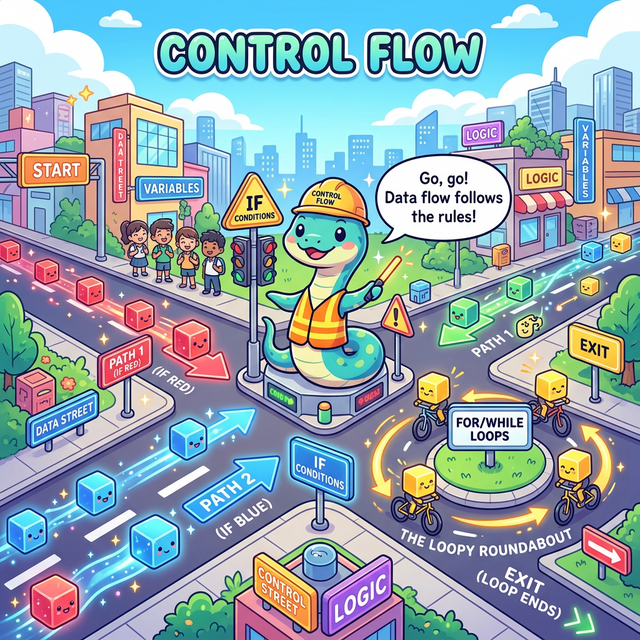
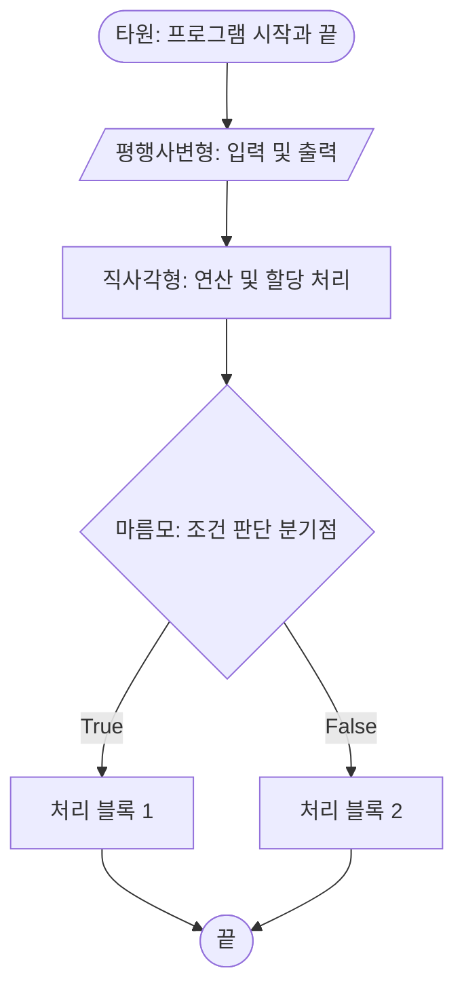
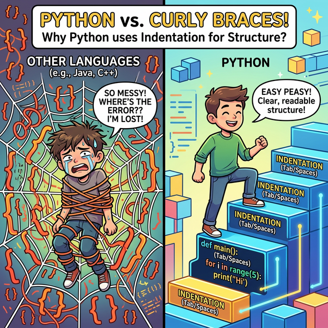
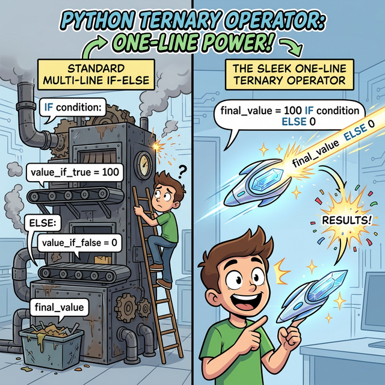

# 5주차: 제어문 (1) - 조건문과 논리 연산 🚦

프로그램이 똑똑해지려면 상황에 따라 다른 행동을 해야 합니다. 이번 시간에는 파이썬의 **조건문**과 그 판단 기준이 되는 **논리 연산**을 배웁니다.

---



## 학습목표
파이썬의 가장 강력한 제어문을 학습하는 단원입니다. 
우리가 작성한 코드가 위에서 아래로만 무식하게 흐르는 것을 막고, 상황에 따라 다른 길로 빠지게 하거나(조건문), 똑같은 작업을 수백 번 알아서 반복하도록(반복문) 트래픽을 통제하는 교통순경의 역할을 배웁니다. 아울러 예기치 못한 사고(오류)를 우아하게 넘기는 예외 처리 기술까지 마스터하여 프로그램의 논리적 실행 흐름을 완벽히 조작해 봅시다.

## 세부 학습 목차

### [3.2.1 조건문 기초: 흐름도와 if/else](#321-조건문-기초-분기-이론과-if/else)
프로그램이 갈림길을 선택하게 만드는 컴퓨터 과학의 분기(Branching) 이론과 순서도(Flowchart) 기호를 배웁니다. 아울러 파이썬의 핵심 분기문인 `if`와 `else`의 기본 구조, 그리고 자바 개발자가 헷갈리기 쉬운 파이썬만의 '들여쓰기(Indentation)' 블록 규칙을 확실히 다집니다.

### [3.2.2 조건문 심화: 다중 조건과 중첩 if](#322-조건문-심화-다중-조건과-중첩-if)
단순한 양자택일을 넘어 3가지 이상의 길로 쪼개지는 `elif` 다중 조건문, 여러 조건을 엮어내는 논리 연산자, 명시적 논리식 없이도 참/거짓을 판별하는 파이썬 고유의 Truthy/Falsy 검사법, 그리고 조건문 안에 조건문이 포개어지는 중첩(Nested) if문을 깊이 있게 다룹니다.

### [3.2.4 반복문 for (데이터 순회)](../week06/#324-반복문-for-데이터-순회)
컨베이어 벨트에 올라온 수만 개의 컬렉션(리스트 등) 데이터를 하나씩 차례로 꺼내 처리하는 파이썬 특유의 `for` 문법 순회(Iteration) 원리를 이해하고, `zip()`과 `f-string`을 묶어 우아하게 매핑하는 기법을 학습합니다.

### [3.2.5 반복문 while (조건 반복과 제어)](../week06/#325-반복문-while-조건-반복과-제어)
특정 조건이 참인 한 영원히 끝없이 도는 `while` 문의 패러다임과 부작용(무한 루프)을 이해합니다. 무한의 사슬을 끊어버리는 강력한 `break` 명령어를 배우고 텍스트 RPG 전투 예제로 실습합니다.

### [3.2.6 이중 반복문과 별 찍기](../week06/#326-이중-반복문과-별-찍기)
단일 차원의 제어를 넘어 서로 맞물려 돌아가는 **이중 반복문(Nested Loops)** 톱니바퀴 메커니즘을 배웁니다. 중첩 반복문의 영원한 수련법인 12가지 *별 찍기* 예제를 돌려보며 2차원 공간 지각력을 극대화합니다.

### [3.2.7 예외 처리](../week12/#327-예외-처리)
통제할 수 없는 외부 요인(네트워크 끊김, 없는 파일 읽기 등)으로 인해 프로그램이 허무하게 뻗어버리는(Crash) 것을 막기 위해, 에러를 부드럽게 감싸 안는 `try ~ except` 방어벽 구축 기법을 배웁니다.

---

## 🎉 정리
지금까지 우리는 코드의 실행 맥락을 입맛대로 제어하는 '제어 흐름(Control Flow)'을 완벽하게 마스터했습니다. 이제는 `for` 반복문 안에 `if` 조건문을 중첩하여 넣으면서 복잡한 데이터 분류 작업도 너끈히 자동화할 수 있는 강력한 코딩 논리력을 갖게 되었습니다. 이 논리력을 바탕으로, 다음 장에서는 컨베이어 벨트 위에 올라갈 진짜 부품들인 '자료 구조(Data Structures)'의 세계로 진입해 보겠습니다.

---

## 1. 제어 흐름과 분기(Branching) 이론

컴퓨터 프로그램은 기본적으로 소스 코드를 위에서 아래로 한 줄씩 순차적으로(Sequential) 실행합니다. 하지만 현실 세계의 복잡한 로직을 처리하려면, 특정 조건에 따라 프로그램의 흐름을 쪼개서 서로 다른 길로 보내는 **분기(Branching)** 작업이 필수적입니다.

### 순서도(Flowchart)의 기본 기호

알고리즘을 시각적으로 설계할 때 전 세계적으로 통용되는 **표준 순서도(Flowchart)** 기호들을 먼저 알아봅시다.



*   **타원 (Terminal)**: 프로그램의 시작(Start)과 종료(End)를 알립니다.
*   **평행사변형 (Input/Output)**: 사용자로부터 데이터를 받거나(`input()`) 화면에 출력(`print()`)합니다.
*   **직사각형 (Process)**: 변수에 값을 대입(`=`)하거나 덧셈 뺄셈 등 수학적 계산을 처리합니다.
*   **마름모 (Decision)**: 오늘 배울 가장 중요한 기호입니다. 내부에 조건식(예: `나이 >= 20`)을 담고 있으며, 그 결과가 참(True)인지 거짓(False)인지에 따라 나가는 화살표 길이 달라집니다.

---

## 2. 조건문 if (단일 분기)


*(웹툰 비유: 클럽 입구에 선 무서운 가드 로봇이 '나이가 20살 이상인가?'라는 조건식 표지판을 들고 있습니다. 15살 로봇은 '거짓(False)' 판정을 받아 쫓겨나고, 25살 로봇은 '참(True)' 판정을 받아 문 안으로 통과하는 재미있는 분기(Branching) 상황입니다.)*

데이터의 분기를 나누고 전처리를 하다 보면, 특정 조건에 맞게 값이나 그룹을 변경하는 일이 빈번합니다. 파이썬의 꽃이라고 할 수 있는 제어 흐름의 기본기, 조건문 `if`에 대해 알아봅니다.

### 블록 문장 조건문 if (왜 중괄호 대신 들여쓰기를 쓸까?)

파이썬은 C, Java와 같은 기존 언어들과 달리 **중괄호 `{}` 대신 오직 '들여쓰기(Indentation)'**만을 사용하여 코드 블록을 묶고 구분합니다.


*(웹툰 비유: 왼쪽의 다른 언어 프로그래머는 수많은 중괄호 `{}` 거미줄에 갇혀 코드의 논리를 잃고 괴로워하고 있습니다. 하지만 오른쪽의 파이썬 프로그래머는 자로 잰 듯 완벽하게 정렬된 '들여쓰기 블록 계단'을 가뿐하게 오르며 여유롭게 코드를 식별합니다!)*

#### "가독성이 왕이다" (Readability Counts)
파이썬 창시자 귀도 반 로섬(Guido van Rossum)은 **"코드는 작성되는 시간보다 다른 사람에 의해서 읽히는 시간이 훨씬 길다"**고 굳게 믿었습니다. 

자바나 C에서는 중괄호만 맞으면 띄어쓰기를 엉망으로 섞어 써도 컴퓨터는 군말 없이 코드를 실행해 줍니다. 하지만 파이썬은 **"사람의 눈에 보이는 시각적 들여쓰기 구조가 곧 실제 컴퓨터가 인식하는 논리 구조와 100% 동일하도록"** 프로그래머에게 규칙을 강제합니다. 

관례적으로 **스페이스 4칸**을 사용합니다. 블록을 시작하기 전(예: `if` 조건식 끝)에는 반드시 콜론 `:`을 찍어 "이제부터 새로운 블록 계단이 시작된다"고 변환기에게 예고해야 합니다.

> [!WARNING]
> **난간 없는 계단의 공포: `IndentationError`**
> 중괄호 지옥에서 해방된 대가는 **'엄격한 줄 맞춤'**입니다. 난간이 없는 계단과 같아서 발을 헛디디면 바로 추락합니다. 단 하나의 스페이스 결함이나 탭(Tab) 혼용이 에러를 발생시킵니다.

```python
n = 20

# 조건이 참이므로 들여쓰기 된 블록이 실행됨
if n % 2 == 0:
    print("짝수")
```

---

## 3. 양자택일 조건문 if ... else ...


*(웹툰 비유: 갈림길에 선 로봇이 표지판을 보고 있습니다. `날씨 == 맑음`이라는 조건이 참(True)이면 밝은 해변으로 가는 길을 택하고, 거짓(False)이면, 즉 그 외의 모든 날씨에는 아늑한 도서관으로 가는 다른 길을 택하게 됩니다!)*

특정 조건을 만족하는 경우와 만족하지 않는 경우에 다른 연산을 지정하는 구문입니다. 조건이 처음부터 거짓(False)이거나, 중간에 판별을 실패하면 자동으로 마지막 보루인 `else:` 내부의 블록이 무조건 실행됩니다.


*(다이어그램: `x > 4`라는 스위치를 만나, 조건을 통과한 참(True) 데이터 수레는 위쪽 철로(`y = 1`)를 타고, 거짓(False) 데이터 수레는 튕겨져서 아래쪽 철로(`y = 2`)로 우회하는 애니메이션입니다.)*

```python
x = 3

if x > 4:
    y = 1
else:
    y = 2

print(y) # 결과: 2
```

---

## 4. 삼항 연산자를 이용한 한 줄 조건문 (One-line if)


*(웹툰 비유: 거대한 다층 공장 기계(`if...else` 블록) 앞에서 멍하니 서 있던 프로그래머가, 똑같은 작업을 한 줄로 압축해 내는 초소형 마법 지팡이(한 줄 조건문)를 보고 감탄하는 모습입니다.)*

단순한 값 할당을 위한 `if ~ else` 구문은 한 줄로 합쳐서 매우 간결하게 표현할 수 있습니다. 



```python
age = 18
# 간결한 한 줄 표현
status = '성인' if age >= 20 else '미성년자'
print(status)
# 출력: 미성년자
```

---

## ☕ Java vs 🐍 Python 스나이퍼 비교

### 1. 블록 구조 (중괄호 vs 들여쓰기)
*   **Java**: 블록을 정의할 때 중괄호 `{ }` 를 사용합니다. 들여쓰기(Indentation)는 사람의 눈을 위해 정렬하는 것일 뿐, 논리에는 영향을 미치지 않습니다.
*   **Python**: 중괄호가 아예 없습니다! 오직 **스페이스 4칸 들여쓰기**만으로 코드 블록을 인식합니다.

### 2. 조건부 괄호
*   **Java**: `if (n % 2 == 0) {` 와 같이 논리식을 반드시 **소괄호 `( )`** 로 감싸야 합니다.
*   **Python**: `if n % 2 == 0:` 처럼 소괄호를 생략하는 것이 기본이자 파이썬다움(Pythonic)입니다. 대신 문장 끝에 반드시 콜론(`:`)을 찍습니다.

---

## 🎧 Vibe Coding

> **🗣️ 학생 프롬프트 (AI에게 이렇게 명령해 보세요):**
> "파이썬에서 스페이스바(Space)와 탭(Tab) 키를 섞어서 들여쓰기(Indentation)를 했을 때, 눈에는 안 보이는데 파이썬이 TabError나 IndentationError를 뱉어내는 이유를 기술적으로 설명해 주고, 내가 VS Code 같은 에디터에서 이걸 어떻게 한 번에 고칠 수 있는지 알려줘."

---

## 코딩 영단어 학습 📝

*   **`Flowchart`**: 순서도. (물이 흐르듯 알고리즘의 실행 순서를 표준화된 기호로 그려놓은 지도입니다.)
*   **`Branch`**: 나뭇가지, 분기점. (프로그램이 일직선으로 실행되다 둥치에서 나뭇가지가 갈라지는 것처럼 갈림길을 형성하는 것을 의미합니다.)
*   **`if`**: 만약 ~라면. (코드 세계에서 선택의 기로를 만듭니다.)
*   **`else`**: 그 밖의, 다른. (모든 `if`의 검증을 통과하지 못한 '나머지 찌꺼기' 값들이 모조리 들어가는 최후의 보루입니다.)
*   **`Indent (Indentation)`**: 들여쓰다. (콜론 뒤에 스페이스바 4번을 쳐서 코드를 우측으로 파이게 만드는 행위를 말합니다.)

---

## 1. 반복된 다중 조건문 if ... elif ... else


*(웹툰 비유: 복도에 여러 개의 잠긴 문이 순서대로 늘어서 있습니다. 로봇이 85번 키를 들고 첫 번째 `>= 90` 문에 꽂아보지만 열리지 않습니다(False). 다음 문인 `>= 80` 문에 꽂자 철칵! 하고 위풍당당하게 문이 열립니다(True). 로봇은 뒤에 남은 `>= 70` 문 따위는 쳐다보지도 않고 열린 방 안으로 들어가 버립니다. 이것이 `elif`의 핵심 원리인 **'순차적 숏서킷(Short-Circuit)'**입니다.)*

Python에서는 조건 판단이 3갈래 이상으로 나뉘는 경우 `elif` (else if의 줄임말) 구문을 사용합니다. 첫 조건부터 순차적으로 검사하며, 한 번이라도 참을 달성하면 하위 조건들은 쳐다보지도 않고 스킵(건너뜀)합니다.

```python
point = 85

if 90 <= point:
    print('A')
elif 80 <= point:
    print('B')
elif 70 <= point:
    print('C')
else:
    print('F')
```
**출력:**
```
B
```

## 2. 논리 연산자(and, or, not)를 활용한 다중 조건문

여러 조건을 동시에 평가해야 할 때는 앞서 배운 논리 연산자를 사용합니다.

```python
age = 25
has_ticket = True

# 두 조건을 모두 만족해야 입장 가능
if age >= 19 and has_ticket:
    print("관람이 가능합니다.")
else:
    print("입장할 수 없습니다.")
# 출력: 관람이 가능합니다.
```

## 3. 중첩 조건문 (Nested if)


*(웹툰 비유: 로봇이 힘겹게 첫 번째 거대한 자물쇠 상자(`성적 >= 80`)를 열었는데, 그 안에 보물이 있는 게 아니라 **또 다른 두 번째 자물쇠 상자(`출석 == 100`)**가 들어있습니다! 로봇은 땀을 한 방울 흘리며 두 번째 열쇠까지 꽂아 넣고 나서야 비로소 진짜 황금 트로피(최종 합격)를 꺼냅니다. 퀘스트 안의 퀘스트, 이것이 바로 중첩 조건문입니다.)*

`if` 블록 안에 또 다른 `if` 블록을 중첩시켜, 조건 판별을 2중 3중으로 단계적이고 깊숙하게 들어갈 수도 있습니다. 단, 너무 많은 중첩 조건문(If depth)은 코드를 오른쪽으로만 길게 만들고 가독성을 훼손하므로 적절히 분리하는 것이 좋습니다.

```python
score = 85
attendance = 100

if score >= 80:
    print("1차 평가: 성적 평가는 통과했습니다.")
    
    # 1차 조건을 통과한 경우에만 내부 if문을 검사
    if attendance == 100:
        print("최종 합격: 장학금 지급 대상입니다!")
    else:
        print("최종 합격: 하지만 결석이 있어 장학금은 제외됩니다.")
else:
    print("성적 미달로 불합격입니다.")
```

## 4. 파이썬의 암묵적인 참/거짓 (Truthy & Falsy)

파이썬에서는 굳이 세부적인 비교 연산자(`==`, `>`, `<`)를 쓰지 않아도 데이터 자체가 문맥에 따라 `True`나 `False`로 판별되는 **암묵적인 논리 평가** 특징이 있습니다. 데이터가 "비어 있느냐, 값이 없느냐"를 가장 파이썬답고 세련되게 검사하는 패턴입니다.

- **Falsy 평가 (거짓 처리)**: `0`, `0.0`, `""`(빈 문자열), `[]`(빈 리스트), `()`, `{}`, `None`, `False`
- **Truthy 평가 (참 처리)**: 위를 제외한, 값이 채워져 있는 모든 데이터

```python
user_name = ""  # 빈 문자열은 Falsy로 평가됨
items = []      # 빈 리스트도 Falsy로 평가됨

if user_name:   # user_name이 비어있으면 조건은 False가 되어 else 블록으로 감
    print(f"환영합니다, {user_name}님.")
else:
    print("이름이 입력되지 않았습니다.")
    
# 리스트에 데이터가 있는지 없는지 직관적으로 확인
if not items:
    print("장바구니가 비어 있습니다.")
```

## 5. 포함 여부를 검사하는 멤버십 연산자 (in, not in)

리스트, 튜플, 문자열 등 연속형 자료 안에 특정 값이 들어 있는지 확인할 때 `in`과 `not in` 연산자를 활용하면 매우 직관적인 조건 처리가 가능합니다.

```python
allowed_users = ["Alice", "Bob", "Charlie"]
user = "David"

if user not in allowed_users:
    print(f"경고: {user}는 허가되지 않은 사용자입니다.")
```

---

## [실전 예제] 게임 체력(HP) 상태 경고 시스템

조건 판단이 여러 갈래로 나뉘는 `if ~ elif ~ else` 구문은 실제 로직을 분기하는 데 매우 흔하게 쓰입니다. 

```python
hp = 30

# 조건 1: 체력이 20 이하니?
if hp <= 20:
    print("⚠️ 위험! 포션을 사용하세요!")
# 조건 2: 체력이 50 이하니?
elif hp <= 50:
    print("주의! 체력을 관리하세요.")
# 그 외 모든 경우
else:
    print("상태 양호. 전투를 계속합니다.")
```

## [데이터 분석 심화] np.select() 조건 처리

Python 기본 제어문을 넘어 Pandas 등 대용량 데이터 전처리를 할 때, `numpy.select()`를 응용하면 중첩된 `if else` 없이 여러 조건을 깔끔하게 배열 단위로 변환할 수 있습니다. 

```python
import numpy as np

arr = np.array([1, -2, 3, -4, 0])

# 분기될 조건들의 리스트
conditions = [arr > 0, arr == 0, arr < 0]
# 조건에 매칭되어 반환될 값 리스트
choices = ["양수", "0", "음수"]

result = np.select(conditions, choices)
print(result) # ['양수' '음수' '양수' '음수' '0']
```

---

## 🎧 Vibe Coding

> **🗣️ 학생 프롬프트 (AI에게 이렇게 명령해 보세요):**
> "파이썬에서 점수를 입력받아 A, B, C, D, F 학점을 매겨주는 간단한 성적 판별기 코드를 작성해줘. 단, `if`, `elif`, `else`가 정확히 어떻게 분기되는지 옆에 자세한 주석을 달아주고, 내가 잘못된 값(음수나 100점 초과)을 넣었을 때 에러 메시지를 띄우는 중첩 if문 예외처리도 상세하게 추가해봐."

---

## 코딩 영단어 학습 📝

*   **`elif`**: else if 의 줄임말. (두 번째, 세 번째 플랜B 조건들을 계속해서 다중으로 엮을 때 씁니다.)
*   **`Nested`**: 중첩된, 포개어진. (러시아 마트료시카 인형처럼, `if`문 안에 또 다른 `if`문이 겹겹이 쌓여있는 복잡한 심화 논리 구조를 부를 때 사용합니다.)

---

Python 3.10 버전부터 새롭게 도입된 `match` 구문은 C, Java 등 다른 언어의 `switch-case` 문과 같이 기본적인 값 매칭 기능을 제공할 뿐만 아니라, **데이터의 '구조(형태)'까지 분해해서 매칭**할 수 있는 훨씬 강력하고 현대적인 기능입니다. 처음에는 단순 값 매칭을 연습하고 후반부에서 구조적 패턴 매칭을 배웁니다.

## 기존 switch ~ case 구문과의 차별점

| 언어/구문 | 주요 특징 및 한계점 |
|---|---|
| **C/Java의 `switch`** | 주로 정수형(int), 문자(char), 문자열(String) 등 **단순한 단일 값의 일치 여부**만 검사할 수 있습니다. 각 `case`마다 `break`를 명시하지 않으면 밑으로 주욱 누수(fall-through)되는 귀찮은 점이 있습니다. |
| **Python의 `match`** | 숫자, 문자열 비교는 기본이고, 리스트 갯수, 튜플 내부의 변수 위치, 딕셔너리의 키 구조 등 **복합 자료구조 자체를 분해(Unpacking)**하여 매칭할 수 있습니다. `break`를 쓰지 않아도 매칭된 블록 하나만 실행되고 깔끔하게 종료됩니다. |

## 문법 및 키워드
구문에서 `match`와 `case`는 핵심 키워드입니다. C나 자바에 쓰이던 `default:` 키워드 대신 `case _:` (언더스코어) 문법을 기본값으로 사용합니다.

연산식 또는 변수 `exp`의 구조나 값을 각 `case` 블록의 패턴들과 위에서부터 순서대로 비교하고, 첫 번째로 구조/값이 일치하는 `case`를 찾으면 해당 `case` 내부 블록인 `statements`만 실행합니다. 
어떤 `case`와도 일치하지 않으면 옵션인 `case _:` 이후의 블록을 실행한다.

```python
match exp:
    case value1:
        statements
    case value2:
        statements
    case _:
        statements
```

- `exp`: `match` 구문에서 평가할 식(expression)이나 변수이며, 이 값이 어떤 `case`와 일치하는지 확인
- `value1`, `value2`, ...: 여러 개의 경우(case)를 정의하며, `exp`의 값과 각 경우를 비교
- `statements`: 각 경우에 해당하는 실행 문장이 정의되는 블록으로, `exp`의 값이 해당하는 경우, 해당 블록이 실행


## 예제
다음 구문 `match` 문장에서 `value`가 `apple`이므로 `case 'apple'`에 적용되어 출력 값은 사과이다.

```python
value = "apple"
match value:
    case 'apple':
        result = "사과"
    case 'banana':
        result = "바나나"
    case _:
        result = "기타"

print(result)
```
**출력:**
```
사과
```

다음은 `value`가 `banana`이므로 `result`에 저장된 값은 바나나이다.

```python
value = "banana"
match value:
    case 'apple':
        result = "사과"
    case 'banana':
        result = "바나나"

print(result)
```
**출력:**
```
바나나
```

다음은 `mango`로 비교할 값이 `case`에 없으므로 `case _:` 블록이 실행되어 `None`이 출력된다.

```python
value = "mango"

match value:
    case 'apple':
        result = "사과"
    case 'banana':
        result = "바나나"
    case _:
        result = None

print(result)
```
**출력:**
```
None
```

## 고급 활용: 구조적 패턴 매칭 (Structural Pattern Matching)


*(웹툰 비유: 미래 우체국의 최첨단 `match` 분류기입니다. 단순히 택배 상자의 주소(숫자)만 검사하는 옛날 기계(`switch`)와 달리, X-ray 눈으로 상자 내부의 '구조'와 '형태(리스트인지, 딕셔너리인지)'까지 단번에 꿰뚫어 보고 그에 맞는 전용 파이프로 슛! 하고 날려 보냅니다.)*

`match` 구문의 진정한 강력함은 리스트나 딕셔너리 같은 복합 자료형의 내부 **'구조'를 통째로 인식하여 분해(Unpacking)할 때** 발휘됩니다. 값이 일치하는지 묻는 것이 아니라, "너는 리스트니? 튜플이니?" "요소가 2개니? 3개니?"라고 형태를 먼저 질문합니다.


*(다이어그램: `match` 터미널로 들어온 데이터들이 각자 자신의 형태(`[x, y]`, `{"id": id}`, `_`)에 맞는 X-ray 검사대(`case`)를 통과하며 곧바로 내부 변수로 분해(Unpacking)되어 처리되는 일련의 과정을 보여주는 애니메이션입니다.)*

### 1. 리스트(List) 구조 언패킹 매칭
들어오는 데이터 리스트의 원소 개수와 위치에 따라 처리를 분기할 수 있습니다. 가장 놀라운 점은, 조건 판별에 통과함과 동시에 그 내부 값들을 `x`, `y` 같은 **변수로 즉시 뽑아내어(Unpacking) 저장해 버린다는 것**입니다.

```python
# 2개의 요소가 들어있는 리스트
point = [10, 20]

match point:
    case [0, 0]:
        print("원점입니다.")
    case [x, 0]:
        print(f"X축 위의 점입니다. 위치 X = {x}")
    case [0, y]:
        print(f"Y축 위의 점입니다. 위치 Y = {y}")
    case [x, y]:  # point 리스트의 형태가 [요소1, 요소2] 와 일치하므로 여기에 진입!
        # 진입과 동시에 x=10, y=20 으로 값이 자동으로 분해되어 할당됩니다!
        print(f"일반 2차원 좌표: X={x}, Y={y}")
    case [x, y, z]:
        print(f"3차원 좌표입니다: X={x}, Y={y}, Z={z}")
    case _:
        print("단순 2차원 좌표가 아닙니다.")
```
**출력:**
```
일반 2차원 좌표: X=10, Y=20
```

### 2. 딕셔너리(Dictionary) 구조 검증 매칭
웹 API JSON 응답이나 게임의 상태 데이터와 같은 복잡한 딕셔너리 데이터에서, 필수 키(Key)가 존재하는지 마치 **붕어빵 틀처럼 데이터 뼈대를 점검**할 때 매우 깔끔한 코드를 작성할 수 있습니다.

```python
response = {"status": 200, "data": "로그인 성공", "timestamp": "2023-10-27"}

match response:
    # 딕셔너리 안에 status 값이 200이고, "data"라는 키가 있다면 통과!
    # 그리고 그 "data" 키의 값을 즉시 msg 변수에 뽑아냅니다.
    case {"status": 200, "data": msg}:
        print(f"정상 처리됨: {msg}")
        
    case {"status": 404}:
        print("경고: 리소스를 찾을 수 없습니다.")
        
    # 에러 코드가 무엇이든 error 키가 포함되어 있으면 통과!
    case {"status": code, "error": err_msg}:
        print(f"서버 오류 코드 {code}: {err_msg}")
        
    case _:
        print("알 수 없는 응답 포맷입니다.")
```
**출력:**
```
정상 처리됨: 로그인 성공
```

---

## ☕ Java vs 🐍 Python 스나이퍼 비교

### 1. Fall-through 방지 메커니즘
*   **Java**: `switch` 문에서 `break;` 를 깜빡 잊고 적지 않으면, 의도치 않게 밑에 있는 다른 `case` 구문들까지 줄줄이 실행되는 `Fall-through` 버그가 매우 빈번하게 발생합니다.
*   **Python**: `match` 문은 오직 최초로 일치한 단 한 개의 `case` 블록만 실행하고 구문을 깔끔히 종료합니다. `break` 명령어가 아예 필요하지 않습니다!

### 2. 매칭의 차원 (단일 값 vs 구조적 객체)
*   **Java (전통적)**: 정수, 문자, 짧은 문자열 등 단순한 기본 타입 데이터들의 "동등성(Equal)"을 비교하는 데 최적화되어 있습니다.
*   **Python**: 데이터의 "구조와 형태(Shape)" 자체를 맞추는 만능 셰이프 매칭 퍼즐과 같습니다.

---

## 🎧 Vibe Coding

> **🗣️ 학생 프롬프트 (AI에게 이렇게 명령해 보세요):**
> "파이썬 3.10 버전 이상의 `match` 구문을 사용해서, RPG 게임 캐릭터의 장비 아이템 데이터를 분류하는 함수를 짜줘. 아이템이 무기인지 (`[단검, 공격력 10]`), 방어구인지 (`[투구, 방어력 5, 20골드]`), 아니면 알 수 없는 쓰레기인지 리스트의 길이와 형태 패턴 구조로 매칭하게 만들고 자세한 주석을 달아줘."

---

## 코딩 영단어 학습 📝

*   **`match`**: 어울리다, 짝을 맞추다. (복잡한 데이터 퍼즐 조각이 어떤 뼈대 틀(Case)과 완벽하게 짝이 맞는지 맞춰보는 행위입니다.)
*   **`case`**: 경우, 사례. (데이터가 들어맞을 수 있는 각각의 방(Room)이나 분류 통을 말합니다.)
*   **`Unpacking (언패킹)`**: 짐을 풀다. (구조적 패턴 매칭의 핵심입니다. 리스트나 딕셔너리라는 보따리가 `case` 틀을 통과하자마자 그 내부 내용물(짐)이 곧바로 풀려서 변수에 알맹이만 쏙 저장되는 마법 같은 기능입니다.)

---

## ✍️ 이번 주 연습 문제

**문제 1.** 사용자로부터 숫자를 입력받아, 그 숫자가 **홀수인지 짝수인지** 판별하여 출력하는 프로그램을 작성해 보세요.

**문제 2.** 세 개의 숫자 `a, b, c`를 입력받아 그 중 **가장 큰 수**를 찾아 출력하는 프로그램을 작성해 보세요. (`max()` 함수를 쓰지 말고 `if`문만 사용해 보세요.)

**문제 3.** (심화) 다음 코드의 출력 결과는 무엇일까요? 단락 평가의 원리를 이용하여 설명해 보세요.
```python
def check_me():
    print("함수 호출됨!")
    return True

print(True or check_me())
```

---

## 📖 교재 상세 학습: 40 파이썬의 영리한 게으름: 단락 평가(Short-circuit)

## 40 파이썬의 영리한 잔머리 계산법: 단락 평가(Short-circuit)

파이썬 엔진은 `and`나 `or` 같은 논리 연산자를 만났을 때 굉장히 효율적인 꼼수를 씁니다. 바로 앞에서 이미 최종 결론이 뻔히 나버렸다면, 굳이 에너지를 들여 뒤쪽 코드를 연산하지 않고 과감히 스킵(Skip)해버리는데 이를 프로그래밍 용어로 **단락 평가(Short-circuit evaluation)**라고 부릅니다.

#### 1. and 연산의 단락 평가
`and` 조건은 **양쪽 저울이 모두 참이어야만** 최종 승인이 떨어집니다. 그렇다면 만약 왼쪽 저울이 이미 `False`로 판명 났다면? 어차피 우측 상태가 어떻든 전체 결과는 무조건 `False`로 낙인찍히므로 파이썬은 오른쪽 식을 아예 실행조차 하지 않고 버립니다.

**코드: 에러를 피해 가는 안전한 딕셔너리 검증**
```python
user_info = {"name": "파이썬"}

# 만일 파이썬 봇이 멍청하게 양쪽을 무조건 다 읽으려 든다면, 우측의 user_info["age"] 구문에서 없는 키를 찾다 치명적인 KeyError 불꽃이 튈 것입니다.
# 하지만 다행히도 앞쪽의 "age" in user_info 가 이미 거짓(False) 판정을 받았기에, 파이썬은 뒤쪽 위험한 코드는 쳐다보지도 않고 무사히 넘어갑니다!
if "age" in user_info and user_info["age"] > 20:
    print("성인 인증 완료.")
else:
    print("나이 데이터가 누락되었거나 미성년자입니다.")
```

#### 2. or 연산의 단락 평가
이와 정반대로 `or` 조건은 **둘 중 아무쪽이나 하나만 참이어도** 전체 패스가 보장됩니다. 따라서 만약 왼쪽 코드를 훑어봤더니 운 좋게 `True`가 나왔다면? 뒤쪽 코드는 볼 필요도 없이 이미 게임 끝(`True` 확정)이므로 우측 연산을 완전히 무시해 버립니다.


---

## 📖 교재 상세 학습: 41 형태만으로 참/거짓 판별하기: Truthy와 Falsy

## 41 실체가 없는 것과 있는 것: Truthy와 Falsy의 마법

`if`문의 조건식 필드에는 오로지 정직한 `True`나 `False` 진리값만 들어갈 수 있을까요? 재미있게도 파이썬은 일반 숫자, 문자열, 리스트 등 세상에 존재하는 모든 데이터 조각들을 저마다 '참(True)' 비슷한 무언가, 혹은 '거짓(False)' 비슷한 무언가로 은밀하게 자동 평가하는 능력을 갖췄습니다.

#### 텅 빈 깡통은 거짓(Falsy), 내용물이 한 톨이라도 있으면 참(Truthy)

이는 파이썬 생태계를 지배하는 절대 법칙입니다. 속이 텅 비어있거나, 가치가 0에 수렴한다면 무조건 **거짓(False)** 꼬리표가 붙습니다.
* **거짓으로 취급(Falsy)**: 숫자상 `0`이나 `0.0`, 아무 길이도 없는 빈 텍스트 `""`, 빈 집업 `[]`과 빈 가방 `{}`, 그리고 절대무(無)를 뜻하는 `None`
* **참으로 취급(Truthy)**: 정상 숫자 `1`, 마이너스 `-10`, 일반 텍스트 `"안녕"`, 원소가 든 배열 `[1, 2]`, 심지어 투명한 공백 한 칸 `" "` 마저도 데이터가 존재하므로 참으로 쳐줍니다.

**REPL 실습 창: 은밀한 데이터 참/거짓 판별기**
```python
>>> bool(0)
False
>>> bool(-99)
True
>>> bool([])
False
>>> bool([1])
True
```

이 매력적인 법칙을 바로 직전에 다뤘던 `or` 단락 평가 스킬과 버무려내면, 변수에 기본값을 우아하게 욱여넣는 환상적인 한 줄 코드가 만개합니다.

**활용 코드: 닉네임이 비었을 때 기본 용사 이름 세팅하기**
```python
# 유저가 멋진 이름을 짓기 귀찮아서 입력창에 아무것도 안 치고 엔터광클을 했다면?
# 파이썬 input() 함수는 텅 빈 문자열 "" 을 뱉어냅니다. (이건 명백한 Falsy!)
# or 연산자가 앞쪽을 탐색하다 False(빈 문구)를 만나면 패스하고, 자연스레 뒤쪽의 '무명 용사' 문자열을 최종 결괏값으로 채택(True)해 변수에 대입합니다!

char_nickname = input("캐릭터 닉네임을 설정하세요: ") or "무명 용사"

print(f"로그인 성공, {char_nickname}님 환영합니다!")
```

위 짤막한 스크립트를 실제로 돌려보고 아무 값 없이 엔터를 튕겨보면, 에러 화면 대신에 근사한 "무명 용사" 타이틀이 세팅되는 광경을 볼 수 있습니다. 타 언어에서 줄줄이 `if ... else ...`로 써야 할 로직을 이토록 담백하게 풀어내는 파이썬의 매력 포인트이니, 꼭 동작 원리를 가슴에 새겨두시기 바랍니다.

---

### 💻 미니 실습: Truthy와 Falsy 솎아내기 감별사

**Quiz 1** 아래 제각기 다른 6개의 데이터 블록들이 `if` 조건 제어문에 차례로 빨려 들어갔을 때, 코드가 통과되어 메시지가 찍히는 부류와 차갑게 튕겨 나가는 부류로 나뉠 것입니다. 
`0`, `"Python"`, `[ ]`, `[0]`, `""`, `-1`
이 후보군 중에서 `if` 문턱을 넘어 화면 출력을 이끌어 낼 이른바 참된 녀석(Truthy)들만 정확하게 골라내 보세요.

---
<details>
<summary><b>모범 답안 보기</b></summary>

**풀이 1**
파이썬 엔진 내부에서 참(Truthy)으로 격상되어 조건 블록을 통과하는 알짜배기 데이터들은 아래 세 가지입니다.
* `"Python"` (적어도 영문자 6개가 꽉 찬 문자열)
* `[0]` (비록 숫자 0일지라도 원소가 1개 들어찬 어엿한 리스트)
* `-1` (0만 아니면 모든 정수/실수는 참)

반면 숫자 `0`, 깨끗이 비워진 리스트 `[ ]`, 아무 길이가 없는 문자열 `""` 트리오는 전부 무상(Falsy) 상태로 간주되어 `if`문을 넘지 못하고 탈락합니다.
</details>


---

## 📖 교재 상세 학습: 09 상황에 따른 행동 지침, if문

## 09 파이썬의 갈림길 판단, if 조건문

우리가 사용하는 일상적인 프로그램들은 주어진 상황에 따라 각기 다른 동작을 수행합니다. 예를 들어 온라인 쇼핑몰에서 계좌 잔고가 넉넉하면 결제가 완료되고, 모자라면 결제 실패 메시지가 뜨는 것과 같습니다. 파이썬에서는 이렇게 흐름을 나누는 문법을 `if`문이라고 부릅니다.

간단한 예제 코드로 작동 방식을 알아보겠습니다. `if_test.py`라는 파일을 생성하고 아래 코드를 타이핑해 보세요.

**작성할 코드: if_test.py**
```python
members = 4
pizza_slices = 8

if members <= pizza_slices / 2:
    print('한 사람당 두 조각씩 먹을 수 있는 넉넉한 피자 파티입니다!')

if members > pizza_slices:
    print('피자가 모자랍니다. 가위바위보를 준비하세요!')
```

이 코드를 실행하면 `members`(4)가 `pizza_slices / 2` (4)보다 작거나 같다는 첫 번째 조건이 참(True)이 되기 때문에 첫 번째 프린트문만 콘솔에 출력됩니다.

if문을 작성하는 기본 규칙은 다음과 같습니다.

1. **`if` 키워드**: "만약 조건이 이러하다면"이라는 선언입니다.
2. **조건식**: 참과 거짓을 판별해 코드를 실행할지 결정하는 기준입니다. (예: `members > pizza_slices`)
3. **콜론(`:` )**: 조건식의 끝을 파이썬 엔진에 알려주는 기호입니다. "이제 이 조건이 맞을 때 실행할 코드가 이어집니다"라는 뜻을 가집니다.
4. **들여쓰기(Indentation)**: 스페이스바 4번(또는 탭)을 눌러 들여쓰기를 적용합니다. 들여쓰기가 된 구역 안의 코드들만 if 블록에 포함됩니다.
5. **실행할 코드**: 조건식이 사실일 때 동작하는 실제 명령어들입니다.

만일 `if` 뒤의 조건이 거짓(False)이라면, 파이썬은 들여쓰기된 코드를 완전히 무시하고 다음 줄로 건너뜁니다. 부등호를 반대로 뒤집어 보거나 변수의 숫자를 변경해 보면서 어떻게 작동하는지 직접 테스트해 보세요.

---

### 💻 미니 실습: if문 작성해 보기

**Quiz 1** 조건식 자리에 직접 `True`나 `False`라는 값을 넣어서 if문의 동작을 강제로 제어할 수도 있습니다. 빈칸을 채워 두 번째 `print`문만 화면에 나오게 만들어 보세요.

```python
if False:
    print("이 문장은 화면에 출력되지 않습니다.")

# 아래 빈 공간에 if문과 True 키워드를 사용해 코드를 완성하세요.

    print("이 문장은 화면에 출력되어야 합니다.")
```

---
<details>
<summary><b>모범 답안 보기</b></summary>

**풀이 1**
```python
if False:
    print("이 문장은 화면에 출력되지 않습니다.")

if True:
    print("이 문장은 화면에 출력되어야 합니다.")
```

> **참고**: `True`와 `False`는 반드시 첫 문자를 대문자로 작성해야만 파이썬이 올바른 값으로 인식한답니다.
</details>


---

## 📖 교재 상세 학습: 10 진실게임의 규칙, 조건식

## 10 참과 거짓을 가르는 조건식의 세계

if 조건문에서 가장 중요한 부분은 `if`라는 단어 바로 다음에 나오는 **'조건식'**입니다. 이 식은 컴퓨터가 계산했을 때 결과가 반드시 참(`True`) 아니면 거짓(`False`) 중 하나로 귀결되어야만 합니다.

조건식을 만들 때 가장 많이 쓰이는 도구는 왼쪽과 오른쪽의 크기를 비교하는 '비교 연산자'와 조건들을 서로 엮어주는 '논리 연산자(Boolean Operator)'입니다.

파이썬 대화형 환경(REPL)을 이용해 직접 결과를 확인해 볼까요?

**대소 비교 연산하기**
```text
>>> 5 < 10
True
>>> 20 > 50
False
```

가장 혼동하기 쉬운 것은 '크거나 같다' 혹은 '작거나 같다'를 표현할 때입니다. 키보드에는 $\le$ 같은 기호가 없기 때문에 `=` 기호를 부등호 뒤에 붙여서 `>=` 혹은 `<=` 형태로 적어주어야 합니다. 만약 `=<`처럼 순서를 반대로 쓰면 문법 에러가 터지니 꼭 주의하세요!

여기서 또 하나, 파이썬만의 중대한 규칙을 짚고 넘어가겠습니다.
만약 양쪽 값이 **'서로 동일한가?'**를 체크하고 싶다면 등호를 연달아 두 번 쓴 `==` 기호를 써야 합니다.

```text
>>> 100 == 100
True
>>> 10 = 10
SyntaxError: can't assign to literal
```

앞에서도 다뤘지만 파이썬에서 `=` 하나짜리 기호는 오직 "우측 데이터를 좌측 변수에 대입하라"는 의미로만 쓰입니다. 이것을 비교용으로 쓰면 오류가 발생합니다.
반대로 양쪽 데이터가 '서로 다른가?'를 묻고 싶을 때는 `!=` 기호를 사용합니다. (프로그래밍 세계에서 `!` 마크는 보통 부정을 뜻합니다.)

**복잡한 조건 묶기: 논리 연산자**
조건이 여러 개일 때, 파이썬은 일상 영어와 거의 똑같은 `and`, `or`, `not`을 통해 식을 결합하도록 지원합니다.

*   `and` (그리고): 양쪽 두 조건이 **전부 다** `True`일 때만 최종 결과를 `True`로 판단합니다.
*   `or` (또는): 양쪽 조건 중에서 **어느 것 하나라도** `True`라면 쿨하게 `True`로 인정해 줍니다.
*   `not` (~가 아니다): 원래 계산된 조건의 결과를 반대로 뒤집는 역할을 합니다.

```text
>>> score = 85
>>> rank = 2
>>> score > 80 and rank <= 3  # 두 가지 조건을 모두 만족시키므로 True
True
>>> not (score > 90)          # 90점 초과가 아님이 확실하므로 True
True
```

---

### 💻 미니 실습: 조건식 훈련하기

**Quiz 1** 변수 `number`가 짝수(2로 나누어떨어짐)인지 판별하여 "짝수입니다"라는 메시지를 띄우도록 if문을 넣어보세요.

```python
number = 14

# 조건을 만족하는 if문을 완성하세요.

    print(f"{number}는 짝수입니다.")
```

**Quiz 2** 현재 시간이 아침 9시 이전이거나, 오후 6시(18시) 이후라면 "휴식 시간" 문구가 뜨도록 조건을 조합해 보세요.
```python
current_time = 20

# 9보다 작거나 18보다 크다 조건을 or 키워드로 연결해 보세요.

    print("행복한 휴식 시간입니다.")
```

---
<details>
<summary><b>모범 답안 보기</b></summary>

**풀이 1**
```python
number = 14
if number % 2 == 0:
    print(f"{number}는 짝수입니다.")
```

**풀이 2**
```python
current_time = 20
if current_time < 9 or current_time > 18:
    print("행복한 휴식 시간입니다.")
```
</details>


---

## 📖 교재 상세 학습: 11 묶음 단위로 움직이는 코드, 블록(Block)

## 11 함께 움직이는 코드의 묶음, 블록(Block)

파이썬 스크립트에서 들여쓰기로 묶인 하나의 텍스트 구역을 가리켜 '코드 블록'이라고 칭합니다.
이 블록은 특정 조건문의 지휘 아래 놓이며, 조건이 참이면 블록에 포함된 모든 줄이 순차적으로 실행되고, 거짓이면 블록 전체가 한 번에 통과(스킵)됩니다.

**코드 구조 예시**
```python
if True:
    print("이 세 줄의 출력문은 하나의 블록에 속해 있습니다.")
    print("우리 모두는 같은 운명 공동체입니다.")
    print("들여쓰기가 유지되는 한 모두 다 같이 실행됩니다.")
print("이곳은 들여쓰기가 끝났으므로 if문 블록 바깥 영역입니다.")
```

코드 블록을 짤 때 절대 어기면 안 되는 핵심 규칙이 하나 있습니다. 바로 **"동일한 블록 안에 속한 코드들은 들여쓰기 간격이 100% 한 치의 오차도 없이 맞아야 한다"**는 점입니다. 스페이스바를 한두 번 더 누르거나 덜 누르면 파이썬 엔진은 어김없이 깐깐한 `IndentationError`(들여쓰기 오류)를 내뱉게 됩니다.

물론 필요하다면 큰 블록 덩어리 안에 또 다른 작은 블록을 겹겹이 쌓아 올릴 수도 있습니다. 

**중첩된 블록 예시**
```python
if True:
    print("가장 바깥쪽 블록 안으로 들어왔습니다.")
    
    if False:
        print("첫 번째 안쪽 블록 - 이 조건은 거짓이기에 무시됩니다.")
    
    if True:
        print("두 번째 안쪽 블록 - 이 조건은 참이기에 실행 문장이 뜹니다.")

print("if문 덩어리가 모두 끝나고 프로그램이 종료됩니다.")
```

위의 예제처럼 `if` 블록 내부에서 또다시 `if` 조건을 열게 되면, 기존 들여쓰기에 더해 한 번 더 깊게 들여쓰기(보통 스페이스 4칸 추가)를 해 주어 새로운 내부 블록을 엽니다. 안쪽 블록은 항상 자신을 품고 있는 바깥쪽 블록의 실행 여부에 종속됩니다. 즉, 바깥 블록의 조건이 `False`가 되어버리면 내부 블록 조건이 아무리 `True`일지언정 아예 진입조차 하지 못합니다.


---

## 📖 교재 상세 학습: 12 모든 경우의 수를 처리하기: if - elif - else

## 12 다양한 분기 처리의 완성: if, elif, else

단순히 `if`문 한 개만 덜렁 있는 프로그램은 조건이 맞을 때만 반응하고, 틀릴 때는 아무 일도 안 한 채 고요히 침묵합니다. 하지만 실제 코딩을 할 때는 조건이 일치하지 않는 '그 밖의 상황들'에 대한 대비책도 세워두어야 하죠. 그럴 때 투입되는 구문이 바로 `else`입니다.

`else`는 항상 `if` 덩어리 맨 끝에 따라오며, **"위에 나열된 조건들이 모조리 실패했을 때, 최후의 보루로 이 코드를 구동하라"**는 목적을 가집니다. 구문 특성상 `else` 뒤에는 다른 조건식이 오지 않으며 구분이 끝났음을 알리는 콜론(`:`)기호만 붙입니다.

**기본 적인 elif 활용 예제**
```python
guess_num = 7
answer_num = 7

if guess_num == answer_num:
    print("정답입니다! 축하합니다.")
else:
    print("틀렸습니다. 다음에 또 도전해 보세요!")  # 모든 조건이 위 쪽에 맞지 않을 때 동작
```

현실 세계에서 결정지가 O와 X, 단 두 가지뿐만은 아니죠. 신호등만 봐도 빨강, 노랑, 초록의 세 가지 행동 강령이 존재합니다. 이때 만약 `else` 문 안에다가 또다시 `if-else` 구문을 파고들며 코딩하면 들여쓰기 계단이 끝도 없이 오른쪽으로 파고드는 악몽 같은 스파게티 코드가 탄생합니다.

이러한 가독성 파괴를 아름답게 막아주는 훌륭한 문법이 바로 **`elif`** (else if의 축약어)입니다.

**다중 분기 처리 예제**
```python
traffic_light = "노랑"

if traffic_light == "초록":
    print("길을 건너도 안전합니다.")
elif traffic_light == "노랑":
    print("신호가 바뀔 수 있으니 주의하거나 멈추세요.")
elif traffic_light == "빨강":
    print("위험합니다. 멈춰주세요!")
else:
    print("신호등이 고장 났습니다. 주의해서 이동하세요.")
```

`elif` 구문을 활용하면 여러 개의 다양한 조건을 같은 수준의 들여쓰기로 1열로 쭉 나열할 수 있어 읽기가 무척 쾌적해집니다. 파이썬은 위 줄부터 아래로 하나씩 조건식을 체크해 가다가, 참과 맞아떨어지는 블록이 나오면 곧바로 그것을 실행하고 **그 즉시 하위의 다른 `elif`나 `else`는 전부 건너뛰며 검사를 마칩니다**.

결국 이 3종 세트(`if`, `elif`, `else`)만 제대로 숙지하면 어떤 복잡한 로직이라도 물 흐르듯 유연하게 구조를 짤 수 있답니다!

---

### 💻 미니 실습: 다중 조건문 작성해 보기

**Quiz 1** 학생 점수에 따라 학점을 매기는 로직입니다. 현재 `A`, `B`, `C` 등급을 부여하고 싶은 상황인데, `if`, `elif`, `else` 콤보를 활용하여 간결하게 코드를 다듬어 보세요.

```python
score_value = 88

# 90점 이상일 때는 A등급
if score_value >= 90:
    print("A등급")
# 80점 이상일 때는 B등급
# 그 이하 나머지 모든 점수는 C등급
```

---
<details>
<summary><b>모범 답안 보기</b></summary>

**풀이 1**
```python
score_value = 88

if score_value >= 90:
    print("A등급")
elif score_value >= 80:
    print("B등급")
else:
    print("C등급")
```
위와 같이 작성하면, 첫 번째 `if` 관문(90점 이상)에서 걸러지지 않은 점수들만 자연스레 두 번째 `elif`(80점 이상) 판단을 받게 되어 불필요한 조건 명시를 획기적으로 줄일 수 있습니다.
</details>


---

## 📖 교재 상세 학습: 2. 프로그램의 제어 흐름

## 2. 프로그램의 제어 흐름

단순한 리터럴이나 사칙연산만으로는 복잡한 문제를 해결할 수 없습니다. 데이터에 이름을 붙여 보관하고(할당), 상황에 따라 분기하며(제어), 특정한 작업을 반복(순환)하게 만드는 흐름 제어가 필요합니다.

### 2.1 할당문 (Assignment)

파이썬에서는 변수 선언 시 타입을 지정하지 않으며, 값(인스턴스 객체의 주소)을 할당하는 순간이 곧 변수의 탄생입니다. 변수 할당은 우변부터 평가되어 좌변의 이름과 연결됩니다.

```python
# 다중 할당: 우측부터 1을 c, b, a에 차례대로 할당합니다.
a = b = c = 1

# 함수 실행 결과를 즉시 할당받을 수도 있습니다.
def fetch_token():
    return "ABC-123"

token = fetch_token()
```

> [!WARNING]
> 파이썬에서는 이름이 네임스페이스에 한 번이라도 할당(등록)되지 않은 변수에 접근하려고 하거나, 연산(`x = x + 1`)을 시도하면 즉시 `NameError` 예외가 발생합니다. 반드시 초기값이 정의되어야 합니다.

---

### 2.2 조건문: `if`, `elif`, `else`

제어문은 주어진 조건식이 `True` 인지 `False` 인지 판별하여 실행 흐름을 둘로 가릅니다.

#### 빈(Empty) 데이터의 False 평가
파이썬은 숫자 `0`, 빈 문자열 `""`, 빈 리스트 `[]`, 빈 딕셔너리 `{}` 그리고 `None` 객체를 모두 조건식에서 `False`로 간주합니다. 그 외에 데이터가 차단된 상태면 `True`로 봅니다.

```python
user_items = []

if user_items:
    print("아이템이 존재합니다.")
else:
    print("인벤토리가 비어있습니다. (False 로 평가됨)")
# 출력: 인벤토리가 비어있습니다. (False 로 평가됨)
```

#### 복합 제어 (elif)
여러 개의 조건을 연쇄적으로 판별해야 할 때는 중첩된 `if` 대신 `elif` 블록을 구성합니다. 이렇게 하면 코드가 훨씬 논리적이고 깔끔해집니다.

```python
score = 85

if score >= 90:
    print("A 학점")
elif score >= 80:
    print("B 학점") # 여기가 실행됨
else:
    print("C 학점")
```

#### 삼항 연산자 (Ternary Operator)
IF 문장을 한 줄로 축약하여 변수 할당 시 다이내믹하게 사용할 수 있습니다. `[참일 때 반환값] if [조건식] else [거짓일 때 반환값]` 형태로 작성합니다.

```python
status_code = 200
message = "Success" if status_code == 200 else "Error"
print(message) # 출력: Success
```

---

### 2.3 반복문: `for` 와 `while`

#### 리터레이터 순환 (`for`)
파이썬의 `for`문은 전통적인 언어들의 숫자 증가 방식(예: `for(int i=0; i<10; i++)`)이 아니라, 리스트나 문자열 같은 **반복 가능한 객체(Iterable)**에서 원소를 하나씩 꺼내어 순환장을 형성합니다.

```python
# 문자열의 글자 순환
for char in "Python":
    print(char, end=" ")
# 출력: P y t h o n 
```

#### 조건부 순환 (`while`)
`while` 문은 특정 조건식이 `True`인 동안 무한히 반복 블록을 실행합니다. 조건이 `False`로 바뀌거나 `break`를 만나야 종료됩니다.

```python
countdown = 3
while countdown > 0:
    print(countdown)
    countdown -= 1
# 출력: 3, 2, 1 차례대로 줄바꿈 출력
```

---

### 2.4 순환 흐름 제어: `break`, `continue`, `else`

- **`break`**: 루프(순환문)를 즉시 중단하고 빠져나오게 합니다.
- **`continue`**: 남은 로직을 건너뛰고 다음 반복 회차로 곧바로 점프합니다.

파이썬만이 가지는 독특한 문법 중 하나는 반복문에 **`else` 블록**을 붙일 수 있다는 점입니다. 
루프가 중간에 `break` 당하지 않고 **끝까지 온전히 순환을 전부 마쳤을 때**에만 `else` 블록이 실행됩니다. (검색 로직 등에 유용합니다)

```python
targets = [1, 3, 5, 7, 9]

for val in targets:
    if val % 2 == 0:
        print("짝수를 찾았습니다!")
        break
else:
    print("명단에 짝수가 하나도 없습니다. 루프 완전 종료.")
# 출력: 명단에 짝수가 하나도 없습니다. 루프 완전 종료.
```

---

### 2.5 전역/외부 스코프 접근: `global` 과 `nonlocal`

파이썬 함수 안에서 바깥에 있는 변수를 "읽는 것(조회)"은 자유롭지만, 그 값을 **직접 덮어씌워 갱신(할당)**하려고 하면 함수는 그 변수를 '자신만의 지역 변수를 새로 만든 것'으로 착각하게 되어 에러가 납니다. 이것을 방지하기 위한 키워드입니다.

1. **`global`**: 함수 내부에서 파일 전체의 전역 변수를 수정하겠다고 선언합니다.
2. **`nonlocal`**: 함수 속에 함수가 겹쳐져 있을 때(내부 함수), 바로 상위 부모 함수의 지역 변수를 수정하겠다고 선언합니다.

```python
global_count = 0

def update_counter():
    global global_count # 전역 변수를 수정하겠다는 강제 선언
    global_count += 1

update_counter()
print(global_count) # 1
```
