# 6주차: 제어문 (2) - 반복문과 이터레이터 🔄

컴퓨터의 가장 강력한 능력 중 하나는 지치지 않고 수백만 번 반복하는 것입니다. 이번 시간에는 파이썬의 **반복문**과 반복문의 내부 동작을 담당하는 **이터레이터(Iterator)**의 개념을 배웁니다.

---

## 학습목표
본 장에서는 주어진 집합 데이터를 처음부터 끝까지 순회하는 `for` 문의 기본적인 반복 제어 원리를 배웁니다.


타 프로그래밍 언어들은 루프(Loop)를 매우 중요하게 취급합니다. 왜냐하면 반복 작업 처리에 반복문 이외의 대안이 거의 없기 때문입니다. 반면 파이썬은 **리스트 내포(List Comprehension)**와 패키지의 **벡터화 연산(ex Numpy)**을 통해 반복 작업을 보다 간결하게 치환하는 경우가 많습니다. 그럼에도 불구하고 핵심 제어 구조인 `for` 반복문은 흐름 명확성에 큰 이점이 있어 매우 기본적으로 알아야 합니다.

## 반복문 동작 흐름 (Mermaid)

반복문의 본질은 조건을 만족하는 동안 특정 블록의 코드를 끝없이 회전(Loop)시키는 것입니다. 아래 다이어그램은 반복문 기반 알고리즘의 전형적인 동작 흐름을 나타냅니다.

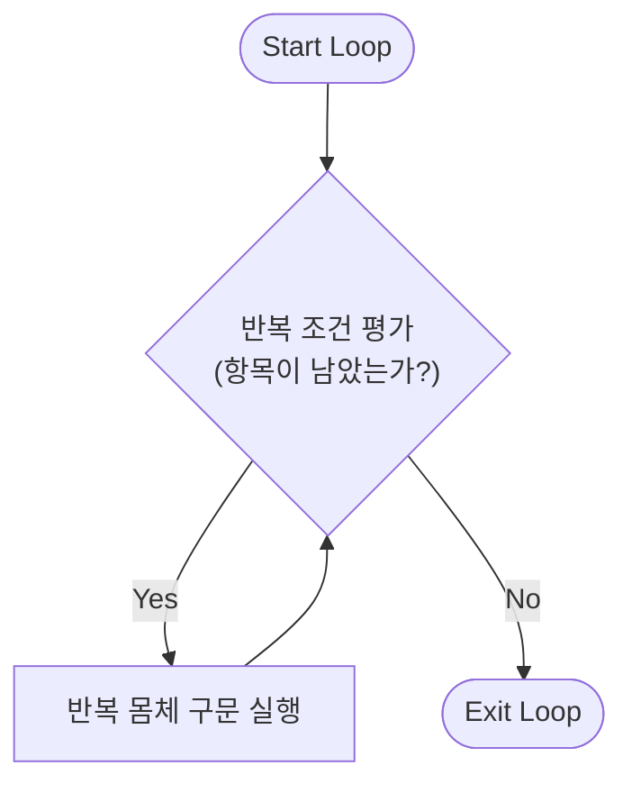

## 횟수와 구조 중심의 반복문 for

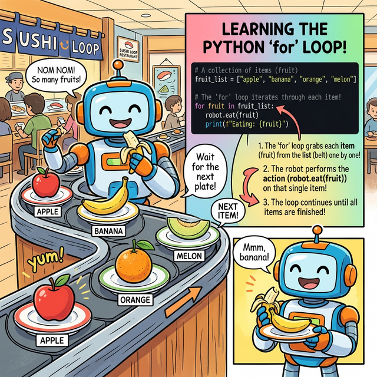
*(웹툰 비유: 회전 초밥집 컨베이어 벨트 앞에 앉은 로봇입니다. 접시(데이터)가 하나씩 다가오면 로봇이 집어 먹고(처리하고), 다음 접시가 올 때까지 기다립니다. 벨트 위에 초밥이 남아 있는 한 이 과정은 계속 반복되며, 초밥이 동나면 식사(루프)가 종료됩니다.)*

`for` 구문은 `in` 이후의 리스트, 튜플, 문자열 등 항목이 있는 집합적 구조를 하나씩 처음부터 끝까지 순회합니다. `for` 마지막 콜론 `:`은 반드시 필요하며 탭(Tab) 들여쓰기로 블록을 생성해야 합니다.

*(다이어그램: 컬렉션 바구니(`[A, B, C]`)에서 항목 하나가 튀어나와 변수 `item`에 담기고, 아래쪽 `print` 실행 블록으로 쏙 들어가 처리된 뒤 증발하는 과정을 순차적으로 반복하는 애니메이션입니다. 파이썬의 `for`문은 값을 일일이 세는 것이 아니라, "바구니에서 하나 꺼내기(Unpacking)"의 연속입니다.)*

```python
# 3.2.3 내장 range(1, 6)을 이용해 1부터 5까지 반복
for x in range(1, 6):
    print(x)
```

모임형 자료형(리스트 안의 원소 등)을 직접 꺼낼 수도 있습니다.

```python
fruits = ["apple", 2500, "banana", 500]
for item in fruits:
    print(item)
```

## [유용한 테크닉] f-string과 zip() 함수의 결합
데이터를 짝지어서 출력할 때 최신 파이썬의 꽃인 **f-string** 포매팅 기법(Python 3.6+)과 `zip()` 내장 함수를 묶어서 사용하면 매우 가독성이 높습니다.
- **f-string**: 중괄호 `{}` 안에 변수나 표현식을 직접 삽입해 문자열을 동적으로 생성
- **zip()**: 여러 개의 객체를 병렬로 묶어 같은 인덱스끼리 튜플로 매칭

```python
names = ["John", "Alice", "Bob"]
ages = [25, 30, 22]

# 서로 다른 두 리스트를 zip으로 묶어 병렬 반복 순회
for name, age in zip(names, ages):
    # f"..." 형태로 간편하게 변수 삽입 문자열 출력
    print(f"Name: {name}, Age: {age}살")
```
**출력:**
```
Name: John, Age: 25살
Name: Alice, Age: 30살
Name: Bob, Age: 22살
```

---

## ☕ Java vs 🐍 Python 스나이퍼 비교

### 1. for 문의 패러다임 변화 (Index vs Iteration)
*   **Java**: 전통적인 자바의 `for` 문은 인덱스(횟수)를 통제합니다. `for (int i=0; i<arr.length; i++)` 처럼 변수를 선언하고, 조건식을 걸고, 증감시킵니다.
*   **Python**: 파이썬의 `for` 구문은 자바의 **향상된 for 문(Enhanced for loop)인 `for (Type item : arr)` 과 사실상 역할이 동일**합니다. 횟수를 세는 구문이 아예 없고, "이 보따리(리스트)에 든 내용물을 처음부터 끝까지 하나씩 전부 꺼내!"라는 **이터레이션(Iteration, 순회)** 방식입니다. 만약 자바처럼 횟수가 필요하다면 `range()` 함수가 그 보따리를 대신 만들어주는 것입니다.

---

## 🎧 Vibe Coding

> **🗣️ 학생 프롬프트 (AI에게 이렇게 명령해 보세요):**
> "파이썬 `for` 문과 `zip()` 함수를 사용해서, 3명의 학생 이름과 수학 점수가 각각 담긴 두 개의 리스트를 순회하며 '{이름} 학생의 수학 점수는 {점수}점입니다'라는 문장을 예쁘게 출력해주는 간단한 코드를 짜줘. 데이터는 아무거나 넣어도 돼."

---

## 코딩 영단어 학습 📝

*   **`for`**: ~를 위하여, ~하는 것에 대하여. (`for item in list:` 는 "리스트 안에 있는 각각의 item을 집어올 때마다 반복하겠다"는 뉘앙스입니다.)
*   **`Iteration`**: 반복, 순회. (리스트와 같이 여러 개가 들어있는 상자에서 하나씩 꺼내어 살펴보는 '행위 그 자체'를 뜻하는 핵심 프로그래밍 용어입니다.)

---

## 학습목표
본 장에서는 주어진 조건이 참(True)인 동안 끝없이 회전하는 **`while` 문의 원리와, 무한 루프를 파괴하는 강력한 비상 정지 버튼 `break`의 활용법**을 배웁니다. 아울러 중첩 반복문(Nested Loops) 구조를 시각적인 별 찍기 실습과 텍스트 RPG 전투 시스템으로 완벽히 마스터합니다.

## 조건 중심의 반복문 while

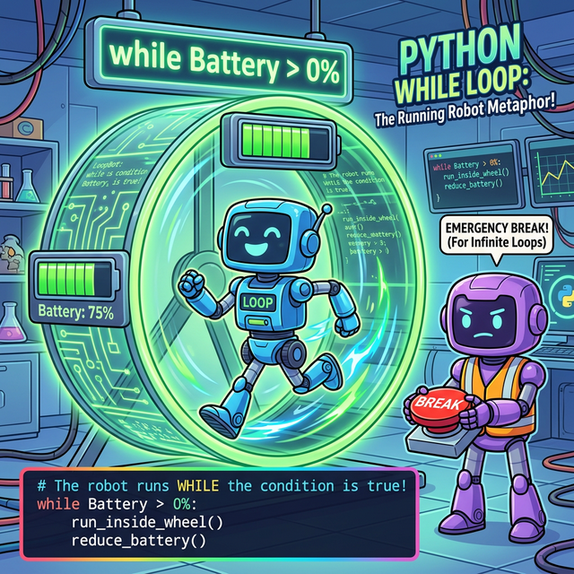
*(웹툰 비유: 거대한 야광 쳇바퀴 안을 쉼 없이 달리는 로봇입니다. 쳇바퀴 위에는 `배터리 > 0%`라는 간판이 빛나고 있습니다. 배터리가 조금이라도 남아있는 한(True) 로봇은 절대 멈추지 않고 달립니다. 쳇바퀴 밖에서는 혹시 모를 고장에 대비해 다른 로봇이 거대한 빨간색 비상정지 `BREAK` 버튼을 들고 땀을 쥐며 대기하고 있습니다.)*

`while 조건식: 블록` 구문은 조건이 `True`인 동안은 영원히 블록을 반복 실행합니다. 


*(다이어그램: 데이터 입자가 `i <= 10`이라는 조건 스캐너를 통과합니다. `True` 판정을 받으면 아래쪽 처리장(`i += 1`)으로 떨어져 처리된 뒤, 롤러코스터 트랙을 타고 다시 위쪽 스캐너로 수직 상승하여 무한 루프 쳇바퀴를 형성합니다. 만약 스캐너에서 `False` 판정을 받는 순간, 비로소 오른쪽 Exit 통로로 튕겨 나갑니다.)* 

```python
i = 1
total = 0

#  i가 10 이하일 때까지만 계속 반복
while i <= 10:
    total += i
    i += 1  # 이 증감식이 없으면 끝나지 않음 (무한 루프)

print(total) # 결과: 55
```

## [유용한 테크닉] 무한 루프 탈출, break

만약 `while`의 조건식을 변수 없이 그냥 `True`로 강제 고정시켜버리면 이는 절대 스스로 끝나지 않는 무한 루프(Infinite Loop)가 됩니다. 이럴 땐 프로그램 내부에서 특정 종료 조건을 감지하여 `break` 명령어를 사용해 강제로 쳇바퀴를 깨부수고 탈출시킬 수 있습니다.

```python
i = 0
while True:  # 일단 영원히 반복!
    i += 3
    if i > 10:
        break    # 10을 초과하면 반복문을 강제로 파괴하고 종료함
    print(i)
```
**출력:**
```
3
6
9
```


## [종합 실습] 텍스트 RPG 전투 시스템 만들기

결론적으로 조건문(`if`), 반복문(`for` 또는 `while`), 그리고 자료구조(리스트)를 잘 버무리면 제법 복잡한 로직도 손쉽게 구현할 수 있습니다. 위에서 배운 개념들을 모두 활용해 간단한 전투 예제를 만들어 봅시다.

**시나리오:**
1. 플레이어의 초기 체력은 100입니다.
2. 몬스터 리스트의 몬스터를 순서대로 만납니다. (`for` 반복문)
3. 랜덤하게 공격 데미지를 입습니다.
4. 중간에 체력이 0 이하가 되면 `break`로 전체 게임 오버 처리를 합니다.

```python
import random # 랜덤 숫자를 뽑기 위한 모듈

player_hp = 100
monsters = ["Slime", "Wolf", "Dragon"]

print("⚔️ 모험을 시작합니다!")

for monster in monsters:
    print(f"\n--- {monster}와의 전투 시작! ---")
    
    # 10에서 50 사이의 랜덤 데미지 생성
    damage = random.randint(10, 50) 
    player_hp -= damage
    
    print(f"으악! {monster}에게 {damage}의 데미지를 입었습니다.")
    
    # 체력 체크 통제 구문 (if ~ else)
    if player_hp <= 0:
        print(f"체력이 {player_hp}이 되었습니다.")
        print("💀 Game Over... 눈앞이 캄캄해집니다.")
        break # 반복문을 즉시 종료하고 빠져나갑니다.
    else:
        print(f"휴... 남은 체력: {player_hp}")

# 전체 전투 반복문이 정상적으로 끝난 뒤 생존 확인
if player_hp > 0:
    print("\n🎉 축하합니다! 모든 몬스터를 물리치고 승리했습니다!")
```

## 정리
`while` 루프와 `break` 명령어는 파이썬 개발에 있어 절대 뺄 수 없는 핵심 논리 제어 구조입니다. 무한 루프 탈출을 통제하는 `break`를 명확히 이해하고, 이중 반복문의 톱니바퀴 구조를 별 찍기로 수련하면서 프로그래밍 사고력을 한층 깨우치시길 바랍니다.

---

## ☕ Java vs 🐍 Python 스나이퍼 비교

### do ~ while 문의 부재 (파이썬만의 무한 루프 제어 철학)
*   **Java**: 블록을 최소한 한 번은 무조건 실행하고 나서 나중에 조건을 검사하는 `do { } while(조건);` 제어문이 따로 존재합니다.
*   **Python**: 파이썬에는 언어 스펙상 `do ~ while` 구조가 아예 **없습니다**. 왜냐하면 "한 문법 규칙(while)으로 똑같은 일을 달성할 수 있다면 새로운 문법을 만들지 않는다"는 Pythonic 디자인 원칙 때문입니다. 파이썬에서는 `do ~ while`과 똑같은 효과를 원한다면 `while True:` 로 무조건 열어두고 안에서 최초 실행 후 `if 조건: break` 로 탈출하는 명시적인 방식을 주로 사용합니다.

---

## 🎧 Vibe Coding

> **🗣️ 학생 프롬프트 (AI에게 이렇게 명령해 보세요):**
> "파이썬 `while` 문과 `random` 모듈을 이용해서, 1부터 100 사이의 숨겨진 숫자를 맞추는 '업다운(Up & Down) 스무고개 게임' 코드를 짜줘. 내가 정답을 맞출 때까지 수없이 오답을 입력하더라도 `break`를 만날 때까지 반복해서 물어보는 무한 루프 형태로 만들어줘."

---

## 코딩 영단어 학습 📝

*   **`while`**: ~하는 동안. (논리적인 조건이 참으로 유지되는 '기간'을 중심으로 빙빙 도는 특징을 뜻합니다.)
*   **`break`**: 깨다, 부수다, 멈추다. (무한히 돌고 있는 루프 사슬의 한가운데를 도끼로 쾅! 내리쳐 깨버리고 강제로 빠져나오는 아주 강력한 제동 명령어입니다.)

---

## 학습목표
본 장에서는 단일 차원의 제어를 넘어, 반복문 안에 또 다른 반복문을 중첩시키는 **이중 반복문(Nested Loops)**의 톱니바퀴 원리를 정확하게 시각적으로 이해합니다. 아울러 프로그래머들의 영원한 기초 수련법인 **별 찍기(Star Patterns) 12선** 알고리즘을 직접 돌려보며 2차원 공간 지각력을 극대화합니다.

## 이중 반복문 (Nested Loops)의 톱니바퀴 원리

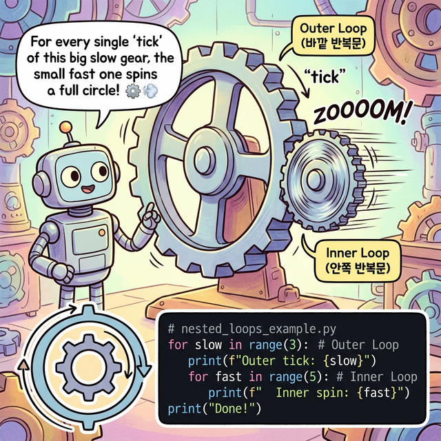
*(웹툰 비유: 거대한 바깥쪽 톱니바퀴(Outer Loop) 안에 작고 미친 듯이 빨리 도는 안쪽 톱니바퀴(Inner Loop)가 맞물려 있습니다. 거대한 톱니바퀴가 딱 한 칸(1회) '딸깍' 하고 움직일 때마다, 안쪽 톱니바퀴는 아예 한 바퀴 통째로(전체 반복) 미친 듯이 회전합니다. 이것이 바로 이중 반복문의 핵심 원리입니다!)*

반복문 안에 또 다른 반복문이 들어가는 구조를 **이중 반복문(Nested Loops)**이라고 부릅니다. 주로 2차원 매트릭스, 표 형태의 데이터, 화면 픽셀 매트릭스를 다룰 때 필수적으로 사용됩니다. 원리는 매우 직관적이고 강력합니다. **바깥쪽 루프가 1번 실행될 때마다, 안쪽 루프는 아예 새로 초기화되어 처음부터 끝까지 전체를 반복**합니다. 

```python
# 구구단 2단, 3단 출력 예제
for i in range(2, 4):         # 외부 루프: 2, 3 두 번 돎
    print(f"--- {i}단 ---")
    for j in range(1, 10):    # 내부 루프: 외부가 1번 돌 때마다 1~9 전체를 다 돎
        print(f"{i} x {j} = {i*j}")
```

---

## 2차원 공간 프로그래밍: 12가지 별 찍기 대방출

프로그래밍 논리 구조에서 이중 반복문의 원리를 가장 빠르고 확실하게 체득시켜 주는 최고의 훈련법은 단연 **'별 찍기(Star Patterns)'**입니다. 

기억해야 할 핵심 기술은 `print()` 함수의 옵션 중 하나인 `end=""` 입니다. 이 옵션은 출력 후 강제로 다음 줄로 넘어가는 엔터(개행) 동작을 무시하고 **옆으로 다닥다닥 붙여서 출력**하게 만듭니다. 안쪽 톱니바퀴(내부 루프)가 돌며 수평으로 별을 긋고 나면, 바깥쪽 루프에서 빈 `print()`를 던져 가로줄을 완성하고 다음 줄로 넘어갑니다.

아래 12가지 패턴을 에디터에 직접 복사하거나 타이핑해가며 톱니바퀴가 어떻게 돌아가는지 눈으로 확인해 보세요!

### 1. 정사각형 (Square)
가장 기본이 되는 N x N 사이즈 출력입니다.

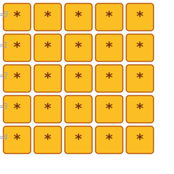

```python
size = 5
for i in range(size):
    for j in range(size):
        print("*", end="")
    print() # 한 줄(안쪽 루프 5회)이 끝나면 줄바꿈 처리!
```

### 2. 직각 삼각형 (Left-aligned Right Triangle)
행수(i)가 늘어날 때마다 찍는 별의 개수(j)도 순차적으로 늘어납니다.

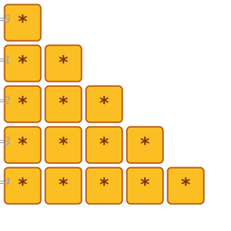

```python
size = 5
for i in range(1, size + 1):
    for j in range(i):  # j는 i까지만 돕니다.
        print("*", end="")
    print()
```

### 3. 역직각 삼각형 (Inverted Left-aligned Right Triangle)
다섯 개부터 시작해서 밑으로 내려갈수록 줄어듭니다.

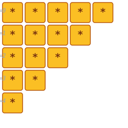

```python
size = 5
for i in range(size, 0, -1):
    for j in range(i):
        print("*", end="")
    print()
```

### 4. 우측 정렬 직각 삼각형 (Right-aligned Right Triangle)
별표 앞에 빈 공백(Space)을 의도적으로 채워 넣어 우측 끝으로 별을 밀어냅니다.

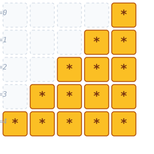

```python
size = 5
for i in range(1, size + 1):
    for j in range(size - i):
        print(" ", end="") # 허공인 공백 문자 먼저 출력
    for j in range(i):
        print("*", end="") # 그다음 진짜 별 출력
    print()
```

### 5. 우측 정렬 역직각 삼각형 (Inverted Right-aligned Right Triangle)

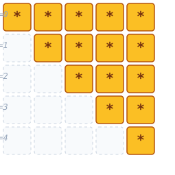

```python
size = 5
for i in range(size, 0, -1):
    for j in range(size - i):
        print(" ", end="")
    for j in range(i):
        print("*", end="")
    print()
```

### 6. 정삼각형 (Pyramid)
공백으로 한가운데로 밀어 넣고, 한 줄을 넘어갈 때마다 별 1개씩이 아니라 `2 * i - 1` 공식을 이용해 홀수 단위(1 $\to$ 3 $\to$ 5)로 퍼져나가게 만듭니다. 가장 중요한 공식입니다!

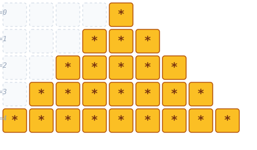

```python
size = 5
for i in range(1, size + 1):
    for j in range(size - i):
        print(" ", end="")
    for j in range(2 * i - 1): # 별의 개수는 홀수로 확산
        print("*", end="")
    print()
```

### 7. 역정삼각형 (Inverted Pyramid)

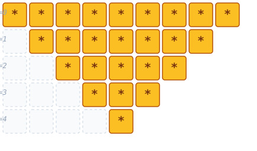

```python
size = 5
for i in range(size, 0, -1):
    for j in range(size - i):
        print(" ", end="")
    for j in range(2 * i - 1):
        print("*", end="")
    print()
```

### 8. 다이아몬드 (Diamond)
위쪽을 찍는 정삼각형 코드 블록을 실행하고, 밑으로 꺾여 들어가는 역정삼각형 코드 블록을 연달아 이어 붙이면 아름다운 다이아몬드가 됩니다.

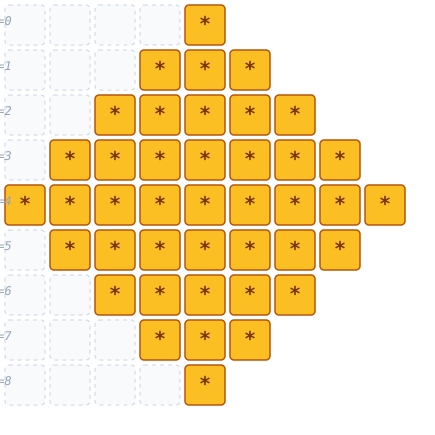

```python
size = 5
# 위쪽 정삼각형
for i in range(1, size + 1):
    for j in range(size - i):
        print(" ", end="")
    for j in range(2 * i - 1):
        print("*", end="")
    print()
# 아래쪽 역정삼각형 (가장 두꺼운 윗줄과 사이즈가 동일하면 중복되므로 -1 부터 시작)
for i in range(size - 1, 0, -1):
    for j in range(size - i):
        print(" ", end="")
    for j in range(2 * i - 1):
        print("*", end="")
    print()
```

### 9. 모래시계 (Hourglass)
역정삼각형 코드를 먼저 쏘고 그 아래 정삼각형을 쏘되, 만나는 모서리 꼭짓점이 중복되지 않도록 방어하는 것이 포인트입니다.

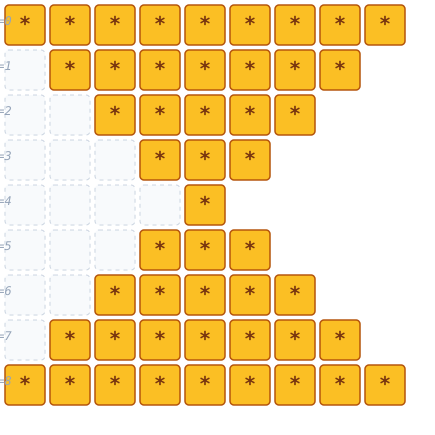

```python
size = 5
# 윗부분 (역삼각 깔때기)
for i in range(size, 0, -1):
    for j in range(size - i):
        print(" ", end="")
    for j in range(2 * i - 1):
        print("*", end="")
    print()
# 아랫부분 (삼각, 윗부분 꼭짓점 중복 제외 위해 2부터 시작)
for i in range(2, size + 1):
    for j in range(size - i):
        print(" ", end="")
    for j in range(2 * i - 1):
        print("*", end="")
    print()
```

### 10. 테두리만 있는 정사각형 (Hollow Square)
정사각형과 똑같이 돌되, 중간에 `if` 문을 걸어 **안쪽 칸일 경우 별 대신 우주 공간처럼 틈새 공백 문자**를 발사합니다.

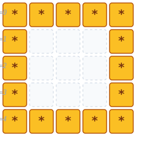

```python
size = 5
for i in range(size):
    for j in range(size):
        # 첫 줄이거나, 마지막 줄이거나, 맨 앞이거나, 맨 끝일 때만 별 도장!
        if i == 0 or i == size - 1 or j == 0 or j == size - 1:
            print("*", end="")
        else:
            print(" ", end="") # 내부 속 공간
    print()
```

### 11. 나비 모양 (Butterfly)
왼쪽 날개(삼각형 모양)를 쏘고 공간을 비운 뒤 오른쪽 날개(역방향 삼각형을 대칭 거울)를 결합합니다.

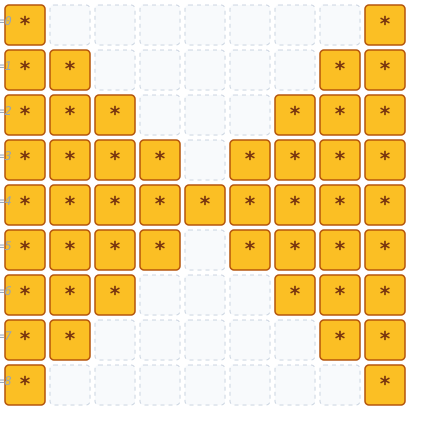

```python
size = 5
# 위쪽 전개 날개
for i in range(1, size + 1):
    for j in range(i):
        print("*", end="")
    for j in range(2 * (size - i)):
        print(" ", end="")
    for j in range(i):
        print("*", end="")
    print()
# 아래쪽 좁혀지는 날개
for i in range(size - 1, 0, -1):
    for j in range(i):
        print("*", end="")
    for j in range(2 * (size - i)):
        print(" ", end="")
    for j in range(i):
        print("*", end="")
    print()
```

### 12. 평행사변형 (Parallelogram)

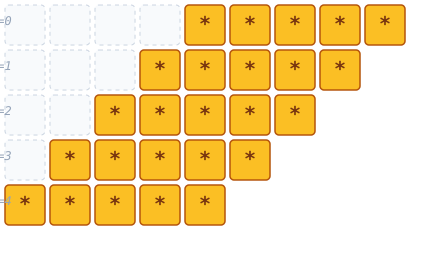

```python
size = 5
for i in range(1, size + 1):
    for j in range(size - i): # 아래 행렬로 갈수록 공백 개수를 점진적으로 갉아먹음
        print(" ", end="")
    for j in range(size):     # 별의 총개수는 무조건 유지
        print("*", end="")
    print()
```

---

## 🎧 Vibe Coding

> **🗣️ 학생 프롬프트 (AI에게 이렇게 명령해 보세요):**
> "내가 파이썬 이중 반복문을 공부하고 있는데, `print`와 공백 문자를 이용해서 '내 이름 스펠링 영문자 첫 글자(예: K)'를 거대한 별표 아트(ASCII Art)로 콘솔창에 7x7 크기로 그려주는 코드를 짜줘. 그리고 `if`, `else` 분기 처리가 정확히 픽셀 단위로 어떻게 되었는지 상세히 주석 달아줘."

---

## ✍️ 이번 주 연습 문제

**문제 1.** `while` 루프를 사용하여 1부터 100까지의 자연수 중 **3의 배수들의 합계**를 구하는 프로그램을 작성해 보세요.

**문제 2.** 구구단 전체(2단부터 9단까지)를 이중 `for` 루프를 사용하여 아래 형식처럼 예쁘게 출력하는 프로그램을 작성해 보세요.
*(예: `2 x 1 = 2`, `2 x 2 = 4`, ...)*

**문제 3.** (심화) `for` 루프와 `range()`를 응용하여, 사용자로부터 자연수 $N$을 입력받아 다음과 같은 높이 $N$의 피라미드를 출력하는 프로그램을 작성해 보세요.
*(예: $N=3$일 때)*
```
  *  
 *** 
*****
```

---

## 📖 교재 상세 학습: 57 리스트 컴프리헨션: 한 줄로 끝내는 리스트 만들기

## 57 리스트 컴프리헨션: 한 줄로 끝내는 리스트 만들기

수학 시간에 배운 '조건제시법'과 똑같습니다. "이러이러한 조건을 만족하는 원소들을 모아서 집합으로 만들어라"라는 명령을 파이썬 코드로 그대로 번역한 것입니다.

**목표**: 1부터 5까지 숫자를 각각 3배 곱한 리스트 만들기

**코드: 초보자의 방식 (for문)**
```python
result = []
for i in range(1, 6):
    result.append(i * 3)

print(result) # [3, 6, 9, 12, 15]
```
초보자 시절에는 이렇게 세 줄이 필요했습니다. 하지만 컴프리헨션을 쓰면 대괄호 `[]` 안에서 모든 작업이 끝납니다.

**코드: 고수의 방식 (컴프리헨션)**
```python
# [넣을_값 for 변수 in 반복_가능한_데이터]
result = [i * 3 for i in range(1, 6)]

print(result) # [3, 6, 9, 12, 15]
```

#### if문까지 한 줄에 구겨 넣기!
이번엔 1부터 10까지 숫자 중에서 **짝수만 골라서 제곱**해 보겠습니다.

```python
# [넣을_값 for 변수 in 데이터 if 조건]
even_squares = [x**2 for x in range(1, 11) if x % 2 == 0]

print(even_squares) # [4, 16, 36, 64, 100]
```
어떤가요? 이 코드는 다른 프로그래밍 언어 사용자들의 부러움을 한 몸에 받는 파이썬만의 아름다운 문법입니다. 

---

### 💻 실습: 리스트 컴프리헨션 마스터하기

**문제** 1부터 20까지의 숫자 중에서 5의 배수인 숫자들만 그대로 모아서 `my_list`라는 리스트로 만드는 코드를 컴프리헨션으로 작성해 보세요.

---
<details>
<summary><b>정답 확인하기</b></summary>

**해답**
```python
my_list = [i for i in range(1, 21) if i % 5 == 0]
```
</details>

<br>

<div align="center">
  


---

## 📖 교재 상세 학습: 58 딕셔너리 컴프리헨션: 단숨에 짜맞추는 이름표 쌍

## 58 딕셔너리 컴프리헨션: 단 한 줄로 키와 값을 조립하기
</div>

앞 장에서 대괄호 `[]`를 활용해 리스트를 예술적으로 빚어냈던 것처럼, 딕셔너리 역시 중괄호 `{}` 양식을 쓰면 단 한 문장만으로도 키(Key)와 값(Value)이 짝지어진 완벽한 사전을 뚝딱 생성해 낼 수 있습니다. 

떨어져 있는 두 개의 별개 리스트를 가져와 딕셔너리로 본드 칠할 때, 파이썬 생태계 최고의 찰떡궁합인 `zip()` 함수를 버무려 쓰면 극상의 효율이 나옵니다. `zip()` 함수는 아우터의 지퍼를 쫙 올리듯, 두 리스트에서 똑같은 위치(인덱스)에 서 있는 원소끼리 손을 꼭 잡게 엮어 주는 역할을 합니다.

**목표**: '상품명 리스트'와 '단가 리스트'를 엮어 '{상품명: 단가}' 형식의 영수증 딕셔너리 만들기

**코드: 딕셔너리 컴프리헨션과 zip()의 극적인 콜라보레이션**
```python
items = ["아이폰", "갤럭시", "픽셀"]
prices = [120, 100, 80]

# {내가_정할_키: 내가_정할_값 for 키용_변수, 값용_변수 in zip(좌측리스트, 우측리스트)}
store_catalog = {product: cost for product, cost in zip(items, prices)}

print(store_catalog)
# {'아이폰': 120, '갤럭시': 100, '픽셀': 80}
```

때로는 이전에 다뤘던 `enumerate()` 함수와 콜라보하여, 데이터의 멱살을 잡고 차례차례 기호 순번을 매겨주는 넘버링 딕셔너리도 손쉽게 짤 수 있습니다.

```python
members = ["제시카", "티파니", "태연"]

# {내가_정할_키: 내가_정할_값 for 순번_변수, 값_변수 in enumerate(데이터더미)}
# i는 0부터 돌기 때문에 사람이 보기 편하도록 i+1을 조미료로 뿌려줍니다!
roll_book = {f"참가자{i+1}": person for i, person in enumerate(members)}

print(roll_book)
# {'참가자1': '제시카', '참가자2': '티파니', '참가자3': '태연'}
```

이 압축적인 컴프리헨션 문법이야말로 코드를 '가장 파이썬스럽게(Pythonic)' 칠해주는 마법의 붓끝입니다. 낯선 모양새라 처음엔 어질어질하겠지만, 손에 익는 순간 지루한 `for`문 로직을 타자 몇 번으로 찍어누르는 쾌감을 맛보게 될 것입니다!

---

### 💻 미니 실습: 딕셔너리 지퍼 합체 마술

**Quiz 1** 동떨어진 두 개의 리스트, `headers = ["분류", "재질", "색상"]` 와 `details = ["상의", "면", "블랙"]` 이 있습니다. 컴프리헨션 문법과 `zip()` 도구를 영리하게 섞어서 이 둘을 `product_info`라는 단 하나의 딕셔너리로 깨끗하게 병합해 보세요.

---
<details>
<summary><b>모범 답안 보기</b></summary>

**풀이 1**
```python
headers = ["분류", "재질", "색상"]
details = ["상의", "면", "블랙"]

product_info = {h: d for h, d in zip(headers, details)}
```
</details>


---

## 📖 교재 상세 학습: 59 세트 컴프리헨션: 중복 데이터 제거 마술

## 59 세트 컴프리헨션: 중복을 허락하지 않는 집합 생성기

이전 시간에 리스트와 딕셔너리를 한 줄로 우아하게 만들어내는 파이썬의 핵심 문법, 컴프리헨션(Comprehension)을 배웠습니다. 
파이썬은 여기서 멈추지 않고, **동일한 값을 절대로 중복해서 가지지 않는 '집합(Set)'** 자료형에도 지능형 생성 문법을 적용할 수 있도록 허용합니다.

지능형 딕셔너리처럼 중괄호 `{}`를 사용하지만, 콜론(`:`) 형식의 `Key: Value` 쌍이 아니라 요소 1개만 덩그러니 반환하도록 명시하면 파이썬 호스트는 눈치껏 이를 **'지능형 집합(Set Comprehension)'**으로 인식합니다.

### 1. 중복된 원소 깔끔하게 걸러내기

만약 수많은 데이터가 들어있는 리스트에서 어떤 수식을 적용하되, 결과값 중 겹치는 것들은 알아서 제거하고 싶다면 어떻게 해야 할까요?
세트 컴프리헨션을 쓰면 너무나도 쉽게 해결됩니다.

**예제 코드: 절댓값을 구해서 중복 없이 모으기**
```python
raw_data = [1, -1, 2, -2, 3, -3]

# 절댓값 함수(abs)를 씌워서 중괄호 안에 쏟아 넣습니다.
unique_absolutes = {abs(x) for x in raw_data}

print(unique_absolutes) 
# {1, 2, 3} (1과 -1의 절댓값 1이 겹치므로 하나만 남고 자동으로 제거됨)
```

### 2. 문자열 고유 알파벳 추출하기

어떤 단어가 주어졌을 때, 해당 알파벳을 모조리 수집하되 중복되는 글자를 빼버리는 로직도 단 한 줄이면 족합니다.

```python
word = "banana"

# 문자열도 하나씩 순회할 수 있는 '반복 가능한' 데이터입니다!
unique_chars = {char for char in word}

print(unique_chars)
# {'a', 'b', 'n'} (순서는 집합 특성상 무작위로 출력될 수 있음)
```

이 압축적인 컴프리헨션 문법은 수많은 데이터를 정제하고 걸러내는 데이터 분석이나 알고리즘 로직에서 진가를 발휘합니다.
리스트 `[]`, 딕셔너리 `{}`, 세트 `{}` 각각의 지능형 마법을 손에 익히고 나면, 왜 수많은 전 세계의 개발자들이 파이썬을 사랑하는지 뼛속 깊이 깨닫게 될 것입니다!


---

## 📖 교재 상세 학습: 62 마르지 않는 샘물: 반복형(Iterable)과 반복자(Iterator)

## 62 마르지 않는 샘물: 반복형(Iterable)과 반복자(Iterator)

파이썬에서 `for` 문을 돌릴 수 있는 리스트, 튜플, 문자열 같은 데이터 꾸러미들을 우리는 **반복형(Iterable)**이라고 부릅니다. 하지만 이 꾸러미들 자체가 데이터를 하나씩 '알아서' 뱉어내는 능력까지 가진 것은 아닙니다. 꾸러미 안에서 데이터를 하나씩 쏙쏙 꺼내주는 **반복자(Iterator)**라는 별도의 뽑기 기계를 거쳐야만 합니다.

### 1. `iter()`와 `next()`의 콤비 플레이

- **반복형(Iterable)**: 원소들을 품고 있는 상자. 내부에 `__iter__` 라는 특수한 마법 메서드가 구현되어 있습니다.
- **반복자(Iterator)**: 상자에 관을 꽂아 하나씩 뽑아내는 기계. 내부에 `__next__` 라는 마법 단어가 구현되어 있습니다.

`iter()` 함수 상자에 반복형을 집어넣으면 반복자 기계가 되어 나옵니다. 이 기계에 `next()` 버튼을 누를 때마다 뱃속의 항목이 하나씩 세상 밖으로 튀어나옵니다.

```python
# 문자열은 반복형(Iterable) 상자입니다.
my_str = "Hi!"

# iter()를 써서 하나씩 뽑아내는 기계(Iterator)로 변신시킵니다.
my_iterator = iter(my_str) 

# next()를 누를 때마다 하나씩 튀어나옵니다!
print(next(my_iterator)) # 'H'
print(next(my_iterator)) # 'i'
print(next(my_iterator)) # '!'
```

더 이상 뽑을 게 없는데 계속 `next()`를 누르면 파이썬 엔진은 **`StopIteration`** 이라는 경고음을 내며 기계를 멈춥니다. 
(`for` 문은 사실 우리가 모르는 뒤편에서 몰래 이 `StopIteration` 에러가 날 때까지 무한정 `next()` 버튼을 광클해주는 아주 고마운 녀석이었습니다!)

> [!WARNING]
> 반복자 기계는 데이터를 한 번 다 뽑아내면 수명이 완전히 끝납니다(소진됨). 다시 처음부터 뽑고 싶다면 텅 빈 기계를 누를 게 아니라, `iter()`를 써서 기계를 **새로 다시 만들어야** 합니다.

---

### 2. 내 손으로 뚝딱! 나만의 반복자 기계 만들기

우리가 직접 만든 클래스도 특정 규칙(`__iter__` 와 `__next__` 구현)만 완벽히 지키면, 파이썬이 인정해 주는 내장 반복자가 될 수 있습니다.

```python
class MyCounter:
    def __init__(self, limit):
        self.limit = limit
        self.current = 1

    # "나 반복형이야!" 하고 선언하는 부분 (기계 자기 자신을 그대로 리턴)
    def __iter__(self):
        return self

    # next()가 불릴 때마다 어떻게 숫자를 뱉어낼지 정해줍니다.
    def __next__(self):
        if self.current <= self.limit:
            value = self.current
            self.current += 1
            return value
        else:
            # 한계치에 도달하면 뽑기를 멈추는 에러를 뿜어냄!
            raise StopIteration

# 딱 3까지만 연속해서 나오는 뚝딱 카운터 기계 생성!
counter_machine = MyCounter(3)

print("첫 번째:", next(counter_machine)) # 1
print("두 번째:", next(counter_machine)) # 2
print("세 번째:", next(counter_machine)) # 3
# print(next(counter_machine)) # 여기서 숨겨진 StopIteration 에러 발생!
```

이렇게 원할 때마다 필요한 데이터를 **그 자리에서(즉석에서) 딱 한 개씩 만들어주기 때문에**, 노트북의 뇌 용량(메모리)을 아주아주 조금만 쓰면서도 무한대에 가까운 데이터를 에러 없이 쉽게 처리할 수 있는 강력한 설계 패턴이 됩니다.


---

## 📖 교재 상세 학습: 63 마법의 순환 도구 상자: itertools 모듈

## 63 데이터 조립의 신: 마법의 순환 도구 상자 (`itertools`)

파이썬 창조주가 태초부터 만들어둔 기본 창고에는, 수많은 반복자(Iterator)들을 마치 찰흙이나 레고 블록처럼 이리저리 뭉치고 떼어내어 완전히 새로운 데이터 흐름을 만들어내는 초강력 마법 도구 상자가 있습니다. 바로 **`itertools` (아이터 툴즈)** 모듈입니다.

이 도구들도 모조리 **결과를 반복자 형태로만 돌려주기 때문에** (한꺼번에 리스트를 만들지 않음) 아무리 거대한 데이터를 집어넣어도 메모리가 폭발하지 않아 대규모 데이터 집계에 안성맞춤입니다.

### 1. 차곡차곡 데이터 쌓고 엮기

* **`accumulate` (눈덩이 계산기)**: 들어오는 값들을 계속 누적해서 더해주는 무서운 눈덩이 기계입니다.
* **`chain` (사슬 묶기)**: 생판 다른 두 개 이상의 리스트나 문자열을 하나의 거대한 밧줄로 길게 묶어줍니다.

```python
import itertools

# 1. 눈덩이 굴리기 (누적 합산)
numbers = [1, 2, 3, 4]
# 눈으로 결과물을 확인하기 위해 억지로 list()로 포장해줍니다.
acc_iter = itertools.accumulate(numbers)
print(list(acc_iter))  # [1, 3, 6, 10] (과정: 1, 1+2, 1+2+3, 1+2+3+4)

# 2. 다른 종족 리스트 이어 붙이기
list_a = [1, 2]
list_b = ["A", "B"]
chained_iter = itertools.chain(list_a, list_b)
print(list(chained_iter))  # [1, 2, 'A', 'B'] 무심하게 한 줄로 이어버림!
```

### 2. 모든 사건의 배후: 경우의 수 마스터 (순열과 조합)

카드 게임에서 내가 어떤 카드 패를 뽑을지 확률을 계산하거나, 자물쇠 번호의 모든 경우의 수를 부술 때 아주 유용한 도구들입니다.

* **`product` (카테시안 곱)**: 여러 주머니에서 각각 공을 1개씩 꺼내 만들 수 있는 모든 '짝꿍'을 만듭니다.
* **`permutations` (순열)**: **순서를 따져서** 가능한 모든 줄 세우기 포지션을 만듭니다.
* **`combinations` (조합)**: **순서에 상관없이** 그냥 뽑아온 조편성 경우의 수만 구합니다.

```python
import itertools

heroes = ["IronMan", "Thor", "Hulk"]

# 3명 중 2명을 뽑아서 '어떤 순서'로 공격을 보낼지? (순열)
perm = itertools.permutations(heroes, 2)
print("■ 공격조 (순서 중요):", list(perm)) 
# [('IronMan', 'Thor'), ('IronMan', 'Hulk'), ('Thor', 'IronMan'), 
#  ('Thor', 'Hulk'), ('Hulk', 'IronMan'), ('Hulk', 'Thor')]

# 3명 중 2명을 그냥 같은 '한 팀'으로 편성하기 (조합 - 순서 무관)
comb = itertools.combinations(heroes, 2)
print("■ 한 팀 (순서 무관):", list(comb))
# [('IronMan', 'Thor'), ('IronMan', 'Hulk'), ('Thor', 'Hulk')]
```

### 3. 폭주 기관차 멈추기! (무한 반복 컨트롤러)

때로는 `cycle`(무한 반복)이나 `count`(무한 숫자 세기)처럼 끝없이 데이터를 찍어내는 브레이크 고장 난 폭주 기관차 반복자를 만들어야 할 때가 있습니다. 이런 기관차를 적절하게 썰어버리는 훌륭한 안전 장치도 세트로 존재합니다.

* **`takewhile` (조건이 맞을 때까지만 살리기)**: 조건이 참(`True`)일 때까지만 문을 열어두고, 단 한 번이라도 거짓이 들어오면 가차 없이 셔터를 닫아 기계를 멈춥니다.
* **`dropwhile` (조건이 거짓일 때부터 다 살리기)**: 조건이 참이면 데이터를 쿨하게 쓰레기통에 버리다가, 거짓이 되는 순간부터 정신을 차리고 끝까지 모든 데이터를 쏟아냅니다.

```python
import itertools

# 1부터 0.5 간격으로 평생 무한히 숫자 세기 (1, 1.5, 2.0, 2.5, 3.0 ...)
무한숫자 = itertools.count(1, 0.5)

# 값이 3보다 작을 때까지만 문을 열어놔라!
안전한숫자 = itertools.takewhile(lambda x: x < 3, 무한숫자)

# 안전하게 멈추기 때문에 list()로 묶어도 컴퓨터가 터지지 않아요!
print("수집 요원:", list(안전한숫자)) # [1.0, 1.5, 2.0, 2.5]
```

이 밖에도 리스트의 일부분만 슬라이스 해주는 `islice`, 중복된 값을 그룹으로 에쁘게 묶어주는 `groupby` 등, `itertools`는 장인이 될수록 코드를 마법처럼 짧고 빠르게 만들어주는 파이썬 최고의 무기입니다.


---

## 📖 교재 상세 학습: 64 게으른 데이터 공장: 제너레이터(Generator)와 yield

## 64 가장 게으르고 똑똑한 데이터 공장: 제너레이터(`Generator`)

앞선 장에서 클래스에 `__iter__` 와 `__next__` 를 직접 만들어서 멋진 맞춤형 반복자(Iterator)를 만들 수 있다고 배웠습니다. 하지만 매번 클래스를 짜려니 코드가 너무 길어지고 복잡해집니다.
파이썬은 이를 아주 세련되고 간단하게 만들 수 있는 마법의 문법을 제공합니다. 바로 **제너레이터(Generator)** 입니다.

제너레이터는 작동 방식이 아주 "게으릅니다(Lazy)". 누가 달라고 조르기 전(`next()`를 부르기 전)에는 땀 흘려 일하지 않고 가만히 대기합니다. 이 철저한 게으름 덕분에 메모리를 엄청나게 아낄 수 있습니다!

### 1. `return` 대신 양보하는 `yield`

보통의 파이썬 함수는 `return`을 만나면 결과값을 딱 뱉어내고 아예 생을 마감해버립니다(종료).
하지만 제너레이터 함수는 **`yield`**(양보하다, 산출하다)라는 특별한 키워드를 사용합니다. `yield`를 만나면 데이터를 밖으로 뱉어내긴 하지만, 함수가 죽지 않고 현재 상태 그대로 **"작업 일시 정지(Pause)"** 상태에 들어갑니다!

```python
def my_lazy_factory():
    print("[시스템] 첫 번째 공정 작동합니다...")
    yield "아이템 1호"
    
    print("[시스템] 두 번째 공정 작동합니다...")
    yield "아이템 2호"
    
    print("[시스템] 마지막 공정 작동합니다...")
    yield "아이템 3호"

# 공정 기계를 만듭니다 (이때는 함수 내부 코드가 단 한 줄도 실행되지 않습니다!)
factory_machine = my_lazy_factory() 

# 밖에서 next() 버튼을 눌러야 비로소 기계가 돌아갑니다!
print(next(factory_machine)) 
# 출력: [시스템] 첫 번째 공정 작동합니다...
# 결과: "아이템 1호" 
# (그리고 함수는 여기서 일.시.정.지! 퇴근하지 않고 기다립니다)

print(next(factory_machine))
# 일시 정지된 위치부터 다시 출발!
# 출력: [시스템] 두 번째 공정 작동합니다...
# 결과: "아이템 2호"
```

이렇게 함수 코드를 끝까지 다 실행하지 않고 중간중간 멈출 수 있기 때문에, 1억 개의 연산 결과도 리스트에 다 담지 않고 즉석에서 하나씩 만들어 내보낼 수 있습니다.

---

### 2. 1줄로 끝내는 제너레이터 표현식 (GenExpr)

우리가 리스트를 한 줄로 예쁘게 만들 때 쓰던 '지능형 리스트(리스트 컴프리헨션)' 문법을 기억하시나요? 거기서 꺾쇠 기호 `[]` 대신 소괄호 `()`를 쓰면 그 즉시 세련된 1줄짜리 제너레이터 기계가 완성됩니다.

```python
# 보통의 지능형 리스트 
# (메모리 쾅! 백만 개의 제곱수를 램(RAM)에 다 만들어서 쑤셔 넣음)
squares_list = [x*x for x in range(1000000)] 

# 제너레이터 표현식 
# (메모리 세이브! 만드는 '규칙'만 기억하고 대기)
squares_gen = (x*x for x in range(1000000))

print(squares_gen) # 결과 값 대신 <generator object> 기계 자체가 나옴
print("첫 뽑기:", next(squares_gen)) # 첫 뽑기: 0
print("두 뽑기:", next(squares_gen)) # 두 뽑기: 1
```

---

### 3. 대규모 하도급 계약 발주! (`yield from`)

제너레이터를 엮어서 거대한 파이프라인을 만들다 보면, 내가 만든 제너레이터가 '다른 제너레이터'의 값들을 쭉 대신 뽑아와서 밖으로 연달아 뱉어줘야 할 때가 있습니다. 이럴 땐 골치 아프게 `for` 루프를 돌릴 필요 없이, **`yield from`** 이라는 키워드 하나면 파이프라인이 레고블록처럼 찰칵 연결됩니다.

```python
def small_factory():
    yield "나사못"
    yield "톱니바퀴"

def big_factory():
    yield "조립 전..."
    
    # small_factory에 하도급을 맡겨서 나오는 걸 내가 다 뽑아서 줍니다!
    yield from small_factory()
    
    yield "조립 완료!"

# 완성된 거대 파이파라인 가동
bf = big_factory()
for item in bf:
    print(item)
    
# [출력 결과]
# 조립 전...
# 나사못
# 톱니바퀴
# 조립 완료!
```
이렇게 제너레이터를 줄줄이 소시지처럼 엮으면, 아주 크고 복잡한 빅데이터 가공 파이프라인도 손쉽고 우아하게 구축할 수 있습니다!


---

## 📖 교재 상세 학습: 22 데이터를 타고 흐르는 마법의 루프, for ~ in

## 22 데이터를 타고 흐르는 자동 루프, for ~ in

파이썬 코드를 짤 때 리스트와 같은 묶음 데이터 안에 들어있는 내용물들을 처음부터 끝까지 한 번씩 순방향으로 방문하며 동일한 작업을 반복하고 싶다면 가장 먼저 떠올려야 할 문법이 바로 `for ... in` 구문입니다.

백문이 불여일견! 직관적인 코드 예제를 살펴보겠습니다.

**예제 코드: loop_test.py**
```python
# 여러 종류의 과일이 담겨 있는 과일 바구니 리스트
fruit_basket = ['사과', '바나나', '포도', '딸기']

# 과일 리스트를 차례차례 순회하는 for 반복문
for item in fruit_basket:
    print(f"달콤한 {item} 과일을 아주 맛있게 먹습니다.")
```

**실행 결과**
```text
달콤한 사과 과일을 아주 맛있게 먹습니다.
달콤한 바나나 과일을 아주 맛있게 먹습니다.
달콤한 포도 과일을 아주 맛있게 먹습니다.
달콤한 딸기 과일을 아주 맛있게 먹습니다.
```

코드는 달랑 2줄에 불과하지만 터미널에 찍히는 결과는 4줄이 되었습니다. 겉보기에 짧은 이 문장 안에는 사실 파이썬 엔진의 분주한 과정이 숨어있습니다.

`for` 반복문은 내부적으로 이런 순서로 작동합니다.
1. `in` 키워드 뒤편에 놓인 `fruit_basket` 리스트의 크기를 살핍니다.
2. 리스트의 맨 앞칸에 있는 데이터('사과')를 조용히 꺼내 옵니다.
3. 방금 꺼낸 데이터를 `in` 앞에 선언해 둔 `item`이라는 새로운 임시 변수에 대입(`=`)하여 담아 둡니다.
4. 아래쪽의 들여쓰기 된 실행 블록 안으로 진입합니다. 첫 번째 바퀴에서 `item` 변수 안에는 '사과'가 들어있으므로 "달콤한 사과 과일을..." 이라는 문장이 출력됩니다.
5. 블록 내부의 코드가 끝나면 다시 위(1번)로 점프한 뒤, 두 번째 데이터('바나나')를 꺼내어 변수에 다시 덮어씌우고 4번 과정을 반복합니다.
6. 리스트 안의 모든 내용물이 빠짐없이 순회를 마치면(마지막 '딸기' 출력이 끝나면), 비로소 반복의 사슬을 끊고 루프문을 완전히 빠져나가 다음 줄의 코드로 이동합니다.

만약 이 `for` 루프 없이 똑같은 결과를 내려고 했다면 다음과 같은 답답한 코딩을 해야 했을 것입니다.

**코드: (비교 예시) for문 없이 원초적으로 구현하기**
```python
# for 문과 똑같은 동작을 하나씩 직접 풀어서 쓴 코드
item = fruit_basket[0]
print(f"달콤한 {item} 과일을 아주 맛있게 먹습니다.")
item = fruit_basket[1]
print(f"달콤한 {item} 과일을 아주 맛있게 먹습니다.")
item = fruit_basket[2]
print(f"달콤한 {item} 과일을 아주 맛있게 먹습니다.")
# ... 리스트 내용물이 1,000개라면 1,000줄 반복 ...
```
데이터 개수가 천 개, 만 개라면 수십 시간을 낭비해야 하지만, `for` 구문을 활용하면 단 2줄로 모든 작업을 깔끔하게 해결할 수 있습니다.

---

### 💻 미니 실습: 리스트 순회 훈련

**Quiz 1** 본인이 가장 선호하는 동물들의 이름이 담긴 리스트 `my_animals`를 생성한 다음, `for-in` 구문으로 동물 이름을 하나하나 터미널에 빠짐없이 출력해 보세요.

---
<details>
<summary><b>모범 답안 보기</b></summary>

**풀이 1**
```python
my_animals = ['강아지', '고양이', '토끼', '호랑이']

for animal_name in my_animals:
    print(animal_name)
```
</details>


---

## 📖 교재 상세 학습: 23 숫자를 찍어내는 팩토리, for in range

## 23 끝없는 숫자를 생산해 내는 공장, for in range

`for-in` 구문의 진가는 리스트 같은 묶음 데이터 안에서 알맹이를 하나씩 빼서 쓸 때 가장 크게 발휘됩니다. 그런데 만일 리스트 같은 건 없지만 그냥 단순하게 "안녕하세요!"를 딱 100번만 반복해서 출력하게 만들거나, 1부터 50까지 숫자를 순서대로 화면에 찍어내고 싶다면 난감해집니다.
고작 그런 이유로 `[1, 2, 3, 4, ... 100]` 처럼 백 개의 항목이 든 무식하고 거대한 리스트를 억지로 손으로 타이핑할 수는 없는 노릇이니까요.

이런 고충을 말끔히 날려주기 위해 파이썬이 준비한 마법의 숫자 생성 함수가 바로 **`range()`**입니다.

**예제 코드: range() 함수의 기본 원리**
```python
# 파이썬은 무조건 0부터 시작하므로 0, 1, 2, 3, 4 (총 5개) 숫자 뭉치가 만들어집니다.
for n in range(5):
    print(n)
```
**출력 결과**
```text
0
1
2
3
4
```

`range(5)` 코드가 지나가는 순간, 내부적으로 파이썬은 메모리상에 임시로 리스트 `[0, 1, 2, 3, 4]` 형태의 숫자 꾸러미를 동적으로 생성해 줍니다. (지난 시간에 강조했듯이, 파이썬 숫자의 시작은 항상 **0번부터**라는 점, 그리고 괄호 안에 `5`를 넘기면 5는 포함되지 않고 직전 숫자인 `4`에서 멈춘다는 원리를 평생 명심하셔야 합니다!)

그렇다면, 특정한 실존 리스트를 훑어가면서 "이건 몇 번째 아이템이다" 하고 친절하게 모서리에 번호표를 달아서 출력해 주고 싶다면 어떻게 구성해야 할까요?
`range()` 함수와 리스트의 전체 길이를 알아내는 `len()` 내장 함수를 조합하여 인덱스 요소를 간접적으로 만들어내는 클래식한 기법을 쓸 수 있습니다.

**코드: 리스트 데이터와 순번 함께 뽑아내기**
```python
hero_team = ['아이언맨', '캡틴', '토르', '헐크']

# len(hero_team)의 결과는 총 요소 개수인 4가 되며, range(4)가 작동하여 0, 1, 2, 3 숫자가 반복문으로 들어옵니다.
for idx in range(len(hero_team)):
    member_name = hero_team[idx]
    print(f'{idx + 1}번째 소속 영웅: {member_name}')
```
**출력 화면**
```text
1번째 소속 영웅: 아이언맨
2번째 소속 영웅: 캡틴
3번째 소속 영웅: 토르
4번째 소속 영웅: 헐크
```

#### 💎 진정한 프로의 고급 스킬: enumerate
방금 작성해 본 `for idx in range(len(...))` 조합법도 정답이긴 하지만, 인덱스로 또 한 번 값을 끄집어내는 과정 때문에 코드가 살짝 길어집니다.
그래서 파이썬 설계자들은 리스트 안의 "값(데이터)"은 물론이고 그 값이 "몇 번째 칸에 있는지(순서 인덱스)"를 아주 아름답고 직관적으로 동시에 추출해 주는 최강의 도우미 함수 **`enumerate()`**(열거 기능)를 탄생시켰습니다.

**코드: 세련되고 우아한 enumerate 사용법**
```python
hero_team = ['아이언맨', '캡틴', '토르', '헐크']

# idx 에는 0, 1, 2 인덱스 번호가 꽂히고, name 에는 '아이언맨' 등 실제 값이 자동으로 할당됩니다. (변수 두 개를 사용)
for idx, name in enumerate(hero_team):
    print(f'{idx + 1}번째 소속 영웅: {name}')
```
조금 전의 전통적 방식과 완벽히 100% 동일한 결과가 나오지만, 코드의 외관은 훨씬 파이썬스럽고 명료해졌습니다!

각 상황의 성격에 맞게 알맞은 도구를 선택해서 활용하세요.
* **`range()`**: 0부터 특정 횟수만큼을 그저 기계적으로 반복하고 싶을 때.
* **`enumerate()`**: 리스트 안의 데이터 내용을 살피면서 동시에 해당 데이터의 '인덱스 번호 순위'를 반드시 알아내야 할 때.

---

### 💻 미니 실습: 반복 횟수와 번호표 자유자재로 다루기

**Quiz 1** `range()`를 동원하여 숫자 0에서 출발해 6까지 차례로 터미널에 내보내는 스크립트를 작성하세요.
**Quiz 2** 아래 준비된 `month_list`를 보고 `enumerate()`를 활용해 "순서 번호(인덱스 기반 + 1)"와 함께 화면에 예쁘게 포장해서 출력해 보세요.

```python
month_list = ["Jan", "Feb", "Mar", "Apr"]

# 1번 과제

# 2번 과제
# 예시 꼴 -> 1월: Jan, 2월: Feb ... 형태로 찍히게 조립해 보세요.

```

---
<details>
<summary><b>모범 답안 보기</b></summary>

**풀이 1**
```python
# 0부터 6까지 나오려면 7 직전에서 멈추도록 range(7)을 적어줍니다.
for n in range(7):
    print(n)
```

**풀이 2**
```python
month_list = ["Jan", "Feb", "Mar", "Apr"]

for idx, m_name in enumerate(month_list):
    print(f'{idx + 1}월: {m_name}')
```
</details>


---

## 📖 교재 상세 학습: 24 포문을 풍성하게: enumerate, zip, reversed

## 24 반복문의 단짝 친구 상자: enumerate, zip, reversed

파이썬의 `for`문은 그 자체로도 훌륭하지만, 여러 개의 데이터를 요리조리 멋지게 가공할 때 함께 콤보로 쓰이는 마법 도구들이 있습니다. 이 도구들은 한 번에 데이터를 왕창 만들어 메모리를 터뜨리지 않고, **"딱 필요할 때 하나씩만"** 던져주는 '반복자(Iterator)'라는 아주 영리한 성질을 갖고 있습니다.

### 1. 번호 스티커 자판기: `enumerate`

리스트 안의 데이터들 앞에 0번부터 순서대로 번호표(인덱스)를 착착 붙여서 꺼내주는 기계입니다. 루프를 돌면서 "지금 몇 번째 데이터지?" 궁금할 때, 굳이 바깥에 `i = 0` 같은 변수를 지저분하게 만들 필요가 없어 코드가 훨씬 깔끔해집니다.

```python
heroes = ["아이언맨", "슈퍼맨", "배트맨"]

# enumerate가 '순번'과 '데이터' 두 개를 쌍으로 던져줍니다.
for idx, hero in enumerate(heroes):
    print(f"{idx}번 출전 선수: {hero}")

# 100번부터 시작하고 싶다면?
for idx, hero in enumerate(heroes, 100):
    print(f"[{idx}번] {hero}")
```

### 2. 짝 맞추기 달인: `zip`

서로 다른 겉옷(리스트)에 들어있는 요소들을 순서대로 하나씩 꺼내서, 똑딱이 지퍼(zip)를 채우듯 예쁜 튜플 쌍으로 묶어주는 기계입니다. 
가장 개수가 적은(짧은) 리스트의 길이에 맞춰서 짝을 맺어주고 남는 것은 쿨하게 버립니다.

```python
names = ["스파이더맨", "헐크", "토르"]
colors = ["빨강 파랑", "초록", "은색", "보라 (남는 건 버려짐!)"]

# 두 개의 리스트에서 동시에 하나씩 뽑아 옵니다!
for name, color in zip(names, colors):
    print(f"{name}의 메인 컬러는 {color}입니다.")
    
# [스파이더맨의 메인 컬러는 빨강 파랑입니다.]
# [헐크의 메인 컬러는 초록입니다.]
# [토르의 메인 컬러는 은색입니다.]
```

### 3. 요술 거울 (역순 출력): `reversed`

주어진 데이터를 맨 끝에서부터 거꾸로 순회하게 해주는 요정입니다. 원본 리스트를 완전히 뒤집어버리는(`list.reverse()`) 무식한 슬라이싱(`[::-1]`)과 달리, 원본은 안전하게 그대로 두고 **꺼내는 방향만 거꾸로** 돌려주어 메모리를 전혀 낭비하지 않는 아주 착한 도구입니다.

```python
countdown = [1, 2, 3, 4, 5]

print("우주선 스페이스X 발사 카운트다운!")

# 원본 리스트는 가만히 둔 채, 뒤에서부터 꺼내 옵니다.
for num in reversed(countdown):
    print(f"발사 {num}초 전...")

print("발사!!")
```

여러분은 이제 `for`문과 이 삼총사만 있으면 웬만한 복잡한 데이터 배열링도 눈감고도 요리해 낼 수 있습니다!


---

## 📖 교재 상세 학습: 35 조건이 허락하는 한 끝까지 달린다, while문

## 35 조건이 허락하는 한 끝까지 달린다, while문

영어 단어 `while`은 "~하는 동안에"라는 뜻을 품고 있습니다. 파이썬 문법에서도 이 단어의 의미를 그대로 가져와 "지정해 둔 조건식이 참(True)으로 유지되는 동안에는 이 블록 안의 코드를 무한정 반복하라"는 묵직한 명령을 내립니다.
만약 `if` 조건문이 상태를 단 한 번 점검하고 코드를 **1회만** 실행하고 쿨하게 떠나는 녀석이라면, `while` 반복문은 코드를 돌린 뒤 위로 끈질기게 되돌아가 조건에 부합하지 않을 때까지 **수천, 수만 번** 집요하게 쳇바퀴를 도는 녀석입니다.

#### while문은 언제 활약할까?
내가 이 반복을 정확히 몇 바퀴나 돌려야 할지 모르는 상황, 즉 **"어떠한 특정 이벤트나 상황이 터질 때까지 계속 대기하며 반복해라!"**라고 시킬 때 독보적인 효율을 자랑합니다. 
웹 서버가 접속자를 24시간 내내 무한정 기다리거나, 게임에서 유저가 [종료] 키를 누를 때까지 끝없이 화면을 갱신(렌더링)하는 것 모두 `while`문의 고유한 영역입니다.

**코드: 끈질긴 입력 대기 스크립트**
```python
user_msg = ""

# 사용자가 입력란에 '탈출'이라고 치지 '않는 동안' 계속 반복 블록이 돌아갑니다.
while user_msg != "탈출":
    user_msg = input("그만두고 싶다면 '탈출'이라고 정확히 치세요: ")
    print(f"당신이 방금 남긴 말: {user_msg}")

print("시스템이 드디어 평화롭게 종료되었습니다!")
```

위 스크립트를 돌리고 아무 말이나 엔터 쳐보세요. 오직 "탈출"이라는 두 글자를 완벽히 입력하기 전까지 이 프로그램은 절대 여러분을 놓아주지 않고 다음 줄 코드로 넘어가지 않을 것입니다.

#### for문의 대체재로서의 while문
취향에 따라서는 `for`문이 하던 카운팅 횟수 반복 동작마저 `while`문으로 강제 묘사할 수 있습니다.

**코드: 3회 반복하는 카운터 while문**
```python
# for i in range(3): 과 100% 동일하게 작동하는 코드 로직입니다.
loop_count = 0
while loop_count < 3:
    print(f"현재 카운트: {loop_count}번째 도는 중입니다.")
    loop_count = loop_count + 1   # 주의: 이 횟수 증가 코드를 빼먹으면 변수값이 영원히 0이라 '무한 지옥 루프'에 갇히게 됩니다!
```
비록 가능은 하지만 카운터를 수동으로 하나씩 조작해야 하니 불편합니다. 따라서 **반복 범위 및 횟수가 명확할 때는 `for`문을 꺼내 들고, 특정 상황 제어가 메인일 때는 `while`문을 잡는다**는 실무 공식 하나만 머릿속에 기억해 두시면 완벽합니다.

---

### 💻 미니 실습: while의 쳇바퀴 돌리기

**Quiz 1** 변수 `num`이 주어져 있습니다. `while` 루프를 적용하여 `num`이 숫자 5 자리에 도달할 때까지 값을 1씩 지속적으로 펌핑(증가)시키면서 터미널에 중간 과정을 출력하는 코드를 작성하세요.

```python
num = 1
# 이 아래 빈 공간에 while문을 완성해 주세요.

```

---
<details>
<summary><b>모범 답안 보기</b></summary>

**풀이 1**
```python
num = 1
while num < 5:
    print(num)
    num = num + 1
```
</details>


---

## 📖 교재 상세 학습: 36 흐름을 지배하는 주문: break와 continue

## 36 구동 흐름을 내가 지배한다: break와 continue

반복문 루프가 신나게 도는 와중에도 우리는 개발자 특권인 두 가지 강력한 특수 조이스틱(`break`, `continue`)을 움켜쥐고 코드의 실행 흐름을 자유자재로 끊고 넘길 수 있습니다. 이 버튼들은 `for`문이든 `while`문이든 가리지 않고 어디서나 완벽히 호환됩니다.

#### 1. 비상 정지 버튼! break
의도한 목표를 이미 달성해서 더 이상 헛된 반복을 돌릴 가치가 없을 때, 그 즉시 반복문의 허리를 끊고 **밖으로 완전히 빠져나가는** 파괴적인 스킬입니다.
현업에서는 보통 `if` 조건 제어와 찰떡궁합을 이뤄 "수만 개의 데이터 중 원하는 불량품을 찾자마자 시스템 검색을 중지(break)하라!"는 형태로 자주 애용됩니다.

**활용 코드: 첫 번째 3의 배수 딱 하나 찾고 퇴근하기**
```python
search_pool = [1, 2, 8, 9, 11, 15]

for item in search_pool:
    if item % 3 == 0:
        print(f"빙고! 3의 배수 발견: {item}")
        break  # 9가 조건에 걸리는 즉시 미련을 버리고 루프를 부수고 밖으로 튕겨 나갑니다. 따라서 뒤에 남은 15는 아예 거들떠보지도 않습니다.
```

#### 2. 이번 턴 넘기고 다음 타자 입장! continue
루프 자체를 산산조각 내는 `break`와 달리, `continue`는 지금 돌고 있는 현재 바퀴수(턴)만 여기서 급하게 마무리 짓고 **"다음 차례 루프로 곧장 점프해라"**라는 뜻입니다. 리스트 안에 섞인 불순물을 무시하고 정상 데이터만 이어서 처리할 때 매우 유용하게 쓰입니다.

**활용 코드: 짝수는 무시하고 홀수일 때만 로직 돌리기**
```python
for idx in range(1, 6): # 1~5까지 카운트 
    if idx % 2 == 0:    # 만약 현재 뽑힌 숫자가 짝수라면
        continue        # 아래로 떨어질 코드를 싸그리 무시해 버리고, 위로 슝 점프해 다음 홀수 숫자 턴을 넘겨받습니다!
    print(idx)          # 짝수일 때는 이 줄에 도달하지 못하므로 오직 홀수인 1, 3, 5만 깨끗하게 출력됩니다.
```

이 `continue` 키워드를 영리하게 배치하면 `if ... else ...` 블록 때문에 코드 탭(들여쓰기)이 우측 끝도 없이 깊어지는 끔찍한 사태(흔히 화살표 양털 깎기 안티패턴이라 부름)를 사전에 방지하여 코드를 매우 세련되고 가독성 있게 최적화할 수 있습니다.

---

### 💻 미니 실습: 자유로운 루프 컨트롤러 쥐기

**Quiz 1** 1부터 10까지 숫자를 하나씩 반복하여 출력하다가 중간에 숫자 7을 발견하면 즉각적으로 무한루프를 깨고(break) 종료하는 로직의 코드를 짜보세요.
**Quiz 2** 1부터 5까지 숫자를 훑어내려 갈 때, 방해물인 숫자 3만 눈여겨보았다가 슬쩍 점프해 건너뛰고(continue) 그 외 청정 숫자들만 화면에 뿌려보세요.

---
<details>
<summary><b>모범 답안 보기</b></summary>

**풀이 1**
```python
for n in range(1, 11):
    if n == 7:
        break
    print(n)
```

**풀이 2**
```python
for n in range(1, 6):
    if n == 3:
        continue
    print(n)
```
</details>


---

## 📖 교재 상세 학습: 3. 지능형 컬렉션 생성 (Comprehension)

## 3. 지능형 컬렉션 생성 (Comprehension)

수학에서 집합을 정의할 때 '조건 제시법'을 쓰듯, 파이썬도 여러 줄의 `for`문과 `if`문을 거쳐 배열을 만드는 대신 단 한 줄의 표현식만으로 컬렉션 내부 요소 전체를 동적으로 찍어내는 **지능형(Comprehension)** 생성 문법을 제공합니다. 

이 방식은 단순히 코드가 짧아지는 것을 넘어 파이썬 내부 C 최적화 엔진을 직접 통과하므로 일반 `for`문에 비해 **실행 속도도 월등히 빠르며**, 변수의 범위(Namespace)가 블록 내부로 엄격히 제한되어 외부 변수를 오염시키지도 않습니다.

### 3.1 지능형 리스트 (List Comprehension)

파이썬 코딩의 꽃이자 가장 빈번하게 사용되는 패턴입니다. 대괄호 `[]` 안에 가공할 출력값, `for`문, 그리고 필터 역할을 할 `if`문을 순서대로 배치합니다.

**기본 문법: `[표현식 for 변수 in 반복가능객체 if 조건식]`**

```python
# 1. 일반적인 for문 사용 방식
squares = []
for i in range(10):
    if i % 2 == 0:  # 짝수일 때만
        squares.append(i * i) # 제곱해서 넣기

print(squares) # [0, 4, 16, 36, 64]


# 2. 지능형 리스트 방식 (단 1줄로 완벽히 대체)
clever_squares = [i * i for i in range(10) if i % 2 == 0]

print(clever_squares) # [0, 4, 16, 36, 64]
```

#### 다중 반복문 (Nested For)
지능형 문법 내에서 `for`문을 여러 개 이어 붙이면 리스트 안에 튜플 쌍을 만들거나, 2차원 리스트 형태를 매우 쉽게 뽑아낼 수 있습니다. 

```python
# 구구단 조합 만들기
pairs = [(x, y) for x in range(2) for y in range(3)]

print(pairs) 
# [(0, 0), (0, 1), (0, 2), (1, 0), (1, 1), (1, 2)]
```

---

### 3.2 지능형 딕셔너리 (Dict Comprehension)

지능형 문법은 리스트뿐만 아니라 딕셔너리(`dict`) 포맷에도 그대로 적용됩니다. 

중괄호 `{}` 를 사용하며 출력값 부분에 반드시 콜론(`:`)을 이용한 **`Key: Value`** 쌍 형태의 표현식이 들어가야 합니다. 리스트 요소들의 인덱스와 값을 뒤집어 딕셔너리를 만들거나, 두 리스트를 결합할 때 탁월합니다.

```python
word = "Python"

# 문자열에서 문자(char)를 Key로, 해당 글자의 인덱스 번호를 Value로 하는 사전 생성
char_dict = {char: idx for idx, char in enumerate(word)}

print(char_dict)
# {'P': 0, 'y': 1, 't': 2, 'h': 3, 'o': 4, 'n': 5}
```

---

### 3.3 지능형 집합 (Set Comprehension)

지능형 딕셔너리와 같이 중괄호 `{}`를 사용하지만, 콜론 없이 요소 1개만 반환하도록 명시하면 파이썬은 이를 **'지능형 집합(Set)'**으로 알아서 인식합니다. 

집합의 특성 덕분에 결과물 배열 내의 모든 데이터는 자동으로 "중복"이 말끔히 제거됩니다.

```python
raw_data = [1, -1, 2, -2, 3, -3]

# 절댓값 처리(abs)를 진행한 뒤 집합에 쏟아 넣기
unique_absolutes = {abs(x) for x in raw_data}

print(unique_absolutes) 
# {1, 2, 3} (결괏값의 중복이 자동으로 제거됨)
```


---

## 📖 교재 상세 학습: 3. 게으른 데이터 공장: 제너레이터 (generator)

## 3. 게으른 데이터 공장: 제너레이터 (`generator`)

앞서 클래스에 `__iter__` 와 `__next__` 를 직접 구현해서 멋진 맞춤형 반복자(Iterator)를 만들 수 있었습니다. 하지만 코드가 너무 길어지고 복잡해지는 단점이 있었죠.
파이썬은 이를 훨씬, 아주 훨씬 쉽게 만들 수 있는 마법의 문법을 제공합니다. 바로 **제너레이터(Generator)** 입니다.

제너레이터는 작동 방식이 아주 "게으릅니다(Lazy)". 누가 달라고 조르기 전(`next()`를 부르기 전)에는 절대로 먼저 일해서 데이터를 만들지 않습니다. 이 게으름 덕분에 메모리를 엄청나게 절약할 수 있습니다!

### 3.1 `return` 대신 `yield`

보통의 파이썬 함수는 `return`을 만나면 값을 딱 뱉어내고 아예 소멸해버립니다(종료).
하지만 제너레이터 함수는 **`yield`**(양보하다, 산출하다)라는 특별한 키워드를 사용합니다. `yield`를 만나면 데이터를 뱉어내긴 하지만, 함수가 죽지 않고 현재 상태 그대로 **"작업 일시 정지(Pause)"** 상태에 들어갑니다!

```python
def my_lazy_factory():
    print("첫 번째 공정 작동합니다...")
    yield "아이템 1호"
    
    print("두 번째 공정 작동합니다...")
    yield "아이템 2호"
    
    print("마지막 공정 작동합니다...")
    yield "아이템 3호"

# 공정 기계를 만듭니다 (이때는 함수 내부 코드가 전혀 실행되지 않습니다!)
factory_machine = my_lazy_factory() 

# next()로 기계를 돌려볼까요?
print(next(factory_machine)) 
# "첫 번째 공정 작동합니다..." 출력 후 "아이템 1호" 반환
# 그리고 함수는 일.시.정.지!

print(next(factory_machine))
# 일시 정지된 위치부터 다시 출발!
# "두 번째 공정 작동합니다..." 출력 후 "아이템 2호" 반환
```
이렇게 함수 코드를 끝까지 다 실행하지 않고 중간중간 멈출 수 있기 때문에 수만 개의 연산 결과도 즉석에서 하나씩 만들어 내보낼 수 있습니다.

---

### 3.2 1줄로 끝내는 제너레이터 표현식 (GenExpr)

지능형 리스트(리스트 컴프리헨션)를 쓸 때 꺾쇠 기호 `[]` 대신 소괄호 `()`를 쓰면 그 즉시 세련된 1줄짜리 제너레이터가 완성됩니다.

```python
# 보통의 지능형 리스트 (메모리 쾅! 모든 제곱수를 다 만들어서 저장)
squares_list = [x*x for x in range(100000)] 

# 제너레이터 표현식 (메모리 세이브! 규칙만 기억하고 대기)
squares_gen = (x*x for x in range(100000))

print(squares_gen) # <generator object <genexpr> at ...>
print(next(squares_gen)) # 0
print(next(squares_gen)) # 1
```

---

### 3.3 대규모 하도급 계약! (`yield from`)

가끔 내가 만든 제너레이터가 다른 제너레이터의 값들을 대신 통째로 다 끌어와서 뱉어주고 싶을 때가 있습니다. 이럴 땐 골치 아프게 `for` 루프를 돌릴 필요 없이, **`yield from`** 이라는 키워드 하나면 파이프라인이 마법처럼 뚫립니다.

```python
def small_factory():
    yield "부품 A"
    yield "부품 B"

def big_factory():
    yield "조립 전..."
    # small_factory에 외주를 맡겨서 거기 있는 걸 대신 다 뽑아줍니다!
    yield from small_factory()
    yield "조립 완료!"

bf = big_factory()
for item in bf:
    print(item)
# 조립 전...
# 부품 A
# 부품 B
# 조립 완료!
```
이렇게 제너레이터를 줄줄이 소시지처럼 엮어서 복잡한 데이터 파이프라인을 아주 우아하게 구축할 수 있습니다!


---

## 📖 교재 상세 학습: 1. 반복형(Iterable)과 반복자(Iterator)

## 1. 반복형(Iterable)과 반복자(Iterator)

파이썬에서 `for` 문을 돌릴 수 있는 리스트, 튜플, 문자열 같은 데이터 꾸러미들을 우리는 **반복형(Iterable)**이라고 부릅니다. 하지만 이 꾸러미들 자체가 데이터를 하나씩 '알아서' 뱉어내는 능력까지 가진 것은 아닙니다. 꾸러미 안에서 데이터를 하나씩 쏙쏙 꺼내주는 **반복자(Iterator)**라는 별도의 뽑기 기계를 거쳐야만 합니다.

### 1.1 `iter()`와 `next()`의 콤비 플레이

- **반복형(Iterable)**: 원소들을 가지고 있는 상자. 내부에 `__iter__` 라는 마법 단어가 구현되어 있습니다.
- **반복자(Iterator)**: 상자에 관을 꽂아 하나씩 뽑아내는 기계. 내부에 `__next__` 라는 마법 단어가 구현되어 있습니다.

`iter()` 함수 상자에 반복형을 넣으면 반복자 기계가 되어 나옵니다. 이 기계에 `next()` 버튼을 누를 때마다 항목이 하나씩 나옵니다.

```python
# 문자열은 반복형(Iterable) 상자입니다.
my_str = "Hi!"

# iter()를 써서 뽑기 기계(Iterator)로 변신시킵니다.
my_iterator = iter(my_str) 

# next()를 누를 때마다 하나씩 튀어나옵니다!
print(next(my_iterator)) # 'H'
print(next(my_iterator)) # 'i'
print(next(my_iterator)) # '!'
```

더 이상 뽑을 게 없는 데 계속 `next()`를 누르면 파이썬 엔진은 **`StopIteration`** 이라는 경고음을 내며 기계를 멈춥니다. 
(`for` 문은 사실 뒤에서 몰래 이 `StopIteration` 에러가 날 때까지 반복해서 `next()` 버튼을 눌러주는 고마운 녀석입니다!)

> [!WARNING]
> 반복자 기계는 데이터를 한 번 다 뽑아내면 수명이 끝납니다. 다시 처음부터 뽑고 싶다면 `iter()`를 써서 기계를 **새로 다시 만들어야** 합니다.

---

### 1.2 내 손으로 뚝딱! 나만의 반복자 만들기

우리가 직접 만든 클래스도 특정 규칙(`__iter__` 와 `__next__` 구현)만 지키면 완벽한 반복자가 될 수 있습니다.

```python
class MyCounter:
    def __init__(self, limit):
        self.limit = limit
        self.current = 1

    # "나 반복형이야!" 하고 선언하는 부분 (자기 자신을 그대로 리턴)
    def __iter__(self):
        return self

    # next()가 불릴 때마다 어떻게 할지 정해줍니다.
    def __next__(self):
        if self.current <= self.limit:
            value = self.current
            self.current += 1
            return value
        else:
            # 한계치에 도달하면 뽑기 종료!
            raise StopIteration

# 3까지만 나오는 뚝딱 카운터 기계 생성!
counter_machine = MyCounter(3)

print(next(counter_machine)) # 1
print(next(counter_machine)) # 2
print(next(counter_machine)) # 3
# print(next(counter_machine)) # 여기서 StopIteration 에러 발생!
```

이렇게 원할 때마다 필요한 데이터를 즉석에서 한 개씩 만들어주기 때문에, 메모리(노트북의 임시 뇌 용량)를 아주아주 조금만 쓰면서도 수백만 개의 데이터를 쉽게 처리할 수 있는 강력한 무기가 됩니다.


---

## 📖 교재 상세 학습: 2. 마법의 순환 도구 상자 (itertools)

## 2. 마법의 순환 도구 상자 (`itertools`)

파이썬에는 반복자(Iterator)들을 마치 레고 블록처럼 이리저리 조립하고 가공해서 완전히 새로운 데이터 흐름을 만들어낼 수 있는 강력한 마법 도구 상자가 있습니다. 바로 `itertools` (아이터 툴즈) 모듈입니다.

이 도구들도 모조리 **결과를 반복자 형태로 돌려주기 때문에** (즉석에서 생성하기 때문에) 메모리 폭발 걱정 없이 안심하고 쓸 수 있습니다.

### 2.1 데이터를 가공하고 합치는 도구들

* **`accumulate` (누적 계산기)**: 들어오는 값들을 계속 누적해서 더해주는 눈덩이 기계입니다.
* **`chain` (사슬 묶기)**: 두 개 이상의 리스트나 문자열을 하나의 줄로 길게 묶어줍니다.

```python
import itertools

# 1. 눈덩이 굴리기 (누적 계산)
numbers = [1, 2, 3, 4]
acc_iter = itertools.accumulate(numbers)
print(list(acc_iter))  # [1, 3, 6, 10] (1, 1+2, 1+2+3, 1+2+3+4)

# 2. 리스트 이어 붙이기
list_a = [1, 2]
list_b = ["A", "B"]
chained_iter = itertools.chain(list_a, list_b)
print(list(chained_iter))  # [1, 2, 'A', 'B']
```

### 2.2 모든 경우의 수 마스터 (순열과 조합)

카드 게임에서 어떤 카드들을 뽑을 수 있는지, 로또 번호는 몇 가지 경우의 수가 있는지 계산할 때 아주 유용한 도구들입니다.

* **`product` (카테시안 곱)**: 여러 주머니에서 각각 공을 1개씩 꺼내 만들 수 있는 모든 짝을 만듭니다.
* **`permutations` (순열)**: 순서를 따져서 가능한 모든 줄 세우기 경우를 만듭니다.
* **`combinations` (조합)**: 순서에 상관없이 뽑는 경우의 수만 만듭니다.

```python
import itertools

heroes = ["IronMan", "Thor", "Hulk"]

# 3명 중 2명을 뽑아 순서대로 줄 세우기 (순열)
perm = itertools.permutations(heroes, 2)
print(list(perm)) 
# [('IronMan', 'Thor'), ('IronMan', 'Hulk'), ('Thor', 'IronMan'), 
#  ('Thor', 'Hulk'), ('Hulk', 'IronMan'), ('Hulk', 'Thor')]

# 3명 중 2명을 그냥 팀으로 뽑기만 하기 (조합 - 순서 무관)
comb = itertools.combinations(heroes, 2)
print(list(comb))
# [('IronMan', 'Thor'), ('IronMan', 'Hulk'), ('Thor', 'Hulk')]
```

### 2.3 제어 불능을 멈춰라! (무한 반복 컨트롤)

때로는 `cycle`(무한 반복)이나 `count`(무한 숫자 세기)처럼 끝없이 데이터를 생산하는 폭주 기관차 반복자를 만들어야 할 때가 있습니다. 이런 폭주 기관차를 적절하게 잘라주는 훌륭한 브레이크 장치도 존재합니다.

* **`takewhile` (조건이 맞을 때까지만 가기)**: 조건이 참일 때까지만 통과시키고, 거짓을 만나면 가차 없이 셔터를 내립니다.
* **`dropwhile` (조건이 거짓일 때부터 다 통과시키기)**: 조건이 참이면 데이터를 계속 버리다가, 거짓이 되는 순간부터 끝까지 모든 데이터를 쏟아냅니다.

```python
import itertools

# 1부터 0.5 간격으로 무한히 숫자 세기 (1, 1.5, 2.0, 2.5, 3.0 ...)
무한숫자 = itertools.count(1, 0.5)

# 3보다 작을 때까지만 통과시켜라!
안전한숫자 = itertools.takewhile(lambda x: x < 3, 무한숫자)

# 안전하게 멈추기 때문에 list()로 묶어도 무한루프에 빠지지 않아요!
print(list(안전한숫자)) # [1, 1.5, 2.0, 2.5]
```
이 밖에도 리스트의 일부분만 슬라이스 해주는 `islice`, 중복된 값을 그룹으로 묶어주는 `groupby` 등, `itertools`는 능숙하게 다룰수록 코드를 마법처럼 짧고 빠르게 만들어주는 파이썬 최고의 무기입니다.
