# 7주차: 함수 기초 - 모듈화와 매개변수의 원리 ⚙️

프로그램이 거대해지면 코드를 작고 재사용하기 쉬운 부품으로 쪼개야 합니다. 이 프로그래밍 부품이 바로 **함수(Function)**입니다. 이번 시간에는 함수의 기초 개념과 호출 원리를 배웁니다.

---

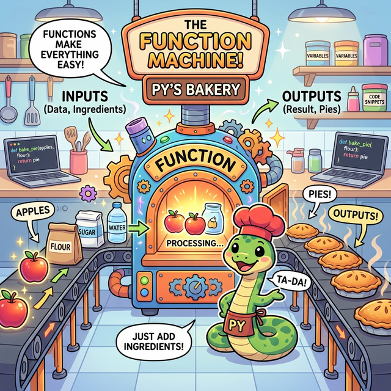

## 학습목표
내가 짠 파이썬 코드가 수십 줄, 수백 줄 길어지기 시작하면 코드의 중복과 복잡함에 압도당하게 됩니다. 코드를 재사용 가능한 단위로 묶어서 블록화하는 핵심 개념인 **'함수(Function)'**에 대해 학습합니다. 본 장에서는 함수라는 단어가 가진 어원적/수학적 기원부터 시작하여, 나만의 커스텀 논리 기계를 설계하는 방법(`def`), 다양하고 유동적인 매개변수(`*args`) 통로 설계, 변수가 살아 숨 쉬는 생태계 규격(Scope)까지, 프로그래머들의 제1 핵심 무기를 완벽하게 장착합니다.

---

## 📚 세부 학습 목차

### [3.3.1 함수의 어원과 수학적 기원](#331-함수의-어원과-수학적-기원)
Function 이라는 영어 단어의 사전적 의미("동작, 역할")에서 출발하여, 수학의 $y = ax + b$ 가 만들어낸 **대응(Mapping)** 시스템이 어떻게 현대 프로그래밍의 '독립적이고 통제된 논리 처리 단위'로 진화했는지 거대한 철학의 첫 단추를 꿰맞춥니다.

### [3.3.2 함수 블랙박스와 매핑 시스템](#332-함수-블랙박스와-매핑-시스템)
수학의 함수에서 가장 중요한 **정의역(Input Domain)**과 **공역(Output Codomain)**의 엄격한 통제 이론을 파이썬 함수의 뼈대 구조로 이식합니다. 내용물을 몰라도 버튼만 누르면 튀어나오는 공학적 블랙박스(Information Hiding) 비유를 통해 함수의 존재 이유 3가지를 깨우칩니다.

### [3.3.3 함수 작동 흐름 시퀀스 다이어그램](#333-함수-작동-흐름-다이어그램)
함수가 호출될 때 메인 프로그램의 메모리 제어권이 어떻게 함수 내부의 블랙박스 공간으로 일시 정지(Pause) 및 워프(Jump)하고, 연산 결과만을 들고 깔끔하게 귀환(Return)하는지 그 입체적인 생애주기를 시퀀스 다이어그램으로 한눈에 조망합니다.

### [3.3.4 함수 선언 문법 (def)과 호출(Call)](#334-함수-선언-문법-def과-호출call)
남이 만든 함수(print, type 등)를 쓰는 소비자 입장에서 벗어나, 파이썬에서 `def` 키워드를 활용해 나만의 커스텀 함수(명령어)를 직접 창조하는 설계자가 되어봅니다. 특히 함수가 호출(Call)될 때 프로그램의 제어권(메모리 불빛)이 위아래로 널뛰기 점프를 뛰는 역동적인 실행 궤적을 심층적으로 추적합니다.

### [3.3.5 함수 호출과 제어 흐름의 도약](#335-함수-호출과-제어-흐름의-도약-jump-&-return)
초보자들이 가장 당황하는 지점인 '제어 흐름의 널뛰기'를 심층 분석합니다. 함수 호출 시 메인 프로그램이 잠시 멈추고 제어권이 워프(Jump)하는 현상, 그리고 임무 완수 후 결괏값만 들고 귀환(Return)하는 흐름을 포탈 애니메이션과 함께 직관적으로 추적합니다.

### [3.3.6 함수의 다양한 매개변수 통로 (\*args, \*\*kwargs)](../week09/#336-함수의-다양한-매개변수-통로-*args-**kwargs)
설계 구조(Parameter)와 실제 재료(Argument)의 개념 차이를 명확히 구분하고, 파이썬만이 가진 변칙적이고 무한한 데이터 흡수 그물망인 별표 인스펙터(`*args`, `**kwargs`)들의 작동 메커니즘을 배웁니다.

### [3.3.7 변수의 유효 범위 (Scope와 Global)](../week09/#337-변수의-유효-범위-scope와-global)
왜 함수 안에서 만든 변수는 밖에서 쓸 수 없을까요? 함수라는 밀폐된 방 안에서 잠시 부풀었다 사라지는 '지역 변수'와, 파일 전체 세계관을 호령하는 '전역 변수' 데이터가 살아 숨 쉬는 공간(Scope)의 범위를 파악하고, 열쇠(`global`)를 조심히 다루는 법을 배웁니다.

### [3.3.8 람다(Lambda) 익명 함수](../week09/#338-람다lambda)
이름조차 짓기 귀찮은 일회용 함수인 `lambda`의 수학적 탄생 역사(알론조 처치)를 엿보고 코드를 극단적으로 얇게 썰어내는 방법을 익힙니다. 

### [3.3.9 마법의 거울, 재귀(Recursion)](../week09/#339-마법의-거울-재귀recursion)
거울 속의 자신을 보듯 자기가 자기를 꼬리 물며 끝없이 호출하는 트리 탐색의 원조, **재귀 함수**의 마법 메커니즘을 훈련합니다.

### [3.3.10 (참고) 파이썬 내장 함수와 메서드](../week09/#339-내장-함수와-메서드-활용)
파이썬 생태계에 입장하자마자 언제든 뽑아 쓸 수 있도록 든든하게 제공되는 핵심 내장 함수(`len()`, `max()`, `sum()`, `enumerate()` 등)들의 활용법을 살펴봅니다. 코드의 길이를 드라마틱하게 줄여줄 치트키 창고입니다.

### [3.3.11 (심화) Python 파이썬과 수학](../week09/#3311-내장-모듈-math-활용)
기본 문법을 넘어, 파이썬이 미리 제작해 둔 거대한 공학용 계산기 라이브러리인 `math` 모듈을 불러와(import) 수많은 수학 공식과 상수들을 함수 형태로 활용하는 방법을 실습합니다. 외부 함수의 막강한 조립 능력을 경험할 수 있습니다.

---

## 🎉 정리
축하합니다! 함수를 속속들이 다루는 법을 깨우쳤다는 것은, 드디어 코드를 무작정 일직선 스파게티로 짜내려가는 초보 티를 완벽히 벗고 '나만의 요리법과 도구 상자'를 블록화 할 줄 아는 **아키텍트(Architect, 설계자)**의 영역에 들어섰다는 뜻입니다. 앞으로 작성될 모든 대규모 AI 코드나 웹 시스템은 전부 이 함수 단위로 예쁘게 조각나고 조립되어 거대한 사이버 세상의 톱니바퀴로 작용할 것입니다.

---

## 학습목표
본 장에서는 프로그래밍의 가장 거대한 뼈대인 **'함수(Function)'**라는 단어가 도대체 어디서 왔는지 그 어원적 의미를 파헤칩니다. 영어 사전 속 '동작, 역할'이라는 뜻이 어떻게 수학의 $y = ax + b$ 대응 관계로 발전했고, 마침내 현대 프로그래밍의 **'독립적이고 일관적인 논리 처리 블랙박스'**로 진화했는지 그 근원적 철학을 완벽하게 이해합니다.

---

## 1. 어원적 접근: Function은 본래 "동작, 역할"이다

코딩을 처음 배우는 학생들이 가장 낯설어하는 단어 1위가 바로 '함수'입니다. 한자로 상자 함(函)에 셈 수(數)를 써서 "상자 속의 숫자 마법"이라는 뜻으로 번역되었기 조차 어렵습니다.

하지만 영어권 사람들에게 **"Function(펑션)"**은 아주 흔한 일상생활 단어입니다. 영어 사전을 찾아보면 그 뜻은 다음과 같습니다.
1. **기능, 작용**
2. **역할, 목적**
3. **(제대로) 작동하다, 역할하다**

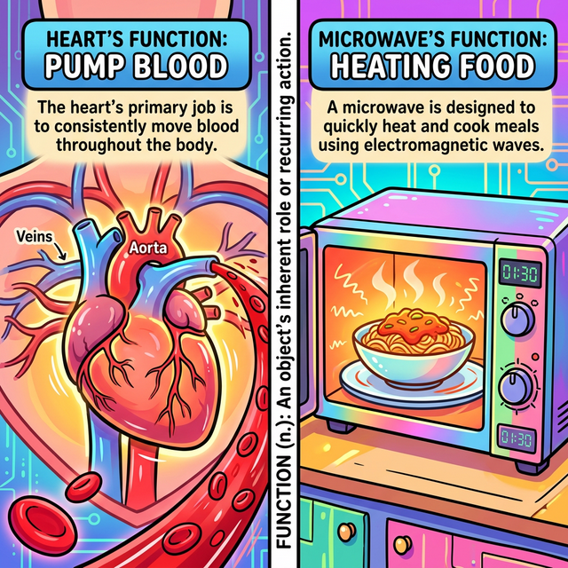
*(웹툰 비유: 심장이 쿵쾅거리는 그림 위에 `Heart's Function : Pumping Blood` 라고 적혀있고, 전자레인지 그림 위에 `Microwave's Function : Heating Food` 라고 적혀있습니다. 각 사물이 가진 고유하고 **반복적인 '역할(역할/기능)'**이 바로 Function의 핵심 본질임을 보여줍니다.)*

이처럼 Function의 본질은 무언가 복잡한 수식이 아니라, **"외부에서 자극(Input)이 주어졌을 때, 자기가 맡은 고유의 임무(동작)를 묵묵히 수행하고 결과를 내어주는 것"**입니다. 심장의 펑션이 피를 뿜는 것이듯, 프로그래밍에서의 펑션(함수)은 '특정한 계산이나 동작을 수행하도록 묶어놓은 코드 덩어리'를 의미합니다.

---

## 2. 수학적 기원: y = ax + b 와 '대응(Mapping)'의 탄생

그렇다면 이 일상용어였던 Function이 어떻게 오늘날 컴퓨터 논리의 핵심으로 자리 잡았을까요? 그 중간 다리 역할을 한 것이 바로 **수학(Mathematics)**입니다.

과거 수학자들은 자연현상을 관찰하다가 한 가지 놀라운 사실을 발견합니다. 
> "어? 기온이 올라갈수록 아이스크림 판매량이 늘어나네? **원인(온도)이 변하면 결과(판매량)도 규칙적으로 변하는구나!**"

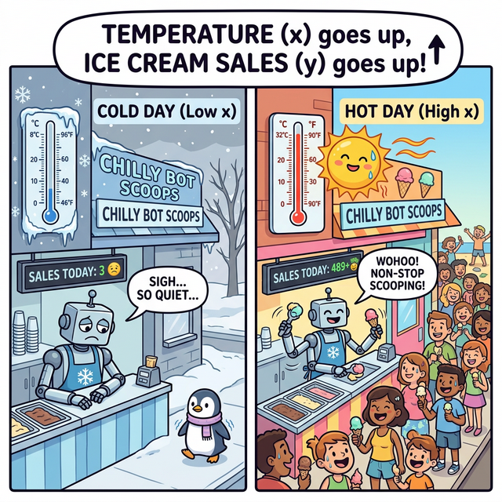
*(웹툰 비유: 왼쪽은 온도가 낮아 파리 날리는 아이스크림 가게, 오른쪽은 온도가 폭염일 때 로봇 점원이 땀을 뻘뻘 흘리며 아이스크림을 불티나게 파는 모습입니다. 원인이 변함에 따라 결과가 확연히 달라지는 '대응 관계'를 유머러스하게 보여줍니다.)*

여기서 수학의 위대한 발명품인 **변수(Variable)** 개념이 등장합니다. 수학자들은 원인이 되는 기온을 $x$(독립변수), 그에 따라 종속되어 결과가 되는 아이스크림 판매량을 $y$(종속변수)로 두고, 이 둘 사이의 규칙적인 변화율(대응 관계)을 $y = ax + b$ 같은 간결한 수식으로 묶어버렸습니다.

---

## 3. 식(Equation)과 함수(Function)의 결정적 차이: 미지수의 역동성

수학에서 `식`(예: $2a + 3 = 7$)과 `함수`(예: $y = 2x + 3$)는 겉보기엔 비슷하지만 근본적인 철학이 다릅니다.

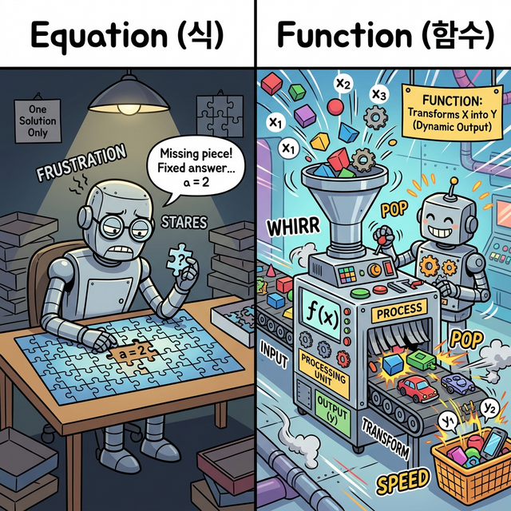
*(웹툰 비유: 왼쪽 그림의 `식(Equation)` 로봇은 책상에 가만히 앉아 직소 퍼즐에서 오직 1개의 정답 피스(`a=2`)를 찾으려 골머리를 앓는 정적인 모습입니다. 반면 오른쪽 그림의 `함수(Function)` 로봇은 거대한 기계를 조작하며 컨베이어 벨트에 $x$(원인 재료)를 계속 들이붓고 반대편에서 끝없이 전혀 다른 파란색의 $y$(새로운 제품)를 신나게 찍어내는 역동적인 공장장 모습입니다!)*

*   **식(Equation)**: 정지되어 있는 퀴즈입니다. 좌변과 우변이 같아지게 만드는 특정한 미지수 `a`의 정답(이 경우 `a = 2`) 하나만을 찾아내는 것이 목적입니다. 즉, 죽어있는 고정된 숫자들의 수수께끼입니다.
*   **함수(Function)**: 살아 움직이는 공장입니다. $x$라는 **변수(Variable)** 공간에 어떤 값을 주입(Input)하든지 간에, 정해진 규칙(대응)에 따라 실시간으로 계산하여 새로운 $y$값(Output)을 뱉어냅니다. 

이처럼 정적인 식을 넘어, 미지수를 이용해 끊임없이 동적인 **'대응(Mapping)'** 변화를 만들어낸다는 점에서 함수는 거대한 생명력을 가지게 되었고, 이 개념이 컴퓨터 프로그래밍 세계로 넘어와 입력 데이터에 대응하는 출력 데이터를 찍어내는 "코드 공장"의 토대가 된 것입니다.

---

## "대응(Correspondence)"과 "집합(Set)"의 콜라보레이션
수식 구조 안에서 $x$에 숫자 `1`을 넣으면 $y$가 `3`이 되고, $x$에 `2`를 넣으면 $y$가 `5`가 됩니다. 이렇게 원인인 $x$ 값 하나에 결과인 $y$ 값이 짝을 지어 결정되는 관계를 수학에서는 **대응(Mapping, Correspondence)**이라고 불렀습니다.

이 대응 관계를 성립시키려면, 먼저 원인이 될 수 있는 숫자들을 모아놓은 그룹(출발지)과 결과가 될 수 있는 숫자들을 모아놓은 그룹(도착지)이 필요합니다. 수학에서는 이처럼 명확한 조건으로 묶인 값들의 모임을 **집합(Set)**이라고 부릅니다.
*   함수의 시작점이 되는 원인 $x$ 값들의 집합을 **정의역(Domain)**이라 부릅니다.
*   함수의 도착점이 되는 결과 $y$ 값들의 집합을 **공역(Codomain)**이라 부릅니다.

결국, 함수란 그저 둥둥 떠다니는 수식이 아니라 **"정의역이라는 집합의 원소(Data) 하나를 공역이라는 다른 집합의 원소(Data)로 정확히 연결해 주는 규칙적인 다리"**인 셈입니다.

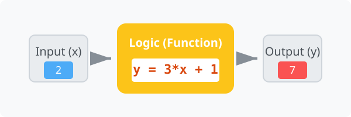
*(다이어그램: 정의역($X$ 집합, 원인)의 데이터들이 $y = 2x + 1$ 이라는 마법의 파이프를 통과하자마자 공역($Y$ 집합, 결과)으로 확정되어 튀어나오는 매핑 과정. "1개의 입력은 정확히 1개의 결과만 보장한다"는 인과율의 화살표가 선명하게 빛납니다.)*

수학자들은 이처럼 **"입력이 주어지면 내부의 규칙(수식)을 거쳐 결과를 일관되게 뱉어내는 기계적인 대응 시스템"**의 모습이 마치 사물이 제 기능을 하는 모습과 똑같다고 생각하여 이를 **수학적 '함수(Function)'**라고 명명하게 됩니다.

---

## 4. 프로그래밍으로의 진화: 일관적인 '논리 처리 동작'

수학의 함수가 단순히 "숫자를 넣어 숫자를 뽑아내는 식"이었다면, 컴퓨터 프로그래밍 세계로 넘어오면서 이 개념은 무한대로 확장됩니다.

### "숫자를 넘어서 모든 종류의 데이터를 대응시킨다"
컴퓨터 세계에서의 함수는 숫자뿐만 아니라, **문자열, 사용자 클릭, 파일, 이미지** 등 모든 형태의 데이터를 원인($x$, Input)으로 받을 수 있습니다. 그리고 그 안에서 단순한 사칙연산이 아닌, 무수히 많은 `if`문과 `for` 루프가 섞인 **일관적이고 비대한 논리 처리 동작**을 수행한 뒤 새로운 결과($y$, Output)를 만들어 냅니다.

```python
# 일관적인 논리 처리를 담당하는 현대 프로그래밍의 함수(Function)
def translate_word(korean_word):
    # 단순한 수식이 아니라, 조건 분기와 매핑이라는 거대한 논리 덩어리입니다.
    # 하지만 "입력을 받아 역할을 수행하고 결과를 반환한다"는 철학은 똑같습니다.
    dictionary = {"사과": "Apple", "바나나": "Banana"}
    
    if korean_word in dictionary:
        return dictionary[korean_word] # 1:1 확정 대응 처리!
    else:
        return "Unknown"
```

결론적으로, 현대 코딩에서 함수를 짠다는 것은 수학에서 $y = f(x)$ 라는 공식을 만드는 행위의 연장선입니다. 우리는 함수라는 껍데기(def) 안에 **1. 어원적 의미인 '독립적인 고유의 동작/임무'**와 **2. 수학적 의미인 '입력과 출력의 철저한 인과율(대응)'** 철학을 모두 담아 거대한 소프트웨어를 조립하는 기어봉을 만드는 것입니다.

---

---

## 🎧 Vibe Coding

> **🗣️ 학생 프롬프트 (AI에게 이렇게 명령해 보세요):**
> "수학의 1차 함수 방정식 $y = 3x + 5$ 를 파이썬 함수 `def linear_func(x):` 로 그대로 똑같이 표현해서 짜줘. 그리고 그 밑에 for 루프를 돌려서 x 에 1부터 5까지 집어넣었을 때 y 값이 어떻게 일관성 있게(대응되어) 매핑되어 출력되는지 콘솔에서 확인하는 코드도 같이 줘."

---

## 코딩 영단어 학습 📝

*   **Function**: 기능, 동작, 목적, 함수. (어떤 것이 마땅히 수행해야 할 고유의 역할. 이 개념 하나가 수학과 컴퓨터 구조 전체를 관통하는 알파이자 오메가입니다.)
*   **Variable**: 변수. (변할 수 있는 값. 온도($x$)나 아이스크림 판매량($y$)처럼 세상의 불확실성을 담아두는 빈 상자입니다.)
*   **Correspondence / Mapping**: 대응, 매핑. (이쪽 집단의 원소 하나가 저쪽 집단의 원소 하나와 확고하고 운명적으로 짝지어지는 논리적 연결선입니다.)
*   **Set**: 집합. (명확한 기준을 가지고 모인 객체나 데이터들의 묶음입니다.)
*   **Domain / Codomain**: 정의역 / 공역. (함수라는 다리를 건너기 전 출발지 집합(원인)이 정의역, 다리를 건너 도착할 수 있는 잠재적 목적지 집합(결과)이 공역입니다.)

---

## 학습목표
본 장에서는 코드를 단순히 나열하는 초단계를 벗어나, 수학의 **'정의역(Domain)과 공역(Codomain)'**이라는 철저한 입력/출력 통제 규칙을 프로그래밍의 블랙박스(Black Box) 설계 철학과 연결합니다. 입력(Input), 처리(Process), 출력(Output)의 3대 필수 요소가 어떻게 소프트웨어라는 거대 공장의 핵심 부품이 되는지 깨우칩니다.

---

## 1. 수학적 관점: 정의역(Domain)과 공역(Codomain)의 통제

프로그래밍의 '함수(Function)'는 본래 수학의 엄격한 자판기 시스템에서 파생되었습니다. 수학 세계에서 불량품 함수로 판정받지 않기 위해서는, 자판기에 집어넣을 수 있는 동전의 종류(입력 데이터 풀)인 **정의역(Domain)**과, 튀어나올 잠재적 음료의 종류(출력 타깃 풀)인 **공역(Codomain)**을 명확히 규정해야만 합니다.

이러한 수학의 제약조건은 **"아무 쓰레기 데이터나 집어넣으면 프로그램이 터진다"**는 현대 코딩의 가장 본질적인 에러 핸들링 논리로 발전하게 됩니다.

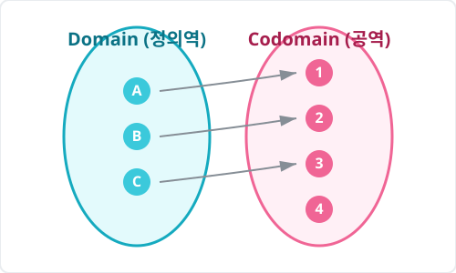
*(다이어그램: 정의역(Domain, $X$) 집합에 있는 숫자 `1, 2, 3`이 중간의 거대한 $f(x)$ 톱니바퀴 연산 기계를 거치면서, 공역(Codomain, $Y$) 집합에 있는 특정 결괏값 `A, B, C`로 한 치의 오차도 없이 일대일(혹은 다대일)로 정확하게 매핑(Mapping)되어 레이저 빔처럼 꽂히는 무결점 수학적 흐름입니다.)*

프로그래밍의 함수도 이 수학적 원리의 3단계를 100% 동일하게 가져왔습니다.
1.  **입력 (Input / Parameter)** = 정의역($X$) 통제 구역. 기계에 던져 넣게 허락된 원재료입니다. 파이썬에서는 `()` 안에 던져주는 변수들을 의미합니다.
2.  **처리 (Process / Logic)** = $f(x)$ 톱니바퀴. 들어온 원재료를 지지고 볶고 연산하는 기계 내부 동작입니다.
3.  **출력 (Output / Return)** = 공역($Y$) 내에서 확정된 치역 매핑 결과. 가공이 끝나 기계 밑구멍으로 튀어나오는 영광스러운 최종 결과물(`return`)입니다.

---

## 2. 공학적 관점: 치밀한 블랙박스 (The Black Box)

수학의 엄격한 기계 원리를 소프트웨어 공학으로 가져오면, 함수는 곧 **'블랙박스(Black Box)'**가 됩니다. 비행기의 블랙박스처럼 내부가 숨겨져 있다는 뜻이 아니라, **"속에 무슨 복잡한 부품이 들었는지는 알 필요 없고, 겉에 달린 버튼(Input)과 튀어나오는 결과(Output)만 알면 누구나 가져다 쓸 수 있다"**는 **구현 은닉(Information Hiding)**과 **추상화(Abstraction)**의 위대한 철학을 담고 있습니다.


*(웹툰 비유: 평범한 로봇이 밀가루, 계란, 설탕 등 지저분한 날것의 재료(Input)를 정체를 알 수 없는 시커먼 '블랙박스 로봇'에게 전해줍니다. 블랙박스 로봇은 속에서 무슨 마법을 부렸는지 전혀 보여주지 않은 채, 1초 만에 완벽하게 구워진 3단 케이크(Output)를 내밀며 윙크합니다.)*

### 왜 함수를 블랙박스로 만들어야 할까요?
스마트폰 전원 버튼을 누를 때 폰 내부에서 일어나는 수만 가지 전기 회로의 파장 흐름(배터리 인가, 액정 배열 등)을 우리가 일일이 계산하며 살지 않는 것과 같습니다. 우리는 그저 **"전원 버튼을 누른다(Input 호춯)"** $\to$ **"화면이 켜진다(Output 도출)"** 라는 깔끔한 인터페이스만 누립니다. 

코딩도 마찬가지입니다. 누군가가 미리 머리 터지게 짜둔 `print()`, `len()`, `sum()` 같은 훌륭한 블랙박스들이 이미 있기 때문에, 모니터 픽셀이 어떻게 그려지는지 신경 끄고 단어 하나로 모든 복잡성을 잊어버리는 것입니다.

---

## 3. 함수의 위대한 3대 존재 이유

우리는 왜 굳이 귀찮음을 무릅쓰고 코드를 함수로 묶어서 만들어야 할까요? 코드를 위에서 아래로 그냥 쭈욱 길게 적어내려가면 안 될까요?

### ① 코드의 재사용성 (DRY 원칙: Don't Repeat Yourself)

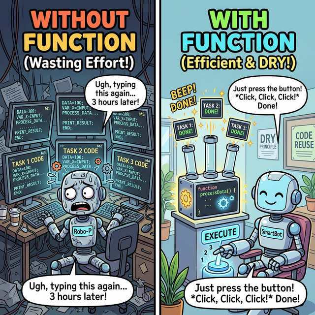
*(웹툰 비유: 왼쪽 그림의 `Without Function(함수 없음)` 로봇은 다크서클이 턱까지 내려온 채 완전히 똑같이 생긴 복잡한 계산 코드를 모니터 3대에 걸쳐 일일이 중복으로 타이핑하며 땀을 뻘뻘 흘립니다. 반면 오른쪽 그림의 `With Function(함수 사용)` 스마트 로봇은 그 길고 복잡한 코드를 깔끔한 '함수 상자(Function Box)' 안에 딱 한 번만 예쁘게 포장해 둔 뒤, 버튼 하나만 여유롭게 `딸깍!` 3번 눌러서 똑같은 결과물을 눈 깜짝할 새에 쏟아내는 마법을 보여줍니다!)*

소프트웨어를 만들다 보면, '회원 가입 환영 이메일 보내기'나 '장바구니 총합 할인율 계산하기'처럼 완전히 똑같은 흐름의 복잡한 논리 작업들이 여기저기서 수십 번씩 필요해집니다. 똑같은 행동을 하는 코드를 10군데에 그대로 복붙하는 것은 프로그래머에게 죄악(Spaghetti Code)입니다. 나중에 정책이 바뀌어 코드를 1줄 고쳐야 할 때 10군데를 모두 찾아가 일일이 고쳐야 하는 끔찍한 대참사가 일어납니다.

이때 뛰어난 개발자들은 그 반복되는 긴 작업(논리 흐름) 코드 전체를 하나의 캡슐 상자 안에 깔끔하게 묶어버립니다(**'함수화, Bundling'**). 이렇게 함수라는 '명령어 캡슐' 안에 넣어두고 이름만 호출하면, 나중에 함수 내부의 코드 딱 한 줄만 고쳐도 그것을 호출하는 수백만 군데의 프로그램 생태계가 일제히 자동 업데이트되는 최고의 마법(**재사용성**)을 경험하게 됩니다.

### ② 논리의 모듈화와 분할 정복 (Divide & Conquer)
RPG 게임을 만들 때 거대한 'main' 통뼈 파일 하나에 수백만 줄의 코드를 다 때려 박으면 당연히 미아가 됩니다. 이 덩어리를 `move_character()`, `attack()`, `get_item()` 이라는 독립된 작은 블랙박스 함수 부품들로 쪼개서 만들면(모듈화), 개별 부품만 독립적으로 테스트하고 고장 난 곳만 떼어내서 빠르게 수리할 수 있습니다.

### ③ 가독성 (Readability)
함수는 그 자체로 내가 쓴 코드의 '논리적 목차'가 됩니다. 내부의 복잡한 연산을 읽기도 전에, 함수 이름을 `calculate_tax()`라고 명명해 두면 "아하, 여기서 머리 아프게 세금을 떼고 다음 줄로 넘어가겠군!" 하고 소설책처럼 메인 프로그램의 뼈대를 술술 읽어 내려갈 수 있습니다.

---

## 🎧 Vibe Coding

> **🗣️ 학생 프롬프트 (AI에게 이렇게 명령해 보세요):**
> "파이썬에서 함수의 입력(매개변수)과 반환(return)의 개념이 잘 이해가 안 가. 숫자 2개를 입력하면 그 안에서 더하기, 빼기, 곱하기, 나누기를 한 결과값 4개를 동시에 한꺼번에 리턴하는 '만능 사칙연산 함수' 코드를 작성해주고, 어떻게 함수가 여러 개의 값을 돌려줄 수 있는지 파이썬만의 특징(Tuple Unpacking)을 사용해서 아주 친절하게 주석을 달아줘."

---

## 코딩 영단어 학습 📝

*   **Function**: 기능, 작용, (수학의) 함수. (단어 자체에 이미 '어떤 목적을 달성하게 해주는 동작 메커니즘'이라는 뜻이 내포되어 있습니다.)
*   **Define (`def`)**: 규정하다, 정의하다. (파이썬에서 새로운 함수를 창조하고, 그것의 룰을 세상(메모리)에 선포할 때 쓰는 키워드입니다.)
*   **Argument (인자)**: 주장, 논거, (수학/컴퓨터의) 독립변수. (함수라는 판사에게 "이 재료를 바탕으로 판단해 주십시오" 하고 호출자가 집어 던져 넘기는 실제 데이터 값입니다.)
*   **Parameter (매개변수)**: 한도, 매개변수. (함수의 설계도 단에서, 나중에 Argument들이 날아오면 임시로 받아줄 그릇(변수 이름)들의 명칭입니다.)
*   **Return**: 돌려주다, 돌아가다. (함수가 자신에게 주어진 모든 톱니바퀴 연산을 마치고, 최종 계산서를 자신을 부른 주인(호출자)에게 던져주고 무대에서 퇴장하는 명령어입니다.)
*   **Abstraction**: 추상화. (세상 복잡한 블랙박스 내부 기어비는 다 숨겨버리고, 사용자가 쓰기 편한 엑셀 페달(껍데기)만 겉으로 딸랑 드러내 놓는 공학 최고의 미덕입니다.)
*   **Reuse (Reusability)**: 재사용성. (한 번 잘 만들어둔 코드를 수정 없이 여기저기서 수십 번 반복해서 다시 꺼내 쓰는 프로그래밍 최고의 덕목입니다.)
*   **Bundling**: 묶음, 포장. (복잡하게 흩어진 논리적 흐름들을 하나의 거대한 캡슐(함수) 박스로 깔끔하게 포장하는 행위입니다.)

---

## 학습목표
본 장에서는 메인 프로그램이 함수를 '호출(Call)'하여 요청을 위임하고, 함수가 자기만의 독립된 공간에서 치열하게 연산한 뒤 그 결과물을 다시 '반환(Return)'하여 메인 프로그램으로 돌아오는 전체 작동 흐름을 시퀀스 다이어그램을 통해 직관적으로 조망합니다.

---

## 1. 함수 작동 흐름 (Mermaid)

함수를 정의해 두고, 메인 프로그램에서 인자(Argument)를 담아 "호출(Call)"하여 결과값(Return Value)을 돌려받기까지의 위임과 회수 과정을 아래 시퀀스 다이어그램으로 시각화했습니다.

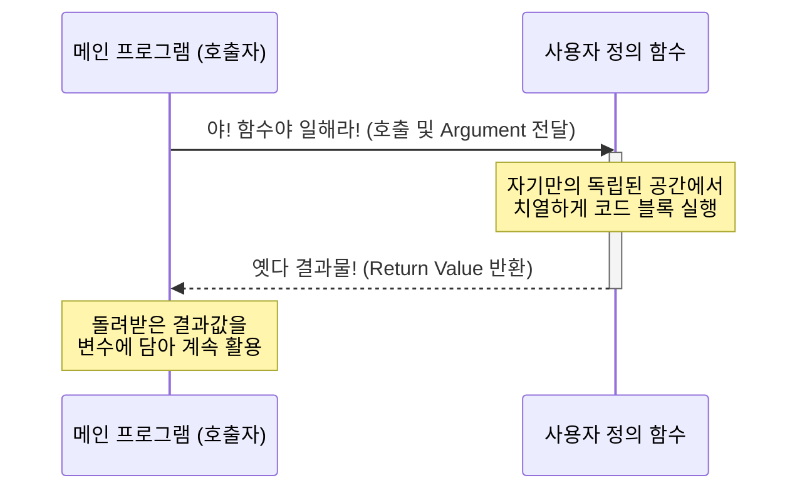

위 다이어그램에서 보듯, 함수는 호출되는 순간 메인 프로그램의 메모리 흐름에서 일시적으로 벗어나 자신만의 독립된 실행 환경(블랙박스)을 시동합니다. 모든 처리를 마치고 나면 흔적을 지우고 오직 결과값 하나만 호출자에게 배달한 뒤 깔끔하게 사라집니다.


## ☕ Java vs 🐍 Python 스나이퍼 비교

### 1. 극단적으로 간결한 정의 방식 (def 키워드)
*   **Java**: 자바에서 함수(메서드)를 하나 만들려면 험난한 관문을 거쳐야 합니다. 접근 제어자(`public`), 정적 여부(`static`), 가장 중요한 **반환 데이터 타입(`int`, `String` 등)**을 가장 먼저 선언해야 합니다.
    *   `public static int add(int a, int b) { return a + b; }`
*   **Python**: 파이썬은 이 모든 선언의 압박을 단 세 글자 **`def` (Define)** 로 퉁칩니다. 파이썬은 동적 타입 언어이므로 들어오는 입력값도, 뱉어내는 반환값도 미리 귀띔해 줄 필요가 없습니다. 그저 실행해 볼 뿐입니다.
    *   `def add(a, b): return a + b`

### 2. 일급 객체 (First-Class Citizen)의 대우
*   **Java**: 자바 8 이전까지 자바의 메서드는 오로지 '클래스'라는 거대한 성벽 안에 종속된 부속품일 뿐이었습니다. 함수 그 자체를 변수에 담거나 다른 함수에 던져줄 수 없었습니다.
*   **Python**: 파이썬에서 함수는 **변수나 숫자와 완벽히 동등한 지위(일급 객체)**를 누립니다. 함수 덩어리 자체를 숫자 `3`이나 문자열 `"hello"`처럼 변수에 틱 하고 대입할 수도 있고, 다른 함수의 인자로 `add` 함수 뭉치를 통째로 집어던질 수도 있는 극도의 유연성을 자랑합니다.


---

## 🎧 Vibe Coding

> **🗣️ 학생 프롬프트 (AI에게 이렇게 명령해 보세요):**
> "파이썬으로 간단하게 물건 가격과 할인율을 입력받아 최종 가격을 계산하는 함수를 만들어줘. 그리고 메인 프로그램에서 이 함수를 호출할 때 흐름이 어떻게 해당 함수로 넘어갔다가, 다시 계산 결과를 들고 메인으로 돌아오는지 시퀀스 구조가 잘 보이도록 `print()` 문으로 흐름을 찍어주는 주석 가득한 예제 코드를 작성해 줘."

---

## 코딩 영단어 학습 📝

*   **Sequence**: 순서, 차례. (프로그램의 동작이 호출과 반환의 시간적 순서에 따라 어떻게 흘러가는지 보여주는 다이어그램입니다.)
*   **Caller**: 호출자. (함수에게 일을 시키기 위해 메인 프로그램 쪽에서 이름을 부르는 주체입니다.)
*   **Activate / Deactivate**: 활성화 / 비활성화. (함수가 호출되어 메모리 상에서 독립적인 블랙박스 공장이 가동(Activate)되고, 일이 끝나면 소멸(Deactivate)하는 생명주기를 나타냅니다.)

---

## 학습목표
본 장에서는 학생들이 파이썬 프로그래밍을 배울 때 가장 큰 벽으로 느끼는 **'함수의 흐름(Control Flow)'**을 파헤칩니다. `def` 키워드로 함수를 만드는 기법부터, 호출(Call)될 때 프로그램 메모리의 흐름이 어떻게 다른 공간으로 워프(Jump)했다가 되돌아오는지(Return) 그 복잡한 궤적을 완벽히 이해합니다. 더 나아가, 함수가 자기 자신을 끝없이 호출하는 마법 같은 **재귀(Recursion)**의 원리까지 상세히 정복합니다.

---

## 1. 함수 선언하기 (Why `def`?)

파이썬에서 함수를 새롭게 창조하는 행위를 가리켜 **'정의한다(Define)'**고 표현합니다. 다른 많은 언어들이 함수를 만들 때 `function`이라는 길고 번거로운 단어를 쓰지만, 파이썬은 왜 단 세 글자인 `def`를 사용할까요?

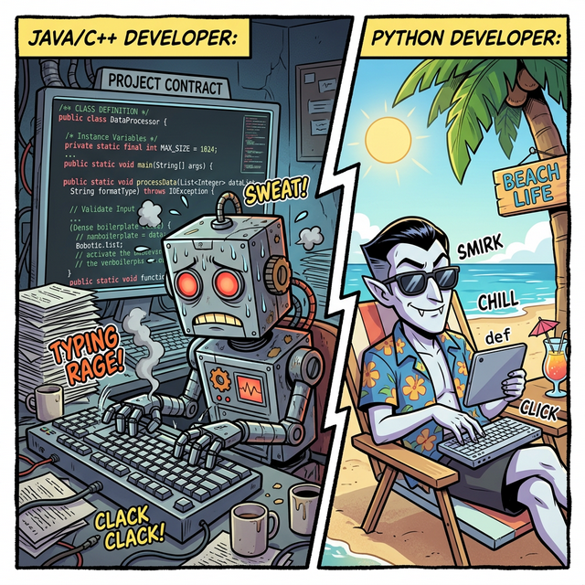
*(웹툰 비유: 자바나 C++ 로봇이 땀을 뻘뻘 흘리며 `public static void function...` 이라는 수십 자의 계약서를 쓰고 있는 동안, 해변 의자에 누워 선글라스를 낀 파이썬 뱀파이어는 여유롭게 단 세 글자 `def`만 틱 치고 미소를 짓고 있습니다. 파이썬의 궁극적인 철학인 "단순함과 우아함"을 보여줍니다.)*

파이썬의 철학은 **"실용적이고 읽기 쉬워야 하며, 불필요한 타이핑은 지양한다"**입니다. 8글자나 되는 `function`을 매번 치는 것은 프로그래머의 손가락을 피곤하게 만듭니다. 그래서 **"새로운 명령어를 정의(Define)한다"**라는 뜻의 앞 세 글자 **`def`**만을 따와서 가장 직관적이고 쿨한 예약어를 탄생시켰습니다.

### 기본 선언 문법

```python
# 'def' 키워드로 함수명과 입력받을 통로(매개변수)를 정의합니다.
def make_greeting(name):
    """이곳은 함수가 무슨 일을 하는지 적어두는 독스트링(설명서) 공간입니다."""
    message = f"안녕하세요, {name}님! 환영합니다."
    
    # 작업이 다 끝나면 그 결과를 호출한 쪽으로 탁 던져줍니다.
    return message
```

---

## 2. 매개변수(Parameter) vs 인수(Argument)

함수에서 가장 헷갈리는 용어가 바로 **파라미터(Parameter)**와 **아규먼트(Argument)**입니다. 둘 다 "함수에 넣어주는 값"이라고 뭉뚱그려 알고 있으면 나중에 객체지향을 배울 때 뼈아픈 타격을 입습니다. 이 둘의 차이는 하늘과 땅 차이입니다!

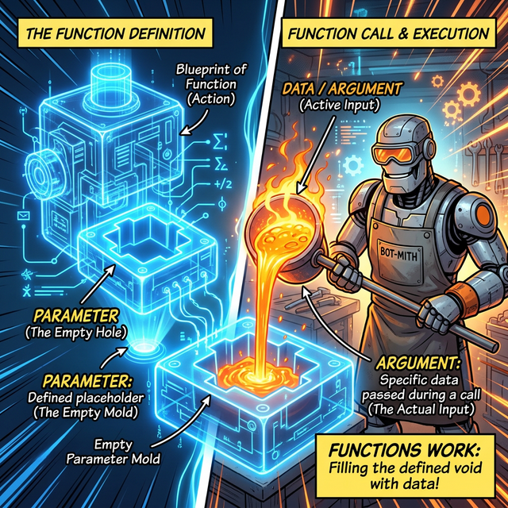
*(웹툰 비유: 왼쪽의 텅 빈 검 푸른 '홀로그램 도면(틀)'이 바로 파라미터(Parameter)입니다. "이 틀에는 무언가 들어올 거다~" 하고 선언만 해둔 빈 공간입니다. 반대로 오른쪽의 대장장이 로봇이 펄펄 끓는 진짜 마그마(실제 데이터)를 그 틀 안에 들이붓고 있는데, 이 들이붓는 진짜 알맹이 데이터가 바로 아규먼트(Argument)입니다.)*

*   **매개변수(Parameter)**: 함수를 처음 **설계(def)할 때 뚫어놓은 구멍(이름표)**입니다. 아직 값이 없습니다. 
    *   `def make_cookie(flavor):` 여기서 `flavor`는 파라미터입니다.
*   **인수/인자 (Argument)**: 함수를 실제로 **실행(Call)할 때 그 구멍에 쑤셔 넣는 진짜 데이터 값**입니다.
    *   `make_cookie("초코")` 여기서 `"초코"`라는 텍스트 덩어리가 실제 작동하는 아규먼트입니다.

---

## ☕ Java vs 🐍 Python 스나이퍼 비교

### 1. 극단적으로 간결한 정의 방식 (def 키워드)
*   **Java**: 자바에서 함수(메서드)를 하나 만들려면 험난한 관문을 거쳐야 합니다. 접근 제어자(`public`), 정적 여부(`static`), 가장 중요한 **반환 데이터 타입(`int`, `String` 등)**을 가장 먼저 선언해야 합니다.
    *   `public static int add(int a, int b) { return a + b; }`
*   **Python**: 파이썬은 이 모든 선언의 압박을 단 세 글자 **`def` (Define)** 로 퉁칩니다. 파이썬은 동적 타입 언어이므로 들어오는 입력값도, 뱉어내는 반환값도 미리 깐깐하게 귀띔해 줄 필요가 없습니다.

---

## 🎧 Vibe Coding

> **🗣️ 학생 프롬프트 (AI에게 이렇게 명령해 보세요):**
> "파이썬에서 매개변수(Parameter)와 인수(Argument)의 차이가 너무 헷갈려. 내가 '붕어빵 틀'을 만드는 `def` 함수 설계 과정과, 그 틀에 팥이나 슈크림 같은 진짜 데이터 재료(Argument)를 집어넣어서 빵을 찍어내는 함수 호출 과정을 주석으로 재밌게 비유해서 파이썬 코드로 짜줘."

---

## 코딩 영단어 학습 📝

*   **Define (`def`)**: 규정하다, 정의하다. (파이썬에서 새로운 명령어 블랙박스를 창조하고 메모리에 선포할 때 쓰는 마법 지팡이 같은 키워드입니다.)
*   **Parameter**: 매개변수. (설계 단계: 블랙박스 기계에 미리 뚫어놓은 공갈 껍데기 구멍의 이름표(틀)입니다.)
*   **Argument**: 인수, 인자. (작동 단계: 블랙박스 구멍 안으로 실제로 콸콸 들이붓는 현장의 진짜 데이터 재료 값입니다.)

---

## 학습목표
본 장에서는 초보자들이 파이썬 함수를 배울 때 가장 크게 당황하는 **'제어 흐름의 널뛰기(Control Flow Jump)'** 현상을 파헤칩니다. 함수가 호출(Call)될 때 메인 프로그램의 메모리 흐름이 어떻게 잠시 정지(Pause)하고 완전히 다른 성벽(Scope) 안으로 워프(Jump)했다가 다시 계산 결과만 들고 귀환(Return)해오는지 그 역동적인 궤적을 완벽히 정복합니다. 

---

## 1. 제어 흐름의 도약 (Control Flow Jump)

일반적인 파이썬 코드는 위에서 아래로 정직하게 폭포수처럼 1줄씩 흐릅니다. 하지만 함수를 호출(Call)하는 순간, 여러분의 관찰 시점은 이 폭포수를 벗어나 완전히 다른 차원으로 널뛰기를 하게 됩니다. 

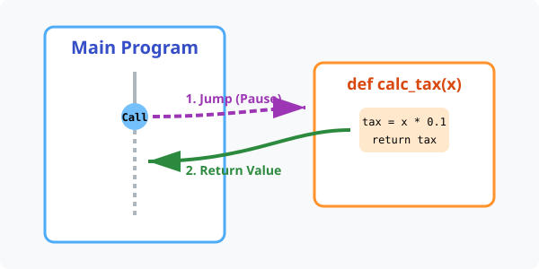
*(다이어그램: 메인 프로그램(Main Program)을 일직선으로 차례차례 읽고 내려오던 초록색 실행 불빛이, `calc_tax(100)`이라는 함수 호출 코드를 만납니다. 그러자 불빛이 보라색 포탈 안으로 쑥 빨려 들어가, 전혀 다른 메모리 공간에 둥둥 떠있는 `calc_tax()` 함수의 방으로 떨어집니다. 거기서 세금 계산 지시사항을 모두 마친 불빛은, 계산 결과(Return)를 보따리에 싸들고 뚫린 황금색 귀환 포탈을 타서, 아까 본인이 떠났던 바로 그 메인 프로그램의 호출 위치로 기가 막히게 정확히 되돌아옵니다.)*

### 호출(Call)과 복귀(Return)의 3단계 마법

1.  **점프(Jump)**: 메인 프로그램이 실행되다가 `함수이름()`을 부르는 순간, 프로그램은 하던 일을 모두 일시정지(`Pause`)하고 그 줄에 책갈피를 꽂아둡니다. 그리고 실행권(제어권)을 통째로 떼어 함수가 살고 있는 곳으로 순식간에 **순간이동**시킵니다.
2.  **격리된 공간(Scope)**: 함수는 자신만의 굳게 닫힌 밀실(Local Scope) 안에서, 메인 공간에서 배달 받은 재료(Argument)를 갖고 지지고 볶습니다. 이 방에서 일어나는 난리통은 바깥세상(메인 프로그램)에서는 전혀 알지 못합니다.
3.  **반환(Return)**: 함수 끄트머리에서 `return 결괏값` 문장을 만나면 함수의 존재 이유는 끝납니다. 함수는 임무를 완수하고 자신의 방을 깨끗이 폭파해버린 뒤, 계산된 가장 맛있는 엑기스(결과물) 하나만 딸랑 들고 아까 책갈피를 꽂아두었던 메인 프로그램의 그 자리로 다시 역(逆) 순간이동하여 돌아옵니다.

만약 개발자가 굳이 `return`을 돌려주지 않고 함수가 싱겁게 끝난다면, 파이썬은 빈털터리라는 의미로 `None`이라는 빈 껍데기를 몰래 쥐어주고 돌아옵니다.

---

## 2. 다중 반환의 쾌감 (Tuple Packing)

파이썬은 아주 호탕한 언어입니다. 다른 언어에서는 돌려주고(Return) 싶은 결괏값이 2개 이상일 땐 배열이나 클래스 객체로 귀찮게 꽁꽁 싸서 줘야만 합니다. 하지만 파이썬은 `return` 뒤에 쉼표(`,`)만 여러 번 찍어주면, **다수의 결괏값을 한 큐에 튜플(Tuple) 포장지로 쓰윽 감싸서 아주 쿨하게 던져줍니다.**

```python
def math_master(x, y):
    add = x + y
    sub = x - y
    mul = x * y
    # 값 3개를 동시에 배출! 파이썬이 알아서 (add, sub, mul) 이란 튜플로 묶어줍니다.
    return add, sub, mul  

# 튜플 언패킹(Unpacking) 마법으로 3개의 변수에 동시에 공중 캐치하여 우겨넣기
result_add, result_sub, result_mul = math_master(10, 3) 

print(f"더하기: {result_add}, 빼기: {result_sub}, 곱하기: {result_mul}") 
# 출력: 더하기 13, 빼기 7, 곱하기 30
```

---

## 🎧 Vibe Coding

> **🗣️ 학생 프롬프트 (AI에게 이렇게 명령해 보세요):**
> "파이썬에서 함수의 입력(매개변수)은 알겠는데 다시 돌아오는 반환(return)의 개념이 잘 이해가 안 가. 숫자 2개를 던져주면 그 함수 안에서 더하기, 빼기, 곱하기, 나누기를 전부 혼자서 한 다음, 그 결괏값 4개를 동시에 튜플 매핑으로 몽땅 배출해내는 '만능 사칙연산 기계' 코드를 작성해 줘. 그리고 코드가 어떻게 메모리를 건너뛰고 위아래로 점프하는지 콘솔창에 print 가 찍히는 순서를 조작해서 아주 실감 나게 주석으로 달아줘."

---

## 코딩 영단어 학습 📝

*   **Call/Invoke**: 호출하다, 깨우다. (잠자고 있던 함수의 이름표를 쿡 찔러 메모리 상으로 소환해 내는 구동 시발점을 뜻합니다.)
*   **Return**: 돌려주다, 방 빼고 돌아가다. (함수가 호출자의 미션을 모두 완수한 뒤, 액기스 결과물 하나만 들고 자기가 있던 메모리 공간을 파괴하며 원래 불렸던 곳으로 제어 흐름을 점프시키는 명령어입니다.)

---

## ✍️ 이번 주 연습 문제

**문제 1.** 반지름 `r`을 전달받아 원의 넓이를 계산하여 반환하는 `calculate_circle_area(r)` 함수를 작성해 보세요. (원주율은 3.14로 가정)

**문제 2.** 다음 코드의 결과는 무엇일까요? 'Call by Object Reference' 원리를 이용하여 변수 `num`과 `lst`가 가리키는 값의 관점에서 설명해 보세요.
```python
def test_func(a, b):
    a = a + 10
    b.append(4)

num = 5
lst = [1, 2, 3]
test_func(num, lst)
print(num, lst)
```

**문제 3.** (심화) 입력받은 숫자가 **소수(Prime Number)**인지 확인하여 True/False를 반환하는 `is_prime(n)` 함수를 작성해 보세요.

---

## 📖 교재 상세 학습: 13 나만의 코드 조립 블록, 함수 만들기

## 13 나만의 코드 조립 블록, 함수 만들기

학창 시절 수학 시간에 다루었던 '이차방정식의 근의 공식'을 파이썬 코드로 구현해 보겠습니다.

**작성할 코드: root_calc.py**
```python
# 일반적인 이차방정식 해 도출 코드
a = 1
b = 2
c = -8

# 근의 공식 적용
answer1 = (-b + (b ** 2 - 4 * a * c) ** 0.5) / (2 * a)
answer2 = (-b - (b ** 2 - 4 * a * c) ** 0.5) / (2 * a)

print(f'계산된 두 해는 {answer1}, {answer2} 입니다.')
```

만일 `a`, `b`, `c`의 숫자를 매번 바꾸어가며 100번 계산을 반복해야 한다면 어떻게 해야 할까요? 이 수식 코드를 100번이나 복사해서 붙여넣어야 한다고 상상하면 끔찍합니다. 이렇게 지루하고 반복적인 작업을 획기적으로 묶어주는 파이썬의 핵심 문법이 바로 '함수(Function)'입니다.

위의 코드를 함수 형태로 업그레이드해 보겠습니다.

**함수를 활용한 코드 개선**
```python
def print_root():
    # 이 안쪽에 들여쓰기 된 구역이 온전히 함수의 영역입니다.
    answer1 = (-b + (b ** 2 - 4 * a * c) ** 0.5) / (2 * a)
    answer2 = (-b - (b ** 2 - 4 * a * c) ** 0.5) / (2 * a)
    print(f'도출된 해: {answer1}, {answer2}')

a = 1
b = 2
c = -8
print_root()  # 첫 번째 시도 (함수 실행)

a = 2
b = -6
c = -8
print_root()  # 두 번째 시도 (재사용)
```

어떤가요? 전체적인 코드 흐름이 눈에 띄게 깔끔해졌습니다. 새로운 함수를 창조하는 문법은 **`def`**(define의 약자)로 출발합니다.

1. `def`를 맨 앞에 적고, 내가 만들고자 하는 함수의 이름(예: `print_root`)을 지어 붙입니다.
2. 함수 이름 뒤에 빈 **소괄호 `()`**와 쌍점 **`:`**을 차례로 찍어줍니다.
3. 그 아랫줄부터는 조건문처럼 `스페이스 4칸`을 들여쓴 뒤, 함수 안에 담을 기능들을 자유롭게 코딩합니다.

여기서 가장 치명적인 오해가 하나 있습니다. **"함수는 그저 껍데기를 만들어 정의(def)만 해둔다고 자발적으로 돌아가지 않는다"**는 규칙입니다. 함수는 한갓 설명서에 불과하므로, 필요한 순간에 `함수명()`을 입력하여 직접 "호출(Call)"이라는 액션을 취해주어야 비로소 내부에 적어둔 코드가 살아 숨 쉬며 동작합니다. 선언된 함수는 파이썬 내부에서 독립적인 객체로 취급되어 메모리의 네임스페이스에 등록됩니다.

우리가 아무렇지 않게 쓰던 `print()` 명령 역시 파이썬에 미리 내장되어 제공되는 훌륭한 '내장 함수' 중 하나입니다.

#### 💡 파이썬 함수의 숨겨진 특징: 암묵적 반환과 pass 문
* **모든 함수는 값을 반환합니다**: 내부에 실행 결과물을 밖으로 던져주는 `return` 문장을 적어두지 않더라도, 함수의 실행이 끝나는 순간 파이썬 시스템이 몰래 `None`(비어있음)이라는 객체를 알아서 반환해 줍니다.
* **형태만 잡아두기 (`pass`)**: 파이썬 문법상 함수 내부에는 반드시 들여쓰기와 함께 한 줄 이상의 문장이 구멍 없이 채워져 있어야 합니다. 로직 구현을 나중으로 미루고 당장 에러 없이 뼈대만 잡아두고 싶다면 `pass`라는 특별한 단어를 적어두면 됩니다.

**pass 활용 예제**
```python
def prepare_database():
    pass  # "아직 코드를 안 짰으니 일단 에러내지 말고 조용히 넘어가라"는 뜻입니다.

# 에러 없이 정상 통과됨
prepare_database()
```

---

### 💻 미니 실습: 나만의 함수 첫걸음

**Quiz 1** 화면에 환영 인사를 띄우는 `greet`라는 이름의 함수를 완성하고, 해당 함수를 단 한 번 호출하여 메시지가 나오도록 만들어 보세요.

---
<details>
<summary><b>모범 답안 보기</b></summary>

**풀이 1**
```python
def greet():
    print("반갑습니다! 파이썬 함수를 테스트하고 있습니다.")

greet()
```
기억하세요! 들여쓰기가 끝난 함수 바깥 영역에서 `greet()`을 불러주어야만 출력이 작동합니다.
</details>


---

## 📖 교재 상세 학습: 14 함수에게 재료 전달하기: 매개변수와 인수

## 14 함수에게 필수 재료 건네기: 매개변수와 인수

조금 전 만들어 본 `print_root()` 함수는 완벽해 보일지 몰라도 구조적으로 치명적인 약점을 안고 있습니다. 자신의 바깥세상(전역)에 `a`, `b`, `c`라는 이름의 변수가 미리 존재해야만 작동한다는 점입니다. 만일 누군가가 세 개 중 하나라도 미리 준비해 두지 않았다면, 파이썬은 즉시 변수를 찾지 못했다는 `NameError`를 뿜어냅니다.

함수를 특정 변수에 의존하지 않는 **완전한 100% 독립 공장**으로 조립하게 해주는 문법 요소가 바로 **매개변수(Parameter)**입니다.

함수 선언부에 있는 소괄호 `()`의 진정한 목적이 여기서 드러납니다. 소괄호 내부는 함수가 업무를 수행하기 위해 바깥으로부터 건네받아야 할 '필수 재료'들의 목록을 나열하는 공간입니다.

**매개변수가 추가된 독립적인 함수**
```python
def print_root(a, b, c):  # a, b, c라는 세 가지 필수 재료(매개변수)를 받겠다는 선언
    answer1 = (-b + (b ** 2 - 4 * a * c) ** 0.5) / (2 * a)
    answer2 = (-b - (b ** 2 - 4 * a * c) ** 0.5) / (2 * a)
    print(f'구해진 해는 {answer1}, {answer2}')

# 함수를 부를 때는 요구하는 재료를 순서대로 넘겨줍니다.
print_root(1, 2, -8)
print_root(2, -6, -8)
```

수정된 예제를 보면 훨씬 깔끔하죠? 밖에서 번거롭게 변수를 할당해 둘 필요 없이, 함수를 부르는 순간 `(1, 2, -8)` 같이 필요한 재료들을 쉼표 단위로 쪼개어 전달해 주기만 하면 끝입니다. 이렇게 함수 안으로 던져 넣는 실제 데이터들을 **인수(Argument)**라고 칭합니다. 
함수를 만들 때 "원료 3개를 줘!"라고 명시(매개변수 지정)해 두었는데 정작 넣을 때는 2개만 주거나 4개를 집어넣으면 즉결 에러(`TypeError`)가 나므로 반드시 짝을 맞춰야 합니다.

또 다른 대표적인 사례로 내장 함수인 반올림 도구 `round()`를 들여다봅시다.
```python
val = round(4.6)
print(val)  # 숫자 5 출력
```
여기서 넘겨진 `4.6`이라는 소수 데이터 역시 `round` 함수 내부에 매개변수로 안착하게 되는 '인수(Argument)'입니다.

---

### 14.1 여러 개의 재료를 한 번에 섞어 받기: 가변 매개변수 (`*args`, `**kwargs`)

지금까지 만든 함수는 재료 2개를 달라고 했으면 무조건 2개만, 3개를 달라고 했으면 3개만 넣어야만 작동하는 깐깐한 구조였습니다. 하지만 실무에서는 "사용자가 인수를 몇 개나 던져줄지 미리 알 수 없는" 유연한 상황이 훨씬 많습니다. (예를 들어, 개수 제한 없이 무한정 인자를 받아 출력해 주는 `print()` 함수처럼요!)

파이썬은 매개변수 이름표 앞에 **별표(`*`) 기호**를 붙이는 것만으로 마법처럼 한계를 넘나드는 **가변(Variable) 파라미터** 문법을 제공합니다.

#### 위치 기반 데이터를 쓸어 담는 `*args`
개수가 정해지지 않은 여러 개의 데이터를 던져주면, 파이썬이 이들을 모조리 긁어모아 **'튜플(Tuple)'**이라는 하나의 박스 안에 포장(Packing)하여 `args`라는 이름으로 보관합니다. (arguments의 약자인 `args`를 관행적으로 씁니다)

```python
# 몇 개가 들어올지 모르는 숫자들을 전부 받아서 더하는 강력한 함수
def sum_all(*args):
    total = 0
    # args 튜플 안에 들어온 재료들을 하나씩 꺼내어 더합니다.
    for num in args:
        total += num
    return total

print(sum_all(10))             # 10
print(sum_all(1, 2, 3, 4, 5))  # 무려 5개를 던져줘도 한 입에 받아 15!
```

#### 키워드 기반 데이터를 쓸어 담는 `**kwargs`
별표 2개(`**`)를 붙이면 이보다 한 단계 진화하여, 특정 이름이 붙은 옵션(Key=Value) 데이터들을 개수 제한 없이 싹 다 모아 **'딕셔너리(Dict)'** 형태로 조립하여 `kwargs`라는 방에 저장해 줍니다. (Keyword Arguments의 약자)

```python
def make_pizza(size, **kwargs):
    print(f"주문하신 {size}인치 피자 제작 중...")
    
    # 추가 토핑이나 요청사항(kwargs 딕셔너리)들을 확인합니다.
    for key, value in kwargs.items():
        print(f" - 추가 요청({key}): {value}")

# 고정 필수 인자인 size 외에 crust, extra_cheese 라는 옵션을 동적으로 투척함
make_pizza(12, crust="치즈크러스트", extra_cheese=True, message="빠른 배달 부탁드려요!")
```

---

### 14.2 치명적인 함정: 가변 객체를 기본값으로 쓰지 마세요!

함수를 정의할 때 `def add(a, b=10):` 처럼 `b`의 자리에 미리 기본값을 세팅해 두면 호출할 때 입력을 생략할 수 있어 매우 편리합니다. 

하지만 **이 기본값 자리에 절대로 리스트(`[]`)나 딕셔너리(`{}`) 같은 변경 가능한(Mutable) 자료형을 생짜로 적어두어서는 안 됩니다.**
파이썬 엔진은 함수를 생전 처음 읽을(Compile) 때 이 빈 바구니(`[]`)를 메모리에 딱 한 번만 만들어둡니다. 그 후 함수를 수백 번 호출해도 계속해서 **그 단 하나의 바구니를 영원히 재사용**하기 때문에 데이터가 무한히 누적되어 치명적인 버그를 양산합니다.

**[견고하고 안전한 파이썬 코딩 패턴]**
기본값이 컬렉션이어야 한다면, 무조건 파라미터 초기값을 `None`으로 설정하고 함수 실행부 내부에서 빈 리스트를 새롭게 생성해 주어야 호출될 때마다 독립적인 방이 생성되어 파괴적인 참사를 막을 수 있습니다.

```python
def safe_add_to_cart(item, cart=None):
    if cart is None:
        cart = [] # 함수가 호출될 때마다 새롭고 깨끗한 빈 바구니 생성!
    cart.append(item)
    return cart

print(safe_add_to_cart("사과"))   # ['사과']
print(safe_add_to_cart("바나나")) # ['바나나'] (이전 호출과 데이터가 섞이지 않음!)
```

---

### 💻 미니 실습: 재료를 받는 함수 만들기

**Quiz 1** 숫자 기호 `x`와 `y` 2개를 건네받아, 두 숫자를 더한 결괏값을 화면에 찍어주는 `add` 함수를 직접 작성하고 호출해 보세요.

---
<details>
<summary><b>모범 답안 보기</b></summary>

**풀이 1**
```python
def add(x, y):
    result = x + y
    print(f"두 수의 합산 결과는 {result} 입니다.")

add(10, 5) # 15 출력
```
</details>


---

## 📖 교재 상세 학습: 15 함수의 결과 도출: return

## 15 함수 공장의 성과물 배출: return

여태껏 우리가 실습한 함수들은 내부에서 연산을 마친 뒤 그 결과를 단순히 화면에 `print`로 남기고 허무하게 종료되었습니다. 하지만 실무에서는 a라는 함수가 힘들게 계산해 낸 결과 숫자를 받아서, b라는 다음 목적지로 넘기는 연계 작업이 필수적입니다. 단순히 화면에 글자만 뿌린다고 데이터가 저장되지는 않으니까요.

함수가 공정 단계를 거쳐 만들어낸 본인의 최종 결과물을 공장 바깥으로 **'반환(제출)'**하도록 명령하는 가장 결정적인 키워드가 바로 `return`입니다.

**return 명령어 적용 예시**
```python
def add_ten(value):
    calc_result = value + 10
    return calc_result

# 함수가 뱉어낸(return) 결과값 52를 외부의 my_num 상자에 옮겨 담습니다.
my_num = add_ten(42)
print("산출된 결과값:", my_num)
```

`return`이 갖는 의미를 상세히 분석해 보겠습니다.
1. **데이터 인도**: `return` 바로 우측에 놓인 데이터를 함수를 처음 불러냈던(호출) 자리로 되돌려줍니다.
2. **강제적인 종료**: 코드 수행 중 `return` 구문에 부딪히는 그 즉시 함수는 **미련 없이 작동을 강제 종료**합니다. 그 밑에 아무리 많은 코드가 적혀 있을지라도, 쳐다보지도 않고 바깥으로 빠져나옵니다.

**return의 탈출 속성 확인하기**
```python
def check_password(password):
    if password == "1234":
        return "보안 통과, 로그인 성공!"
    
    # 1234가 찍혀서 위에서 return으로 튕겨 나갔다면,
    # 아래의 실패 문구는 영영 빛을 볼 수 없는 운명이 됩니다.
    return "로그인 실패! 암호를 재확인하세요."
```

마지막으로 알아둘 파이썬만의 독보적인 꿀팁! 물건 여러 개를 하나의 바구니에 담아 배달하듯이, 파이썬에서의 `return`은 단일 값이 아닌 복수 개의 결괏값을 쉼표(`,`) 기호로 엮어 단 한 방에 던져주는 유용한 기능을 뽐냅니다.

**여러 결과 동시 배출하기**
```python
def calc_root(a, b, c):
    answer1 = (-b + (b ** 2 - 4 * a * c) ** 0.5) / (2 * a)
    answer2 = (-b - (b ** 2 - 4 * a * c) ** 0.5) / (2 * a)
    
    # 구해진 두 개의 해를 쉼표로 묶어 동시에 반환합니다.
    return answer1, answer2

# 돌아오는 값이 2개이므로, 받을 때도 변수 2개를 연달아 세팅해 줍니다.
r1, r2 = calc_root(1, 2, -8)
print(f"첫 근: {r1}, 두 번째 근: {r2}")
```

외부로부터 필요한 원료(`매개변수`)를 공급받고, 함수가 묵묵하게 조립을 끝내 완성품을 바깥 세상으로 배출하는(`return`) 완벽한 톱니바퀴! 이것이야말로 파이썬 프로그래밍의 역동적인 심장과도 같습니다.

---

### 💻 미니 실습: return 사용하기

**Quiz 1** 임의의 숫자 `a`와 `b`를 인수로 받아들인 다음, 계산 연산자(`**`)를 동원하여 `a`의 `b` 거듭제곱을 연산하고 **그 최종 결괏값을 밖으로 return(반환)**해주는 `power` 함수를 코딩해 보세요.

---
<details>
<summary><b>모범 답안 보기</b></summary>

**풀이 1**
```python
def power(a, b):
    final_result = a ** b
    return final_result

test_power = power(2, 3)  # 2를 3번 거듭 반목해서 곱합니다.
print(test_power)         # 계산 결과인 8이 화면에 보입니다.
```
</details>


---

## 📖 교재 상세 학습: 3. 함수와 클래스의 기본 구조

## 3. 함수와 클래스의 기본 구조

파이썬 코드에서 여러 줄의 문장을 하나로 묶어 필요할 때마다 재사용하고 싶다면 **함수(Function)**와 **클래스(Class)** 구조를 사용해야 합니다. 

이러한 구조들이 파이썬 스크립트 실행 시 메모리에 적재(Loading)되면, 각 모듈의 네임스페이스에 이름표를 부여받고 등록되어 언제든 호출할 수 있는 상태가 됩니다.

### 3.1 함수(Function) 선언과 반환

파이썬에서 함수를 정의할 때는 `def` 키워드를 사용합니다. 선언된 함수는 그 자체로 파이썬 내장 `function` 클래스의 독립적인 인스턴스 객체로 취급됩니다.

#### 기본 구조와 반환(return)
함수를 설계할 때는 필요에 따라 데이터를 받아올 **매개변수(Parameter)**를 괄호 안에 지정할 수 있고, 실행이 끝난 후 값을 돌려보내기 위해 `return` 문을 사용합니다.

```python
def calculate_area(width, height):
    """
    너비와 소문자를 받아 직사각형의 넓이를 계산합니다.
    """
    area = width * height
    return area

# 함수 호출과 인자(Argument) 전달
result = calculate_area(10, 5)
print(result) # 출력: 50
```

> [!NOTE]
> 파이썬에서는 명시적으로 `return` 문을 작성하지 않아도, 함수 실행이 종료되는 시점에 시스템이 알아서 `None` 객체를 자동으로 반환해 줍니다. 따라서 모든 파이썬 함수는 반드시 어떤 값이든 반환한다는 특징이 있습니다.

---

### 3.2 클래스(Class) 선언

객체 지향 프로그래밍(OOP)의 근간이 되는 클래스는 `class` 키워드를 사용하여 정의합니다. 클래스가 선언되는 순간 하나의 거대한 설계도이자 객체가 생성되며, 이를 이용해 수많은 **인스턴스(Instance)**들을 찍어낼 수 있습니다.

```python
# 사용자 정보를 다루기 위한 빈 클래스 정의
class UserAccount:
    pass

# 인스턴스 생성
user_1 = UserAccount()

# 어떤 클래스에서 파생된 인스턴스인지 검사
print(type(user_1)) 
# 출력: <class '__main__.UserAccount'>
```

추후 다루게 될 클래스 파트에서 이 빈 설계도 안에 속성(변수)과 기능(메서드)을 채워넣는 방법을 상세히 배웁니다.

---

### 3.3 형태만 유지하는 `pass` 문

위에 등장한 예제 코드들에서 `pass` 라는 독특한 예약어를 보셨을 것입니다. 파이썬 문법상 함수, 클래스, 혹은 조건문 블록 내부에는 들여쓰기와 함께 **최소 1줄 이상의 문장**이 강제적으로 존재해야 합니다. 

만약 당장 뼈대만 잡아두고 세부 로직의 구현은 나중으로 미루고 싶을 때, 빈 공간으로 두면 `IndentationError`가 발생하므로 **"아무것도 하지 않고 문법 구멍만 메워라"** 라는 뜻으로 `pass` 를 적어 넣습니다.

```python
# 로직 구현을 나중으로 미룬 함수 스케치
def prepare_database_connection():
    pass

# 조건문 구조만 미리 잡아놓은 경우
if 10 > 5:
    pass
else:
    print("수학적 오류입니다.")
```

`pass` 구문을 거치더라도 프로그램이 에러를 일으키거나 멈추지 않고 자연스럽게 다음 라인으로 흘러갑니다.


---

## 📖 교재 상세 학습: 1. 함수의 정의와 호출 (Function Definition)

## 1. 함수의 정의와 호출 (Function Definition)

프로그램을 만들다 보면 동일한 수식을 여러 번 반복해서 코딩해야 하는 경우가 생깁니다. 파이썬에서는 중복되는 코드 뭉치들을 하나의 이름으로 묶어 내고, 필요할 때 그 이름만 불러서 재활용할 수 있는 **함수(Function)** 기능을 제공합니다. 

### 1.1 함수의 탄생: 정의와 호출 체계

함수를 만들기 위해서는 `def` (Define) 키워드로 선언을 시작합니다. 함수는 크게 **① 머리(Header)**, **② 몸통(Body)**, **③ 꼬리(Return)** 세 부분으로 나뉩니다.

- **Header (정의부)**: 함수의 이름표를 달고 외부에서 건네받을 재료(매개변수, Parameter)를 명시합니다. 구문의 끝에는 콜론(`:`)을 붙여 본문의 시작을 알립니다.
- **Body (실행부)**: 들여쓰기(Indent) 후 함수가 실제로 수행할 구체적인 연산이나 로직을 작성합니다.
- **Return (반환부)**: 결과를 밖으로 내보내는 꼬리 부분으로, `return` 키워드를 사용합니다. 만약 명시하지 않는다면 파이썬은 항상 묵시적으로 아무것도 없다는 의미인 `None`을 반환합니다.

```python
# 1. 함수의 정의 (Definition)
def calc_exchange_rate(dollars, rate):
    """
    이런 식으로 함수 바로 밑에 작성된 큰따옴표 3개의 문자열을
    함수의 도움말(Docstring)이라고 부릅니다.
    """
    won = dollars * rate # 몸통 로직
    return won           # 결과 반환

# 2. 함수의 호출 (Call)
# 소괄호 () 연산자를 사용하여 진짜 데이터를(인자, Argument) 전달합니다.
my_money = calc_exchange_rate(100, 1300)

print(my_money) # 130000
```

> [!WARNING]
> 파이썬 인터프리터는 코드를 위에서 아래로 순차적으로 읽어들입니다. 아직 정의되지 않은(def 구문이 등장하기 전) 함수를 먼저 호출하려고 하면 즉시 `NameError` 예외가 발생하므로, 반드시 **정의가 호출보다 먼저 실행**되어야 합니다.

---

### 1.2 제네릭(Generic) 본능과 타입 제어

C언어나 Java와 다르게, 파이썬 함수는 매개변수의 **데이터 타입(형)**을 엄격하게 규정하지 않습니다. 정수를 넣든, 문자열을 넣든 무조건 들어갑니다. (이 특징을 가리켜 **제네릭(Generic) 함수**라고 합니다.) 

이러한 유연성은 편하지만, 덧셈 연산자처럼 숫자가 들어오느냐 문자열이 들어오느냐에 따라 결과가 다르게 도출되어 버리는 논리적 약점을 만듭니다.

```python
def generic_add(x, y):
    return x + y

print(generic_add(5, 5))         # 10 (정수 덧셈)
print(generic_add("오", "점"))    # "오점" (문자열 결합)
# print(generic_add({"a":1}, {"b":2})) -> 딕셔너리끼리 더하려다 TypeError 발생!
```

**[안전한 방어 로직 추가하기]**
무분별하게 엉뚱한 타입이 함수 내에 진입해 시스템을 오작동시키는 것을 막기 위해, 함수 시작 부분에서 `isinstance` 내장 함수를 사용해 데이터 타입을 강제로 필터링하는 방어 로직을 짤 수 있습니다.

```python
def safe_add(x, y):
    if not isinstance(x, int) or not isinstance(y, int):
        raise ValueError("정수(int)만 더할 수 있습니다!") # 강제 에러 방출
    return x + y
```

---

### 1.3 파이썬의 비밀: "함수도 결국 객체다"

파이썬의 가장 심오하고 매력적인 특징은 바로 **"함수조차도 `function` 클래스에서 태어난 하나의 인스턴스(객체)"**라는 점입니다.

우리가 함수를 정의하고 이름표를 달아주면, 파이썬은 내부적으로 메모리 상에 '함수 객체'를 빚어내어 활성화합니다. 이렇게 만들어진 함수 객체들은 다른 데이터들(리스트, 딕셔너리)처럼 엄청나게 융통성 있는 대우를 받습니다.

- 함수의 이름(레퍼런스)을 다른 변수에 할당해 이름을 바꿔 부를 수 있습니다.
- 인스턴스이기 때문에, **함수에 나만의 임의 속성(변수나 또 다른 함수)을 동적으로 꽂아 넣을 수 있습니다.**

```python
def my_func():
    print("호출되었습니다.")

# 1. 함수형 객체가 지닌 기본 정보 파악
print(type(my_func))      # <class 'function'>
print(my_func.__name__)   # 함수 이름 출력 ('my_func')

# 2. 객체이기 때문에 속성을 생성하여 저장 (마치 클래스 인스턴스처럼!)
# 함수가 불린 횟수를 누적하기 위해 변수를 함수 객체 자체에 박아넣음
my_func.call_count = 0  
my_func.call_count += 1

print(my_func.call_count) # 1
```

> [!TIP]
> 괄호 `()`를 붙이는 것은 사실 파이썬 함수 객체 내부에 기본 탑재된 숨겨진 스페셜 메서드인 `__call__()`을 실행하라는 **호출 연산자**의 암호입니다. 즉, `my_func()` 와 `my_func.__call__()` 은 기계적으로 완전히 동일한 뜻을 가집니다.


---

## 📖 교재 상세 학습: 2. 함수의 변수 스코프 (Scope)

## 2. 함수의 변수 스코프 (Scope)

함수는 내부에 자신만의 독립적인 방(스코프)을 가지고 있습니다. 이를 통해 함수 안팎에서 동일한 이름의 변수들을 사용해도 서로 엉키지 않게 막아줍니다.

파이썬이 함수 내부에서 변수를 찾고 관리하는 규칙인 **네임스페이스(Namespace)**와 **스코프(Scope)**의 개념을 명확히 이해해야만 예상치 못한 버그를 막을 수 있습니다.

### 2.1 파이썬의 변수 탐색 규칙 (LEGB 룰)

파이썬의 모든 변수 이름표들은 거대한 딕셔너리(사전) 구조인 네임스페이스 속에서 관리됩니다. 프로그램이 특정 변수 이름을 만나면, 다음의 순서대로 방을 뒤져가며 값을 찾습니다.

1. **Local (지역)**: 함수 내부의 가장 깊은 방. 함수가 호출될 때 생성되고 끝나면 파괴됩니다.
2. **Enclosing (내포)**: (나중에 배울 내부 함수의 경우) 나를 감싸고 있는 바깥쪽 함수의 방.
3. **Global (전역)**: 파일(모듈) 전체 영역. 스크립트가 실행될 때 생성됩니다.
4. **Built-in (내장)**: 파이썬이 기본으로 제공하는 최상위 공간 (`print`, `len` 등의 내장 함수가 위치함).

> [!TIP]
> 즉, 내 방(Local)에 찾는 물건이 없으면 거실(Global)로 나가보고, 거실에도 없으면 집 밖(Built-in)을 뒤지는 식입니다. 끝까지 찾아도 없으면 `NameError`로 프로그램이 뻗어버립니다.

```python
# ================= Global (전역) 공간 =================
power = 100 

def my_func():
    # ================= Local (지역) 공간 =================
    power = 50 
    print(power) # 내 방(Local)에 'power'가 있으므로 50이 출력!

my_func()
print(power) # 거실(Global)의 입장에서는 방 안을 볼 수 없으므로 여전히 100
```

---

### 2.2 함수 내부에서 전역 변수 조작하기 (`global`)

함수 안에서는 밖(Global)에 있는 변수의 **"값을 읽어오기(조회)"는 마음대로 할 수 있습니다.**
하지만 변수에 새로운 값을 담아버리는 **"수정 및 갱신(할당)"은 기본적으로 철저히 금지**되어 있습니다. 갱신을 시도하는 순간, 파이썬은 그것을 수정이 아닌 '동일한 이름의 내 방(Local) 변수 생성'으로 간주해버리기 때문입니다.

이를 무시하고 함수 내부에서 바깥의 변수를 강제로 조종하고 싶을 때 사용하는 치트키가 바로 **`global`** 키워드입니다.

```python
character_hp = 500 # 전역 변수

def take_damage(damage):
    # "이 함수 안에서 쓰이는 character_hp는 내 방(Local) 것이 아니라, 밖에 있는 놈이다!" 선언
    global character_hp 
    
    # 이제 자유롭게 바깥 변수를 깎아내릴 수 있습니다.
    character_hp = character_hp - damage 

take_damage(150)
print(character_hp) # 350 (전역 변수의 값이 실제로 깎임!)
```

> [!WARNING]
> `global` 키워드를 남발하면 코드가 조금만 복잡해져도 도대체 어디서 변수가 꼬여버렸는지 예측하기가 매우 힘들어집니다. 피치 못할 때만 사용하고, 가급적 함수의 **반환값(return)**을 통해 외부 데이터를 다루는 것이 올바른 객체지향적 설계입니다.

---

### 2.3 `locals()`와 `globals()`

현재 내 위치를 기준으로, 어떠한 변수들과 함수들이 활동 중인지를 투명하게 들여다볼 수 있는 파이썬 내장 탐지 함수들입니다. (둘 다 딕셔너리 형태로 값을 뱉어냅니다)

- **`locals()`**: 지금 내가 있는 이 지역 방 안의 상태 창을 띄웁니다.
- **`globals()`**: 거실(전역 모듈 전체)의 상태 창을 띄웁니다.

```python
x = 10

def check_namespaces():
    y = 20
    print("--- 내 방(Local) ---")
    print(locals()) # {'y': 20} (바깥의 x는 보이지 않음)

check_namespaces()

print("--- 거실(Global) ---")
# 수많은 기본 시스템 변수들과 함께, 내가 만든 x와 check_namespaces 가 들어있습니다.
print(globals()) 
```


---

## 📖 교재 상세 학습: 4. 내부 함수 (Inner Function)

## 4. 내부 함수 (Inner Function)

파이썬의 함수는 단순히 코드만 묶어두는 문법 구조가 아니라, 메모리상에 독립적으로 존재하는 값(객체)입니다. 숫자나 문자열처럼 변수에 담거나 다른 함수로 건네줄 수 있으며, 심지어 **함수 내부에서 또 다른 함수를 잉태(정의)하는 것**도 자유롭습니다. 

이렇게 함수 안에 선언된 함수를 **내부 함수(Inner Function)** 혹은 중첩 함수(Nested Function)라고 부릅니다.

### 4.1 내부 함수의 기본 구조와 클로저(Closure) 기초

바깥쪽 함수(외부 함수)는 내부 함수의 공장 역할을 합니다. 외부 함수 내부에 보조 역할을 할 꼬마 함수들을 여러 개 만들어두고, 외부의 조건에 따라 알맞은 내부 함수를 선택해 **'함수 객체 그 자체'**를 외부로 반환(return)할 수 있습니다.

```python
# 외부 함수 (조건에 따라 적절한 계산기 '함수'를 만들어주는 공장)
def make_calculator(op_type):
    
    # 내부 함수 1
    def add(x, y): return x + y
    
    # 내부 함수 2
    def mul(x, y): return x * y
    
    # 인자에 따라 적절한 내부 함수 "객체 자체"를 반환 (괄호() 없이 이름만 넘김!)
    if op_type == "+":
        return add
    else:
        return mul

# 1. 덧셈 역할을 하는 함수를 주문해서 받아옴
my_add_func = make_calculator("+")

# 2. 받아온 함수를 실제로 실행!
print(my_add_func(10, 20)) # 30
```

> [!NOTE]
> 내부 함수는 부모(외부 함수)의 보호를 받기 때문에, 외부 함수의 바깥(전역 공간)에서는 내부 함수를 직접 호출하거나 간섭할 수 없습니다. 철저히 캡슐화되어 외부의 오염으로부터 안전합니다.

---

### 4.2 외부 함수의 변수를 기억하는 내부 함수

내부 함수의 가장 소름 돋는 마법 중 하나는 부모(외부 함수)의 변수를 **'기억'**한다는 점입니다. 
외부 함수가 실행을 마치고 메모리에서 소멸되더라도, 바깥으로 반환된 내부 함수는 자신이 탄생했을 당시 부모가 가지고 있던 환경 변수를 캡슐처럼 감싸 안고 살아남습니다. (이러한 현상을 **클로저(Closure)**라고 합니다.)

```python
def make_greeting(word): # 외부 함수
    # 이 word 변수는 외부 함수가 끝날 때 같이 죽어야 하지만...

    def say_hello(name): # 내부 함수
        # 내부 함수가 부모의 word 변수를 여기서 사용하고 있음!
        return f"{word}, {name}님!"
    
    return say_hello

# "안녕하세요" 라는 환경을 캡슐화한 함수 생성 (외부 함수는 여기서 임무 종료)
korean_hello = make_greeting("안녕하세요")

# 죽은 줄 알았던 외부 함수의 "안녕하세요"가 내부 함수 속에 끈질기게 살아있음!
print(korean_hello("김철수")) # 안녕하세요, 김철수님!
print(korean_hello("홍길동")) # 안녕하세요, 홍길동님!
```

---

### 4.3 `nonlocal` 키워드 (부모 변수 조작하기)

전역 변수를 깔짝거릴 때 `global`을 썼듯이, 내부 함수 안에서 **부모(외부 함수)의 변수를 갱신(수정)**하려 들면 오류가 발생합니다. 파이썬은 변수 값이 바뀌는 순간 내부 함수 공간에 새로운 지역 변수를 하나 더 만들어버리기 때문입니다.

내부 함수에서 부모 방의 변수를 진짜로 수정하고 싶을 때는 **`nonlocal`** 이라는 선언을 반드시 해주어야 합니다.

```python
def counter_factory():
    count = 0 # 부모의 변수
    
    def click_button():
        # "이 count는 내 방에 있는게 아니라, 내 부모의 방에 있는 count다!" 명시
        nonlocal count 
        
        count += 1 # 부모 함수의 변수를 갱신!
        return count
        
    return click_button

# 버튼 카운터 객체 생성
my_counter = counter_factory()

print(my_counter()) # 1
print(my_counter()) # 2
print(my_counter()) # 3 (계속해서 상태가 누적되어 기억됨)
```


---

## 📖 교재 상세 학습: 2. 함수의 매개변수와 인자 (Parameters & Arguments)

## 2. 함수의 매개변수와 인자 (Parameters & Arguments)

파이썬 함수 세계에서 데이터를 넘겨주는 방식은 다른 프로그래밍 언어의 '값 복사(Call by value)'나 '참조 복사(Call by reference)' 개념과는 사뭇 다릅니다. 파이썬은 오직 객체의 이름표(레퍼런스)만을 전달하는 **'객체 참조 전달(Call by Object Reference)'** 방식을 고수합니다.

### 2.1 인자 전달 방식의 비밀: Call by Object Reference

함수를 호출할 때 외부에서 전달하는 변수(인자)는 파이썬 내부 메모리에 존재하는 객체를 가리키는 포인터(이름표)일 뿐입니다. 
따라서 함수 내부에 들어온 매개변수와 바깥의 원본 변수는 **컴퓨터 메모리 상의 완벽히 동일한 객체**를 쳐다보고 있습니다.

이때, 전달된 데이터가 리스트나 딕셔너리처럼 **변경 가능한(Mutable) 데이터**라면 함수 내부에서 값을 수정했을 때 바깥에 있는 원본 데이터까지 같이 훼손되어 버립니다.

```python
# 1. 원본을 파괴하는 위험한 함수
def modify_list(data_list):
    data_list.append(999) # 전역 변수(원본)의 메모리에 직접 침투하여 수정함

original_data = [1, 2, 3]
modify_list(original_data)

print(original_data) # [1, 2, 3, 999] (원본 데이터가 오염됨!)
```

**[해결책: 사본(Copy) 전달하기]**
원본 데이터를 안전하게 보호하려면, 함수를 호출할 때 원본의 메모리 주소가 아닌 쌍둥이 사본을 만들어서 넘겨야 합니다. 주로 **슬라이싱(`[:]`)** 이나 **`.copy()`** 메서드를 사용합니다.

```python
original_data = [1, 2, 3]

# [:] 를 통해 완전히 똑같이 생긴 새로운 리스트 객체를 생성하여 넘김
modify_list(original_data[:]) 
modify_list(original_data.copy())

print(original_data) # [1, 2, 3] (안전하게 보존됨)
```

---

### 2.2 파이썬 최대의 함정: 가변 기본값 (Mutable Default Argument)

함수를 정의할 때 매개변수에 미리 기본값을 지정해두면, 인자 없이 호출할 때 그 값이 채워지는 편리한 기능이 있습니다. 
하지만 이 **기본값 자리에 리스트(`[]`)나 딕셔너리(`{}`)를 절대로 넣어서는 안 됩니다.**

파이썬은 함수가 호출될 때마다 기본값을 갱신하는 것이 아니라, **함수가 최초로 텍스트로 정의(Compile)될 때 단 한 번만 생성**하여 메모리에 묶어둡니다. 즉, 모든 함수 호출이 단 하나의 리스트 객체를 영원히 공유하게 됩니다.

```python
# [치명적 버그를 유발하는 안 좋은 코딩 패턴]
def add_to_cart(item, cart=[]):
    cart.append(item)
    return cart

print(add_to_cart("사과"))   # ['사과']
print(add_to_cart("바나나")) # ['사과', '바나나'] (이전 호출 결과가 누적됨!)
print(add_to_cart("포도"))   # ['사과', '바나나', '포도'] 
```

**[해결책: None 안전망 사용하기]**
기본값이 컬렉션이어야 한다면, 무조건 파라미터 초기값을 `None`으로 설정하고 함수 실행부(Body) 내부에서 빈 리스트를 생성해 주어야 호출될 때마다 독립적인 방이 생성됩니다.

```python
# [견고하고 안전한 파이썬 코딩 패턴]
def safe_add_to_cart(item, cart=None):
    if cart is None:
        cart = [] # 함수가 호출될 때마다 새로운 빈 리스트 객체를 메모리에 생성!
        
    cart.append(item)
    return cart

print(safe_add_to_cart("사과"))   # ['사과']
print(safe_add_to_cart("바나나")) # ['바나나'] (이전 호출과 섞이지 않음)
```


---

## 📖 교재 상세 학습: 5. 함수 인자/반환값 언패킹 패턴

## 5. 함수 인자/반환값 언패킹 패턴

앞서 배운 `*args`와 `**kwargs`는 함수를 **'만들 때(정의할 때)'** 매개변수를 하나로 뭉치는(Packing) 기술이었습니다. 
반대로 함수를 **'사용할 때(호출할 때)'**에는, 이미 뭉쳐져 있는 리스트나 딕셔너리를 해체해서(Unpacking) 개별 인자로 흩뿌려 던져주는 마법을 부릴 수 있습니다.

### 5.1 컬렉션을 해체해서 함수로 던지기

리스트나 튜플 등에 담긴 데이터 덩어리를 함수의 개별 매개변수 자리에 하나씩 밀어넣고 싶을 때, 변수 앞에 **별표(`*`)**를 붙여서 넘겨주면 껍데기가 벗겨지며 안의 내용물이 각 매개변수로 흩어집니다.

```python
def print_vector(x, y, z):
    print(f"좌표: X={x}, Y={y}, Z={z}")

# 데이터가 리스트 덩어리로 존재함
my_location = [100, 200, 300]

# [에러 발생] 리스트 객체 1개만 x 자리로 통째로 들어가고 y, z가 비어버림
# print_vector(my_location) 

# [성공] 별표를 붙이면 리스트가 해체되어 100, 200, 300으로 각각 날아감!
print_vector(*my_location) 
# 좌표: X=100, Y=200, Z=300
```

---

### 5.2 딕셔너리를 해체해서 키워드 인자로 던지기

딕셔너리를 해체할 때는 **별표 2개(`**`)**를 붙여서 넘깁니다. 이러면 딕셔너리의 Key-Value 쌍이 함수의 **'키워드 인자(Keyword Arguments)'**로 완벽하게 변형되어 각각의 매개변수 자리에 꽂힙니다.

이 기법은 주로 데이터베이스에서 읽어온 JSON 데이터(딕셔너리)를 객체 생성 함수에 밀어넣을 때 아주 유용하게 쓰입니다.

```python
def create_student(name, grade, active):
    print(f"학생 이름: {name}, 학년: {grade}, 상태: {active}")

# DB나 API에서 받아온 딕셔너리 데이터
student_data = {
    "name": "Jane",
    "grade": "Senior",
    "active": True
}

# 딕셔너리가 해체되면서 내부적으로 create_student(name="Jane", grade="Senior", active=True) 로 변환됨!
create_student(**student_data)
# 학생 이름: Jane, 학년: Senior, 상태: True
```

---

### 5.3 다중 반환값(Multiple Returns) 언패킹

파이썬 함수는 `return a, b, c` 처럼 여러 개의 결과값을 동시에 뱉어낼 수 있습니다. 사실 이 반환값들은 파이썬 내부에서 **'튜플(Tuple)' 형태 하나로 조용히 패킹**되어 던져진 것입니다.

함수 밖에서는 이 튜플 반환값을 변수 할당 언패킹 기법으로 우아하게 받아낼 수 있습니다.

```python
def calculate_stats(numbers):
    total = sum(numbers)
    avg = total / len(numbers)
    # 두 개의 값을 반환하는 것처럼 보이지만, 사실은 (total, avg) 라는 하나의 튜플임!
    return total, avg 

# 함수의 튜플 반환값을 곧바로 언패킹해서 각각의 변수에 이쁘게 담아냄
sum_val, avg_val = calculate_stats([10, 20, 30, 40])

print(f"합계: {sum_val}, 평균: {avg_val}")
# 합계: 100, 평균: 25.0
```

> [!TIP]
> 만약 5를 반환하는 함수에서 `return 5,` 처럼 끝에 콤마가 붙어있다면, 단순 정수 5가 아니라 원소가 1개인 튜플 `(5,)`가 반환되어 치명적인 에러가 발생할 수 있습니다. 콤마의 존재에 유의하세요.


---

## 📖 교재 상세 학습: 1. 변수 할당의 원리 (Packing & Unpacking)

## 1. 변수 할당의 원리 (Packing & Unpacking)

함수의 매개변수가 작동하는 심층적인 원리를 이해하기 위해서는, 먼저 파이썬이 데이터를 변수에 할당할 때 발생하는 **패킹(Packing, 포장하기)**과 **언패킹(Unpacking, 포장 풀기)**의 마법을 짚고 넘어가야 합니다.

### 1.1 컬렉션을 흩뿌려 담기 (언패킹)

리스트, 튜플, 문자열 등 **여러 개의 요소를 가진 데이터(컬렉션)**를 그 개수에 딱 맞춰 콤마(`,`)로 구분된 여러 변수에 일대일로 대입하면, 파이썬은 컬렉션의 껍데기를 벗기고 내용물을 각각의 변수에 나누어 담습니다.

```python
# 1. 튜플 언패킹
a, b, c = (10, 20, 30)
print(a) # 10

# 2. 리스트 언패킹
x, y, z = ["파", "이", "썬"]
print(y) # "이"

# 3. 문자열 언패킹
s1, s2, s3 = "Mac"
print(s1, s2, s3) # M a c
```

이 언패킹 원리를 응용하면 프로그래머들에게 가장 사랑받는 **'임시 변수 없는 변수 값 교환(Swap)'** 기법이 탄생합니다.

```python
left = "사과"
right = "바나나"

# 다른 언어처럼 임시 변수(temp)를 만들 필요 없이,
# 우항에서 튜플로 '패킹'되고, 좌항의 변수들에 다시 '언패킹'됨!
left, right = right, left

print(left)  # 바나나
print(right) # 사과
```

---

### 1.2 변수 개수가 모자랄 때? 별표(`*`) 패킹

언패킹을 하려고 좌측 변수를 나열했는데 우측 데이터의 개수보다 모자라면 어떻게 될까요? 파이썬은 어디에 담아야 할지 몰라 즉시 `ValueError`를 발생시킵니다.

이럴 때, 특정 변수 앞에 구원투수인 **별표(`*`) 표기법**을 붙여주면 남는 모든 잉여 데이터들을 전부 끌어모아 **'하나의 리스트'**로 다시 뭉쳐서(Packing) 담아줍니다.

```python
# 변수는 2개인데 데이터는 4개일 때
# b 앞에 *를 붙여주면 a가 첫 번째 1을 가져가고 남은 나머지 전체를 b가 리스트로 흡수!
a, *b = (1, 2, 3, 4)

print(a) # 1
print(b) # [2, 3, 4]

# *의 위치는 자유롭습니다.
*head, tail = "Python"
print(head) # ['P', 'y', 't', 'h', 'o']
print(tail) # 'n'
```

---

### 1.3 딕셔너리(Dict)의 언패킹과 병합

원소가 단순히 줄지어 있는 리스트와 달리, 키(Key)와 값(Value)의 쌍으로 이루어진 딕셔너리는 언패킹을 할 때 **별표 2개(`**`)**를 사용해야 키와 값이 온전히 전달됩니다.

주로 두 개 이상의 딕셔너리를 손쉽게 하나로 합칠(Merge) 때 이 표기법이 아주 유용하게 쓰입니다.

```python
dict_a = {"name": "Alice", "age": 25}
dict_b = {"city": "Seoul", "job": "Developer"}

# 1. 별 1개(*) 사용 시: Key 들만 추출되어 모임 (집합(set)이나 리스트 형태)
keys_only = {*dict_a, *dict_b}
print(keys_only) # {'name', 'age', 'city', 'job'}

# 2. 별 2개(**) 사용 시: Key-Value 쌍이 모두 추출되어 새로운 딕셔너리로 완벽하게 병합됨!
merged_dict = {**dict_a, **dict_b}
print(merged_dict) 
# {'name': 'Alice', 'age': 25, 'city': 'Seoul', 'job': 'Developer'}
```


---

## 📖 교재 상세 학습: 3. 고정 위치 매개변수와 키워드 인자

## 3. 고정 위치 매개변수와 키워드 인자

함수를 호출할 때 외부에서 던져주는 데이터(인자)들이, 함수 내부의 이름표(매개변수)들과 어떤 기준으로 짝을 맺어 찾아가는지 그 매핑(Mapping) 원리를 알아봅니다.

### 3.1 위치 기반 매핑 (Positional Arguments)

가장 기본적이고 원시적인 방법으로, **매개변수가 선언된 '순서'에 정확하게 맞추어 데이터를 밀어 넣는 방식**입니다. 순서가 곧 기준이 되므로, 하나라도 순서가 꼬이거나 개수가 모자라면 곧바로 에러가 터집니다.

```python
def make_profile(name, age, city):
    return f"이름: {name}, 나이: {age}, 지역: {city}"

# 1. 올바른 위치 매핑
print(make_profile("앨리스", 25, "서울")) 

# 2. 순서가 꼬였을 때의 참사
print(make_profile("부산", "밥", 30)) # 이름: 부산, 나이: 밥, 지역: 30
```

---

### 3.2 이름표 기반 매핑 (Keyword Arguments)

위치 인자의 단점을 극복하기 위해, 파이썬은 **매개변수의 '이름'을 직접 지정하여 값을 꽂아 넣는 키워드 인자(Keyword Arguments) 방식**을 지원합니다. 이 방식을 쓰면 데이터의 순서가 완전히 뒤죽박죽 섞여도 파이썬이 알아서 찰떡같이 찾아냅니다.

```python
def make_profile(name, age, city):
    return f"이름: {name}, 나이: {age}, 지역: {city}"

# 매개변수 이름(Keyword)을 명시적으로 적어줌
# 순서가 완전히 엉망이 되었지만, 이름표 덕분에 완벽하게 조립됨!
result = make_profile(city="제주", age=28, name="찰리")

print(result) # 이름: 찰리, 나이: 28, 지역: 제주
```

> [!TIP]
> 키워드 인자 방식을 사용하면 코드를 읽는 사람(동료 개발자) 입장에서 이 데이터가 도대체 어떤 의미로 들어가는지 직관적으로 파악할 수 있어 **코드의 가독성**이 비약적으로 상승합니다.

---

### 3.3 위치와 키워드의 혼용 규칙 (주의사항)

실무에서는 위치 인자와 키워드 인자를 적절히 섞어서 사용하는 경우가 많습니다. (보통 앞쪽의 핵심 데이터는 위치로, 뒤쪽의 옵션 데이터는 키워드로 넘깁니다.) 
하지만 반드시 지켜야 할 철칙이 하나 있습니다.

**"위치 인자(Positional) 군단은 파괴할 수 없다. 무조건 키워드 인자(Keyword)보다 선봉에 서야 한다."**

```python
def register_user(user_id, email, is_admin):
    pass

# [성공] 위치 인자가 먼저 오고, 그 뒤를 키워드 인자가 따름
register_user(101, is_admin=False, email="test@mail.com")

# [실패: SyntaxError 발생]
# 키워드 인자(email="...")가 나타난 순간, 그 뒤로는 절대로 위치 인자가 올 수 없습니다!
register_user(102, email="admin@mail.com", True) 

# [실패: TypeError 발생]
# 앞에서 이미 위치 인자로 103이 user_id 파라미터로 들어갔는데, 
# 뒤에서 키워드로 user_id를 또 주입하려 하면 중복 에러가 발생합니다.
register_user(103, "test@mail.com", user_id=103)
```


---

## 📖 교재 상세 학습: 4. 가변 매개변수 (*args, **kwargs)

## 4. 가변 매개변수 (*args, **kwargs)

함수를 만들 때, 사용자가 데이터를 몇 개나 던져줄지 미리 예측할 수 없는 경우가 많습니다. (예: `print()` 함수처럼 무한정 인자를 받을 수 있는 함수) 

파이썬은 매개변수 이름표 앞에 **별표(`*`) 기호**를 붙여서, 한계를 알 수 없이 쏟아지는 수많은 인자들을 단일 컬렉션으로 쓸어담는 우아한 **가변(Variable) 파라미터** 문법을 제공합니다.

---

### 4.1 가변 위치 인자: `*args`

개수가 정해지지 않은 위치 인자 여러 개를 받을 때 사용합니다. 넘어온 모든 위치 인자 찌꺼기들을 모조리 긁어모아 **'튜플(Tuple)'** 형태로 압축(Packing)하여 `args`라는 이름의 방에 저장합니다. 관행적으로 변수명은 arguments의 약자인 `args`를 씁니다.

```python
# 몇 개가 들어올지 모르는 숫자들을 전부 받아서 더하는 함수
def sum_all(*args):
    print(f"args의 정체는 튜플입니다: {args}")
    
    total = 0
    for num in args:
        total += num
    return total

# 1개든 5개든 전부 args 튜플 안으로 쏙 들어갑니다.
print(sum_all(10))             # args = (10,)
print(sum_all(1, 2, 3, 4, 5))  # args = (1, 2, 3, 4, 5) => 15
```

---

### 4.2 가변 키워드 인자: `**kwargs`

개수가 정해지지 않은 키워드 방식의 인자(Key=Value)들을 받을 때 사용합니다. 별표 2개(`**`)를 붙이며, 넘어온 데이터들을 **'딕셔너리(Dict)'** 형태로 압축하여 `kwargs`라는 이름의 방에 저장합니다. (Keyword Arguments의 약자)

함수를 유연하게 디자인하거나, 설정(Option) 값들을 한 번에 넘겨받을 때 극도로 유용합니다.

```python
# 사용자의 프로필 설정 정보를 유연하게 받아오는 함수
def build_profile(first, last, **kwargs):
    # kwargs는 딕셔너리로 조립됨!
    profile = {}
    profile['first_name'] = first
    profile['last_name'] = last
    
    # 전달받은 추가 설정값(kwargs 딕셔너리)들을 프로필에 병합함
    for key, value in kwargs.items():
        profile[key] = value
        
    return profile

# 고정 매개변수인 first, last 외에 city, job 이라는 새로운 옵션을 동적으로 투척함
user = build_profile("albert", "einstein", location="princeton", field="physics")

print(user)
# {'first_name': 'albert', 'last_name': 'einstein', 'location': 'princeton', 'field': 'physics'}
```

---

### 4.3 모든 인자를 흡수하는 무적의 패턴

실무에서 데코레이터나 유틸리티 함수를 짤 때, 외부에서 어떤 형태의 파라미터 폭탄이 떨어지더라도 에러 없이 전부 다 받아내야 하는 경우가 있습니다. 이때 아래의 조합을 사용합니다. 

단, 규칙상 **`*args`가 무조건 `**kwargs`보다 먼저 선언되어야 합니다.**

```python
# 세상에 존재하는 모든 파라미터 호출 방식을 다 흡수해버리는 마법의 서명(Signature)
def ultimate_func(*args, **kwargs):
    print("위치 인자들(Tuple):", args)
    print("키워드 인자들(Dict):", kwargs)

# 뒤죽박죽으로 보내도 알아서 분류해서 담아냅니다.
ultimate_func(1, 2, 3, name="Alice", age=30)
# 위치 인자들(Tuple): (1, 2, 3)
# 키워드 인자들(Dict): {'name': 'Alice', 'age': 30}
```
