# 9주차: 함수 심화 - 고급 매개변수와 함수형 프로그래밍 🧠

이번 장에서는 함수의 유연성을 한 단계 더 끌어올리는 **고급 매개변수 기법**과 **함수의 범위 스코프(LEGB)**, 그리고 데이터 정제에 필수적인 **함수형 도구(map, filter, lambda)** 및 수학적인 내장 모듈의 심화 활용법을 마스터합니다.

---

## 학습목표
본 장에서는 타 언어 대비 파이썬이 가지는 가장 강력하고 유연한 무기인 **가변 인자(Variable Arguments)**와 **키워드 인자(Keyword Arguments)** 매핑 시스템을 배웁니다. 몇 개가 들어올지 모르는 미지의 데이터를 파이썬이 어떻게 `*args`와 `**kwargs`라는 마법의 주머니로 싹쓸이하여 담아내는지, 그 극강의 유연성을 정복합니다.

---

## 1. 극단적으로 유연한 파라미터 전달 (Keyword Arguments)

대부분의 전통적인 프로그래밍 언어(Java, C 등)에서는 매개변수(Parameter)를 정의해 둔 순서대로, 기계처럼 철저하게 위치를 지켜서 데이터(Argument)를 밀어 넣어야만 합니다. (이를 **위치 인자, Positional Argument**라고 부릅니다.)

하지만 파이썬은 파라미터 이름을 직접 지목해서 꽂아버리는 **키워드 인자(Keyword Argument)**를 지원합니다. 순서를 내 마음대로 뒤집어엎어서 던져줘도, 파이썬 인터프리터가 알아서 이름표를 찾아 원래 구멍에 정확히 데이터를 매핑해 줍니다.

> 💡 **다이어그램:** 첫 번째 줄은 값이 순서대로 기계처럼 자기 자리를 찾아가지만, 두 번째 줄은 값의 입력 순서가 거꾸로여도 각 값에 붙은 이름표(`name=`, `age=`)를 따라 파이썬이 해당 빈칸을 정확하게 역추적해 꽂아 넣는 시각적 흐름을 보여줍니다.

```python
def make_profile(name, age, job):
    print(f"이름: {name}, 나이: {age}, 직업: {job}")

# 1. 위치 인자 (순서대로 꽂힘 - 일반적 방식)
make_profile("앨리스", 25, "해커")

# 2. 키워드 인자 (순서를 무시하고 이름표로 저격하여 꽂음)
make_profile(job="해커", name="앨리스", age=25) 
# 결과는 완전히 똑같습니다!
```

---

## 2. 디폴트 파라미터 (Default Parameter)

함수 제작자가 구멍(Parameter)을 뚫어놓긴 했지만, 혹시나 사용자가 귀찮아서 값을 안 넣고 돌릴(Call) 때를 대비하여 **"아무 값도 안 들어오면 이거라도 써라"** 하고 기본값을 세팅해 둘 수 있습니다.

> 💡 **다이어그램:** `country="한국"`이라는 무거운 디폴트 블록이 자리를 지키고 있다가, 사용자가 빈손으로 호출하면 그 블록이 그대로 채택되고, 사용자가 명시적으로 `"미국"`이라는 새로운 값을 힘껏 던지면 기존의 `"한국"` 블록을 튕겨내 버리고 새 값이 그 자리를 꿰차는 대체(Override) 원리를 보여줍니다.

```python
# country="한국" 이라는 디폴트(기본) 방어막을 쳐두었습니다.
def make_passport(name, country="한국"):
    print(f"{name}님의 여권 발행 국가는 [{country}] 입니다.")

make_passport("김철수")               # 아무것도 안 넣으면 '한국' 무혈 입성
make_passport("James", "미국")       # 명시적으로 '미국'을 던지면 한국을 밀어내고 덮어씀
```
**🚨 주의사항:** 디폴트 파라미터는 반드시 일반 파라미터보다 **뒤에(오른쪽에)** 위치해야 합니다. (`def make_passport(country="한국", name):` 이따위로 쓰면 파이썬이 순서를 헷갈려 에러를 뿜습니다.)

---

## 3. 별표 하나(\*): 무한의 `튜플` 주머니 (\*args)

만약 덧셈 함수를 만들 건데, 사용자가 숫자를 2개 적을지, 10개 적을지, 100개 적을지 죽었다 깨어나도 알 수 없다면 구멍(Parameter)을 몇 개나 파두어야 할까요?
파이썬에서는 매개변수 이름 앞에 **별표 한 개(`*`)**만 딱 달아주면 해결됩니다. 이 별표는 **"들어오는 모든 위치 인자(Position Arguments)들을 싹 다 긁어모아 커다란 튜플(Tuple) 보따리에 담아라"**는 블랙홀 같은 마법의 기호입니다. (관례상 `arguments`의 약자인 `*args`로 씁니다.)

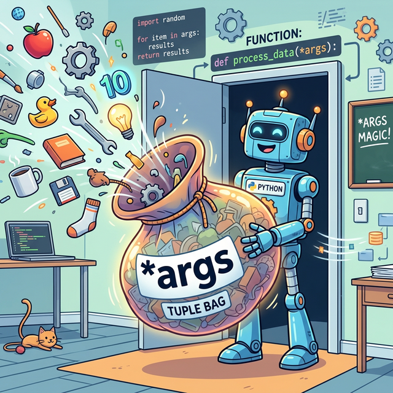
> 💡 **웹툰 비유:** 자신만만한 파이썬 로봇이 함수 문 앞에 서서 `*args`라고 적힌 마법의 거대한 탄성 주머니(튜플)를 벌리고 있습니다. 허공에서 사과, 톱니바퀴, 숫자 10, 스패너 등 온갖 잡동사니 인자(Arguments)들이 날아오는데, 개수나 종류에 상관없이 주머니 하나 속으로 쏙쏙 다 빨려 들어가는 통쾌한 모습입니다.

> 💡 **다이어그램:** `10`, `"Hello"`, `True` 처럼 개수나 모양이 제각각인 인자들이 순서대로 날아와, 함수 머릿단에 선언된 거대한 `*args` 주머니 안에서 하나의 튜플 `(10, "Hello", True)` 형태로 깔끔하게 압축 포장(Packing)되는 메모리 흐름 애니메이션입니다.

위 애니메이션의 과정을 코드로 확인해 보겠습니다. `super_add` 함수는 숫자가 몇 개 들어오든 `*args`라는 튜플 주머니를 열고 전부 받아냅니다.
```python
def super_add(*args):
    # args는 이제 (1, 2, 3, 4, 5) 라는 거대한 하나의 튜플 주머니가 되었습니다!
    total = 0
    for num in args:  # 주머니 안의 숫자를 for문으로 하나씩 꺼내 씁니다.
        total += num
    return total

print(super_add(10, 20))           # 30 출력
print(super_add(1, 2, 3, 4, 5, 6)) # 21 출력 (몇 개든 끄떡없습니다)
```

### 심화 예제: 동적 출석부 만들기
숫자뿐만 아니라, 다양한 길이의 문자열 데이터를 받을 때도 유연하게 대처합니다.
```python
def call_attendance(teacher, *students):
    print(f"\\n[{teacher} 선생님의 반 출석부]")
    if len(students) == 0:
        print(" -> 오늘 출석한 학생이 없습니다.")
    else:
        # enumerate()를 써서 1번부터 인덱스와 함께 추출
        for idx, name in enumerate(students, 1):
            print(f" {idx}번: {name}")

# 학생이 2명일 때
call_attendance("김교사", "철수", "영희")
# 학생이 4명일 때 (에러 없이 가변적으로 주머니에 쏙 들어갑니다!)
call_attendance("박교사", "제시카", "알리", "톰", "세라")
```

---

## 4. 별표 두 개(\*\*): 무한의 `딕셔너리` 주머니 (\*\*kwargs)

위치 인자를 싹쓸이하는 게 `*args`였다면, **키워드 인자(`특정이름=값`)들만 싹 다 긁어모아 거대한 딕셔너리(Dictionary) 포대자루에 담아버리는 녀석**이 바로 **별표 두 개(`**`)**입니다. (관례상 `keyword arguments`의 약자인 `**kwargs`로 씁니다.)

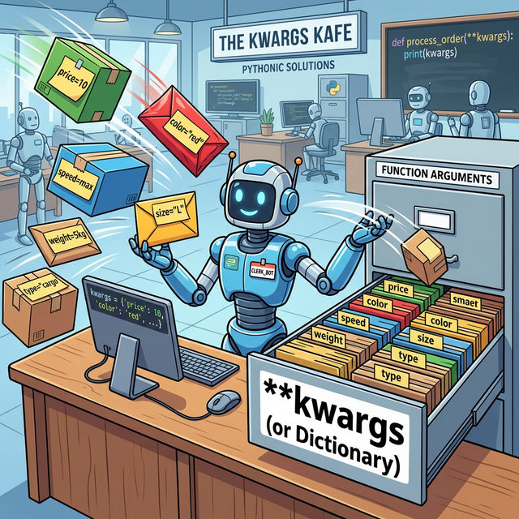
> 💡 **웹툰 비유:** 스마트한 로봇 안내원이 데스크에 서 있습니다. 공중에서 `price=10`, `color=red`, `speed=max`처럼 고유한 이름표(Sticky Note)가 붙은 다양한 택배 상자들이 날아오는데, 안내원은 당황하지 않고 `**kwargs`라고 적힌 대형 캐비닛 서랍장(딕셔너리)을 열어 각 이름표에 맞게 척척 알아서 분류해 넣는 능수능란한 모습입니다.

> 💡 **다이어그램:** 메인 프로그램에서 `color="red"`, `width=100` 처럼 스스로 명찰을 달고 날아오는 키워드 인자들이, 함수의 `**kwargs` 서랍장에 도달하자마자 정확히 `{'color': 'red', 'width': 100}` 형태의 딕셔너리로 차곡차곡 자동 정렬되어 매핑(Packing)되는 시각적 쾌감을 보여주는 애니메이션입니다.

애니메이션에서 보신 것처럼, 아무리 많은 키워드 옵션을 던져도 딕셔너리(`{}`) 형태로 완벽하게 정리됩니다. 이를 코드로 구현해 보겠습니다.
```python
def create_hero(name, **kwargs):
    print(f"\\n--- 영웅 {name} 탄생 ---")
    # kwargs는 이제 {'hp': 100, 'mp': 50, 'weapon': 'Sword'} 라는 딕셔너리가 되었습니다!
    for key, value in kwargs.items():
        print(f" [{key}] 능력치: {value}")

# hp, mp, weapon 등 내가 원하는 스탯을 무한대로 이름 붙여서 마음껏 던질 수 있습니다!
create_hero("아서", hp=1000, mp=50, weapon="엑스칼리버")
```

### 심화 예제: HTML 태그 자동 생성기
속성(Attribute)이 몇 개나 들어올지 모르는 웹 컴포넌트(UI) 코드를 짤 때 `**kwargs`는 최고의 유연성을 뽐냅니다. 파이썬 딕셔너리의 `.get()` 메서드를 써서, 사용자가 값을 안 넘겼을 때는 기본값을 세팅하며 에러 없이 안전하게 핸들링할 수 있습니다.
```python
def make_button(text, **options):
    # **options 딕셔너리에서 값을 꺼내되, 안 들어왔으면 우측의 기본값을 씁니다.
    bg_color = options.get("bg_color", "transparent")
    font_size = options.get("font_size", "14px")
    border = options.get("border", "none")
    
    print(f"\\n<button style='background:{bg_color}; font-size:{font_size}; border:{border};'>")
    print(f"  {text}")
    print("</button>")

# 1. 색상과 폰트 크기만 지정 (테두리는 기본값 none 적용)
make_button("전송하기", bg_color="blue", font_size="16px")

# 2. 테두리 옵션까지 추가 지정 (개발자가 원하는 속성을 끝없이 추가 파라미터로 던집니다!)
make_button("취소", border="1px solid red", font_size="12px", bg_color="white")
```

이렇게 `*args`와 `**kwargs`를 조합하면 전 세계 그 어떤 형태의 미친 입력값이 들어와도 파이썬 함수 하나로 모조리 흡수해 버릴 수 있는 '무적의 블랙박스'를 설계할 수 있게 됩니다.

---

## 🎧 Vibe Coding

> **🗣️ 학생 프롬프트 (AI에게 이렇게 명령해 보세요):**
> "파이썬 가변 매개변수인 `*args`와 `**kwargs`를 둘 다 동시에 하나의 함수에서 사용하는 '영수증 출력기' 함수 코드를 짜줘. `*args`로는 내가 산 물건들의 가격들을 무한대로 받아서 총합을 구하고, `**kwargs`로는 '할인율', '캐시백' 같은 추가 옵션들을 맘대로 받아서 최종 결제 금액을 출력하도록 만들어 줘."

---

## 코딩 영단어 학습 📝

*   **Default**: 기본의, 태만, 채무 불이행. (사용자가 인자를 던져주지 않고 '태만'하게 굴 때를 대비해, 시스템이 대신 깔아주는 기본 방어막 수치입니다.)
*   **Asterisk (`*`)**: 별표, 방사상. (파이썬에서 단순 곱하기 기호를 넘어, 메모리나 인자 덩어리를 팍팍 '방사상' 폭발시키거나(Unpacking) 빨아들이는(Packing) 만능 마법 기호로 쓰입니다.)
*   **Args**: Arguments의 줄임말. (위치에 기반해 들어붙는 흔한 데이터 파편들입니다.)
*   **Kwargs**: Keyword Arguments의 줄임말. (`나이=20` 처럼 스스로 명찰표(Key)를 달고 들어와 딕셔너리($\{Key: Value\}$)로 돌변하는 고급 데이터 묶음입니다.)

---

## 학습목표
본 장에서는 함수 내부 코드와 바깥세상을 엄격히 철창으로 가로막는 메모리 방화벽인 **'변수의 유효 범위(Scope)'** 개념을 익힙니다. 굳게 닫힌 밀실 문을 부수고 전 지역을 통치하는 `global` 키워드의 작동 원리와 그 치명적인 위험성을 함께 파악합니다.

---

## 1. 지역 변수(Local)와 전역 변수(Global)의 격리 생태계

일반적으로 함수(`def`) 안에 선언된 변수들은 바깥의 세상(전역 공간)에 전혀 영향을 주지 않고 철저하게 고립되어 태어났다가 죽습니다.
*   **전역 변수 (Global Variable)**: 코드 파일 전체(함수 바깥)에 노출되어, 파일 내 어디서든(심지어 함수 안에서도 읽는 것은 가능하게) 볼 수 있는 광역 생태계 변수입니다.
*   **지역 변수 (Local Variable)**: 특정 함수라는 작고 좁은 '밀실 안에서만' 잠시 만들어져 쓰이다가, 함수가 일이 끝나고 `return`으로 방을 폭파시킬 때 **흔적도 없이 함께 소멸**해 버리는 일회용 변수입니다.

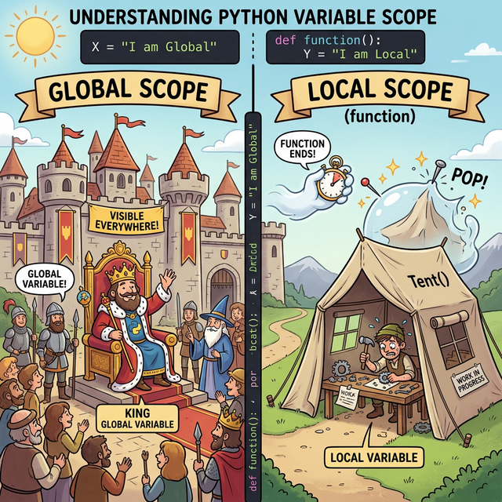
> 💡 **웹툰 비유:** 왼쪽 창밖에는 거대한 성(Global Scope) 안의 왕좌에 전역 변수 왕(`x=100`)이 군림하며 천하를 호령합니다. 반면 오른쪽에는 좁고 임시로 세운 텐트(Local Scope 함수 텐트) 안에서 동명이인의 일꾼 지역 변수(`x=10`)가 땀을 뻘뻘 흘립니다. 이 텐트 안의 일은 바깥 왕에게는 전혀 보이지 않고, 함수 호출이 끝나면 이 텐트와 일꾼은 흔적도 없이 파괴됩니다.

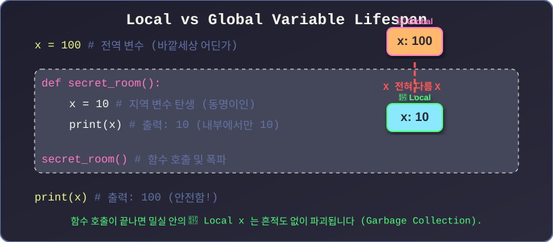
> 💡 **다이어그램:** 메인 프로그램 실행 중에 함수가 호출되면, 잠시동안만 반짝하고 살아나는 파란색 'Local x:10' 블록의 생명주기와 소멸(Garbage Collection) 과정을 보여주는 애니메이션입니다. 이 두 x는 이름만 같을 뿐 철저한 격리벽(`X 다름 X`)으로 차단되어 있습니다.

```python
x = 100  # 이 녀석은 파일 전체를 호령하는 '전역 변수'입니다.

def secret_room():
    # 이 x는 바깥의 전역 변수 x와 이름만 우연히 똑같을 뿐, 
    # 완전히 별개의 메모리에서 태어난 동명이인 '지역 변수'입니다!
    x = 10 
    print(f"밀실 내부의 x: {x}")  # 10 출력

secret_room()
# 밀실이 터지면서 내부의 10은 허공으로 사라졌습니다.
print(f"바깥세상의 x: {x}") # 여전히 100 출력 (바깥쪽 x는 전혀 상처입지 않음)
```

이러한 격리(Isolation)는 프로그램이 거대해질 때, 내가 만든 함수의 내부 로직이 남이 만든 함수나 프로그램 전체의 변수를 실수로 덮어씌워 오염시키는 재앙을 완벽하게 막아주는 최고의 방어벽입니다.

---

## 2. 전역 변수를 강제로 조종하는 만능 열쇠, `global` 키워드

함수는 블랙박스처럼 바깥세상과 단절(격리)되는 것이 원칙이지만, 간혹 함수 안의 복잡한 로직을 타고 난 뒤 함수 바깥 스코프에 있는 전역 변수의 상태를 물리적으로 꼭 영구히 수정해야 하는 예외적인 요구 사항이 발생할 때가 있습니다. (예: 게임 진행도 누적 저장, 전체 시스템의 누적 방문자 수 카운트)

이럴 때는 함수 내부에서 `global` 키워드를 선언하여 **"지금부터 내가 다룰 변수 `x`는, 밀실 내부에서 새로 탄생시키는 쪼렙 지역 변수가 아니라 저 바깥세상을 통치하는 진짜 전역 변수 `x` 본체를 직접 원격 조종하겠다!"** 라고 파이썬에게 선포해야만 합니다.

> 💡 **다이어그램:** 함수 내부에 `global hp` 선언을 하면 밀실의 철창 방어벽이 무너지고, 바깥세상의 `hp 500` 원본 데이터와 해킹 파이프 라인이 다이렉트로 연결(Direct Override)되어, 함수 내부의 데미지 연산 결과가 바깥세상의 원본 수치를 영구적으로 깎아버리는(`430`) 치명적 부작용(?)을 묘사한 애니메이션입니다.

```python
monster_hp = 500 # 전역 변수

def power_attack():
    global monster_hp # 바깥세상의 monster_hp와 영혼을 동기화하는 만능 열쇠!
    
    damage = 70       # 이 damage는 밀실 안에서만 쓰이는 착한 지역 변수
    monster_hp -= damage
    print(f"⚔️ 쾅! 내부에서 타격. 남은 체력: {monster_hp}") 

power_attack()
power_attack()
print(f"바깥에서도 영구적으로 다쳐버린 몬스터 체력: {monster_hp}")

# [출력 결과]
# ⚔️ 쾅! 내부에서 타격. 남은 체력: 430
# ⚔️ 쾅! 내부에서 타격. 남은 체력: 360
# 바깥에서도 영구적으로 다쳐버린 몬스터 체력: 360
```

### 🚨 `global`의 치명적 위험성 (안티 패턴)
`global`을 남발하면 함수가 블랙박스로서의 무결성을 잃어버립니다. 함수 바깥의 변수 상태를 언제 어디서 몰래 찔러서 변형시켰는지 추적하기가 불가능해져서, 코드가 이른바 '스파게티 오염 코드'가 되어버립니다.
따라서 현대 프로그래밍에서는 `global`로 바깥 변수를 직접 훼손하기보다는, 깔끔하게 **결과를 반환(`return`)받아서 바깥에서 변수를 덮어쓰는(재할당)** 방식을 훨씬 안전하게 권장합니다.

---

## 🎧 Vibe Coding

> **🗣️ 학생 프롬프트 (AI에게 이렇게 명령해 보세요):**
> "파이썬의 지역 변수(Local)와 전역 변수(Global)의 차이가 너무 헷갈려. 금고 안에 있는 돈(지역)과 은행에 있는 돈(전역)으로 비유해서, 왜 아무 조치 없이 함수 안에서 바깥에 있는 돈을 마음대로 수정하려고 하면 에러(UnboundLocalError)가 나는지 뼈저리게 느낄 수 있는 나쁜 예시 코드와, 그것을 `global`로 해결한 코드를 나란히 시뮬레이션해 줘."

---

## 코딩 영단어 학습 📝

*   **Scope**: 시야, 범위, 영역. (저격총의 스코프처럼 '내 눈(메모리)이 닿아서 변수를 읽고 다룰 수 있는 유효 반경 범위'를 뜻하는 핵심 용어입니다.)
*   **Global**: 전 세계적인, 전반적인, 전역의. (프로그램 생태계 전체를 호령하는 범우주적인 바깥쪽 메모리 공간입니다.)
*   **Local**: 지역의, 현지의. (함수라는 작고 좁은 방구석 한정으로만 잠시 존재했다 소멸해버리는 찰나의 휘발성 메모리 공간입니다.)
*   **Isolation**: 고립, 격리. (병원에서 병균을 격리하듯, 함수 내부의 코드가 바깥 시스템을 오염시키지 않도록 철창에 가두는 훌륭한 공학적 기법입니다.)

---

## 학습목표
본 장에서는 초급자를 벗어나 중급자로 도약하는 산맥 중 하나인 **람다(Lambda)** 함수의 극강의 활용도를 해부합니다. 이름조차 붙이지 않고 쓰고 버리는 강력한 일회용 함수의 원리와, 컴퓨터 과학에 람다 대수(Lambda Calculus)를 창시한 알론조 처치(Alonzo Church)의 수학적 배경도 함께 알아봅니다.

---

## 1. 이름 없는 마법의 한 줄 문장, 람다 (Lambda)

함수(`def`)가 너무 거창하고 무겁게 느껴질 때가 있습니다. 코드가 단 1줄에 그치는 매우 시시한 계산식인데 굳이 `def` 키워드를 쓰고, 들여쓰기를 하고, 함수 이름을 작명하느라 골머리를 앓는 대신 **이름표조차 붙이지 않고 쓰고 버리는 강력한 일회용 함수**가 바로 람다(Lambda)입니다. 

### 왜 '익명 함수'라고 안 부르고 '람다'라고 부를까요?

"이름 없는 함수(Anonymous Function)와 똑같은 말인데, 왜 하필 람다(Lambda)라는 외계어 같은 이름을 고집하나요?" 코딩을 갓 배운 학생들이 가장 많이 던지는 질문입니다.

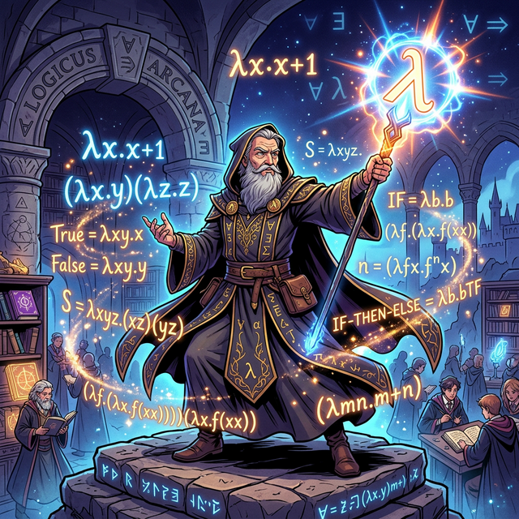
> 💡 **웹툰 비유:** 고대의 위대한 천재 마법사 수학자 '알론조 처치(Alonzo Church)' 형상의 RPG 마법사가 번쩍이는 그리스 문자 람다(λ) 지팡이를 들고 있습니다. 그의 주변에는 무거운 기계어가 아닌, 순수한 논리 그 자체인 수학 공식 `λx.x+1`이 허공에 떠 있습니다.

이 독특한 이름은 1930년대, 컴퓨터가 존재하기도 전에 활동했던 미국의 천재 수학자 **알론조 처치(Alonzo Church)**의 구상에서 유래했습니다. 그는 모든 가능한 계산을 오직 **'이름 없는 수학적 함수 매핑'**만으로 논리적으로 증명하기 위해 **람다-대수(Lambda Calculus)**라는 무시무시한 논리 체계를 창시했습니다. 이때 그는 함수 매개변수를 묶어주는 기호로 그리스 문자 람다(λ)를 썼습니다.

현대 컴퓨터 과학자들은 이 위대한 선구자의 수학적 업적에 대한 오마주(존경)를 바치기 위해, 파이썬을 포함한 수많은 언어에서 '익명 함수'를 만들 때 `lambda` 키워드를 고유 명사처럼 사용합니다.

### 일반 함수(def) vs 람다 익명 함수(lambda)의 생명주기 차이

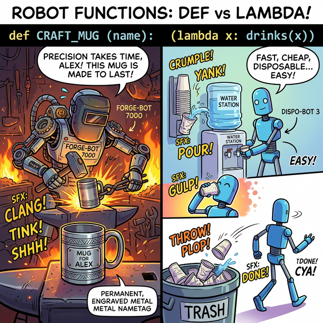
> 💡 **웹툰 비유:** 왼쪽 로봇은 철심을 깎아 평생 쓸 무겁고 고급스러운 커스텀 스텐 머그잔(def 함수)을 이름표까지 붙여 정성스레 만들고 있습니다. 반면 오른쪽 로봇은 정수기 옆에 쌓인 싸구려 일회용 종이컵(lambda 익명 함수)을 툭 뽑아 물을 단숨에 마신 뒤, 미련 없이 쓰레기통에 쿨하게 버려버립니다.

1.  **일반 함수(`def`)**: 메모리 상에 자기 이름표를 달고 **영구적인 방**을 얻어 거주합니다. 부르면 튀어나와서 일을 합니다. 
2.  **람다 함수(`lambda`)**: 이름표가 없어 메모리 주소록에 등록되지 않습니다. 결괏값을 뱉자마자 **흔적도 없이 소멸(Garbage Collected)**해 버립니다. 

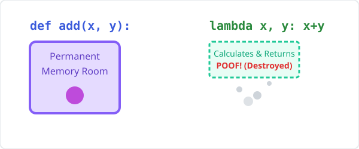
> 💡 **다이어그램:** 위쪽의 `def add(x,y)`는 보라색 영구 메모리 방을 만들어 대기하다 결과를 주는 과정입니다. 아래쪽의 `lambda x, y: x+y`는 함수 상자가 메모리에 둥지를 틀기도 전에 점선으로 허공에 순식간에 나타났다가 `7`을 뱉는 순간 파스슥 하고 연기처럼 증발해버리는 경쾌한 흐름입니다.

---

## 2. 람다 함수 선언과 극강의 활용법

### 기본 문법 (단 1줄 규칙)
람다 함수는 오직 한 줄(One-liner)로만 작성해야 하며, 그 자체가 자동으로 반환값(`return`)이 되기 때문에 `return`이라는 글자조차 적을 수 없습니다.

```python
# 람다 방식 (1줄, 익명)
# lambda 매개변수: 뱉어낼 수식
lambda_add = lambda x: x + 10
print(lambda_add(5)) # 15
```

### 진정한 람다의 무대: 일급 객체로서의 인자 전달
사실 람다에 `lambda_add` 변수 이름을 붙일 거면 `def`를 쓰는 게 낫습니다. 람다 함수가 진짜 미친 듯한 위력을 발휘할 때는, **함수의 인자(Argument)로 또 다른 함수 몸통을 통째로 쑤셔 넣어야 할 때**입니다. (파이썬이 함수를 변수 취급하는 일급 객체 시스템이기에 가능합니다.)

```python
students = [('Alice', 85), ('Bob', 95), ('Charlie', 70)]

# "튜플의 1번째 원소(점수 x[1])를 기준으로 정렬해줄래?" 
# 아주 작고 귀찮은 기준 함수를 1회용 람다로 휙 던져줍니다.
students.sort(key=lambda x: x[1], reverse=True)

print(students)
# [('Bob', 95), ('Alice', 85), ('Charlie', 70)] 점수순 정렬 완벽 성공!
```

---

## ☕ Java vs 🐍 Python 스나이퍼 비교

### 1. 람다 표현식의 직관성 (익명 클래스 제거)
*   **Java**: 7버전까진 이름 없는 함수를 만들려면 `new Runnable() { public void run() { ... } }` 이라는 끔찍한 코드를 주절주절 읊어야 했습니다. (8버전부터 `(x) -> x + 10` 같은 람다식 표기법이 부랴부랴 도입되었습니다.)
*   **Python**: 태생부터 함수를 일급 객체(First-class citizen)로 다뤄왔기에, 단어 하나 `lambda`로 코드의 극강 다이어트를 실현시켜 줍니다.

---

## 코딩 영단어 학습 📝

*   **Anonymous**: 익명의, 이름을 알 수 없는. (함수에 이름표를 주지 않고 복면을 씌워 한 번 쓰고 버리는 은밀한 파이썬의 기술입니다.)
*   **Lambda**: 람다, 그리스 알파벳 (λ). (수학자 알론조 처치가 서기 1930년대에 고안한 '이름 없는 마법의 함수 대수학'을 기리기 위해 프로그래머들이 채택한 전설적인 단어입니다.)

---

## 학습목표
본 장에서는 함수가 거울 속의 자신을 보듯 자기 자신을 끝없이 호출하는 마법 같은 패턴이자, 폴더 속의 폴더를 뒤지는 트리 탐색의 근간이 되는 **재귀(Recursion)**의 원리를 상세히 정복합니다. 콜 스택(Call Stack)의 동작 방식과 종료 조건(Base Case)의 중요성을 이해합니다.

---

## 1. 궁극의 마법: 재귀 함수 (Recursive Functions)

함수 챕터의 진정한 최종 보스는 **재귀(Recursion)**입니다. 재귀 함수란 **"함수 내부에서 뜬금없이 자기 자신을 또 다시 부르는 함수"**를 뜻합니다.


> 💡 **웹툰 비유:** 대장 로봇이 배를 열더니 살짝 작은 자신의 클론 로봇을 꺼냅니다. 그 클론이 다시 자기 배를 열어 더 작은 클론을 꺼내고... 무한 반복하다 구석의 콩알만 한 막내 로봇이 "어? 난 배터리(Base Case)가 있네?" 라며 거꾸로 형들에게 에너지를 넘겨주어 마침내 대장 로봇이 기동됩니다.

### 콜 스택 (Call Stack)과 종료 조건
자기 자신을 계속 부르게 되면 메모리에 함수들이 탑처럼 쌓이다 터져버립니다(`RecursionError`). 따라서 재귀 함수를 만들 때는 **"이 조건이 되면 그만 파고들고 돌아가자!"**라는 철저한 제동 장치, 즉 **종료 조건(Base Case)**을 반드시 만들어 두어야 합니다.

수학의 '팩토리얼(Factorial, 5! = 5 * 4 * 3 * 2 * 1)' 연산이 가장 완벽한 예시입니다.

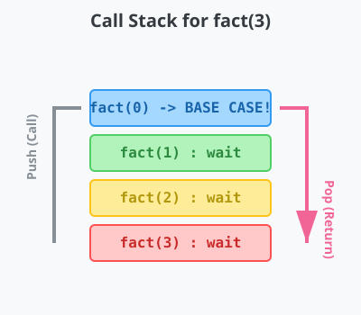
> 💡 **다이어그램:** `fact(3)`이 완료되려면 `fact(2)`를 부르고, `fact(2)`는 `fact(1)`을 부르며 스택을 파고들어 갑니다(Push). 마침내 `fact(0)`이 종료 조건(Base Case)을 만나 숫자 `1`을 확정 짓고 위로 돌려주면, 멈춰있던 형들이 거꾸로 올라가며 연쇄 곱셈을 터뜨리며(Pop) 최종 답을 들고 폭포수처럼 돌아옵니다.

```python
def factorial(n):
    # 1. 절대 잊어선 안되는 브레이크 (Base Case)
    if n <= 0:
        return 1 
    
    # 2. 크기(n)를 1칸씩 줄여가며 자기 자신을 향해 끝없이 다이브합니다.
    return n * factorial(n - 1) 

print("3 팩토리얼의 결과:", factorial(3))
```

처음엔 헷갈리지만, 윈도우의 '폴더 속의 폴더 속의 폴더'를 탐색(트리 탐색)할 때 이 재귀 함수의 위력은 상상을 초월하게 우아합니다.

---

## 🎧 Vibe Coding

> **🗣️ 학생 프롬프트 (AI에게 이렇게 명령해 보세요):**
> "재귀 함수(Recursion)의 개념을 이용해서 1부터 내가 입력한 숫자 N까지의 합을 차례대로 구하는 파이썬 코드를 짜줘. 단, 메인 로직이 파고들 때마다 `N이 3일 때 진입`, `N이 2일 때 진입` 같은 상태를 print 문으로 콘솔에 전부 찍어줘. 콜 스택에 함수가 겹겹이 쌓이는 걸 내 눈으로 직접 볼 수 있게 말이야."

---

## 코딩 영단어 학습 📝

*   **Recursion**: 재귀, 되풀이. (라틴어 currere(달리다)에 re(다시)가 붙어, 왔던 길을 다시 되짚어 밑바닥까지 달린다는 뜻입니다. 마트료시카 인형을 까는 행위입니다.)
*   **Base Case**: 기저 조건, 바닥 조건. (재귀 함수가 무한 루프의 늪에 빠져 터지기(Stack Overflow) 직전에, 바닥을 치고 수면 위로 솟구쳐 오르게 살려주는 유일한 생명줄 점프 조건문입니다.)

---

## 학습목표
본 장에서는 별도 패키지 설치 없이 파이썬이 기본 탑재하고 있는 강력하고 유용한 뼈대 수공구들인 **내장 함수(Built-in Function)**와, 각각의 데이터 공장(객체)이 지원하는 전용 **메서드(Method)**를 두루 익힙니다. 이 도구들을 능숙하게 다루는 것이야말로 진정한 파이썬 코더로 거듭나는 기초 체력입니다.

---

## 1. 든든한 다용도 공구함: 파이썬 내장 함수

파이썬은 무거운 패키지나 모듈을 (`import math` 처럼) 별도로 부르지 않아도 언제 어디서나 즉시 뽑아 쓸 수 있는 수많은 **내장 함수(Built-in Function)**를 기본으로 대여해 줍니다. 


*(웹툰 비유: 거대하고 번쩍이는 최고급 만능 공구함이 열려 있습니다. 그 안에는 평범한 렌치나 망치 대신 `print()`, `len()`, `max()`, `type()` 이라는 이름표가 빛나는 최첨단 마법 도구들이 꽉 차 있습니다. 귀여운 파이썬 정비공 스네이크가 `len()` 줄자를 쫙 뽑아 들고 엄지를 척 들어 올리며 "이건 무료 기본 템이야!"라고 외치고 있습니다.)*

이 공구들은 여러분이 파이썬을 설치하는 바로 그 순간부터 메모리 한편에 항시 대기하고 있습니다.

### 대표적인 내장 함수 총정리 표

| 분류 | 함수 이름 | 기능 설명 | 사용 예시 |
| :--- | :--- | :--- | :--- |
| **입출력** | `print()` | 콘솔 화면에 데이터를 예쁘게 출력합니다. | `print("Hello!")` |
| | `input()` | 사용자의 키보드 타이핑 값을 문자열(`str`)로 받아옵니다. | `ans = input("나이: ")` |
| **통계/수학** | `max()` / `min()` | 여러 값들 중 가장 큰 값 / 가장 작은 값을 즉시 뽑아냅니다. | `max(10, 50, 3)` $\rightarrow$ 50 |
| | `abs()` | 숫자의 부호를 떼버린 순수한 거릿값(절댓값)을 반환합니다. | `abs(-99)` $\rightarrow$ 99 |
| | `round()` | 지정한 소수점 자리에서 반올림을 깔끔하게 처리합니다. | `round(3.1415, 2)` $\rightarrow$ 3.14 |
| | `sum()` | 리스트나 튜플 안에 들어있는 모든 숫자를 싹 다 더해줍니다. | `sum([1, 2, 3])` $\rightarrow$ 6 |
| **정보 파악** | `len()` | (Length) 문자열의 길이나 리스트의 데이터 개수를 잽니다. | `len("Python")` $\rightarrow$ 6 |
| | `type()` | 이 데이터가 도대체 정수인지, 문자인지, 딕셔너리인지 **근본 족보(타입)**를 감별해 냅니다. | `type(3.14)` $\rightarrow$ `<class 'float'>` |

> [!NOTE] 
> **기본 내장 수학 함수(`abs`, `round`, `max` 등) vs `math` 모듈?**
> 일상적인 가벼운 계산(반올림, 최댓값)은 파이썬이 기본 제공하는 위 표의 내장 함수들로 충분합니다. 하지만 게임 물리 엔진을 짜거나 데이터의 로그(log), 삼각함수(sin, cos)를 다루는 전문 공학 계산을 하려면, 다음 장에서 배울 강력한 전용 공구함인 **`math` 모듈**을 수입(`import`)해 와야 합니다.

---

## 2. 데이터의 껍데기를 벗기는 마법: 캐스팅 (Type Casting)

**캐스팅(Casting)** 은 데이터의 근본 자료형을 강제로 다른 자료형으로 뒤바꾸는(마치 뱀이 허물을 벗듯) 마법 같은 내장 함수들입니다.
특히 `input()`으로 사용자에게 받은 숫자는 겉보기엔 숫자여도 컴퓨터는 **문자열(글자)**로 취급하기 때문에 곱하기, 나누기를 하려면 반드시 캐스팅 기계에 한 번 넣었다 빼야 합니다.

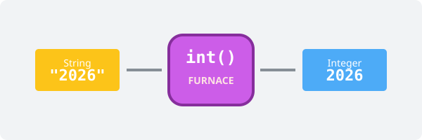
*(다이어그램: 컨베이어 벨트를 타고 들어오는 분홍색 `"2026"`이라는 문자열 상자가 있습니다. 이 상자가 중간에 있는 거대한 보라색 `int()` 숫자 변환기 용광로 안으로 들어갑니다. 용광로가 한바탕 가동되더니, 반대쪽 컨베이어 벨트로는 완전히 껍데기가 벗겨진 파란색 순수 수학 정수 `2026` 상자가 튀어나오는 역동적인 형 변환 과정입니다.)*

| 캐스팅 함수 | 변환 목표 | 기능 설명 및 예방 효과 | 예시 |
| :--- | :--- | :--- | :--- |
| `int(값)` | **정수형** | 문자로 된 "100"이나 소수점 "3.14"를 깔끔한 정수로 강제 변환합니다. | `int("50") + 10` $\rightarrow$ 60 |
| `float(값)` | **실수형** | 정수나 문자를 소수점이 달린 정밀한 실수로 확장합니다. | `float(3)` $\rightarrow$ 3.0 |
| `str(값)` | **문자형** | 숫자를 문자로 포장합니다. (숫자와 문자를 `+`로 이어 붙일 때 에러 방지용) | `"올해는 " + str(2026)` |
| `bool(값)` | **논리형** | 값이 비어있거나 0이면 `False`, 뭐라도 꽉 차 있으면 `True`로 극단적 판별을 합니다. | `bool("")` $\rightarrow$ False |

```python
# [위험!] 에러가 나는 흔한 초보자 코드
age_str = input('당신의 나이는? (예: 15) : ')
# print(age_str + 5) # 🚨 에러 폭발! "15"(문자) 와 5(숫자)는 서로 더할 수 없습니다!

# [안전!] 캐스팅(형 변환)을 거친 완벽한 코드
age_num = int(age_str)  # 마법의 캐스팅
print(f"5년 뒤 당신의 나이는 {age_num + 5}세 입니다.")
```

---

## 3. 객체들의 전용 필살기: 메서드 (Method)

내장 함수가 '누구에게나 평등하게 쓰이는 공용 도구'라면, **메서드(Method)**는 리스트, 딕셔너리, 문자열 같은 **각각의 데이터 성(Castle)에 소속된 전속 마법사(전용 함수)**입니다.
반드시 객체 뒤에 마침표(`.`)를 찍어서 호출합니다. 

### ① 문자열(`str`) 전용 메서드
글자를 깔끔하게 가공하거나 쪼개고 합칠 때 사용하는 텍스트 다듬기 전용 필살기들입니다.

| 메서드 형태 | 설명 | 실전 예제 |
| :--- | :--- | :--- |
| `.upper()` / `.lower()` | 모든 문자를 무자비하게 대문자/소문자로 밀어버립니다. | `"Hi".upper()` $\rightarrow$ `"HI"` |
| `.replace(old, new)` | 타겟 단어(`old`)를 찾아내 새로운 단어(`new`)로 전부 갈아 끼웁니다. | `"사과 좋아".replace("사과", "수박")` |
| `.split(구분자)` | 하나의 거대한 문장을 특정 기호(구분자)로 난도질하여 **리스트(List)**로 쪼개줍니다. | `"A,B,C".split(",")` $\rightarrow$ `['A', 'B', 'C']` |
| `.strip()` | 실수로 양쪽에 끼어 들어간 지저분한 공백이나 엔터키를 세차하듯 날려버립니다. | `"  안녕  ".strip()` $\rightarrow$ `"안녕"` |

### ② 리스트(`list`) 전용 메서드
데이터를 줄 세우고, 추가하고, 도려내는 창고 정리 전용 필살기입니다.

| 메서드 형태 | 설명 | 실전 예제 |
| :--- | :--- | :--- |
| `.append(값)` | 리스트 맨 끝 꼬리에 새로운 데이터를 조용히 밀어 넣습니다. | `lst.append(99)` |
| `.remove(값)` | 리스트 속에서 정확히 그 '값'을 찾아내 흔적도 없이 지워버립니다. | `lst.remove("스팸")` |
| `.pop(인덱스)` | 지정한 위치(혹은 맨 뒤)의 아이템을 리스트에서 완전히 도려내어 바깥으로 '반환(툭!' 하고 뱉음)'합니다. | `last_item = lst.pop()` |
| `.sort()` | 리스트 내부를 쑥대밭에서 오름차순(기본) 이나 내림차순으로 아주 예쁘게 재정렬합니다. | `lst.sort(reverse=True)` |

---

## ☕ Java vs 🐍 Python 스나이퍼 비교

### 1. 전역 내장 함수의 유무
*   **Java**: 철저한 객체지향의 노예이기 때문에 전역 함수라는 개념 자체가 없습니다. 최댓값을 구하려면 `Math.max()`, 출력을 하려면 `System.out.println()`, 문자열 변환은 `String.valueOf()` 처럼 무조건 어떤 "클래스(Class)" 소속인지를 읊어야 하는 지독한 소속감에 시달립니다.
*   **Python**: `print()`, `max()`, `len()` 은 그 어떤 클래스에도 소속되지 않은 자유로운 전역 내장 함수입니다. 코드 타이핑의 피로도가 압도적으로 줄어듭니다.

### 2. 형 변환 (Casting)의 철학
*   **Java**: 소괄호를 앞에 붙여 `(int) 3.14` 처럼 캐스팅하는 무뚝뚝한 문법 이외에도, `Integer.parseInt("100")` 같이 파싱 유틸리티를 뒤져야 하는 복잡함이 있습니다.
*   **Python**: 데이터 타입 이름 자체가 하나의 거대한 함수처럼 동작합니다. `int("100")`, `float(3)`, `str(99)` 처럼 타입의 이름을 부르는 것만으로 그 타입으로 새로 태어나는(객체 생성) 아주 직관적이고 강력한 철학을 가집니다.

---

## 🎧 Vibe Coding

> **🗣️ 학생 프롬프트 (AI에게 이렇게 명령해 보세요):**
> "파이썬에서 `input()`을 이용해서 여러 개의 숫자들을 쉼표(,)로 구분지어서 한 번에 입력받게 해줘. (예: `10, 50, 20, 90`) 그리고 이 문자열을 문자열 메서드인 `.split()`으로 쪼개서 리스트로 만든 다음, 리스트의 원소들을 싹 다 `int()` 내장 함수로 예쁘게 캐스팅 숫자로 바꿔줘. 마지막으로 내장함수 `max()` 와 `min()`, `sum()`을 써서 최댓값, 최솟값, 총 숫자의 합계를 한 번에 깔끔하게 출력하는 코드를 짜줘. 주석도 재밌게 달아주고!"

---

## 코딩 영단어 학습 📝

*   **Built-in**: 내장된, 안에 박혀있는. (따로 외부에서 물건을 사 오거나(Import) 조립할 필요 없이, 파이썬 설치 패키지 상자 안에 태생적으로 붙어있는 기본 도구들을 지칭합니다.)
*   **Method**: 방법, 체계적인 방식. (단순한 함수(Function)가 아니라, 어떤 주체(객체)가 특정 목적을 달성하기 위해 보유한 '그 녀석만의 전용 기술이나 동작 방식'이라는 강한 소속감을 내포합니다.)
*   **Cast (Casting)**: 원형(거푸집)에 쇳물을 부어 모양을 뜨다, 캐스팅하다. (원래 모양이 어떻든 간에 내가 원하는 새로운 틀(예: int틀, str틀)에 집어넣어 완전히 새로운 성질의 데이터로 찍어내는 강제 물성 변환 작업입니다.)
*   **Strip**: 옷을 벗다, 껍질을 벗기다. (원목 문장 데이터의 양옆에 덕지덕지 붙어 보호지 역할을 하고 있는 공백("  ")이나 엔터키("\n")라는 껍질을 시원하게 확 벗겨버리는 세차장 같은 메서드입니다.)

---

## 학습목표
본 장에서는 남들이 피땀 흘려 만들어 놓은 코드를 재사용하는 **'모듈(Module)'**과 **'라이브러리(Library)'**의 짜릿한 개념을 비유를 통해 아주 직관적으로 확립합니다. 그리고 파이썬 기본 탑재 모듈 중 하나인 `math`를 내 코드로 당겨와(`import`), 직접 짜기 힘든 강력한 수학 공식들을 손쉽게 가져다 쓰는 방법을 세부 챕터별로 심도 있게 익힙니다.

---

## 📚 세부 학습 목차

### [3.3.11.1 기본 산술, 통계 및 반올림 (math)](#33111-기본-산술-통계-및-반올림-math)
기본 스펙트럼의 `abs`나 `round`와는 차원이 다른, `math.fabs()`와 극한의 올림/내림/버림 통제 함수(`ceil`, `floor`, `trunc`)들의 작동 원리를 Matplotlib 계단 그래프 시각화와 함께 학습합니다. 최대공약수와 팩토리얼 연산도 다룹니다.

### [3.3.11.2 거듭제곱과 로그 (math)](#33112-거듭제곱과-로그-math)
수치의 폭발적인 팽창(지수, $x^2$)과 극단적인 압축(로그, $\sqrt{x}$)을 담당하는 스케일 변환의 핵심 함수들을 배웁니다. 피타고라스의 정리를 활용한 유클리드 거리 공식 실전 예제와 함수 곡선들의 시각화를 확인합니다.

### [3.3.11.3 기하학 및 삼각함수 (math)](#33113-기하학-및-삼각함수-math)
컴퓨터 그래픽스와 물리 엔진 파동 주기 계산의 기반이 되는 원주율(`pi`), 자연상수(`e`), 그리고 `sin`, `cos` 파동의 실체와 360분법 각도(Degree)를 수학의 진짜 언어(Radian)로 호환시키는 방법을 마스터합니다.

---

## 바퀴를 다시 발명하지 마라 (Don't reinvent the wheel)

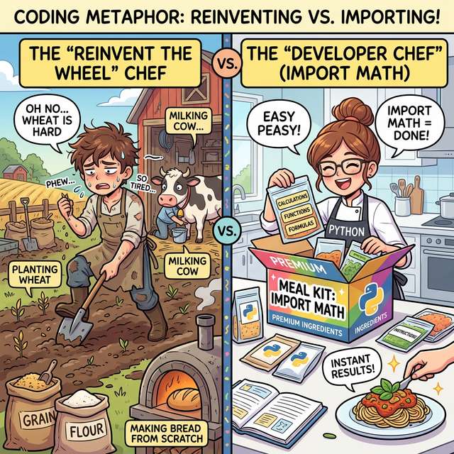
> 💡 **웹툰 비유:** 빵을 만들기 위해 밀농사부터 짓는 고생스러운 방법과, 훌륭하게 구성된 조립/요리 세트(`import math`) 밀키트 상자를 주문해서 바로 완성하는 편안함을 대비시켜 보여줍니다. 모듈은 바로 이 '조립 밀키트'입니다!

이미 전 세계의 엄청난 개발자들이 만들어 놓은 훌륭한 도구들이 있습니다. 우리는 직접 복잡한 수식이나 알고리즘을 전부 구현할 필요 없이 `import` 키워드로 불러오기만 하면 됩니다.
마치 요리사가 식재료 농사부터 소스 제조까지 전부 다 수작업 하는 대신, 잘 손질된 훌륭한 **'밀키트'**를 사 와서 조리만 하는 것과 같습니다.

---

## 정리
프로그래머의 가장 위대한 덕목은 역설적이게도 '게으름(중복되는 코딩 수고로움을 거부하는 것)'입니다. 이미 발명된 둥근 바퀴를 처음부터 다시 깎아내려 하지 말고, 단 한 줄의 `import` 주문을 통해 수만 명의 선배 천재 개발자들이 미리 검증해 놓은 훌륭한 부품(모듈/라이브러리)을 조립식 장난감처럼 합치는 거인의 어깨 위에 서는 방법을 배웠습니다. 파이썬 기본 제공 `math` 모듈은 그 무한한 외부 생태계(Pandas, Scikit-Learn 등)로 들어가는 짜릿한 첫 경험이자 발판에 불과합니다.

---

## ☕ Java vs 🐍 Python 스나이퍼 비교

### 1. 외부 기능 불러오기 (Import)
*   **Java**: `import java.util.Scanner;` 처럼 클래스나 패키지 경로를 선언해 주고 빌드 시 포함시킵니다. 수학 관련 내장 클래스인 `Math`는 `import` 없이 `Math.sqrt()` 형태로 전역적으로 기본 제공됩니다.
*   **Python**: `import math` 명령어 하나로 별도의 파이썬 파일(.py)에 있는 모든 기능을 현재 내 도화지 위로 쏟아붓습니다. 

### 2. 별명(Alias) 지정하기
*   **Java**: 파일명 중복을 피하기 위한 별명 지정 모듈 임포트 기능이 자체적으로 존재하지 않으며, 전체 경로를 명시해야 합니다.
*   **Python**: `import math as m` 처럼 `as 별명` 키워드를 써서 타이핑 길이를 획기적으로 줄일 수 있습니다. 데이터 과학의 국룰인 `import numpy as np`, `import pandas as pd`가 모두 이 문법에서 나옵니다.

---

## 🎧 Vibe Coding

이제는 라이브러리를 직접 만들고 배포하는 생산자가 되어 보세요.

> **🗣️ 학생 프롬프트 (AI에게 이렇게 명령해 보세요):**
> "파이썬에서 내가 직접 `my_calculator.py`라는 모듈(파일)을 만들고, 거기에 덧셈/뺄셈 함수를 넣은 뒤, 메인 실행 파일에서 `import`해서 사용하는 방법을 중학생 수준에서 스텝바이스텝으로 그림 그리듯 자세히 알려줘."

---

## 코딩 영단어 학습 📝

*   **`Module`**: 모듈, 교체 가능한 독립적인 부품. (레고 블록 하나하나를 뜻합니다. 파이썬에서는 남이 만들어 놓은 `.py` 텍스트 코드 파일 한 장을 의미합니다.)
*   **`Library`**: 도서관. (파이썬에서는 쓸만한 모듈(책)들을 용도별로 잘 모아놓은 상자(도서관)를 뜻합니다.)
*   **`Import`**: 수입하다, 밖에서 안으로 가져오다. (외부에 있는 모듈이나 라이브러리의 기능들을 현재 내 코드 화면 안으로 끌어당겨 오는 역할을 하는 필수 마법 주문입니다.)

---

## 학습목표
`math` 모듈이 제공하는 기본적인 산술 연산, 절댓값, 팩토리얼 등 통계 기능과 더불어 소수점을 정밀하게 제어하는 '올림, 내림, 버림' 함수들의 정확한 메커니즘을 시각적으로 학습합니다.

---

## 1. 기본 산술 및 통계 함수 (숫자 다듬기)

통계나 확률 등을 계산할 때 기본 내장 함수만으로는 부족한 정밀한 계산들을 도와주는 핵심 함수들입니다.


> 💡 **웹툰 비유:** 파이썬 뱀 정비공이 거대한 마법 팩토리얼 기계 레버를 당기자 박스들이 기하급수적으로 복사되어 쏟아지고, 다른 한쪽에서는 두 숫자가 거의 같은지 미세한 레이저 저울(`isclose`)로 암호를 풀고 있는 공학 연구소의 역동적인 모습입니다.

### 1. 절댓값 (fabs)과 오차 없는 비교 (isclose)

*   **`math.fabs(x)`**: 절댓값을 구합니다. 기본 `abs()`와 달리 무조건 실수형(`float`)으로 반환합니다.
*   **`math.isclose(a, b)`**: 컴퓨터는 0.1+0.2를 0.3으로 정확히 인식하지 못하고 $0.30000000000000004$ 로 계산하는 치명적인 부동소수점 오차를 가집니다. 이를 안전하게 비교할 때 필수적입니다.

```python
import math

# 1. 실수 변환 절댓값
print("fabs(-5.5):", math.fabs(-5))  # 5.0 (결과가 무조건 float 5.0)

# 2. 부동소수점 오차 비교 (중요!)
print("0.1 + 0.2 == 0.3:", 0.1 + 0.2 == 0.3)  # False (부동소수점 오차 때문에 다름!)
print("isclose(0.1+0.2, 0.3):", math.isclose(0.1 + 0.2, 0.3))  # True (오차 범위를 인정하고 같다고 판별)
```

### 2. 팩토리얼 (factorial)과 연속 곱셈 (prod)

수학적 확률이나 조합의 경우의 수를 구할 때 숫자가 미친 듯이 불어나는 연산입니다.

> 💡 **다이어그램:** $5!$ 의 계산 과정을 보여줍니다. $5 \times 4 \times 3 \times 2 \times 1$ 의 상자들이 연쇄적으로 등장하여 하나로 합쳐지며 거대한 $120$ 이라는 결괏값을 폭발적으로 뿜어냅니다.

```python
import math

# 1. 팩토리얼 (1부터 N까지의 모든 정수 곱)
print("5! (Factorial):", math.factorial(5))  # 120 (5 * 4 * 3 * 2 * 1)

# 2. 리스트 내부 요소 전체 곱 (prod)
numbers = [2, 3, 4]
print("[2,3,4]의 전체 곱:", math.prod(numbers))  # 24 (2 * 3 * 4)
```

### 3. 최대공약수 (gcd)와 최소공배수 (lcm)

분수를 약분하거나, 일정 주기로 반복되는 패턴이 처음 만나는 지점을 계산할 때 씁니다.

> 💡 **다이어그램:** $12$ 와 $16$ 두 숫자의 약수와 배수가 충돌하는 모습을 시각화했습니다. 둘의 가장 큰 공통 약수인 $4$(GCD)가 추출되어 나오고, 둘이 동시에 만나는 가장 작은 배수인 $48$(LCM)로 쭉 뻗어나가는 과정입니다.

```python
import math

# 1. 최대공약수 (Greatest Common Divisor)
print("12와 16의 최대공약수:", math.gcd(12, 16))  # 4

# 2. 최소공배수 (Least Common Multiple - Python 3.9+)
print("12와 16의 최소공배수:", math.lcm(12, 16))  # 48
```

---

## 2. 천장, 바닥, 그리고 무자비한 절단 (올림/내림/버림)

수많은 소수점 데이터들을 통계적으로 단정하게 다듬기(Rounding) 위해 세 가지 함수를 사용합니다. 일반 내장 함수 `round()`가 일상적인 반올림 용도라면, 아래 함수들은 물리 엔진이나 UI 픽셀 계산 등 특정 수학 세계관에서 '단호하고 확실한 기준치'를 세울 때 쓰는 극단적인 절단 함수들입니다.

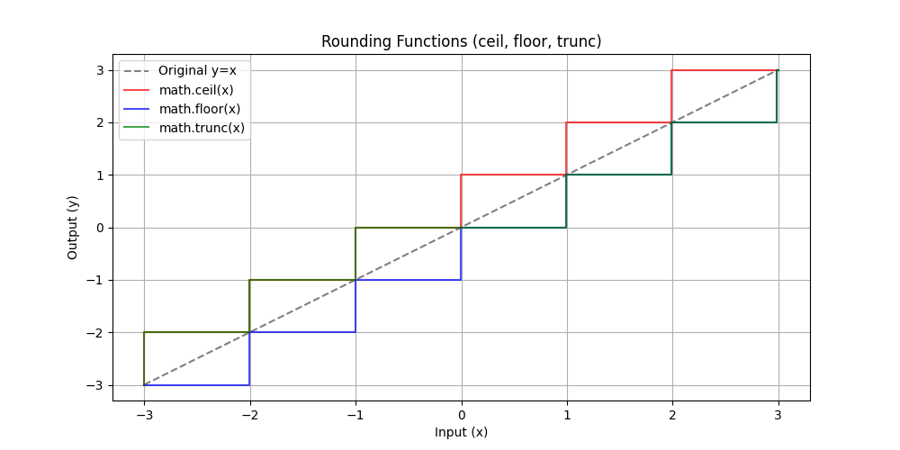
> 💡 **다이어그램(Matplotlib):** 
> *   `math.ceil()` (빨간색 계단): 회색 원래의 선보다 항상 위쪽에 그려집니다. 값을 엘리베이터 천장 층으로 강제로 끌어올립니다.
> *   `math.floor()` (파란색 계단): 회색 원래의 선보다 항상 극단적으로 아래쪽에 있습니다. 무거운 중력으로 바닥 층으로 끌어내립니다.
> *   `math.trunc()` (초록색 계단): 위/아래 방향성은 무시하고 $0$에 가까워지는 방향으로 소수점만 칼로 무자비하게 단칼에 베어 버립니다.

1. **`math.ceil(x)` (올림)**: Ceiling(천장)의 약자로, 자기 자신보다 **크거나 같은 가장 작은 정수**로 무조건 올려버립니다.
2. **`math.floor(x)` (내림)**: Floor(바닥)의 약자로, 자기 자신보다 **작거나 같은 가장 큰 정수**로 무조건 내려버립니다.
3. **`math.trunc(x)` (버림)**: Truncate(자르다)의 약자로, 양수든 음수든 무조건 소수점을 싹둑 잘라냅니다.

```python
import math as m

# 1. math.ceil (올림: 상승!)
print(f"3.1의 올림: {m.ceil(3.1)}")    # 4
print(f"-3.7의 올림: {m.ceil(-3.7)}")  # -3 

# 2. math.floor (내림: 하강!)
print(f"3.7의 내림: {m.floor(3.7)}")   # 3
print(f"-3.1의 내림: {m.floor(-3.1)}") # -4 

# 3. math.trunc (절사: 방향 무시 소수점 삭제)
print(f"3.999의 절사: {m.trunc(3.999)}")    # 3
print(f"-3.999의 절사: {m.trunc(-3.999)}")  # -3
```

---

## 📊 Matplotlib: 반올림 그래프 그리는 방법

위의 계단형 반올림 그래프를 파이썬 코드로 직접 그리는 방법입니다.

```python
import math
import matplotlib.pyplot as plt
import numpy as np

# -3부터 3까지 500개의 데이터를 촘촘하게 만듭니다
x = np.linspace(-3, 3, 500)

y_ceil = [math.ceil(v) for v in x]
y_floor = [math.floor(v) for v in x]
y_trunc = [math.trunc(v) for v in x]

plt.figure(figsize=(10, 5))
plt.plot(x, x, label='Original y=x', color='gray', linestyle='--')
plt.step(x, y_ceil, label='math.ceil(x)', color='red', alpha=0.7)
plt.step(x, y_floor, label='math.floor(x)', color='blue', alpha=0.7)
plt.step(x, y_trunc, label='math.trunc(x)', color='green', alpha=0.7)

plt.title("Rounding Functions")
plt.legend()
plt.grid(True)
plt.show()
```

---

## 학습목표
`math` 모듈을 이용하여 수치의 거대한 스케일 팽창(지수, 거듭제곱)과 압축(루트, 로그)을 계산하는 방법론을 시각적 그래프와 함께 이해합니다.

---

## 1. 거듭제곱 및 로그 함수 (스케일 조절)

주식의 복리 계산, 인구 증가율, 바이러스 확산 등 폭발적으로 증가하는 수치나 그것을 다시 보기 좋게 압축하는 과학적 연산에 쓰이는 핵심 함수들입니다.

| 함수명 | 설명 | 예시 / 활용법 |
| --- | --- | --- |
| `math.pow(x, y)` | `x`의 `y` 거듭제곱을 계산합니다. ($x^y$) | `math.pow(2, 3)` $\to$ `8.0` |
| `math.sqrt(x)` | `x`의 **제곱근(루트)**을 구합니다. ($\sqrt{x}$) | `math.sqrt(16)` $\to$ `4.0` |
| `math.exp(x)` | 자연상수 $e$의 `x` 거듭제곱을 구합니다. ($e^x$) | 자연 지수 성장 계산 |
| `math.log(x, base)`| 지정된 밑(`base`)으로 **로그** 값을 구합니다. (기본은 자연로그)| `math.log(100, 10)` $\to$ `2.0` |
| `math.log10(x)` | 밑이 10인 상용로그 값을 빠르게 구합니다. | 과학 스케일 조절, 자릿수 계산 |

---

## 2. 함수 동작의 시각화 관찰

거듭제곱과 지수 함수는 값이 위로 솟구치게 만들고, 루트와 로그는 갑갑할 정도로 수치를 바닥으로 짓눌러버리는 상반된 특징을 가집니다.

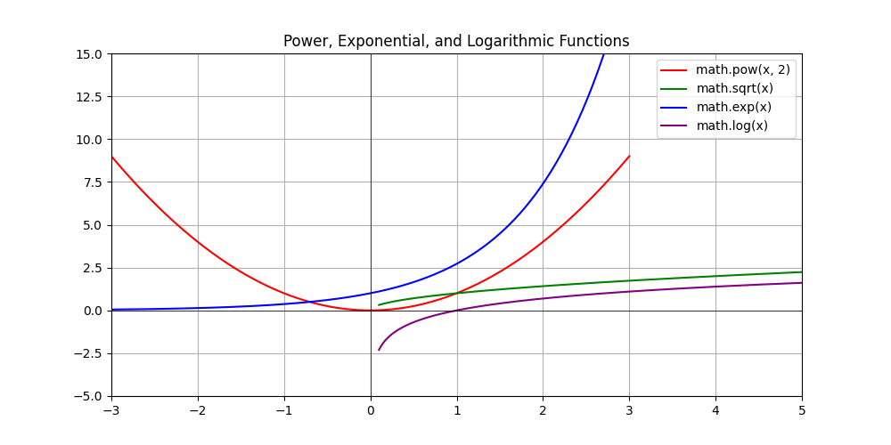
> 💡 **다이어그램(Matplotlib):** 
> *   `math.pow(x, 2)` (빨간 선)와 `math.exp(x)` (파란 선)는 값이 커질수록 저 높이 하늘로 미친 듯이 치솟아 오르는 팽창형 수식을 보여줍니다.
> *   반대로 역연산인 `math.sqrt(x)` (초록 선)와 `math.log(x)` (보라 선)는 값이 커져도 완만하게 눌려서 증가폭이 둔화되는 극도의 압축형 특성을 시각적으로 뚜렷하게 보여줍니다.

---

## 3. 실전 응용 (제곱근과 제곱)

`math.sqrt()`(Square Root) 함수는 어떤 숫자의 제곱근(√)을 무조건 실수(`float`) 형태로 정확히 반환합니다. 파이썬 문법 자체에 거듭제곱(`**`) 기호가 이미 있지만, 전체적인 계산식의 형식을 수학적으로 일관성 있게 통일하기 위해 `math.pow(x, y)` 함수도 세트로 자주 쓰입니다.

**실전 응용: 피타고라스의 정리 (Pythagorean Theorem) 계산기**
게임에서 캐릭터와 몬스터 사이의 대각선 거리를 구하거나, 통계 데이터의 유클리드 거리를 잴 때 가장 많이 쓰이는 기하학 공식입니다. 직각삼각형의 두 변의 길이(`A`, `B`)를 알고 있을 때, 빗변 대각선(`C`)의 길이를 $C = \sqrt{A^2 + B^2}$ 수식을 통해 단숨에 구할 수 있습니다. 

```python
import math as m

side_a = 3
side_b = 4

# 피타고라스 정리 적용: 빗변 C = √(a^2 + b^2)
hypotenuse_c = m.sqrt(m.pow(side_a, 2) + m.pow(side_b, 2))

print(f"가로 {side_a}, 세로 {side_b} 일 때, 대각선(빗변) 길이는 {hypotenuse_c} 입니다.")
```

---

## 📊 Matplotlib: 지수와 로그 그래프 그리는 방법

수치의 팽창과 압축 그래프 수식을 그리는 파이썬 코드입니다.

```python
import math
import matplotlib.pyplot as plt
import numpy as np

x_pos = np.linspace(0.1, 5, 200)
x_full = np.linspace(-3, 3, 200)

y_pow2 = [math.pow(v, 2) for v in x_full]
y_sqrt = [math.sqrt(v) for v in x_pos]
y_exp  = [math.exp(v) for v in x_full]
y_log  = [math.log(v) for v in x_pos]

plt.figure(figsize=(10, 5))
plt.plot(x_full, y_pow2, label='math.pow(x, 2)', color='red')
plt.plot(x_pos, y_sqrt, label='math.sqrt(x)', color='green')
plt.plot(x_full, y_exp, label='math.exp(x)', color='blue')
plt.plot(x_pos, y_log, label='math.log(x)', color='purple')

plt.ylim(-5, 15)
plt.xlim(-3, 5)
plt.axhline(0, color='black', linewidth=0.5)
plt.axvline(0, color='black', linewidth=0.5)
plt.title("Power, Exponential, and Logarithmic Functions")
plt.legend()
plt.grid(True)
plt.show()
```

---

## 학습목표
`math` 모듈이 지원하는 수학적 상수(`pi`, `e`)들과 파동(Wave)을 그려내는 삼각함수(`sin`, `cos`)의 사용 규칙과 라디안 변환 원리를 이해합니다.

---

## 1. 기하학 상수 및 삼각함수 함수표

물리 시뮬레이션에서 캐릭터의 포물선 발사 궤적을 그리거나, 부드러운 왕복 운동, 파도, 오디오 신호 등 주기적으로 반복되는 **파동 공간 데이터**를 다룰 때 필수적입니다.

| 함수명/상수명 | 설명 | 예시 / 활용법 |
| --- | --- | --- |
| `math.pi`, `math.e` | 상수 **원주율 $\pi$(3.1415...)**, **자연상수 $e$(2.718...)** | 원의 넓이 $r^2 \pi$ 계산 |
| `math.sin`, `math.cos`| **삼각함수** (라디안 각도 체계를 기준 입력값으로 받습니다.) | 부드러운 상하 왕복 애니메이션 |
| `math.radians(x)` | 평범한 **각도(Degree 0~360)** 값을 **라디안(Radian)**으로 자동 변환 | `math.radians(180)` $\to$ `3.14159...`|
| `math.degrees(x)` | 반대로 **라디안(Radian)** 값을 평범한 360 각도로 변환 | `math.degrees(math.pi)` $\to$ `180.0`|
| `math.dist(p, q)` | 두 점(튜플 좌표) 사이의 공간 거리를 계산 (유클리드) | `math.dist((0,0), (3,4))` $\to$ `5.0` |

---

## 2. 삼각함수의 세계: 수학 파동(Wave) 파악하기

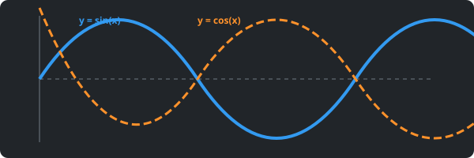
> 💡 **다이어그램(Matplotlib):** `math.sin()`과 `math.cos()` 함수가 0도에서 360도까지 진행하면서 만들어내는, 절대 끊기지 않는 부드러운 교차 파동 곡선의 시각적 형태입니다. 컴퓨터 애니메이션에서 숨쉬기 모션이나 깜빡거리는 점멸등 속도 제어에 쓰입니다.

---

## 3. 라디안(Radian)의 엄격한 법칙

초보자들이 가장 실수하는 파트가 바로 각도의 입력입니다.
`math.sin(90)` 이라고 적으면 90도 각도를 기대하시겠지만, 파이썬의 삼각함수는 인간의 눈높이에 맞춰진 360분법 각도(Degree)를 거부하고 순수 수학적인 **라디안(Radian)** 체계를 고집합니다.

따라서 90도 각도를 삼각함수에 넣기 전에는 언제나 통역기인 `math.radians()` 함수를 한 번 거쳐야만 정확한 1.0 (최고점)이 출력됩니다.

> 💡 **다이어그램:** 인간에게 친숙한 180도짜리 Degree 각도가 `math.radians()` 컨베이어 벨트에 들어가면, 파이썬 삼각함수가 이해할 수 있는 순수 수학 바이트인 `3.14 (파이)` 형태의 Radian 값으로 변환되어 출력되는 시각적 과정입니다.


```python
import math as m

# 잘못된 입력! (90 라디안으로 인식하여 엉뚱한 값 출력)
print("sin(90)의 잘못된 값:", m.sin(90))

# 안전한 정석! 통역기(radians)를 한 번 필수로 거쳐야 합니다.
rad_90 = m.radians(90)
print("sin(90도)의 정확한 값:", m.sin(rad_90))  # 1.0 출력!
```

---

## 📊 Matplotlib: 삼각함수 파동 그리는 방법

`math.sin` 부품의 출력을 Y 좌표로 삼아 곡선을 그리는 파이썬 코드입니다.

```python
import math
import matplotlib.pyplot as plt

# 0도부터 360도까지 점찍을 X 좌표 (라디안 변환)
x_angles = range(0, 360, 2)  # 2도 간격으로 촘촘히 
x_radians = [math.radians(deg) for deg in x_angles]

# Y 좌표 (sin과 cos 파동 계산)
y_sin = [math.sin(rad) for rad in x_radians]
y_cos = [math.cos(rad) for rad in x_radians]

plt.figure(figsize=(10, 4))
plt.plot(x_angles, y_sin, label='Sine Wave (sin)', color='blue', linestyle='-')
plt.plot(x_angles, y_cos, label='Cosine Wave (cos)', color='orange', linestyle='--')

plt.title("Trigonometric Waves (math.sin, math.cos)")
plt.xlabel("Angle (Degrees)")
plt.ylabel("Amplitude")
plt.axhline(0, color='black', linewidth=0.5, linestyle='--')
plt.legend()
plt.grid(True)
plt.show()
```

---

## 학습목표
거대한 숫자 1,000개가 들어있는 리스트의 모든 숫자에 2를 곱해야 한다면 어떻게 해야 할까요? 초보자는 습관적으로 `for` 반복문을 씁니다. 하지만 파이썬이 자랑하는 함수형 패러다임 도구인 `map()`과 `filter()`를 사용하면 거대한 데이터 열(Column) 단위로 변형 작업을 **for문 없이 한 번에(Vectorize)** 처리할 수 있습니다. 3.3.3장에서 배운 이름 없는 함수 **람다(Lambda)** 와 환상적인 호흡을 보여주는 이 도구들을 마스터합니다.

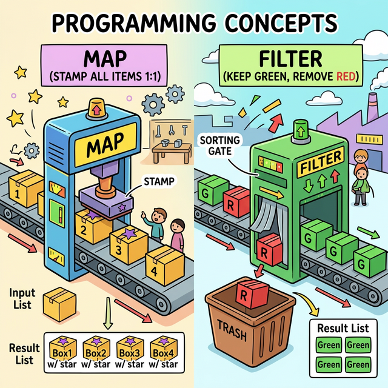
<div align="center">
  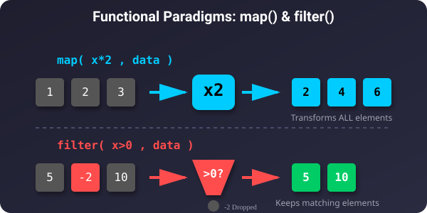
</div>

---

## 💡 TL;DR (1분 핵심 요약)

*   **`map(함수, 데이터)`**: 컨베이어 벨트에 리스트를 올려놓고, 똑같은 도장(함수)을 모든 원소에 "쾅! 쾅! 쾅!" 찍어냅니다. (데이터 일괄 **변형**)
*   **`filter(함수, 데이터)`**: 거름망(True/False를 판별하는 함수)을 통과시켜, 내가 원하는 조건(True)을 만족하는 데이터만 **추출**합니다.
*   위 두 함수는 보통 1회용 함수인 `lambda`와 세트로 묶여 **데이터프레임(Pandas)**의 열(Series) 전처리에 매일같이 쓰입니다.

---

## 1. Map() : 모든 원소에 똑같은 도장 찍기

우리가 가진 리스트의 숫자들을 전부 문자열(String)로 바꾸고 싶다고 가정하겠습니다. 

```python
# 기존의 촌스러운 for문 방식
numbers = [1, 2, 3, 4, 5]
str_numbers_for = []

for n in numbers:
    str_numbers_for.append(str(n)) # 일일이 str() 도장을 찍음

print(str_numbers_for) # ['1', '2', '3', '4', '5']
```

**`map()`을 이용한 우아한 방식**
```python
numbers = [1, 2, 3, 4, 5]

# map(적용할_함수, 데이터배열)
# 내장함수 str을 numbers 리스트 전체에 한 번에 맴핑!
# 주의: map 결과는 제네레이터 객체이므로 list()로 변환해서 까봐야 함.
str_numbers_map = list(map(str, numbers)) 

print(str_numbers_map) # ['1', '2', '3', '4', '5']
```

`map()`과 `람다(lambda)`의 콜라보레이션으로 데이터 형식을 한 번에 바꾸는 데이터 분석 실전 예제입니다.

```python
prices = [1000, 2500, 3000]

# "모든 가격에 10% 부가세를 더해서 곱해주는 1회용 로직(lambda)" 적용
tax_prices = list(map(lambda x: int(x * 1.1), prices))

print(tax_prices) # [1100, 2750, 3300]
```

---

## 2. Filter() : 원하는 조건만 족집게로 걸러내기

이번엔 데이터 속에서 짝수만 걸러내고 싶습니다. `filter`의 첫 번째 인자로 들어가는 함수는 반드시 `True`나 `False`를 뱉어내는 조건 판독기여야 합니다. 

```python
# 기존 for문 + if문 방식 
raw_data = [1, -5, 10, 3, -2, 8]
positives_for = []

for x in raw_data:
    if x > 0: # 양수인지 판별
        positives_for.append(x)

print(positives_for) # [1, 10, 3, 8]
```

**`filter()` + `lambda`의 우아한 방식**
```python
raw_data = [1, -5, 10, 3, -2, 8]

# filter(True를 뱉는 람다식, 데이터배열)
# 양수(x > 0)인 놈들만 거름망을 통과시킴
positives_filter = list(filter(lambda x: x > 0, raw_data))

print(positives_filter) # [1, 10, 3, 8]
```

---

## 3. Map과 Filter의 콤보 파이프라인

데이터 분석 현장에서 가장 흔한 시나리오는 쓰레기가 섞인 배열에서 정상 데이터를 거르고(`filter`), 그 데이터를 특정 형태로 가공하는(`map`) 연속 작업입니다.

```python
# [미션] 매출 데이터 중 올바른 형식의 데이터만 뽑아서, 원화(KRW 1,300원)로 뻥튀기 환전하라!
dirty_sales_usd = [10, "error", 50, -20, 100, None]

# 1단계: filter로 쓰레기(문자열, None, 음수) 거르기 
# (조건: 정수형이면서 0보다 커야 함)
clean_usd = list(filter(lambda x: isinstance(x, int) and x > 0, dirty_sales_usd))
print(f"필터링 1단계: {clean_usd}") # [10, 50, 100]

# 2단계: map으로 환율 적용하기 (1300배)
krw_sales = list(map(lambda x: x * 1300, clean_usd))
print(f"변환 2단계: {krw_sales}") # [13000, 65000, 130000]
```

---

## ☕ Java vs 🐍 Python 스나이퍼 대결

**함수형 프로그래밍(Functional Stream) 비교**

*   **Java 8+**: 자바도 8버전부터 눈부신 발전을 이뤄 똑같은 맵핑을 할 수 있습니다. `list.stream().filter(x -> x > 0).map(x -> x * 1300).collect(Collectors.toList());` 하지만 코드가 여전히 길고 무거우며, 리스트를 먼저 스트림 객체로 뽑고 다시 리스트로 묶는 보일러플레이트 코드가 거슬립니다.
*   **Python**: `map`과 `filter`가 태생부터 내장 함수로 존재하기 때문에 즉시 데이터 덩어리를 욱여넣어 변형이 가능합니다. (물론 이보다 한 단계 더 우아한 버전이 앞서 3.4.1장에서 배운 **리스트 컴프리헨션(List Comprehension)** 기술입니다. 개발자 취향에 따라 컴프리헨션과 Map/Filter를 섞어 씁니다!)

---

## 🎧 Vibe Coding

> **🗣️ 학생 프롬프트 (AI에게 이렇게 명령해 보세요):**
> "내가 가진 학생 성적 리스트가 `scores = [{"name": "A", "score": 45}, {"name": "B", "score": 80}, {"name": "C", "score": 95}]` 이렇게 생겼는데, 파이썬의 `filter()`를 써서 성적이 80점 이상인 합격자 딕셔너리만 쪽 뽑아내 줘! 람다 함수를 꼭 섞어서."

---

## 코딩 영단어 학습 📝

*   **Map (맵 / 맵핑)**: 지도, 배치하다. (수학에서는 하나의 값 $x$ 를 다른 값 $y$ 로 대응시키는 함수 관계인 '사상(Mapping)'을 뜻합니다. `f(x) = y`라는 기계를 거쳐 원래 리스트의 얼굴을 싹 일대일로 맵핑(변형) 시킨다고 이해하세요.)
*   **Filter (필터)**: 거르다, 여과기. (정수기 필터처럼 더러운 불순물이나 조건에 안 맞는 찌꺼기를 걸러내어, 순수한 True 데이터만 아래로 똑똑 떨어뜨립니다.)

---

## ✍️ 이번 주 연습 문제

**문제 1.** 가변 인수 `*args`를 사용하여, 전달받은 모든 숫자의 평균값을 구하는 `calculate_average(*args)` 함수를 구현해 보세요.

**문제 2.** 다음과 같은 딕셔너리로 이루어진 리스트가 있습니다. `lambda`와 내장 함수 `sorted()`를 활용하여, **나이(age)가 많은 순서대로** 정렬된 리스트를 반환하는 한 줄의 코드를 작성해 보세요.
`users = [{"name": "A", "age": 20}, {"name": "B", "age": 30}, {"name": "C", "age": 25}]`

**문제 3.** (심화) 팩토리얼(Factorial)을 구하는 재귀 함수 `factorial(n)`을 작성하되, `n`이 음수로 전달되거나 소수점이 있는 실수가 들어왔을 때의 예외 처리도 포함해 보세요.

---

## 📖 교재 상세 학습: 16 한 줄로 끝내는 일회용 마법: 람다(Lambda) 익명 함수

## 16 이름 없는 일회용 직공: 람다(Lambda) 익명 함수

지금까지 배운 `def` 키워드는 함수에 번듯한 이름을 붙여두고 수십, 수백 번 두고두고 사용할 때 쓰는 묵직하고 듬직한 정석 방식입니다. 
하지만 개발을 하다 보면, 오직 단 한 번만 잠깐 계산용으로 쓰고 미련 없이 버려버릴, 아주 가벼운 1회성 로직이 필요할 때가 적지 않습니다. 

이럴 때 굳이 3~4줄에 걸쳐 거창하게 `def`로 이름을 짓고 메모리를 장악하게 두는 것은 파이썬의 철학 상 낭비일 수 있습니다. 그래서 파이썬은 **이름 없는 초경량 퀵-함수, 람다(Lambda) 표현식**을 제공합니다.

### 1. 람다의 극단적이고 심플한 구조

람다는 오직 **단 한 줄**로만 작성할 수 있는 강제적인 제약이 있으며, 반환을 의미하는 `return` 키워드조차 생략해야 합니다. 콜론(`:`) 뒤의 계산식이 자동으로 결과물로 도출됩니다.

**기본 문법: `lambda 필요한_매개변수들: 도출할_표현식`**

```python
# 1. 묵직한 정석 (이름: normal_add)
def normal_add(x, y):
    return x + y

# 2. 깃털처럼 가벼운 람다 (이름 따위는 없다!)
# 이 한 줄이 위쪽 2줄짜리 정석 함수와 100% 똑같은 파워를 냅니다.
lambda_add = lambda x, y: x + y

print(normal_add(10, 20))   # 결과: 30
print(lambda_add(10, 20)) # 결과: 30
```

> [!NOTE]
> 람다를 변수(`lambda_add`)에 집어넣어 마치 일반 함수처럼 반복 호출할 수도 있지만, 사실 이러려면 처음부터 `def`를 쓰는 것이 100번 낫습니다. 람다의 진가는 "일회용성"과 "다른 내부 구조에 조립용 부품으로 곧바로 꽂아 넣을 때" 나옵니다.

### 2. 즉시 실행 (선언과 동시에 폭파!)

람다는 이름을 메모리에 등록할 틈도 주지 않고, **코드를 작성하자마자 그 즉시 실행**시켜 버릴 수도 있습니다. (이를 IIFE 패턴이라 부르기도 합니다)

람다 표현식 전체를 둥근 소괄호 `()`로 크게 감싼 뒤, 바로 옆에 찰싹 붙어서 또 다른 괄호 `(전달할_인자)`를 쏘아붙이면 됩니다.

```python
# "나는 숫자 5를 받아서 5의 제곱을 곧바로 구하겠다!"
# (람다 설계도 선언부)(재료 투척 및 실행부) 구조
result = (lambda x: x * x)(5)

print(result) # 단숨에 25가 찍히고, 람다 로직은 흔적도 없이 소멸합니다.
```

### 3. 다른 함수와의 환상적인 팀플레이 (조립 부품)

람다가 가장 유용하게 쓰이는 곳은 리스트 같은 데이터를 한꺼번에 가름할 때 쓰는 **고차 함수**(`map`, `filter` 등) 내부, 혹은 **리스트의 정렬 순서를 커스터마이징**할 때입니다. 쓸데없이 일회용 로직을 바깥에 정의하지 않아 코드가 환상적으로 간결해집니다.

**실전 활용: `sort()`의 정렬 기준 바꿔치기**
```python
fruits = ["apple", "banana", "kiwi", "watermelon"]

# 기존 방식: 무조건 알파벳 A-Z 순서로만 정렬됨.
fruits.sort() 

# 람다 방식: "나는 글자의 길이(len)를 잣대로 삼아서 짧은 놈부터 줄을 세우겠다!"
# key 파라미터에 람다를 부품처럼 꽂아 넣습니다.
fruits.sort(key=lambda word: len(word)) 

print(fruits) # ['kiwi', 'apple', 'banana', 'watermelon']
```

람다는 분명 눈이 휘둥그레질 만큼 짧고 매력적인 녀석이지만, 안의 로직이 조금이라도 복잡하고 길어진다면 망설이지 말고 정석적인 `def` 방식으로 돌아가 길게 풀어쓰는 것이 진정으로 배려심 넘치는 파이써니스타의 자세임을 늘 명심하세요!


---

## 📖 교재 상세 학습: 18 일급 시민 함수와 기억술사: 클로저(Closure)

## 18 일급 시민 함수와 기억술사: 클로저(Closure)

파이썬의 함수는 그저 코드를 묶어두는 껍데기가 아닙니다. 파이썬 세상에서 함수는 숫자나 문자열처럼 변수에 생짜로 집어넣고, 남에게 던져주고, 결과로 받아올 수 있는 특권층인 **일급 시민(First-class Citizen)** 대우를 받습니다.

### 1. 함수도 변수에 담을 수 있다!

이름이 정해진 함수라도 괄호 `()`를 빼고 이름표 자체만 다른 변수에 대입하면, 그 변수도 똑같은 함수처럼 동작할 수 있습니다.

```python
def say_hello():
    return "반갑습니다, 모험가님!"

# 괄호 없이 함수 자체를 변수에 대입!
my_greeting = say_hello

# 이제 my_greeting 변수도 함수처럼 ()를 붙여 쓸 수 있습니다.
print(my_greeting()) # 반갑니다, 모험가님!
```

이런 성질 덕분에, 우리는 다른 함수에게 '기능(함수)' 자체를 매개변수 조립 부품처럼 휙휙 던져주는 **고차 함수(Higher-order Function)**를 만들 수 있습니다.

---

### 2. 함수 안의 함수가 낳은 마법: 클로저(Closure)

파이썬은 함수 뱃속에 또 다른 함수를 정의할 수 있습니다. 이때 내부 함수를 바깥으로 퉤 뱉어낼(return) 때 아주 재미있는 **'기억 보존 현상'**이 일어납니다.

```python
def make_multiplier(n):
    # n은 바깥쪽(외부) 함수의 지역 변수입니다.
    print(f"[공장 가동] {n}배수 곱하기 기계를 제작 중...")
    
    # 함수 뱃속에 내부 함수를 만듭니다!
    def multiplier(x):
        # 내부 함수에서 외부 변수 n을 참조해서 씁니다.
        return x * n
        
    # 내부 '함수 자체'를 바깥으로 반환합니다. 
    return multiplier

# 1. 외부 함수를 실행해 3배수 기계 함수를 결과로 받아 변수에 담습니다.
times3 = make_multiplier(3)
# 출력: [공장 가동] 3배수 곱하기 기계를 제작 중...

# 원래라면 외부 함수(make_multiplier)가 끝났으니 지역변수 n=3도 
# 메모리에서 깔끔하게 날아가(소멸)야 하지만...

# 2. 내부 함수가 샐행될 때 놀랍게도 n=3을 여전히 생생하게 기억하고 있습니다!!
print(times3(10)) # 30
print(times3(5))  # 15
```

#### 비밀 상자 유지의 조건

함수가 끝났는데도 그 안의 변수들이 메모리 공간의 우주 먼지로 사라지지 않고 보존되는 현상!
이렇게 **"내부 함수가, 자기가 태어났던 환경(외부 변수)을 마치 타임캡슐처럼 끌어안고 닫아버린(Close) 채 나오는 현상"**을 프로그래밍 용어로 **클로저(Closure)**라고 부릅니다.

클로저의 이 엄청난 기억력을 바탕으로, 우리는 함수를 새로 고치지 않고 껍질만 씌워 추가 기능을 부여하는 진정한 마법 **'데코레이터'**를 배울 준비를 마쳤습니다!


---

## 📖 교재 상세 학습: 19 코드 건드리지 않고 성능 업그레이드! 데코레이터

## 19 기존 코드를 건드리지 않는 마법: 데코레이터(Decorator)

직장 상사가 "네가 짠 30개의 모든 함수 앞뒤로, 실행 소요 시간을 찍어주는 타이머 로그를 추가해라"라고 지시했다고 칩시다. 초보자는 30개 함수 배를 일일이 갈라 코드를 쑤셔 넣겠지만, 파이썬 고수들은 원래 코드에 털끝 하나 손대지 않고 껍질만 씌우는 **데코레이터(Decorator)**를 사용합니다.

데코레이터는 문자 그대로 함수에 예쁜 포장지를 감싸서(장식해서) 추가 기능을 부여하는 강력한 문법입니다. 클로저(Closure)의 원리를 완벽히 활용한 마법입니다.

### 1. 데코레이터의 3단 포장 원리

데코레이터는 본질적으로 **'원본 함수를 집어삼킨 뒤, 새롭게 장식된 포장지 함수(클로저)를 돌려주는 고차 함수'**입니다.

```python
# 1. 장식 기계(데코레이터) 정의 
def timer_booster(func):
    """넘겨받은 원래 함수(func)의 앞뒤로 타이머 로그를 찍어주는 기계"""
    
    # 2. 내부 포장지 함수 (클로저)
    # 어떤 형태의 데이터가 들어올지 모르니 *args, **kwargs로 모두 받아냅니다.
    def wrapper(*args, **kwargs):
        print("▶ [아이템 켜짐] 타이머 시작!")
        
        # 3. 보관하고 있던 진짜 원본 함수의 임무를 빙의(실행)합니다.
        result = func(*args, **kwargs)
        
        print("■ [아이템 꺼짐] 타이머 종료!")
        return result # 원본이 내뱉은 결과를 그대로 토해냅니다.
        
    return wrapper # 포장지를 반환
```

### 2. 골뱅이(`@`) 마법 부리기

파이썬에서는 위와 같이 데코레이터 기계를 한 번 만들어두면, 아이템을 장착하고 싶은 타겟 함수 바로 머리 윗줄에 **`@데코레이터이름`** 이라는 초간단 직관적 문법으로 기능을 스며들게 할 수 있습니다.

```python
# 타이머 부스터 장착!!
@timer_booster 
def skill_attack():
    print("기본 공격 얍! 얍!")
    return "데미지 100"

# my_attack을 평소처럼 실행하지만, 파이썬 몰래 포장지(wrapper)가 가로채서 실행됩니다.
defense_result = skill_attack()
print("최종 결과:", defense_result)
```

**콘솔 출력 화면**
```text
▶ [아이템 켜짐] 타이머 시작!
기본 공격 얍! 얍!
■ [아이템 꺼짐] 타이머 종료!
최종 결과: 데미지 100
```
원본 함수 `skill_attack`의 코드를 한 글자도 수정하지 않았는데 앞뒤로 기능이 쏙 들어가 버렸습니다!

---

### 3. 원본의 신분증 유지하기 (`@wraps`)

데코레이터를 장착하면 함수가 투구(wrapper 포장지)를 둘러쓰기 때문에, 남들이 볼 때 원래 이름(`skill_attack`)이 아니라 투구 이름(`wrapper`)으로 오해하는 부작용이 생깁니다.  

이 신분증 분실 사고를 막기 위해, 포장지를 만들 때는 파이썬 기본 도구인 `functools.wraps`를 겉에 한 겹 더 발라주어 원본 함수의 이름과 주석 정보를 그대로 보존해 주는 것이 고수들의 핵심 매너입니다.

```python
from functools import wraps

def authentic_decorator(func):
    
    @wraps(func) # 원본 함수 func의 본래 이름과 혼(신분증)을 그대로 복원!
    def wrapper(*args, **kwargs):
        print("뭔가 추가 기능 동작 중...")
        return func(*args, **kwargs)
        
    return wrapper
```


---

## 📖 교재 상세 학습: 20 순수 함수와 데이터 가공 기계들: 함수형 프로그래밍

## 20 부작용 없는 깔끔한 설계: 함수형 프로그래밍의 기초

코드가 길어질수록 초보자들이 가장 많이 겪는 버그는 "도대체 내 변수 값이 왜, 어디서 바뀐 거야?!"라며 머리를 쥐어뜯는 일입니다. 함수 여기저기서 밖의 전역 변수를 몰래 건드리거나 리스트의 내부를 마구 찢어발기기 때문이죠.

이런 끔찍한 사태(부작용, Side-effect)를 막기 위해 **"함수 바깥의 세상(데이터)에는 일절 손대지 말고, 정직하게 받은 재료만으로 새로운 결과물만 퉤 뱉어내라!"**고 함수를 엄격하게 통제하는 우아한 코딩 패러다임을 **함수형 프로그래밍(Functional Programming)**이라고 합니다.

### 1. 오염되지 않은 무균실: 순수 함수 (Pure Function)

똑같은 재료(입력값)를 넣으면 비가 오나 눈이 오나 무조건 똑같은 결과물(출력값)만 뱉어내는 예측 심부름꾼입니다. 제일 중요한 건, 심부름을 하는 도중에 밖(외부 환경)의 물건을 훔치거나 훼손하지 않는다는 것입니다.

```python
# [나쁜 예] 미순수 함수: 외부의 리스트를 자기 맘대로 건드림! (부작용 발생)
user_inventory = []
def add_item_bad(item):
    user_inventory.append(item) 
    
# [좋은 예] 순수 함수: 원본은 안전하게 둔 채, 복사본에 추가해서 새것을 반환함!
def add_item_pure(item, old_inventory):
    new_inventory = old_inventory[:] # 파이썬 리스트 복사 스킬
    new_inventory.append(item)
    return new_inventory
```

이런 순수 함수들만 블록처럼 매끈하게 쌓아서 프로그램을 만들면, 밤새워 버그를 찾을 일이 확연히 줄어듭니다!

---

### 2. 부품을 끼워 넣는 고차 함수 마법: `map`, `filter`, `reduce`

순수 함수들을 마음껏 부려먹기 위해 파이썬 창조주가 태초부터 만들어둔 3대장 가공 기계를 소개합니다. 이 기계들은 리스트 같은 긴 데이터를 통째로 집어삼킨 뒤, 우리가 **'핵심 조립 부품(함수)'**만 갈아 끼워주는 대로 내용물을 찰칵찰칵 깎아서 뱉어냅니다.

#### 일괄 변신 기계: `map`

데이터가 100개 든 리스트를 통째로 넣고, "모두 제곱해!"라는 함수 부품을 던져주면 한 번에 일괄 처리합니다.
```python
numbers = [1, 2, 3, 4]

# 모든 숫자를 제곱해주는 1회용 람다(Lambda) 부품을 끼워넣어 맵(map)을 돌림
squared = list(map(lambda x: x * x, numbers))
print(squared) # [1, 4, 9, 16]
```

#### 꼼꼼한 검문소: `filter`

리스트 원소들이 지나갈 때, 지정한 함수(부품)에 돌려봐서 **결과가 True(참)**인 녀석들만 살려두고 나머지는 가차 없이 버립니다.
```python
numbers = [1, 2, 3, 4, 5, 6]

# 짝수인지 검사하는 부품을 끼워넣어 필터(filter)를 돌림
evens = list(filter(lambda x: x % 2 == 0, numbers))
print(evens) # [2, 4, 6]
```

#### 눈덩이 축소 기계: `reduce`

리스트 맨 앞부터 데이터를 2개씩 꺼내 함수 부품으로 요리(합성)하고, 그 결과를 다음 조각이랑 또 요리하는 과정을 **끝까지 반복해서 단 하나의 값으로** 눈덩이를 뭉칩니다. 
(이 기계는 파이썬 기본 장착이 아니어서 `functools` 창고에서 꺼내와야 합니다.)
```python
from functools import reduce
import operator

# 배열의 요소를 차례대로 꺼내 덧셈 기계(operator.add)에 집어넣어 축약
total_sum = reduce(operator.add, [10, 20, 30, 40])
print(total_sum) # 100 ((10+20) -> 30+30 -> 60+40)
```

이 세 가지 기계들과 `lambda` 함수를 환상적으로 버무려 쓰면, 5줄짜리 지저분한 `for`문도 단 한 줄로 극도로 우아하게 압축해 낼 수 있습니다.


---

## 📖 교재 상세 학습: 4. 클래스로 만드는 데코레이터

## 4. 클래스로 만드는 데코레이터

지금까지는 "함수"로 데코레이터를 만들었지만, 복잡하게 상태를 제어하거나 더 큰 규모의 아이템을 만들 때는 "클래스"로도 데코레이터를 제조할 수 있습니다. 

단지 `__call__` 스페셜 메서드 하나만 잘 오버로딩하면 됩니다. (이전 장에서 배운 `callable` 개념이 여기서 빛을 발합니다!)

### 4.1 `__init__`과 `__call__`의 합작

클래스로 데코레이터를 만들 때는 두 가지 문만 기억하면 됩니다.
1. `__init__`: 타겟 함수를 인자로 받아서, 초기 속성으로 **저장**합니다.
2. `__call__`: 클래스의 인스턴스가 괄호 문법 `()`으로 실행될 때, 포장지 역할을 하면서 저장해둔 본래 **함수를 호출**합니다.

```python
class PowerUpItem:
    # 1. 대상 함수 func를 뱃속에 담아둡니다.
    def __init__(self, func):
        self.func = func
        
    # 2. 아이템이 장착된 함수가 실행될 때 호출됩니다. (wrapper 역할)
    def __call__(self, *args, **kwargs):
        print(f"[{self.func.__name__}] 함수에 로켓 엔진 가동!")
        # 본래 함수 실행!
        return self.func(*args, **kwargs)

# 함수가 아닌 내가 직접 조립한 클래스 객체로 데코레이터 장착!
@PowerUpItem
def sprint(speed):
    print(f"시속 {speed}km로 달립니다.")

# sprint 함수를 호출하면, 사실은 PowerUpItem의 __call__이 실행됩니다!
sprint(150)

# [실행 결과]
# [sprint] 함수에 로켓 엔진 가동!
# 시속 150km로 달립니다.
```

---

### 4.2 내장된 클래스 데코레이터

우리가 파이썬 코드에서 익숙하게 봐왔던 `@classmethod`, `@staticmethod`, 그리고 변수처럼 함수를 쓰게 해주는 `@property` 역시, 파이썬이 내부적으로 C언어로 구현해둔 **클래스 기반의 강력한 데코레이터**들입니다.

원리만 파악하면 여러분도 Django 웹 프레임워크나 딥러닝 패키지에 존재하는 거대한 마법(데코레이터)들을 여러분의 코드에 아주 쉽게 이식하고 사용할 수 있습니다.


---

## 📖 교재 상세 학습: 1. 함수가 품은 보물상자: 클로저 (Closure)

## 1. 함수가 품은 보물상자: 클로저 (Closure)

데이터뿐만 아니라 **'함수' 자체도 변수에 담거나 남에게 던져줄(Return) 수 있다**는 사실을 아시나요? 파이썬에서 함수는 일급 시민(First-class citizen)이기 때문입니다. 데코레이터를 이해하기 위한 첫 관문은 바로 클로저(Closure) 현상입니다.

### 1.1 함수 안의 함수 (Nested Function)

파이썬은 함수 내부에 또 다른 함수를 만들 수 있습니다. 그리고 이 내부 함수를 외부로 반환(return)할 때 아주 재미있는 현상이 일어납니다.

```python
def make_multiplier(n):
    # n은 외부 함수의 지역 변수입니다.
    
    def multiplier(x):
        # 내부 함수에서 외부 변수 n을 참조합니다!
        return x * n
        
    # 내부 '함수 자체'를 반환합니다. (괄호를 치지 않음)
    return multiplier

# 1. n=3으로 세팅된 곱하기 기계를 만듭니다.
times3 = make_multiplier(3)

# 원래대로라면 make_multiplier가 끝났으니 n=3도 사라져야 하지만...
# 2. 내부 함수가 실행될 때 여전히 n=3을 기억하고 있습니다!
print(times3(10)) # 30
print(times3(5))  # 15
```

---

### 1.2 자유 변수 (Free Variable)를 품은 클로저

함수가 끝나면 그 안의 변수들은 보통 메모리에서 우주 먼지처럼 사라집니다. 하지만 위의 예제처럼, **내부 함수가 외부 함수의 변수(`n`)를 물고 밖으로 튀어나오면**, 파이썬은 그 변수를 지우지 않고 내부 함수만의 '비밀 보물상자'에 영원히 가둬둡니다.

이렇게 "자신이 만들어진 환경(변수)을 닫아서(Close) 기억하고 있는 함수" 현상을 **클로저(Closure)**라고 부릅니다. 이때 기억된 외부 변수를 **자유 변수**라고 합니다.

내부 함수의 `__closure__` 속성을 뜯어보면 실제로 값이 저장되어 있는 것을 확인할 수 있습니다.

```python
# times3 함수 안에 저장된 클로저(비밀 상자) 열어보기
# cell_contents 안에 숫자 3이 살아있는 것을 확인할 수 있습니다!
print(times3.__closure__[0].cell_contents) # 3
```

이 클로저의 강력한 기억력을 바탕으로, 데코레이터는 기존 함수의 상태나 매개변수를 잃어버리지 않고 기억하며 마법을 부릴 수 있게 됩니다.


---

## 📖 교재 상세 학습: 3. 아이템 장착! 함수 데코레이터

## 3. 아이템 장착! 함수 데코레이터

진짜 데코레이터의 세계로 진입할 차례입니다. 기존 함수의 코드는 단 한 줄도 수정하지 않은 채, 함수 앞위치에 로그를 찍거나 실행 시간을 측정하는 등 껍질(패키징) 기능을 쉽게 추가하는 방법입니다.

### 3.1 데코레이터의 핵심 구조: 3단 콤보

데코레이터는 본질적으로 **'함수를 매개변수로 받아서, 새로운 함수(클로저)를 리턴하는 함수'**입니다.

1. **데코레이터 로봇 (외부 함수)**: 장착할 아이템. 원본 함수를 인자로 받습니다.
2. **포장지 (내부 wrapper 함수)**: 원본 함수의 앞뒤로 추가할 기능을 작성하는 곳입니다. 어떤 인자가 들어올지 모르니 `*args`, `**kwargs`로 모든 것을 받아냅니다.
3. **원본 실행**: 포장지 기능이 끝나면 원본 함수를 호출하여 임무를 완수합니다.

```python
# 1. 데코레이터 정의 
def timer_booster(func):
    
    # 2. 내부 포장지 함수 (자유 변수 func를 기억하는 클로저)
    def wrapper(*args, **kwargs):
        print("▶ [아이템 발동] 타이머 시작!")
        
        # 3. 원래 함수의 임무 실행
        result = func(*args, **kwargs)
        
        print("■ [아이템 해제] 타이머 종료!")
        return result
        
    return wrapper
```

---

### 3.2 골뱅이(`@`) 마법 부리기

파이썬에서는 데코레이터 함수를 만들어두면, 타겟 함수 바로 윗줄에 `@데코레이터이름` 이라는 직관적인 문법으로 아이템을 장착시킬 수 있습니다.

```python
# 귀찮은 과정 (기존 방식)
# calc_func = timer_booster(calc_func)

# 깔끔한 @ 문법 적용!
@timer_booster
def my_attack():
    print("기본 공격 얍!")
    return "데미지 100"

# my_attack을 실행하면 껍질 안의 wrapper가 먼저 실행됩니다.
defense_result = my_attack()
print("결과:", defense_result)

# [실행 결과]
# ▶ [아이템 발동] 타이머 시작!
# 기본 공격 얍!
# ■ [아이템 해제] 타이머 종료!
# 결과: 데미지 100
```

---

### 3.3. 신분 도용 방지: `functools.wraps`

데코레이터를 장착하면 겉모습이 `wrapper` 함수로 덮어씌워지기 때문에, 원래 함수가 누군지를 잃어버리는(이름이나 주석 파악 불가) 부작용이 생깁니다.  
이를 방지하기 위해 데코레이터를 만들 때는 관례적으로 **`@wraps(func)`**를 내부 함수에 한 번 더 붙여서 원래 함수의 신분증을 그대로 복원해줍니다.

```python
from functools import wraps

def authentic_decorator(func):
    # 원래 함수 func의 이름(__name__)과 주석(__doc__)을 유지시켜줌!
    @wraps(func)
    def wrapper(*args, **kwargs):
        return func(*args, **kwargs)
    return wrapper
```


---

## 📖 교재 상세 학습: 2. 함수 쪼개기와 기억력

## 2. 함수 쪼개기와 기억력: 부분 함수와 메모이제이션

클로저의 응용으로 코드를 훨씬 쾌적하고 영리하게 만드는 두 가지 고급 패턴을 알아봅니다.

### 2.1 인자 예약 시스템: 부분 함수 (Partial Function)

기능은 동일한데, 매번 함수를 호출할 때마다 똑같은 인자를 반복해서 입력하기 귀찮을 때가 있습니다. 파이썬의 `functools.partial` 모듈을 쓰면 함수의 **특정 매개변수를 미리 "고정"시켜둔 새로운 함수**를 쉽게 뚝딱 만들 수 있습니다.

```python
from functools import partial

# 기본 함수: 3개의 인자를 모두 더함
def add_three_numbers(a, b, c):
    return a + b + c

# a=10, b=20을 미리 고정해둔 '부분 함수' 생성! (c만 남음)
add_base_30 = partial(add_three_numbers, 10, 20)

# 이제 남은 인자(c)만 보내주면 됩니다.
print(add_base_30(5))   # 10 + 20 + 5 = 35
print(add_base_30(100)) # 10 + 20 + 100 = 130
```

복잡한 클로저를 직접 설계하지 않아도 파이썬이 알아서 커링(Currying) 패턴처럼 인자를 쪼개서 관리해줍니다.

---

### 2.2 한 번 푼 문제는 다시 풀지 않는다: 메모이제이션 (Memoization)

어려운 수학 문제를 풀 때, 똑같은 문제를 누가 또 물어본다면 처음부터 계산하지 않고 예전에 적어둔 답을 쓱 보고 바로 말해주는 것이 효율적입니다. 프로그램에서도 복잡하고 오래 걸리는 함수 호출의 **'결과값'을 캐시(기억)해두는 기법**을 **메모이제이션**이라고 합니다.

파이썬 3에서는 이 기능을 데코레이터 한 줄로 끝낼 수 있게 내장 모듈을 제공합니다.

#### 갓성비 데코레이터: `@lru_cache`

```python
import time
from functools import lru_cache

# 이 마법의 한 줄을 추가하면, 파이썬이 함수 결과를 알아서 기억해둡니다.
# maxsize는 몇 개까지 기억할지를 정합니다. (None이면 무제한)
@lru_cache(maxsize=128)
def heavy_computation(num):
    print(f"  [오래 걸리는 연산 시작] {num} 계산 중...")
    time.sleep(2) # 2초 동안 복잡한 계산을 한다고 가정
    return num * 100

print("첫 번째 호출:")
print(heavy_computation(5)) # 2초 걸려서 500 출력

print("\n두 번째 호출 (동일한 인자):")
# 연산(time.sleep) 없이 기억해둔 500을 0.0001초 만에 즉시 반환!
print(heavy_computation(5)) 

print("\n세 번째 호출 (새로운 인자):")
print(heavy_computation(8)) # 8은 처음이므로 다시 2초 걸려서 800 출력
```

과거의 영광(?)을 기억하는 강력한 기능이므로 반복적인 데이터 크롤링, 웹 요청, 무거운 알고리즘 연산에 필수로 쓰이는 기술입니다!


---

## 📖 교재 상세 학습: 6. 함수의 숨겨진 속성 객체

## 6. 함수의 숨겨진 속성 객체

파이썬에서 함수가 만들어지는 순간, 파이썬 인터프리터는 함수의 껍데기뿐만 아니라 함수의 내부 동작 원리가 기록된 여러 스페셜 속성(Dunder Methods)들을 함수 객체 내부에 몰래 복제해 넣습니다. 

이러한 메타데이터 덕분에 파이썬은 실행 중에도 함수의 정체를 낱낱이 파악할 수 있는 고도의 유연성을 발휘합니다.

### 6.1 `__code__` 객체 (바이트코드 보관소)

함수 내부에서 가장 핵심적인 부분은 `__code__` (Code Object) 속성입니다. 우리가 작성한 사람용 문자열 코드는 컴퓨터가 이해할 수 있는 기계어 직전의 상태인 **'바이트코드(Bytecode)'** 로 번역되어 이곳에 꼬리표처럼 저장됩니다.

- `co_varnames`: 함수가 사용하는 지역 변수들의 이름 목록
- `co_argcount`: 함수가 요구하는 매개변수의 개수

```python
def my_func(x, y):
    result = x + y
    return result

# 함수가 가진 코드 객체에 접근
code_obj = my_func.__code__

print(code_obj.co_argcount) # 2 (x와 y 두 개)
print(code_obj.co_varnames) # ('x', 'y', 'result')
```

#### 바이트코드 디스어셈블 (dis 모듈)
파이썬 내장 모듈인 `dis`를 사용하면, 내부의 바이트코드가 도대체 어떻게 구성되어 있는지 어셈블리어 형태로 까볼 수 있습니다. 파이썬 최적화에 관심이 깊은 해커들이 자주 사용하는 기법입니다.

```python
import dis

# my_func 이 내부적으로 어떻게 동작하는지 기계어 수준의 절차 출력
dis.dis(my_func)
```

---

### 6.2 `inspect` 모듈로 함수 해부하기

함수 객체의 내부 속성을 일일이 `__dict__`나 `__code__` 로 뒤지는 것은 너무 원시적입니다. 파이썬은 타인의 코드나 알 수 없는 함수를 분석하기 편하도록 **`inspect`** 표준 라이브러리를 제공합니다.

- `inspect.getsource()`: 이 함수가 작성된 원래의 '파이썬 코드 텍스트 전체'를 긁어옵니다.
- `inspect.signature()`: 이 함수가 요구하는 정확한 매개변수 형태(시그니처)와 타입 힌트 정보를 추출합니다.
- `inspect.getsourcefile()`: 이 함수가 도대체 어느 파이썬 파일(.py) 출신인지 출생지를 추적해 줍니다.

```python
import inspect

def calculate_tax(amount: int, rate: float = 0.1) -> float:
    """세금을 계산하는 함수입니다."""
    return amount * rate

# 1. 함수의 파라미터(시그니처) 해부
sig = inspect.signature(calculate_tax)
print(sig) # (amount: int, rate: float = 0.1) -> float

# 2. 함수의 원본 소스코드 그대로 복원해 출력!
source = inspect.getsource(calculate_tax)
print(source) 
# def calculate_tax(amount: int, rate: float = 0.1) -> float:
#     """세금을 계산하는 함수입니다."""
#     return amount * rate
```

> [!TIP]
> 디버깅을 하거나 인공지능 도구(AI Assistant)들이 소스코드를 읽어들일 때 바로 이 `inspect` 모듈의 메타 파싱 능력을 십분 활용합니다.


---

## 📖 교재 상세 학습: 3. 람다 익명 함수 (Lambda)

## 3. 람다 익명 함수 (Lambda)

지금까지 배운 `def` 키워드는 함수에 번듯한 이름을 붙여두고 여러 번 두고두고 사용할 때 쓰는 방식입니다. 

하지만 오직 한 번만 잠깐 쓰고 버릴, 아주 단순한 계산 로직에 굳이 이름을 짓고 메모리를 차지하게 두는 것은 낭비일 수 있습니다. 이럴 때 파이썬에서는 이름 없는 일회용 퀵-함수, **람다(Lambda) 표현식**을 제공합니다.

### 3.1 람다의 기본 문법

람다는 오직 **단 한 줄**로만 작성할 수 있으며, `return` 키워드조차 쓸 필요가 없이 콜론(`:`) 뒤의 계산식이 자동으로 결과물로 반환됩니다.

**기본 문법: `lambda 매개변수들: 반환할 표현식`**

```python
# 일반적인 함수 정의 방식
def normal_add(x, y):
    return x + y

# 람다(익명) 함수 방식
# 코드가 훨씬 간결하고 직관적입니다.
lambda_add = lambda x, y: x + y

print(normal_add(10, 20))   # 30
print(lambda_add(10, 20)) # 30
```

> [!NOTE]
> 람다 역시 내부적으로는 `def`로 만든 함수와 100% 동일하게 `function` 클래스 객체 취급을 받습니다. 단지 파이썬 내부 시스템에서 이름이 없다는 뜻으로 `<lambda>`라는 임시 명찰을 달고 있을 뿐입니다.

---

### 3.2 즉시 실행 함수 (IIFE) 패턴

람다 함수는 선언과 동시에 바로 실행시켜 버릴 수도 있습니다. (Immediately-Invoked Function Expression)
주로 임시적인 계산을 일회성으로 처리하고 깔끔하게 변수를 소멸시키고 싶을 때 사용합니다. 람다 표현식 전체를 괄호 `()`로 감싸고, 바로 뒤에 다시 괄호 `()`를 붙여 인자를 모조리 던져주면 됩니다.

```python
# "나는 x를 받아서 x의 제곱을 곧바로 구하겠다!"
# (선언부)(실행부) 구조
result = (lambda x: x * x)(5)

print(result) # 25
```

---

### 3.3 지능형 컬렉션(Comprehension)과의 시너지

람다 함수가 가장 강력한 힘을 발휘하는 순간은 리스트나 딕셔너리를 가공하기 위한 `map()`, `filter()` 또는 지능형 리스트(List Comprehension) 내부에서 사용될 때입니다.

단, 반복문(for) 안에서 람다를 동적으로 생성할 때는 외부 변수의 상태가 람다 내부로 어떻게 전달되는지(Late Binding) 주의해야 합니다.

```python
# 1. 일반적인 람다 생성 (실행 시점의 x를 참조하려 함)
# 반복문이 끝나고 x는 2가 된 상태에서 일괄 실행되므로 모두 2를 리턴함.
bug_lambdas = [lambda: x for x in range(3)]
print(bug_lambdas[0]()) # 2
print(bug_lambdas[1]()) # 2
print(bug_lambdas[2]()) # 2

# 2. 올바른 람다 바인딩 방법
# 람다 매개변수의 기본값 기능(x=n)을 이용해, 생성 당시의 값을 단단히 묶어둡니다.
safe_lambdas = [(lambda n=x: n)() for x in range(3)]
print(safe_lambdas) # [0, 1, 2]
```


---

## 📖 교재 상세 학습: 5. 파이썬 내장 함수 (Built-in Functions)

## 5. 파이썬 내장 함수 (Built-in Functions)

우리가 함수를 굳이 직접 `def`로 하나하나 정의하지 않아도, 파이썬이 태어날 때부터 기본적으로 뱃속에 품고 있는 든든한 함수들이 있습니다. 이들을 **내장 함수(Built-in Functions)**라고 부릅니다.

내장 함수들은 파이썬의 핵심 모듈인 `__builtins__` 네임스페이스 영역에 항상 상주하고 있으므로, 언제 어디서든 `import` 명령어 없이 즉시 가져다 사용할 수 있습니다.

### 5.1 사칙연산과 수학 제어 함수

복잡한 수식을 일일이 반복문으로 풀지 않아도, 파이썬은 직관적인 함수를 기본 제공합니다. 

```python
# 1. 합계 합산: sum()
scores = [90, 80, 75, 100]
print(sum(scores)) # 345 (반복문 없이 통째로 더함)

# 2. 몫과 나머지 동시 출력: divmod()
# 100을 23으로 나눈 몫과 나머지를 '튜플'로 묶어 반환합니다.
print(divmod(100, 23)) # (4, 8)

# 3. 절댓값 처리: abs()
print(abs(-250.5)) # 250.5

# 4. 반올림 처리: round()
pi = 3.141592
print(round(pi, 2)) # 3.14 (소수점 둘째 자리까지 반올림)
```

---

### 5.2 진위 논리 판독 함수 (any / all)

리스트나 튜플 내부에 거짓(False) 판정을 받는 불순물(예: `0`, `""`, `None`)이 섞여 있는지 한 번에 스캔하는 지뢰 탐지기 같은 기능입니다.

- **`all()`**: 원소가 **"전부 참(True)"** 이어야만 최종적으로 True (교집합)
- **`any()`**: 원소 중 **"단 하나라도 참"** 이 존재하면 최종적으로 True (합집합)

```python
status_logs = [1, 2, 0, 4] # 0 은 False 로 간주됨

print(all(status_logs)) # False (불량 값 0 이 섞여 있으므로 전체 실패)
print(any(status_logs)) # True  (참인 값들이 존재하므로 일단 패스)
```

---

### 5.3 배열 원본 보존형 정렬 `sorted()`

리스트가 가진 고유 메서드 `.sort()`는 배열 원본 자체를 개조(파괴)해버리지만, 내장 함수인 **`sorted()`**는 절대로 원본을 건드리지 않고 정렬이 완료된 완전히 다려진 **'새로운 복사본'을 창조해서 반환**합니다.

함수를 평가하는 기준(key)으로 또 다른 내장 함수(예: `len`)를 넘겨주어 고차원적인 정렬도 가능합니다.

```python
words = ['banana', 'apple', 'pie']

# 알파벳순 정렬 (원본 words 는 그대로 보존됨)
ordered = sorted(words)
print(ordered) # ['apple', 'banana', 'pie']

# 단어의 길이(len)를 평가 기준으로 정렬!
length_ordered = sorted(words, key=len, reverse=True)
print(length_ordered) # ['banana', 'apple', 'pie'] (제일 긴 단어부터 정렬됨)
```

---

### 5.4 런타임 코드 실행기와 입력기

실행 도중 사용자의 입력을 실시간으로 묻거나, 심지어 텍스트 문장을 파이썬 코드 그 자체로 해석해서 강제 실행시켜버리는 놀라운 내장 함수들입니다.

- **`input("메시지")`**: 프로그램 실행을 잠깐 정지시키고 텍스트를 입력받습니다. 결과는 무조건 '문자열'로 인식되므로 `int()` 형 변환이 자주 필요합니다.
- **`eval("코드")` / `exec("명령어")`**: 문자열 안에 들어있는 파이썬 코드를 런타임 중에 인터프리터에 꽂아 넣어 실시간으로 평가 및 실행해버립니다.

```python
# 문자열이지만 exec()를 만나면 진짜 함수 코드로 부활시킵니다!
code_script = """
def magic_add(a, b):
    return a + b
"""

exec(code_script) 
# 방금 문자열에서 창조해낸 함수를 바로 써먹을 수 있음
print(magic_add(70, 30)) # 100
```


---

## 📖 교재 상세 학습: 2. 내장된 데이터 가공 기계들

## 2. 내장된 데이터 가공 기계들

파이썬은 함수형 프로그래밍의 3대장인 Map, Filter, Reduce를 비롯해 함수를 부품으로 받는 훌륭한 고차 함수 기계들을 기본으로 탑재하고 있습니다. 컨베이어 벨트를 타고 오는 리스트 데이터를 마법처럼 가공해 봅시다.

### 2.1 모두 모아 압축! (Reduction)

여러 개의 데이터를 뭉치고 뭉쳐서 **단 하나의 결과**로 축약하는 기계들입니다. 단일 값을 구하는 과정에서 판단 기준이 되는 '함수'를 key 값으로 집어넣을 수 있습니다.

* **최댓값과 최솟값 조작하기** (`max`, `min`)
  기본적으로는 가장 큰/작은 숫자를 찾지만, `key=` 인자에 함수를 넘겨주면 내 마음대로 기준을 바꿀 수 있습니다.
  
  ```python
  words = ["apple", "elephant", "cat"]
  
  # 길이를 재는 내장 함수 len()을 key로 던져줍니다. (글자가 가장 많은 단어 찾기!)
  print(max(words, key=len)) # "elephant"
  ```

* **눈덩이 굴리기** (`functools.reduce`)
  리스트의 맨 앞부터 숫자 2개를 꺼내서 함수로 계산하고, 그 결과를 다음 숫자와 합치는 과정을 끝까지 반복해서 하나의 값으로 뭉칩니다. 눈 뭉치를 굴려서 큰 눈사람으로 만드는 것과 같습니다.

  ```python
  from functools import reduce
  import operator
  
  # 요소들을 차례차례 더해나가는 눈덩이 방식 (1+2 -> 3+3 -> 6+4 -> 10)
  total = reduce(operator.add, [1, 2, 3, 4])
  print(total) # 10
  ```

---

### 2.2 모양 바꾸기와 채에 거르기 (Transform & Filter)

가장 대표적이고 많이 쓰이는 함수형 도구입니다. 리스트의 원소들을 묶어서 한 번에 가공할 때 유용합니다. (결과를 보려면 꼭 `list()` 포장지로 묶어줘야 합니다.)

* **일괄 변신 기계** (`map`)
  리스트를 통째로 기계에 넣고, 모든 원소 하나하나마다 지정한 함수(변신 마법)를 동일하게 적용합니다.

  ```python
  numbers = [1, 2, 3, 4]
  
  # 모든 숫자를 제곱하는 익명 함수(lambda)를 부품으로 던졌습니다.
  squared = list(map(lambda x: x * x, numbers))
  print(squared) # [1, 4, 9, 16]
  
  # (참고로 지능형 리스트 문법이 더 선호되기도 합니다)
  print([x * x for x in numbers]) # [1, 4, 9, 16]
  ```

* **꼼꼼한 검문소** (`filter`)
  리스트 원소들이 지나갈 때, 지정한 함수에 넣어서 **True(통과)**가 나오는 녀석들만 남기고 나머지는 버리는 기계입니다.

  ```python
  numbers = [1, 2, 3, 4, 5, 6]
  
  # 짝수인지 검사하는 익명 함수를 던졌습니다.
  evens = list(filter(lambda x: x % 2 == 0, numbers))
  print(evens) # [2, 4, 6]
  
  # (이 역시 지능형 리스트로 짤 수 있습니다)
  print([x for x in numbers if x % 2 == 0]) # [2, 4, 6]
  ```


---

## 📖 교재 상세 학습: 1. 순수 함수와 일급 객체

## 1. 순수 함수와 일급 객체

함수형 프로그래밍을 제대로 다루려면 어떤 변수를 함부로 건드려서는 안 되며, 함수 자체를 마음대로 굴릴 수 있어야 합니다. 그 가장 기본이 되는 개념들을 소개합니다.

### 1.1 오염되지 않은 기계: 순수 함수 (Pure Function)

'순수 함수'란 **동일한 입력이 들어가면 언제나 동일한 출력만 반환**하며, 실행 도중에 외부에 있는 다른 변수를 몰래 수정하거나 파일에 쓰는 등 외부 세상에 어떤 흔적(부작용, Side-effect)도 남기지 않는 깔끔한 함수를 말합니다.

```python
# [미순수 함수] 외부에 있는 리스트를 몰래 건드려서 상태를 변경함
bad_list = []
def bad_func(item):
    bad_list.append(item)  # 외부에 똥을 남김! (부작용 발생)
    
# [순수 함수] 외부 상태에 간섭하지 않고 오로지 새 값을 생성해 반환함 
def pure_func(item, old_list):
    # 기존 리스트를 복사한 새 리스트를 만듦 (원본은 안전!)
    new_list = old_list[:] 
    new_list.append(item)
    return new_list
```

함수형 프로그래밍에서는 이런 순수 함수들만 연결해서 프로그래밍하기 때문에 "이 변수 값이 도대체 어디서 바뀐거야?!" 라며 밤을 새우는 일이 확연히 줄어듭니다.

---

### 1.2 함수는 특별 대우를 받는 '일급 객체 (First-class Object)'

파이썬에서 함수는 코드 쪼가리가 아니라 어엿한 🌟**일급 시민(First-class citizen)**🌟 대우를 받는 객체입니다.
이름은 거창하지만, 결국 숫자나 문자열처럼 **변수에 담거나**, **다른 함수의 인자로 던져주거나**, **함수의 결과값으로 리턴**할 수 있다는 뜻입니다. 

```python
def say_hello():
    return "안녕하세요!"

# 함수를 변수에 할당할 수 있습니다. (괄호 빼고 이름만!)
my_greet = say_hello

# 할당된 변수에 괄호를 치면 원래 함수가 실행됩니다.
print(my_greet()) # "안녕하세요!"
```

---

### 1.3 내 안의 나를 부른다: 재귀 호출 (Recursive Call)

함수형 코딩 스타일에서는 `for`, `while` 같은 반복문(상태가 변하는 변수가 필요하므로)의 사용을 자제합니다. 대신 함수 안에서 **자기 자신을 다시 호출**하여 반복을 해결합니다. 흔히 "재귀 호출"이라고 부릅니다.

```python
# 리스트 안의 모든 숫자를 더하는 재귀 함수
def sum_all(numbers):
    # 1. 끝나는 조건: 리스트에 숫자가 1개 남으면 그것을 던져준다.
    if len(numbers) == 1:
        return numbers[0]
        
    # 2. 첫 번째 숫자(head)와 나머지(tail)로 쪼갠다.
    head, *tail = numbers
    
    # 3. 나머지를 처리하기 위해 나 자신을 다시 부른다!
    return head + sum_all(tail)

print(sum_all([10, 20, 30, 40])) # 100
```

---

### 1.4 함수를 삼키는 거대한 입: 고차 함수 (Higher-order Function)

일급 시민인 함수를 인자로 받거나, 새로운 함수를 리턴하는 함수들을 거창하게 부르는 말이 바로 **고차 함수**입니다. 데코레이터에서 봤던 패턴이 모두 고차 함수에 해당합니다.

```python
# 고차 함수: 첫 번째 인자로 '기능 부품(함수)'을 받습니다.
def do_math(func, a, b):
    # 전달받은 함수 부품을 조립해 실행합니다.
    return func(a, b)

def plus(x, y): return x + y
def multiply(x, y): return x * y

# 더하기 기계를 인자로 던짐
print(do_math(plus, 5, 2))      # 7
# 곱하기 기계를 인자로 던짐
print(do_math(multiply, 5, 2))  # 10
```
이러한 고차 함수 원리를 이용하면 틀은 그대로 둔 채 핵심 부품만 살짝 갈아 끼우는 레고 조립 같은 코딩이 가능해집니다.


---

## 📖 교재 상세 학습: 3. 이름은 하나, 행동은 여러 개

## 3. 이름은 하나, 행동은 여러 개: 여러 함수로 분기하기

C 언어나 Java 같은 언어에서는 함수 이름이 같더라도, 집어넣는 재료(매개변수)의 개수나 데이터 타입이 다르면 알아서 상황에 맞는 함수가 착착 실행됩니다. 이를 함수 **오버로딩(Overloading)** 이라고 부릅니다.

하지만 파이썬은 변수의 '자료형'을 미리 정해놓지 않기 때문에, 똑같은 이름으로 함수를 여러 개 만들면 가장 마지막에 쓴 함수가 앞에 쓴 함수들을 **그대로 덮어씌워버려서** 기존 기능이 날아가 버립니다.

이럴 때 파이썬의 외부 마법 도구(외부 모듈)인 `multipledispatch`를 사용하면, 파이썬에서도 우아하게 "알아서 재료에 맞는 함수를 고르는 기계"를 만들 수 있습니다.

---

### 3.1 `multipledispatch` 모듈로 마법 부리기

이 도구는 기본 내장 도구가 아니므로, 만약 설치되어 있지 않다면 터미널에서 설치해야 합니다. (`pip install multipledispatch`)

이 모듈의 `dispatch` 데코레이터를 이용하면, 같은 함수 이름(`add`)을 쓰더라도 괄호 안에 들어올 데이터 타입(시그니처)을 데코레이터에 명시해주어 알아서 갈림길을 나눠줄 수 있습니다.

```python
from multipledispatch import dispatch

# 1번 기계: 정수(int) 두 개가 들어올 때는 여기서 덧셈을 합니다!
@dispatch(int, int)
def add(x, y):
    print("▶ 정수 계산기를 돌립니다.")
    return x + y

# 2번 기계: 문자열(str) 두 개가 들어올 때는 글자를 이어 붙입니다!
@dispatch(str, str)
def add(x, y):
    print("▶ 문자열 이어붙이기를 돌립니다.")
    return x + y

# 3번 기계: 리스트(list) 두 개가 들어올 때는 리스트를 합칩니다!
@dispatch(list, list)
def add(x, y):
    print("▶ 리스트 병합을 돌립니다.")
    return x + y
```

#### 마법의 결과 확인하기

함수 이름은 무조건 `add` 하나만 호출하지만, 파이썬이 던져준 재료들을 킁킁 냄새 맡고(자료형 확인) 알아맞혀서, 자기가 가야 할 기계로 배송해줍니다. 

결과가 덮어씌워지지 않고, 각각 고유한 로직이 실행됩니다. 이를 **멀티플 디스패치(Multiple Dispatch)**라고 부릅니다.

```python
# 1번 기계로 배송됨
print(add(5, 10)) 
# ▶ 정수 계산기를 돌립니다.
# 15

# 2번 기계로 배송됨
print(add("Hello ", "World"))
# ▶ 문자열 이어붙이기를 돌립니다.
# "Hello World"

# 3번 기계로 배송됨
print(add([1, 2], [3, 4]))
# ▶ 리스트 병합을 돌립니다.
# [1, 2, 3, 4]
```

비록 파이썬은 동적 타이핑이라 오버로딩을 기본적으로 권장하지 않고 하나의 함수 안에서 `isinstance` 등으로 분기 처리를 하도록 안내하지만, 분기할 조건이 너무 복잡하거나 모듈 단위로 행동을 깔끔하게 나눠야 하는 강력한 구조 설계가 필요할 때 훌륭한 대안이 됩니다.
