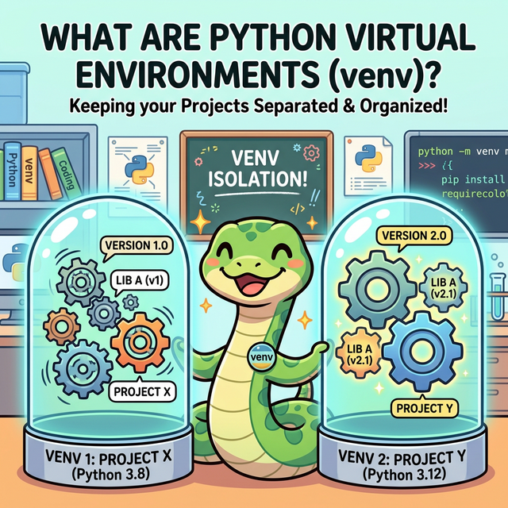
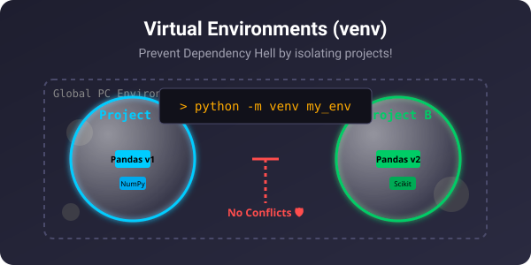

# 10주차: 모듈과 패키지 - 대규모 프로젝트 개발의 기초 📦

다양한 파이썬 코드를 기능별로 쪼개어 보관하는 **모듈(Module)**과 이들의 묶음인 **패키지(Package)**, 그리고 충돌 없는 가상환경 개발 장부인 **가상환경(venv)**의 모든 작동 원리를 배웁니다.

---

## 학습목표
내가 짠 파이썬 코드 길이가 수백 줄을 넘어가면, 마치 수학의 인수분해처럼 코드를 의미 있는 단위(파일)로 쪼개어 다른 파일에서 수입(`import`)해 쓰는 아키텍처적 사고가 필요합니다. 본 장에서는 나만의 커스텀 모듈을 만들 때 필수적인 흑마법 방어막 **`if __name__ == "__main__":`** 의 정체를 파악합니다. 나아가 데이터 분석 여정에서 피할 수 없는 '의존성 지옥(Dependency Hell)'을 막아주는 안전한 방공호, **가상환경(`venv`)**과 패키지 관리장부(`requirements.txt`) 세팅법을 확립합니다.


<div align="center">
  
</div>

---

## 💡 TL;DR (1분 핵심 요약)

*   **커스텀 모듈**: 내가 짜놓은 `my_math.py` 파일은 언제든 다른 파일에서 `import my_math` 로 불러와 쓸 수 있는 훌륭한 부품이 됩니다.
*   **`__name__ == "__main__"`**: 내가 직접 이 파일을 실행했을 때만 동작하고, 남이 나를 `import` 해서 부품으로 쓸 때는 함부로 켜지지 않게 막아주는 방어막 씰(Seal)입니다.
*   **`venv` (가상환경)**: A 프로젝트는 Pandas 1.0이, B 프로젝트는 Pandas 2.0이 필요할 때 파이썬끼리 싸우지 않도록 폴더마다 독립된 원룸을 배정해주는 기술입니다.

---

## 1. 나만의 모듈(Module) 만들기 기초

파이썬에서는 거창한 선언 없이, **그저 `.py` 확장자로 저장한 모든 파일이 모듈(Module)**이 됩니다.

**[상황]**
같은 폴더에 두 개의 파이썬 파일이 존재합니다.
1. `my_tools.py` (도구를 모아놓은 창고 파일)
2. `main.py` (실제 도구를 가져다 쓰는 사령부 파일)

### `my_tools.py` 작성
```python
# my_tools.py
def add(a, b):
    return a + b

def multiply(a, b):
    return a * b

print("my_tools 공장이 가동되었습니다!")
```

### `main.py` 에서 불러다 쓰기
```python
# main.py
import my_tools

# 남의 파일(모듈)에 있는 함수 사용하기!
result = my_tools.add(10, 20)
print(f"결과: {result}")
```

> **🚨 문제 발생!**
> `main.py`를 실행하면 콘솔에 다음과 같이 뜹니다.
> ```text
> my_tools 공장이 가동되었습니다!
> 결과: 30
> ```
> 나는 단순히 함수 부품만 가져오고 싶었는데(`import`), 파이썬은 모듈을 import 하는 순간 그 파일 전체를 한 번 스윽 읽어버립니다. 그래서 원치 않던 `print` 문까지 강제로 터져버리는 부작용이 생깁니다.

---

## 2. 방어막 전개: `if __name__ == "__main__":`

위와 같은 "부작용 터짐 현상"을 막기 위해 파이썬 창시자들이 만들어 둔 룰이 있습니다. 바로 **"이 코드가 직접 실행된 진짜 주인공(Main) 일 때만 작동하라!"**라는 마법의 주문입니다.

### `my_tools.py` 수정본 (방어막 적용)
```python
# my_tools.py
def add(a, b):
    return a + b

# ---- 흑마법 방어막 경계선 ----
if __name__ == "__main__":
    # 이 아래의 코드들은 'my_tools.py'를 [직접 실행] 했을 때만 작동합니다.
    # 남이 import 해서 쓸 때는 코딱지도 건드려지지 않고 철저히 무시됩니다!
    print("my_tools 공장이 [직접 실행]으로 가동되었습니다!")
    print(add(5, 5))
```

이제 다시 `main.py`를 실행해 보면, 쓸데없는 프린트 문장이 뜨지 않고 깔끔하게 덧셈 결과만 출력됩니다!

---

## ☕ Java vs 🐍 Python 스나이퍼 대결

**진입점(Entry Point) 비교**

*   **Java**: 프로그램이 무조건 시작되는 지점은 `public static void main(String[] args)` 라는 거대한 선언문이 독점합니다.
*   **Python**: 파일 실행 시 묻지도 따지지도 않고 최상단부터 순차 실행됩니다. 단축키 격인 보이지 않는 `__name__` 변수에 파이썬이 몰래 `"__main__"` 이라는 명찰을 달아줍니다. 남에게 부품으로 불려왔을 때는 명찰이 `"__main__"` 이 아니기 때문에 방어벽(`if`)을 뚫을 수 없습니다.

---

## 3. 의존성 지옥과 가상환경(Virtual Environment)

실무 개발에서는 여러 외주 프로젝트를 동시에 뜁니다. 
*   A 회사 프로젝트: 원시적인 `Pandas v0.25` 구버전이 필요함
*   B 회사 프로젝트: 최신 `Pandas v2.2` 신버전이 필요함

이때 내 컴퓨터 파이썬 폴더에 `pip install pandas`를 함부로 때리면, 이전 버전을 갈아엎고 신버전만 깔리면서 A 회사 프로젝트에 접속하는 순간 에러를 뿜으며 대폭발(Dependency Hell)합니다. 

이를 막기 위해 파이썬은 해당 소스코드 폴더 안에 **나만의 원룸(가상환경)**을 파주는 `venv` 모듈을 기본 제공합니다.

### 🛠️ 필수 가상환경 세팅 3단계 명령 (터미널)

1. **내 방(원룸) 계약하기 (생성)**
   ```bash
   python -m venv my_env
   # 작업 폴더 안에 'my_env' 라는 작은 파이썬 복사본 폴더가 통째로 지어집니다.
   ```

2. **내 방 불 켜기 (활성화 - Windows VS Code 기준)**
   ```bash
   my_env\Scripts\activate
   # 터미널 프롬프트 앞에 (my_env) 라는 녹색 마크가 뜨면 성공! 이제부터 까는 패키지는 내 컴퓨터(Global)가 아니라 이 원룸에만 격리되어 깔립니다.
   ```

3. **원룸에 가구(패키지) 들여놓기**
   ```bash
   (my_env) pip install pandas matplotlib
   ```

### 📄 영수증 발급: `requirements.txt`

이 프로젝트를 남(팀원 구글 드라이브나 GitHub)에게 넘길 때, 쓸데없이 수백 메가바이트짜리 가상환경 폴더(`my_env`)를 통째로 압축해 보내면 욕을 먹습니다. 
대신, "이 프로젝트를 돌리려면 이 가구(버전) 목록이 필요합니다"라는 **영수증 파일**만 뽑아서 소스코드와 함께 한 장 떨궈주면 됩니다.

*   **영수증 발급 (내가 치는 명령어)**
    ```bash
    pip freeze > requirements.txt
    ```
*   **영수증대로 가구 자동 세팅 (팀원이 치는 명령어)**
    ```bash
    pip install -r requirements.txt
    ```

---

## 🎧 Vibe Coding

> **🗣️ 학생 프롬프트 (AI에게 이렇게 명령해 보세요):**
> "파이썬 `venv` 가상환경을 잡았는데 터미널에서 빨간색으로 `PSSC 실행 정책 요류 (허가되지 않은 스크립트 실행 불가)` 같은 보안 에러 뜨면서 `activate`가 안 먹혀. 이거 윈도우 파워쉘 보안 문제 같은데 어떻게 우회해서 켤 수 있는지 알려줘." *(💡 VS Code 초기 세팅 시 가장 많이 부딪히는 실전 버그 투표 1위입니다!)*

---

## 코딩 영단어 학습 📝

*   **Dependency Hell (디펜던시 헬)**: 의존성 지옥. (내 코드가 A모듈에 의존하고, A모듈은 B모듈 버전1에 의존하는데, 내가 새로 깐 C모듈이 B모듈 버전2를 깔아 덮어버리면서 전체 프로그램이 연쇄 붕괴하는 악몽 같은 상황입니다. 가상환경이 피난처입니다.)
*   **Virtual Environment (버추얼 엔바이런먼트 / venv)**: 가상 환경. (현실의 내 컴퓨터(자원)를 더럽히지 않고 샌드박스처럼 격리된 파이썬 실행 환경. 폴더 단위로 1채씩 지어집니다.)
*   **Freeze (프리즈)**: 얼리다, 고정하다. (`pip freeze`는 지금 당장 내 원룸에 깔려있는 패키지와 그 정확한 버전 번호(예: `pandas==2.0.3`)를 스냅샷 사진 찍듯 딱 얼려서 출력해주는 명령어입니다.)

---

## ✍️ 이번 주 연습 문제

**문제 1.** `.venv` 가상환경을 구축하고 이를 터미널에서 활성화하는 명령어를 macOS와 Windows 각각에 맞추어 정리해 보세요.

**문제 2.** `calc.py`라는 모듈을 만들고 덧셈/뺄셈 함수를 작성한 뒤, 이 모듈이 직접 실행될 때만 실행되는 테스트 코드를 `if __name__ == "__main__":` 문을 활용해 구현해 보세요.

**문제 3.** (심화) `sys.path`의 정체가 무엇이며, 파이썬이 임포트할 모듈을 검색할 때 이 리스트가 어떤 역할을 하는지 3단계 검색 메커니즘을 들어 설명해 보세요.

---

## 📖 교재 상세 학습: 24 내장 모듈 가져다 쓰기 (import)

## 24 남이 만든 훌륭한 도구 빌려오기: 모듈과 import

진정한 개발자라면 모든 기능을 바닥부터 스스로 짜는 수고를 덜어야 합니다. 파이썬 생태계에는 이미 수학 연산, 무작위 뽑기 기능, 웹 통신 기능 등을 담아둔 수많은 마법의 상자가 완벽하게 준비되어 있습니다. 
우리는 이런 완성된 도구 상자들을 가리켜 **모듈(Module)**이라고 부릅니다.

내 파이썬 스크립트 안으로 이런 외부 도구를 영입해 오는 필수 명령어가 바로 **`import`**입니다.

#### 1. math 모듈: 정교한 수학 공학용 계산기
원주율(파이, $\pi$)을 소수점 끝까지 직접 외워서 3.1415... 라며 타이핑할 필요가 전혀 없습니다. 파이썬의 핵심 수학 관련 모듈인 `math`를 불러서 맡기면 됩니다.

**REPL 실습: math 모듈 써보기**
```python
>>> import math
>>> r = 10
>>> circle_area = math.pi * r * r  # pi 상수를 이용한 원의 넓이
>>> print(circle_area)
314.1592653589793
```
모듈이 품고 있는 특정 기능이나 변수를 호출하려면 항상 **`모듈명.기능명`** 형식처럼 중간에 마침표(`.`)로 다리를 놔주어야 합니다.
`math` 모듈 안에는 억지로 소수점을 끌어올리는 올림 함수 `math.ceil()`과, 냉정하게 깎아내리는 내림 함수 `math.floor()` 등 유용한 도구들이 가득합니다.

> **⚠️ 팁:** 일반적으로 실생활에서 자주 쓰이는 '반올림' 연산은 굳이 `math` 모듈을 임포트하지 않아도 되는 파이썬의 영구 내장 함수 `round()`가 기본 담당하고 있습니다.

#### 2. random 모듈: 예측 불가능한 주사위 굴리기
RPG 게임에서 드랍되는 몬스터의 아이템이나 오늘 점심 메뉴를 무작위로 고르려면 `random` 모듈이 필수적입니다.
그중에서도 리스트 내부에 늘어선 여러 후보 중 하나를 임의로 콕 집어주는 `choice` 함수는 매우 활용도가 높습니다.

**코드: random_picker.py**
```python
import random

lucky_numbers = [7, 12, 23, 31, 40, 45]
my_pick = random.choice(lucky_numbers)
print(f"시스템이 추천하는 오늘의 번호는: {my_pick}")
```

#### 3. 통신 모듈로 인터넷 훔쳐보기 (맛보기)
파이썬 기본 내장 모듈들의 기능은 무궁무진합니다. 심지어 인터넷 사이트의 코드(HTML)를 단 몇 줄의 코딩으로 쭉 빨아들이는 것도 가능합니다. (아래 코드는 "이렇게도 쓸 수 있구나" 정도로 감상만 하고 넘어가시면 됩니다.)

**코드: 웹 페이지 데이터 추출 맛보기**
```python
import urllib.request

target_url = "http://example.com/"
response_data = urllib.request.urlopen(target_url)
print(response_data.read().decode('utf-8'))
```
이렇듯 단 한 줄의 `import` 구문은 내 코드를 전 세계 파이썬 고수들이 쌓아올린 거대한 지식의 탑과 연결해 줍니다.

---

### 💻 미니 실습: 외부 모듈 활용하기

**Quiz 1** `math` 모듈을 제일 먼저 불러온 뒤, `50.7`이라는 실수의 소수점을 무자비하게 날려버리는(내림 연산) 함수를 찾아내 터미널에 결과를 띄워보세요.

---
<details>
<summary><b>모범 답안 보기</b></summary>

**풀이 1**
```python
import math
print(math.floor(50.7))  # 결과: 50
```
</details>


---

## 📖 교재 상세 학습: 25 나만의 모듈 직접 만들기

## 25 나만의 전용 특수 모듈 개발하기

파이썬 개발자들이 만들어 둔 모듈만 받아 쓰려니 조금 아쉽지 않나요? 내가 심혈을 기울여 만든 유용한 함수나 중요한 데이터들을 잘 모아서 묶어둔 평범한 파이썬 스크립트 파일(`.py`) 하나하나가 모두 훌륭한 **독자적 모듈**로 대우받습니다! 관련 있는 여러 모듈 폴더를 모아놓은 거대한 묶음은 **패키지(Package)**라고 부릅니다.

나만의 도구상자 파일을 직접 창조해 봅시다.

#### 1단계: 도구 상자(모듈 파일) 기획 및 제작
내가 코딩을 하는 작업 폴더 아래에 `my_toolkit.py` 라는 새로운 파이썬 파일을 생성하고, 여기저기서 편하게 꺼내 쓸 만한 상숫값이나 함수들을 선언해 줍니다.

**제작할 코드: my_toolkit.py**
```python
# 향후 여러 스크립트에서 공용으로 돌려 쓸 나만의 도구 창고입니다.
MAX_WIND = 15
SERVER_LIMIT = 100

def greet_user(nickname):
    return f"환영합니다, {nickname} 님! 서버에 접속하셨습니다."

def throw_dice():
    import random
    return random.choice([1, 2, 3, 4, 5, 6])
```

#### 2단계: 메인 파일에서 도구상자 불러 쓰기
이제 방금 만든 공간 파일과 동일한 디렉토리에 메인 로직을 담당할 `game_start.py` 파이썬 파일을 추가합니다. 그리고 맨 윗줄에서 아까 지어준 파일 이름을 `import`로 소환하기만 하면 끝입니다.

**활용할 코드: game_start.py**
```python
import my_toolkit  # 중요: 뒤에 .py 확장자는 절대로 붙여선 안 됩니다!

# 만든 모듈 파일에서 글로벌 변수 꺼내기
print(f"현재 채팅방 최대 수용 인원은 {my_toolkit.SERVER_LIMIT}명 입니다.")

# 만든 모듈 파일에서 함수(기능) 빌려 쓰기
welcome_msg = my_toolkit.greet_user("파이썬초보")
print(welcome_msg)

dice_val = my_toolkit.throw_dice()
print(f"내가 굴린 주사위 눈금: {dice_val}")
```

이 `game_start.py`를 실행하면, 아까 다른 파일에서 설계했던 기능들이 한 치의 오차 없이 완벽하게 구동되는 것을 목격할 수 있습니다. 이 기법을 도입하면 수천 줄짜리 코드를 기능별로 쪼개어 파일로 관리하는 '코드의 분업화'가 비로소 완성됩니다.

---

#### 💡 파이썬 모듈의 숨겨진 원리: `__main__`과 공간 분리
* **`__name__ == "__main__"` 테스트 블록**
파이썬은 어떤 스크립트 파일이 에디터 등에서 **직접 실행**되었을 때만 그 파일의 내장 변수인 `__name__`에 `"__main__"`이라는 특별한 문자표를 부여해 줍니다. 반대로 `import`를 통해 남의 파일로 불려 들어갔을 때는 진짜 자기 파일 이름표를 가집니다. 이를 응용해 모듈 제작 시 아래와 같은 테스트 뼈대를 맨 밑에 자주 숨겨둡니다.

```python
# my_toolkit.py 맨 밑에 추가됨
if __name__ == "__main__":
    # 이 부분은 내가 이 파일을 '단독으로' 실행해 볼 때만 테스트용으로 작동합니다.
    # game_start.py에서 나를 import 할 때는 이 코드가 몰래 무시되고 넘어갑니다.
    print(throw_dice())
```

* **네임스페이스(Namespace)에 의한 독립성**
모듈 파일에서 선언한 변수나 함수들은 모두 해당 모듈만의 철저히 독립적인 **네임스페이스(이름 공간)**에 안전하게 갇히게 됩니다. 그래서 여러분이 A 모듈과 B 모듈에 모두 `MAX_WIND = 10`이라고 똑같은 변수 이름을 만들더라도, 절대로 서로 충돌하거나 망가지지 않고 완벽한 독립 상태가 유지됩니다.

* **패키지 조립을 위한 특별한 예약어 (`__init__.py`)**
나중에 여러 모듈을 하나의 거대한 `my_game` 폴더(패키지) 안에 체계적으로 분류하고 싶다면, 파이썬에게 "여기는 평범한 폴더가 아니라 관련 코드를 묶어놓은 패키지 폴더입니다!"라고 알려주어야 합니다. 이를 위해 폴더 안에 내용이 텅 빈 **`__init__.py`** 라는 마법의 파일을 하나 쓱 만들어 두는 것이 개발자들의 모범 사례입니다. (파이썬 3.3부터는 없어도 되지만 명확한 구조 구분을 위해 생성해 두는 것을 강력히 추천합니다.)

---

#### 🚨 모듈 기획 시 지켜야 할 철칙

1. **`.py` 이름표는 떼고 부를 것**
   다른 스크립트에서 모듈을 부를 때 `import my_toolkit.py`라고 부르면 파이썬은 모듈을 인식하지 못하고 문법 에러를 토합니다. 오직 파일의 순수 '이름' 부분만 호명해야 합니다.
2. **같은 보금자리에 둘 것**
   현재 초급 단계에서는, 부품 역할을 하는 도구 상자 파일(`my_toolkit.py`)과 전체를 관장하는 메인 파일(`game_start.py`)이 기필코 **같은 폴더 안**에 이웃하고 있어야 파이썬 엔진이 손쉽게 파일을 주워 담을 수 있습니다.
3. **유명한 거인들의 이름을 사칭하지 말 것**
   파이썬이 태생적으로 품고 있는 공식 모듈들과 똑같은 파일명을 내 모듈에 붙이면 절대 안 됩니다. 예를 들어 내 파일 이름을 실수로 `math.py` 나 `sys.py`로 짓고 실행하면, 파이썬이 원래의 진짜 모듈 대신 내 빈 깡통 파일을 우선으로 잘못 불러오게 되어 시스템이 망가지는 치명적 장애가 생길 수 있습니다! 항상 겹치지 않는 독창적인 파일명(예: `math_custom.py`)을 선호하세요.


---

## 📖 교재 상세 학습: 59 시간의 흐름을 지배하는 모듈: datetime

## 59 특정 시점(Point in Time)의 좌표를 포착하다: datetime 모듈
</div>

#### 현실의 현재 시각 스캔하기
우리가 스마트폰 액정을 켜서 시계를 힐끗 보듯, 파이썬 스크립트 도중에도 `datetime` 시스템을 호출해 현재 흐르고 있는 우주의 정확한 시각을 포착해 낼 수 있습니다.

**REPL 실습 창: 시간아 멈춰라!**
```python
>>> import datetime # 시간 관리 전담 부서를 호출합니다.
>>> current_time = datetime.datetime.now()
>>> current_time
datetime.datetime(2023, 10, 24, 15, 30, 0, 123456)
```
출력된 좌표는 왼쪽부터 차례대로 `연도, 월, 일, 시각, 분, 초, 미세한 마이크로초` 단위까지 정밀하게 쪼개져 있습니다.

#### 내 맘대로 과거나 미래 특정 좌표 세팅하기
마치 타임머신 계기판에 가고 싶은 연도를 입력하거나 폰 알람을 내일 아침으로 직접 맞추는 것처럼, 프로그래머가 인위적으로 날짜와 시간을 강제로 부여해 인스턴스(시간 캡슐)를 찍어낼 수도 있습니다.

**REPL 실습 창: 타임머신 좌표 설정**
```python
>>> target_date = datetime.datetime(2024, 1, 1) # 내년 1월 1일 자정으로 세팅!
>>> target_date
datetime.datetime(2024, 1, 1, 0, 0)
```

#### 시점 사이의 간격 측정하기 (남은 D-Day 계산)
우리가 설정한 새해 첫날(`target_date`)이 현재 시점(`current_time`)으로부터 도대체 얼마나 남았는지 산술적으로 빼기를 하면 그 거리를 적나라하게 측정할 수 있습니다.

**REPL 실습 창: 디데이 폭파 시간 계산기**
```python
>>> gap = target_date - current_time
>>> gap
datetime.timedelta(days=68, seconds=30600, microseconds=876544)
>>> print(f"새해까지 정확히 {gap.days}일 남았네요!")
새해까지 정확히 68일 남았네요!
```

이 연산을 거쳐 탄생한 녀석은 더 이상 콕 집은 '시점(`datetime`)'이 아닙니다. 두 점액통 사이를 연결하는 "순수한 기간과 길이"만을 의미하는, 시계열의 또 다른 황태자 **`timedelta`** 타입으로 변모합니다.

---

### 💻 미니 실습: 나만의 D-Day 자동 계산기

**Quiz 1** 여러분이 간절히 기다리는 특정 기념일(예: 2024년 10월 31일 할로윈)을 `event_day` 변수에 좌표로 찍어두고, 평범한 오늘 시점 기준으로 대체 며칠이나 참아야 하는지 숫자만 쿨하게 출력해 내는 스크립트를 짜보세요.

<details>
<summary><b>모범 답안 보기</b></summary>

**풀이 1**
```python
import datetime

# 올해 할로윈 파티를 디데이 타겟으로 세팅!
event_day = datetime.datetime(2024, 10, 31)
today_now = datetime.datetime.now()

# 두 시간 좌표를 빼서 순수 '간격(길이)'을 뽑아낸 뒤, '.days' 속성으로 날짜 수만 쏙 빼냅니다.
remaining_days = (event_day - today_now).days

print(f"광란의 할로윈 파티까지 고작 {remaining_days}일 남았습니다.")
```
</details>

<br>

<div align="center">
  


---

## 📖 교재 상세 학습: 60 덩어리진 시간을 덧붙이고 빼기: timedelta

## 60 덩어리진 시간(Duration)을 마음대로 조종하기: timedelta
</div>

앞서 배운 `datetime.datetime` 모듈이 거대한 우주 달력에 압정을 콱 박아 표시한 **콕 집은 특정 시점(좌표)**이라면, 이번에 다룰 `datetime.timedelta`는 하루, 열흘, 혹은 365일 같이 쭉 뻗은 **길이나 양(Duration)** 그 자체를 의미합니다.

과거나 현재의 특정 '시점' 좌푯값에 이 '길이' 덩어리를 더하면, 미래에 도달할 새로운 좌푯값을 너끈히 알아낼 수 있습니다!

#### 사귄 지 100일째 되는 기념일 파워 로직 계산
방금 막 1일 차가 된 풋풋한 커플이 100일 파티를 예약할 날짜는 정확히 언제 며칠일까요?

**REPL 실습 창: 기념일 계산기**
```python
>>> import datetime
>>> current_date = datetime.datetime.now()

# '100일'이라는 압도적인 덩어리(길이)를 창조해 냅니다.
>>> hundred_span = datetime.timedelta(days=100)

# 현재 달력 시점(좌표) + 100일(길이) = 다가올 미래의 도착일(좌표)
>>> party_day = current_date + hundred_span
>>> print(f"두근두근 100일 기념일은 {party_day.year}년 {party_day.month}월 {party_day.day}일입니다!")
두근두근 100일 기념일은 2024년 2월 1일입니다! (실행하는 시능에 따라 결괏값은 요동칩니다)
```

#### 아침 9시 정각으로 고집스럽게 고정하기 (`replace`)
특정 디데이 계산기나 업무용 타이머의 기준이 늘 '오전 9시 정각 출근 시간'이라면, 날짜를 뭉텅이로 더하기 전에 엉망인 현재 시, 분, 초 단위들을 오전 9시로 강제 덮어쓰기(`replace`) 해두면 계산이 아주 깔끔하게 떨어집니다.

**REPL 실습 창: 시간 리셋의 연금술**
```python
# 지금 우주 시계가 오후든 새벽이든 무시하고, '시, 분, 초'를 무자비하게 09:00:00 으로 억지로 밀어버립니다.
>>> today_work_start = datetime.datetime.now().replace(hour=9, minute=0, second=0)

# 이 깨끗하게 리셋된 상태에서 1일이라는 '길이'를 살포시 더해주면, 한 치의 오차도 없이 완벽한 낼 아침 9시 좌표가 툭 튀어나옵니다.
>>> tomorrow_work_start = today_work_start + datetime.timedelta(days=1)
```

달력을 보며 손가락으로 짚어가던 복잡한 아날로그 방식은 버리세요. 이제 여러분은 `datetime` 클래스와 `timedelta` 클래스의 이중 플레이를 통해 완벽한 시간의 지배자로 거듭났습니다.

---

### 💻 미니 실습: 업무 마감일 수명 연장 프로젝트

**Quiz 1** 여러분의 과한 업무를 위해 오늘 자정 직전인 밤 11시 59분 59초에 맞춰진 `death_line` 변수를 하나 생성하세요. 그런 다음, 이 피 말리는 `death_line`에 은혜롭게도 정확히 **단 7일의 시간**을 극적으로 연장해 준 `new_death_line` 변수를 탄생시키고 그 은총 가득한 날짜를 출력해 보세요.

<details>
<summary><b>모범 답안 보기</b></summary>

**풀이 1**
```python
import datetime

# 1. 오늘 날짜를 기준으로 시간 파츠만 23시 59분 59초로 가혹하게 튜닝합니다.
death_line = datetime.datetime.now().replace(hour=23, minute=59, second=59)

# 2. 7일 치만큼의 생명줄(길이 단위)을 덧붙여줍니다!
new_death_line = death_line + datetime.timedelta(days=7)

print(f"극적으로 연장된 새로운 데드라인은 {new_death_line} 입니다. 살았다!")
```
</details>


---

## 📖 교재 상세 학습: 4. 모듈(Module)과 패키지(Package)

## 4. 모듈(Module)과 패키지(Package)

프로그램의 덩치가 커지면 모든 코드를 하나의 파일에 담아둘 수 없습니다. 파이썬에서는 관련 있는 함수와 클래스들을 하나의 파이썬 파일(`.py`)로 묶어 **모듈(Module)** 단위로 관리하며, 여러 모듈들을 다시 하나의 폴더로 묶은 것을 **패키지(Package)**라고 부릅니다.

### 4.1 `import` 구문의 활용

외부에 작성된 파이썬 모듈을 현재 내 코드에서 불러와 사용하려면 `import` 문을 사용합니다. 파이썬이 기본으로 제공하는 내장 모듈들(예: `math`, `os`) 뿐만 아니라 개발자가 직접 만든 파일들도 동일한 방식으로 호출할 수 있습니다.

#### 다양한 import 방식

1. **모듈 전체 불러오기**
   ```python
   import math
   print(math.pi) # 3.141592...
   ```
2. **별칭(alias) 지정하기**
   ```python
   import pandas as pd
   ```
3. **특정 요소만 골라서 불러오기**  
   모듈 이름 대신 내부의 객체 이름만으로 직접 접근하고 싶을 때 사용합니다.
   ```python
   from math import sin, pi
   print(sin(pi / 2)) # 1.0
   ```

> [!TIP]
> `import` 문은 원칙적으로 파이썬 스크립트 파일의 맨 최상단에 모아서 작성하는 것(PEP 8 권장)이 모범 사례입니다. 가독성을 높이고 의존성을 한눈에 파악할 수 있기 때문입니다.

---

### 4.2 메인 모듈의 시작점 ( `__main__` )

자바(Java)나 C언어에는 프로그램의 진입점을 알리는 고정된 `main()` 함수가 존재하지만, 파이썬은 파일이 곧바로 실행되는 스크립트 특성을 가집니다. 

파이썬 인터프리터는 현재 **직접 실행된** 최초의 파이썬 파일 객체에 한해서만 `__name__` 이라는 특수 변수에 `"__main__"` 이라는 문자열표시를 부여해 줍니다. 반면 `import` 로 불려온 파일의 `__name__` 에는 본래 파일명(모듈명)이 들어갑니다.

```python
# calculator.py
def add(a, b):
    return a + b

# 이 파일이 외부에서 import된 것이 아니라 직접 실행(python calculator.py)될 때만 아래 블록이 실행됩니다.
if __name__ == "__main__":
    result = add(10, 20)
    print("단독 실행 테스트 결과:", result)
```
이 패턴은 자신이 작성한 모듈을 테스트하는 용도로도 널리 사용됩니다.

---

### 4.3 모듈 네임스페이스 점검 (`globals`, `locals`)

현재 활성화된 컨텍스트 공간에 어떤 변수와 함수들이 로드되어 있는지 상태를 스캔하기 위해 내장 함수를 사용할 수 있습니다.

- `globals()`: 현재 모듈 파일 전체의 변수 목록을 딕셔너리로 반환합니다.
- `locals()`: 현재 위치한 스코프(함수 내부 등)의 지역 변수 목록을 반환합니다.

```python
x = 100

def check_space(y):
    print("지역:", locals())

check_space(200) # 출력: 지역: {'y': 200}
print("전역 x 확인:", globals()['x']) # 100
```

---

### 4.4 패키지(Package) 아키텍처 구성

관련 모듈들(`.py`)을 디렉터리로 묶어 구조화하려면 해당 디렉터리 내부에 반드시 **`__init__.py`** 라는 특별한 파일을 생성해 두어야 합니다. (파이썬 3.3 이후부터는 없어도 암묵적 패키지로 취급하지만, 호환성과 명시성을 위해 선언하는 것을 권장합니다.)

#### 구조 예시
```text
my_game/                  # Top-level 패키지 디렉터리
    __init__.py
    sound/                # Sub-package
        __init__.py
        effects.py
        bgm.py
    graphic/              # Sub-package
        __init__.py
        render.py
```

이렇게 계층화된 패키지는 점(`.`) 연산자를 통해 경로를 거슬러 올라가며 모듈을 자유롭게 엮어 쓸 수 있습니다.
```python
import my_game.sound.effects
# 또는
from my_game.graphic import render
```


---

## 📖 교재 상세 학습: 5. 네임스페이스 (Namespace) 심화

## 5. 네임스페이스 (Namespace) 심화

앞서 파이썬은 변수 이름과 실제 객체(데이터)를 서로 연결(Binding)하여 관리한다고 배웠습니다. 이렇게 연결된 "이름표"들이 모여있는 격리된 저장 공간을 **네임스페이스(Namespace)**라고 부릅니다. 

네임스페이스는 내부적으로 파이썬의 핵심 딕셔너리(`dict`) 구조로 구현되어 있으며, 변수의 이름이 Key가 되고 변수에 할당된 객체가 Value가 됩니다.

### 5.1 네임스페이스에 할당과 조회

모듈(.py 파일) 수준에서 변수를 만들거나, 함수 문법(`def`)을 통해 함수를 선언하거나, 클래스 문법(`class`)을 통해 클래스를 선언하면 모두 이 네임스페이스에 각자의 이름표가 등록됩니다.

다시 한 번 전역 네임스페이스를 관리해주는 내장 함수 `globals()` 를 이용해 작동 원리를 살펴보겠습니다.

```python
# 일반 변수 등록
system_mode = "Production"

# 함수 등록
def calculate_tax():
    pass

# 클래스 등록
class Customer:
    pass

# 현재 네임스페이스(globals)에 등록된 모든 이름들을 조회해 볼 수 있습니다.
print(list(globals().keys())[-3:])
# 출력 결과: ['system_mode', 'calculate_tax', 'Customer']
```
우리가 정의한 변수부터 함수, 심지어 클래스의 이름까지 빠짐없이 딕셔너리의 Key로 등록된 것을 볼 수 있습니다.

---

### 5.2 전역 접근 규칙과 독립성

각 파이썬 모듈 파일(`.py`)은 태생적으로 **자신만의 고유한 전역(Global) 네임스페이스**를 갖습니다. 즉, A 모듈과 B 모듈에 동일한 이름표(예: `x = 100`)가 존재하더라도, 두 이름표는 완전히 격리된 별개의 공간에서 관리되므로 서로 충돌하지 않습니다. 

#### 함수가 바라보는 전역 네임스페이스의 기준

가장 헷갈리기 쉬운 부분은, 모듈 안에 정의된 함수가 변수를 검색할 때 바라보는 전역 공간의 기준입니다.

```python
# file_A.py 모듈
base_value = 100

def print_value():
    print(base_value)

# -----------------

# file_B.py 모듈 (현재 실행 중인 파일)
import file_A

base_value = 500

# 외부 모듈의 함수를 호출
file_A.print_value() 
# 출력은 500이 아니라 100이 됩니다!
```

> [!IMPORTANT]
> 함수는 외부 파일에서 불러와서(`import`) 실행하더라도, 언제나 자신이 **최초에 태어난 원본 모듈(위 예제의 file_A)**의 전역 네임스페이스를 최우선으로 검색합니다. 따라서 현재 실행 중인 파일(`file_B`)에서 변수값을 덮어쓰더라도 원본 모듈의 함수에는 아무런 영향을 주지 못합니다.


---

## 📖 교재 상세 학습: 6. 단순한 네임스페이스 활용

## 6. 단순한 네임스페이스 활용

앞에서 배운 파이썬의 네임스페이스 메커니즘을 보다 직관적으로 이해하고 구조화된 데이터 묶음을 쉽게 만들기 위해, 파이썬 표준 라이브러리인 `types` 모듈은 `SimpleNamespace` 라는 유용한 클래스를 제공합니다.

이번 장에서는 이 간단한 구조체가 어떻게 작동하는지 알아보고, 이와 유사한 형태의 데이터 관리 클래스를 직접 구현해 보겠습니다.

### 6.1 `types.SimpleNamespace` 기본 사용법

`SimpleNamespace`는 이름 그대로 기능이 거의 없이 오로지 **변수 이름표(속성)들을 묶어서 보관하기 위한 빈 껍데기** 역할을 합니다. 딕셔너리(`dict`)와 매우 유사하게 작동하지만 딕셔너리의 키에 점(`.`) 연산자로 접근할 수 있어 가독성이 뛰어납니다.

```python
import types

# 1. 속성을 주입하며 인스턴스 생성
user_info = types.SimpleNamespace(name="Alice", role="Admin")

print(type(user_info)) # <class 'types.SimpleNamespace'>
print(user_info.name)  # "Alice"

# 2. 런타임에 동적으로 속성 추가하기
user_info.level = 99

# 내부 네임스페이스 점검
print(user_info.__dict__)
# 출력: {'name': 'Alice', 'role': 'Admin', 'level': 99}
```

---

### 6.2 SimpleNamespace 작동 방식 모방하기

내부적으로 `SimpleNamespace` 가 어떻게 구성되어 있는지 원리를 파악하기 위해, 파이썬의 기본 클래스로 유사한 동작을 하는 클래스를 직접 정의해 볼 수 있습니다.

파이썬의 모든 클래스 인스턴스는 내부에 `__dict__` 라는 딕셔너리를 몰래 가지고 있으며, 이 공간이 곧 그 인스턴스의 네임스페이스입니다. 이 원리를 활용하여 객체가 생성될 때(`__init__`) 넘겨받은 값들을 즉시 이 딕셔너리에 합치도록(Update) 구현합니다.

```python
class CustomNamespace:
    def __init__(self, **kwargs):
        # 넘겨받은 모든 키워드 인자들을 이 인스턴스의 네임스페이스에 통째로 붓습니다.
        self.__dict__.update(kwargs)

    def __repr__(self):
        # 객체를 출력할 때 예쁘게 보여주기 위한 장치
        keys = sorted(self.__dict__.keys())
        items = [f"{k}={repr(self.__dict__[k])}" for k in keys]
        return f"{type(self).__name__}({', '.join(items)})"

# 직접 만든 클래스 테스팅
config = CustomNamespace(host="localhost", port=8080)

print(config.host) # "localhost"
config.timeout = 30

print(repr(config))
# 출력: CustomNamespace(host='localhost', port=8080, timeout=30)
```

이와 같이 파이썬은 변수와 값이 매칭되는 "이름표 바구니(`__dict__`)" 구조를 통해 모든 메커니즘이 투명하고 일관성 있게 운영됩니다.
