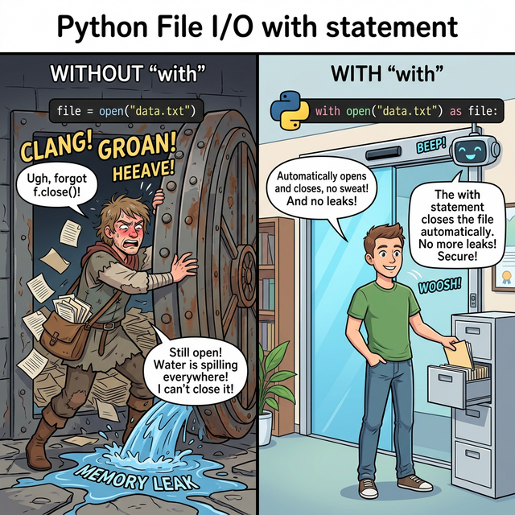
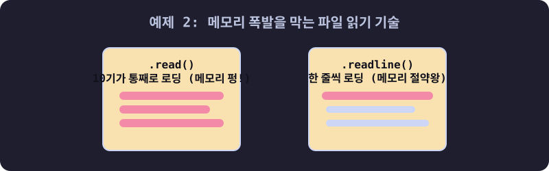
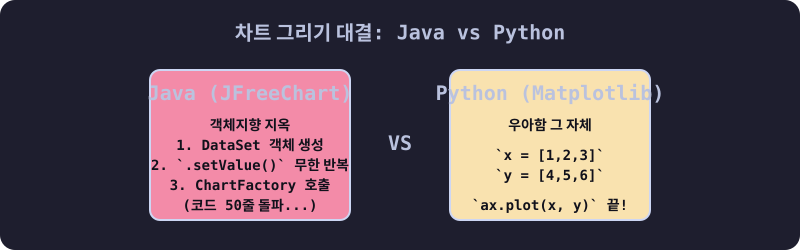
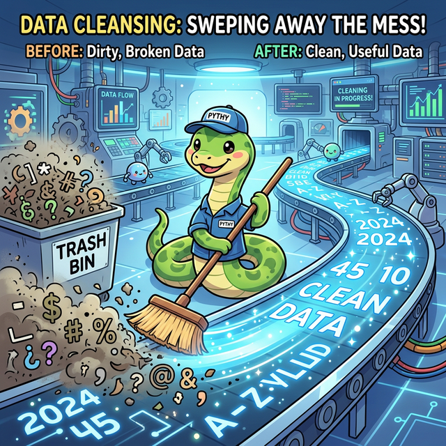
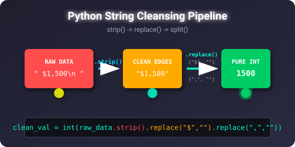

# 11주차: 파일 입출력 - 데이터 영구 보관과 파이썬 데이터 분석 실습 💾

데이터를 영구 보관하기 위해 하드디스크에 파일을 읽고 쓰는 원리와 파이썬의 안전장치인 **컨텍스트 매니저**, 그리고 읽어온 문자열을 다듬고 클렌징하는 **문자열 가공(정규 표현식 등)**과 **Matplotlib 시각화** 기법을 마스터합니다.

---


지금까지 배운 파이썬의 변수, 리스트, 제어문은 모두 컴퓨터의 **메모리(RAM)** 위에서 임시로 돌아가다가 프로그램이 꺼지면 흔적도 없이 증발하는 지식이었습니다. 

## 학습목표
본 장부터는 데이터 분석의 진정한 첫걸음인 **파일 입출력(File I/O)**을 배웁니다. 내 하드디스크에 영구적으로 누적된 텍스트나 엑셀(CSV) 파일을 파이썬 공장으로 빨아들이고(`Read`), 파이썬에서 계산된 결과를 다시 하드디스크 창고에 단단히 박아넣는(`Write`) 스킬을 학습합니다. 나아가 이렇게 빨아들인 무미건조한 데이터를 파이썬 시각화의 대모(Mother) 격인 **`Matplotlib`** 붓을 이용해 아름다운 차트로 변환하는 짜릿한 종합 예술 실습을 완수합니다.

---

## 📑 세부 학습 목차

### [3.6.1 파일 입출력의 개념과 필요성](#361-파일-입출력의-개념과-필요성)
프로그램(휘발성 RAM)과 하드디스크(비휘발성 SSD) 사이를 가로막고 있는 거대한 성벽을 이해합니다. 왜 우리가 코드를 짤 때 귀찮게 '파일 파이프(Stream) 뚫기'와 '닫기' 절차를 거쳐야만 하는지, 그 단기 기억상실증(휘발성) 극복의 근본 원리를 깨우칩니다.

### [3.6.2 파일 열기와 닫기 (open, with)](#362-파일-열기와-닫기-open-with)
파이썬의 마스터키 `open()` 함수로 스트림 문을 여는 3가지 모드(`r` 읽기, `w` 새로 쓰기, `a` 이어 쓰기)를 장착합니다. 특히 개발자가 깜빡하고 파이프를 닫지(`close`) 않아 발생하는 끔찍한 메모리 누수 재앙을 원천 방어하기 위해 설계된 파이썬 최고의 우아한 안전장치, **`with open()` 라이프사이클 컨텍스트(Context Manager)**의 위력을 감상합니다. 자바의 지저분한 `try-catch-finally`와의 1:1 비교는 덤입니다.

### [3.6.3 데이터 분석 실습 (Matplotlib 맛보기)](#363-데이터-분석-실습-matplotlib-맛보기)
이제 진짜 하드디스크에 있는 `sales.csv` 영업 장부를 파이썬 세계로 소환합니다. 한 줄 한 줄 읽어와 콤마(`,`)를 기준으로 썰어 리스트(`List`)에 예쁘게 포장하는 전처리(Preprocessing) 훈련을 수행합니다. 그리고 정제된 그 숫자 리스트를 꺼내 시각화의 캔버스(`Figure`)와 액자(`Axes`) 위에 물감을 뿌리듯 우아한 꺾은선 차트로 뽑아내는 1석 2조의 쾌감을 맛봅니다.

---

## 🎉 정리
파일 입출력의 관문을 넘었다는 것은, 이제 남이 던져준 한두 개의 변수가 아니라 세상에 존재하는 수백만 줄의 진짜 현실(Real-world) 빅데이터를 씹어먹을 수 있는 강력한 이빨을 얻었다는 뜻입니다. 여기에 화면에 선을 그리는 시각화(`Matplotlib`) 마법까지 손에 넣었으니, 다음 장(GUI 프로그래밍)에서는 이 멋진 결과물을 검은 터미널이 향기가 아닌, 화려한 윈도우 그래픽 창으로 예쁘게 포장하여 고객에게 배달하는 법을 터득하게 될 것입니다!

---

## 학습목표
코딩 초보자들이 흔히 간과하는 **램(RAM)의 휘발성** 문제를 자각하고, 데이터가 영구히 저장되는 **하드디스크(SSD/HDD)** 공간에서 파이썬 프로그램 안으로 데이터를 밀어넣고(Input) 빼내는(Output) **스트림(Stream)**의 원리를 이해합니다.

---

## 💡 TL;DR (1분 핵심 요약): 왜 파일을 열고 닫아야 할까?

1. **메모리 증발 (RAM)**: 파이썬에서 `a = 10` 이라는 변수를 만들었더라도, 터미널 프로그램을 끄거나 컴퓨터 코드가 종료되면 메모리에 있던 `10`은 영원히 허공으로 사라집니다. (휘발성)
2. **영구 보존 (Disk)**: 내일 컴퓨터를 다시 켜도 데이터(`10`)가 살아있게 하려면, 전원이 끊겨도 데이터가 남아있는 하드디스크의 **파일(`.txt`, `.csv` 등)** 형태로 저장해 두어야 합니다. (비휘발성)
3. **입출력 (I/O)**: 따라서 프로그램(RAM)과 하드디스크(File) 사이에는 데이터를 실어 나르는 거대한 파이프가 필요한데, 데이터를 빨아들이는 것을 **Input (입력/Read)**, 다시 밀어내는 것을 **Output (출력/Write)**이라고 부릅니다. 

---

## 1. 기억 상실증에 걸린 프로그램과 일기장

우리가 지금까지 작성한 파이썬 코드는 전원이 꺼지면 모든 기억을 잃는 단기 기억상실증 환자와 같습니다.

아무리 복잡한 데이터 분석 코드를 짜서 주식 환율의 최저점 타이밍을 계산해 냈더라도, 그 결과값이 화면(Console)에만 한 번 찍히고 파이썬이 종료돼버리면 그 귀중한 계산 결과는 영원히 소멸합니다. 

그래서 우리는 외장 뇌(일기장)인 **파일(File)**을 꺼내와야 합니다. 하드디스크에 `.txt` 나 `.csv` 파일을 만들어 파이썬이 계산해 낸 데이터를 펜으로 꾹꾹 눌러 써서 영구 기록으로 남기는 과정을 **파일 출력(Write)**이라고 합니다. 반대로, 어제 기록해 둔 일기장을 열어 오늘 파이썬 코드에서 다시 그 수치를 가져다 계산하는 것을 **파일 입력(Read)**이라고 합니다.

---

## 2. 파일 I/O 파이프(스트림)의 작동 원리

하드디스크는 파이썬 프로그램과 완전히 분리된 거대한 요새입니다. 성벽 너머에 있는 데이터를 가져오기 위해 파이썬은 **스트림(Stream)**이라는 한 방향으로 흐르는 기다란 파이프 관을 꽂아야 합니다.


*(웹툰 비유: 화면 왼쪽에 파이썬 프로그램이라는 거대한 공장이 돌아가고 있습니다. 오른쪽에는 성벽으로 둘러싸인 안전한 금고(하드디스크)가 있고, 그 안에 파일이라는 일기장이 들어 있습니다. 공장장이 파이프(open)를 성벽 건너편 일기장에 강제로 꽂고, 펌프질(Read/Write)을 통해 텍스트 구슬들을 빨아들이고 내보냅니다. 하지만 파이프를 뽑지 않고(close를 생략하고) 방치하면, 쥐가 파이프를 갉아먹거나 쓰레기가 유입되어 일기장이 망가지는 끔찍한 사태(Error)가 벌어집니다.)*

---

## 🎧 Vibe Coding

> **🗣️ 학생 프롬프트 (AI에게 이렇게 질문해 보세요):**
> "램(RAM)과 하드디스크(HDD)의 차이점을, 요리사가 요리하는 '주방의 도마'와 재료를 보관하는 '초대형 냉장고'의 비유를 들어서 초등학생도 이해할 수 있게 짧은 만화 대본처럼 설명해 줘."

---

## 코딩 영단어 학습 📝

*   **I/O (Input / Output)**: 입력과 출력. (컴퓨터 입장에서 외부 소스로부터 데이터를 빨아들이는 행위를 인풋(Input, 키보드 치기, 파일 읽기), 밖으로 뱉어내는 행위를 아웃풋(Output, 모니터에 그리기, 파일 쓰기)이라고 부르는 가장 근본적인 프로그래밍 단어입니다.)
*   **Volatile (휘발성의)**: 날아가 버리기 쉬운. (RAM 메모리처럼 전기 공급이 끊어지는 즉시 저장된 데이터가 흔적도 없이 사라지는 특성을 말합니다. 알코올이 공기 중으로 휘발되어 날아가는 것을 연상하면 됩니다.)
*   **Stream (스트림)**: 시냇물, 물줄기. (하드디스크 파일에서 파이썬 코드로 데이터가 이동할 때 뭉텅이로 순간이동하는 것이 아니라, 수도꼭지를 틀어놓은 것처럼 바이트(Byte) 조각들이 한 줄로 졸졸졸 끊임없이 흘러들어오는 통로를 뜻합니다.)

---

## 학습목표
파이썬 내장 함수인 `open()`을 사용하여 하드디스크의 파일을 열고 데이터를 읽고(`r`) 쓰는(`w`, `a`) 모드의 차이를 학습합니다. 특히, 열려 있는 파이프 관을 닫는 `close()` 함수의 100% 실행 보장을 위해 자바의 무거운 `finally` 블록 대신, 파이썬만의 가장 아름답고 안전한 문법 인프라인 **`with open()` 구문**을 마스터합니다.

---

## 💡 TL;DR (1분 핵심 요약): 파이프 관리법

1. **`open("파일명", "모드")`**: 하드디스크 파일에 파이프 관을 꽂습니다. 
   (`r`=읽기, `w`=다 지우고 새로 쓰기, `a`=덧붙여 쓰기)
2. **`close()` 생략의 재앙**: 파이프를 꽂았으면 반드시 `close()`로 뽑아줘야 합니다. 안 뽑으면 다른 프로그램이 해당 파일을 만질 수 없는 심각한 데드락 상태가 옵니다.
3. **`with open(...) as f:` (컨텍스트 매니저)**: `close()`를 까먹는 인간의 실수를 원천 차단하기 위해, 들여쓰기 공간이 끝나면 **"설령 치명적인 에러가 터지더라도 알아서 파이프를 뽑아주는"** 파이썬 최고의 마법 문법입니다.

---

## 1. 파일 열기 모드의 3대장 (r, w, a)

파일에 파이프를 꽂을 때, 내가 데이터를 빨아들일지 뱉어낼지 그 성격을 명확히 지정해 주어야 합니다.


*   **`r` (Read, 읽기)**: 이미 존재하는 일기장을 눈으로 읽기만 합니다. (파일이 없으면 빨간줄 에러가 납니다!)
*   **`w` (Write, 쓰기)**: 펜을 들고 일기장에 글을 씁니다. 주의할 점은, 예전에 적어둔 글씨가 있다면 **전부 폭파시키고 백지상태에서 새로 씁니다.** (파일이 없으면 친절하게 자기가 새로 만들어냅니다.)
*   **`a` (Append, 추가)**: 도장 깨기처럼, 기존 일기장 내용을 보호한 채 **맨 끝 꼬리에 글을 살포시 이어 덧붙입니다.** (로그 기록 남길 때 필수입니다.)

---

## 2. 파일 I/O의 암묵적 규칙과 `with`의 마법

파일을 열고(open), 읽고(read), 닫는(close) 아주 고전적이고 원시적인 방법입니다.

```python
# (주의) 이렇게 짜면 하수입니다.
f = open("my_diary.txt", "w", encoding="utf-8")
f.write("오늘은 파이썬 시각화를 배우는 날이다.\n")
# 만약 여기서 컴퓨터에 벼락이 쳐서 코드가 에러로 팅긴다면?
f.close() # <- 영원히 이 코드는 실행되지 못하고 좀비 파일이 됩니다.
```

### ✨ 고수의 방식: `with` (컨텍스트 매니저)
파이썬 개발자들은 위와 같은 좀비 파이프 사태를 막기 위해 `with` 라는 마법의 영역을 창조했습니다.



```python
# 'with' 들여쓰기 공간이 끝나는 순간, 에러가 터지든 정상 종료되든 f.close()를 무조건 자동 실행해버립니다!
with open("my_diary.txt", "w", encoding="utf-8") as f:
    f.write("나는 절대 망가지지 않는 안전한 파일에 글을 적고 있다.\n")
    f.write("with 블록 최고!\n")
# 여기서 들여쓰기가 끝났으므로 f.close() 자동 발동! 이 파일은 안전하게 저장되었습니다.

# 방금 쓴 파일 읽어오기
with open("my_diary.txt", "r", encoding="utf-8") as f:
    content = f.read()  # 파일 통째로 다 빨아오기
    print("터미널에 방금 적은 글 출력:\n", content)
```

---

## ☕ Java vs 🐍 Python 스나이퍼 대결

### `try-catch-finally`의 저주를 푸는 파이썬
*   **Java**: 파일 하나를 읽고 안전하게 닫으려면 입에서 험한 말이 나옵니다. `BufferedReader br = null;` 선언부터 시작해 `try { br = new BufferedReader(...) } catch(Exception e) {} finally { if(br != null) try { br.close(); } catch(Exception e) {} }` 라는 미친 듯이 흉측하고 장황한 20줄짜리 뼈대 코드를 피눈물 흘리며 작성해야 파이프 누수를 막을 수 있습니다.
*   **Python**: 오직 `with open("파일") as f:` 한 줄로 끝납니다. 이 `with` 블록을 빠져나가는 순간 내부 깊은 곳의 `__exit__` 매직 메서드가 발동하여 하늘이 무너져도 `close()`를 보장해 줍니다. 인간의 실수 확률을 0%로 떨어뜨리는 파이썬 문법의 대용단입니다.

---

## 코딩 영단어 학습 📝

*   **Context Manager (컨텍스트 매니저)**: 문맥(상황) 관리자. (`with` 구문과 연결된 파이썬의 핵심 기법. 파일 열기나 DB 접속처럼 "무조건 마지막에 안전하게 닫고 정리(Clean up)해 줘야 하는 위험한 파이프"들을 관리하기 위해, 블록이 끝날 때 뒷수습을 자동화해 주는 스마트한 비서입니다.)
*   **Encoding (인코딩)**: 암호화 조립. (우리가 쓰는 '한글'을 0과 1로 된 하드디스크 파일에 적어넣을 때 사용하는 번역 사전입니다. 윈도우 한글과 맥 한글이 깨지는 것을 막기 위해 전 세계 표준인 `encoding="utf-8"` 파라미터를 무조건 습관적으로 달아주는 것이 좋습니다.)
*   **Append (어펜드)**: 살포시 덧붙이다. (파이썬 리스트 파트에서 `.append()`로 맨 뒤에 데이터를 밀어 넣던 것과 똑같은 원리입니다. 파일 모드 `"a"`를 쓰면 기존 파일을 죽이지 않고 엉덩이 뒤에 글씨를 쓰기 시작합니다.)

---

## 학습목표
앞서 배운 파이썬의 핵심 3대장 (제어문, 리스트, 그리고 파일 `open()`)을 총동원하여 미니 데이터 분석을 수행합니다. 내 하드디스크에 저장된 `sales.csv` 매출 데이터를 가져와 파이썬 리스트로 정제한 뒤, 데이터 시각화의 꽃인 **`Matplotlib`** 차트로 띄워보는 황홀한 경험을 해봅니다.

---

## 💡 TL;DR (1분 핵심 요약): 하드디스크에서 예쁜 차트까지

1. **파일 읽기 (`open`)**: `sales.csv` 파일을 스트림으로 엽니다.
2. **데이터 파싱 (`split`)**: 엑셀의 한 줄(문자열)을 쪼개서 `[일자, 매출액]` 두 덩어리 숫자로 변환하고 리스트에 쌓습니다.
3. **도화지 깔기 (`plt.subplots()`)**: 텅 빈 거대한 캔버스(`Figure`) 위에 차트를 그릴 액자 영역(`Axes`)을 배정합니다.
다음 코드를 실행하기 전에, VS Code 하단 터미널을 열어 1차 시각화 라이브러리인 `matplotlib`을 반드시 설치해야 합니다. 파이썬은 이런 모듈을 쉽게 깔 수 있는 `pip` 라는 훌륭한 앱스토어를 가지고 있습니다.

```bash
python -m pip install matplotlib
```

데이터가 7줄짜리이므로 가볍게 파이썬 기본 기능(`open`)으로 읽어보겠습니다.
4. **그림 그리기 (`ax.plot`)**: 리스트를 들이부어 아름다운 꺾은선(Plot) 차트를 생성합니다.

---

## 1. 뼈대 잡기: 화가와 도화지 (Figure & Axes)

하드디스크에서 데이터를 긁어왔다면, 이제 그림을 그려야 합니다. `Matplotlib`이 그리는 방식을 완벽히 이해해 봅시다.


*(웹툰 비유: 화면 왼쪽에는 좌표 픽셀을 일일이 C언어 코드로 찍느라 땀을 삐질삐질 흘리는 학생이 있습니다. 오른쪽에는 'Matplotlib' 베레모를 쓴 프로 학생이 상단에 거대한 빈 캔버스(`Figure`)를 이젤에 올려놓고, 그 위에 예쁜 눈금자가 쳐진 차트 프레임(`Axes`)을 딱! 붙인 뒤 여유롭게 붓(`plot`)을 들고 데이터를 슥슥 문지르고 있습니다.)*

*   코딩을 할 때 항상 "먼저 도화지(`Figure`)를 깔고, 그 위에 차트 한 장(`Axes`)을 올린다!"라고 속으로 되뇌어야 합니다.

---

## 2. 통합 실습: CSV 읽어서 차트 띄우기

**사전 준비 (터미널)**: 가상환경을 켜고 `pip install matplotlib` 패키지를 설치해야 그래프 마법을 부릴 수 있습니다. 그리고 같은 위치에 아래의 `sales.csv` 샘플 데이터 파일이 있어야 합니다.

### [가상 데이터: `sales.csv`]
```csv
Day,Sales
1,100
2,110
3,105
4,120
5,135
6,180
```

### [파이썬 스크립트: 데이터 분석과 시각화]



```python
import matplotlib.pyplot as plt

days = []
sales = []

# 1. 파일 열어 데이터 읽어오기 (안전한 with 파이프)
with open("sales.csv", "r", encoding="utf-8") as f:
    header = f.readline() # 첫 번째 줄(Day,Sales 헤더)은 숫자 연산을 못하니 날려버림
    
    # 2. 파일의 끝까지 한 줄씩 읽기 (for 루프의 폭탄 세일)
    for line in f:
        # 공백 제거 후 쉼표(,) 쪼개기 -> ['1', '100'] 배열 탄생
        row = line.strip().split(',') 
        
        # 문자를 숫자로 형변환(Casting)하여 리스트 비커에 조심스럽게 담기
        days.append(int(row[0]))
        sales.append(int(row[1]))

# 3. 도화지(fig)와 액자(ax) 한 번에 생성하기 (마법의 문법)
fig, ax = plt.subplots(figsize=(6, 4))

# 4. 액자 위에 리스트 들이붓고 그림 그리기 (Plot)
# marker: 점 / color: 선 색 / linestyle: 점선
ax.plot(days, sales, marker='o', color='red', linestyle='--')

# 5. 차트 화장하기
ax.set_title("1 Week Sales Analysis")
ax.set_xlabel("Day")
ax.set_ylabel("Sales ($)")

# 6. 완성된 캔버스 화면에 대공개!
plt.show() 
```

---

## ☕ Java vs 🐍 Python 스나이퍼 대결

### 데이터 파일 파싱부터 시각화까지의 험난함 차이
*   **Java**: 파일 하나를 한 줄씩 쪼개려면 `BufferedReader`부터 시작해서 `while(readline() != null)` 루프를 돌고, `Integer.parseInt` 하다 에러나면 또 `try-catch`를 발라야 합니다. 거기에 외부 시각화 패키지(`JFreeChart`)를 엎으면 `DataSet` 도메인을 생성하고 50줄의 인터페이스 지옥에 빠져 허우적거리다 차트 보기도 전에 수강생의 멘탈이 깨집니다.
*   **Python (`Matplotlib`)**: 위 예제처럼, 기본 내장함수 `open`에 `split()` 하나 얹어 던지면 파싱이 끝납니다. 그리고 그 파싱된 파이썬 순정 리스트를 그대로 `ax.plot()` 함수 입속으로 곧바로 다이렉트로 집어던져버리면 차트가 렌더링 됩니다. 이 미칠듯한 호환성과 짧은 코드가 파이썬이 데이터 분석계를 천하 통일한 이유입니다.

---

## 🎧 Vibe Coding

> **🗣️ 학생 프롬프트 (AI에게 이렇게 피드백해보세요):**
> "방금 썼던 파이썬 시각화 코드에서 꺾은선 그래프 아래 빈 공간을 빨간색 투명한 물감으로 꽉 채워서 색칠해진 면적 그래프(Area chart)처럼 만들고 싶어! `ax.fill_between()` 이라는 함수를 써야 할 것 같은데 수정해 줘."

---

## 코딩 영단어 학습 📝

*   **Parse (파싱)**: 구문 분석, 뜯어고치다. (하나의 거대하고 더러운 텍스트 문자열 데이터 덩어리(`"1,100\n"`)를 컴퓨터 시스템이 씹어 넘길 수 있도록 가치 있는 숫자나 변수 형태(`1`, `100`)로 해체하고 소화하는 전처리 작업을 뜻합니다.)
*   **Figure (피겨)**: 도면, 공간, 전체 도화지. (Matplotlib 세계관에서 모든 차트들을 품는 가장 거대한 캔버스 윈도우 창 그 자체를 부르는 말입니다. 흔히 `fig`로 줄여 씁니다.)
*   **Axes (액시즈)**: Axis(축)의 복수형. (단순한 선반이 아니라, `X-Y` 이중 축 레이더를 가지고 있어 데이터를 실질적으로 그려내는 '진짜 차트 영역 액자' 전체를 지칭합니다. 흔히 `ax` 로 줄여 쓰며 파이썬 객체지향 시각화의 99%를 차지합니다.)

---

## 학습목표
실무 데이터 분석의 80%는 지저분한 텍스트를 청소하는 '데이터 클렌징(Data Cleansing)' 작업입니다. 본 장에서는 파이썬이 제공하는 강력하고 다채로운 내장 문자열 메서드(`split`, `join`, `strip`, `replace`)를 마스터하여, 웹 스크래핑이나 엑셀에서 긁어온 엉망진창인 데이터를 깔끔한 리스트 구조로 정제하는 피지컬을 기릅니다. 더불어 텍스트 처리의 끝판왕인 **정규표현식(Regular Expressions)**의 기초를 맛봅니다.


<div align="center">
  
</div>

---

## 💡 TL;DR (1분 핵심 요약)

*   **`split(구분자)`**: 하나의 긴 문장(String)을 칼로 썰어서 리스트(List)로 분해합니다. (CSV 파싱의 핵심)
*   **`join(리스트)`**: 흩어진 리스트(List)의 조각들을 접착제(구분자)로 발라 하나의 문장(String)으로 이어 붙입니다.
*   **`strip()`**: 문자열 양끝에 묻은 더러운 공백이나 줄바꿈(`\n`) 찌꺼기를 세탁합니다.
*   **`replace(A, B)`**: 오타나 불필요한 단어 A를 찾아 B로 일괄 치환(교체)합니다.

---

## 1. 텍스트 세탁소: 파이썬 문자열 4대장

파이썬은 문자열 그 자체를 하나의 객체로 취급하며, 내부에 무수히 많은 청소 도구(메서드)를 가지고 있습니다.

### 1) 자르기: `split()`
띄어쓰기나 쉼표(,) 같은 특정 기호를 기준으로 문자열을 조각내어 **리스트(List)** 타입으로 반환합니다.

```python
# 1. 공백 기준 자르기 (기본값)
sentence = "Python is very powerful"
words = sentence.split()
print(words) # 출력: ['Python', 'is', 'very', 'powerful']

# 2. 쉼표(,) 기준 자르기 (CSV 데이터 찢을 때 필수)
csv_data = "홍길동,25,seoul,010-1234-5678"
user_info = csv_data.split(",")
print(user_info) # 출력: ['홍길동', '25', 'seoul', '010-1234-5678']
```

### 2) 붙이기: `join()`
`split`의 정확히 반대 역할입니다. **문자열(접착제)**.join(리스트) 형태로 사용합니다.

```python
pieces = ["010", "1234", "5678"]
# 조각들을 휴대전화 번호 형식(-)으로 조립하기
phone_number = "-".join(pieces)
print(phone_number) # 출력: 010-1234-5678

# 띄어쓰기로 이어 붙이기
sentence = " ".join(["Hello", "World", "Python"])
print(sentence) # 출력: Hello World Python
```

### 3) 벗겨내기: `strip()`
인터넷에서 긁어온 데이터는 양옆에 쓰레기 공백이 묻어있는 경우가 많습니다. `strip()`은 양옆의 공백, 탭(`\t`), 줄바꿈(`\n`) 기호를 싹 벗겨냅니다.

```python
dirty_text = "   \n\t  불가사리 \n  "
clean_text = dirty_text.strip()
print(f"청소 전: '{dirty_text}'")
print(f"청소 후: '{clean_text}'") # 출력: '불가사리'

# 참고: lstrip()은 왼쪽만, rstrip()은 오른쪽만 지웁니다.
```

### 4) 교체하기: `replace(old, new)`
특정 문자열을 찾아 다른 문자열로 바꿉니다. 데이터에서 특정 불순물을 제거할 때 빈 문자열(`""`)로 치환하는 꼼수로 많이 쓰입니다.

```python
typo_text = "I hxte bug, hxte error!"
fixed_text = typo_text.replace("hxte", "love")
print(fixed_text) # 출력: I love bug, love error!

# 불필요한 문자 제거 꼼수 (달러 기호 날리기)
price = "$1,500"
clean_price = price.replace("$", "").replace(",", "")
print(int(clean_price)) # 출력: 1500 (성공적인 정수 변환)
```

---

## 2. 실전 클렌징 파이프라인 (체인 액션)

파이썬의 문자열 메서드들은 실행 결과로 또다시 문자열을 반환하기 때문에, 꼬리에 꼬리를 무는 **체인(Chain)** 형태로 한 줄에 몰아 쓸 수 있습니다.

```python
# 웹에서 스크래핑한 더러운 데이터
raw_data = "   \n [속보] 파이썬, 우주 정복... 가격은 $99,999 \n\n "

# 1. 양옆 쓰레기 제거 (strip)
# 2. '[속보] ' 제거 (replace)
# 3. '$' 기호 제거 (replace)
# 4. ',' 쉼표 제거 (replace)

clean_data = raw_data.strip().replace("[속보] ", "").replace("$", "").replace(",", "")

print(f"원래 데이터: {raw_data}")
print(f"정제 데이터: {clean_data}") 
# 출력: 파이썬 우주 정복... 가격은 99999
```

---

## ☕ Java vs 🐍 Python 스나이퍼 대결

**문자열 조작 편의성 비교**

*   **Java**: 자바에서 문자열(`String`)은 불변 객체인데다 메모리 성능 이슈 때문에 무지성으로 `+` 연산이나 `replace` 체인을 쓰면 앱이 느려집니다. 그래서 번거롭게 `StringBuilder` 나 `StringBuffer` 객체를 만들어서 써야 하는 함정이 널려 있습니다. 배열을 하나로 합치기도(join) 꽤 귀찮습니다.
*   **Python**: 그런 거 없습니다. 체인 함수를 마음대로 덕지덕지 붙여서 `raw_data.strip().replace().lower()` 형태로 마구 써도 짧고 우아하게 동작합니다. 

---

## 3. 끝판왕: 정규표현식(Regex) 기초 맛보기

만약 텍스트 안에서 **"숫자 3자리-숫자 4자리-숫자 4자리"**로 생긴 전화번호 형식만 다 뽑아내야 한다면 어떨까요? `split`과 `replace`만으로는 수십 줄의 짜증 나는 `if`문이 필요합니다. 
이때 파이썬의 `re` (Regular Expression) 내장 모듈을 쓰면 패턴 탐지를 단 한 줄로 끝냅니다.

> 정규표현식은 하나의 거대한 프로그래밍 언어 수준이므로, 여기서는 그 강력함의 맛만 봅니다.

```python
import re

text = "제 연락처는 010-1234-5678 이고, 업무용 폰은 010-9876-5432입니다. 메일은 info@test.com 입니다."

# 1. 전화번호 패턴 정의 (\d는 숫자를 의미)
phone_pattern = r"\d{3}-\d{3,4}-\d{4}"

# 2. findall() 로 텍스트 싹쓸이
phones = re.findall(phone_pattern, text)
print(phones) # 출력: ['010-1234-5678', '010-9876-5432']

# 3. sub() 로 패턴을 뭉개서 치환하기 (개인정보 마스킹)
masked_text = re.sub(phone_pattern, "***-****-****", text)
print(masked_text) 
# 출력: 제 연락처는 ***-****-**** 이고, 업무용 폰은 ***-****-****입니다. 메일은 info@test.com 입니다.
```

---

## 🎧 Vibe Coding

> **🗣️ 학생 프롬프트 (AI에게 이렇게 명령해 보세요):**
> "파이썬으로 더러운 이메일 주소 데이터를 청소하는 정규표현식 코드를 짜줘. 
> 문자열 리스트 안에는 `['  user1@gmail.com\n', 'USER2@NAVER.COM  ', 'invalid-email', '  user3@daum.net']` 이 들어있어. 
> 1) 양옆 공백 싹 날리고, 2) 전부 소문자로 바꾸고, 3) 정규표현식으로 진짜 이메일 형식(골뱅이와 점이 있는)에 맞는 놈들만 추려서 새로운 리스트로 만들어줘."

---

## 코딩 영단어 학습 📝

*   **Cleanse (클렌즈)**: 세척하다, 정화하다. (화장 지울 때 쓰는 클렌징 폼이랑 똑같습니다. 데이터에 묻은 더러운 문자열 화장을 지워 생얼(정수/실수/깔끔한 텍스트)로 만드는 과정을 Data Cleansing이라 부릅니다.)
*   **Strip (스트립)**: 껍질을 벗기다. (과일 껍질 까듯 문자열 양 끝단의 쓸데없는 빈 공간(공백)이나 엔터키 흔적을 확 벗겨내는 파이썬 메서드입니다.)
*   **Regex / Regular Expression (레젝스 / 레귤러 익스프레션)**: 정규표현식. ('규칙(패턴)'을 가진 문장 표현법. "숫자 3개 연달아 나오는 것 다 잡아와!" 같은 수배 전단을 `\d{3}`이라는 암호 같은 규칙으로 명령하는 기술입니다.)

---

## ✍️ 이번 주 연습 문제

**문제 1.** `my_diary.txt`라는 파일을 생성하고, 오늘 날짜와 기분을 기록하는 프로그램을 작성해 보세요. (`'w'` 모드 사용)

**문제 2.** 위에서 만든 `my_diary.txt` 파일에 새로운 내용을 추가로 기록하는 프로그램을 작성해 보세요. (`'a'` 모드 사용)

**문제 3.** (심화) 텍스트 파일에 저장된 여러 줄의 숫자들을 읽어와서, 그 숫자들의 합계를 계산하여 출력하는 프로그램을 작성해 보세요. (각 줄에 숫자 하나씩 적혀 있다고 가정)

---

## 📖 교재 상세 학습: 71 창고의 규칙: 텍스트 파일 IO와 마법 주문 with

## 71 창고의 규칙: 텍스트 파일 IO와 마법 주문 `with`

컴퓨터의 창고에 파일을 꺼내오거나(Input) 새 파일을 만들어 넣는(Output) 작업을 합쳐서 **IO 처리(Input/Output)** 라고 부릅니다.

### 1. 파이썬 도서관의 열람증: 파일 모드(Mode)

파일을 열 때는 파이썬에게 어떤 목적으로 열 것인지 '열람증' 같은 것을 제출해야 합니다. 이를 **파일 모드(File Mode)**라고 합니다.

- **`r` (Read, 읽기)**: 파일을 눈으로만 읽을 때 씁니다. (파일이 없으면 "에러!"를 냅니다)
- **`w` (Write, 쓰기)**: 새 공책(파일)을 사서 글을 씁니다. 만약 이름이 똑같은 파일이 원래 있었다면, **기존 내용을 다 지워버리고(리셋) 처음부터 새로 씁니다!** (주의 요망)
- **`a` (Append, 이어 쓰기)**: 리셋하지 않고, 원래 써진 내용의 **맨 뒷장부터 이어서** 글을 더 적고 싶을 때 씁니다. 로그 기록 등에 유용합니다.

여기에 추가로 데이터의 생김새(파일 종류)에 따라 옵션이 붙습니다.
- **`t` (Text)**: 우리가 읽을 수 있는 обы 글자(예: "안녕하세요") 메모장 모드! (기본값)
- **`b` (Binary)**: 기계어(바이트) 모드. 사진, 음악, 엑셀 등을 열 때 씁니다.
> 파이썬에서는 두 기호를 엮어서 `rt` (텍스트 읽기 모드), `wb` (바이너리 쓰기 모드)처럼 조합해 사용합니다!

---

### 2. 문단속을 철저히! 마법의 키워드 `with`

파일을 열었(`open`)으면 반드시 프로그램 메모리를 비우기 위해 뚜껑을 닫아줘야(`close()`) 합니다. 안 닫으면 좀비처럼 파일 찌꺼기가 남아 나중에 에러를 뿜어냅니다. 그런데 매번 `f.close()` 치는 걸 사람들은 참 잘 까먹습니다.

**`with`** 라는 마법 주문을 상단에 쓰면, 파이썬이 "아! 이 들여쓰기 구역(블록)이 끝나는 순간 내가 알아서 자동으로 파일 문을 완벽히 닫아줄게!" 라고 약속해 줍니다. 

```python
# 파일을 엽니다. as f는 '이 열린 파일을 f라는 별명으로 부를게'라는 뜻입니다.
# 한글 깨짐을 막으려면 encoding="utf-8" 을 습관처럼 달아줍시다!
with open("diary.txt", "wt", encoding="utf-8") as f:
    f.write("오늘은 파이썬 코딩을 했다. 정말 재미있다!\n")
    f.write("내일도 화이팅!")
    # 이 구역(블록)을 빠져나가는 순간 f.close()가 알아서 조용히 실행됩니다!

# 확인차 읽어보기 (r 모드)
with open("diary.txt", "rt", encoding="utf-8") as f:
    print(f.read())
```

---

### 3. 돋보기로 위치 콕 찍기 (`seek`와 `tell`)

파일.txt 내부에도 동영상 재생 바처럼 읽고 있는 커서(위치)가 존재합니다.
- `f.tell()`: "지금 내 읽기 커서 번호(바이트 단위)가 어딘지 콘솔에 말해줘!"
- `f.seek(번호)`: "야, 0번째 글자(맨 처음) 위치로 묻지도 따지지도 말고 바로 뒤로 감기(순간이동) 해!"

```python
with open("diary.txt", "rt", encoding="utf-8") as f:
    print("원래 첫 번째 라인:", f.readline()) 
    print("지금 내 커서 위치 번호:", f.tell())
    
    # 영상 뒤로 감기처럼 0번 커서위치(맨 처음) 으로 강제 순간이동!
    f.seek(0)
    
    # 다시 처음부터 읽힐 것입니다!
    print("두 번째로 시도한 라인:", f.readline()) 
```

> [!WARNING] 파일이 존재하는지 묻기!
> 만약 `rt` (읽기) 모드로 열려는데 진짜 내 컴퓨터에 그 파일이 없다면 프로그램이 폭발합니다! 문을 벌컥 열기 전에 미리 똑똑하게 확인해 봐야 합니다.
> `os.path.exists("파일이름.txt")`를 쓰면 진짜 그 파일이 폴더 안에 있는지 진실을 가려낼 수 있습니다!


---

## 📖 교재 상세 학습: 72 컴퓨터의 진짜 언어: 바이너리(바이트) 파일과 메모리 뷰

## 72 컴퓨터의 진짜 언어: 바이너리(바이트) 파일과 메모리 뷰

사람은 "가, 나, 다" 같은 문자를 보지만, 예쁜 이미지나 화려한 게임 저장 파일을 뜯어보면 컴퓨터는 오직 "01010111" 이런 전기 신호(바이트) 덩어리로만 저장하고 이해합니다.
글자가 아닌 파일들을 있는 형태 그대로 파괴 없이 다룰 때는 글자 번역기가 빠지고 날것을 다루는 **바이너리 모드(`b`)**를 써야 합니다.

### 1. 바이너리로 읽고 쓰기

바이너리 모드로 글씨를 쓰려면, 파이썬에게 "이건 우리가 읽을 글씨가 아니라 그냥 1바이트짜리 기호 덩어리(Raw Bytes)야!" 라고 알려주기 위해 따옴표 앞에 `b`를 꼭 붙여야 합니다.

```python
# wb 모드 (Write Binary): 바이너리로 기계어 쓰기
# 텍스트가 기계어로 번역(인코딩)된 상태라고 생각하면 됩니다.
with open("my_raw.bin", "wb") as f:
    f.write(b"Hello! I am a robot binary sequence!\x00") 

# rb 모드 (Read Binary): 바이너리로 원래 형태 그대로 읽어오기
with open("my_raw.bin", "rb") as f2:
    data = f2.read()
    print(data)  
    # 출력: b'Hello! I am a robot binary sequence!\x00'
```

---

### 2. 허공에 임시 파일 만들기 대작전 (`BytesIO`)

프로그램을 만들다 보면, "진짜 내 하드디스크 C드라이브에 파일을 썼다 지웠다 만들기는 속도도 느리고 너무 찌꺼기가 남아 부담스러워. 그냥 **허공(메모리)에 임시 가짜 파일을 만들어서 잠깐만 쓰고 확 버릴 순 없을까?**" 할 때가 자주 찾아옵니다.

이럴 때 쓰는 아주 놀라운 파이썬 마법이 바로 **`io.BytesIO`** (임시 버퍼) 입니다.

```python
import io

# 하드디스크를 건드리지 않고 허공 임시 메모리에 텅 빈 공책 펼치기!
memory_file = io.BytesIO()

# 진짜 파일인 것처럼 막 써넣기 (눈에 보이는 파일은 생성되지 않음!)
memory_file.write(b"It's fake memory file!")
memory_file.write(b" So fast and clean!")

# 다 쓴 다음 어떤 내용이 담겼나 전체 쏟아보기 (getvalue())
print(memory_file.getvalue()) 
# 출력: b"It's fake memory file! So fast and clean!"

# 허공의 임시 공책을 쓰레기통에 폐기
memory_file.close() 
```

`BytesIO`를 쓰면 굳이 컴퓨터 하드디스크 수명을 줄여가며 파일들을 저장했다가 지울 필요 없이, 빛의 속도로 램(RAM) 안에서 데이터를 썼다 전송했다 버릴 수 있어서 네트워크 통신 등에서 엄청 자주 씁니다!

---

### 3. 메모리 뻥튀기 막기! 복제의 마법 거울 `memoryview`

만약 10GB짜리 엄청 크고 무거운 동영상 파일 데이터를 리스트 슬라이싱(`[0:1000]`)해서 편집한다고 쳐 봅시다. 보통 파이썬 리스트에서는 슬라이싱을 하는 순간 똑같은 크기의 복사본 창고가 메모리에 하나 더 생겨서 순식간에 컴퓨터가 뻗고 멈춰버립니다.

이때 구세주처럼 등장하는 것이 바로 **`memoryview` (메모리뷰)** 마법의 전신 거울입니다!

```python
# 엄청 크고 방대한 바이트 데이터가 메모리에 있다고 상상해봅시다.
giant_data = bytearray(b"abcdefghijklmnopqrstuvwxyz")

# 10GB를 그대로 복사하는 대신, 
# 마법 거울(memoryview)을 꺼내 데이터를 그저 '비춰보기만' 합니다!
view = memoryview(giant_data)

# 거울에 비친 상을 조종해서 바꿔볼까요? 맨 앞 글자에 대문자 'A' 아바타 주입!
view[0] = ord(b'A')

# 원본 데이터를 확인하면 놀랍게도 같이 조작되어 있습니다!
print(giant_data)
# 출력: bytearray(b'Abcdefghijklmnopqrstuvwxyz')
```

`memoryview`는 데이터를 새로 무겁게 복사하지 않고 껍데기만 씌워 "저 멀리 있는 큰 원본 데이터를 바로 투시해서 조작할게!" 라는 뜻입니다. 아무리 크고 무거운 몬스터급 빅데이터라도 아주 가볍고 번개처럼 다룰 수 있게 해줍니다!


---

## 📖 교재 상세 학습: 3. 바이트 (Bytes)

## 3. 바이트 (Bytes)

파이썬 3으로 넘어오면서 기본 문자열 체계가 유니코드(Unicode)로 통합됨에 따라, 메모리, 네트워크 송수신, 바이너리 파일 입출력 등 기계 친화적인 로우레벨 작업을 위해 **바이트(Bytes)** 자료형이 철저하게 분리되었습니다. 

바이트 자료형 역시 시퀀스의 한 종류이므로 내부 요소를 개별적으로 조회할 수 있으며, 문자열(`str`)과 마찬가지로 내부 요소가 변하지 않는 **변경 불가능(Immutable)**한 특성을 가집니다.

### 3.1 바이트 생성

영문이나 숫자의 경우, 문자열 앞에 리터럴 기호 `b`를 붙여서 직관적으로 순수 바이트 배열을 생성할 수 있습니다. (ASCII 기반)

```python
# 1. 리터럴을 이용한 생성
ascii_bytes = b"hello"
print(type(ascii_bytes)) # <class 'bytes'>
print(ascii_bytes)       # b'hello'

# 2. 한글처럼 아스키코드 범위를 넘어서는 문자열은 encode()를 동반해야 합니다.
korean_str = "파이썬"
# korean_bytes = b"파이썬" -> SyntaxError 발생! 
korean_bytes = korean_str.encode("utf-8")
print(korean_bytes)      # b'\xed\x8c\x8c\xec\x9d\xb4\xec\x8d\xac'
```

---

### 3.2 바이트만의 특수 메서드 (hex)

바이트 자료형은 시퀀스의 일종이므로 문자열이 제공하는 `count`, `find`, `split` 등의 유용한 가공 메서드들을 거의 그대로 제공합니다. 하지만 바이너리 형태를 시각적으로 다루기 위해 문자열에는 없는 `hex` 관련 메서드가 추가로 존재합니다.

- **`hex()`**: 바이트 데이터를 16진수 형태의 "문자열(str)"로 예쁘게 변환하여 출력해줍니다.
- **`fromhex()`**: 순수한 16진수 문자열을 다시 "바이트(bytes)" 객체로 복원합니다.

```python
# 순수 바이트
secret_byte = b"Hello"

# 1. 바이트를 16진수 텍스트로 변환
hex_str = secret_byte.hex()
print(hex_str) # "48656c6c6f"

# 2. 16진수 텍스트를 다시 바이트로 복원
restored_byte = bytes.fromhex("48656c6c6f")
print(restored_byte) # b'Hello'
```

---

### 3.3 문자열(str)과 바이트(bytes)의 통합 변환

인터넷 너머로 "안녕하세요"라는 텍스트를 전송하려면, 반드시 출발지에서 문자열을 바이트로 `encode()` 하고, 도착지에서 바이트를 문자열로 `decode()` 하는 암호화/복호화 규격이 성립되어야 합니다.

```python
# 1. 송신: 유니코드(Str) -> 바이트 배열(Bytes) 변환
message = "데이터 전송"
packet = message.encode("utf-8")
print(type(packet)) # <class 'bytes'>

# ======== (네트워크/파일 입출력 전송 중) ========

# 2. 수신: 바이트 배열(Bytes) -> 유니코드(Str) 복원
received_message = packet.decode("utf-8")
print(received_message) # "데이터 전송"
```

파이썬의 가장 강력한 특징 중 하나는 이처럼 `str` 객체와 `bytes` 객체 간의 경계를 명확하게 구분하여 데이터 인코딩 버그를 원천적으로 차단한다는 점입니다.


---

## 📖 교재 상세 학습: 4. 바이트 어레이 (Bytearray)

## 4. 바이트 어레이 (Bytearray)

순수 바이트(`bytes`) 자료형은 한 번 생성되면 절대로 갱신할 수 없지만, 파이썬은 대용량 파일의 바이트 읽기/쓰기나 네트워크 통신 시 자유자재로 편집할 수 있는 **바이트 어레이(`bytearray`)**라는 임시 버퍼 공간을 추가로 제공합니다.

바이트 어레이는 이름 그대로 바이트들을 모아둔 가변 배열이므로, 파이썬의 리스트(`list`)와 매우 유사하게 내부 원소들을 자유롭게 변경, 추가, 삭제할 수 있는 강력한 **변경 가능(Mutable)** 자료형입니다.

### 4.1 바이트 어레이 생성 및 할당

기존에 만들어둔 바이트나 문자열을 `bytearray` 생성자로 감싸면 곧바로 변경 가능한 버퍼 묶음으로 변신합니다. 또한, 빈 공간을 미리 예약하여 버퍼 크기를 확보할 수도 있습니다.

```python
# 1. 불변 바이트를 가변 바이트 어레이로 변환
b_data = b"abcde"
ba_data = bytearray(b_data) 
print(ba_data) # bytearray(b'abcde')

# 2. 지정된 크기만큼 빈 버퍼 공간 0(\x00)으로 채워 생성
buffer = bytearray(20)
print(buffer) # 20개의 0 영역이 잡힘
```

---

### 4.2 바이트 어레이 갱신 규칙 (요소 수정)

바이트 어레이가 불변 바이트와 가장 결정적으로 차이나는 부분이자 강력한 능력은 내부 요소를 입맛대로 뜯어고칠 수 있다는 점입니다.

#### 슬라이스를 이용한 덩어리 교체
슬라이싱(`[:]`)을 이용해 특정 구간을 잡으면 파이썬 문자열이나 바이트 객체를 통째로 집어넣어 내용을 덮어씌울 수 있습니다.

```python
# 20칸짜리 버퍼의 맨 앞 5칸을 b'abcde' 로 교체
buffer[:5] = b"abcde"
print(buffer) 
# 출력 결과 앞부분에 데이터가 씌워지고 뒷부분 15칸은 비어있게 됨
# bytearray(b'abcde\x00\x00\x00\x00\x00\x00\x00\x00\x00\x00\x00\x00\x00\x00\x00')
```

#### 단일 인덱스 요소 교체 시의 주의사항
단, 덩어리 단위가 아니라 `buffer[0]` 처럼 정확히 하나의 칸(Index)을 집어내어 값을 교체하려 할 때는 **반드시 0부터 255 사이의 정수(아스키 번호)**를 직접 넣어주어야 합니다. 바이트 문자를 직접 밀어넣으려 하면 에러가 발생합니다.

```python
# buffer[0] = b'a' -> TypeError: an integer is required 예외 폭발!
buffer[0] = 97  # 소문자 'a'의 아스키코드 정수 배정 (성공)
```

---

### 4.3 리스트와 동일한 컬렉션 편집 메서드

바이트 어레이는 파이썬의 리스트(List)와 동일한 메커니즘을 상속받았기 때문에, 데이터를 조작하는 유용한 메서드들을 빠짐없이 지원합니다.

- **데이터 추가**: `append(정수)`, `extend(순회가능객체)`
- **데이터 중간 삽입**: `insert(인덱스, 정수)`
- **데이터 뽑아내어 삭제**: `pop(인덱스)` -> 지정된 인덱스의 데이터를 버퍼에서 제거하고 값을 반환합니다.
- **순역 배열**: `reverse()`

```python
test_array = bytearray(b"Hello")

# 맨 뒤에 감탄사(아스키코드 33 -> '!') 추가하기
test_array.append(33)
print(test_array) # bytearray(b'Hello!')
```


---

## 📖 교재 상세 학습: 1. 기계들의 빡빡한 규칙: array와 memoryview

## 1. 기계들의 빡빡한 규칙: `array`와 `memoryview`

파이썬의 리스트(`list`)는 정말 편리한 가방입니다. 숫자, 글자, 심지어 다른 가방까지 막 섞어서 넣을 수 있죠. 하지만 컴퓨터 입장에서는 이 가방이 너무 무겁고 메모리 낭비가 심합니다. 그래서 아주 빠르고 가벼운 '전용 금고'가 필요합니다.

### 1.1 오직 한 종류만! `array.array`

`array` 모듈의 배열은 아주 깐깐한 수문장이 지키는 창고입니다. "여기엔 정수만 들어올 수 있어!" 또는 "여기엔 소수(float)만 올 수 있어!" 하고 **타입 코드(Type Code)**를 정해놓고 그것만 넣을 수 있습니다.

```python
import array

# 'i'는 정수(integer)만 들어올 수 있는 비밀기지 암호(타입 코드)입니다!
my_arr = array.array("i", [1, 2, 3, 4, 5])

print(my_arr)
# 출력: array('i', [1, 2, 3, 4, 5])

# 파이썬 리스트의 append, pop 다 쓸 수 있습니다.
my_arr.append(6)
print(my_arr)

# 하지만 글자를 몰래 넣으려고 하면? 에러 폭탄 쾅!
# my_arr.append("스파이") -> TypeError 발생!
```

이 방식은 엄청나게 정교하게 컴퓨터의 메모리를 아낄 수 있어서 네트워크나 대규모 데이터를 다룰 때 사랑받습니다. 문자를 다루는 `'u'`, 큰 숫자를 다루는 `'q'` 등 다양한 비밀 코드들이 존재합니다!

---

### 1.2 메모리 분신술! `memoryview`

만약 10GB짜리 엄청 큰 영화 파일 데이터를 슬라이싱(`[0:100]`)해서 편집한다고 쳐 봅시다. 보통 파이썬 리스트에서는 슬라이싱을 하면 똑같은 크기의 복사본 창고가 하나 더 생겨서 순식간에 컴퓨터가 멈춰버립니다.

이때 구세주처럼 등장하는 것이 **`memoryview` (메모리뷰)** 마법의 거울입니다!

```python
# 엄청 큰 바이트 데이터를 상상해봅시다.
giant_data = bytearray(b"abcdefghijklmnopqrstuvwxyz")

# 거울(memoryview)을 꺼내 데이터를 비춰봅니다. (복사가 아님!)
view = memoryview(giant_data)

# 거울 안의 모습을 바꿔볼까요? 0번째 글자를 대문자 'A'로!
view[0] = ord(b'A')

# 원본 데이터를 확인하면?
print(giant_data)
# 출력: bytearray(b'Abcdefghijklmnopqrstuvwxyz')
```

`memoryview`는 데이터를 새로 복사하는 대신, "저기 있는 저 데이터를 거울로 비춰서 바로 조작할게!" 라는 뜻입니다. 아무리 큰 몬스터 데이터라도 아주 빠르고 가볍게 조작할 수 있는 엄청난 마법 스킬입니다!


---

## 📖 교재 상세 학습: 2. 텍스트의 변신과 압축: 유니코드와 struct

## 2. 텍스트의 변신과 압축: 유니코드와 struct

우리가 키보드로 친 "안녕"이라는 예쁜 글씨들. 사실 기계 안에서는 이리저리 코드가 쪼개지고 숫자로 변신하며 돌아다니고 있습니다. 그 신비한 변신의 세계를 슬쩍 들여다보죠!

### 2.1 문자들의 전 세계 공용어: 유니코드

"A"는 숫자 65번, "B"는 66번. 옛날에는 이렇게 영어를 숫자로 바꿨지만, 한글이나 이모지(😀)는 어떻게 할까요? 
전 세계 사람들이 회의를 해서 "지구상의 모든 문자에 고유한 숫자(코드)를 부여하자!"라고 만든 거대한 사전이 바로 **유니코드(Unicode)**입니다. 

파이썬의 글자들은 기본적으로 이 유니코드 사전의 번호표를 당당히 달고 있습니다.

하지만 이 글자들을 컴퓨터 하드웨어나 인터넷 선에 밀어 넣으려면 더 잘게, 0과 1로 된 '바이트(Byte)' 스트림 가루로 빻아야 합니다. 이걸 **인코딩(Encoding)**이라고 부릅니다. 
가장 유명한 인코딩 규칙이 바로 `UTF-8`입니다!

```python
my_word = "파이썬!"

# 유니코드를 마법의 가루통(UTF-8)에 넣고 바이트(기계어)로 빻기! (인코딩)
machine_code = my_word.encode('utf-8')
print("기계어 변신:", machine_code)
# 출력: b'\xed\x8c\x8c\xec\x9d\xb4\xec\x8d\xac!' (사람이 읽을 수 없음)

# 이 기계어를 가져와 다시 사람이 읽을 수 있는 유니코드로 조립! (디코딩)
human_code = machine_code.decode('utf-8')
print("사람 말로 복구:", human_code)
# 출력: 파이썬!
```

---

### 2.2 부품들을 압축 포장하는 공장: `struct` 모듈

가끔 "정수 1, 2, 3을 가장 작은 바이트 박스에 빈틈없이 구겨 넣어서 다른 컴퓨터로 전송하라!"는 명령이 떨어집니다. 이럴 때 자르고 붙이는 포장 공장 역할을 하는 것이 **`struct`** 모듈입니다.

```python
import struct

# 'hhl' 이 암호는 설계도(Format String)입니다. 
# h는 작은 상자(2바이트 정수), l은 큰 상자(4바이트 정수)입니다.
# 즉 "작은 상자 2개, 큰 상자 1개"로 포장하라는 뜻!

# 1, 2, 3 이라는 데이터를 진짜로 포장(packing)합니다.
packed_data = struct.pack('hhl', 1, 2, 3)

print("포장 완료:", packed_data)
# 출력: b'\x01\x00\x02\x00\x03\x00\x00\x00\x00\x00\x00\x00' (전기 신호들)

# 이 찌그러진 박스를 받아서 다시 원래 모습으로 뜯어내기! (unpacking)
unpacked_data = struct.unpack('hhl', packed_data)

print("박스 뜯기 완료:", unpacked_data)
# 출력: (1, 2, 3)
```

게임에서 아주 적은 데이터로 플레이어의 좌표, 체력, 마나 등을 동시에 포장해서 인터넷으로 휙 쏴버릴 때 아주 유용하게 쓰이는 고급 스킬입니다!


---

## 📖 교재 상세 학습: 3. 파이썬 전용 수축 광선 총: pickle 모듈

## 3. 파이썬 전용 수축 광선 총: `pickle` 모듈

`struct`는 엄청 작고 효율적이게 C언어 기계들과 대화하는 용도라면, 파이썬이 독자적으로 만든 궁극의 수축 광선 총이 있습니다. 바로 **`pickle` (피클)** 모듈입니다.

오직 다른 파이썬 프로그램들과 교류할 때만 쓰는 마법인데, 딕셔너리, 리스트 심지어 여러분이 만든 복잡한 몬스터 '클래스 객체'까지 그 모습 그대로 피클(절임 병)에 쏙 담아서 파일로 저장해버릴 수 있습니다! 

이를 **직렬화(Serialization)**라고 부릅니다. 

---

### 3.1 얍! 피클로 얼려서 보관하기 (덤프, Dump)

복잡한 데이터 꾸러미를 바이트 코드로 수축시켜 디스크 창고에 던져 넣는 마법은 `dump` 라고 합니다.

```python
import pickle

# 복잡한 파이썬 전용 데이터 덩어리
my_bag = {
    'name': '멋진 기사',
    'level': 99,
    'items': ['전설의 검', '물약', '갑옷']
}

# 피클 보관용 병(파일)을 바이트 쓰기('wb') 모드로 엽니다.
with open("save_data.pkl", "wb") as f:
    # 수축 광선총 발사! 객체를 병 f 에 완전히 던져(dump) 넣습니다.
    pickle.dump(my_bag, f)

print("서랍 속에 안전하게 세이브 완료!")
```

---

### 3.2 봉인 해제! 원래 모습으로 되돌리기 (로드, Load)

저장해둔 세이브 파일을 불러와 원래의 파이썬 객체로 소환(봉인 해제)하는 마법은 `load` 입니다.

```python
import pickle

# 피클 병(파일)을 바이트 읽기('rb') 모드로 엽니다.
with open("save_data.pkl", "rb") as f:
    # 짠! 파일 안의 바이트들을 원래 객체로 통째로 부활시킵니다!
    loaded_bag = pickle.load(f)

print("로드된 데이터:")
print("이름:", loaded_bag['name'])
print("가진 아이템:", loaded_bag['items'])
```

인터넷 너머로 다른 파이썬 컴퓨터에 데이터를 고스란히 쏴주거나, 머신러닝의 어마어마한 학습 결과(가중치)들을 세이브하고 로드할 때 이 `pickle` 광선총은 파이썬 최고 존엄의 무기가 된답니다!


---

## 📖 교재 상세 학습: 1. 창고의 규칙: 파일 IO의 기초

## 1. 창고의 규칙: 파일 IO의 기초

컴퓨터의 창고에서 파일을 꺼내오거나(Input) 새 파일을 집어넣는(Output) 작업을 합쳐서 **IO 처리(Input/Output)** 라고 부릅니다.

### 1.1 파이썬 도서관의 열람증: 파일 모드(Mode)

파일을 열 때는 파이썬에게 어떤 목적으로 열 것인지 '목적'을 확실히 말해줘야 문을 열어줍니다. 이를 **파일 모드(File Mode)**라고 합니다.

- **`r` (Read, 읽기)**: 책을 눈으로만 읽을 때 씁니다. (파일이 없으면 "없는데요?" 하고 에러를 냅니다)
- **`w` (Write, 쓰기)**: 새 공책을 사서 글을 씁니다. 만약 이미 있는 공책(파일)이라면 내용을 다 찢어버리고(삭제하고) 처음부터 새로 씁니다!
- **`a` (Append, 이어 쓰기)**: 이미 글씨가 써진 공책의 맨 뒷장부터 이어서 글을 적습니다. 
- **`x` (eXclusive, 오직 새 것만)**: 이미 그 이름의 파일이 있으면 절대로 열지 않고 화를 내는 모드입니다. 덮어쓰기 사고를 막을 때 씁니다.

여기에 추가로 데이터의 '생김새'에 따라 두 가지 모드가 더 붙습니다.
- **`t` (Text)**: 우리가 읽을 수 있는 обы 글자(예: "안녕") 모드! (안 쓰면 무조건 기본으로 설정됩니다)
- **`b` (Binary)**: 기계어(바이트) 모드. 사진이나 음악을 열 때 씁니다.

> *합체 예시*: `rt` (글자를 읽기 모드로 열기), `wb` (이미지를 쓰기 모드로 열기)

---

### 1.2 파이썬의 IO 클래스 족보 (IOBase)

우리가 파일을 열면(Open), 파이썬은 내부적으로 멋진 객체 도구들을 생성해 줍니다. 모든 파일 도구의 왕조본가는 `io.IOBase`라는 클래스입니다. 이 할아버지 밑으로 크게 세 명의 자식이 있습니다.

1. **`RawIOBase`** : 가장 밑바닥, 가공되지 않은 기계어 자체를 다룰 때 아주 가끔 씁니다.
2. **`BufferedIOBase`** : 바이트(Bytes) 단위의 데이터를 한꺼번에 묶음(버퍼)으로 빠르게 처리하는 녀석입니다. 이미지/음악 파일을 열면 출동합니다.
3. **`TextIOBase`** : 이 바이트를 우리가 읽을 수 있는 한글, 알파벳 등 '텍스트'로 멋지게 번역해주는 똑똑한 자식입니다. 우리가 `.txt` 파일을 열면 이 녀석이 일합니다.

결국, 우리가 무심코 `open('note.txt', 'rt')`라고 치는 순간 파이썬은 내부에서 `TextIOBase` 구조를 빌려와 여러분에게 가장 편안한 텍스트 편집 기능을 제공하는 것입니다!


---

## 📖 교재 상세 학습: 2. 컴퓨터의 언어: 바이너리(바이트) 처리

## 2. 컴퓨터의 언어: 바이너리(바이트) 처리

사람은 "가, 나, 다" 문자를 보지만, 컴퓨터는 오직 "01010111" 이런 전기 신호 덩어리만 이해합니다. 사진 파일이나 게임 세이브 파일처럼 글자가 아닌 파일들을 다룰 때는 **바이너리 모드(`b`)**를 써야 합니다.

### 2.1 BufferedReader와 BufferedWriter

바이너리 파일을 읽거나 쓸 때는 데이터를 하나하나 옮기지 않고 바구니(버퍼, Buffer)에 적당량을 듬뿍 담아서 한 번에 옮깁니다. 이쪽이 훨씬 속도가 빠르거든요! 

- 파일을 `rb` (읽기 전용 바이너리)로 열면 **`BufferedReader`**라는 요정이 튀어나와 데이터를 읽어옵니다.
- 파일을 `wb` (쓰기 전용 바이너리)로 열면 **`BufferedWriter`**라는 요정이 출동합니다.

```python
import io

# wb 모드: 바이너리로 글씨 쓰기 (글자 앞에 b를 꼭 붙여야 합니다!)
# 텍스트가 기계어로 번역(인코딩)된 상태라고 생각하면 됩니다.
f = open("my_binary.txt", "wb")
f.write(b"Hello! Im binary!") 
f.close()

# rb 모드: 바이너리로 읽어오기
f2 = open("my_binary.txt", "rb")
print(f2.read())  # 출력: b'Hello! Im binary!'
f2.close()
```

---

### 2.2 가짜 파일 만들기 대작전: BytesIO

프로그램을 만들다 보면, "진짜 하드디스크에 파일(C드라이브)을 만들기는 좀 부담스럽고 찌꺼기가 남는데... 메모리 허공에 가짜 파일을 만들어서 잠깐만 쓰고 버릴 순 없을까?" 할 때가 있습니다.

이럴 때 쓰는 아주 놀라운 마법이 바로 **`BytesIO`** 입니다.

```python
import io

# 하드디스크를 쓰지 않고 허공(메모리)에 빈 공책 펼치기!
memory_file = io.BytesIO()

# 파일처럼 막 써넣기
memory_file.write(b"It's fake file!")
memory_file.write(b" So fast!")

# 다 쓴 다음 어떤 내용이 담겼나 훔쳐보기 (getvalue)
print(memory_file.getvalue()) 
# 출력: b"It's fake file! So fast!"

# 허공의 공책 쓰레기통에 버리기
memory_file.close() 
```

`BytesIO`를 쓰면 굳이 컴퓨터에 쓰레기 파일들을 남기지 않고 빛의 속도로 썼다 지웠다 할 수 있어서, 네트워크 통신 등에서 데이터를 쏠 때 엄청 자주 쓴답니다!


---

## 📖 교재 상세 학습: 3. 우리의 언어: 텍스트 파일과 마법 주문 with

## 3. 우리의 언어: 텍스트 파일과 마법 주문 with

이번엔 진짜 우리가 읽을 수 있는 일반 메모장 텍스트 파일 다루기입니다. 사실 너무 간단하지만, 실수하지 말아야 할 초보자 필수 스킬들이 숨어있습니다.

### 3.1 텍스트 처리와 인코딩 (TextIOWrapper)

읽기 전용 텍스트 파일(`rt`)을 열면 `TextIOWrapper`가 등장합니다. 이 기능은 안쪽에 있는 더러운 기계어를 유니코드라는 아주 예쁘고 일관된 글꼴로 바꾸어서 파이썬 화면에 뿌려주는 역할을 합니다.

특히 한글이 깨지는 것을 막으려면 외계어처럼 이상한 글자가 나오지 않도록 `encoding='utf-8'` 옵션을 습관적으로 걸어주는 것이 좋습니다.

```python
# 한글이 절대 안깨지는 방탄 텍스트 파일 열기!
f = open("diary.txt", "wt", encoding="utf-8")
f.write("오늘은 파이썬 IO를 배웠다. 재미있다!")
f.close()
```

---

### 3.2 허공의 진짜 메모장: StringIO

바이너리 쪽에 `BytesIO`가 있었다면 텍스트 쪽에는 똑같은 역할을 하는 녀석이 있습니다. 파일은 안 남기면서 파이썬 화면 메모리 상에서만 글자를 썼다 지우는 마법의 칠판, 바로 **`StringIO`**입니다. 

```python
import io

fake_memo = io.StringIO()
fake_memo.write("이건 허공에 쓴 일기야.")
print(fake_memo.getvalue()) # 읽어오기!
fake_memo.close()
```

---

### 3.3 문단속을 철저히! 마법의 키워드 `with`

파일을 열었으면 반드시 닫아야(`close()`) 합니다. 안 닫으면 좀비처럼 파일이 켜진 채 남아 에러를 뿜어냅니다. 그런데 매번 닫는 걸 까먹기 십상이죠?

`with` 라는 마법 주문을 앞에 쓰면, 파이썬이 "아! 들여쓰기가 끝나는 순간 내가 알아서 자동으로 파일 문을 닫아줄게!" 라고 약속해 줍니다. 

```python
# 파일을 엽니다. as f는 '이 파일을 f라는 별명으로 부를게'라는 뜻입니다.
with open("diary.txt", "rt", encoding="utf-8") as f:
    text = f.read()
    print("파일 내용:", text)
    # 이 구역(블록)을 빠져나가는 순간 f.close()가 알아서 실행됩니다!

# 파일이 이미 잘 닫혔습니다!
# print(f.read())  # 이렇게 블럭 밖에서 다시 읽으려 시도하면 에러가 납니다!
```

---

### 3.4 돋보기로 위치 콕! (`seek`, `tell`)

공책을 처음 열면 읽는 눈동자의 커서가 맨 처음에 있습니다. `tell`은 "지금 내 커서 번호가 어딘지 말해줘!" 이고, `seek`은 "야, 10번째 글자 뒤로 바로 순간이동 해!"라는 명령입니다.

```python
with open("diary.txt", "rt", encoding="utf-8") as f:
    print("내 위치:", f.tell()) # 0 출력
    
    # 0번(처음) 으로 강제 이동해!
    f.seek(0)
    
    # 라인 하나만 쓱 읽어오기
    print(f.readline()) 
```

#### 🚨 시작 전 확인: 진짜 파일이 존재할까?
만약 `rt` 모드로 열려는데 파일이 없다면 프로그램이 터집니다! 그러니 문을 벌컥 열기 전 똑똑하게 확인해 봐야 합니다.
`os.path.exists()`를 쓰면 진짜 그 파일이 폴더 안에 있는지 진실을 말해줍니다.

```python
import os

if os.path.exists("diary.txt"):
    print("파일 찾았어! 열게!")
    # 파일 열기 진행 ... 
else:
    print("아무것도 없어. 창고가 비었네!")
```
