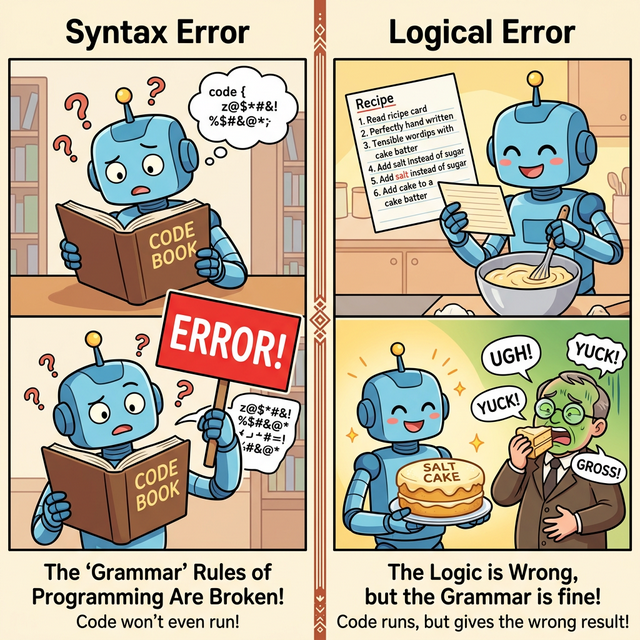
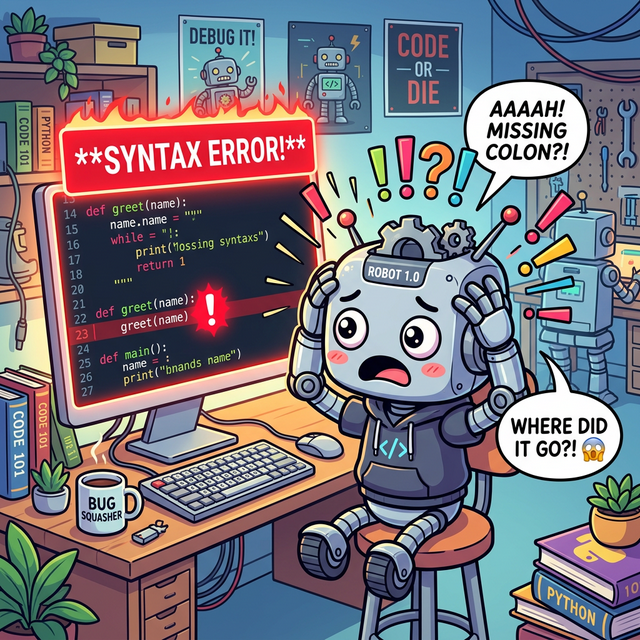
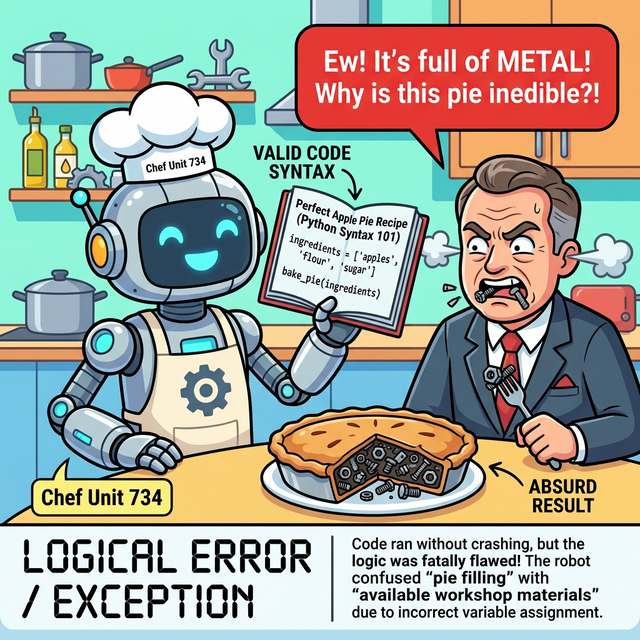
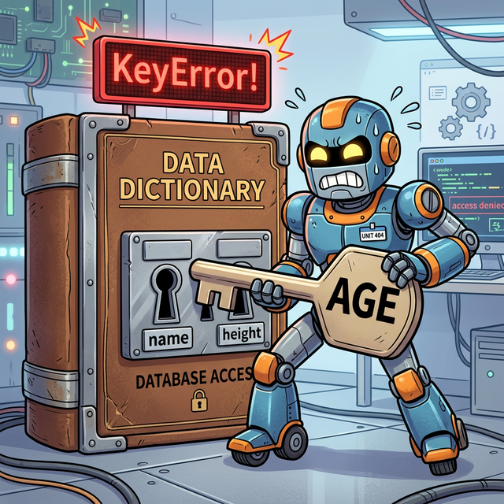
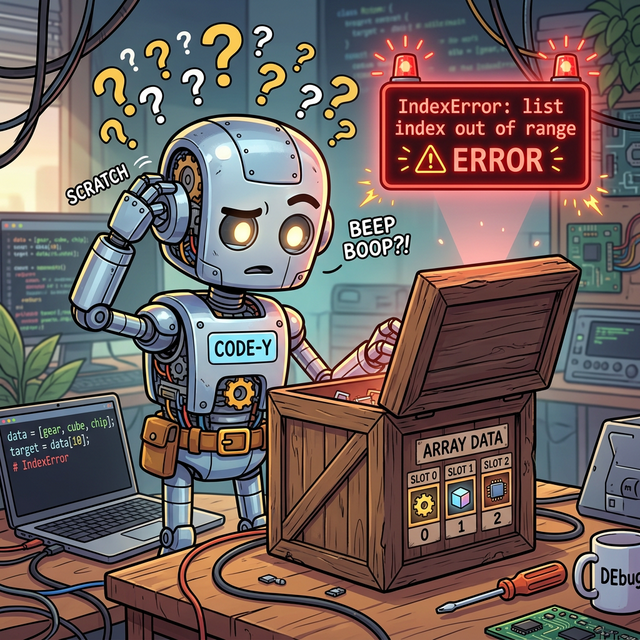
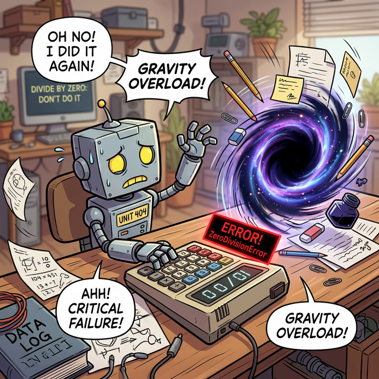

# 12주차: 예외 처리 - 버그와 충돌 방어막 세우기 🛡️

프로그램 실행 도중 발생하는 치명적인 예기치 못한 에러에 대응하여, 시스템 다운 없이 우아하게 비상을 선포하고 복원하는 **예외 처리(Exception Handling)**의 세부 구조와 예외 계층, 그리고 사용자 정의 예외와 예외 체이닝 기법을 배웁니다.

---

## 학습목표
본 장에서는 프로그램 실행 중 발생하는 예기치 못한 에러를 안전하게 방어하고 복구하는 **`try-except` 예외 처리** 구문의 중요성과 작동 원리를 이해합니다. 더 나아가, 무조건 실행되어야 하는 `finally` 블록의 역할과, 고의로 에러를 발생시키는 `raise` 키워드의 개념을 파악하여 실전처럼 견고한 코드를 작성하는 법을 익힙니다.

---

## 에러의 두 가지 종류 (Syntax Error vs Logical Error)

코딩을 하다 보면 숱하게 에러를 만나게 됩니다. 에러는 발생 시점에 따라, 프로그램이 실행되기 전 발생하는 **문법 에러(Syntax Error)**와 실행 중에 발생하는 **논리/예외 에러(Logical Error, Exception)**로 나뉩니다. 두 가지 에러의 차이점과 정확한 원인을 먼저 알아보겠습니다.

👉 [에러의 종류 상세 보기 (문법 에러 vs 논리 에러)](#01-에러의-종류)


*(웹툰 비유: 왼쪽 로봇은 해독 불가능한 외계어(오타)가 적힌 책을 보고 뇌 정지가 와 에러 간판을 들고 있습니다(문법 에러). 오른쪽 로봇은 레시피는 완벽하게 쓰여 있어서 그대로 요리를 완성했지만, 설탕 대신 소금을 넣으라는 잘못된 논리 때문에 완성된 소금 케이크를 먹고 심사위원이 기절해 버립니다(논리 에러).)*


---

## 든든한 안전망: `try-except` 예외 처리

에러가 발생해도 프로그램이 강제 종료(Crash)되지 않고 안전하게 복구 프로세스를 거치도록 방어하는 핵심 문법 구조입니다. 에러 종류별 분기 처리 등 기본적 실전 예시를 다룹니다.

👉 [`try-except` 기본 구조와 사용법 알아보기](#02-try-except-기본-구조)

## 다양한 에러 개별적으로 잡기

발생할 수 있는 예외가 여러 가지일 때 한 번에 퉁치지 않고 `IndexError`, `KeyError` 등 특정 에러마다 맞춤형으로 분기하여 잡는 다중 예외 처리 방식을 알아봅니다.

👉 [다양한 에러 개별 맞춤 처리 (다중 except)](#03-다양한-에러-잡기)

---

## 고급 예외 처리: `else`와 `finally`

`try-except` 구문에서 에러가 없을 때만 실행되는 `else` 블록과, 에러 발생 여부와 상관없이 무조건 마지막에 실행되어야 하는 `finally` 블록을 활용하여 완벽한 에러 통제 파이프라인을 구축해 봅니다.

👉 [`else`와 `finally` 완벽 활용 가이드](#04-고급-예외-처리-else-finally)

---

## 고의로 에러 일으키기 (`raise`)

문법적 오류는 아니지만, 서비스 기획이나 비즈니스 로직상 에러로 규정해야 하는 상황일 때 개발자가 직접 강제로 에러 비상벨을 울리는 `raise` 키워드의 활용법을 알아봅니다.

👉 [강제로 에러 발생시키기 (`raise`)](#05-고의로-에러-일으키기-raise)

---

## ☕ Java vs 🐍 Python 예외 처리 비교

두 언어의 차이점(`catch` vs `except`), 그리고 컴파일러가 강제하는 체크 예외(Checked Exception)의 유무 등 핵심적인 구조적 차이를 스나이퍼 비교를 통해 명확히 이해합니다.

👉 [Java와 Python의 예외 처리 패러다임 비교](#06-java-vs-python-예외-처리-비교)

---

## 🎧 단원 종합 Vibe Coding

> **🗣️ 학생 프롬프트 (AI에게 이렇게 명령해 보세요):**
> "지금까지 파이썬의 예외 처리 단원(`try`, `except`, `else`, `finally`, `raise`)을 모두 공부했어. 이 5가지 핵심 키워드가 하나의 코드 안에서 전부 적절하게 활용되는 '종합 선물 세트' 같은 완벽한 뱅킹(입출금) 예제 코드를 하나 작성해 줘. 그리고 이 예외 처리 구조가 실무에서 왜 중요한지 3줄 이내로 요약해 봐."

---

## 📝 핵심 코딩 영단어 총정리

* **Exception**: 예외. (정상적인 프로그램 실행 흐름을 깨뜨리는 이례적인 사건이나 런타임 에러 객체를 말합니다.)
* **Try-Catch / Try-Except**: 시도하고 낚아채기. (프로그래밍 세계에서 에러를 방어하는 가장 근본적인 디자인 패턴 명칭입니다.)
* **Crash**: 비정상 종료. (안전망(Except)이 없어서 프로그램이 시스템 바닥에 추락해 완전히 멈추어 버리는 현상입니다.)
* **Throw / Raise**: 던지다 / 일으키다. (개발자가 능동적으로 룰을 어긴 데이터를 발견하고 시스템에 직접 에러 경보를 울리는 통보 행위입니다.)

---

코딩을 하다 보면 숱하게 에러를 만나게 됩니다. 에러는 크게 두 가지 범주로 나눌 수 있습니다.

---

## 1. 문법 에러 (Syntax Error)
`오타`를 내거나 `들여쓰기`를 틀리는 등 파이썬 언어의 **문법 규칙을 어겼을 때** 발생합니다. 

이 경우 파이썬 인터프리터가 코드를 아예 읽지도 못하기 때문에 `실행조차 되지 않고` 곧바로 에러 문구를 뱉어냅니다. 

이는 프로그램이 시작되기도 전에 발견되므로 고치기 매우 쉽습니다.


*(웹툰 비유: 코드에 콜론(`:`)이나 오타가 발생하자 파이썬 번역기 로봇이 "해독 불가!"를 외치며 거대한 빨간색 경고등(Syntax Error)을 울리는 장면입니다. 실행조차 되지 않고 즉시 차단됩니다.)*

---

## 2. 예외/논리 에러 (Logical Error / Exception)
문법은 완벽해서 프로그램이 정상적으로 **실행되던 도중** 발생하는 에러입니다. 

"숫자 10을 0으로 나누어라" 혹은 "배열의 5번째 요소가 없는데 가져와라" 같은 `논리적 모순`이 발생했을 때 터집니다. 

우리가 제어 구조인 `try...except`로 `방어`하고 낚아채야 하는 대상이 바로 런타임에 발생하는 이 **예외(Exception)**입니다.


*(웹툰 비유: 요리사 로봇이 레시피(문법) 형태는 완벽하게 지켰지만, '사과' 대신 실수로 '나사못'을 잔뜩 넣고 구운 '나사못 파이'를 심사위원에게 제출하여 심사위원이 먹고 기절하는 장면입니다. 코드는 일단 실행되었지만 결과가 논리적으로 완전히 파탄난 런타임 에러 상황을 의미합니다.)*

---

## 🎧 정규 학습 & Vibe Coding

> **🗣️ 학생 프롬프트 (AI에게 이렇게 명령해 보세요):**
> "파이썬에서 `Syntax Error`가 발생하는 매우 단순한 예시 하나와, 문법은 맞지만 `Logical Error(Exception)` 중 하나인 `IndexError`가 발생하는 예시 코드를 각각 1개씩 작성해 줘. 그리고 각각 왜 그런 에러가 나는지 3줄 이내로 핵심만 비유를 들어서 짧게 설명해 줘."

---

## 📝 코딩 영단어 학습

* **Syntax**: 구문, 문법. (언어의 철자법이나 문장 규칙을 뜻합니다.)
* **Logical**: 논리적인. (컴퓨터 입장에선 문법상 맞지만 인간의 기획 의도와 어긋나는 상태를 뜻합니다.)
* **Runtime**: 실행 시간. (코드를 작성하는 시간이 아니라, 실제로 프로그램이 돌아가고 있는 순간을 말합니다.)
* **Exception**: 예외. (기본적인 규칙에서 벗어나는 이례적인 런타임 에러 상황을 말합니다.)

---

프로그램 실행 중 발생하는 에러(예외)를 우아하게 대비/처리하여, 프로그램이 의도치 않게 갑자기 강제 침몰하는 것을 막아내는 튼튼한 `방어 로직`을 배웁니다.

## 비정상 종류

일반적으로 파이썬 프로그램은 예기치 못한 에러(ZeroDivisionError, IndexError 등)가 발생하면 그 즉시 **비정상 종료(Crash)**됩니다. 하지만 우리가 이용하는 웹 서버나 24시간 도는 봇 프로그램이 사소한 입력값 하나 잘못 받았다고 완전히 꺼져버린다면 매우 곤란할 것입니다.


*(웹툰 비유: 코드를 실행하며 조심조심 유리그릇을 옮기던 로봇이 돌부리(Exception)에 걸려 넘어집니다. 하지만 바닥에 부딪혀 와장창 깨지기 직전, 마법처럼 `except`라고 쓰인 푹신한 안전 그물망이 튀어나와 로봇을 안전하게 받아냅니다.)*

## 안정망

이때 `안전망` 역할을 해주는 필수 방어적 코딩 기법이 바로 **`try-except`** 예외 처리 구문입니다.


*(다이어그램: 초록색 정상 점은 `try` 블록을 무사히 거쳐 `finally` 출구로 기분 좋게 빠져나갑니다. 반면, 빨간색 에러 점은 `try` 블록 중간에 번개(에러)를 맞고 비상망(`except`)으로 튕겨져 떨어져 복구 프로세스를 거친 후, 똑같이 노란색 `finally` 출구로 빠져나가는 두 갈래의 흐름을 묘사한 애니메이션입니다.)*

## 기본 구조: `try-except`

**"일단 블록 안의 코드를 시도해봐(try). 만약 에러가 터지면(except) 이렇게 조치해."**

```python
try:
    # 에러가 발생할 가능성이 있는 논리 코드
    number = 10 / 0
except ZeroDivisionError:
    # 에러가 감지되었을 때 비상탈출하여 실행할 복구 코드
    print("0으로 나눌 수 없습니다! (프로그램은 계속 실행됩니다)")
```

### [실행 결과]
```text
0으로 나눌 수 없습니다! (프로그램은 계속 실행됩니다)
```
(붉은색의 시스템 에러 메시지를 뿜지 않고, 우리가 핸들링한 문구가 출력되며 프로그램은 비정상 종료 없이 매끄럽게 계속 실행됩니다.)

## 실전 예제 1: 입력값 변환 보호 (ValueError)
사용자가 숫자가 아닌 문자를 입력했을 때 `int()` 함수가 터지는 것을 막아냅니다.
```python
user_input = "삼백원"
try:
    price = int(user_input)
    print(f"입력된 가격은 {price}입니다.")
except ValueError:
    print("❌ 숫자로 변환할 수 없는 입력입니다. 다시 확인해주세요.")
```

---

## 🎧 방어적 코딩 & Vibe Coding

> **🗣️ 학생 프롬프트 (AI에게 이렇게 명령해 보세요):**
> "파이썬에서 사용자의 나이를 `input()`으로 입력받아 숫자로 변환하는 코드를 짜줘. 만약 사용자가 '스무살'처럼 텍스트를 입력해서 `ValueError`가 발생하더라도, 프로그램이 뻗지 않고(안전하게) `try-except`로 오류를 낚아채어 '숫자만 입력해 주세요!'라고 다시 물어보는 완성된 예제 코드를 만들어 줘. 주석도 꼼꼼히 작성해 줘."

---

## 📝 코딩 영단어 정복

* **Try**: 시도하다. (먼저 코드를 정상적으로 실행해 보겠다는 선언입니다.)
* **Except (또는 Catch)**: ~을 제외하고, 낚아채다. (시도하다가 실패한 상황을 안전망으로 받아낸다는 의미입니다.)
* **Crash**: 충돌, 비정상 종료. (프로그램이 치명적인 오류를 만나 강제로 픽 하고 꺼져버리는 현상입니다.)
* **Handling**: 다루기, 처리. (`Error Handling`은 발생하는 에러를 적절하게 통제하고 무마시키는 방어 조작을 뜻합니다.)

---

여러 종류의 각기 다른 에러를 하나로 퉁치지 않고 성격에 맞게 각각 다르게 분기 처리하여, 원인에 따라 맞춤형 대응이 가능하게 만들 수 있습니다.


*(다이어그램: 우편물을 분류하는 것처럼, 발생한 에러 객체의 종류와 일치하는 첫 번째 `except` 블록으로 떨어져 맞춤형 처리가 이루어지는 라우팅 과정을 묘사한 애니메이션입니다.)*

---

## 🛑 주요 예외 종류별 상세 설명

### 1. `KeyError` (키가 없음)
딕셔너리 자료형에서 내부에 존재하지 않는 키(Key) 값을 꺼내려고 시도할 때 발생합니다.

*(웹툰 비유: 책장이나 자물쇠(딕셔너리)에 맞는 열쇠(키)가 아예 없어 들어가지 않고 쩔쩔매고 있는 답답한 상황입니다.)*

### 2. `IndexError` (순번 초과)
리스트, 튜플 등 반복 가능한(Iterable) 자료형이 가지고 있는 실제 길이(크기)를 벗어난 범위를 허공에서 찾으려 할 때 발생합니다.

*(웹툰 비유: 딱 3칸짜리 작은 상자 안에서 10번째 물건을 꺼내려고 빈 허공을 뒤적이며 혼란에 빠진 모습입니다.)*

### 3. `ZeroDivisionError` (0으로 나누기)
수학적으로 정의될 수 없는 불가능한 연산인, 어떤 숫자를 분모 `0`으로 나누려고 시도할 때 터지는 에러입니다.

*(웹툰 비유: 계산기로 10을 0으로 나누자 블랙홀이 생겨나 주변 문서와 집기들을 모두 빨아들이고 있는 치명적인 수학 법칙 파탄 장면입니다.)*

### 4. `Exception` (나머지 모든 에러 방어)
위에서 구체적으로 지명하여 잡지 못한 미지의 예기치 않은 에러들을 전부 포괄하여 블랙홀처럼 잡아내는 최상위 방어망입니다.

---

## 💻 다중 예외 처리 코드 다형성 (Polymorphism)

위의 개념을 바탕으로, 우선순위에 따라 순서대로 `except` 블록을 구성하면 아래와 같은 강력한 무적의 방어 구조가 완성됩니다.

```python
try:
    # 💥 에러가 발생 가능한 복합적인 로직들
    my_dict = {"name": "Alice"}
    print(my_dict["age"]) # -> 여기서 KeyError 발생 시 곧바로 1번 블록으로 추락!
    
    number = 10 / 0 # -> ZeroDivisionError 발생 환경 구비 완료!
    
# 1번 블록: KeyError 방어
except KeyError:
    print("딕셔너리에 해당 키(항목)가 존재하지 않습니다!")
    
# 2번 블록: IndexError 방어
except IndexError:
    print("배열의 범위를 벗어난 접근입니다!")
    
# 3번 블록: ZeroDivisionError 방어
except ZeroDivisionError:
    print("수학적인 오류(0으로 나누기)가 발생했습니다!")
    
# 4번 블록: 최후의 보루 방어망
except Exception as e:
    # Exception은 모든 에러를 포괄하는 최상위 부모 클래스(부대장)입니다.
    # 특정하지 못한 나머지 모든 에러를 흡수하기 위해 반드시 맨 마지막 맨 밑에 배치해야 합니다.
    print(f"알 수 없는 치명적인 에러가 통보되었습니다: {e}")
```

> **[주의 사항]** 
> 위 코드에서 만약 `except Exception:` 블록을 첫 줄(맨 위)에 올려두면 그 어떤 에러든 간에 첫 번째 그물망에서 모두 걸려버리므로, 아래에 있는 상세 에러들(KeyError, IndexError 등)의 블록은 영원히 도달할 수 없는 `Dead Code`(죽은 코드)가 되어버립니다!

---

## 🎧 다중 예외 처리 & Vibe Coding

> **🗣️ 학생 프롬프트 (AI에게 이렇게 명령해 보세요):**
> "파이썬에서 딕셔너리(dictionary)와 리스트(list)를 둘 다 쓰는 코드를 하나 만들어봐. 이 코드 안에서는 `KeyError`와 `IndexError`가 각각 발생할 가능성이 있어. 다중 `except` 문을 사용해서 이 두 가지 에러를 어떻게 각각 따로 라우팅하여 별도의 메시지로 처리할 수 있는지, 친절한 주석이 달린 예제 코드와 쉬운 비유 설명을 덧붙여 줘."

---

## 📝 코딩 영단어 정복

* **Multiple**: 다수의, 복합적인. (여러 가지의 예외를 한꺼번에 다루는 다중 예외 처리에서 사용됩니다.)
* **Index**: 색인, 순번. (`IndexError`는 데이터가 정렬된 순번의 범위를 벗어날 때 발생하는 에러입니다.)
* **Key**: 열쇠, 핵심 식별자. (`KeyError`는 자물쇠(딕셔너리)를 열기 위한 정확한 열쇠 이름이 없을 때 발생합니다.)
* **Hierarchy**: 계층, 서열. (예외 클래스들의 족보/서열을 나타냅니다. `Exception`은 이 서열의 가장 높은 꼭대기에 있는 보스입니다.)

---

`try-except` 구문은 에러가 나지 않고 성공했을 때만 실행할 `else` 블록, 에러의 유무와 상관없이 무조건 마지막에 실행되어야 하는 `finally` 블록과 결합하여 완벽한 에러 통제 파이프라인을 구축할 수 있습니다.


*(다이어그램: 초록색 정상 경로는 `try`가 무사히 끝나면 `else` 블록을 통과하여 `finally`로 향합니다. 반면, 빨간색 에러 경로는 `try` 블록에서 번개를 맞으면 `except` 비상망으로 추락하지만 결국에는 똑같이 `finally` 출구를 통해 안전하게 빠져나가는 모습을 보여줍니다.)*


## 코드 예제
예제를 통하여 `else`와 `finally`의 동작 원리를 알아보겠습니다.

```python
try:
    print("1. 파일 열기 시도 중...")
    file_data = open("document.txt", "r")
    
except FileNotFoundError:
    print("2. [오류] 파일을 찾을 수 없습니다. 예외가 잡혔습니다.")
    
else:
    # try 블록이 에러 없이 무사히 통과했을 때만 실행됨
    print("3. [성공] 파일을 무사히 열었습니다. 데이터를 읽습니다.")
    print(file_data.read())
    
finally:
    # 에러가 났든 안 났든, 심지어 return으로 빠져나가려 해도 무조건 실행됨
    print("4. [마무리] 자원을 해제하고 파일 시스템을 닫습니다.")
```

- **`finally`의 중요성**: 파일 시스템 닫기, 켜두었던 데이터베이스(DB) 연결 끊기 등 프로그램이 죽더라도 이 자원 처리만큼은 **반드시** 하고 죽으라는 최후의 보루 역할을 합니다.

## 정리
지금까지 우리는 에러를 단순히 피해야 할 두려운 존재로 여겼지만, `try-except-finally`라는 튼튼한 방어망을 치고 나면 에러마저도 프로그램의 정상적인 제어 흐름 안으로 편입시킬 수 있습니다. 특히 크롤링 머신이나 데이터를 임포트하는 기능을 24시간 가동시켜야 할 실무에서, 이 예외 처리 로직은 서버가 죽지 않고 버티게 해 주는 가장 든든한 생명줄 역할을 톡톡히 해낼 것입니다.

---

## 🎧 고급 예외 흐름 & Vibe Coding

> **🗣️ 학생 프롬프트 (AI에게 이렇게 명령해 보세요):**
> "크롤링 로봇을 파이썬으로 만든다고 가정해 줘. 타겟 웹사이트에 접속을 시도(`try`)하고, 접속에 실패하면 예외 처리(`except`)를, 무사히 접속했다면 데이터를 파싱(`else`)한 뒤, 성공 여부에 상관없이 마지막에는 무조건 인터넷 연결 자원을 종료(`finally`)하는 완벽한 4단계 파이프라인의 뼈대(구조) 코드를 작성해 줘."

---

## 📝 코딩 필수 영단어

* **Else**: 그 밖의, 그 외에 (여기서는 "에러가 터지지 않고 무사히 넘어간다면 그 다음에" 라는 긍정적인 맥락으로 쓰입니다.)
* **Finally**: 마침내, 최종적으로. (성공하든 실패하든, 심지어 코드가 함수를 빠져나가려 해도 무조건 마지막으로 불려가는 필수 관문입니다.)
* **Resource**: 자원. (메모리, 파일, 네트워크, DB 연결 등 프로그램이 잠시 빌려 쓰는 한정된 컴퓨터 자원을 의미합니다.)
* **Release (or Close)**: 해제하다, 놓아주다. (빌려 쓴 자원을 다 쓰고 나서 컴퓨터 시스템에 다시 반납하는 행위입니다.)

---

프로그램의 문법(Syntax)은 완벽하더라도, **서비스 기획이나 비즈니스 로직상 절대 허용해서는 안 되는 상황**이 발생할 수 있습니다. 예를 들어 "나이가 음수(-5살)로 입력됨" 같은 논리적 오류 상황입니다. 

문법적으로 에러가 아니기 때문에 파이썬은 정상적으로 실행해 버리려 하지만, 이대로 놔두면 나중에 데이터베이스나 중요한 시스템 로직이 완전히 꼬이게 됩니다. 

## raise
이때 개발자가 직접 나서서 시스템 전체에 경보 비상벨을 울리고 실행을 중단시켜야 하는데, 이 행위가 바로 **`raise`** 입니다.


*(웹툰 비유: 평단하고 조용한 시스템 제어실. 기계 자체에는 전혀 문제가 없지만, "나이는 음수가 될 수 없다!"라는 회사 수칙(기획)을 지키기 위해 로봇 관리자가 망치로 빨간색 `EMERGENCY(비상)` 버튼의 유리를 깨서 스스로 에러 경보를 강제로 터뜨리는 장면입니다.)*

> **💡 용어 비교: 다른 언어의 `throw`**
> Java, C++, JavaScript 등 많은 프로그래밍 언어에서는 에러를 던진다는 의미로 **`throw`** 키워드를 사용합니다. 
> 하지만 파이썬에서는 동일한 역할을 수행하기 위해 에러를 끌어올린다는 의미의 **`raise`** 키워드를 사용합니다. 이름만 다를 뿐, 개발자가 강제로 예외를 발생(통보)시키는 완전하게 동일한 기능입니다!

## `raise` 사용 예제 코드

```python
def check_age(age):
    # 문법적으론 이상 없지만, 비즈니스 기획상 허용할 수 없는 '음수' 값 침입 감지!
    if age < 0:
        # 적절한 에러 클래스(ValueError)를 직접 생성하여 바깥으로 던짐(raise)
        raise ValueError("나이는 음수가 될 수 없습니다!")
        
    print(f"당신의 나이는 {age}살 이군요.")

try:
    check_age(-5)
except ValueError as e:
    # raise로 발생시킨 에러를 안전망에서 받아 처리합니다.
    print(f"사용자 에러 잡힘: {e}")
```

이렇게 함수 안에서 `raise` 구문을 활용하면 나중에 다른 개발자가 내 코드를 호출할 때, "현재 허용되지 않는 부적절한 값이 들어왔다!"라는 사실을 강하게 통보(문구 포함)해 줄 수 있어 안전하고 견고한 애플리케이션 설계의 기초가 됩니다.

---

## 🎧 강제 에러 방출 & Vibe Coding

> **🗣️ 학생 프롬프트 (AI에게 이렇게 명령해 보세요):**
> "은행 계좌(Account) 클래스의 출금(withdraw) 메서드를 파이썬으로 만들어봐. 출금하려는 금액이 현재 잔액보다 크면 문법적으론 이상 없어도 비즈니스 논리상 말이 안 되니까, 개발자가 고의로 `raise` 키워드를 써서 `ValueError`를 발생(던지는)시키는 예제 코드를 작성해. 다른 언어의 `throw`와 어떻게 비슷한지도 한 줄로 설명해 줘."

---

## 📝 코딩 영단어 및 동의어 정리

* **Raise**: 들어 올리다, 일으키다. (파이썬에서 깊숙이 숨어있는 에러 상황을 수면 위로 강제로 끄집어 올려 경보를 울릴 때 씁니다.)
* **Throw**: 던지다. (Java나 JS 등 다른 언어에서 `raise`와 완벽히 동일한 의미로 쓰이는 키워드입니다. 에러를 바깥으로 던진다는 뜻입니다.)
* **Intentional**: 의도적인. (버그나 실수가 아닌 시나리오에 의해 *고의로* 발생시킨 에러를 지칭할 때 자주 쓰입니다.)
* **Validation**: 유효성 검사. (입력된 데이터가 비즈니스 규칙에 맞는지(예: 나이가 양수인지) 검증하는 방어 과정입니다.)

---

## ☕ Java vs 🐍 Python 스나이퍼 비교

### 1. 키워드의 차이 (catch vs except)
*   **Java**: 자바에서는 `try { } catch (Exception e) { } finally { }` 구문을 사용합니다.
*   **Python**: 파이썬은 목적어 성격이 강한 `catch` 대신 전치사 성격의 **`try ... except ... finally:`** 키워드를 사용합니다. 기능은 완전히 똑같습니다. 단지 콜론(`:`)과 들여쓰기 블록을 쓴다는 점만 다릅니다.

### 2. 체크 예외(Checked Exception)의 부재
*   **Java**: 파일 입출력(IOException) 등을 다룰 때 `try-catch`로 감싸거나 메서드 시그니처에 `throws`를 붙이지 않으면 아예 컴파일 자체가 안 되는 깐깐한 Checked Exception 시스템이 있습니다.
*   **Python**: 파이썬에는 컴파일러가 강제하는 **Checked Exception 개념이 없습니다**. 파일을 열 때 `try-except`로 감싸지 않아도 문법적 오류를 내뿜지 않습니다. 전적으로 개발자의 책임과 논리(Logical)에 맡깁니다.

---

## 🎧 Vibe Coding

> **🗣️ 학생 프롬프트 (AI에게 이렇게 명령해 보세요):**
> "파이썬으로 간단한 리스트의 평균을 구하는 계산기 함수를 만들어봐. 단, 빈 리스트가 들어와서 0으로 나누기 오류(`ZeroDivisionError`)가 발생하거나, 요소 중에 문자가 섞여 있어서 타입 오류(`TypeError`)가 발생할 수 있으니, `try-except` 구문으로 철저하게 예외 처리를 감싼 코드로 작성해 줘. 각 에러마다 귀여운 이모지와 함께 안내 문구를 출력해야 해."

---

## 📝 코딩 영단어 학습

*   **Syntax**: 구문, 문법 규칙. (`Syntax Error`는 파이썬 언어의 철자법이나 문법 체계를 틀린 것입니다.)
*   **Logic**: 논리, 타당성. (`Logical Error`는 컴퓨터는 시킨 대로 잘 했는데, 시킨 사람의 생각 자체가 틀린 것입니다.)
*   **Except**: ~을 제외하고. (`try...except` 구조에서는 "내가 시도해 보라(try)고 한 구문 외에 예기치 못하게 벌어진 빗나간 일들(except)은 이렇게 예외적으로 조치해"라는 의미로 쓰입니다.)
*   **Finally**: 마침내, 결국. (어떤 험난한 과정이나 에러가 있었든 간에 프로그램이 종료되기 전에 '무조건 마지막으로' 수행되는 약속된 공간입니다.)

---

## ✍️ 이번 주 연습 문제

**문제 1.** 두 숫자를 입력받아 나눗셈을 하는 함수에서, 분모가 0일 때 발생하는 `ZeroDivisionError`와 숫자가 아닌 잘못된 타입이 들어왔을 때 발생하는 `ValueError`를 각각 다른 `except` 블록으로 대응하는 함수를 구현해 보세요.

**문제 2.** `raise` 문을 활용하여 나이(age)가 음수이거나 150세를 초과하는 값일 때 예외를 발생시키고 이를 처리하는 코드를 작성해 보세요.

**문제 3.** (심화) `try~except~else~finally` 블록의 구조에서 `else`와 `finally`가 언제 실행되는지 그 결정적인 차이점을 가상환경 복구 시나리오(예: 파일 닫기, 임시 메모리 정리 등)를 바탕으로 설명해 보세요.

---

## 📖 교재 상세 학습: 19_부록_자주_만나는_오류

<div align="center">
  

## 부록: 파이썬 생존 일지 - 단골 에러 완벽 대처법
</div>

왕초보 구간을 갓 벗어난 신입이든 10년 차 시니어 개발자든, 코딩을 하다 보면 하루에도 수십 번씩 시뻘건 에러(오류) 폭탄을 맞게 됩니다. 에러는 여러분을 괴롭히려는 악당이 결코 아닙니다. 오히려 **"주인님, 이 줄이 번역이 안 돼요! 얼른 고쳐주세요!"**라며 다급하게 외치는 아주 충직한 비서입니다. 
파이썬 여정에서 가장 자주 조우하게 될 11대 에러의 정체와, 그들이 던지는 다잉 메시지를 해독하는 노하우를 전수해 드립니다.

---

#### 디버깅(Debugging)의 2대 절대 원칙
1. **맨 밑바닥 줄의 에러 타이틀부터 읽어라!** (가장 확실한 스모킹 건입니다)
2. **에러가 터졌다고 삿대질(`^`)하는 화살표 주변이나 그 윗줄의 괄호들을 샅샅이 뒤져라!**

---

### 1. SyntaxError (문법 에러)
**사망 원인**: 파이썬이 요구하는 엄격한 문법 규칙을 대놓고 어겼을 때 터집니다. 외국인에게 한국어 어순을 엉망으로 섞어 말한 것과 같습니다.
* **따옴표나 괄호의 짝이 안 맞을 때** (압도적인 1위 원인)
* `if`나 `for` 문장 끝에 콜론(`:`)을 쿨하게 빼먹었을 때
* 파이썬이 혼자 쓰려고 찜해둔 예약어(`True`, `for` 등)나 숫자를 변수 이름으로 쓰려 할 때

```python
# 에러 폭발 예시
print("반갑습니다)  # 뒤쪽 따옴표가 행방불명입니다! (EOL while scanning string literal)
1st_rank = "나" # 변수명 맨 앞자리에 숫자가 오다니, 용납할 수 없습니다!
```

### 2. IndentationError / TabError (들여쓰기 에러)
**사망 원인**: 파이썬의 꽃이자 생명선인 '들여쓰기(Indentation)'가 미세하게 엇나갔을 때 터집니다.
* 스페이스바(Space) 4칸 룰을 지키다 갑자기 손가락이 미끄러져 3칸만 쳤을 때
* 스페이스 띄어쓰기와 탭(Tab) 키가 눈에 보이지 않게 혼용되어 눈속임을 할 때 (TabError)

### 3. NameError (이름 에러)
**사망 원인**: 파이썬 엔진이 태어나서 생전 처음 들어보는 '이름'을 여러분이 갑자기 호출했을 때 뿜어냅니다.
* 정의한 적도 없는 변수명을 막무가내로 쓰려 할 때
* 변수 이름을 칠 때 치명적인 오타를 냈을 때 (예: `apple`을 `aple`로 침)

```python
# 에러 폭발 예시
score_point = 100
print(scroe_point) # scroe_point라는 변수는 메모리상에 존재한 적이 없습니다! (name 'scroe_point' is not defined)
```

### 4. AttributeError (속성 에러)
**사망 원인**: 해당 데이터(객체)가 태생적으로 가지고 있지도 않은 기능(메서드)을 억지로 꺼내 쓰라고 강요할 때 발생합니다.
* 리스트 전용인 `.index()`를 실수로 `.indax()`로 오타 냈을 때
* 단순한 정수(int) 쪼가리한테 문자열 전용 칼날인 `.replace()`를 휘두르라고 명령할 때

```python
# 에러 폭발 예시
my_number = 10
my_number.append(20) # 숫자는 리스트가 아니므로 append라는 스킬을 모릅니다! ('int' object has no attribute 'append')
```

### 5. TypeError (타입 에러)
**사망 원인**: 특정 연산자나 함수에 전혀 어울리지 않는 '잘못된 종족(타입)의 데이터'를 구겨 넣었을 때 터집니다.
* 숫자 데이터와 문자열 데이터를 더하기(`+`) 기호로 무식하게 융합시키려 할 때
* 함수가 요구하는 매개변수 개수가 2개인데, 실수로 1개만 주거나 3개를 던졌을 때

```python
# 에러 폭발 예시
print("제 나이는 " + 20 + "입니다.") # 문자와 숫자는 물과 기름 폭탄입니다! (can only concatenate str to str)
```

### 6. ValueError (값 에러)
**사망 원인**: 데이터의 타입(종류)은 대충 들어맞는데, 그 안에 든 알맹이의 상태가 상식적으로 말이 안 될 때 발생합니다.
* `int("100")`은 기꺼이 숫자로 변환해 주지만, `int("안녕")`은 도저히 수학적 숫자로 바꿀 방도가 없습니다.

```python
# 에러 폭발 예시
my_age = int("스무살") # '스무살'이라는 한글 문자를 어떻게 아라비아 숫자로 바꿉니까!
```

### 7. UnboundLocalError (지역 변수 참조 에러)
**사망 원인**: 함수 저 멀리 바깥에 선언된 전역 변수(Global)의 값을, 함수 내부에 있는 녀석이 허락(`global` 키워드)도 없이 멋대로 덮어씌우려 시도할 때 파이썬 보안관이 쏘는 경고장입니다.

### 8. KeyError & IndexError (접근 실패 에러)
**사망 원인**: 보관함을 열어제꼈는데 내가 찾는 번호나 열쇠표가 없을 때 터지는 허탈한 에러입니다.
* **KeyError**: 딕셔너리를 뒤졌는데 내가 적은 '키(Key)'가 없을 때
* **IndexError**: 리스트에 방이 3개(0, 1, 2)밖에 없는데, 다짜고짜 10번째 방의 아이템을 내놓으라고 할 때

```python
# 에러 폭발 예시
my_items = ["검", "방패", "포션"]
print(my_items[5]) # 5번 인덱스 방 따위는 애초에 공사된 적이 없습니다! (list index out of range)
```

### 9. ModuleNotFoundError (모듈 실종 에러)
**사망 원인**: `import` 로 외부의 꿀 기능(패키지)을 불러오라 명령했는데, 파이썬이 시스템 연합을 다 뒤져도 그 파일을 찾지 못했을 때 터집니다. (이름 스펠링이 틀렸거나, `pip install` 로 설치를 깜빡했을 확률이 99%입니다)

### 10. RecursionError (무한 루프/재귀 에러)
**사망 원인**: 함수 안에 함수가 자기 자신을 계속해서 부르는 굴레(재귀)에 빠져, 파이썬 엔진이 정해둔 뇌의 한계치(보통 깊이 1,000번)를 초과해 장렬히 뻗어버렸을 때 발생합니다. 정지 조건(브레이크)을 빼먹은 코드를 짰을 때 주로 만납니다.

### 11. ZeroDivisionError (0 나누기 에러)
**사망 원인**: 컴퓨터 공학의 절대 금기, 즉 어떤 숫자를 감히 `0`으로 나누려고 시도할 때 파이썬 코어가 보호 모드를 발동하며 뻗습니다.
```python
# 에러 폭발 예시
result_val = 100 / 0 # 파이썬은 우주가 무너져도 이 계산을 단호히 거부합니다! (division by zero)
```

에러 창이 뜨는 것에 공포를 느끼지 단호히 맞서 탐정처럼 원인을 사냥해 보세요!

### 📖 학습 목차


---

## 📖 교재 상세 학습: 37 프로그램 추락을 막는 구명조끼: try ~ except

## 37 에러의 치명상을 흡수하는 방파제: try ~ except

파이썬 스크립트가 돌아가다 갑작스레 픽 하고 쓰러지는(Crash) 사유는 셀 수 없이 많습니다. 텅 빈 리스트에서 무리하게 0번째 방을 열려고 할 때 터지는 `IndexError`, 혹은 명백한 한글 문자열을 우격다짐으로 숫자로 바꾸려다 발생하는 `ValueError` 등이 대표적인 주범들입니다.

**코드: 끔찍한 파국 (에러 발생 상황)**
```python
str_data = "이백퍼센트"
# 파이썬은 한글 "이백퍼센트"를 수학적 정수로 변환할 능력이 없으므로 이 지점에서 비명을 지르며 뻗어버립니다!
num = int(str_data) 
print(num)
```

이런 치명적인 사태로부터 내 소중한 코드를 구출하려면, 폭발 위험이 있는 불안 불안한 코드를 일단 안전지대인 `try` (한 번 시도해 보기) 블록 안에 격리시키고, 만약 사고가 터졌을 때 대피할 플랜 B 경로를 `except` (예외 처리) 블록에 꼼꼼히 마련해 구명조끼를 채워주면 됩니다.

**코드: 튼튼한 이중 방어벽 구축**
```python
str_data = "이백퍼센트"

try:
    # 일단 겁먹지 말고 담담하게 코드 실행을 시도해 봅니다.
    num = int(str_data)
    print(f"변환에 성공한 숫자: {num}")
except ValueError:
    # 만일 치명적인 ValueError가 터졌다면? 프로그램이 사망하는 대신 즉각 이 대피 로직으로 피신합니다!
    print(f"경고: '{str_data}'는(은) 정상적인 숫자로 변환될 수 없습니다. 임시 기본값 0을 강제로 부여합니다.")
    num = 0
```
이러한 `try-except` 기법을 곳곳에 잘 심어두면, 실행 도중 돌발적인 에러 폭탄이 날아들더라도 프로그램이 허무하게 뻗지 않고 유연하게 살아서 끝단까지 순항할 수 있습니다.


---

## 📖 교재 상세 학습: 38 정체 모를 에러에 대비하라: 만능 방패 Exception

## 38 어떤 에러가 터질지 막막할 때 꺼내는 마스터키: Exception

앞 장에서는 발생할 법한 `ValueError`라는 예외 이름을 우리가 미리 정확히 조준해서 방어해 냈습니다. 하지만 외부 인터넷 접속이 끊기거나, 파일 권한이 꼬여서 열리지 않는 등 도무지 어떤 유형의 돌발 에러가 터질지 짐작조차 가지 않을 땐 어떻게 대응해야 할까요?

이럴 때 현업에서는 모든 종류의 에러를 두루뭉술하게 잡아먹는 가장 큰 물귀신, `Exception` 방패를 내세워 투망식으로 방어 라인을 구축합니다.

**코드: 정체불명의 에러 포획하기**
```python
try:
    empty_basket = []
    # 텅 빈 바구니에서 5번째 칸을 요구하니 다짜고짜 에러가 폭발하겠죠?
    print(empty_basket[5]) 
except Exception as ex_info:
    # 무슨 에러가 터질지 도통 모르겠을 땐 'Exception as 별명' 문법을 써두면,
    # 친절한 파이썬 엔진이 해당 에러의 구체적 정체를 'ex_info' 객체 안에 고스란히 묶어서 바쳐줍니다.
    print(f"앗! 시스템 런타임 중 돌발 상황이 벌어졌습니다. 분석된 에러 원인: {ex_info}")
```
이 광범위한 트릭은 365일 무정지로 돌아가야 하는 백엔드 웹 서버 등을 지탱할 때, 시스템이 뻗는 불상사만큼은 기필코 막아내야 하는 절체절명의 상황에서 무척 든든한 동아줄이 됩니다. 
하지만 너무 이 만능 방패에만 의존해 남용하다 보면, 오히려 개발자가 "반드시 직접 보고 수술해서 고쳐야 할 진짜 고름(치명적 버그)"조차 흔적 없이 꿀꺽 삼켜버리는 독이 될 수 있으니 각별히 유의해야 합니다.

---

### 💻 미니 실습: '0블랙홀' 회피 기동 훈련

**Quiz 1** 수학의 룰에서 어떤 수를 '0'으로 나누는 행위는 강력히 금지된 불문율입니다. 파이썬 역시 이를 강행하면 고통스러운 `ZeroDivisionError`를 토해내며 장렬히 쓰러집니다. 이 끔찍한 종말을 `try-except` 구조로 세련되게 회피해 보세요.

```python
target_num = 10
# 10을 0이라는 숫자로 나누는 위험한 코드를 배치하고, 에러 감지 시 "0으로 분할할 수 없습니다!"라는 경고문이 뜨도록 코딩하세요.

```

---
<details>
<summary><b>모범 답안 보기</b></summary>

**풀이 1**
```python
target_num = 10
try:
    final_result = target_num / 0
except ZeroDivisionError:
    print("0으로 분할할 수 없습니다!")
```
</details>


---

## 📖 교재 상세 학습: 39 내가 심판이 되어 경고장 던지기: raise

## 39 내가 설계자로서 직접 레드카드 뽑아 들기: raise

지금껏 우리는 파이썬 엔진이 던지는 에러를 헐떡이며 방어하는 수비수 역할만 해왔습니다. 하지만 여러분이 거대한 시스템을 직접 건축하다 보면 파이썬 문법 체계상으론 눈곱만큼도 문제가 없지만 **여러분이 창조한 비즈니스 룰**에는 명백히 어긋나서 당장 구동을 멈춰 세워야 할 타이밍이 필연적으로 찾아옵니다.

가령 엄격한 '미성년자 출입 금지' 로직인데 사용자 나이 칸에 '마이너스 5살'이라는 기괴한 값이 유입되었다면 어떡할까요?

이럴 때 설계자인 여러분이 **주도적으로 직접 에러를 터뜨려서(raise)** 위기 상황을 사방에 알릴 수 있습니다.

**코드: 억지로 에러를 만들어내 폭발시키기**
```python
def validate_age_logic(user_age):
    if user_age < 0:
        # 이건 파이썬 엔진 잘못이 아니라 내 통제 규칙의 위반입니다! 시스템에 억지로 에러 수류탄을 까넣습니다.
        raise ValueError(f"나이가 세상에 어떻게 음수({user_age}살)일 수 있습니까? 재입력 해주세요!")
    print(f"확인되었습니다. 당신의 나이는 {user_age}살 이군요. 환영합니다.")

try:
    validate_age_logic(-5)
except ValueError as err_msg:
    print(f"시스템 입력 오류 방어됨: {err_msg}")
```

#### 💎 진정한 고수의 시크릿 팁: 개미지옥(이중 반복문) 초스피드 탈출법
이 `raise` 문법에는 또 다른 기상천외하고 짜릿한 쓰임새가 숨어 있습니다.
전 장에서 배운 일반적인 `break`는 자신이 갇힌 가장 인접한 반복문 딱 1겹만 가까스로 부수고 나갑니다. 즉 겹겹이 포개진 `for`문 한가운데 있다면 고작 한 칸 탈출에 그쳐, 결국 그 바깥 바퀴가 재가동되는 악몽을 겪습니다.

이때, 가장 바깥쪽 안전지대까지 단숨에 로켓처럼 탈출하고 싶다면 짓궂게도 고의로 에러(`raise`)를 발생시키고 제일 바깥의 `try`가 이를 부드럽게 받아 안게 만드는 고급 트릭을 구사합니다.

**코드: 이중 반복문 쾌속 탈주 닌자 트릭**
```python
treasure_boxes = {
    'A박스': ['몽당연필', '너덜한 지우개'],
    'B박스': ['녹슨 가위', '✨영롱한 다이아몬드✨', '고장난 볼펜'],
    'C박스': ['플라스틱 자', '커터칼']
}

try:
    for box_id, inner_items in treasure_boxes.items():
        for single_item in inner_items:
            if single_item == '✨영롱한 다이아몬드✨':
                print(f"!!! 아싸! {box_id} 구석에서 전설의 다이아몬드를 발굴해 냈습니다 !!!")
                # 목표 달성 완료! 더 이상 겉바퀴인 A박스, C박스를 무의미하게 뒤적거릴 이유가 없으므로 
                # 여기서 에러를 날려 반복문 2겹의 사슬을 한 방에 찢어버리고 탈출합니다.
                raise StopIteration 
            
            print(f"{box_id} 안의 내용물 '{single_item}' 탐색했으나 꽝입니다.")
except StopIteration:
    print("목표물을 확보하여 탐색 작전을 전면 종료하고 철수합니다.")
```
이 얄미운 트릭을 전장(실무)에서 구사하면 스파게티처럼 꼬인 로직도 칼처럼 명쾌하게 토막 낼 수 있습니다. 이로써 여러분도 위기관리의 달인 `try`, `except`, 그리고 주도적인 지휘자 `raise` 삼총사를 자유자재로 지휘하여 무너지지 않는 요새 같은 앱을 설계할 준비를 마쳤습니다!


---

## 📖 교재 상세 학습: 40 범인의 발자국 쫓기: traceback 추적

## 40 범인의 흔적을 쫓아라: `traceback` (트레이스백)

우리가 앞서 배운 `try ~ except` 매직 그물로 에러를 잡으면, 프로그램이 튕겨서 뻗어버리는 대참사는 막을 수 있습니다. 하지만 이 그물에는 한 가지 단점이 있습니다. 파이썬이 "도대체 파일의 몇 번째 줄에서, 정확히 왜 에러가 났는지" 입을 꾹 다물어버린다는 것입니다. (에러를 꿀꺽 삼켜버렸기 때문이죠!)

이럴 때, 범행 현장의 모든 단서(몇 번째 줄 코드, 어느 함수 등)를 적어둔 비밀 장부를 몰래 꺼내보려면 파이썬의 마법 돋보기인 **`traceback` (트레이스백)** 모듈을 꺼내야 합니다!

### 1. Traceback(추적기)가 뭔가요?

에러 방패(`try`) 없이 에러가 파바박 터지며 프로그램이 죽을 때 콜솔 창에 주르륵 쏟아지던 무서운 빨간 글씨들을 본 적 있죠? 그 무서운 발자국들이 바로 `Traceback`입니다.
"A 함수가 B 함수를 불렀고, B 함수가 15번째 줄에서 C를 호출하다가 펑 터졌다!"를 순서대로 기록해 놓은 비행기 블랙박스와도 같습니다.

에러를 안전하게 `except`로 잡아먹은 상태에서도 이 블랙박스(Traceback) 내용을 몰래 출력해 보려면, **`traceback.print_exc()`** 마법 주문을 쓰면 됩니다.

```python
import traceback

def make_trouble():
    # 고의로 수학 에러 발생시키기 (0으로 나누기)
    return 10 / 0

try:
    print("게임을 정상적으로 실행합니다...")
    make_trouble()
    
except Exception as e:
    print("\n앗, 에러를 그물로 부드럽게 잡았습니다!")
    print(f"내가 잡은 에러 이름: {e}")
    print("\n하지만 돋보기로 범행 현장(블랙박스)을 상세히 분석해 보겠습니다!\n")
    
    # 여기서 에러의 발자국(Traceback)을 예쁘게 출력해 줍니다!
    traceback.print_exc()
```

#### 💻 실행 결과:
```text
게임을 정상적으로 실행합니다...

앗, 에러를 그물로 부드럽게 잡았습니다!
내가 잡은 에러 이름: division by zero

하지만 돋보기로 범행 현장(블랙박스)을 상세히 분석해 보겠습니다!

Traceback (most recent call last):
  File "game.py", line 10, in <module>
    make_trouble()
  File "game.py", line 5, in make_trouble
    return 10 / 0
ZeroDivisionError: division by zero
```

보셨나요? 분명 프로그램이 강제로 튕기거나 죽지 않았는데도 불구하고 파이썬이 어디서(line 5) 터졌는지 친절하게 현장 기록을 똑같이 다 알려주고 있습니다.

### 2. 왜 이게 중요할까?

이렇게 `traceback` 모듈을 쓰면, **"에러가 나도 프로그램 멈추지 않고 계속 실행되게 하면서 ➔ 동시에 에러 발생 위치와 내역은 눈에 안 띄게 숨겨서 로그(.txt) 파일에만 꼼꼼히 기록해두는"** 고오급 스킬이 가능해집니다.

이는 고수 프로그래머들이 자신의 게임 서버나 웹사이트를 1년 365일 내내 한 번도 튕기지 않게 관리하는 최고의 비법이랍니다!


---

## 📖 교재 상세 학습: 11 커스텀 에러 공장장: 나만의 예외 만들기

## 11 기성품은 가라! 나만의 전용 에러 폭탄(예외) 빚어내기

기초 문법을 배우는 동안 우리는 `ValueError`나 `IndexError` 같이 파이썬 본사가 납품해 주는 기성품 에러들만 요리조리 피하며 막아냈습니다. 하지만 여러분이 실전 웹사이트의 회원가입 폼을 설계하다 보면, `"아이디가 이미 DB에 존재합니다"`, `"비밀번호 길이가 허접합니다"` 같은 프로젝트만의 스페셜한 경고 상황을 시스템적인 에러로 승격시키고 싶어집니다.

이럴 땐 방금 전 배운 위대한 기법, '클래스의 상속'을 역이용하면 됩니다. 파이썬 세계관에서 모든 에러들의 최고봉 부모 격인 `Exception` 클래스를 베이스로 상속받기만 하면 **세상에 단 하나뿐인 나만의 규격화된 커스텀 에러 클래스**가 뚝딱 탄생합니다.

**코드: 내 마음에 안 들면 내가 손수 지은 에러 수류탄 투척하기**
```python
# Exception 이라는 에러계의 단군 할아버지를 상속받아, '나만의 에러'라는 꼬리표를 합법적으로 쟁취합니다.
class WeakPasswordError(Exception):
    pass # 안에는 아무 내용이 없어도, 부모의 유전자 덕분에 완벽한 에러 취급을 받습니다.

def register_user(pwd_str):
    if len(pwd_str) < 4:
        # 내 엄격한 보안 규칙에 걸리면, 파이썬 기본 에러가 아닌 내가 직조한 커스텀 에러를 우렁차게 터뜨립니다!
        raise WeakPasswordError("보안 경고: 비밀번호는 최소 4글자 이상의 길이를 확보해야 합니다.")
    print("훌륭합니다, 회원가입이 안전하게 승인되었습니다!")

# 이제 try-except 함정망을 칠 때도 오직 '나의 수제 에러'만 골라서 저격 포획할 수 있는 특권이 주어집니다!
try:
    register_user("123")
except WeakPasswordError as custom_err:
    print(f"가입 프로세스 중단됨 - 사유: {custom_err}")
```

나만의 규격과 이름을 가진 에러 체계를 직접 조각하기 시작하면, 대규모 프로젝트를 이끌 때 버그의 진원지를 파악하기가 숨 막히게 수월해집니다. 축하합니다! 드디어 여러분은 남이 던진 에러만 도망 다니며 막던 초보 티를 완벽히 벗고, 객체지향 프로그래밍(OOP)의 진정한 자유도를 활용해 시스템의 철통같은 아키텍처를 호령하는 설계자의 반열에 올랐습니다.


---

## 📖 교재 상세 학습: 1. 에러 잡는 마법의 그물: try ~ except

## 1. 에러 잡는 마법의 그물: `try ~ except`

우리가 파이썬에게 일을 시키다 보면, 크게 두 가지 종류의 에러를 만납니다. 하나는 '말이 안 되는 문법'을 썼을 때 파이썬이 아예 이해를 못 하는 문법 에러! 다른 하나는 문법은 맞는데 실행하다가 문제가 생기는 런타임 에러입니다.

### 1.1 내가 글을 잘못 썼네! (블록문, 오타 에러)
이 에러들은 우리가 파이썬의 맞춤법을 틀렸을 때 파이썬이 처음부터 차갑게 실행을 거부하는 에러들입니다. 보통 빨간 줄이 쭉 그어집니다.

- **`SyntaxError` (문법 오류)**: 괄호를 안 닫았거나, 콜론(`:`)을 빼먹은 경우!
- **`IndentationError` (들여쓰기 오류)**: `if`문이나 `for`문 안에 들여쓰기를 제대로 맞추지 않아 줄이 삐뚤빼뚤할 때 발생합니다.
- **`NameError` (이름 오류)**: 아직 만들지도 않은 변수 이름을 부르면 "걔가 누군데요?" 하면서 화를 냅니다.

이런 에러들은 그물이 아니라, 우리 스스로 오타를 즉시 찾아내서 고쳐주어야 합니다!

---

### 1.2 안전 그물 던지기: `try`, `except`

맞춤법(문법)은 완벽해도, 막상 코드를 돌리다 보면 유저가 이상한 값을 넣어서 에러가 터질 때가 있습니다. 이럴 땐 프로그램이 튕기지 않도록 **안전 그물**을 쳐야 합니다.

- `try` : "일단 이 코드를 시도(Try)해 봐!"
- `except` : "만약 에러가 터지면 튕기지 말고, 여기 쓰인 코드를 대신 실행해!"

```python
try:
    # 에러가 발생할지도 모르는 위험한 구역!
    print("사냥을 시작해 볼까?")
    result = 10 / 0 # 수학에서 0으로 나누는 건 불가능하므로 에러 발생!
    
except ZeroDivisionError as e: 
    # 0으로 나눴을 때 발생하는 특별한 에러를 잡는 그물!
    print(f"삐용삐용! 에러가 잡혔습니다: {e}")
```

이 코드를 실행하면 프로그램이 강제 종료되는 대신, 부드럽게 메시지만 남기고 다음 코드로 잘 넘어갑니다.

---

### 1.3 어찌됐든 무조건 실행해! (`finally`와 `else`)

`try`와 `except` 뒤에 추가로 붙여서 더욱 똑똑한 에러 처리를 할 수도 있습니다.

- `else` : 에러가 **안 터지고 무사히 끝났을 때만** 기분 좋게 실행되는 보너스 구역입니다.
- `finally` : 에러가 터지든 안 터지든 **마지막에 무조건 100% 실행**되는 구역입니다. 주로 열려있는 파일을 닫거나 뒷정리를 할 때 꼭 씁니다.

```python
try:
    print("게임을 로딩합니다...")
    # raise 구문은 일부러 에러를 강제로 던져서 테스트할 때 씁니다!
    # raise Exception("강제 에러 던지기!")
except Exception as e:
    print("에러 발생! 로딩 실패!")
else:
    print("에러가 한 번도 안 터졌네? 게임 시작!")
finally:
    print("게임이 성공하든 터지든 이 문장은 무조건 출력돼!")
```
이 4가지 키워드만 알면 여러분은 어떤 에러 폭탄이 터져도 끄떡없는 무적의 프로그램을 짤 수 있습니다!


---

## 📖 교재 상세 학습: 2. 에러 가족의 족보: 예외 클래스

## 2. 에러 가족의 족보: 예외 클래스

에러(예외)들도 사실은 파이썬의 **'클래스(Class)'** 로 만들어진 하나의 큰 가족(가문)이랍니다! 그 족보를 알면 어떤 에러를 어떤 그물(`except`)로 잡아야 할지 작전이 보입니다.

### 2.1 내장 에러 가문(족보) 파헤치기

파이썬이 기본으로 가지고 있는 에러 가문의 꼭대기에는 가장 큰 할아버지인 `BaseException`과 `Exception` 클래스가 있습니다.

1. **`Exception` (모든 에러의 기둥)**
   - 거의 모든 런타임 에러들이 바로 이 `Exception` 이라는 아버지 클래스를 상속받아서 만들어집니다.
   - 그래서 `except Exception:` 그물을 치면, 세상의 거의 모든 잡다한 에러를 다 걸러낼 수 있습니다!

2. **`ArithmeticError` (수학 에러 가족)**
   - `Exception`의 자식 중 하나입니다. 주로 수학 계산을 하다가 터지는 에러들이 속해 있습니다.
   - 0으로 나누려 할 때 터지는 `ZeroDivisionError`가 바로 이 가족의 대표적인 손자입니다!

3. **`LookupError` (찾기 실패 에러 가족)**
   - 리스트의 칸 수를 넘어가는 곳을 찾거나(`IndexError`), 딕셔너리에 없는 키를 달라고 조를 때(`KeyError`) 발생하는 에러들입니다.

이처럼 파이썬의 에러들은 꼬리에 꼬리를 무는 부모-자식 상속 구조로 이루어져 있습니다.

---

### 2.2 나만의 맞춤형 에러 경고장 만들기!

게임에서 플레이어의 레벨이 0보다 떨어지는 것은 원래 파이썬에는 없는 오류입니다. 문법이나 수학적으로는 문제가 없지만 우리 게임 규칙에서는 **엄청난 에러**죠!
이럴 때는 파이썬의 에러 족보에 '우리가 만든 에러'를 입양시킬 수 있습니다.

방법은 아주 간단합니다. 파이썬의 `Exception` 클래스를 상속받는 우리만의 클래스를 만드는 것입니다!

```python
# 1. 나만의 '레벨 마이너스 방지' 에러 클래스 만들기
class LevelMinusError(Exception):
    def __init__(self, msg, bad_level):
        # 아버지(Exception)한테 메시지를 넘겨줌
        super().__init__(msg)
        self.bad_level = bad_level # 잘못 입력된 레벨도 팁으로 저장해두기

# 2. 게임에 써먹기!
try:
    player_level = -5
    if player_level < 0:
        # 내가 만든 위험 경보 강제로 울리기! (raise)
        raise LevelMinusError("레벨은 음수가 될 수 없어!", player_level)

except LevelMinusError as e:
    # 내가 만든 특별한 에러 그물로 잡아내기!
    print(f"[경고] {e}")
    print(f"입력된 이상한 레벨 값: {e.bad_level}")
```

이렇게 하면, 파이썬이 모르는 우리만의 비즈니스 룰 기반 에러도 멋지게 방어할 수 있습니다!


---

## 📖 교재 상세 학습: 3. 범인의 흔적을 쫓아라: traceback

## 3. 범인의 흔적을 쫓아라: traceback

우리가 `try ~ except` 매직 그물로 에러를 잡으면, 프로그램이 튕기지 않는 것은 좋지만 파이썬이 "도대체 파일의 몇 번째 줄에서 왜 에러가 났는지" 입을 꾹 다물어버린다는 단점이 있습니다. 에러를 꿀꺽 삼켜버렸기 때문이죠!

이럴 때, 범행 현장의 모든 단서(몇 번째 줄, 어느 함수 등)를 적어둔 비밀 장부를 꺼내보려면 마법의 돋보기, **`traceback` (트레이스백)** 모듈을 꺼내야 합니다!

### 3.1 Traceback(추적기)가 뭐길래?

에러가 파바박 터지며 프로그램이 죽을 때 콜솔 창에 주르륵 쏟아지던 무서운 빨간 글씨들을 본 적 있죠? 그 무서운 발자국들이 바로 `Traceback`입니다.
"A 함수가 B 함수를 불렀고, B 함수가 15번째 줄에서 C를 호출하다가 펑 터졌다!"를 순서대로 기록해 놓은 블랙박스와도 같습니다.

에러를 `except`로 잡아먹은 상태에서도 이 블랙박스(Traceback) 내용을 출력하려면 `traceback.print_exc()` 마법 주문을 쓰면 됩니다.

```python
import traceback

def make_error():
    # 고의로 에러 발생시키기 (0으로 나누기)
    return 10 / 0

try:
    print("실행을 시작합니다...")
    make_error()
    
except Exception as e:
    print("앗, 에러를 그물로 부드럽게 잡았습니다!")
    print("하지만 돋보기로 범행 현장을 상세히 분석해야겠어!\n")
    
    # 여기서 에러의 발자국(Traceback)을 예쁘게 출력해줍니다!
    traceback.print_exc()
```

#### 실행 결과:
```
실행을 시작합니다...
앗, 에러를 그물로 부드럽게 잡았습니다!
하지만 돋보기로 범행 현장을 상세히 분석해야겠어!

Traceback (most recent call last):
  File "game.py", line 10, in <module>
    make_error()
  File "game.py", line 5, in make_error
    return 10 / 0
ZeroDivisionError: division by zero
```

보셨나요? 프로그램이 강제로 튕기지 않았는데도 불구하고 파이썬이 어디서 터졌는지 친절하게 다 알려주고 있습니다.

이렇게 `traceback` 모듈을 쓰면, 프로그램은 프로그램대로 멈추지 않고 계속 실행되게 하면서, 에러 내역은 숨겨진 텍스트 파일(로그 파일)에 몰래 생생하게 기록해둘 수 있습니다. 고수 프로그래머들이 자신의 게임 서버를 24시간 내내 튕기지 않고 관리하는 최고의 비법이랍니다!
