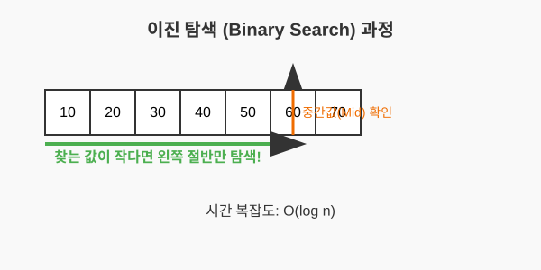

# 14주차: 알고리즘 기초 (2) - 정렬과 탐색 🔍

지난 시간에는 시간 복잡도라는 '측정 도구'를 배웠습니다. 이번 시간에는 그 도구를 사용하여 실제 알고리즘의 효율성을 분석하고, 가장 대표적인 정렬과 탐색 알고리즘을 배웁니다.

---

## 1. 탐색 (Searching)

데이터 집합에서 원하는 데이터를 찾는 방법입니다.

### 1.1 순차 탐색 (Linear Search)
처음부터 끝까지 하나씩 확인하는 방법입니다.
*   **시간 복잡도:** $O(n)$
*   **특징:** 데이터가 정렬되어 있지 않아도 사용할 수 있습니다.

### 1.2 이진 탐색 (Binary Search)
**정렬된 데이터**에서 중간값을 기준으로 탐색 범위를 절반씩 줄여나가는 방법입니다.



*   **시간 복잡도:** $O(\log n)$
*   **특징:** 데이터가 반드시 **정렬**되어 있어야 합니다. $O(n)$보다 압도적으로 빠릅니다.

---

## 2. 정렬 (Sorting)

무작위로 섞인 데이터를 특정 기준(오름차순/내림차순)으로 나열하는 것입니다.

### 2.1 버블 정렬 (Bubble Sort)
인접한 두 원소를 비교하며 큰 값을 뒤로 보내는 방식입니다.
*   **시간 복잡도:** $O(n^2)$
*   **특징:** 구현이 매우 쉽지만, 데이터가 많아지면 매우 느려집니다.

### 2.2 퀵 정렬 (Quick Sort)
기준점(Pivot)을 정하고, 기준보다 작은 값과 큰 값으로 나누어 재귀적으로 정렬하는 방식입니다.
*   **시간 복잡도:** 평균 $O(n \log n)$, 최악 $O(n^2)$
*   **특징:** 대부분의 상황에서 매우 빠르며, 실제 많은 라이브러리에서 사용합니다.

### 2.3 파이썬의 정렬: `sort()`와 `sorted()`
파이썬은 **Timsort**라는 매우 효율적인 알고리즘을 사용합니다. (Merge Sort와 Insertion Sort의 하이브리드)
*   **시간 복잡도:** 최선 $O(n)$, 평균/최악 $O(n \log n)$

---

## 🔍 Deep Dive: Timsort 알고리즘의 매직

파이썬의 내장 정렬 함수인 `sort()`와 `sorted()`는 2002년 팀 피터스(Tim Peters)가 파이썬을 위해 고안한 **Timsort** 알고리즘을 사용합니다.
- **하이브리드 아키텍처**: 데이터 분석에서 이미 정렬된 서브 시퀀스(Run)가 많다는 특성을 활용하여, 삽입 정렬(Insertion Sort)과 병합 정렬(Merge Sort)의 최적화된 하이브리드 형태로 동작합니다.
- **동작 원리**: 데이터를 작은 단위인 Minrun으로 쪼개 삽입 정렬을 실행한 뒤, 스택 구조와 Galloping 모드를 이용하여 런들을 병합(Merge)해 나갑니다. 이는 현실 세계의 대다수 데이터가 무작위가 아닌 일부 정렬된 상태를 지닌다는 점을 역이용한 환상적인 설계 기법입니다.

---

## ✍️ 이번 주 연습 문제

**문제 1.** 정렬되지 않은 리스트 `[5, 2, 9, 1, 5, 6]`에서 숫자 `9`를 찾는 순차 탐색 코드를 작성해 보세요.

**문제 2.** 정렬된 리스트 `[10, 20, 30, 40, 50, 60, 70]`에서 숫자 `20`을 찾는 이진 탐색 과정을 단계별로 설명해 보세요. (어떤 값이 Mid가 되고, 범위가 어떻게 줄어드는지)

**문제 3.** (심화) 버블 정렬의 원리를 이해하고, 파이썬으로 버블 정렬 함수 `bubble_sort(lst)`를 직접 구현해 보세요.

---

## ☕ Java vs C++ vs Python 스나이퍼 비교

### 기본 내장 정렬 알고리즘의 차이
*   **Java (`Arrays.sort()`)**: 정수/실수 같은 기본 자료형(Primitive) 배열에는 성능이 극대화된 **Dual-Pivot Quick Sort**를 적용합니다. 반면, 객체 배열(Object Array)에는 참조 연산 안전성(Stable)을 위해 파이썬과 동일한 **Timsort**를 사용합니다.
*   **C++ (`std::sort()`)**: 안정성을 보장하지 않지만 평균 최상의 연산 성능을 가지는 **Introsort**를 씁니다. Introsort는 기본적으로 Quick Sort로 시작하되, 재귀 깊이가 깊어지면 Heap Sort로 전환하고 데이터 개수가 적어지면 Insertion Sort로 마무리하는 초고속 결합체입니다.
*   **Python**: 참조 안전성(Stable)이 절대적으로 지켜져야 하며 데이터의 일부 정렬 속성을 잘 타는 **Timsort**를 완전히 단일 정렬 엔진으로 내장하고 있습니다.

---

## 🎧 Vibe Coding

> **🗣️ 학생 프롬프트 (AI에게 이렇게 명령해 보세요):**
> "파이썬으로 퀵 정렬(Quick Sort)과 병합 정렬(Merge Sort)을 구현해 주고, 임의로 생성한 1만 개의 난수 리스트를 두 정렬 함수로 정렬하는 시간을 측정 및 시각적으로 비교해 주는 코드를 작성해 줘."

---

## 코딩 영단어 학습 📝

*   **`Linear Search`**: 순차 탐색. (배열의 처음부터 끝까지 순서대로 비교하여 데이터를 탐색하는 기법입니다.)
*   **`Binary Search`**: 이진 탐색. (정렬된 배열에서 중간값을 기준으로 탐색 범위를 계속 절반으로 줄여나가는 고속 탐색 기법입니다.)
*   **`Pivot`**: 피벗, 기준점. (퀵 정렬 등에서 데이터를 대/소로 분할하기 위해 설정하는 핵심 기준값입니다.)


---

## 📖 교재 상세 학습: 68 완벽한 정렬 유지하며 끼어들기: bisect 모듈

## 68 완벽한 정렬 유지하며 새치기 끼어들기: `bisect` 모듈

우리가 이미 키 순서대로 곱게 줄 세워둔 리스트가 있다고 상상해 보세요. `[1번, 2번, 3번, 5번, 6번]`
이때 지각한 '4번' 친구가 나타났습니다. 이 친구가 줄에 끼어들려면 어떻게 해야 할까요? 

처음부터 1번과 비교하고, 2번과 비교하고 하나씩 "나 여기 들어가도 돼?" 하고 묻다 보면 줄이 수십만 명일 때 시간이 너무 오래 걸리겠죠? 파이썬은 **이미 완벽하게 정렬된 줄에 새로운 값을, 기존 정렬을 망가뜨리지 않으면서도 가장 번개처럼 빠르게 쏙! 끼워 넣는 마법**의 모듈, `bisect`(바이스섹트 - 이진 탐색 기법) 모듈을 제공합니다.

### 1. 넌 몇 번째로 들어가야 해? (`bisect`)

먼저, 새로운 숫자가 줄의 몇 번째 자리에 비집고 들어가야 기존 오름차순 정렬이 안 망가지는지 **그 위치(Index)만 슬쩍 물어볼 수 있습니다.**

```python
import bisect

# 완벽하게 오름차순으로 정렬된 줄
line = [1, 2, 3, 5, 6]

# 질문: "4는 이 줄의 몇 번째 인덱스로 들어가야 찰떡이니?"
position = bisect.bisect(line, 4)

print(f"4가 들어갈 자리는 {position}번 인덱스입니다!")
# 출력: 4가 들어갈 자리는 3번 인덱스입니다!
```

---

### 2. 물어볼 필요 없이 곧바로 줄에 끼워 넣기 (`insort`)

어느 자리에 들어갈지 물어보는 것을 넘어, 한 큐에 딱 그 정답 자리를 째고 녀석을 밀어 넣고 싶다면 **`insort`** (insert + sort 합침) 마법을 쓰면 됩니다!

```python
import bisect

line = [1, 2, 3, 5, 6]

# "4를 줄의 알맞은 위치에 확 끼워 넣어라!"
bisect.insort(line, 4)

# 짠! 줄은 무너지지 않고 여전히 차례대로 정렬되어 있습니다.
print(line)  
# 출력: [1, 2, 3, 4, 5, 6]
```

#### 앞쪽? 뒤쪽? 섬세한 방향 옵션

만약 동일한 점수나 숫자를 넣을 때 "기존에 있던 똑같은 친구 앞쪽에 설래? 아니면 뒷쪽에 설래?"를 정해주고 싶다면 `bisect_left`(무조건 앞쪽), `bisect_right`(무조건 뒤쪽) 같이 섬세한 방향 옵션 함수도 짝꿍으로 준비되어 있습니다. 
(참고로 일반 `bisect` 함수는 `bisect_right`와 완벽하게 동일하게 작동합니다.)

지속적으로 새로운 데이터(순찰 시간, 랭킹 점수 등)가 수집되는데, **매번 그걸 받을 때마다 전체를 `sort()` 정렬하면 시스템이 멈춰버릴 정도로 느려집니다.** 이럴 때 정렬된 상태를 유지하며 가볍게 새 데이터만 주사기로 주입하는 `bisect`는 엄청난 속도 최적화의 위력을 발휘합니다!


---

## 📖 교재 상세 학습: 3. 깔끔한 정리 정돈: bisect 모듈

## 3. 깔끔한 정리 정돈: bisect 모듈

우리가 이미 키 순서대로 줄 세워둔 리스트가 있다고 상상해 보세요. `[1번, 2번, 3번, 5번, 6번]`
이때 새로운 '4번' 친구가 나타났습니다. 이 친구가 줄에 끼어들려면 어떻게 해야 할까요? 

처음부터 1번과 비교하고, 2번과 비교하고 하나씩 비교하다 보면 시간이 너무 오래 걸리겠죠? 파이썬은 이미 완벽하게 정렬된 줄에 새로운 녀석을 순서 파괴 없이 **가장 빠르게 쏙! 끼워 넣는** 마법의 모듈, `bisect`(이진 탐색) 모듈을 제공합니다.

### 3.1 넌 어디로 들어가야 해? (`bisect`)

먼저, 새로운 숫자가 줄의 몇 번째 자리에 들어가야 줄이 망가지지 않는지 위치(Index)를 물어볼 수 있습니다.

```python
import bisect

# 완벽하게 오름차순으로 정렬된 줄
line = [1, 2, 3, 5, 6]

# "4는 이 줄의 몇 번째 인덱스로 들어가야 정렬이 유지되니?"
position = bisect.bisect(line, 4)

print(f"4가 들어갈 자리는 {position}번 인덱스입니다!")
# 출력: 4가 들어갈 자리는 3번 인덱스입니다!
```

---

### 3.2 곧바로 줄에 끼워 넣기 (`insort`)

어느 자리에 들어갈지 물어보는 것을 넘어, 한 큐에 딱 그 자리에 녀석을 밀어 넣고 싶다면 `insort` (insert + sort 합침) 마법을 쓰면 됩니다!

```python
import bisect

line = [1, 2, 3, 5, 6]

# 4를 줄의 알맞은 위치에 확 끼워 넣어라!
bisect.insort(line, 4)

# 짠! 줄은 여전히 차례대로 정렬되어 있습니다.
print(line)  
# 출력: [1, 2, 3, 4, 5, 6]
```

만약 동일한 숫자를 넣을 때 "기존 친구 앞쪽에 설래? 뒷쪽에 설래?"를 정해주고 싶다면 `bisect_left`(앞쪽), `bisect_right`(뒤쪽) 같이 섬세한 방향 옵션도 고를 수 있답니다. 
정렬된 데이터에 계속해서 새로운 것을 주입해야 하는 프로그래밍 대회 코딩 문제나 고속 스피드가 생명인 게임 엔진에서 `bisect`는 엄청난 위력을 발휘합니다!
