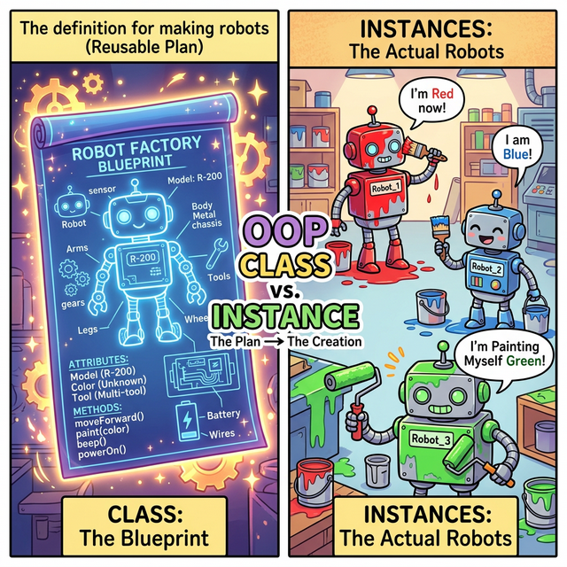

# 1주차: OOP 패러다임 - 객체지향 설계의 시작 🏗️

반갑습니다! 2학기 과정에서는 파이썬의 핵심 기둥 중 하나인 **객체지향 프로그래밍(OOP)**을 배웁니다. 복잡한 현실 세계를 데이터와 코드로 추상화하고 설계하는 첫 걸음을 함께 시작해 봅시다.

---

## 학습목표
본 장에서는 붕어빵을 끝없이 잉태해 내는 추상적인 황금 틀인 **'클래스(Class)'**와 제각각 다른 맛을 품고 그 틀에서 찍혀 나온 구체적인 실체인 **'인스턴스(Instance)'**의 차이를 명확하게 눈으로 확인합니다. 단순히 문법을 암기하는 것에서 벗어나, "왜 함수와 변수를 굳이 한 덩어리로 묶어서 관리해야 하는가?"라는 **유지보수 관점에서의 객체지향적 설계 철학(OOP Design)**을 깨우칩니다. 객체의 첫 숨을 불어넣는 생성자(`__init__`)의 역할과 원리를 투명하게 이해합니다.

---

## 💡 TL;DR (1분 핵심 요약): 객체지향 클래스란?

1. **클래스 (Class)**: 물건을 찍어내기 위한 종이 위 **"설계도"** 혹은 **"공장 라인"**입니다. 여기엔 아무런 실체(메모리)도, 색깔도 없습니다. 단순히 "로봇은 이름과 배터리가 있고, 걸을 수 있다"는 설계만 존재합니다.
2. **인스턴스 (Instance)**: 설계도를 통해 실제로 공장에서 철판을 조립해 만든 **"구체적인 로봇 실물 장난감"**입니다. 이 장난감들은 각자 다른 이름(Wall-E, R2D2)과 배터리 잔량을 가지며 독립적으로 움직입니다.
3. **설계의 핵심**: 파이썬은 **"상태를 나타내는 데이터(명사/변수)"**와 **"그 데이터를 조작하는 행동(동사/함수)"**을 하나로 튼튼하게 묶어버리기 위해 클래스를 도입했습니다. 이를 **캡슐화(Encapsulation)**라고 부릅니다.

---

## 1. 세상 모든 것을 찍어내는 마법의 설계도

파이썬의 세계에서는 숫자, 문자열, 리스트, 나아가 함수까지도 무언가의 설계도로부터 찍혀 나온 **모든 것이 객체(Object)**입니다. 우리가 직접 우리만의 독창적인 새로운 데이터 타입(설계도)을 정의할 때 `class`를 사용합니다.


*(웹툰 비유: 화면 왼쪽에는 추상적인 선방향만 그려져 있는 홀로그램 설계도(클래스)가 떠 있습니다. 그러나 현실 세계인 오른쪽에서는, 이 단 하나의 설계도로부터 빨간 페인트를 뒤집어쓴 로봇, 빗자루를 든 파란 로봇 등 '진짜 실체(인스턴스)'들이 끊임없이 조립되어 양산되고 있습니다.)*

---

## 2. 기본 문법: 선언과 탄생의 순간

클래스를 정의할 때는 `class` 키워드를 사용하며, 파이썬의 클래스 이름은 전통적으로 **파스칼 케이스(PascalCase: 단어의 첫 글자마다 대문자)**로 짓습니다.



### 예제 1: 빈 껍데기 설계도와 독립된 두 개의 개체
```python
# 1. 세상에 없던 나만의 '설계도(클래스)'를 하나 등록합니다.
class Robot:
    pass # 아직 내용은 텅 비어 있습니다.

# 2. 공장에 주문을 넣어 실물 장난감(인스턴스) 2대를 찍어냅니다!
robot_a = Robot()
robot_b = Robot()

print(type(robot_a)) # <class '__main__.Robot'>
print(robot_a == robot_b) # False (설계도만 같을 뿐, 각자 다른 메모리 집 주소를 가진 완전히 남남입니다!)
```

---

## 3. 생성자 (Constructor): 객체의 첫 숨결 `__init__`

공장에서 막 찍혀 나온 로봇은 이름도 색깔도 없는 깡통입니다. **객체가 이 세상에 태어나는 바로 그 0.1초의 찰나!** 가장 먼저 자동으로 한 번 실행되면서 로봇의 초기화 세팅(도색, 이름표 부착)을 강제로 집행하는 함수가 바로 **생성자 `__init__`** 입니다.

### 예제 2: 초기화 세일즈맨 `__init__`
```python
class Robot:
    # 파이썬 특수 매직 메서드 (양쪽 언더바 2개)
    # 로봇() 을 찍어내는 순간 무조건 제일 먼저 은밀하게 실행됩니다!
    def __init__(self, name, color):
        self.name = name   # 이 로봇의 명찰에 외부에서 받아온 name을 적습니다.
        self.color = color # 이 로봇의 도색을 외부에서 받아온 color로 칠합니다.
        print(f"삐릭! [{self.name}] 로봇({self.color}색) 초기화 완료!")

# 괄호 안에 값을 넘겨주면, 그 값들이 __init__ 메서드로 곧장 빨려 들어갑니다.
robot1 = Robot("R2D2", "White/Blue")
robot2 = Robot("C3PO", "Gold")

# robot1.name 은 R2D2, robot2.name 은 C3PO로 완벽히 격리된 데이터를 가집니다.
```

---

## ☕ Java vs 🐍 Python 스나이퍼 비교

### 생성자의 이름
*   **Java**: 생성자의 이름이 `public Robot()` 처럼 클래스 이름과 100% 똑같아야 합니다. 클래스 이름 바꾸면 생성자 이름도 싹 다 고쳐야 하는 번거로움이 있습니다.
*   **Python**: 클래스 이름이 Robot이든 Terminator든 상관없이, 생성자는 평생 고정된 예약어 마법인 `__init__` 하나만을 죽어라 씁니다.

---

## 코딩 영단어 학습 📝

*   **OOP (Object-Oriented Programming)**: 객체 지향 프로그래밍. (현실 세계의 사물들(물건, 무기, 몬스터, 자동차)을 있는 그대로 컴퓨터 속으로 복사해서 상태와 행동을 묶고 각자의 역할을 부여해 상호작용하게 만드는 위대한 설계주의 철학입니다.)
*   **Class**: 부류, 등급, 학급. (공통된 성질이나 규격을 분류해 놓은 종이 도면(Blueprint)입니다. '자동차 설계도'지 실제 굴러가는 람보르기니가 아닙니다.)
*   **Instance**: 사례, 경우, 구체적인 실체. (설계도 원본이 아니라, 그 도면을 보고 실제로 나사 하나하나 조여서 내 손에 만져지게 뚝딱 만들어져 나온 '실물 장난감 1호'를 뜻합니다.)
*   **Constructor (`__init__`)**: 생성자, 건설자. (건물을 처음 지을 때 가장 먼저 뼈대를 세우고 기초공사를 하듯, 객체가 태어날 때 가장 먼저 내부 변수(체력, 마나, 이름)를 초기 세팅해 주는 특별한 노동자 함수입니다.)

---

## ✍️ 이번 주 연습 문제

**문제 1.** 절차지향 프로그래밍과 객체지향 프로그래밍의 핵심 철학 차이를 비유를 들어 설명해 보세요.

**문제 2.** 클래스와 인스턴스의 관계를 붕어빵 틀과 붕어빵의 예시 외에 자신만의 창의적인 비유를 통해 설명해 보세요.

**문제 3.** (심화) 파이썬에서 클래스 선언 자체가 메모리상에서 객체로 어떻게 평가되는지 '메타클래스(type)'의 개념과 결합하여 조사 및 정리해 보세요.

---

## 📖 교재 상세 학습: 01 나만의 독창적 붕어빵 틀 조각하기 (모델링)

## 01 세상에 없던 나만의 맞춤형 거푸집 제작 (데이터 모델링)

이제 수동적인 태도를 버리고, 파이썬 님이 하사하신 기성품 틀(`list`, `str` 등)에서 벗어나 볼 시간입니다. 창조주로서 내가 구상한 현실 세계의 복잡한 사물이나 개념을 코드로 마구 찍어낼 수 있는 나만의 전용 틀(`class`)을 직접 용접해 봅니다.
판타지 RPG 게임 생태계를 구성할 '몬스터'라는 종족의 기초 설계도(모델링)를 그려보겠습니다.

**코드: 몬스터 개체군 설계도 작성 1단계**
```python
# 파이썬 커뮤니티의 룰: class 키워드 옆에 짓는 이름의 첫 글자는 웅장하게 대문자로 시작합니다.
class GameMonster():
    pass # 일단 내부는 텅 비워둡니다.

# 방금 만든 무쇠 틀을 철컥 찍어내어, 필드에 슬라임과 고블린이라는 살아 숨 쉬는 실체(인스턴스) 두 마리를 스폰시킵니다!
slime_mob = GameMonster()
goblin_mob = GameMonster()

# 갓 태어난 상태라 백지 같은 두 녀석에게 콕 집어 각자의 개성(속성 데이터)을 불어넣어 줍니다.
slime_mob.name = "에메랄드빛 슬라임"
slime_mob.health = 30

goblin_mob.name = "몽둥이 고블린"
goblin_mob.health = 100

print(f"야생의 {slime_mob.name}(이)가 나타났다! 현재 체력 게이지는 {slime_mob.health}이다.")
```

**출력 패널**
```text
야생의 에메랄드빛 슬라임(이)가 나타났다! 현재 체력 게이지는 30이다.
```


---

## 📖 교재 상세 학습: 1. 클래스와 인스턴스의 본질

## 1. 클래스와 인스턴스의 본질

프로그래밍에서 복잡한 시스템을 구축하기 위해서는 숫자나 문자열 같은 단순 데이터를 넘어, **'상태(속성)'**와 **'행동(메서드)'**을 하나로 묶은 독립적인 생명체인 **객체(Object)**를 만들어내야 합니다. 이 객체들의 협력으로 돌아가는 시스템을 '객체지향(Object-Oriented)' 시스템이라고 부릅니다.

- **클래스(Class)**: 객체를 똑같이 찍어내기 위한 '설계도' 혹은 '붕어빵 틀'입니다.
- **인스턴스(Instance)**: 설계도를 통해 컴퓨터 메모리 상에 실체화된 개별 '객체(붕어빵)'를 말합니다.

### 1.1 객체가 가져야 할 3대 특징

완벽한 객체라면 다음의 세 가지 특성을 만족해야 합니다.

1. **정체성 (Identity)**: 
    모든 객체는 고유한 메모리 주소(레퍼런스)를 가집니다. 완전히 똑같은 데이터를 가졌더라도, 쌍둥이처럼 서로 다른 존재로 취급받아야 합니다. 파이썬에서는 `id()` 함수를 통해 메모리 바코드(주소)를 확인합니다.
2. **상태 (State / Data Type)**: 
    객체는 자신만의 고유한 정보를 품고 있습니다. (예: 자동차 객체의 '현재 속도', '색상' 데이터)
3. **책임/반응성 (Responsibility / Behavior)**:
    외부에서 특정 메시지(호출)를 받았을 때 스스로의 상태를 변화시키거나 응답하는 행동 지침(메서드)을 갖추고 있어야 합니다.

```python
# 파이썬의 숫자도 사실은 int 라는 클래스로부터 태어난 완벽한 '객체'입니다!
a = int(10)
b = int(5)

# 객체의 '행동(Behavior)' 호출: 
# a.+(b) 와 본질적으로 같은 행위가 내장 스페셜 메서드 __add__를 통해 처리됩니다.
print(a.__add__(b)) # 15
```

---

### 1.2 사용자 정의 클래스 만들기 (`class` 키워드)

파이썬 내장 객체(int, str 등) 외에, 우리 비즈니스 상황에 딱 맞는 독자적인 틀을 만들 때는 `class` 키워드를 사용합니다.

클래스의 첫 글자는 대문자를 사용하는 파스칼 케이스(PascalCase) 표기법을 쓰는 것이 약속(PEP 8)입니다.

```python
# '책' 이라는 추상적 사물의 설계도(클래스)를 정의
class Book:
    # 붕어빵이 갓 구워져 나왔을 때 초기 속성을 채워넣는 특별한 메서드
    def __init__(self, title, author):
        # self.속성명 = 매개변수
        # self는 '방금 태어난 나 자신(인스턴스)'을 가리킵니다.
        self.title = title
        self.author = author

# 설계도를 기반으로 메모리 상에 실물 객체 2개를 탄생시킴 (인스턴스화)
book1 = Book("어린왕자", "생텍쥐페리")
book2 = Book("파이썬 코딩", "귀도 반 로섬")

print(book1.title) # 어린왕자

# 두 책은 완전히 독립된 메모리 주소를 가짐 (정체성 확립)
print(id(book1) == id(book2)) # False
```

---

### 1.3 만물의 조물주: `object`와 `type`

파이썬 객체 생태계 피라미드의 꼭대기에는 두 명의 절대자가 존재합니다.

1. **`object` (최상위 부모 클래스)**
    파이썬의 세상의 모든 클래스(수치, 문자열, 사용자가 만든 `Book` 클래스 등)는 족보를 거슬러 올라가면 시조새 격인 `object` 클래스를 강제로 상속받고 있습니다. 이 때문에 어떠한 객체든 `__str__`이나 `__dict__` 같은 공통 스페셜 속성들을 숨쉬듯 사용할 수 있는 것입니다.
2. **`type` (메타 클래스)**
    '클래스 모양 자체'를 찍어내는 공장장의 공장입니다. 우리가 짠 `class Book:` 코드 블록마저도 사실은 파이썬 내부의 `type`이라는 설계도(메타 클래스)가 만들어낸 하나의 인스턴스에 불과합니다.

```python
# 파이썬의 클래스는 object의 후손입니다.
print(issubclass(int, object))  # True
print(issubclass(Book, object)) # True

# 심지어 클래스(틀) 자신조차도 type 공장에서 찍힌 인스턴스 물건일 뿐입니다.
print(isinstance(Book, type))   # True
```


---

## 📖 교재 상세 학습: 9. 객체 간의 연관 관계와 의존성

## 9. 객체 간의 연관 관계와 의존성

지금까지 클래스를 재사용하는 핵심 방법으로 상속(Inheritance)을 배웠습니다. 하지만 상속의 깊이가 깊어지면 부모의 작은 변화가 자식에게 연쇄적인 버그를 일으키는 **'깨지기 쉬운 부모 클래스 문제(Fragile Base Class Problem)'**가 발생합니다. 

그래서 현대 객체지향 설계에서는 **"상속(Inheritance)보다는 연관(Association)과 구성(Composition)을 활용하라"**는 명언이 있습니다. 부모-자식 관계 대신 포함 관계로 서로를 참조하는 방식을 알아봅니다.

### 9.1 공동 운명체: 구성 (Composition)

한 객체가 생성될 때 내부에 다른 객체를 직접 생성하여 품고 있는 형태입니다. **컨테이너 객체가 소멸하면 부품 객체도 함께 운명을 같이하는 강력한 생명주기 동일성**을 가집니다.

```python
class Engine:
    def __init__(self, hp):
        self.hp = hp
        print("엔진이 조립되었습니다.")

class SportsCar:
    def __init__(self, brand, engine_hp):
        self.brand = brand
        # 차가 만들어지는 순간, 차 내부에서 엔진 객체를 직접 생성함 (강한 결합)
        self.engine = Engine(engine_hp)
        
    def show_info(self):
        print(f"{self.brand} 스포츠카 (출력: {self.engine.hp}마력)")

# 자동차가 폐차(소멸)되면 내부의 엔진도 함께 사라집니다.
ferrari = SportsCar("페라리", 800)
ferrari.show_info()
```

---

### 9.2 느슨한 결합: 집합 (Aggregation)

구성(Composition)보다 **훨씬 느슨하고 자유로운 연관 관계**입니다. 외부에서 이미 완성된 부속품(객체)을 넘겨받아 잠시 담아둘 뿐입니다. 
본체 객체가 파괴되어도 부속품 객체는 바깥에서 여전히 생존할 수 있습니다.

```python
class Keyboard:
    def __init__(self, switch_type):
        self.switch_type = switch_type
        print("키보드가 준비되었습니다.")

class Computer:
    def __init__(self, model):
        self.model = model
        self.keyboard = None # 초기엔 키보드가 없음
        
    def plug_in(self, keyboard_obj):
        # 외부에서 만들어진 키보드 객체를 꽂아넣음 (약한 결합)
        self.keyboard = keyboard_obj

# 컴퓨터와 키보드가 각자 독립적으로 창조됨
mech_keyboard = Keyboard("청축")
mac_studio = Computer("Mac Studio")

# 연결 (Aggregation)
mac_studio.plug_in(mech_keyboard)

# 컴퓨터를 버린(삭제)해도, 키보드는 여전히 내 책상에 살아있습니다!
del mac_studio
print(mech_keyboard.switch_type) # 청축
```

---

### 9.3 남에게 떠넘기기: 위임 패턴 (Delegation)

상속을 쓰지 않으면서도 다른 클래스의 기능을 내 것처럼 재사용할 때 유용한 패턴입니다. 자신에게 접수된 작업 지시(메서드 호출)를, **자신이 품고 있는 다른 전담 객체(연관 객체)에게 그대로 토스(Toss)**해버립니다.

```python
class PrinterModule:
    def do_print(self, document):
        return f"[출력 중] {document}"

# 부모 PrinterModule을 상속받지 않고, 객체로 품어서 기능을 위임합니다.
class OfficeAssistant:
    def __init__(self):
        # 복잡한 인쇄 기능은 내부 전담 객체를 구성(Composition)하여 처리
        self.printer = PrinterModule()
        
    def print_document(self, doc_name):
        print("비서: 네, 인쇄를 지시하겠습니다.")
        # 일은 내가 직접 안 하고 품고 있는 프린터 객체에게 '위임'
        result = self.printer.do_print(doc_name)
        print(result)

assistant = OfficeAssistant()
assistant.print_document("월간 보고서.pdf")
# 비서: 네, 인쇄를 지시하겠습니다.
# [출력 중] 월간 보고서.pdf
```
