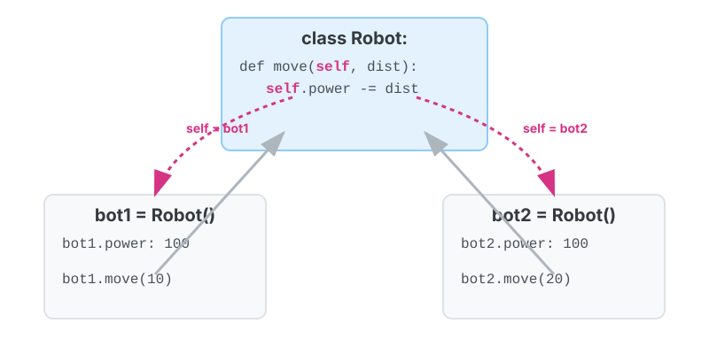

# 2주차: 클래스 기초 - 인스턴스와 self의 정체 ⚙️

지난 시간 배운 OOP 패러다임을 바탕으로, 이번 주에는 파이썬 클래스의 생성자와 속성, 그리고 메서드 선언 시 반드시 짚고 가야 할 **self** 매개변수의 진짜 비밀을 파헤쳐 봅니다.

---

## 학습목표
클래스 안의 가장 강력한 매직 코어이자 매개변수인 `self`의 정체를 통달합니다. 자바의 `this` 키워드와의 차이점을 이해하고, 왜 파이썬은 이토록 강박적으로 명시적인 `self`를 고집하는지 객체지향의 사상적 측면에서 파고듭니다.

---

## 💡 TL;DR (1분 핵심 요약): self란?

1. **self**: 공장에서 찍혀 나온 무수한 인스턴스(객체)들 중에서, **"지금 당장 행동을 취하고 있는 바로 그 '나 자신'"**을 가리키는 파이썬의 거울입니다. 자바나 C++의 `this`와 동일한 역할을 합니다.
2. **명시적 선언**: 파이썬에서는 클래스 내부의 일반 메서드를 선언할 때, **무조건 첫 번째 매개변수로 `self`를 적어 주어야만 합니다.**

---

## 1. 파이썬 최대의 수수께끼: `self`가 도대체 뭔가요?

클래스 안의 모든 괄호마다 귀신처럼 맨 앞자리를 꿰차고 있는 매개변수 `self`. 그 정체는 바로 **"공장에서 찍혀 나온 무수한 로봇 복제 인간들 중에서, 지금 당장 키보드 버튼을 눌러 행동하고 있는 바로 그 '나 자신(현재 인스턴스)'"**을 의미하는 거울입니다.


*(웹툰 비유: 거울을 바라보고 있는 로봇. 로봇의 가슴에는 'self'라는 빛나는 명찰이 붙어 있으며, 거울에 비친 자신의 모습(내부 배터리 잔량)을 들여다보고 있습니다. 아무리 수많은 로봇이 있어도, 이 로봇이 말하는 'self'는 오직 거울 앞의 '자기 자신'뿐입니다.)*

<br>


### 예제: `self`를 통한 행동 반경 제어
메서드(클래스 안에 소속된 함수)를 정의할 때, 무조건 무조건 첫 번째 매개변수로 `self`를 강제해야 합니다.

```python
class Robot:
    def __init__(self, name):
        self.name = name
        self.power = 100 # 기본 배터리는 100% 충전
        
    def say_hello(self): # 반드시 첫 파라미터는 self!
        print(f"안녕하세요! 저는 {self.name}입니다. 잔여 배터리: {self.power}%")
        
    def move(self, distance):
        self.power -= distance # '나 자신'의 배터리 창고에서 값을 빼야 합니다!
        print(f"위이잉~ {distance}m 이동완료. (현재 배터리: {self.power}%)")

# 로봇 조종 시작
bot = Robot("Wall-E")
bot.say_hello()

# 눈에 보이지 않지만, 파이썬은 내부적으로 bot.move(10) 을 Robot.move(bot, 10) 으로 변환해서 
# 10m를 움직인 로봇이 'bot'이라는 것을 self 자리에 주입해 줍니다!!
bot.move(15) 
bot.say_hello()
```

---

## 2. ☕ Java vs 🐍 Python 스나이퍼 비교

### `this` vs `self`
*   **Java**: 자바에서는 클래스 변수에 접근할 때 암시적으로 `this.` 키워드를 깔아줍니다(이름 충돌이 나지 않는 한 생략 가능). 컴파일러가 알아서 현재 객체 자원을 연결해줍니다.
*   **Python**: 파이썬은 **"명시적인 것이 암시적인 것보다 낫다"**는 무서운 철학을 고집합니다. 절대 자동으로 숨겨주지 않고, 네가 남의 변수를 건드리는지 네 자신의 속성을 건드리는지 모조리 `self.` 를 타이핑해서 육안상 명확히 구분하라고 혹독하게 강제합니다. (처음엔 귀찮아도 나중엔 버그를 막아주는 생명줄이 됩니다.)

---

## 코딩 영단어 학습 📝

*   **Self**: 자아, 자신. (클래스라는 하나의 뼈대 안에서 활동하지만, 결국 조작되는 메모리는 각 독립적인 '인스턴스(객체)'입니다. 내가 쏘는 미사일이 남의 배터리를 닳게 하지 않도록, 온전히 나의 내면 상태(변수)를 가리킬 때 쓰는 지시대명사입니다.)
*   **This**: 이것. (자바, C++, 자바스크립트 등 대다수 객체지향 언어에서 현재 인스턴스 자신을 가리키는 키워드입니다. 파이썬의 `self`와 근본적으로 하는 일이 같습니다.)

---

## ✍️ 이번 주 연습 문제

**문제 1.** 파이썬 클래스의 생성자 `__init__` 메서드가 인스턴스를 생성하는 과정에서 어떤 역할을 하는지 설명해 보세요.

**문제 2.** 클래스 내부에 정의된 메서드의 첫 번째 매개변수로 왜 항상 `self`가 필요하며, 메서드가 호출될 때 파이썬은 이 `self`에 무엇을 바인딩해 주는지 설명해 보세요.

**문제 3.** (심화) 파이썬에서 `BankAccount` 클래스 인스턴스 `my_account`가 있을 때, `my_account.deposit(100)`과 `BankAccount.deposit(my_account, 100)`의 내부 바인딩 및 함수 호출 흐름상 차이점과 동일성을 논해 보세요.

---

## 📖 교재 상세 학습: 02 설계도(클래스)와 실제 건축물(인스턴스)

## 02 붕어빵 굽는 무쇠 틀(Class)과 갓 구워낸 붕어빵(Instance)

우리가 알게 모르게 숨 쉬듯 써왔던 `[1, 2, 3]` 같은 리스트 배열도, 사실 그 알맹이를 파헤쳐보면 파이썬 창조주가 태초에 깎아둔 `list`라는 거대한 '무쇠 틀(클래스)'에서 방금 하나 구워져 튀어나온 '따끈한 붕어빵 한 봉지(인스턴스)'에 불과합니다.

* **클래스 (Class)**: 물건을 찍어내기 위한 원본 설계도, 거푸집 (예: '자동차'라는 개념 자체)
* **인스턴스 (Instance)**: 설계도를 쥐고 공장에서 조립해 실제로 내 눈앞에 튀어나온 실물 (예: '내 차', '아빠 차', '어제 뽑은 테슬라')

---

### 02.1 객체(Object)가 가져야 할 3대 특징

프로그래밍에서 복잡한 시스템을 구축하기 위해서는 숫자나 문자열 같은 단순 데이터를 넘어, **'상태(속성)'**와 **'행동(메서드)'**을 하나로 묶은 독립적인 생명체인 **객체(Object)**를 만들어내야 합니다. 완벽한 객체라면 다음 세 가지 특성을 가집니다.

1. **정체성 (Identity)**: 모든 객체는 고유한 메모리 주소(레퍼런스)를 가집니다. 완전히 똑같은 통장(데이터)이라도, 내 통장과 네 통장은 다른 존재입니다.
2. **상태 (State)**: 객체는 자신만의 고유한 정보를 품고 있습니다. (예: 붕어빵의 '앙금 종류', '온도')
3. **행동 (Behavior)**: 외부의 명령(호출)을 받았을 때 스스로 반응하는 행동 지침(메서드)을 갖춥니다.

**REPL 실습 창: `==` 연산자와 `is` 연산자의 소름 돋는 차이 (정체성 확인)**
```python
>>> item_a = [1, 2, 3]
>>> item_b = [1, 2, 3]
>>> item_a == item_b 
True # 둘의 뱃속에 든 값(내용물) 구성이 완전히 똑같다는 겉모습 판별입니다. (어쨌든 둘 다 팥 붕어빵이네!)
>>> item_a is item_b
False # 허나 물리적인 영혼(메모리 주소)까지 완벽히 일치하는 단일 개체는 아닙니다! 파이썬의 id() 함수로 확인해보면 번호표가 다릅니다.
```

---

### 02.2 만물의 조물주: `object` 클래스

여담으로, 파이썬 객체 생태계 피라미드의 맨 꼭대기에는 **`object`** 라는 절대자가 존재합니다. 파이썬 세상의 모든 클래스(수치, 문자열은 물론 우리가 직접 만든 사용자 정의 클래스까지)는 족보를 거슬러 올라가면 시조새 격인 `object` 클래스를 강제로 물려받고 있습니다. 이 덕분에 어떤 객체든 최소한의 공통 기능들을 숨쉬듯 사용할 수 있습니다.


---

## 📖 교재 상세 학습: 03 생명력을 불어넣는 행동 지침서: 메서드(Method)

## 03 스스로 생각하고 움직이게 하라: 메서드(Method)

클래스라는 도화지 위에는 이름이나 체력 같은 정적인 테이터(변수)뿐만 아니라, 살아 움직이는 **행동 패턴(함수)**도 얼마든지 스케치할 수 있습니다. 이렇게 클래스 내부 생태계에 철석같이 소속되어 특수 임무를 띠는 함수들을 우리는 일반 함수와 구분 지어 **메서드(Method)**라고 칭합니다.

클래스 내부에 나만의 메서드를 창조할 때 절대 까먹으면 안 되는 단 하나의 황금률이 있습니다. **무조건 첫 번째 매개변수 구멍에는 `self`라는 마법의 단어를 박아 넣는다!**
이 `self`는 "현재 생명을 얻어 활동 중인 나 자신(인스턴스)"을 직통으로 가리킵니다. "내 체력(`self.health`)을 깎아내라", "내 이름표(`self.name`)를 자랑스럽게 외쳐라" 하고 본인에게 명령을 내릴 때 빠져선 안 될 가장 중요한 주어(Subject)입니다.

**코드: 샌드백이 된 불쌍한 몬스터**
```python
class GameMonster():
    # 클래스 내부에 서식하는 함수(메서드)는 언제나 첫 빠따로 self를 챙겨가야 합니다.
    def receive_strike(self, damage_amount):
        self.health = self.health - damage_amount
        print(f"크윽! {self.name}(이)가 {damage_amount}만큼의 뼈아픈 일격을 당했습니다! (잔여 체력: {self.health})")

# 몬스터 스폰
orc_warrior = GameMonster()
orc_warrior.name = "성난 오크 전사"
orc_warrior.health = 200

# 개발자인 우리가 receive_strike 메서드를 호출할 땐 순수 데미지 수치(50)만 입에 넣어주면 됩니다.
# 맨 앞자리를 떡하니 차지했던 self 변수에는 파이썬 엔진이 센스 있게 'orc_warrior' 본체를 몰래 욱여넣어 줍니다.
orc_warrior.receive_strike(50) 
orc_warrior.receive_strike(100)
```

**콘솔 출력창**
```text
크윽! 성난 오크 전사(이)가 50만큼의 뼈아픈 일격을 당했습니다! (잔여 체력: 150)
크윽! 성난 오크 전사(이)가 100만큼의 뼈아픈 일격을 당했습니다! (잔여 체력: 50)
```


---

## 📖 교재 상세 학습: 04 너의 출신 성분이 무엇이냐? 자료형 검사기

## 04 데이터의 호구조사를 실시하다: 타입(Type) 검열기

파이썬이 지배하는 세계관에서는 굴러다니는 모든 데이터가 저마다 고유한 '종족(자료형, Class Type)' 소속 마크를 이마에 달고 있습니다. 
예를 들어 숫자 `10`과 따옴표를 두른 `"10"`은 인간의 눈으로 보기엔 별반 다를 게 없지만, 파이썬 호스트 입장에선 서로 말도 안 통하는 완전히 딴판인 종족입니다.

* **`type(타깃값)`**: 해당 데이터 조각이 정확히 어느 가문(클래스) 출신인지 그 본래 신분을 적나라하게 까발려줍니다.
* **`isinstance(타깃값, 검사할자료형)`**: 타깃 데이터가 우리가 의심하는 그 소속이 맞는지 아닌지를 단호하게 O/X(True/False)로 심사해 주는 판독기입니다.

**REPL 실습 창: 삼엄한 신분 확인 절차**
```python
>>> type("안녕하세요")
<class 'str'> # 얘는 뼛속까지 텍스트(string) 종족이라는 뜻입니다.
>>> type(3.1415)
<class 'float'> # 아하, 얘는 소수점이 달린 부동소수점(float) 일족이군요.
>>> isinstance(999, int)
True # 맞습니다! 999는 순혈 정수(int) 가문이 확실합니다.
>>> isinstance(999, float)
False # 땡! 999는 소수 나부랭이가 아닙니다! (999.0 이어야 소수 취급을 받습니다.)
```


---

## 📖 교재 상세 학습: 2. 생성자(__new__)와 초기화(__init__)

## 2. 생성자(`__new__`)와 초기화(`__init__`)

파이썬에서 흔히 `__init__`을 '생성자'라고 부르지만, 엄밀한 파이썬의 구조적 관점에서는 이는 **초기화(Initializer)** 메서드일 뿐입니다. 진짜 객체를 메모리에 탄생시키는 창조주 역할은 `__new__`라는 **생성자(Constructor)** 스페셜 메서드가 담당합니다.

### 2.1 진정한 창조주: `__new__` 메서드

우리가 `Book("파이썬")` 형식으로 클래스 이름표를 호출할 때, 사실 파이썬 내부에서는 가장 먼저 `__new__` 메서드가 발동됩니다. 
이 메서드는 메모리 상에 아무것도 칠해지지 않은 텅 빈 인스턴스(객체)를 만들어서 반환하는 역할을 합니다.

```python
class Alien:
    # 인스턴스 객체를 메모리에 생성하는 진짜 '생성자'
    # 첫 번째 매개변수로 클래스 자기 자신(cls)을 받습니다.
    def __new__(cls, *args, **kwargs):
        print("1. __new__ 호출: 텅 빈 인스턴스를 메모리에 창조합니다.")
        # 부모인 object 클래스의 __new__를 빌려와 객체를 실체화함
        instance = super().__new__(cls)
        return instance

    # 생성된 인스턴스에 값을 채워넣는 '초기화' 메서드
    def __init__(self, name):
        print("2. __init__ 호출: 생성된 인스턴스에 이름을 부여합니다.")
        self.name = name

# 객체 생성 과정
alien1 = Alien("외계인 A")
```

> [!NOTE]
> 일반적인 프로그래밍에서는 `__new__`를 직접 건드릴 일이 거의 없습니다. 하지만 **싱글턴 패턴(Singletion Pattern)**처럼 메모리에 단 하나의 객체만 존재하도록 객체 생성을 통제해야 할 때는 `__new__`를 오버라이딩하여 제어합니다.

---

### 2.2 인스턴스 변수 세팅: `__init__` 메서드

`__new__`가 텅 빈 인스턴스를 반환하면, 파이썬은 즉시 그 반환된 인스턴스를 파라미터 `self` 자리에 담아 `__init__` 메서드로 넘겨줍니다. 
여기서 비로소 인스턴스만의 고유한 속성(이름, 나이 등)을 딕셔너리(`__dict__`) 네임스페이스에 채워 넣게 됩니다.

```python
class Robot:
    def __init__(self, model_num):
        # 각각의 로봇(self)은 자기만의 고유한 모델 번호를 가집니다.
        self.model_num = model_num
        self.battery = 100 # 기본값 세팅

robotX = Robot("X-99")
print(robotX.__dict__) # {'model_num': 'X-99', 'battery': 100}
```

---

### 2.3 객체의 최후: 소멸자 `__del__`

객체의 임무가 끝나고 메모리에서 사라질 때(가비지 컬렉터에 의해 수거될 때) 마지막 유언을 남기듯 실행되는 메서드가 바로 **소멸자 `__del__`** 입니다.

```python
class ServerConnection:
    def __init__(self, ip):
        self.ip = ip
        print(f"[{self.ip}] 서버에 연결을 시작합니다.")

    # 객체가 파괴될 때 자동으로 실행됨
    def __del__(self):
        print(f"[{self.ip}] 안전하게 연결을 종료하고 메모리를 해제합니다.")

# 연결 객체 생성
conn = ServerConnection("192.168.0.1")

# 연결 객체를 명시적으로 파괴 (또는 프로그램이 끝날 때 자동 파괴됨)
del conn 
# 출력: [192.168.0.1] 안전하게 연결을 종료하고 메모리를 해제합니다.
```

---

### 2.4 메모리 다이어트: `__slots__`

파이썬의 각 인스턴스는 자유롭게 속성을 무한히 추가할 수 있도록 내부에 `__dict__`라는 해시 테이블을 몰래 들고 다닙니다. 이로 인해 클래스가 굉장히 유연해지지만, 객체를 수십만 개씩 만들어야 할 때는 메모리 소모가 극심해집니다.

이때, 클래스에 **`__slots__`** 리스트를 선언하면 거대한 `__dict__` 대신 속성의 자리를 미리 고정시켜 메모리 사용량을 획기적으로 줄일 수 있습니다.

```python
class MemoryEfficientPoint:
    # 이 인스턴스는 오직 x, y 속성만을 가질 수 있다고 족쇄를 채움!
    __slots__ = ['x', 'y']
    
    def __init__(self, x, y):
        self.x = x
        self.y = y

point = MemoryEfficientPoint(10, 20)

# [에러 발생] __slots__에 정의되지 않은 새로운 속성을 몰래 추가할 수 없음!
# point.z = 30 
```


---

## 📖 교재 상세 학습: 3. 객체의 생명주기와 소멸자

## 3. 객체의 점(Dot) 연산과 속성 제어

파이썬에서 클래스나 인스턴스의 내부 깊숙한 곳(네임스페이스)에 접근할 수 있는 유일한 열쇠는 바로 **점(`.`) 연산자**입니다. 우리가 무심코 사용하는 `p.name`이나 `p.age = 20` 같은 점 연산의 이면에는 파이썬의 정교한 스페셜 메서드 체계가 숨쉬고 있습니다.

### 3.1 점(.) 연산의 숨겨진 호출 구조

점(`.`)을 찍어 인스턴스의 속성에 접근하거나 값을 바꿀 때, 파이썬 내부에서는 다음과 같이 3개의 스페셜 메서드가 보이지 않게 작동합니다.

1. **조회**: `__getattribute__` (가장 먼저 접근 시도)
2. **조회 실패 시 위임**: `__getattr__` (`__getattribute__`에서 못 찾을 때만 호출됨)
3. **할당/갱신**: `__setattr__`
4. **삭제**: `__delattr__`

---

### 3.2 속성 갱신의 통로: `__setattr__`

인스턴스에 새로운 값을 할당할 때마다 항상 `__setattr__` 스페셜 메서드가 가로채기(Intercept)를 수행합니다. 이를 응용하면 데이터베이스에 값을 쓰거나, 특정 값이 들어올 때 타입 검사를 강제할 수 있습니다.

```python
class SmartDevice:
    def __init__(self, name):
        # self.name = name 을 실행하는 순간 __setattr__ 이 발동됨!
        self.name = name
    
    # 속성 할당을 중간에 가로채는 스페셜 메서드
    def __setattr__(self, key, value):
        print(f"[시스템 로그] '{key}' 속성에 '{value}' 값을 저장합니다.")
        # 무한루프를 방지하기 위해 실제 딕셔너리에 직접 값을 밀어넣음
        self.__dict__[key] = value

device = SmartDevice("온도조절기")
# [시스템 로그] 'name' 속성에 '온도조절기' 값을 저장합니다.

device.status = "활성화"
# [시스템 로그] 'status' 속성에 '활성화' 값을 저장합니다.
```

---

### 3.3 우아하게 에러 피하기: `__getattr__`

일반적으로 객체에 정의되지 않은 속성을 점(`.`)으로 호출하면 자비 없이 `AttributeError`가 발생합니다. 하지만 `__getattr__` 메서드를 재정의해두면, **찾는 속성이 없을 때 최후의 보루로 이 메서드가 실행되어 에러를 방지하고 기본값을 던져줄 수 있습니다.**

```python
class UserProfile:
    def __init__(self, id, name):
        self.id = id
        self.name = name

    # 파이썬이 네임스페이스를 완전히 뒤져보고 그래도 없을 때만 호출됨
    def __getattr__(self, missing_attr):
        print(f"[경고] '{missing_attr}' 이라는 속성은 존재하지 않습니다.")
        return "Not Found"

# 1. 속성이 정상적으로 존재할 때 (__getattribute__ 정상 작동)
user = UserProfile(101, "제임스")
print(user.name) # 제임스

# 2. 존재하지 않는 속성을 찾을 때 (에러 대신 __getattr__ 가 막아줌)
print(user.email) 
# [경고] 'email' 이라는 속성은 존재하지 않습니다.
# Not Found
```

> [!CAUTION]
> 무리하게 `__getattribute__`를 가로채려는 시도는 재귀(무한 루프) 함정에 빠지기 십상입니다. 안전하게 처리하려면 가급적 `__getattr__` 을 사용하는 패턴을 추천합니다.


---

## 📖 교재 상세 학습: 4. 메서드의 종류 (인스턴스, 정적, 클래스)

## 4. 메서드의 종류 (인스턴스, 정적, 클래스)

파이썬의 클래스 내부에는 인스턴스의 데이터를 볶고 지지는 함수들이 존재합니다. 이것들을 흔히 **메서드(Method)**라고 부릅니다. 
어떤 주체(인스턴스냐, 클래스 껍데기냐)가 이 메서드를 다루느냐에 따라 파이썬은 **인스턴스 메서드**, **클래스 메서드**, **정적 메서드** 세 가지 종류로 구분하여 지원합니다.

### 4.1 가장 흔한 일꾼: 인스턴스 메서드 (Instance Method)

우리가 파이썬에서 밥 먹듯이 쓰게 될 가장 기본적인 형태의 메서드입니다. 
인스턴스가 생성되고 나면, 그 **인스턴스 고유의 데이터(상태)를 지지고 볶는 역할**을 합니다. 파이썬 문법상 첫 번째 매개변수로 항상 자기 자신을 뜻하는 `self`를 무조건 넘겨받아야 합니다.

```python
class Robot:
    def __init__(self, name):
        self.name = name
    
    # 1. 인스턴스 메서드 정의 (첫 번째 인자는 무조건 self)
    def say_hello(self):
        print(f"삐리릭. 내 이름은 {self.name} 입니다.")

r1 = Robot("R2D2")
# 호출 시, 파이썬이 내부적으로 r1 인스턴스를 self 자리에 몰래 끼워넣습니다.
r1.say_hello() # 삐리릭. 내 이름은 R2D2 입니다.
```

---

### 4.2 클래스의 대표자: 클래스 메서드 (Class Method)

인스턴스 개별 데이터가 아니라, **'클래스 전체를 아우르는 공통 데이터(클래스 변수)'**를 조작하고 싶을 때 사용합니다.
메서드 머리통 위에 `@classmethod`라는 훈장(데코레이터)을 달아주며, 첫 번째 파라미터로는 인스턴스(`self`)가 아니라 **클래스 껍데기 자체(`cls`)**를 넘겨받습니다.

```python
class Employee:
    # 모든 직원이 공유하는 클래스 변수 (사원수)
    total_count = 0 
    
    # 2. 클래스 메서드 정의 (첫 번째 인자는 무조건 cls)
    @classmethod
    def print_company_size(cls):
        print(f"현재 우리 회사의 총 사원수는 {cls.total_count} 명입니다.")

# 인스턴스를 안 만들고도, 곧바로 '클래스명'으로 메서드 호출이 가능합니다!
Employee.print_company_size()
```

---

### 4.3 독립적인 늑대: 정적 메서드 (Static Method)

클래스 안에 둥지를 틀고 있기는 하지만, **클래스 변수(`cls`)나 인스턴스 변수(`self`) 그 어느 것도 건드리지 않는 완벽히 독립적인 함수**입니다. 
머리통에 `@staticmethod` 훈장을 달아주며, 파라미터에 `self`나 `cls` 같은 까다로운 요구사항이 아예 없습니다. 보통 단순 계산이나 보조 유틸리티성 로직을 끼워넣을 때 씁니다.

```python
class MathUtils:
    
    # 3. 정적 메서드 정의 (self, cls 둘 다 필요 없는 순수 계산용 함수)
    @staticmethod
    def add(a, b):
        return a + b

# 단순히 클래스라는 'namespace(이름 공간)' 역할만 빌려 쓰는 셈입니다.
result = MathUtils.add(10, 20)
print(result) # 30
```

---

### 4.4 보너스: 플루언트 인터페이스 (메서드 체이닝)

인스턴스 메서드의 마지막 꼬리 부분(`return` 문)에 `self`를 반환하도록 설계하면, 물 흐르듯이 메서드를 꼬리에 꼬리를 물고 연속으로 부르는 마법이 가능해집니다. 이를 흔히 **메서드 체이닝(Method Chaining)** 패턴이라고 부릅니다.

```python
class TextBuilder:
    def __init__(self, text=""):
        self.text = text
    
    def bold(self):
        self.text = f"**{self.text}**"
        # 나 자신(self)을 고스란히 던져줍니다!
        return self 
        
    def italic(self):
        self.text = f"_{self.text}_"
        # 또 나 자신(self)을 던져줍니다!
        return self

# 꼬리에 꼬리를 무는 기차놀이(Chaining) 방식의 호출
doc = TextBuilder("파이썬").bold().italic()

print(doc.text) # _**파이썬**_
```
