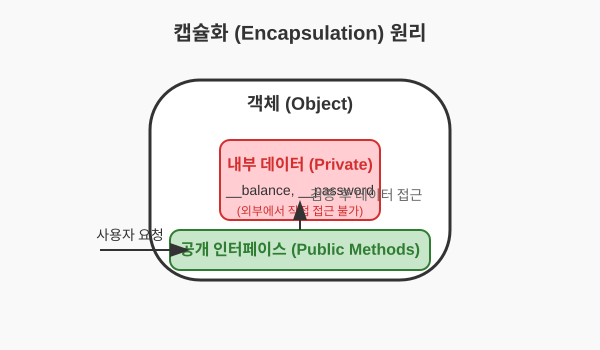

# 3주차: 캡슐화와 정보 은닉 - 안전한 데이터 관리 🔒

우리는 지난 시간까지 클래스를 통해 데이터를 묶는 법을 배웠습니다. 하지만 모든 데이터를 아무나 수정할 수 있게 공개한다면 어떻게 될까요? 예를 들어, 은행 계좌 객체의 `balance`(잔액) 변수를 누구나 수정할 수 있다면, 누군가 내 잔액을 마음대로 10억으로 바꿀 수도 있을 것입니다.

이런 문제를 해결하기 위해 사용하는 것이 **캡슐화(Encapsulation)**와 **정보 은닉(Information Hiding)**입니다.

---

## 1. 캡슐화 (Encapsulation)란?

캡슐화는 **데이터(속성)와 그 데이터를 처리하는 함수(메서드)를 하나로 묶고, 외부에서 데이터에 직접 접근하는 것을 제한**하는 것입니다. 마치 알약의 캡슐이 내부의 약 성분을 보호하고, 사용자는 캡슐이라는 인터페이스를 통해서만 약을 복용하는 것과 같습니다.



### 1.1 왜 캡슐화가 필요한가요?
1.  **데이터 보호:** 잘못된 값이 들어오는 것을 막을 수 있습니다. (예: 나이에 -5살 입력 방지)
2.  **독립성 유지:** 내부 구현 방식을 바꿔도, 외부에서 사용하는 방법(인터페이스)은 그대로 유지할 수 있습니다.
3.  **복잡성 감소:** 사용자는 내부의 복잡한 작동 원리를 몰라도, 제공되는 메서드만 사용하면 됩니다.

---

## 2. 파이썬의 접근 제어자 (Access Modifiers)

파이썬은 Java나 C++처럼 `private`, `public` 같은 엄격한 키워드는 없지만, **이름 규칙(Naming Convention)**을 통해 접근 권한을 표시합니다.

### 2.1 Public (공개)
- **표기:** `name` (일반적인 변수명)
- **특징:** 어디서든 접근 가능합니다.

### 2.2 Protected (보호됨)
- **표기:** `_name` (언더바 하나로 시작)
- **특징:** "이 변수는 내부용이니 가급적 건드리지 마세요"라는 **약속**입니다. 기술적으로는 접근이 가능하지만, 개발자들 사이의 매너입니다.

### 2.3 Private (비공개)
- **표기:** `__name` (언더바 두 개로 시작)
- **특징:** 클래스 외부에서 접근하려고 하면 `AttributeError`가 발생합니다. 파이썬이 내부적으로 이름을 바꾸어 숨기기 때문입니다. (**Name Mangling**)

```python
class BankAccount:
    def __init__(self, owner, balance):
        self.owner = owner          # Public
        self.__balance = balance    # Private (외부 접근 불가)

acc = BankAccount("지니", 1000)
print(acc.owner)    # 결과: 지니
# print(acc.__balance) # ❌ AttributeError 발생!
```

---

## 3. Getter와 Setter, 그리고 `@property`

데이터를 숨겼다면, 이제 안전하게 데이터를 읽고 수정할 방법이 필요합니다. 이때 사용하는 것이 **Getter**와 **Setter** 메서드입니다.

### 3.1 전통적인 방식 (Getter/Setter)
```python
class BankAccount:
    def __init__(self, balance):
        self.__balance = balance

    def get_balance(self): # Getter
        return self.__balance

    def set_balance(self, amount): # Setter
        if amount < 0:
            print("잔액은 음수가 될 수 없습니다!")
        else:
            self.__balance = amount
```

### 3.2 파이썬다운 방식: `@property` 데코레이터
파이썬에서는 메서드를 마치 변수처럼 사용할 수 있게 해주는 `@property`라는 아주 멋진 기능을 제공합니다.

```python
class BankAccount:
    def __init__(self, balance):
        self.__balance = balance

    @property
    def balance(self): # Getter 역할
        return self.__balance

    @balance.setter
    def balance(self, value): # Setter 역할
        if value < 0:
            raise ValueError("잔액은 음수가 될 수 없습니다!")
        self.__balance = value

acc = BankAccount(1000)
print(acc.balance)    # 메서드지만 변수처럼 호출 가능! (Getter)
acc.balance = 2000    # 변수에 값을 넣듯 호출 가능! (Setter)
# acc.balance = -100  # ❌ ValueError 발생!
```

---

## ✍️ 이번 주 연습 문제

**문제 1.** `Person` 클래스를 만들어 보세요.
- **속성:** `__age` (Private)
- **기능:** `@property`를 사용하여 나이를 가져오고, 설정할 때 0보다 작은 값이 들어오면 에러를 발생시키도록 구현하세요.

**문제 2.** 캡슐화가 적용되지 않은 코드와 적용된 코드의 차이점을 '데이터 무결성' 관점에서 설명해 보세요.

**문제 3.** (심화) 파이썬의 `__name` (Private) 변수가 실제로 완전히 숨겨지는 것인지, 아니면 다른 방법으로 접근할 수 있는 방법이 있는지 조사하고 코드로 증명해 보세요. (힌트: `_ClassName__variableName`)
---

## 🔍 Deep Dive: 네임 맹글링(Name Mangling) 작동 메커니즘과 메모리 보안의 진실

파이썬 클래스에서 변수 앞에 언더바 두 개를 붙이면(`__balance`) 외부에서 접근이 불가능하다고 배웁니다. 하지만 이는 물리적으로 메모리가 격리되는 것이 아닙니다.
- **네임 맹글링(Name Mangling)**: 파이썬 인터프리터가 코드를 바이트코드로 파싱할 때, `__변수명`을 `_클래스명__변수명` 형태로 이름을 자동으로 바꾸어(Mangling) 버리는 기법입니다.
- **실제 접근 가능성**: 런타임에 인스턴스의 네임스페이스 딕셔너리(`__dict__`)를 확인해 보면, `_BankAccount__balance`라는 키로 실제 값이 저장되어 있는 것을 볼 수 있습니다. 즉, 외부에서도 `acc._BankAccount__balance`라고 직접 접근하면 제한 없이 값을 읽거나 쓸 수 있습니다.
- **철학적 의미**: 파이썬은 "우리는 모두 성숙한 성인 개발자다(We are all consenting adults here)"라는 철학을 지향합니다. 컴파일러 수준에서 접근을 물리적으로 원천 차단하기보다는, 규약을 지켜 상호 간에 안전하게 코딩하는 가치를 존중합니다.

---

## ☕ Java vs Python 스나이퍼 비교

### 클래스 필드와 접근 제어 방식의 차이
*   **Java**: `private`, `protected`, `public` 및 `default(package-private)` 접근 제어자(Access Modifier) 키워드를 문법 레벨에서 명확히 강제합니다. JVM 클래스로더가 로드할 때 바이트코드 수준에서 이 규칙을 검증하므로, `private` 필드를 부당하게 침범하면 프로그램 컴파일 자체가 불가능합니다. (리플렉션 API를 활용한 강제 우회는 예외)
*   **Python**: 키워드가 아예 존재하지 않으며, 단지 언더바 개수로 약속하는 명명 관례(Naming Convention)만 있습니다. `__` 변수는 네임 맹글링을 통해 이름만 바뀔 뿐이며, 위에서 설명한 것처럼 클래스 밖에서 언제든 우회하여 값에 도달하고 뜯어고칠 수 있습니다.

---

## 🎧 Vibe Coding

> **🗣️ 학생 프롬프트 (AI에게 이렇게 명령해 보세요):**
> "파이썬으로 `@property` 데코레이터를 사용하여 사용자의 이메일과 비밀번호를 검증하는 `User` 클래스를 작성해 줘. 이메일은 @가 들어가는지, 비밀번호는 8자리 이상인지 Setter에서 확인하고 잘못된 데이터는 `ValueError`를 발생시키도록 짜 줘."

---

## 코딩 영단어 학습 📝

*   **`Encapsulation`**: 캡슐화. (데이터와 데이터 조작 메서드를 하나의 클래스 캡슐로 묶어 결합도를 높이고 내부 데이터를 안전하게 격리하는 설계 기법입니다.)
*   **`Access Modifier`**: 접근 제어자. (클래스 내 속성이나 메서드에 대해 외부나 자식 클래스가 도달할 수 있는 한계를 조절하는 키워드나 명명 규약입니다.)
*   **`Name Mangling`**: 네임 맹글링. (파이썬에서 `__`로 시작하는 비공개 속성의 이름을 CPython이 `_ClassName__variable` 형태로 자동 치환하여 우발적인 접근을 예방하는 런타임 기술입니다.)


---

## 📖 교재 상세 학습: 09 데이터 보호와 우아한 접근: 캡슐화와 프로퍼티

## 09 함부로 손대지 마시오: 캡슐화(Encapsulation)와 프로퍼티

클래스를 설계하다 보면, 붕어빵의 내부 앙금 레시피처럼 **외부에서 함부로 점(`.`)을 찍어 건드리지 못하게 꽁꽁 감춰야 할 민감한 데이터**(예: 통장 잔고, 주민번호, 게임 캐릭터의 방어력 공식 등)가 생깁니다. 이렇게 속과 겉을 분리하여 내부 정보를 보호하는 기법을 **캡슐화(Encapsulation) 혹은 정보 은닉**이라고 부릅니다.

### 1. 파이썬식 정보 은닉의 2가지 룰

다른 언어(Java 등)는 `private` 같은 단단한 자물쇠 키워드를 제공하지만, 파이썬은 **"우리 모두 책임감 있는 어른이니 굳이 문을 걸어 잠그진 말자(We are all consenting adults here)"**는 독특한 해커 철학을 가집니다. 대신, 약속된 이름표 표기법으로 강력한 경고를 줍니다.

#### 암묵적 경고: 언더스코어 1개 (`_변수명`)
실무에서 가장 많이 쓰이는 약속입니다. 변수나 메서드 이름 맨 앞에 `_`를 딱 1개 붙여두면 **"이 데이터는 이 클래스 내부에서만 쓸 거니까, 밖에선 제발 꺼내 쓰지 마세요"** 라는 신사적인 경고선 역할을 합니다.
```python
class BankAccount:
    def __init__(self, owner, balance):
        self.owner = owner
        self._balance = balance # [주의] 문법적 강제성은 없지만 절대 건드려선 안 되는 금단의 영역!
```

#### 소문 숨기기: 이름 맹글링 (`__변수명`)
정말로 숨기고 싶다면 언더바를 2개(`__`) 연속으로 붙입니다. 파이썬은 이 녀석을 보는 순간 냅다 변수 이름을 `_클래스명__변수명` 형태로 괴상하게 찌그러뜨려 놓기 때문에, 밖에서는 도저히 기존 이름으로 찾을 수 없게 만듭니다. (Name Mangling)

---

### 2. 변수 조작의 통제소: `@property` (프로퍼티 데코레이터)

내부 데이터를 꽁꽁 숨겨(`_변수`) 두었다면, 밖에서 값을 읽거나 값을 수정할 때 반드시 우리가 만들어둔 특정 검문소(메서드)를 거치도록 통제해야 합니다. 투박한 `get_나이()`, `set_나이()` 함수를 일일이 호출하는 대신 파이썬은 엄청나게 우아한 **`@property`** 마법을 선사합니다.

마치 밖에서는 그냥 평범한 변수처럼 쿨하게 읽고 쓰는 것 같지만, 실상은 그 뒤에 숨겨진 보안 검사 메서드가 몰래 핑글핑글 돌아가는 구조입니다!

**코드: 무적의 프로퍼티 방어막**
```python
class Character:
    def __init__(self, nickname):
        self.nickname = nickname
        self._level = 1  # ◀ 진짜 레벨 데이터는 언더바로 몰래 숨겨둡니다.
        
    # [읽기 전용 통로] @property를 달아주면 밖에서는 변수처럼 읽습니다.
    @property
    def level(self):
        # 원한다면 여기서 가짜 정보를 보여줄 수도 있습니다!
        return self._level
        
    # [쓰기 전용 검문소] 값을 변경할 때 무조건 이 깐깐한 필터를 통과시킵니다.
    @level.setter
    def level(self, new_level):
        if new_level < 1 or new_level > 99:
            print("[운영자 경고] 비정상적인 레벨업 시도가 적발되었습니다!")
            return # 강제 종료하여 핵심 데이터 오염 결사 방어!
        self._level = new_level

player = Character("초보파이썬")

# 메서드인데 괄호() 없이 아주 자연스럽게 속성처럼 조회 (getter 작동)
print(f"현재 레벨: {player.level}") 

# 변수에 스윽 대입하는 척하지만, 사실은 setter 메서드 검문소를 때립니다!
player.level = 999 
# 출력: [운영자 경고] 비정상적인 레벨업 시도가 적발되었습니다!

# 진짜 데이터 _level은 완벽하게 예전 수치(1)를 유지하며 살아남았습니다!
```

이제 여러분은 누구도 함부로 망가뜨릴 수 없는, 코어까지 탄탄하게 보호받는 튼튼한 객체를 설계할 수 있는 방패를 얻게 되었습니다!


---

## 📖 교재 상세 학습: 5. 정보 은닉과 프로퍼티 (Encapsulation)

## 5. 정보 은닉과 프로퍼티 (Encapsulation)

클래스를 설계할 때, 객체 내부의 민감한 데이터나 복잡한 상태를 외부에서 함부로 건드리지 못하게 꽁꽁 싸매어 보호하는 기법을 **캡슐화(Encapsulation)** 또는 **정보 은닉(Information Hiding)**이라고 부릅니다. 
다른 언어(Java 등)는 `private`, `public` 같은 엄격한 접근 제어자 키워드가 있지만, 파이썬은 **'우리 모두 다 큰 성인이니 굳이 문을 잠그진 말자'**는 철학을 가져서 진짜 완벽한 은닉은 없습니다. 대신, 독특한 이름표 규칙(Naming Convention)과 데코레이터를 통해 은닉을 훌륭하게 모방합니다.

### 5.1 암묵적인 경고: 언더스코어 1개 (`_name`)

파이썬 개발자들 사이의 굳은 약속입니다. 변수나 메서드 이름 앞에 **언더스코어(`_`)를 1개** 붙이면, *"이 변수는 내부적으로만 쓸 거니까 외부에서 함부로 점(`.`) 찍어서 건드리지 마세요"* 라는 강력한 경고 메시지를 뜻합니다. (문법적인 강제성은 없습니다.)

```python
class BankAccount:
    def __init__(self, owner, balance):
        self.owner = owner
        # 외부에서 함부로 건드리면 안 되는 민감한 잔고 데이터
        self._balance = balance

account = BankAccount("홍길동", 10000)

# (강제성은 없으므로 읽거나 수정할 수는 있지만, 파이썬 생태계의 금기사항입니다!)
print(account._balance) 
```

---

### 5.2 강렬한 방어막: 맹글링 (`__name`)

정말로 이름을 꽁꽁 숨기고 싶을 때는 변수명 앞에 **언더스코어 2개(`__`)**를 연속으로 붙입니다. 
파이썬은 이 변수를 보는 순간, 몰래 변수 이름을 `_클래스명__변수명` 형태로 괴상하게 찌그러뜨려 놓습니다. 이를 **이름 맹글링(Name Mangling)**이라고 부릅니다.

```python
class SecretAgent:
    def __init__(self, code_name):
        # 맹글링 발동! 외부에선 절대 '__code_name' 으로 찾을 수 없습니다.
        self.__code_name = code_name
        
    def reveal(self):
        # 클래스 내부의 메서드에서는 정상적인 이름으로 접근 가능합니다.
        return f"내 정체는 {self.__code_name} 이다."

agent = SecretAgent("007")

# [에러 발생] 외부에서 이 이름으로 찾으려고 하면 찾을 수 없다고 튕겨냅니다.
# print(agent.__code_name) 

# (굳이 해킹(?) 하자면 찌그러진 맹글링 이름 전체를 치면 접근할 순 있습니다.)
print(agent._SecretAgent__code_name) # 007
```

---

### 5.3 우아한 속성 제어: `@property` 데코레이터

데이터를 은닉(`_변수명`)해놓고 외부에는 이를 안전하게 읽고 쓸 수 있는 통로만 열어주고 싶을 때, 자바처럼 `get_name()`, `set_name()` 같은 투박한 메서드를 만드는 대신 파이썬은 **`@property`** 라는 우아한 마법을 제공합니다.

마치 일반 변수에 접근하는 것처럼 보이지만, 사실은 우리가 숨겨둔 통제(메서드)를 반드시 거치게 만드는 필터 역할을 합니다.

```python
class Person:
    def __init__(self, name, age):
        self.name = name
        # 실제 나이 데이터는 철저히 은닉 (직접 수정 불가)
        self._age = age
        
    # [1. Getter] 프로퍼티를 달아주면 밖에서는 변수처럼 읽을 수 있습니다.
    @property
    def age(self):
        return self._age
        
    # [2. Setter] 값을 수정할 때 반드시 이 검사소(메서드)를 통과하게 만듭니다.
    @age.setter
    def age(self, new_age):
        if new_age < 0:
            print("[시스템 경고] 나이는 0보다 작을 수 없습니다!")
        else:
            self._age = new_age

p = Person("앨리스", 25)

# 마치 변수처럼 값을 읽음 (사실은 @property 메서드 실행됨)
print(p.age) # 25

# 마치 변수처럼 값을 할당함 (사실은 @age.setter 검사소가 발동됨)
p.age = -10 # [시스템 경고] 나이는 0보다 작을 수 없습니다!

print(p.age) # 여전히 안전하게 25를 유지함!
```


---

## 📖 교재 상세 학습: 3. 강력한 보안 요원: 디스크립터(Descriptor)

## 3. 강력한 보안 요원: 디스크립터(Descriptor)

프로퍼티(`@property`)는 너무 멋지고 편하지만, 단점이 하나 있습니다. 만약 로봇의 양팔, 양다리, 머리 등 수십 개의 부품을 모두 보안 검사해야 한다면? 방어 코드(`setter`)를 10번, 20번 주저리주저리 반복해서 적어줘야 하니 귀찮고 지저분해집니다.

이럴 때, 나만의 막강한 '보안 요원 템플릿'을 딱 하나 만들어두고 여러 변수에 찰싹찰싹 붙여서 재활용하는 고급 기술이 바로 **디스크립터(Descriptor)** 입니다.

### 3.1 디스크립터 요원의 3가지 핵심 무기

파이썬의 인스턴스가 어떤 변수에 접근하려 할 때, 파이썬은 변수가 방치되어 있는지 아니면 '디스크립터 요원'이 지키고 있는지 검사합니다.
요원이 되기 위해선 다음 3가지 특별한 방패(메서드) 중 하나 이상을 들고 있어야 합니다.

1. `__get__(self, instance, owner)` : 데이터를 읽으려 할 때 튀어나오는 방패
2. `__set__(self, instance, value)` : 데이터를 바꾸려 할 때 튀어나오는 방패
3. `__delete__(self, instance)`: 데이터를 지우려 할 때 튀어나오는 방패

---

### 3.2 디스크립터 직접 만들어보기

'이름표'를 지키는 보안 요원 클래스를 만들어 볼까요? 누군가 값을 갱신하려 할 때마다 화면에 누가 접근 중인지 경고를 띄워봅시다.

```python
# 1. 보안 요원(디스크립터) 클래스 만들기
class NameGuard:
    def __init__(self, key_name):
        self.key_name = "_" + key_name # 실제 값을 담아둘 보물 상자 이름 (예: _player)

    def __get__(self, instance, owner):
        print(f"[알림] 앗! 누군가 {self.key_name} 금고를 열어 데이터를 읽어가네요!")
        # 로봇(instance)의 뱃살(__dict__) 안에서 남몰래 값을 꺼내 줌
        return instance.__dict__[self.key_name]

    def __set__(self, instance, value):
        print(f"[보안] 스탑! {self.key_name} 금고 속 데이터를 '{value}' 로 바꾸겠습니다.")
        instance.__dict__[self.key_name] = value


# 2. 로봇(소유자) 클래스에 방패 달아주기
class GameCharacter:
    # 플레이어 1과 2 변수에 NameGuard 보안 요원 배치!
    player1 = NameGuard("player1")
    player2 = NameGuard("player2")

    def __init__(self, p1_name, p2_name):
        self.player1 = p1_name
        self.player2 = p2_name

# 3. 실행해보기!
game = GameCharacter("마리오", "쿠파")
# 출력: 
# [보안] 스탑! _player1 금고 속 데이터를 '마리오' 로 바꾸겠습니다.
# [보안] 스탑! _player2 금고 속 데이터를 '쿠파' 로 바꾸겠습니다.

# 데이터를 읽어도 에이전트가 작동!
print(game.player1)
# 출력: 
# [알림] 앗! 누군가 _player1 금고를 열어 데이터를 읽어가네요!
# 마리오
```
멋지지 않나요? `NameGuard` 하나만 만들어 두면, 아무리 많은 변수라도 단 한 줄로 강력한 방어 요원을 배치할 수 있습니다!

---

### 3.3 [주의] 내 꼬리 내가 물기 (무한 루프 조심!)

디스크립터를 짤 때 가장 많이 하는 실수가 바로 영원히 빙글빙글 도는 **무한 루프**의 지옥에 빠지는 것입니다.

만약 보안 요원 내부의 `__get__` 설계도 창에서 
`return getattr(instance, self.key_name)` (파이썬 내장 조회 함수)을 무심코 쓰면 어떻게 될까요?
`getattr` 함수는 내부적으로 또 `__get__` 가드를 불러오기 때문에, 가드가 튀어나와서 `getattr`을 부르고 -> `getattr`이 또 가드를 부르고 -> 가드가 또 부르는 끝없는 악몽(에러)이 펼쳐집니다!

그래서 디스크립터 강호들은 이런 꼬리 물기를 피하기 위해, 객체의 뱃속 깊은 주머니인 **`instance.__dict__` (인스턴스 딕셔너리)를 강제로 직접 열어서** 값을 안전하게 훔쳐(조회해) 옵니다. 주의하세요!

> [!TIP]
> 놀랍게도 파이썬이 자랑하는 평범한 '함수(`function`)'나 '클래스 메서드(`method`)'들 역시, 내부적으로는 `__get__` 이 구현되어 있는 아주 거대한 디스크립터 보안 요원 중 하나일 뿐입니다! 즉, 디스크립터는 '파이썬의 심장'과도 같은 초특급 핵심 지식입니다!


---

## 📖 교재 상세 학습: 1. 프로퍼티(property)의 마법

## 1. 프로퍼티(`property`)의 마법

로봇의 체력을 관리하는 프로그램을 짜고 싶습니다. 체력(`hp`)은 무조건 0에서 100 사이여야 합니다. 누군가 `robot.hp = 9999` 처럼 비정상적인 체력을 직접 집어넣는 것을 막으려면 어떻게 해야 할까요? 

이를 위해 파이썬은 변수 앞을 가로막는 **프로퍼티(Property)**라는 스마트 가드(경호원)를 제공합니다. 

### 1.1 직접 접근 금지! 프라이빗 변수 흉내 내기

파이썬에서는 진짜 데이터를 남몰래 숨겨두기 위해 변수 이름표 앞에 밑줄(`_`)을 하나 붙이는 암묵적인 약속을 합니다. `self.hp` 대신 `self._hp` 라고 쓰는 것이죠. 이건 "이 데이터는 직접 건드리지 마세요!"라는 뜻입니다.

대신 외부에서 접근할 수 있도록 안전한 창구를 열어주는데, 이때 사용하는 것이 바로 `@property` 마법(데코레이터)입니다.

---

### 1.2 `getter`, `setter`, `deleter` 구조

프로퍼티는 데이터를 건드릴 때 일어나는 3가지 행동을 감시합니다.

1. **읽을 때 (getter)**: `@property`
2. **쓸 때 (setter)**: `@메서드이름.setter`
3. **지울 때 (deleter)**: `@메서드이름.deleter`

```python
class Robot:
    def __init__(self, hp):
        # 진짜 데이터는 밑줄 '_' 을 붙여서 숨깁니다.
        self._hp = hp 

    # 1. 누군가 robot.hp 를 "읽으려" 할 때 작동! (getter)
    @property
    def hp(self):
        print("[경비원] 체력을 조회합니다.")
        return self._hp

    # 2. 누군가 robot.hp 에 숫자를 "넣으려" 할 때 작동! (setter)
    @hp.setter
    def hp(self, value):
        print(f"[경비원] 조심해! {value}로 변경 요청이 들어왔어!")
        if value < 0:
            self._hp = 0   # 0 밑으로는 못 내려가게 막기!
        elif value > 100:
            self._hp = 100 # 100 이상으로는 못 올라가게 막기!
        else:
            self._hp = value

    # 3. 누군가 del robot.hp 로 "지우려" 할 때 작동! (deleter)
    @hp.deleter
    def hp(self):
        print("[경비원] 체력 데이터가 삭제되었습니다.")
        del self._hp

# 로봇을 생성해 볼까요?
my_robot = Robot(50)

# (1) 값 읽기 -> 내부적으로 @property가 달린 함수가 자동 실행!
print(my_robot.hp)  
# [경비원] 체력을 조회합니다.
# 50

# (2) 값 쓰기 (해킹 시도!) -> 내부적으로 @hp.setter 함수가 방어!
my_robot.hp = 999
print(my_robot.hp)  
# [경비원] 체력을 조회합니다.
# 100 (999가 아니라 100으로 철벽 방어!)
```

이렇게 프로퍼티를 사용하면, 마치 평범한 변수처럼(`my_robot.hp = 10`) 편하게 코드를 짜면서도, 그 뒷면에서는 함수가 작동하기 때문에 강력한 검사와 통제를 할 수 있습니다!

---

### 1.3 가짜 변수 (계산된 프로퍼티) 만들기

심지어 실제로는 존재하지도 않는 변수를 존재하는 것처럼 꾸밀 수도 있습니다. 
사각형의 경우 너비와 높이만 저장해 두고, '면적(`area`)' 이라는 프로퍼티를 호출할 때 즉석에서 계산해서 뱉어주게 만들면 됩니다.

```python
class Rectangle:
    def __init__(self, width, height):
        self.width = width
        self.height = height

    # 면적은 값을 저장해두지 않고 부를 때마다 즉석 요리!
    @property
    def area(self):
        return self.width * self.height

box = Rectangle(10, 5)
print(box.area)  # 50 (함수지만 이름처럼 부름!)
```


---

## 📖 교재 상세 학습: 2. 내 손으로 만드는 데코레이터 공장

## 2. 내 손으로 만드는 데코레이터 공장

파이썬에서 친절하게 기본으로 제공하는 `@property` 라는 데코레이터를 이용해 멋진 보안 문지기를 만들었죠? 그렇다면 이 `property` 는 속이 어떻게 생겼길래 이런 마법을 부리는 걸까요?
우리가 직접 그 내부와 쏙 빼닮은 나만의 "수제 프로퍼티 클래스"를 만들어보면서 원리를 뜯어보겠습니다.

### 2.1 커스텀 Property 클래스의 구조

파이썬의 `property`는 사실 함수가 아니라 거대한 **통제실 클래스**입니다. 
이 통제실 안에는 데이터를 읽고(`fget`), 쓰고(`fset`), 지우는(`fdel`) 3명의 요원이 대기하고 있습니다.

이 원리를 따라 우리만의 통제실 `MyProperty` 인스턴스를 직접 만들어 보면 이렇습니다.

```python
class MyProperty:
    # 3명의 요원(함수)을 초기에 등록받는 역할을 합니다.
    def __init__(self, fget=None, fset=None, fdel=None):
        self.fget = fget
        self.fset = fset
        self.fdel = fdel

    # '읽기' 명령이 들어왔을 때 fget 요원 출동!
    def __get__(self, obj, objtype=None):
        if self.fget is None:
            raise AttributeError("읽을 수 없는 속성입니다.")
        return self.fget(obj)

    # '쓰기' 명령이 들어왔을 때 fset 요원 출동!
    def __set__(self, obj, value):
        if self.fset is None:
            raise AttributeError("변경할 수 없는 속성입니다.")
        self.fset(obj, value)

    # '지우기' 명령이 들어왔을 때 fdel 요원 출동!
    def __delete__(self, obj):
        if self.fdel is None:
            raise AttributeError("지울 수 없는 속성입니다.")
        self.fdel(obj)
```

이 코드가 바로 파이썬에 내장되어 있는 `property` 클래스의 아주 단순화된 핵심 심장부입니다. 이 통제실의 핵심은 바로 `__get__`, `__set__`, `__delete__` 라는 파이썬 고유의 마법 주문(스페셜 메서드)들에 있습니다.

---

### 2.2 데코레이터를 등록해주는 도구 만들기

여기에, 내장 `@property` 처럼 우리도 함수 바로 위에 `@내이름.setter`를 붙일 수 있도록 데코레이터 지원 파트를 마저 붙여주는 것이 좋습니다.

```python
class MyProperty:
    # (앞선 __init__, __get__, __set__ 생략...)
    
    # 누군가 @이름.setter 데코레이터를 쓸 수 있게 열어주기!
    def setter(self, fset_func):
        print(">> 새 setter 요원 등록 완료!")
        # 기존 요원들(fget, fdel)은 살려두고, 
        # 새로운 쓰기 요원(fset_func)을 장착한 MyProperty 기계를 새로 복사해서 줍니다.
        return type(self)(self.fget, fset_func, self.fdel)

    # 누군가 @이름.getter 데코레이터를 쓸 수 있게 열어주기!
    def getter(self, fget_func):
        return type(self)(fget_func, self.fset, self.fdel)
```

이처럼 프로퍼티란, 파이썬이 던져주는 **3가지 특별한 스위치(`__get__`, `__set__`, `__delete__`)가 장착된 리모컨 객체(=디스크립터)**를 변수 이름에 씌워놓은 것에 불과합니다. 이제 대망의 '디스크립터(Descriptor)'가 무엇인지 다음 장에서 더 깊이 알아보겠습니다!
