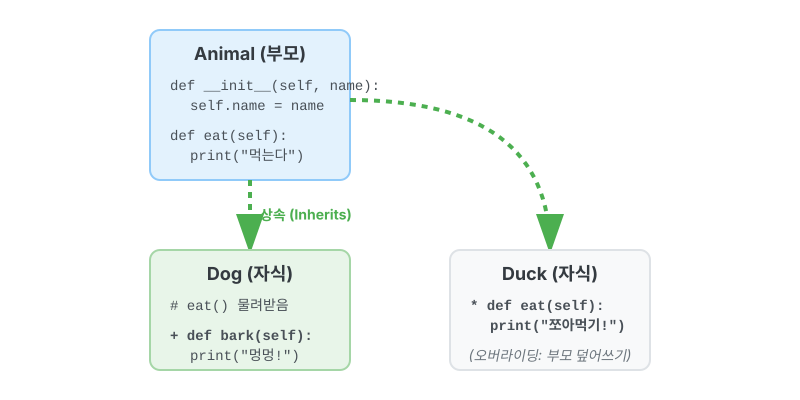
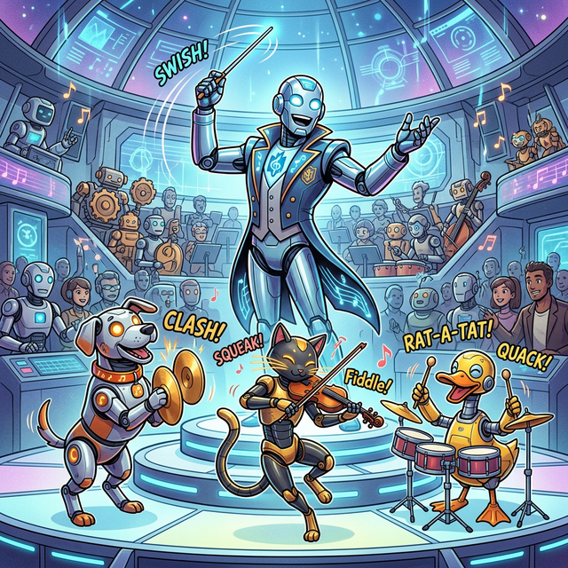
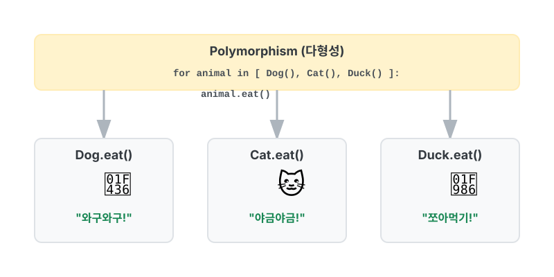

# 4주차: 상속과 다형성 - 유연하고 확장 가능한 설계 🌿

기존 클래스를 물려받아 기능을 확장하는 **상속(Inheritance)**과 동일한 메시지 호출에도 각자 다르게 대응하는 **다형성(Polymorphism)**의 환상적인 하모니를 배웁니다.

---

## 학습목표
본 장에서는 부모가 피땀 흘려 짜놓은 수만 줄의 코드를 자식 클래스가 단 한 줄만으로 꿀꺽 삼키며 **수직적인 코드 재사용의 극치**를 보여주는 **'상속(Inheritance)'**의 원리를 다룹니다. 또한 부모의 간섭을 피해 내 입맛대로 행동을 갈아엎는 오버라이딩(Overriding)을 통해 코드 중복을 줄이고 구조를 확장하는 방법을 알아봅니다.

---

## 💡 TL;DR (1분 핵심 요약): 상속이란?

1. **상속 (Inheritance)**: "복사 & 붙여넣기는 하수나 하는 짓이다!" 부모 클래스가 가진 변수와 함수를 새로운 자식 클래스가 그대로 물려받아, 뼈대는 재활용하고 본인만의 새로운 기능(로켓 부스터, 레이저 빔)만 쏙쏙 추가하는 **진화의 과정**입니다.
2. **오버라이딩 (Overriding)**: 부모가 물려준 방식이 구식이라 마음에 안 들면, 자식이 똑같은 이름의 함수를 다시 만들어서 아예 **덮어써서(개조해서)** 사용하는 기법입니다.

---

## 1. 상속: 부모의 유전자를 물려받는 진화 장치

객체지향(OOP)을 쓰는 절대적인 이유는 **'코드의 재사용성'**입니다. 똑같은 이름표와 배터리 속성을 가진 로봇을 100종류나 매번 처음부터 정의한다면 밤을 새워야 합니다. 상속은 이 고통을 끝내줍니다.


*(웹툰 비유: 화면 왼쪽, 바퀴 하나 달린 구형 '부모 로봇' 옆에, 그 바퀴를 똑같이 물려받으면서도 제트팩과 레이저 눈을 추가 장착한 화려한 '자식 로봇'이 서 있습니다.)*

<br>



---

## 2. 기본 문법: 피를 이어받는 자식 클래스

### 예제 1: 부모의 능력은 나의 것 (기본 상속)
클래스를 새로 만들 때, 괄호 `()` 안에 물려받고 싶은 **부모(Super) 클래스**의 이름을 적어주기만 하면 끝입니다.

```python
# 1. 뼈대가 되는 위대한 부모 클래스 선언
class Animal:
    def __init__(self, name):
        self.name = name

    def eat(self):
        print(f"[{self.name}] 와구와구 밥을 먹습니다.")

# 2. 괄호 안에 Animal을 넣어 부모의 유전자를 모두 물려받은 자식 클래스
class Dog(Animal):
    # 부모에게 없는 나만의 새로운 필살기 추가!
    def bark(self):
        print(f"[{self.name}] 멍멍 짖습니다! 왈왈!")

class Cat(Animal):
    def meow(self):
        print(f"[{self.name}] 야옹하고 웁니다.")

# 3. 객체 실전 조종
dog1 = Dog("바둑이")
dog1.eat()  # 자식은 코드를 짠 적도 없는데 부모의 '먹기' 능력을 그대로 사용합니다.
dog1.bark() # 자신만의 고유 능력 방출!

cat1 = Cat("나비")
cat1.eat()
cat1.meow()
```

---

## 3. 부모님께 용돈 타오기: `super()` 의 마법

자식이 태어날 때 뭔가 자기만의 초기화 작업(`__init__`)을 하고 싶어서 생성자를 덮어쓰게 되면, **비극적이게도 부모가 초기화해주던 세팅(`name`)이 동작하지 않고 끊겨버립니다.** 이때 끊어진 부모의 생성자 파이프라인을 다시 연결해 주는 혈맹 코드가 바로 **`super()`** 입니다.


### 예제 2: 부모의 `__init__`을 강제 기상시키기
```python
class Bird(Animal):
    def __init__(self, name, wing_span):
        # 🚨 여기서 super().__init__(name)을 안 부르면 큰일 납니다!
        # 부모님, 제발 일어나서 제 '이름(name)' 좀 먼저 초기화 세팅해 주세요!
        super().__init__(name) 
        
        # 부모가 이름을 지어줬으니, 이제 제 고유 속성인 '날개 길이'를 세팅합니다.
        self.wing_span = wing_span 
        
    def fly(self):
        print(f"[{self.name}] 날개를 폅니다. 길이는 {self.wing_span}cm 입니다.")

bird1 = Bird("참새", 20)
bird1.eat() # name이 super()를 통해 완벽하게 세팅되어 오류 없이 밥을 먹습니다.
bird1.fly()
```

---

## 4. 부모를 딛고 일어서라: 오버라이딩 (Overriding)

부모에게 물려받은 기능이 낡고 구식이거나 내 입맛에 맞지 않나요? 그럼 자식 클래스 안에서 똑같은 이름의 스킬(메서드)을 다시 만들면 됩니다. 파이썬은 **망설임 없이 부모의 스킬을 폐기하고 자식의 최신 스킬로 덮어씌워(Override)** 줍니다.

### 예제 3: 부모의 행동 내 맘대로 개조하기
```python
class Duck(Animal):
    # 부모 Animal에도 eat()이 있지만, 오리답게 쪼아 먹도록 덮어씌웁니다! (오버라이딩)
    def eat(self):
        print(f"[{self.name}] 부리로 바닥의 곡물을 쪼아 먹습니다. 꽥꽥!")

duck1 = Duck("도널드")
duck1.eat() # 원본인 '와구와구 밥을 먹습니다'는 소멸하고, 오버라이딩된 결과가 나옵니다.
```

---

## ☕ Java vs 🐍 Python 스나이퍼 비교

### 1. 상속 선언 키워드
*   **Java**: `class Dog extends Animal` 이라는 길고 명시적인 키워드를 써야 합니다.
*   **Python**: 압도적으로 쿨합니다. 그냥 괄호만 치면 끝입니다. `class Dog(Animal):`

### 2. 고통스런 다중 상속의 유무
*   **Java**: 부모를 2명 이상 모시는 다중 상속(Multiple Inheritance)을 철저히 금지합니다. 피가 섞이면 복잡해진다고 강력히 규제하며 오직 인터페이스(`implements`)로만 우회시킵니다.
*   **Python**: "규제 그딴 거 없다. 네 자유다." 파이썬은 `class Liger(Lion, Tiger):` 처럼 당당하게 다중 상속을 지원합니다. MRO(메서드 탐색 순서)라는 내부 규칙으로 충돌을 알아서 정리합니다. (강력하지만, 설계의 복잡성을 초래하므로 고급 개발자들만 조심해서 다룹니다.)

---

## 코딩 영단어 학습 📝

*   **Inheritance**: 상속, 유전. (부모가 자식에게 재산이나 DNA를 넘겨주듯, 코드를 복사 붙여넣기 할 필요 없이 부모의 스펙을 그대로 이어받는 시스템입니다.)
*   **Super**: 위쪽의, 초월적인. (`super()`의 본 뜻은 초인(슈퍼맨)이 아니라, 계급 구조상 내 머리 꼭대기 위에 있는 최상위 개체, 즉 나를 낳아 준 '부모 설계도'를 지칭하는 예약어입니다.)
*   **Override**: 짓밟다, 무시하다, 무효로 하다. (Over(위로) + Ride(타다). 부모의 낡고 구식인 메서드 지시 위로 자식이 새롭게 올라타서 기존 코드를 완전히 무시하고 산산조각 덮어씌워 버리는 혁명적인 키워드입니다.)

---

## 학습목표
본 장에서는 똑같은 지시문(`울어라!`) 하나로 강아지는 짖고 고양이는 야옹하게 만드는 **'다형성(Polymorphism)'**의 마법 같은 쾌감을 통해 진정한 객체지향 설계의 확장성을 무기로 삼습니다. 동일한 코드가 다양한 모습으로 실행되는 방법을 완벽히 이해합니다.

---

## 💡 TL;DR (1분 핵심 요약): 다형성이란?

1. **다형성 (Polymorphism)**: 수백 마리의 다른 동물들을 리스트에 싹 다 가둬놓고, `동물.짖어라()` 단 한 줄만 명령하면, 강아지는 알아서 "멍멍!", 닭은 "꼬끼오!" 하고 각자의 생태계에 맞게 **똑똑하게 다르게 행동**하는 파이썬 최고의 마법입니다.

---

## 1. 다형성 (Polymorphism): 동일한 명령, 위대한 각자의 행동

'다형성'이란 이름표 하나로 여러 객체를 조종하는 객체지향의 궁극적인 마법입니다. 이전 장에서 배운 추상화나 오버라이딩을 활용하여 자식 클래스가 부모의 메서드를 새롭게 재정의하면, 메인 프로그램은 그 자식의 정확한 종류를 모른 채 동일한 지침으로 다루기만 해도 알아서 적절히 동작합니다.

**메인 지휘자(나의 코드)는 괄호 속의 동물이 강아지인지, 오리인지 조사할 필요 자체가 아예 없습니다.** 그냥 리스트에 다 때려 넣고 한 번만 지시하면 끝납니다.


*(웹툰 비유: 하나의 지휘자 로봇이 "연주해!"라고 단 한 번 마법봉을 휘두릅니다. 똑같은 명령을 받은 강아지 로봇은 바이올린을, 고양이 로봇은 피아노를, 오리 로봇은 드럼을 치며 각자의 방식으로 완벽한 교향곡을 만들어냅니다.)*

<br>


### 예제: 100종류의 동물을 단 두 줄로 조종하는 기적
오버라이딩(Overriding)된 자식들이 각자 알아서 행동하기 때문에 코드가 극도로 짧아지고 우아해집니다.

```python
class Animal:
    def eat(self):
        print("동물이 먹이를 먹습니다.")

class Dog(Animal):
    def eat(self):
        print("[멍멍이] 와구와구 밥을 먹습니다.")

class Cat(Animal):
    def eat(self):
        print("[야옹이] 와구와구 밥을 먹습니다.")

class Duck(Animal):
    def eat(self):
        print("[오리] 부리로 바닥의 곡물을 쪼아 먹습니다. 꽥꽥!")

# 세상의 온갖 동물들을 하나의 큰 우리[리스트]에 다 집어넣어 버립니다.
animals = [Dog(), Cat(), Duck(), Animal()]

# 지휘자 출격: 동물들의 종류 따위는 검사하지 않는다. 그냥 무조건 먹어라!
for animal in animals:
    animal.eat() 
```

**[다형성의 화려한 콘솔 출력]**
> [멍멍이] 와구와구 밥을 먹습니다.  
> [야옹이] 와구와구 밥을 먹습니다.  
> [오리] 부리로 바닥의 곡물을 쪼아 먹습니다. 꽥꽥! *(<- 스스로 오버라이딩된 스킬 발동)*  
> 동물이 먹이를 먹습니다.  

이것이 파이썬 데이터 엔지너어들이 수백만 줄의 비즈니스 로직을 `if / elif / else` 떡칠 없이 깔끔하고 무제한 확장이 가능하도록 짜는 절대적인 비결입니다.

---

## ☕ Java vs 🐍 Python 스나이퍼 비교

### 1. 인터페이스와 덕 타이핑 (Duck Typing)
*   **Java**: 다형성을 구현하려면 철저한 계약서인 `Interface`를 설계해서 강제로 `implements` 시키고 족쇄를 채워야만 컴파일 에러를 피할 수 있습니다.
*   **Python**: 파이썬은 **"오리처럼 걷고 오리처럼 꽥꽥거리면, 그냥 오리인갑다 하고 넘어가자(Duck Typing)"**라는 매우 자유로운 심리학을 가집니다. 부모가 누구든, 인터페이스를 맺었든 말든 묻지 않습니다. 객체 안에 `eat()` 이라는 이름의 스킬만 진짜로 달려 있다면 파이썬은 군말 없이 실행해 주는 초유연성의 극치를 보여줍니다.

---

## 🎧 Vibe Coding

> **🗣️ 학생 프롬프트 (AI에게 이렇게 명령해 보세요):**
> "파이썬 다형성(Polymorphism)을 활용해서 스타크래프트 유닛 공격 시스템을 만들어 줘.
> 1) 부모 클래스 `Unit`을 만들고, 방어력(`armor`) 속성을 초기화해 줘. 그리고 비어있는 `attack()` 스킬을 만들어.
> 2) `Unit`을 상속받는 자식 클래스 `Marine`(마린)과 `Tank`(탱크) 두 개를 만들어 줘.
> 3) 자식들은 오버라이딩을 통해 `attack()` 스킬을 덮어써서 마린은 '두두두! 총 발사!', 탱크는 '쾅! 대포 발사!' 라고 출력하게 해. 
> 4) 리스트에 마린 2마리, 탱크 1마리를 넣고 딱 한 번의 `for` 문을 돌려서 모든 유닛이 동시에 `attack()` 하도록 명령하는 코드를 짜줘."

---

## 코딩 영단어 학습 📝

*   **Polymorphism**: 다형성. (Poly(많다) + Morphos(형태, 모양). 하나의 지시봉(함수명)을 휘둘렀는데, 바라보는 객체가 마린이냐 탱크냐 강아지냐에 따라 알아서 수만 가지의 다채로운 형태로 쪼개져 작동하는 가장 아름다운 객체지향 건축 미학입니다.)

---

## ✍️ 이번 주 연습 문제

**문제 1.** 부모 클래스의 메서드를 자식 클래스에서 재정의하는 **메서드 오버라이딩(Method Overriding)**의 특징을 설명하고 예시 코드를 구현하세요.

**문제 2.** 파이썬 특유의 **덕 타이핑(Duck Typing)** 철학인 "오리처럼 걷고 오리처럼 운다면 그것은 오리다"의 의미를 다형성 관점에서 해석해 보세요.

**문제 3.** (심화) 상속 관계에서 자식 클래스가 `super().__init__()`을 호출해야 하는 이유를 자식 인스턴스의 속성 바인딩 관점에서 명확하게 증명해 보세요.

---

## 📖 교재 상세 학습: 05 유전자 물려받기: 상속(Inheritance)

## 05 코드를 복사하지 않고 부모 능력을 훔쳐오기: 상속

온라인 게임 캐릭터를 기획하며 '검사'와 '마법사'라는 두 직업의 코드를 짠다고 상상해 봅시다. 두 직업은 휘두르는 무기와 공격 스킬만 다를 뿐, '숨쉬기', '걷기', '뛰기' 같은 사람 고유의 기본 행동 패턴은 완벽히 같습니다. 
이럴 땐 모든 직업마다 똑같은 걷기 코드를 노가다로 붙여넣는 대신, 공통분모를 묶어 '인간(부모)'이라는 베이스 클래스로 선언해 두고 두 하위 직업(자식)에게 이 능력을 통째로 **상속(Inheritance)**해 주는 기법이 효율적입니다.

**코드: 부모의 유전자를 상속받는 자식들**
```python
# 1. 뼈대가 될 부모 클래스(Base Class)를 먼저 세팅합니다.
class BaseHuman():
    def walk_around(self):
        print("두 발로 뚜벅뚜벅 걸어갑니다.")
    def eat_food(self):
        print("음식을 맛있게 우물우물 먹습니다.")

# 2. 새로운 클래스를 만들 때, 이름 옆 괄호 안에 부모 클래스 이름을 슬쩍 밀어 넣으면 유전자 복제 끝!
class Knight(BaseHuman):
    # 전사만의 전용 고유 스킬을 타이핑해 넣습니다.
    def slash_sword(self):
        print("양손검으로 적을 무자비하게 내리치기!")

class Sorcerer(BaseHuman):
    def cast_fireball(self):
        print("강력한 파이어볼 연성 후 발사!")

# 전사 캐릭터를 하나 서버에 스폰시켜 볼까요?
arthas = Knight()

arthas.slash_sword() # 기사가 원래 갖고 태어난 자신의 고유 검술도 잘 작동하고,
arthas.walk_around() # 띠용? 한 줄도 안 적은 부모의 걷기 기능(walk_around)까지 내 것처럼 뻔뻔하게 쓸 수 있습니다!
```

**콘솔 출력창**
```text
양손검으로 적을 무자비하게 내리치기!
두 발로 뚜벅뚜벅 걸어갑니다.
```

자식 클래스는 별도의 수고 없이 부모 클래스에 정의된 알짜배기 기능들을 고스란히 끌어다 쓸 수 있습니다. 일상생활의 유산 상속과 다른 점이 있다면, 파이썬에서는 자식 수백 명에게 코드를 상속해 줘도 부모의 원본 재산(코드 블록)이 절대 닳아 없어지지 않는다는 점입니다!

---

### 05.1 욕심쟁이 상속: 다중 상속 (Multiple Inheritance)

Java 같은 강력한 타입 기반 언어들은 부모를 딱 한 명만 모실 수 있도록 다중 상속을 엄격히 금지합니다. 반면, 파이썬은 대단히 자유분방해서 **여러 부모로부터 동시에 유전자를 물려받는 다중 상속을 쿨하게 허용**합니다. 
클래스를 괄호로 열고 콤마(`,`)로 여러 부모 클래스 이름을 쭈르륵 나열하기만 하면 됩니다.

```python
class Flyable:
    def fly(self):
        print("하늘을 사뿐하게 납니다.")

class Swimmable:
    def swim(self):
        print("물 속을 유유히 헤엄칩니다.")

# 공중과 수중의 두 가지 능력을 모두 물려받은 궁극의 오리 클래스!
class SpecialDuck(Flyable, Swimmable):
    pass

donald = SpecialDuck()
donald.fly()  # 엄마 능력 발동: 하늘을 사뿐하게 납니다.
donald.swim() # 아빠 능력 발동: 물 속을 유유히 헤엄칩니다.
```


---

## 📖 교재 상세 학습: 06 부모를 뛰어넘는 청출어람: 메서드 오버라이딩(Overriding)

## 06 부모의 낡은 방식을 내 맘대로 덮어씌우기: 메서드 오버라이드

부모 클래스로부터 유용한 행동 지침을 공짜로 물려받긴 했지만, 자식 입장에선 그 낡은 방식이 영 마음에 들지 않아 나만의 멋진 스타일로 뜯어고치고 싶어질 때가 있습니다. 예를 들어, 늠름한 전사 캐릭터라면 평범한 인간처럼 '뚜벅뚜벅' 보단 '위풍당당하고 거칠게' 걸어가야 제맛이죠. 
이럴 때는 자식 클래스의 몸통 안에 **부모가 쓰던 것과 완전히 동일한 이름의 메서드**를 한 번 더 작성해 버리면 됩니다. 이 통쾌한 하극상을 프로그래밍 용어로 **덮어쓰기(Method Override)**라고 부릅니다.

**코드: 내 스타일대로 부모 유전자 덮어쓰기**
```python
class BaseHuman():
    def walk_around(self):
        print("두 발로 평범하게 뚜벅뚜벅 걷습니다.")

class Knight(BaseHuman):
    # 부모가 물려준 walk_around라는 이름을 똑같이 선언하되, 내용물만 내 입맛대로 개조합니다!
    def walk_around(self):
        print("중갑옷을 입고 쿵쿵거리며 위풍당당하게 전진합니다!")

# 확인해 볼까요?
arthas = Knight()
arthas.walk_around() 
```

**콘솔 출력창**
```text
중갑옷을 입고 쿵쿵거리며 위풍당당하게 전진합니다!
```

위처럼 파이썬 엔진은 부모와 자식이 같은 이름의 함수를 가지고 다툴 때, 무조건 자식이 최신형으로 업데이트한 버전을 1순위로 인정해 줍니다. 

---

### 06.1 같은 이름, 다른 행동: 다형성 (Polymorphism)

객체지향 설계의 진정한 꽃이라고 불리는 **다형성(Polymorphism)**은 "다양한(Poly) 형태(morphism)를 띤다"는 뜻입니다. 
쉽게 말해, **똑같은 스위치(메서드 이름)를 눌러도 연결된 기기(객체)에 따라 선풍기가 켜지기도 하고, 에어컨이 켜지기도 하는 마법**입니다. 메서드 오버라이딩은 이 다형성을 구현하는 가장 대표적인 방법입니다.

```python
class Car:
    def drive(self):
        print("가솔린 엔진을 가동하고 주행합니다.")

class ElectricCar(Car):
    # 부모와 똑같은 이름으로 덮어씀 (오버라이딩)
    def drive(self):
        print("배터리 전력으로 조용히 주행합니다.")

# 같은 drive() 스위치 호출이지만, 객체의 실제 종류에 따라 각기 다른 결과가 나옴 (다형성)
my_car = Car()
my_ev = ElectricCar()

my_car.drive() # 가솔린 엔진을 가동하고 주행합니다.
my_ev.drive()  # 배터리 전력으로 조용히 주행합니다.
```

---

### 06.2 파이썬의 상징: 덕 타이핑 (Duck Typing)

> "만약 어떤 새가 오리처럼 걷고, 오리처럼 꽥꽥거린다면, 나는 그 새를 오리라고 부르겠다."

파이썬식 다형성의 끝판왕입니다. 자바나 C++ 같은 깐깐한 언어들은 함수에 인자를 받을 때 "반드시 `Car` 클래스의 자식 객체만 들어올 수 있다"며 철저히 족보(타입 검사)를 따집니다.

하지만 자유로운 영혼인 파이썬은 **"네 족보(부모)가 뭐냐?"는 묻지도 따지지도 않습니다.** 
대신 **"너 지금 내가 시키는 그 행동(메서드) 할 줄 알아?"(행위의 존재 유무)** 하나만 쿨하게 묻습니다. 

```python
class Duck:
    def sound(self): return "꽥꽥!"

class Dog:
    def sound(self): return "멍멍!"

class Robot: # 오리나 개랑은 아무런 족보(상속) 연관이 없는 완전한 남남
    def sound(self): return "삐리리릭."

# 매개변수 animal이 어디 출신인지 묻지 않고 오직 sound() 메서드를 가졌는지만 봅니다!
def make_sound(animal):
    print(animal.sound())

# 모두 다른 클래스이지만 공통된 행동(인터페이스)을 가졌으므로 모두 정상 작동! (덕 타이핑)
make_sound(Duck())  # 꽥꽥!
make_sound(Dog())   # 멍멍!
make_sound(Robot()) # 삐리리릭.
```


---

## 📖 교재 상세 학습: 07 부모 소환술의 비밀 주문: super()

## 07 super(): 위기의 순간, 부모의 능력을 끌어오는 소환 주문

때로는 부모의 기존 기능을 아예 무시하고 덮어버리는(오버라이딩) 대신, **부모가 정성껏 짜놓은 그 기초 뼈대(베이스 로직)를 살짝 빌려오면서 그 위에 내 필살기만 살포시 얹고 싶을 때**가 생깁니다.
예를 들면 캐릭터가 태어나 세팅될 때, 가장 기초적인 '이름표 붙이기' 작업은 부모(인간)의 생성자에게 짬처리를 시키고, 오직 특별한 '소속 길드 설정'만 전사(자식)가 직접 입력받아 처리하는 똑똑한 분업 방식 말이죠.

이럴 때 파이썬이 제공하는 `super()`라는 영적 소환 함수를 쓰면, 자식 객체 안에서 언제든 부모의 영혼(메서드)을 마음껏 불러낼 수 있습니다.

**코드: 부모의 노하우(초기화 세팅) 교묘하게 훔쳐 쓰기**
```python
class BaseHuman():
    def __init__(self, char_name):
        self.name = char_name

class Knight(BaseHuman):
    def __init__(self, char_name, guild_name):
        # 1. 뼈대 작업인 '이름표 세팅' 로직은 부모의 __init__ 마법진을 역소환하여 떠넘깁니다!
        super().__init__(char_name)
        # 2. 남은 특별 작업인 '길드 세팅'만 내 몸통 안에서 직접 처리합니다.
        self.guild = guild_name
        
    def announce_arrival(self):
        print(f"[{self.guild} 길드 소속] 맹렬한 기사 {self.name}님이 전장에 합류했습니다!")

# 테스트 소환
arthas = Knight("아서스", "은빛 십자군")
arthas.announce_arrival()
```

이처럼 `super()` 마법을 적재적소에 비벼 넣으면, 쓸데없이 코드를 복붙하는 중복 노동을 확 줄이고 유지보수가 훨씬 즐겁고 여유로운 고품격 프로그램을 지휘할 수 있습니다!

---

### 07.1 족보의 룰: MRO (Method Resolution Order)

53단원에서 파이썬은 엄마 아빠를 모두 모시는 다중 상속이 가능하다고 배웠습니다. 그런데 만약 코드를 짰는데, 엄마와 아빠가 둘 다 우연히 똑같은 이름의 `def skill()` 메서드를 가지고 있다면 어떻게 될까요? 자식 입장에선 누구의 말을 먼저 들어야 할지 대혼란이 옵니다.

이 혼란을 막기 위해 파이썬은 **MRO(메서드 탐색 순서)**라는 아주 엄격하고 스마트한 족보 탐색법을 몸속에 품고 있습니다.
일반적으로 다중 상속을 할 때 `class Child(Mom, Dad)` 라고 괄호 안에 적으면, **왼쪽에 먼저 적힌 이름(Mom) 쪽의 유전자(메서드)를 최우선으로 탐색**합니다. 각 클래스의 서열순표는 `.mro()` 속성을 찍어보면 눈으로 바로 볼 수 있습니다.

---

### 07.2 부품 갈아 끼우기: 믹스인 (Mixin) 패턴

이 강력한 다중 상속 기능을 응용하여 파이썬 고수들이 즐겨 쓰는 아키텍처 방식이 바로 **'믹스인(Mixin) 패턴'**입니다.

이 기법은 상태(데이터 객체 속성)는 자신에게 단 하나도 갖지 않은 채, **오직 '특수 목적을 가진 행동(메서드) 세트'만 잘 정리해 둔 조립용 미니 클래스**를 만들어두는 것입니다. (관례상 이름 끝에 XxxMixin 이라고 붙여 이 녀석이 단독 운행용이 아니라 부품용임을 명시합니다.) 그 후 거대한 본체 클래스를 선언할 때 이 믹스인 부품을 다중상속으로 톡 끼워 넣어 언제든 능력을 부여하거나 제거할 수 있습니다.

```python
# 1. 믹스인(조립 부품) 클래스들
class WingMixin:
    def flap(self): return "파닥파닥 힘차게 날아오릅니다."

class GunMixin:
    def shoot(self): return "두두두두! 머신건 발사!"

# 2. 본체(Base) 클래스
class Robot:
    def __init__(self, name):
        self.name = name

# 3. 조립 파티! (원하는 부품만 다중 상속으로 골라 장착)
class FighterJet(Robot, WingMixin, GunMixin):
    pass # 추가 코드를 적지 않아도 날개와 총을 다 갖추게 됨!

f16 = FighterJet("건담")
print(f16.flap())  # 파닥파닥 힘차게 날아오릅니다.
print(f16.shoot()) # 두두두두! 머신건 발사!
```


---

## 📖 교재 상세 학습: 6. 속성과 행위의 대물림: 상속 (Inheritance)

## 6. 속성과 행위의 대물림: 상속 (Inheritance)

객체지향 프로그래밍의 가장 강력한 무기 중 하나는 바로 **재사용성**입니다. 이미 잘 만들어진 클래스(부모, Super Class)가 있다면, 그 기능을 처음부터 다시 짜지 않고 그대로 물려받아(상속) 새로운 클래스(자식, Sub Class)를 만들 수 있습니다.

파이썬은 클래스 이름 뒤에 소괄호 `()`를 치고 부모 이름을 적어넣는 아주 직관적인 문법으로 상속을 지원합니다.

### 6.1 기본 상속과 네임스페이스 검색 구조

자식 클래스에 없는 속성이나 메서드를 호출하면, 파이썬은 에러를 내뱉기 전에 **부모 클래스의 네임스페이스를 먼저 검색**하여 훔쳐옵니다(?).

```python
class Animal:
    def __init__(self, name):
        self.name = name
        
    def eat(self):
        print(f"{self.name}이(가) 밥을 먹습니다.")

# Animal 클래스의 모든 기능을 그대로 물려받음
class Dog(Animal):
    def bark(self):
        print("멍멍!")

# Dog에는 __init__이 없지만, 부모인 Animal의 __init__이 자동 실행됩니다.
badugi = Dog("바둑이")
badugi.eat()  # 바둑이이(가) 밥을 먹습니다. (부모 메서드 재사용)
badugi.bark() # 멍멍! (자식 고유 메서드)
```

---

### 6.2 부모를 소환하라: `super()`

자식 클래스에서 부모 클래스의 메서드(특히 `__init__`)를 완전히 엎어버리지(Override) 않고, **부모의 기능을 일부 활용하면서 살을 덧붙이고 싶을 때**는 `super()` 함수를 사용합니다.

```python
class Warrior:
    def __init__(self, hp):
        self.hp = hp
        self.attack_power = 10

class Knight(Warrior):
    def __init__(self, hp, shield_power):
        # 1. 부모의 초기화 로직을 호출해서 hp와 attack_power를 먼저 세팅함
        super().__init__(hp)
        # 2. 자식만의 고유한 속성 추가
        self.shield_power = shield_power

k = Knight(100, 50)
print(k.hp, k.attack_power, k.shield_power) # 100 10 50
```

---

### 6.3 욕심쟁이 상속: 다중 상속 (Multiple Inheritance)

Java 같은 언어들은 다중 상속을 엄격히 금지하지만, 파이썬은 쿨하게 **여러 부모로부터 동시에 상속받는 것을 허용**합니다. 
콤마(`,`)로 여러 부모 클래스를 나열하기만 하면 됩니다.

```python
class Flyable:
    def fly(self):
        print("하늘을 납니다.")

class Swimmable:
    def swim(self):
        print("물 속을 헤엄칩니다.")

# 두 가지 능력을 다 물려받은 슈퍼 오리
class Duck(Flyable, Swimmable):
    pass

donald = Duck()
donald.fly()  # 하늘을 납니다.
donald.swim() # 물 속을 헤엄칩니다.
```

#### 족보의 룰: MRO (Method Resolution Order)

다중 상속을 받다가 두 부모가 **동일한 이름의 메서드**를 가지고 있다면 자식은 누구의 말을 들어야 할까요? 
파이썬은 혼란을 막기 위해 **MRO(메서드 탐색 순서)**라는 엄격한 족보 탐색 서열을 내부적으로 관리합니다. 보통 괄호 안에 적어준 순서(왼쪽에서 오른쪽)를 우선시합니다. 클래스의 `.mro()` 메서드를 출력해보면 서열을 직접 확인할 수 있습니다.

---

### 6.4 부품 갈아 끼우기: 믹스인 (Mixin) 패턴

다중 상속의 유연함을 극대화한 파이썬 특유의 설계 패턴입니다. 속성(상태 데이터)은 전혀 가지지 않고 오직 **'특정 동작(메서드) 뭉치'만 모아둔 클래스**를 만들어두고, 레고 블록 조립하듯 본체 클래스에 다중 상속으로 끼워 넣는 방식입니다. 이런 클래스 이름 뒤에는 관례적으로 `Mixin`을 붙입니다.

```python
# 날개 모듈 (부품)
class WingMixin:
    def flap(self):
        return "파닥파닥 날갯짓"

# 본체 클래스
class Airplane:
    def __init__(self, model):
        self.model = model

# 조립 과정 (다중 상속)
class FighterJet(Airplane, WingMixin):
    pass

f16 = FighterJet("F-16")
print(f16.flap()) # 파닥파닥 날갯짓
```


---

## 📖 교재 상세 학습: 7. 같은 이름, 다른 행동: 다형성 (Polymorphism)

## 7. 같은 이름, 다른 행동: 다형성 (Polymorphism)

객체지향 프로그래밍의 꽃이라고 불리는 **다형성(Polymorphism)**은 "다양한(Poly) 형태(morphism)를 띤다"는 뜻입니다. 
쉽게 말해, **똑같은 스위치(메서드 이름)를 눌러도 연결된 기기(객체)에 따라 선풍기가 켜지기도 하고, 에어컨이 켜지기도 하는 마법**입니다. 파이썬에서는 크게 세 가지 방식으로 이 다형성을 구현합니다.

### 7.1 부모의 유산을 내 입맛대로: 오버라이딩 (Overriding)

부모에게서 물려받은 메서드 이름은 그대로 쓰되, **내용물(로직)만 자식 클래스 상황에 맞게 뜯어고치는 기법**입니다. 
부모의 메서드는 무시되고, 가장 최신인 자식의 메서드가 덮어쓰기(Override) 되어 실행됩니다.

```python
class Car:
    def drive(self):
        print("엔진을 가동하고 주행합니다.")

class ElectricCar(Car):
    # 부모와 완전히 똑같은 이름으로 메서드를 재정의 (오버라이딩)
    def drive(self):
        print("배터리 전력으로 조용히 주행합니다.")

# 같은 drive() 호출이지만 객체의 종류에 따라 결과가 다름 (다형성)
gas_car = Car()
ev_car = ElectricCar()

gas_car.drive() # 엔진을 가동하고 주행합니다.
ev_car.drive()  # 배터리 전력으로 조용히 주행합니다.
```

---

### 7.2 같은 이름, 다른 매개변수: 오버로딩 (Overloading)

자바나 C++에서는 메서드 이름이 같아도 매개변수 개수나 타입이 다르면 서로 다른 메서드로 인식하는 '오버로딩'을 기본 지원합니다. 
하지만 **파이썬은 메서드 이름을 하나만 기억하기 때문에 기본적으로 오버로딩을 지원하지 않습니다.** (나중에 쓴 메서드가 앞의 메서드를 덮어써버림)

대신, 매개변수의 디폴트 값(`=None`)이나 가변 인수(`*args`)를 써서 우회하거나, 외부 라이브러리(`multipledispatch`)를 달아 억지로 구현할 수는 있습니다.

```python
# 파이썬의 우회적인 오버로딩 흉내내기 (디폴트 인자 활용)
class Calculator:
    # 2개짜리 인자도 받고, 3개짜리 인자도 받을 수 있게 하나의 메서드로 처리
    def add(self, a, b, c=0):
        return a + b + c

calc = Calculator()
print(calc.add(10, 20))     # 30
print(calc.add(10, 20, 30)) # 60
```

---

### 7.3 파이썬의 상징: 덕 타이핑 (Duck Typing)

> "만약 어떤 새가 오리처럼 걷고, 오리처럼 꽥꽥거린다면, 나는 그 새를 오리라고 부르겠다."

다형성의 끝판왕입니다. 파이썬은 **"네 부모가 누구 파(족보)냐?"(클래스의 타입)를 따지지 않습니다.** 
대신 **"너 지금 그 기능(메서드) 할 줄 알아?"(행위의 존재 유무)**만 따집니다. 이를 **덕 타이핑**이라고 합니다.

```python
class Duck:
    def sound(self):
        return "꽥꽥!"

class Dog:
    def sound(self):
        return "멍멍!"

class Robot: # 오리나 개랑은 아무런 족보(상속) 연관이 없음
    def sound(self):
        return "삐리릭. 꽥꽥."

# 매개변수 animal이 어느 클래스 출신이든 상관 안 함.
# 그저 sound() 메서드를 할 줄 아는지만 봄!
def make_sound(animal):
    print(animal.sound())

# 모두 다른 클래스임에도 동일한 인터페이스(sound)를 호출 (덕 타이핑 & 다형성)
make_sound(Duck())  # 꽥꽥!
make_sound(Dog())   # 멍멍!
make_sound(Robot()) # 삐리릭. 꽥꽥.
```

### 7.4 연산자 오버로딩 (Operator Overloading)

객체끼리 산술 연산자(`+`, `-`)를 쓰게 만드는 마법입니다.
파이썬의 모든 연산자는 내부적으로 스페셜 메서드(`__add__` 등)로 맵핑되어 있습니다. 이를 오버라이딩하면 내가 만든 객체끼리 덧셈을 구현할 수 있습니다.

```python
class Point:
    def __init__(self, x, y):
        self.x = x
        self.y = y

    # '+' 연산자를 내 입맛대로 재정의!
    def __add__(self, other):
        return Point(self.x + other.x, self.y + other.y)

p1 = Point(1, 2)
p2 = Point(3, 4)

# 원래라면 객체끼리 못 더하지만, __add__ 덕분에 다형적으로 작동함
p3 = p1 + p2 
print(p3.x, p3.y) # 4 6
```
