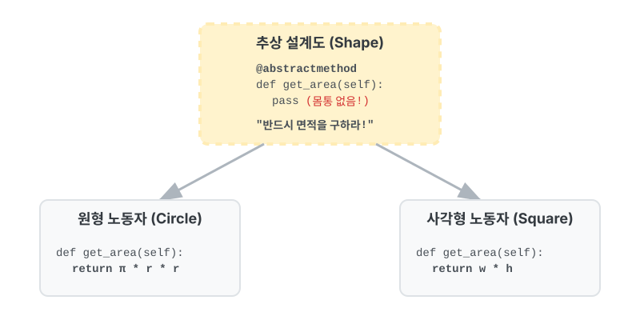
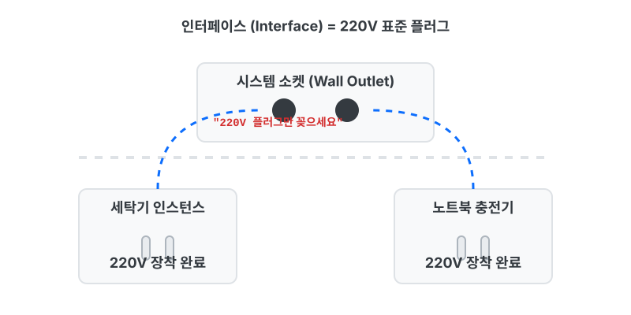
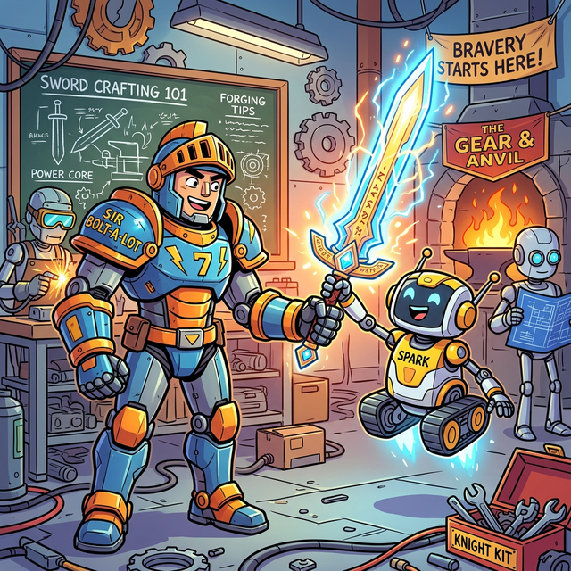
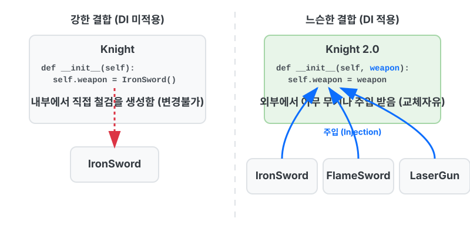

# 6주차: 추상 클래스와 인터페이스 - 설계 청사진과 결합도 낮추기 🗺️

구체적인 구현 대신 전체적인 규격과 약속을 제시하는 **추상 클래스** 및 파이썬의 **인터페이스 설계 철학**, 나아가 의존성을 외부에서 공급하여 코드의 결합도를 획기적으로 낮추는 **의존성 주입(Dependency Injection)** 기법을 마스터합니다.

---

## 학습목표
본 장에서는 깡통(몸통) 구현 없이 오직 자식 클래스가 하늘이 두 쪽 나도 지켜야만 하는 뼈대(규칙)만 세워두는 **'추상 베이스 클래스(ABC)'**의 악덕 고용주 같은 철저한 통제 시스템을 깨우칩니다. 공통적인 속성과 행위를 모아 상위 클래스를 설계하는 방법을 배웁니다.

---

## 💡 TL;DR (1분 핵심 요약): 추상화란?

1. **추상 클래스 (Abstract Class)**: 직접 붕어빵을 찍어낼 수 없도록 막아놓은 **"미완성 설계도(계약서 원본)"**입니다. 수십 명의 협업자들이 각자의 모양대로 클래스를 만들 때, "반드시 이 기능만큼은 빼먹지 말고 똑같은 이름으로 구현해라!"라고 강제하는 법적 장치입니다.
2. **`abc` 모듈**: 덕 타이핑의 자유로움이 가져오는 '휴먼 에러(메서드명 오타, 미구현)'를 막기 위해, 파이썬에서 공식적으로 제공하는 추상화 강제 모듈입니다. 에러를 런타임(실행)이 아닌 객체 생성시에 칼같이 잡아냅니다.

---

## 1. 지켜야만 하는 단단한 약속, 추상화 설계

협업 시 "도형을 만들 때는 넓이를 구하는 `get_area` 함수를 필수로 만들어 줘!"라고 말로만 부탁하면 누군가는 `area()`, 누군가는 `calculate_area()`로 각기 다르게 이름을 지어버려 결국 전체 시스템(다형성)이 붕괴됩니다. **추상화는 이 약속을 코드로 서명하게 만들고, 어기면 프로그램이 강제 종료되도록 통제합니다.**

---

## 2. 파이썬의 `abc` (Abstract Base Classes)

파이썬은 공식 내장 라이브러리인 `abc` 패키지를 통해 추상Base클래스를 작성할 수 있습니다.
*   자신은 절대로 인스턴스(객체)를 허락하지 않습니다.
*   `@abstractmethod` 라는 왕관(데코레이터)이 씌워진 스킬은, 자식이 반드시 복사해서 구현체를 오버라이딩(채워넣기)해야만 살려줍니다.


*(웹툰 비유: 깐깐한 로봇 매니저가 일부분이 텅 비어 있는 추상적인 계약서(Shape)를 들고, 원형 로봇과 사각형 로봇에게 서명을 지시합니다. 이 계약서에는 "너희 몸통(면적)을 어떻게든 스스로 증명하라!"는 빈칸 조항이 강제되어 있습니다.)*

<br>


### 예제 1: 추상 클래스는 실체가 아니다! (에러 발생의 미학)
```python
from abc import ABC, abstractmethod

# 1. 추상 베이스 클래스 선언 (반드시 괄호 안에 ABC를 넣습니다)
class Shape(ABC):
    
    # 이 메서드는 껍데기만 존재하며, 자식이 무조건 속을 채워야 합니다!
    @abstractmethod
    def get_area(self):
        pass

# 🚨 에러 폭발 테스트 🚨
# 무지몽매한 개발자가 계약서 원본(Shape) 자체를 장난감(객체)으로 조립하려고 합니다.
# 삐용삐용! "TypeError: 추상 클래스는 인스턴스화 될 수 없습니다!" 라며 파이썬이 즉각 차단합니다.
s = Shape() 
```

---

## 3. 필수 구현 의무 불이행 시의 참사

이번엔 하청업체(자식 클래스 `Circle`)가 추상 클래스(Shape)를 상속은 해놓고선, 실수로 `get_area` 구현을 빼먹었다고 가정해 봅시다.

```python
class Circle(Shape):
    def __init__(self, radius):
        self.radius = radius
        
    # 앗! 깜빡하고 @abstractmethod 인 get_area() 를 오버라이딩하지 않았습니다!

# 테스트: 자식 로봇을 가동합니다.
# c = Circle(5)
# 🚨 폭발! TypeError: 추상 메서드 get_area 가 구현되지 않아서 조립(인스턴스화) 불가!
```
코드가 다 실행되고 나서 한참 뒤에 에러가 터지는 대참사 대신, 아예 태어나는 순간 조립을 막아버려 개발자에게 실수를 즉각 알려줍니다.

---

## 🎧 Vibe Coding

> **🗣️ 학생 프롬프트 (AI에게 이렇게 명령해 보세요):**
> "파이썬 `abc` 패키지를 이용해서 `Payment`(결제)라는 추상 클래스를 만들어줘.
> 1) `process_payment(amount)` 라는 추상 메서드(@abstractmethod)를 딱 하나만 선언해.
> 2) 이걸 상속받는 자식 클래스 `CreditCard` 랑 `Paypal` 두 개를 만들고, `process_payment`를 정상적으로 오버라이딩해서 알아서 콘솔에 결제수단과 금액을 출력하게 해. 
> 3) 마지막으로 `Bitcoin` 클래스도 `Payment`를 상속받게 만드는데, 고의로 `process_payment` 구축을 빼먹(pass)어봐.
> 4) 세 개의 클래스를 직접 다 실체화(인스턴스 생성) 하려고 시도해 보고 어떤 콘솔 에러가 터지는지, 그 이유를 내게 아주 쉽게 주석으로 타이핑해 줘."

---

## 코딩 영단어 학습 📝

*   **Abstraction**: 추상화. (Abstract(추상적인). 구체적인 디테일이나 계산 로직은 껍데기에 감춰버리고, 오직 바깥으로 드러나는 핵심 개념(버튼 이름, 함수 이름) 스케치만 남겨 하위 조립자들에게 "여기에 맞춰서 짜기만 해!"를 지시하는 설계 기법입니다.)

---

## 학습목표
본 장에서는 클래스와 클래스 사이의 사용 약속인 **인터페이스(Interface)**를 배웁니다. 파이썬만의 느슨하고 자유로운 '덕 타이핑(Duck Typing)' 문화 속에서도, 대형 프로젝트의 치명적인 에러를 원천 봉쇄하기 위해 견고한 인터페이스 계약서를 어떻게 코드로 작성하고 강제하는지 실전 코드로 익힙니다.

---

## 💡 TL;DR (1분 핵심 요약): 인터페이스란?

1. **인터페이스 (Interface)**: "반드시 이 기능만큼은 빼먹지 말고 구현해라!"라는 기능 명세, 즉 계약서 역할을 기대하는 것입니다. 파이썬에서는 별도의 `interface` 키워드가 없기에 보통 추상 클래스(`abc`)나 덕 타이핑을 통해 이를 달성합니다.
2. **덕 타이핑 🦆 (Duck Typing)**: 자바처럼 서약서(`implements`)를 명시적으로 쓰지 않아도, 꽥꽥(필수 스킬) 소리만 낼 수 있다면 시스템이 용인해 주는 파이썬 특유의 자유로운 문화입니다.

---

## 1. 인터페이스 계약 의무의 완벽한 이행과 다형성

이전 장(`추상화`)의 `Shape` 추상 클래스가 제시한 안전 장치를 뚫고, 완벽하게 인터페이스 규격을 맞춘 모범 답안을 보겠습니다.


*(웹툰 비유: 동그라미 로봇과 네모 로봇이 겉모습은 전혀 다르지만, 둘 다 완벽히 똑같은 규격의 "220V 표준 플러그"를 번쩍 들고 환호합니다. 220V 소켓 입장에서 저 로봇이 동그라미든 네모든 알 바 아닙니다. 규격에 맞는 플러그만 꽂히면 전기를 통하게 해 줍니다.)*

<br>



### 예제: 각자의 방식으로 계약 이행
```python
import math
from abc import ABC, abstractmethod

class Shape(ABC):
    @abstractmethod
    def get_area(self):
        pass

# 동그라미: 자신만의 파이(π) 방식을 사용하여 완벽하게 구현을 해냈습니다!
class Circle(Shape):
    def __init__(self, radius):
        self.radius = radius
        
    def get_area(self): # 계약서에 명시된 이름 토시 하나 틀리지 않음
        return math.pi * (self.radius ** 2)

# 네모: 자신만의 (가로 * 세로) 공식을 사용하여 완벽하게 구현을 해냈습니다!
class Rectangle(Shape):
    def __init__(self, w, h):
        self.w = w
        self.h = h
        
    def get_area(self): # 계약서 조항 완벽 이행
        return self.w * self.h

# ✅ 통과! 에러 없이 부드럽게 실체화됩니다.
c = Circle(5)
r = Rectangle(4, 5)

print(f"원 넓이: {c.get_area()} | 사각형 넓이: {r.get_area()}")
```
이 깐깐한 인터페이스(Interface) 계약서 제도가 정착되면, 메인 지휘자는 "이 도형이 원인지 네모인지" 검사할 필요 없이 눈을 감고 `도형.get_area()`를 마음껏 호출하며 다형성을 폭발시킬 수 있습니다.

---

## 2. ☕ Java vs 🐍 Python 스나이퍼 비교

### 1. 전용 키워드의 유무
*   **Java**: `interface`, `implements`, `abstract` 라는 전용 문법 키워드가 언어 스펙에 하드코딩 되어있을 정도로 인터페이스 설계의 심장 같은 언어입니다.
*   **Python**: 인터페이스라는 전용 키워드가 아예 없습니다! 오직 외부 플러그인 같은 느낌의 `from abc import ABC` 패키지를 끌어앉고 `class Shape(ABC):` 와 같이 우회하여 구현합니다.

### 2. 덕 타이핑 (Duck Typing)의 용인
*   **Java**: 인터페이스 계약서(`implements Animal`)에 사인하지 않은 객체는, 아무리 `eat()` 함수를 완벽하게 구현했어도 결코 다형성 리스트에 들어갈 수 없습니다. 엄청나게 고지식합니다.
*   **Python**: 파이썬은 호탕합니다. 굳이 `Shape(ABC)` 가문 소속이라고 사인해주지 않았더라도, 객체 배때지에 누군가 몰래 `get_area()` 함수 하나만 끼워놓았다면, 다형성 리스트에서 군말 없이 정상 실행시켜 버립니다. "오리 소리가 나면 그냥 오리지 족보가 뭐가 중요해!" 마인드입니다.

---

## 🎧 Vibe Coding

> **🗣️ 학생 프롬프트 (AI에게 이렇게 명령해 보세요):**
> "파이썬으로 '오리(Duck)'와 '로봇 오리(RobotDuck)' 클래스를 만들어줘. 
> 공통 부모를 상속받거나 `abc`를 사용하지 말고, 둘 다 각각 `quack()` 이라는 메서드만 갖게 해. 
> 외부에서 어떤 리스트에 담긴 객체들을 넘겨받아서, 그 객체들의 타입이 뭔지 전혀 확인하지 않고 무작정 `.quack()`을 호출해보는 `make_it_quack` 함수를 만들어 줘.
> 그리고 이게 왜 파이썬의 '덕 타이핑'이라는 매력인지 초보자에게 쉽고 재치있게 주석으로 설명해 줘."

---

## 코딩 영단어 학습 📝

*   **Interface**: 경계면, 소통 접점. (Inter(사이) + Face(얼굴). 자판기를 쓸 때 안에 복잡한 회로도 몰라도 '동전 구멍'과 '콜라 버튼'만 누르면 작동하듯이, 클래스와 클래스 사이의 사용 약속 계약서 명세를 의미합니다.)
*   **Duck Typing**: 덕 타이핑. ("만약 어떤 동물이 오리처럼 생겼고, 오리처럼 헤엄치고, 오리처럼 꽥꽥 소리를 낸다면, 우리는 그걸 그냥 오리라고 부른다."라는 유명한 미국 시에서 유래한 프로그래밍 언어의 쿨하고 동적인 성향을 뜻합니다.)

---

## 학습목표
본 장에서는 클래스 간의 결합도를 획기적으로 낮추어 "언제든지 부품을 갈아 끼울 수 있는" 유연한 아키텍처를 진두지휘하는 **의존성 주입(DI)**의 개념을 익힙니다. 상속을 넘어선 객체지향 확장성의 끝판왕 설계 패턴을 경험합니다.

---

## 💡 TL;DR (1분 핵심 요약): 의존성 주입이란?

1. **의존성 (Dependency)**: A 클래스가 동작하기 위해 B 클래스가 반드시 필요한 상태(연결된 상태)를 말합니다. 보통 "기사가 칼을 가지고 있는 상황"과 같습니다.
2. **주입 (Injection)**: 기사 몸속(코드 내부)에서 칼(객체)을 직접 생성하지 않고, **밖에서(코드 외부에서) 누군가 칼을 만들어서 기사의 손에 쥐여주는(전달해 주는) 방식**입니다.
3. **DI의 목적**: 언제든지 녹슨 칼은 버리고 번개 칼로 무기를 교체할 수 있듯이, 코드의 수정을 최소화하고 **클래스 간의 느슨한 결합(Loose Coupling)**을 달성하기 위해서입니다.

---

## 1. 꽉 막힌 의존성: 기사가 몸속에서 칼을 제련한다?

의존성 주입을 쓰지 않은 끔찍한 코드를 보겠습니다.

### 예제 1: 강한 결합 (Tight Coupling)
클래스 내부에서 필요한 객체를 무작정 스스로 생성해 버리면, 평생 그 객체에만 묶이는 노예가 됩니다.


*(웹툰 비유: 최전방에 기사 로봇 한 명이 서 있습니다. 철광석을 주워서 자기 배 속에 있는 대장간 용광로에서 낑낑대며 칼을 스스로 만들어 쓰고 있습니다(강한 결합). 옆에 있던 만렙 로봇이 기겁하며 묻습니다. "아니, 밖에서 칼을 만들어다가 네 손에 쥐여주면(주입) 되잖아?")*

<br>



```python
class IronSword:

    def attack(self):
        return "철검으로 찌르기! 10 데미지!"

class Knight:
    def __init__(self):
        # 🚨 최악의 설계: 기사가 직접 몸속에서 철검을 생성합니다. 
        # 이 기사는 평생 철검밖에 못 쓰는 저주에 걸렸습니다.
        self.weapon = IronSword() 

    def attack(self):
        print(self.weapon.attack())

k = Knight()
k.attack() 
# 만약 상황이 변해 기사에게 '전설의 불꽃검'을 쥐어주고 싶다면? 
# 안타깝게도 Knight 클래스의 내부 코드를 직접 뜯어 고쳐야(수정) 합니다.
```

---

## 2. 의존성 주입 (DI): 밖에서 무기를 쥐여줘라! 

이번엔 아주 깔끔하게 바뀐 설계입니다. 무기를 스스로 만들지 말고, 생성자(또는 메서드)를 통해 **외부에서 건네받도록 설계**합니다.

### 예제 2: 느슨한 결합 (Loose Coupling)
```python
# 다양한 무기들 제조
class IronSword:
    def swing(self):
        return "챙강! 철검 치기!"

class FlameSword:
    def swing(self):
        return "화르륵! 불꽃의 베기!"

# 기사 2.0 설계
class Knight:
    # 💡 핵심: 외부에서 weapon을 '주입(Injection)' 받습니다!
    def __init__(self, weapon):
        self.weapon = weapon

    def attack(self):
        print(self.weapon.swing())

# 상황에 따라 밖(Main 로직)에서 알아서 무기를 교체해 주입합니다.
iron_sword = IronSword()
flame_sword = FlameSword()

# 1. 초보 기사: 철검 주입
k1 = Knight(weapon=iron_sword)
k1.attack()

# 2. 만렙 기사: 불꽃검 주입 (Knight 코드 내부를 1줄도 수정하지 않았습니다!)
k2 = Knight(weapon=flame_sword)
k2.attack()
```
이처럼 "내부에서 `new(생성)`하지 말고 밖에서 받자!"는 아주 단순한 원리 하나가 수만 줄짜리 엔터프라이즈 시스템의 플러그인(Plug-in) 아키텍처를 뒤받치고 있는 제1원칙입니다.

---

## 코딩 영단어 학습 📝

*   **Dependency**: 의존성. (내가 살기 위해 남에게 기대고 있는 상태. 코딩에서는 내 클래스가 돌아가기 위해 반드시 다른 클래스의 객체가 필요한 끈끈한 관계를 말합니다.)
*   **Injection**: 주입, 주사. (내부에서 자체 생성하지 않고, 혈관에 주사액을 꽂아 넣듯 바깥의 프레임워크나 메인 컨트롤러가 객체를 쓱 밀어 넣어 주는 동작을 의미합니다.)
*   **Loose Coupling**: 느슨한 결합. (두 객체가 서로 알긴 알지만, 언제든 다른 놈으로 갈아 치워도 시스템이 터지지 않도록 가볍게 연결된 유연한 구조를 말합니다.)

---

## ✍️ 이번 주 연습 문제

**문제 1.** `abc` 모듈의 `@abstractmethod`를 사용하여 자신만의 추상 클래스 `Vehicle`을 정의하고, 이를 상속받아 세부 메서드를 필수 구현하는 `Car`와 `Bicycle` 자식 클래스를 완성해 보세요.

**문제 2.** 강한 결합(Tight Coupling)과 느슨한 결합(Loose Coupling)의 차이점을 실생활의 부품 대체 사례를 들어 비교 설명하고, 의존성 주입이 주는 설계상 이점을 쓰세요.

**문제 3.** (심화) 파이썬에서 추상 인터페이스를 보장하기 위해 덕 타이핑(Duck Typing)을 사용하는 방식과 `@abstractmethod`를 쓰는 공식적이고 엄격한 방식의 장단점을 아키텍처 관점에서 분석해 보세요.

---

## 📖 교재 상세 학습: 08 강제적인 규약: 추상 클래스(Abstract Class)

## 08 뼈대만 물려주고 구현은 강제하기: 추상 클래스(Abstract Class)

지금까지 우리는 부모가 완성된 기능(메서드)을 만들어 놓으면 자식이 편하게 그걸 가져다 쓰는 '상속'을 배웠습니다. 그렇다면 만약 부모가 **"나는 어떤 입구랑 출구가 필요한지만(이름만) 껍데기로 만들어 둘 테니, 안에 들어가는 진짜 알맹이(기능)는 상속받는 자식인 너희들이 무조건 각자 알아서 새로 짜넣어라!"** 하고 강제하고 싶다면 어떻게 해야 할까요?

이때 등장하는 것이 바로 **추상 클래스(Abstract Class)**입니다. 메서드의 '이름과 인자'라는 뼈대만 존재하고, 뱃속의 실제 코드는 텅 비어있는 미완성 클래스입니다.

### 1. 왜 이런 텅 빈 껍데기가 필요할까? (다형성의 보장)

게임을 만들 때 여러 개발자에게 "각자 몬스터를 하나씩 만들어와라"라고 지시했다고 칩시다. 
어떤 개발자는 공격 함수를 `attack()`으로 만들고, 다른 개발자는 `hit()`, 또 다른 사람은 `strike()`로 마음대로 지어버리면 나중에 이 몬스터들을 한 번에 조종할 때 코드가 엉망진창이 됩니다.

이때 **추상 클래스**를 부모로 만들어 **"내 밑으로 상속받는 모든 몬스터는 무조건 `attack()`이라는 이름의 메서드를 니들이 직접 안에 코드를 채워 넣어서 구현해라. 안 그러면 에러 띄워서 게임 실행도 못하게 막을 거다!"**라고 **강력한 규약(Protocol)**을 걸어버리는 것입니다.

### 2. 파이썬에서 추상 클래스 만들기 (`abc` 모듈)

파이썬은 `abc` (Abstract Base Classes)라는 멋진 기본 모듈을 통해 추상 클래스를 지원합니다.
추상 클래스를 만들려면 **1. `ABC`라는 특별한 부모를 상속받고**, **2. 강제할 메서드 위에 `@abstractmethod` 데코레이터를 붙여주면** 됩니다.

```python
from abc import ABC, abstractmethod

# [미완성 뼈대] 추상 클래스 선언 (이 자체로는 인스턴스를 찍어낼 수 없습니다)
class MonsterProtocol(ABC):
    
    # 자식에게 강제로 할당할 미완성 과제 (뼈대만 있고 본문은 pass)
    @abstractmethod
    def attack(self):
        pass

    @abstractmethod
    def move(self):
        pass

# [개발자 A의 바른 예]
class Slime(MonsterProtocol):
    def attack(self):
        print("슬라임이 끈적한 점액을 발사합니다!")
        
    def move(self):
        print("슬라임이 꾸물꾸물 기어갑니다.")

# 오케이 통과! 완벽하게 작동합니다.
slime = Slime() 
slime.attack() # 슬라임이 끈적한 점액을 발사합니다!


# [개발자 B의 잘못된 예]
class Dragon(MonsterProtocol):
    def attack(self):
        print("드래곤의 거대한 브레스 파이어!!")
    # 앗! 실수로 move() 를 오버라이딩(구현)하는 것을 깜빡했습니다!!

# [에러 폭발!] 부모가 지시한 숙제(move 구현)를 다 안 했다고 객체 생성 자체를 거부합니다!
# dragon = Dragon() 
# TypeError: Can't instantiate abstract class Dragon with abstract method move
```

### 3. 파이썬 코어의 숨겨진 추상 클래스들

파이썬 내부를 뜯어보면, 우리가 자주 쓰는 `리스트(List)`, `딕셔너리(Dict)` 같은 녀석들도 제멋대로 만들어진 게 아닙니다. 파이썬 코어 개발자들이 `collections.abc`라는 곳에 만들어둔 수많은 추상 클래스의 깐깐한 규약을 모두 통과한 엘리트 객체들입니다.

* **`Sequence` 추상 클래스**: "너희가 순서가 있는 리스트나 튜플 행세를 허고 싶어? 그럼 길이(`__len__`) 재는 법이랑 인덱싱(`__getitem__`) 하는 법은 무조건 구현해!"
* **`Mapping` 추상 클래스**: "너희가 딕셔너리처럼 키값으로 놀고 싶다구? 그럼 키값 불러오는 방식 뼈대를 강제로 지켜!"

이렇게 파이썬은 보이지 않는 곳에서 추상 클래스라는 단단한 뼈대를 통해 거대한 표준을 유지하고 있는 아주 치밀한 언어입니다.


---

## 📖 교재 상세 학습: 1. 추상 클래스 기본기 (abc 모듈)

## 1. 추상 클래스 기본기 (`abc` 모듈)

로봇 공장 시스템을 만든다고 상상해봅시다. 모든 '로봇'은 '움직이기' 기능을 반드시 만들어야 한다는 공통 규칙을 정하고 싶습니다. 이때 사용하는 것이 바로 추상 클래스입니다.

파이썬에서는 `abc` (Abstract Base Classes) 모듈을 이용해 추상 클래스를 정의합니다.

### 1.1 강제 규칙 만들기 (추상 메서드)

추상 클래스 자체는 불완전한 뼈대이므로 인스턴스(실제 로봇)를 만들 수 없습니다. 이것을 상속받는 자식 클래스(구현 클래스)가 지시사항(추상 메서드)을 모두 채워 넣어야만 비로소 완성품이 됩니다.

```python
from abc import ABC, abstractmethod

# ABC(Abstract Base Class)를 상속받으면 추상 클래스가 됩니다.
class RobotBlueprint(ABC):
    
    # "자식 클래스는 무조건 이 메서드를 구현해라!" 라는 데코레이터
    @abstractmethod
    def move(self):
        pass  # 뼈대이므로 구현하지 않습니다.

# 자식 클래스 (구현 클래스)
class TankRobot(RobotBlueprint):
    def move(self):
        return "캐터필러로 묵직하게 움직입니다!"
```
만약 `TankRobot`이 `move` 메서드를 빼먹고 인스턴스를 만들려고 하면 에러(TypeError)가 나면서 프로그램이 멈춥니다. 안전장치가 완벽하죠!

---

### 1.2 "넌 이제 내 자식이다!" - 가상 서브클래스 (`register`)

직접 상속(`class A(B):`)을 받지 않아도, 족보에 강제로 이름을 올려 "가상의 자식"으로 취급하는 재미있는 기능이 있습니다. 

```python
from abc import ABC

class PowerCore(ABC):
    pass

# 배터리 클래스는 PowerCore를 상속받은 적이 없지만...
class Battery:
    pass

# 명부(register)에 강제 등록합니다.
PowerCore.register(Battery)

# 진짜 자식이냐고 물어보면? True가 나옵니다!
print(issubclass(Battery, PowerCore)) # True
```

---

### 1.3 암묵적 규칙 (프로토콜과 Duck Typing)

파이썬은 아주 유연한 언어입니다. "오리처럼 걷고 오리처럼 꽥꽥대면, 그건 오리다(Duck Typing)!"라는 철학이 있죠.

즉, 명시적으로 추상 클래스를 상속받지 않았더라도 클래스 내부에 특정 매직 메서드(예: `__len__`)를 잘 만들어 두었다면, 파이썬은 이를 길이를 잴 수 있는 `Sized` 컬렉션의 자식이라고 암묵적으로 인정해 줍니다. 이렇게 동작과 행동 패턴(메서드 유무)만으로 자격을 판단하는 방식을 '프로토콜 인터페이스(Protocol Interface)'라고 부릅니다.


---

## 📖 교재 상세 학습: 2. 숫자들의 가계도 (numbers)

## 2. 숫자들의 가계도 (`numbers`)

우리가 매일 쓰는 1, 3.14 같은 단순한 숫자들도 파이썬 내부에서는 아주 거대한 족보(추상 클래스 체계)를 가지고 있습니다. 파이썬의 `numbers` 모듈을 들여다보면 수학의 수 체계가 그대로 코드로 구현되어 있습니다.

### 2.1 숫자의 가장 큰 조상, Number

모든 숫자의 단군 할아버지(?) 격인 추상 클래스는 `Number`입니다. 정수(`int`), 실수(`float`), 복소수(`complex`) 등 파이썬 내의 모든 숫자 자료형은 결국 이 `Number` 소속입니다.

```python
import numbers

# 정수 10은 Number의 후손이 맞을까?
print(isinstance(10, numbers.Number)) # True

# 3.14 (실수)도 Number의 후손일까?
print(isinstance(3.14, numbers.Number)) # True
```

---

### 2.2 구체적인 숫자 계급표

`numbers` 모듈 안에는 점차 구체화되는 4단계의 숫자 추상 클래스 계급이 있습니다. 

1. **`Number` (수)**: 가장 큰 범주 (더하기, 빼기 등을 포괄적 정의)
2. **`Complex` (복소수)**: 내장 `complex` 타입과 연관 (실수부, 허수부 등)
3. **`Real` (실수)**: 내장 `float` 타입과 연관
4. **`Rational` (유리수)**: 분수 표기가 가능한 숫자 (예: `fractions.Fraction`)
5. **`Integral` (정수)**: 내장 `int` 타입과 연관

(아래로 내려갈수록 상위 클래스의 성질을 물려받아 더 좁은 범위의 숫자가 됩니다.)

```python
import numbers
import fractions

# int(정수)는 Integral(정수 추상 클래스)의 자식입니다.
print(issubclass(int, numbers.Integral)) # True

# 분수(Fraction)는 실수(Real)의 자식입니다.
print(issubclass(fractions.Fraction, numbers.Real)) # True
```

파이썬의 내장 함수나 연산자들은 내부적으로 숫자가 들어올 때 "아, 이 녀석이 `Real` 추상 클래스의 규격을 만족하는 (즉, 더하고 뺄 수 있는) 진짜 숫자가 맞구나!"라고 판단하여 똑똑하게 계산을 처리합니다.


---

## 📖 교재 상세 학습: 3. 컬렉션의 뼈대 (collections.abc)

## 3. 컬렉션의 뼈대 (`collections.abc`)

리스트, 튜플, 딕셔너리, 셋(Set) 등 여러 개의 데이터를 묶어 담는 파이썬의 주머니들을 '컬렉션(Collection)'이라고 합니다. 이 컬렉션들도 결국 제멋대로 만들어진 것이 아니라, `collections.abc` 라는 강력한 가이드라인에 따라 설계되었습니다.

### 3.1 삼위일체: 컬렉션의 기초 조건

파이썬에서 '컬렉션' 대접을 받으려면 (즉, `Collection` 추상 클래스가 되려면) 다음 세 가지 기능의 뼈대를 무조건 갖춰야 합니다.

1. **`Sized`**: 얼마나 들어있는지 길이(`__len__`)를 잴 수 있을 것.
2. **`Iterable`**: 하나씩 차례대로 꺼낼 수(`__iter__`) 있을 것.
3. **`Container`**: 그 안에 특정 요소가 들어있는지 포함 여부(`__contains__`)를 검사할 수 있을 것.

---

### 3.2 줄 세우기: Sequence 패밀리

문자열(`str`), 튜플(`tuple`), 리스트(`list`)처럼 순서(인덱스)가 있는 자료형들의 부모가 바로 `Sequence` 추상 클래스입니다. 
순서가 있으니 추가로 대괄호에서 인덱스로 찾기(`__getitem__`)가 가능해야 하죠.

이 중에서 내용물을 수정할 수 있는 리스트(`list`) 같은 녀석들은 다시금 `MutableSequence` 라는 상위 클래스를 상속받아 요소를 삭제하거나 삽입하는 강력한 능력을 얻습니다.

---

### 3.3 열쇠와 자물쇠: Mapping 패밀리

딕셔너리(`dict`)처럼 "이름표(Key)"로 데이터를 찾는 자료형들의 부모는 `Mapping` 추상 클래스입니다.
역시 딕셔너리는 내부의 값을 맘대로 바꿀 수 있으므로 `MutableMapping` 클래스 아래에 소속되어 있으며, 수정을 담당하는 매직 메서드(`__setitem__` 등)를 구현하고 있습니다.

---

### 3.4 짝퉁(?) 객체: View 자료형

딕셔너리의 키(`dict.keys()`)나 값(`dict.values()`)을 조회하면 나오는 결과는 리스트가 아닙니다. 이들은 데이터를 복사해서 새로 만든 게 아니라, 원본 데이터베이스에서 그 부분만 들여다볼 수 있는 '투명한 유리창(View)' 역할을 합니다. 

파이썬은 이를 위해 `KeysView`, `ValuesView`, `ItemsView` 등의 추상 클래스를 따로 관리합니다. 이런 뷰(View) 형태를 쓰면 매번 덩치가 큰 데이터를 복사할 필요가 없어 컴퓨터 자원을 크게 절약할 수 있습니다.


---

## 📖 교재 상세 학습: 4. 시퀀스를 다루는 내장 도구들

## 4. 시퀀스를 다루는 내장 도구들

파이썬은 여러 개의 데이터(시퀀스)를 편리하게 가공할 수 있도록 내장형 마법 도구들을 기본 지원합니다. 이 도구들은 함수처럼 생겼지만 사실은 하나의 **클래스(객체)**로 작동합니다. 
가장 큰 특징은 이들은 메모리를 아끼기 위해 "필요할 때 딱 하나씩만" 데이터를 뱉어내는 **반복자(Iterator)**나 **반복형(Iterable)** 성질을 갖고 있다는 것입니다. 

### 4.1 짝 맞추기 달인: `zip`

서로 다른 겉옷(리스트)에 들어있는 요소들을 순서대로 하나씩 꺼내서 예쁜 순서쌍(튜플)으로 지퍼(zip)를 채워주는 기계입니다. 
가장 짧은 길이를 가진 리스트에 맞춰서 동작합니다.

```python
names = ["Iron Man", "Spider-Man", "Hulk"]
colors = ["Red", "Red-Blue", "Green", "Extra-Color"] # 마지막은 짝이 없어 무시됨

# zip 객체(반복자)가 만들어짐
z = zip(names, colors) 

# 눈으로 보려면 리스트로 포장합니다.
print(list(z)) 
# [('Iron Man', 'Red'), ('Spider-Man', 'Red-Blue'), ('Hulk', 'Green')]
```
> [!NOTE]
> 반복자(Iterator) 인스턴스는 한 번 데이터를 뽑아 쓰고 나면 **텅 빈 껍데기**가 되므로, 다시 쓰려면 새로 만들어야 합니다!

---

### 4.2 내 맘대로 번호 부여기: `enumerate`

데이터들 앞에 순번 스티커를 착착 붙여주는 기계입니다. 리스트의 인덱스 번호와 실제 내용을 쌍으로 묶어줍니다.

```python
heroes = ["Batman", "Superman", "Flash"]

# 번호 스티커를 붙입니다. (기본은 0번부터 시작)
for idx, hero in enumerate(heroes):
    print(idx, hero)
# 0 Batman / 1 Superman / 2 Flash

# 100번부터 시작하고 싶다면?
print(list(enumerate(heroes, 100)))
# [(100, 'Batman'), (101, 'Superman'), (102, 'Flash')]
```

---

### 4.3 뒤집기 요정: `reversed`

주어진 데이터를 맨 끝에서부터 역순으로 집어서 던져주는 반복자를 만듭니다. 원본 자체를 거꾸로 파괴하는 것이 아니라, 꺼내는 순서만 거꾸로 해주는 아주 착한 기능입니다.

```python
nums = [1, 2, 3, 4]
r = reversed(nums)

print(list(r)) # [4, 3, 2, 1]
```

### 4.4 무한의 숫자 찍어내기: `range`

`range`는 리스트처럼 전체 숫자를 한 번에 메모리에 올리지 않고 숫자들을 생성하는 규칙(시작, 끝, 보폭)만 똑똑하게 기억하는 반복형(Iterable) 객체입니다. 덕분에 `range(1000000)` 처럼 100만 길이를 만들어도 컴퓨터가 힘들어하지 않습니다.


---

## 📖 교재 상세 학습: 5. 타입 힌트와 코드 테스트

## 5. 타입 힌트와 코드 테스트

파이썬은 변수에 "나는 평생 정수(int)만 받을 거야!" 하고 못 박지 않는 동적인 언어입니다. 아주 편하지만, 가끔 다른 사람이 문자열을 집어넣어 프로그램이 와장창 깨지는 사고가 나기도 하죠. 
이런 실수를 막기 위해, 코드를 실행하기 전 에디터 화면에 "이 변수는 이런 타입만 넣어줘"라고 팻말을 달아주는 기능이 바로 **타입 힌트(Type Hint)**입니다.

### 5.1 코드에 달아주는 명찰 (Type Annotation)

파이썬 3.6부터 변수 뒤에 콜론(`:`)을 붙이고, 함수 화살표(`->`)를 사용하여 의도하는 데이터의 종류(타입)를 메모해둘 수 있습니다. 

```python
# a와 b는 정수(int)를 받고, 결과 결과도 정수(int)가 나온다고 메모!
def add_numbers(a: int, b: int) -> int:
    return a + b

# 문자열을 넣어도 프로그램이 당장 멈추지는 않지만...
# 똑똑한 백신(에디터의 타입 체커)이 빨간 줄을 그어 경고해줍니다!
print(add_numbers("Hello", "World")) 
```
*주의사항: 타입 힌트는 어디까지나 '힌트(주석)'일 뿐이라, 실제 파이썬 엔진은 이를 쿨하게 무시하고 코드를 강제로 실행시킵니다. 따라서 코드 규칙 방어용으로 코딩 단계에서 사용합니다.*

---

### 5.2 `typing` 모듈로 더 정교한 힌트 만들기

조금 더 디테일한 힌트를 주기 위해 파이썬은 `typing`이라는 별개의 모듈을 제공합니다. 
예를 들어 그냥 리스트가 아니라 **"정수만 들어있는 리스트"**라고 확실히 못 박고 싶을 때 사용합니다.

```python
from typing import List, Dict

# 이 리스트 안에는 문자열(str)만 들어와야 합니다!
names: List[str] = ["Alice", "Bob"]

# 딕셔너리의 키는 문자열(str), 값은 정수(int)만 와야 합니다!
scores: Dict[str, int] = {"Alice": 100, "Bob": 80}
```

#### 나만의 타입 만들기 (`TypeVar`, `Generic`)

어떤 함수는 "문자열과 바이트 둘 다 받을 수 있는데, 들어온 녀석의 타입을 그대로 돌려주고 싶어!" 할 때가 있습니다. 이때는 `TypeVar` (타입 변수)를 만들어서 사용합니다.

```python
from typing import TypeVar

# T는 딱 str이나 bytes 둘 중 하나만 된다고 규칙을 만듭니다.
T = TypeVar('T', str, bytes)

def concat(x: T, y: T) -> T:
    return x + y
```

---

### 5.3 이 설명서가 참인지 확인해줘! (`doctest`)

함수를 만들 때, 함수 바로 아래 큰 따옴표 3개 `"""` 로 묶어서 "이 함수는 이렇게 쓰는 거야~" 하고 작성한 설명서를 **독스트링(Docstring)**이라고 부릅니다.
여기에 덤으로 Python 대화형 창(`>>>`)에서 실행하는 예제 코드를 함께 적어두면, 파이썬이 이 주석을 눈으로 읽고 **"음, 설명서에 적힌 코드의 결과가 실제 결과랑 똑같이 나오는지 내가 검사해줄게!"**라고 알아서 테스트해주는 마법 기능이 `doctest`입니다.

```python
def my_func(a, b):
    """
    이 함수는 두 숫자를 더합니다.
    
    >>> my_func(2, 3)
    5
    >>> my_func(10, 10)
    20
    """
    return a + b
```
이렇게 적어두고 터미널에서 `python -m doctest 파일명.py` 시스템 명령을 내리면, 만약 내 코드의 덧셈 로직이 틀렸을 경우 주석에 쓴 결과(5, 20)와 다르다며 삑- 하고 에러를 뿜어주어 아주 편리하게 디버깅이 가능합니다.
