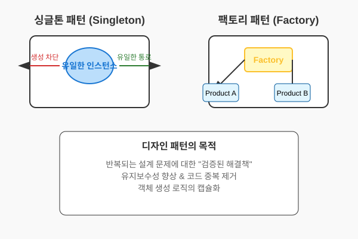

# 9주차: 디자인 패턴 (1) - 싱글톤과 팩토리 패턴 🏗️

우리는 이제 클래스를 설계하는 법을 배웠습니다. 하지만 실무에서는 단순히 클래스를 만드는 것을 넘어, **"어떻게 하면 더 효율적이고 확장 가능하게 설계할 것인가"**가 중요합니다. 이를 위해 전 세계 개발자들이 공통적으로 겪는 문제들에 대한 해결책을 정리해둔 것이 바로 **디자인 패턴(Design Patterns)**입니다.

이번 시간에는 가장 기본이 되는 생성 패턴인 싱글톤과 팩토리 패턴을 배웁니다.

---

## 1. 싱글톤 패턴 (Singleton Pattern)

싱글톤 패턴은 **클래스의 인스턴스가 오직 하나만 생성되도록 보장**하는 패턴입니다.



### 1.1 왜 사용하나요?
프로그램 전체에서 단 하나만 존재해야 하는 객체가 있습니다.
- **설정 관리자 (Configuration Manager):** 설정 파일을 한 번만 읽어 모든 곳에서 공유해야 할 때.
- **데이터베이스 연결 풀 (DB Connection Pool):** DB 연결은 비용이 많이 들므로 하나만 만들어 공유할 때.
- **로그 기록기 (Logger):** 여러 곳에서 로그를 남기지만, 파일 쓰기는 한 곳에서 관리해야 할 때.

### 1.2 파이썬에서의 구현 (더 파이썬다운 방식)
파이썬에서는 `__new__` 메서드를 오버라이딩하여 구현하거나, 모듈 시스템 자체를 이용합니다.

```python
class Database:
    _instance = None # 유일한 인스턴스를 저장할 변수

    def __new__(cls, *args, **kwargs):
        if not cls._instance:
            print("새로운 인스턴스를 생성합니다.")
            cls._instance = super().__new__(cls)
        return cls._instance

# 테스트
db1 = Database() # 새로운 인스턴스 생성
db2 = Database() # 기존 인스턴스 반환

print(db1 is db2) # 결과: True (두 변수가 정확히 같은 객체를 가리킴)
```

---

## 2. 팩토리 패턴 (Factory Pattern)

팩토리 패턴은 **객체 생성 로직을 별도의 클래스(팩토리)에 위임**하여, 사용하는 쪽에서 구체적인 클래스 이름을 몰라도 객체를 생성할 수 있게 하는 패턴입니다.

### 2.1 왜 사용하나요?
만약 `Dog`, `Cat`, `Bird` 클래스가 있고, 상황에 따라 다른 동물을 생성해야 한다면, 사용하는 쪽에서 매번 `if-else` 문으로 어떤 클래스를 생성할지 결정해야 합니다. 팩토리 패턴을 쓰면 이 복잡한 로직을 팩토리 클래스 안에 숨길 수 있습니다.

### 2.2 구현 예시
```python
class Dog:
    def speak(self): return "멍멍!"

class Cat:
    def speak(self): return "야옹!"

class AnimalFactory:
    @staticmethod
    def create_animal(animal_type):
        if animal_type == "dog":
            return Dog()
        elif animal_type == "cat":
            return Cat()
        else:
            raise ValueError("알 수 없는 동물 타입입니다.")

# 사용하는 쪽에서는 팩토리만 호출하면 됨
my_pet = AnimalFactory.create_animal("dog")
print(my_pet.speak()) # 결과: 멍멍!
```

---

## 3. 🔍 Deep Dive: 생성 패턴의 핵심 - 캡슐화

싱글톤과 팩토리 패턴의 공통점은 **"객체 생성 과정의 캡슐화"**입니다.

- **싱글톤:** "인스턴스가 이미 있는지 확인하고 생성하는 과정"을 캡슐화.
- **팩토리:** "어떤 구체 클래스를 생성할지 결정하는 로직"을 캡슐화.

이렇게 생성 로직을 분리하면, 나중에 `Dog` 클래스의 이름이 `Puppy`로 바뀌거나 새로운 동물 `Bird`가 추가되어도, 사용하는 쪽의 코드는 수정할 필요 없이 팩토리 클래스만 수정하면 됩니다. 이것이 바로 **유지보수성이 높은 코드**의 특징입니다.

---

## ✍️ 이번 주 연습 문제

**문제 1.** `ConfigManager` 클래스를 싱글톤 패턴으로 구현해 보세요. (설정값 `theme`와 `language`를 저장하고 관리하는 기능 포함)

**문제 2.** `ShapeFactory` 클래스를 만들어 보세요.
- 생성 가능한 도형: `Circle`, `Square`, `Triangle`
- 각 도형 클래스는 `draw()` 메서드를 가지고 있어야 하며, 팩토리를 통해 생성된 도형의 `draw()`를 호출하는 코드를 작성하세요.

**문제 3.** (심화) 파이썬의 모듈 시스템(파일 하나가 하나의 싱글톤처럼 작동하는 특성)을 이용하여 싱글톤 패턴을 구현하는 방법과, 위에서 배운 `__new__` 방식의 차이점을 설명해 보세요.
---

## 🔍 Deep Dive: 싱글톤(Singleton) 패턴의 3가지 파이썬 구현 방식 비교

싱글톤 패턴은 메모리에 단 하나의 객체 인스턴스만 보장하는 패턴입니다. 파이썬에서는 크게 세 가지로 구현할 수 있습니다.
1. **클래스 데코레이터 방식**: 외부에서 인스턴스화를 지시할 때 데코레이터 함수 내부의 인스턴스 저장소 딕셔너리를 거치게 해 기존 객체를 반환합니다.
2. **`__new__` 오버라이딩**: 객체 할당(Allocation)을 결정하는 `__new__` 클래스 메서드에 인스턴스 캐시 플래그를 두어 중복 할당을 물리적으로 막습니다.
3. **모듈 임포트 방식**: 파이썬은 이미 한 번 임포트된 모듈의 바이트코드를 `sys.modules`에 캐싱해 둡니다. 따라서 모듈 내부에 하나의 인스턴스를 선언하고 이를 가져다 쓰면, 인터프리터 자체 캐싱 기능을 이용한 가장 안전한 싱글톤이 구축됩니다.

---

## ☕ Java vs Python 스나이퍼 비교

### 싱글톤 구현과 멀티스레드 안전성
*   **Java**: 여러 스레드가 동시에 최초 인스턴스 생성을 요청할 때 발생할 수 있는 데이터 손상(Race Condition)을 막기 위해, `volatile` 키워드와 `synchronized` 키워드를 활용한 **Double-Checked Locking** 패턴이나, 안전한 **Static 빌더 클래스(Holder)** 구조를 차용해야 합니다.
*   **Python**: CPython 엔진 특성상 글로벌 인터프리터 락(GIL)의 영향으로 바이트코드 단위의 동시 스레드 메모리 공유 경합이 다소 정리되며, 앞서 언급한 모듈 캐싱(`import`) 기법을 이용하면 멀티스레드 경합 스트레스 없이 매우 간단하고 직관적으로 싱글톤을 공유할 수 있습니다.

---

## 🎧 Vibe Coding

> **🗣️ 학생 프롬프트 (AI에게 이렇게 명령해 보세요):**
> "파이썬으로 설정 정보(DB 호스트, 포트 등)를 읽고 저장하는 `ConfigurationManager` 클래스를 **싱글톤 패턴**으로 구현해 줘. 프로그램 내 어느 곳에서 클래스를 호출하든 항상 동일한 메모리 주소를 가진 단 하나의 설정 객체만 돌아가야 해."

---

## 코딩 영단어 학습 📝

*   **`Design Pattern`**: 디자인 패턴. (소프트웨어 설계 중 자주 반복되어 나타나는 문제들을 해결하기 위해 정형화하여 정리한 재사용 가능한 설계 도면입니다.)
*   **`Singleton`**: 싱글톤. (시스템 전체에서 인스턴스를 단 하나만 갖도록 보장하고, 어디서든 이 인스턴스에 고유 접근할 수 있게 강제하는 클래스 설계 패턴입니다.)
*   **`Factory Pattern`**: 팩토리 패턴. (객체 인스턴스를 클래스에서 직접 뉴(`new`)하지 않고, 공장 역할을 수행하는 전용 클래스나 메서드를 통해 대신 주문 제작해 오는 디자인 패턴입니다.)
