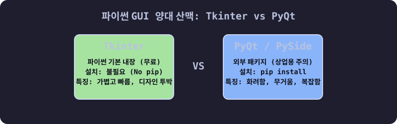
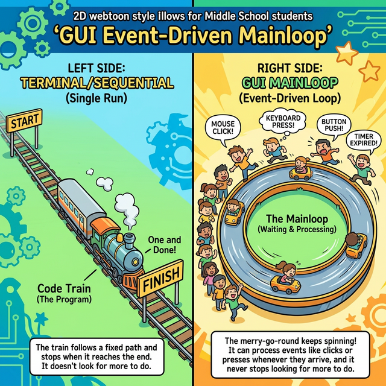
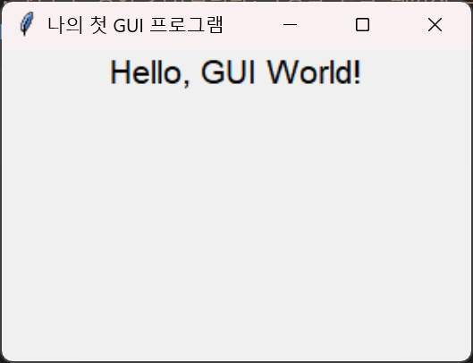

# 1주차: GUI 개발 기초 - 윈도우 인터페이스와 이벤트 루프 🖥️

3학기 시작을 축하합니다! 이번 학기에는 텍스트 위주의 CLI 환경을 벗어나 사용자와 눈을 맞추는 **GUI(Graphical User Interface)** 개발 및 **시스템 프로그래밍**을 다룹니다. 이벤트가 끊임없이 순회하는 GUI의 기본 구동 원리부터 차근차근 배워 봅시다.

---

## 학습목표
수만 줄의 복잡한 로직을 짜더라도, 결국 일반 고객(User)은 터미널의 까만 화면을 이해하지 못합니다. 본 장에서는 코드가 한 번 실행되고 멈추는 터미널과 달리, 무한의 시간 속에서 마우스 클릭을 대기하는 **이벤트 드리븐(Event-Driven)** 방식의 철학을 확립합니다. 또한 파이썬에서 GUI를 개발하기 위한 양대 산맥인 **Tkinter와 PyQt의 차이점**을 분석하고, VS Code 환경에서 쾌적하게 개발하기 위한 기본 세팅법을 간략히 짚고 넘어갑니다.

---

## 💡 TL;DR (1분 핵심 요약): GUI란 무엇인가?

1. **GUI (Graphical User Interface)**: 일반 사용자들이 컴퓨터를 쉽게 쓸 수 있도록 버튼, 텍스트 입력창, 스크롤바 등을 시각적으로 띄워 마우스로 클릭할 수 있게 만든 그래픽 창입니다.
2. **이벤트 드리븐 (Event-Driven)**: 일반적인 스크립트 코드처럼 위에서 아래로 한 번 쭉 떨어지고(폭포수) 끝나는 방식이 지고, **무한 대기** 상태로 돌면서 **사용자가 행동(사건, Event)을 일으킬 때만 번개처럼 반응**하는 현대 프로그래밍의 가장 중요한 아키텍처입니다.
3. **가상 환경 세팅**: 외부 GUI 패키지(예: PyQt)를 쓸 때는 시스템 꼬임을 막기 위해 무조건 Python 가상 환경(`venv` 등)을 격리시킨 후 설치하는 것이 프로의 기본기입니다.

---

## 1. 터미널의 기차 vs GUI의 무한 회전목마

파이썬의 가장 원초적인 실행 공간인 터미널(콘솔)을 상상해 봅시다. 기차가 출발역(1번 줄 코드)에서 종착역(마지막 줄 코드)까지 직진으로 달리면, 기차는 엔진이 꺼지며 프로그램이 완전 종료(Exit) 상태가 됩니다.

반면 GUI 윈도우 창은 사용자가 `X(닫기)` 버튼을 누르기 전까지는 살아서 **영원히 화면에 떠 있어야** 합니다. 즉, **무한 루프(Mainloop)**라는 거대한 쳇바퀴를 팽팽 돌면서 대기압 상태를 유지합니다. 

GUI 세계에서는 이 쳇바퀴 옆에서 사용자가 `버튼을 찰칵 클릭`하거나, `키보드를 타닥 타건`하는 행위 하나하나를 **사건(Event)**이라고 부릅니다. 이 사건이 떨어질 때마다 연결된 함수를 단발성으로 찔끔찔끔 실행하는 것이 바로 현대 스마트폰 앱과 윈도우 프로그램의 근간인 **이벤트 드리븐(Event-Driven)** 방식입니다.

---

## 2. 파이썬 GUI 양대 산맥: Tkinter vs PyQt

파이썬으로 GUI 화면을 그리기로 마음먹었다면, 크게 2가지 길 중에서 갈림길을 선택하게 됩니다.



### 1) 가볍고 빠른 순정품: `Tkinter` (본 단원 학습 대상)
*   **태생**: 파이썬을 설치하면 기본으로 딸려오는 스탠다드 라이브러리(Standard Library)입니다. 
*   **장점**: **설치가 아예 필요 없습니다.** (`pip install` 불필요). 코드가 매우 짧고 직관적이어서 초보자의 GUI 입문에 최고존엄입니다.
*   **단점**: 기본으로 제공되는 디자인 위젯(버튼, 스크롤바 등)의 텍스처 퀄리티가 10년 전 수준으로 좀 투박하고 못생겼습니다.

### 2) 화려하고 거대한 외인구단: `PyQt` / `PySide`
*   **태생**: C++ 베이스의 거대 상용 UI 프레임워크인 `Qt`를 파이썬 옷을 입혀 래핑한 외부 패키지입니다.
*   **장점**: `Qt Designer`라는 압도적인 성능의 그래픽 툴을 제공하여, 마우스 드래그 앤 드롭만으로 포토샵 하듯 손쉽게 UI를 그릴 수 있습니다. 디자인이 수려하고 강력합니다.
*   **단점**: 너무 무거우며, 초기 학습 진입 장벽(객체지향, 오버라이딩 필수)이 굉장히 높습니다. 또한 `PyQt`는 상업 목적으로 앱 배포 시 라이선스 비용 문제가 발생할 수 있어 기업에서는 조심스럽게 다뤄야 합니다 (대안으로 오픈소스인 `PySide`를 권장합니다).

> 💡 **본 파이썬 기초 활용 단원의 선택은?**  
> 데이터 분석의 코어 지식으로 넘어가기 전 코딩 기초 뼈대를 다지는 이 강의의 타깃에 가장 부합하는 기본 내장 라이브러리인 **`Tkinter`**를 가벼운 마음으로 맛볼 것입니다.

---

## 3. VS Code와 환경 준비 (환경 오염 막기)

`Tkinter`는 파이썬 내장 기능이기 때문에 추가 패키지 설치를 할 필요가 전혀 없지만, 향후 `PyQt`, `Pandas`, `Matplotlib` 등 수많은 패키지 설치 시 파이썬 폴더가 온갖 부산물로 뒤섞여 충돌하는 끔찍한 사태(의존성 지옥)를 피하려면 반드시 가상 공간을 만들어 그 안에서만 노는 버릇을 들여야 합니다.

**[VS Code 터미널에서 프로 개발자처럼 안전하게 작업하는 3단계]**

1.  **가상 환경 캡슐 만들기**  
    터미널에 `python -m venv myenv` 입력 (myenv라는 투명한 캡슐 폴더 생성)
2.  **캡슐 안으로 들어가기 (활성화)**  
    윈도우 기준: `myenv\Scripts\activate` 입력  
    (이때 터미널 앞줄에 `(myenv)` 라는 초록색 글자가 뜨면 방독면을 쓰고 안전하게 캡슐 안으로 입장했다는 뜻입니다.)
3.  **이제 자유롭게 패키지 설치**  
    만일 PyQt5를 쓴다면 `pip install PyQt5` 입력 (현재 프로젝트의 캡슐 안에만 격리 설치됨)

---

## ☕ Java vs 🐍 Python 스나이퍼 비교

### 1. 화면 생태계의 복잡도
*   **Java**: 자바 진영의 GUI (AWT -> Swing -> JavaFX)는 그 방대한 인터페이스 철학과 객체지향 뼈대, 분리된 XML(`FXML`) 디자인 방식 등으로 인해 러닝 커브가 험난합니다. 기업용 강력한 데스크톱 앱을 만들 때는 뛰어나나, 초보자가 "확인 버튼" 하나 띄우기 위해 치러야 할 타이핑 노동의 고통이 상당합니다.
*   **Python (`Tkinter`)**: 오직 `import tkinter` 한 줄이면 가동 준비가 완료되고, 위에서 아래로 스크립트 작성하듯 매우 캐주얼(Casual)하고 멍청하게 작성해도 화면이 찰떡같이 뜹니다. 빠른 아이디어(프로토타이핑) 스케치 도구로는 가히 지구 최고 수준입니다.

---

## 코딩 영단어 학습 📝

*   **GUI (Graphical User Interface)**: 그래픽 유저 인터페이스. (수십 개의 터미널 명령어를 외우는 미친 짓을 그만두고, 시각적인 윈도우 창, 아이콘, 팝업 버튼 등을 클릭하며 컴맹도 직관적으로 사용할 수 있게 만든 혁명적인 인터페이스 방식입니다. 반대말은 CLI(Command Line Interface)입니다.)
*   **Event (사건)**: 마우스를 1회 딸깍 클릭하는 것, 키보드 A 버튼을 꾹 누르는 것, 창 크기를 드래그해서 넓히는 것 등, 사용자가 컴퓨터 화면 속에서 툭툭 건드려 일으키는 모든 종류의 간섭 파동 체계를 '이벤트'라고 부릅니다.
*   **Environment (가상환경, venv)**: 환경. (코딩을 하다 보면 온갖 남이 만든 라이브러리(패키지)를 무작정 내 PC에 내려받게 되는데, 이것들이 엉키면 컴퓨터가 망가집니다. 프로젝트마다 깨끗하고 텅 빈 '격리 병동(가상 캡슐)'을 만들어 두고 그곳에만 라이브러리를 설치하는 기술 방벽을 환경 세팅이라 합니다.)

---

## 학습목표
Tkinter 라이브러리를 임포트(Import)하여, 수초 만에 내 컴퓨터 모니터 정중앙에 나만의 윈도우 그래픽 창(Window)을 띄우는 역사적인 "Hello World" 스크립트를 작성합니다. 특히 코드가 종료되지 않고 백그라운드에서 영원히 불침번을 서며 마우스 클릭 이벤트(Event)를 무한 대기하는 핵심 원리인 **`mainloop()`** 함수를 완벽히 이해합니다.

---

## 💡 TL;DR (1분 핵심 요약): 윈도우 창 띄우기의 3단계 뼈대

1. **객체 생성 (`tk.Tk()`)**: 메모리 상에 안 보이는 투명한 윈도우 창 공책을 한 권 펼칩니다.
2. **위젯 조립 (`tk.Label().pack()`)**: 글자나 버튼 등 내용물(레고 블록)을 윈도우 창 위에 턱턱 올려 스티커로 붙입니다.
3. **심장 박동 펌프 작동 (`root.mainloop()`)**: 완성된 창을 모니터에 실제로 "짠!" 띄우고, **프로그램이 절대로 꺼지지 않게 무한 루프**를 돌려 멈춰 세웁니다.

---

## 1. 터미널의 기차 vs GUI의 무한 회전목마

파이썬 터미널 코드는 기차와 같습니다. 1번 줄부터 100번 줄까지 쏜살같이 달린 후 종착역에 도달하면 프로그램이 끝납니다. 

반대로 GUI 프로그램은 **무한히 돌아가는 회전목마(`mainloop`)**입니다. 프로그램이 종료되지 않은 채 끝없이 대기하다가, 사용자가 버튼을 누르면 그제서야 해당 톱니바퀴만 찰칵 돌아갑니다.


*(웹툰 비유: 화면 왼쪽엔 기차가 출발선부터 도착선까지 한 번 달리고 멈춰버리는 직진 선로(터미널)가 보입니다. 오른쪽 화면엔 영원히 멈추지 않고 빙글빙글 도는 거대한 회전목마(Mainloop)가 있고, 옆에서 '마우스 클릭', '키보드 입력'이라는 귀여운 난쟁이들(Event)이 회전목마 안으로 폴짝폴짝 뛰어 들어갈 타이밍을 기다리며 대기하고 있습니다.)*

---

## 2. Hello World 윈도우 띄우기 실전 코드

`tkinter`는 별도의 `pip` 설치 없이 파이썬을 설치하면 같이 설치되는 막강한 표준 라이브러리입니다. 코드 에디터(VS Code 등)에서 바로 타이핑해서 실행(`F5` 혹은 Run)해 봅시다!

```python
import tkinter as tk

# 1. 메인 윈도우(도화지) 생성
root = tk.Tk() 
root.title("나의 첫 GUI 프로그램") # 창의 상단 타이틀 바 이름 지정
root.geometry("300x200")       # 창의 가로x세로 해상도 크기 (띄어쓰기 없이 소문자 엑스 x 사용)

# 2. 위젯(글자 스티커) 만들어서 도화지에 붙이기
label = tk.Label(root, text="Hello, GUI World!", font=("Helvetica", 16))
label.pack() # 윈도우 화면 정중앙 최상단에 위에서부터 블록처럼 찍어 바릅니다.

# 3. 메인 루프 (심장) 작동 시작! 
# 주의: 이 줄 아래로는 사용자가 X(닫기) 버튼을 눌러 창을 부수기 전까지 코드가 내려오지 않습니다!
print("이 메세지는 터미널에 윈도우 창이 켜지기 직전에만 한 번 보입니다.")

root.mainloop() 

print("창을 완전히 닫은 후에야 이 메세지가 터미널에 나타나며 기차가 종착역에 도달합니다.")
```

이 코드를 실행하면 까만 터미널 화면 대신 아름다운(?) 작은 윈도우 창 하나가 뜹니다.





---

## ☕ Java (Swing) vs 🐍 Python 스나이퍼 대결

### 1. 거대한 타이핑 노동 극복
*   **Java (`Swing`)**: 창 하나를 띄우려면 `extends JFrame` 등 부모를 상속받고, 거대한 블록 클래스를 감싸고 그 안에 생성자를 파서 `setVisible(true)` 등 끝없는 명령을 지시해야 합니다.
*   **Python (`Tkinter`)**: 오직 `root = tk.Tk()` 로 도화지를 까고 밑에 `mainloop()` 한 줄만 묶어주면 끝입니다. 스크립트 언어 특유의 절차적 코드 라인으로 압살하는 놀라운 스피드를 보여줍니다.

---

## 🎧 Vibe Coding

> **🗣️ 학생 프롬프트 (AI에게 이렇게 명령해 보세요):**
> "파이썬 `Tkinter`를 써서 가로 세로 400x400 크기의 윈도우 창 하나를 만들어줘. 
> 제목(title)은 '단어 암기장'으로 설정해.
> 그리고 창 정중앙에 `tk.Label`을 이용해서 'apple: 사과' 라는 글자를 무려 폰트 사이즈 30 크기로 아주 큼지막하고 빨간색 글씨로 띄워줘! 맨 밑에는 잊지 말고 `mainloop()`도 돌려 놔."

---

## 코딩 영단어 학습 📝

*   **Mainloop (메인루프)**: 메인(주된) + 루프(무한 반복). (도화지가 사라지지 않고 투명한 쳇바퀴를 1초에 수십 바퀴씩 돌면서, 누가 내 배를 만지지는 않는지(클릭), 키보드를 누르는지 매의 눈으로 끊임없이 감시하는 GUI의 심장 코드입니다.)
*   **Widget (위젯)**: 소형 장치, 레고 블록 단위. (스마트폰 앱에서 화면을 구성하는 가장 작은 부품 단위 조각입니다. 단순히 글자를 보여주는 `Label`(라벨), 클립을 인식하는 `Button`(버튼), 타이핑 입력을 받는 `Entry`(엔트리) 등이 대표적입니다.)
*   **Geometry (지오메트리)**: 기하학, 부피, 크기 구도. (수학에서는 도형의 성질을 뜻하지만, 프로그래밍 GUI 에서는 "윈도우 창의 가로 사이즈 × 세로 사이즈, 그리고 모니터 화면 몇 픽셀 위치에서 팝업창을 시작시킬지"를 지정해 주는 아주 필수적인 창 크기 제어 함수 명령어입니다.)

---

## ✍️ 이번 주 연습 문제

**문제 1.** CLI와 GUI의 결정적인 사용자 인터랙션 방식과 프로그램 라이프사이클 차이점을 설명해 보세요.

**문제 2.** GUI 프로그램에서 `mainloop()` 메서드가 수행하는 무한 이벤트 루프의 역할을 운영체제 메시지 큐 관점에서 해석해 보세요.

**문제 3.** (심화) Tkinter를 활용하여, 화면에 이름을 입력하는 입력창(Entry)과 '인사' 버튼을 배치하고, 버튼을 누르면 "안녕하세요, [입력한이름]님!"이라는 메시지 박스(MessageBox)를 띄우는 완전한 GUI 프로그램을 빌드하세요.