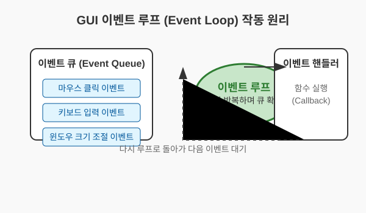

# 1주차 1교시: GUI 개발 기초 - 화면에 생명력 불어넣기 (1/3) 🖥️

## 1. GUI란 무엇인가? (What is GUI?)

### 1.1 CLI vs GUI
우리는 지금까지 **CLI(Command Line Interface)** 환경에서 개발을 해왔습니다. 
- **CLI:** 텍스트 기반의 인터페이스. 명령어를 직접 입력하고 텍스트 결과를 받습니다. (예: 터미널, CMD, Bash)
- **GUI:** 그래픽 기반의 인터페이스. 마우스, 키보드, 터치 등을 이용해 시각적 요소(아이콘, 버튼, 메뉴)와 상호작용합니다. (예: Windows, macOS, 웹 브라우저)

### 1.2 왜 GUI가 필요한가?
- **접근성:** 전문 지식이 없는 일반 사용자도 쉽게 사용할 수 있습니다.
- **직관성:** 시각적 피드백을 통해 현재 상태를 즉각적으로 알 수 있습니다.
- **효율성:** 복잡한 명령어를 외울 필요 없이 클릭 몇 번으로 기능을 수행합니다.

---

## 2. 이벤트 기반 프로그래밍 (Event-Driven Programming)

GUI 프로그램의 가장 핵심적인 차이점은 **"제어권이 누구에게 있는가"**입니다.

### 2.1 절차적 프로그래밍 vs 이벤트 기반 프로그래밍
- **절차적 프로그래밍 (Sequential):** 개발자가 짠 코드 순서대로 프로그램이 실행됩니다. `입력 -> 처리 -> 출력` 순으로 흐름이 명확합니다.
- **이벤트 기반 프로그래밍 (Event-Driven):** 프로그램은 실행 후 **"대기 상태"**에 들어갑니다. 사용자가 버튼을 클릭하거나 키보드를 누르는 등의 **'이벤트'**가 발생했을 때만 특정 코드가 실행됩니다.

### 2.2 이벤트 루프 (Event Loop)의 심층 분석
GUI 프로그램은 내부적으로 무한 루프를 돌며 이벤트를 감시합니다.

#### ⚙️ 작동 메커니즘
1.  **이벤트 발생:** 사용자가 마우스를 클릭하거나 창 크기를 조절합니다.
2.  **이벤트 큐 (Event Queue):** 발생한 이벤트들이 순서대로 큐(Queue)에 쌓입니다.
3.  **이벤트 루프 (Event Loop):** `while True`와 같은 무한 루프가 큐를 계속 확인합니다.
4.  **이벤트 핸들러 (Event Handler/Callback):** 큐에서 이벤트를 꺼내, 해당 이벤트에 연결된 함수(콜백 함수)를 호출합니다.

---

## 3. GUI 프로그램의 치명적 약점: "응답 없음" (Freezing)

GUI 개발 시 가장 많이 겪는 문제가 바로 프로그램이 멈추는 현상입니다.

### 3.1 왜 멈추는가?
이벤트 루프는 **단일 스레드(Single Thread)**에서 동작합니다. 만약 이벤트 핸들러 함수 내부에서 시간이 오래 걸리는 작업(예: 대용량 파일 다운로드, 복잡한 계산, `time.sleep()`)을 수행하면 어떻게 될까요?

- **현상:** 이벤트 루프가 다음 이벤트를 확인하러 돌아가지 못하고 해당 함수에 갇혀 있게 됩니다.
- **결과:** 사용자가 버튼을 눌러도 큐에만 쌓일 뿐 처리가 안 되며, OS는 이 프로그램이 응답하지 않는다고 판단하여 "응답 없음" 상태로 표시합니다.

### 3.2 해결책 (미리 보기)
이 문제를 해결하기 위해 나중에 배울 **멀티스레딩(Threading)**이나 **비동기 프로그래밍(Asyncio)**이 필요합니다. GUI의 메인 스레드는 오직 "화면 갱신"과 "이벤트 처리"에만 집중하게 하고, 무거운 작업은 백그라운드 스레드로 보내야 합니다.

---

## 4. 파이썬 GUI 라이브러리 생태계

파이썬은 다양한 GUI 라이브러리를 제공합니다. 목적에 맞게 선택하는 것이 중요합니다.

| 라이브러리 | 특징 | 장점 | 단점 |
| :--- | :--- | :--- | :--- |
| **Tkinter** | 파이썬 표준 라이브러리 | 설치 불필요, 가볍고 배우기 쉬움 | 디자인이 다소 올드함, 복잡한 UI 구현 어려움 |
| **PyQt / PySide** | Qt 프레임워크 기반 | 매우 강력함, 전문적인 상용 소프트웨어 수준 UI | 학습 곡선 높음, 라이선스 주의 (PyQt) |
| **Kivy** | 멀티터치 지원 | 모바일(Android, iOS) 앱 개발 가능 | 독자적인 문법, 설정이 복잡함 |
| **CustomTkinter** | Tkinter 확장판 | 현대적인 다크 모드/라운드 디자인 제공 | 외부 라이브러리 설치 필요 |

---

## ✍️ 1교시 생각 정리 및 토론

1.  **토론:** 우리가 사용하는 스마트폰 앱 중 '이벤트 기반 프로그래밍'의 특성이 가장 잘 드러나는 기능은 무엇일까요?
2.  **분석:** 웹 브라우저에서 페이지가 로딩 중일 때, 마우스 커서가 모래시계로 변하거나 버튼이 클릭되지 않는 현상을 이벤트 루프 관점에서 설명해 보세요.
3.  **실습 준비:** 다음 시간에는 `Tkinter`를 이용해 실제로 윈도우 창을 띄워보겠습니다. 파이썬 설치 경로에 `tkinter`가 포함되어 있는지 확인하세요.
