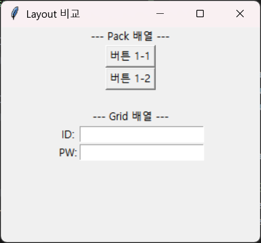
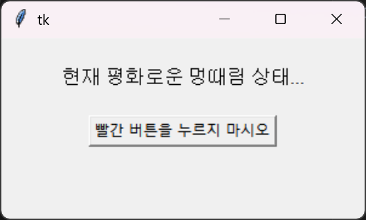

# 2주차: GUI 심화 - 위젯 배치 알고리즘과 데이터 시각화 뷰어 📊

지난 시간 띄운 창에 위젯을 정교하게 배치하고 정렬하는 **레이아웃 매니저**의 원리를 이해하고, 로컬 CSV 파일 데이터 분석 플로우와 결합하여 직접 차트를 띄우는 실전 GUI 분석 뷰어를 완성해 보겠습니다.

---

## 학습목표
`Tkinter` 버튼, 텍스트창, 라벨 같은 위젯 부품들을 단순하게 가운데 정렬로 부어버리는 `pack()`과 엑셀 시트처럼 정교하게 좌표로 꽂아 넣는 `grid()` 레이아웃의 차이를 배웁니다. 더불어, 화면에 던져놓은 버튼을 눌렀을 때 비로소 파이썬 함수가 발동하게 전선을 이어주는 **이벤트 구동(Event-Driven)** 방식의 결정체인 `command=` 파라미터 활용법을 체화합니다.

---

## 💡 TL;DR (1분 핵심 요약): 배치와 액션

1. **위젯(Widget)**: 버튼, 입력창, 라벨 등 화면을 구성하는 가장 작은 레고 분자 블록입니다.
2. **레이아웃 매니저**: 내가 만든 위젯을 빈 도화지(Window) 어디에 꽂을지를 결정하는 자석입니다. (`pack`은 김밥 말기처럼 위에서부터 차곡차곡 쌓는 방식, `grid`는 모눈종이 십자 좌표표에 박아넣는 방식입니다.)
3. **이벤트 핸들링 (`command=`)**: 껍데기뿐인 버튼에 생명을 불어넣는 전류선 연결 작업입니다. 함수 괄호를 빼먹고 이름만 적어야(`command=my_click`) 클릭 시점에만 총알이 발사됩니다.

---

## 1. 화면 배치(레이아웃)의 양대 산맥

버튼(Widget)을 화면에 그냥 던지면 아무것도 보이지 않습니다. 반드시 `팩(pack)` 이나 `그리드(grid)` 라는 레이아웃 매니저 함수를 뒤에 붙여주어야 화면에 본드가 칠해지며 찰싹 달라붙습니다. 



### 예제 1: `pack()` 블록 쌓기와 `grid()` 엑셀 정렬
```python
import tkinter as tk

root = tk.Tk()
root.title("Layout 비교")
root.geometry("300x250") # 가로x세로 크기

# ---------------------------------------------
# 1. pack() 방식: 마트료시카 블록처럼 위에서 아래로 중앙 정렬 쑤셔 넣기 (빠름)
tk.Label(root, text="--- Pack 배열 ---").pack()
tk.Button(root, text="버튼 1-1").pack()
tk.Button(root, text="버튼 1-2").pack()

# ---------------------------------------------
# 2. grid() 방식: 정교하게 엑셀 행(Row)과 열(Column) 셀 나누기 (정교함)
tk.Label(root, text="--- Grid 배열 ---").pack(pady=(20, 0)) # 여백용 꼼수

# 별도의 뼈대 프레임(투명한 액자)을 만들고, 그 안에 그리드를 칩니다.
# (하나의 root 창 안에서 pack과 grid를 함부로 섞어 쓰면 에러 쾅 납니다!)
frame = tk.Frame(root) 
frame.pack()

tk.Label(frame, text="ID:").grid(row=0, column=0)
tk.Entry(frame).grid(row=0, column=1) # 글자를 입력받는 빈칸

tk.Label(frame, text="PW:").grid(row=1, column=0)
tk.Entry(frame).grid(row=1, column=1)

# 심장 박동(회전목마) 무한 실행 시작! 
root.mainloop()
```





---

## 2. 이벤트 드리븐 (Event-Driven)의 마법

사용자가 버튼을 클릭했을 때 어떤 함수를 실행할지 미리 **전선(Command)**을 연결해 두어야 합니다.



### 예제 2: 버튼 클릭과 함수 실행 연결
```python
import tkinter as tk

# 1. 동작할 함수 (총알) 미리 장전!
def force_on_click():
    # 사용자가 버튼을 클릭하면, 이 회로로 전기가 흐르며 함수 발동!
    print("터미널: 앗! 찌릿찌릿! 왼쪽 버튼이 클릭되었습니다!")
    
    # GUI 화면의 라벨 내용을 강제 수정
    label_status.config(text="🔥 미사일 발사 완료! 🔥", fg="red") 

# ---------------------------------------------

root = tk.Tk()
root.geometry("300x150")

# 2. 라벨 만들기 (처음 상태)
label_status = tk.Label(root, text="현재 평화로운 멍때림 상태...", font=("Arial", 12))
label_status.pack(pady=20)

# 3. 버튼 만들기 (command=force_on_click 코드가 바로 핵심 전선(방아쇠) 역할!)
# 🚨 절대 주의: 함수명 뒤에 괄호를 치는 순간( force_on_click() ), 
# 파이썬은 프로그램이 뜨기도 전에 버튼 생성을 하다가 저 함수를 먼저 폭파(실행)시켜 버립니다.
# 방사능 물질(매개변수)이 필요 없는 버튼 연결은 무조건 괄호 생략!
btn = tk.Button(root, text="빨간 버튼을 누르지 마시오", command=force_on_click)
btn.pack()

root.mainloop()
```





---

## ☕ Java vs 🐍 Python 스나이퍼 대결

### 이벤트 감지 (리스너 연결)의 고통 차이
*   **Java (`Swing`)**: 자바에서 버튼을 누를 때 `"hello"`를 찍게 하려면 `ActionEventListener`라는 객체 인터페이스 지옥을 만듭니다. `button.addActionListener(new ActionListener() { public void actionPerformed(ActionEvent e) { System.out.println("hello"); } });` 처럼 거대한 익명 인터페이스 클래스 덩어리를 우겨 넣어야 합니다. 코드 줄 수가 무지막지하게 길고 지저분해집니다.
*   **Python (`Tkinter`)**: 자바의 그 무거운 익명 객체를 버리고, 그냥 파이썬의 **일급 객체(First-class Object)** 특성을 발동시킵니다. `def` 로 함수를 하나 짠 뒤, `tk.Button(..., command=함수명)` 이라는 파라미터 값으로 화살표 포인터 리스트 하나 던져주면 자바의 모든 리스너 오버라이드 과정을 단 한 줄로 철저히 강제 압축시켜버립니다.

---

## 🎧 Vibe Coding

> **🗣️ 학생 프롬프트 (AI에게 이렇게 명령해 보세요):**
> "파이썬 `Tkinter`를 써서 간단한 '비만도(BMI) 계산기' GUI 창을 만들어줘. 
> 1) 몸무게 입력창(Entry), 키 입력창(Entry) 두 개를 나란히 `grid()` 로 예쁘게 배치해.
> 2) 그 아래에 '계산하기' 버튼을 만들고, 클릭하면 `calculate_bmi()` 함수가 이벤트로 발동하게 해 줘.
> 3) 함수 안에서는 `entry_weight.get()` 같은 `get()` 문법을 통해 몸무게값 문자열을 쑥 뽑아오고 실수(float)로 형변환한 뒤, 공식(몸무게 / 키의 제곱)으로 식을 풀고 맨 밑에 있는 라벨의 글자를 '당신의 BMI는 XX입니다' 로 변경해 줘."

---

## 코딩 영단어 학습 📝

*   **Config (Configure)**: 구성하다, 설정값을 뒤바꾸다. (화면에 이미 뿌려진 라벨(Label)의 글자 내용(`text= `)이나 배경색(`bg= `)을, 버튼 클릭 등 동적인 상황이 발생했을 때 실시간으로 강제로 덮어씌워 바꾸기 위해 호출하는 막강한 업데이트 메서드입니다.)
*   **Pack (팩)**: 꾸러미를 싸다. (HTML/CSS 퍼블리싱을 모르는 개발자를 위해 파이썬이 던져주는 마법의 상자. `pack()` 이라고 선언하면 여백이나 공간 계산을 할 필요 없이 윗줄부터 가운데 정렬 차곡차곡 스택처럼 예쁘게 위젯을 쌓아 내립니다.)
*   **Grid (그리드)**: 격자무늬, 모눈종이. (`pack`으로 대충 세팅이 안 되는 까다로운 바둑판, 액셀 테이블형 UI를 짤 때 무조건 꺼내 드는 레이아웃 치트키. 내가 만든 버튼을 `row=3, column=2`의 정확한 좌표 셀(Cell) 박스 안에 때려 넣게 해 줍니다.)

---

## 학습목표
지금까지 배운 파이썬의 핵심 3대장 기술을 하나로 융합하는 최종 보스급 미니 프로젝트입니다. 
1) **파일 I/O (`open()`)** 기술로 `sales.csv` 파일을 읽어 리스트로 가공하고, 
2) **데이터 시각화 (`Matplotlib`)** 기술로 차트를 그려낸 다음, 
3) 이 모든 결과를 **GUI 프로그래밍 (`Tkinter`)** 창 위에 버튼과 함께 아름답게 띄워 넣는 완벽한 통합 애플리케이션을 완성해 봅니다.

---

## 💡 TL;DR (1분 핵심 요약): 3종 신기의 결합

1. 순수 파이썬의 검은색 터미널 창을 벗어나, "결과 보기" 웹 버튼이 달린 번듯한 윈도우 UI(Tkinter)를 먼저 만듭니다.
2. 사용자가 버튼을 누르면(`command=`), 숨겨두었던 데이터 분석 함수가 발동합니다.
3. 함수는 하드디스크의 `.csv` 파일을 열고 파싱하여 `Matplotlib`으로 차트를 생성해 화면에 팝업시킵니다!

---

## 1. 프로젝트 아키텍처 (어떻게 합칠 것인가?)

자바(Java)였다면 이 세 가지(버튼UI, 파일읽기, 차트그리기)를 합치기 위해 수십 개의 클래스 파일과 아키텍처 설계가 필요했을 것입니다. 하지만 파이썬에서는 이 모든 것이 단일 `.py` 파일 안에서 함수 블록(`def`) 하나로 우아하게 통일됩니다.

우리는 윈도우 창(`Tk()`)을 먼저 하나 띄워놓고, 그 안에 커다란 버튼을 하나 박아둘 것입니다. 그리고 이 버튼의 전선(`command`)을 방금 전 데이터 분석 챕터(`06_data_viz_prep`)에서 배웠던 차트 생성 함수에 곧바로 연결해버리면 끝입니다!

---

## 2. 통합 애플리케이션 코드

> **🚨 (필수) 패키지 설치 안내**
> 파이썬 기본 내장 모듈인 `tkinter`와 달리, `matplotlib`은 외부 시각화 라이브러리입니다. 코드를 실행하기 전 VS Code 하단 터미널을 열고 아래 명령어로 패키지를 먼저 설치해 주셔야 합니다.
> ```bash
> python -m pip install matplotlib
> ```

*이 코드를 실행하려면 `sales.csv` 파일이 같은 폴더에 있어야 하며, 오류가 날 경우 위 명령어로 `matplotlib`을 설치해 주세요.*

```python
import tkinter as tk
import matplotlib.pyplot as plt
import os

# ---------------------------------------------------------
# 1. 핵심 비즈니스 로직 (데이터 읽고 차트 그리기 함수)
# ---------------------------------------------------------
def analyze_and_show_chart():
    days = []
    sales = []

    # 현재 파일 위치에서 sales.csv 찾기 (파일 I/O)
    current_dir = os.path.dirname(os.path.abspath(__file__))
    csv_path = os.path.join(current_dir, "sales.csv")

    try:
        with open(csv_path, "r", encoding="utf-8") as f:
            f.readline() # 헤더 버리기
            for line in f:
                row = line.strip().split(',')
                days.append(int(row[0]))   # [1, 2, 3...]
                sales.append(int(row[1]))  # [100, 110, 105...]
    except FileNotFoundError:
        # 파일이 없으면 라벨에 에러 메시지를 띄우는 GUI 피드백!
        lbl_status.config(text="🚨 에러: sales.csv 파일을 찾을 수 없습니다!", fg="red")
        return # 함수 강제 종료

    # 여기까지 무사히 왔다면 차트 그리기 (Matplotlib)
    fig, ax = plt.subplots(figsize=(6, 4))
    ax.plot(days, sales, marker='o', color='blue', linestyle='-')
    ax.set_title("Sales Analysis Data")
    ax.set_xlabel("Day")
    ax.set_ylabel("Sales ($)")
    
    # GUI 라벨 업데이트 및 차트 팝업 띄우기
    lbl_status.config(text="✅ 분석 완료! 차트가 별도 창으로 생성되었습니다.", fg="blue")
    plt.show() 

# ---------------------------------------------------------
# 2. GUI 화면 설계 로직 (Tkinter 껍데기)
# ---------------------------------------------------------
root = tk.Tk()
root.title("내 인생 첫 데이터 분석 앱")
root.geometry("400x200") # 가로상자 크게

# 타이틀 라벨 (팩 레이아웃으로 중앙 정렬)
lbl_title = tk.Label(root, text="🚀 파이썬 원클릭 데이터 분석기", font=("Arial", 16, "bold"))
lbl_title.pack(pady=(20, 10))

# 상태 알림 라벨 (이벤트가 터지면 글씨가 바뀔 곳)
lbl_status = tk.Label(root, text="버튼을 눌러 분석을 시작하세요.", font=("Arial", 10))
lbl_status.pack(pady=5)

# 실행 버튼 (command에 위의 거대한 분석 함수를 장전!)
btn_run = tk.Button(root, text="📊 데이터 읽어오기 및 차트 보기", 
                    font=("Arial", 12),
                    bg="#4CAF50", fg="white", # 버튼 색상 꾸미기
                    command=analyze_and_show_chart)
btn_run.pack(pady=20)

# 심장 박동(무한 대기 루프) 시작
root.mainloop()
```

---

## 3. 코드 해부: 파이썬의 무서운 실전 압축력

위 코드는 불과 40여 줄에 불과하지만, 현업에서 쓰이는 **"데이터 파이프라인 + 프론트엔드 버튼 + 백엔드 처리(시각화)"** 아키텍처의 필수 요소를 모두 갖추고 있습니다.

1.  **UI 렌더링**: `tk.Tk()` 와 `pack()`을 통해 클라이언트 모니터에 시각적인 조종석을 제공합니다.
2.  **예외 처리 연동**: 파일이 없을 경우 무식하게 터미널에 에러를 뱉고 뻗는 것이 아니라, `try-except` 블록을 통과하면서 `lbl_status.config()`라는 GUI 함수를 조종해 사용자에게 시각적으로 "🚨 에러가 났습니다"라고 예쁘게 알려줍니다. (완전한 상용 프로그램의 디테일)
3.  **이벤트 모듈화**: `command=analyze_and_show_chart` 단 한 줄로, 버튼 위젯이라는 빈 껍데기가 거대한 데이터 분석 머신으로 탈바꿈했습니다.

---

## ☕ Java vs 🐍 Python 스나이퍼 대결

자바 개발자라면 위 40줄짜리 파이썬 코드를 자바로 구현하기 위해 머릿속에 수많은 패키지 분리를 상상했을 것입니다.

*   `Swing` / `JavaFX` 로 UI 프레임워크 객체 작성 (100줄 이상)
*   사용자 버튼 클릭을 감지하는 `ActionListener` 와 쓰레드 분리 설계
*   `FileReader`, `BufferedReader` 로 CSV 파싱 객체 구현 (50줄 구조)
*   `JFreeChart` 등에 데이터셋 주입하기 위해 `while` 루프 돌리며 DTO 변환 (50줄 구조)
*   **결과**: 자바로는 파일 3~4개가 쪼개어지고 총 300줄이 넘어가는 숨 막히는 프로젝트가 되어버리지만, **파이썬은 단일 흐름의 절차지향적 코딩으로 프론트와 백엔드 로직이 40줄에 우아하게 결합**됩니다.

---

## 🎧 Vibe Coding

> **🗣️ 학생 프롬프트 (AI에게 이렇게 명령해 보세요):**
> "파이썬 `Tkinter`를 써서 내가 방금 짠 데이터 분석 프로그램에 기능을 추가해줘!
> 지금은 버튼이 한 개인데, 이 버튼 옆에 텍스트 입력칸(`Entry`) 창을 하나 뚫어줘. 그리고 내가 거기에 'sales2.csv' 처럼 어떤 파일 이름을 치고 분석 버튼을 누르면, 코드가 입력칸에서 그 이름을 읽어와서(`get()`) 그 이름에 맞는 파일 데이터를 분석하게 동적인 기능을 가진 GUI로 뜯어고쳐 줘."

---

## 코딩 영단어 학습 📝

*   **Integration (인티그레이션)**: 통합, 결합. (따로따로 노는 A, B, C의 부품을 엮어 하나의 시스템으로 완성하는 것을 뜻합니다. 여기서는 GUI 인프라 위에서 파일 읽기와 그래프 그리기를 인티그레이션(통합)했습니다.)
*   **Pipeline (파이프라인)**: 정보 전달의 관. (원유를 나르는 송유관처럼, 하드디스크의 텍스트 한 줄이 코드를 타고 들어와 -> 리스트로 변형되고 -> 마지막엔 차트 이미지로 출력되는 이 일련의 컨베이어 벨트 처리 과정을 '데이터 파이프라인'이라 부릅니다.)
*   **Try / Except (트라이/익셉트)**: 예외 처리 덫. (파일이 없거나 데이터가 꼬여 프로그램이 강제 폭발하는 것을 막기 위해 쳐놓는 덫입니다. 에러가 나면 팅기지 않고 사용자의 화면 라벨을 예쁜 빨간 글씨로 바꿔주어 고객 경험(UX)을 극대화합니다.)

---

## ✍️ 이번 주 연습 문제

**문제 1.** Tkinter의 세 가지 레이아웃 매니저(`pack`, `grid`, `place`)의 사용 환경과 위젯 배치 특징을 상호 비교해 보세요.

**문제 2.** CSV 데이터를 파싱하여 Tkinter 테이블 및 Matplotlib 그래프로 동시에 출력할 때, 왜 차트 창을 별도로 띄우는 대신 Tkinter 캔버스 객체 안에 차트 피겨(Figure)를 임베딩하는 방식이 더 고급 GUI 디자인에 적합한지 사용 편의성 면에서 쓰세요.

**문제 3.** (심화) `sales.csv` 데이터를 로드해 GUI 창 안의 목록 상자에 제품명을 클릭하면, 해당 제품의 분기별 판매량 추이 선 그래프가 Tkinter 프레임 내에 즉각 갱신되어 그려지는 데이터 분석 대시보드 뷰어의 완성본 코드를 작성하세요.