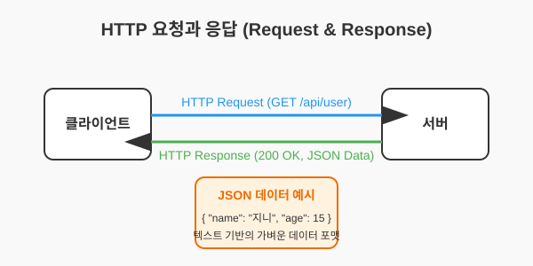

# 4주차: 네트워크 프로그래밍 (2) - HTTP와 REST API 🌐

지난 시간에는 소켓을 이용한 저수준(Low-level) 통신을 배웠습니다. 하지만 현대의 대부분의 서비스는 소켓을 직접 다루지 않고, 그 위에 구축된 **HTTP(HyperText Transfer Protocol)**라는 약속을 사용합니다. 이번 시간에는 HTTP의 원리와 파이썬의 `requests` 라이브러리를 이용한 API 연동을 배웁니다.

---

## 1. HTTP 프로토콜의 이해

HTTP는 웹 브라우저와 서버가 데이터를 주고받기 위한 약속입니다. 기본적으로 **요청(Request)**과 **응답(Response)**의 구조로 이루어져 있습니다.



### 1.1 HTTP 요청 (Request)
클라이언트가 서버에 보내는 메시지입니다.
- **메서드 (Method):** 어떤 동작을 원하는가?
    - `GET`: 데이터 조회 (가장 많이 사용)
    - `POST`: 데이터 생성/제출
    - `PUT`: 데이터 수정
    - `DELETE`: 데이터 삭제
- **URL (Uniform Resource Locator):** 어디에 있는 어떤 자원을 원하는가?
- **헤더 (Header):** 요청에 대한 추가 정보 (브라우저 정보, 인증 토큰 등)

### 1.2 HTTP 응답 (Response)
서버가 요청을 처리한 후 보내는 메시지입니다.
- **상태 코드 (Status Code):** 요청 결과가 어떠한가?
    - `200 OK`: 성공
    - `404 Not Found`: 요청한 자원을 찾을 수 없음
    - `500 Internal Server Error`: 서버 내부 오류
- **바디 (Body):** 실제 전달할 데이터 (HTML, JSON 등)

---

## 2. 파이썬의 `requests` 라이브러리

파이썬에서 HTTP 통신을 가장 쉽고 강력하게 할 수 있게 해주는 라이브러리가 바로 `requests`입니다.

### 2.1 설치 및 기본 사용법
```bash
pip install requests
```

```python
import requests

# 1. GET 요청: 데이터 가져오기
response = requests.get("https://api.github.com/users/github")
print(response.status_code) # 결과: 200
print(response.text)        # 결과: HTML 또는 JSON 문자열
```

---

## 3. REST API와 JSON

현대의 API는 대부분 **REST (Representational State Transfer)** 원칙을 따르며, 데이터 포맷으로 **JSON (JavaScript Object Notation)**을 사용합니다.

### 3.1 JSON이란?
텍스트 기반의 데이터 포맷으로, 파이썬의 딕셔너리와 매우 유사하게 생겼습니다.
`{ "name": "지니", "age": 15, "skills": ["Python", "OOP"] }`

### 3.2 JSON 데이터 처리하기
`requests` 라이브러리는 JSON 데이터를 파이썬 딕셔너리로 바로 변환해주는 `.json()` 메서드를 제공합니다.

```python
import requests

# 공공 API 등을 통해 JSON 데이터 가져오기
response = requests.get("https://jsonplaceholder.typicode.com/posts/1")
data = response.json() # JSON 문자열 -> 파이썬 딕셔너리 변환

print(f"제목: {data['title']}")
print(f"내용: {data['body']}")
```

---

## ✍️ 이번 주 연습 문제

**문제 1.** `requests` 라이브러리를 사용하여 특정 웹사이트(예: 구글, 네이버)의 메인 페이지 HTML 소스를 가져와 파일로 저장하는 프로그램을 작성해 보세요.

**문제 2.** 무료 API 서비스(예: JSONPlaceholder)를 이용하여, 1번부터 5번까지의 포스트 제목만 추출하여 리스트로 출력하는 코드를 작성해 보세요.

**문제 3.** (심화) HTTP 상태 코드 `404`나 `500`이 발생했을 때, 프로그램이 멈추지 않고 "서버에 문제가 발생했습니다"라고 출력하도록 예외 처리(`try-except`)를 적용한 API 호출 함수를 만들어 보세요.
---

## 🔍 Deep Dive: HTTP 비상태성(Stateless)과 REST API 아키텍처의 철학

우리가 매일 쓰는 웹은 HTTP 프로토콜에 의해 구동됩니다.
- **Stateless (비상태성)**: 서버는 클라이언트의 상태를 기억하지 않습니다. 요청 한 번에 응답 한 번을 주고받으면 관계는 뚝 끊깁니다. 이를 보완하기 위해 쿠키(Cookie)나 세션(Session), 토큰(JWT) 등을 활용해 유저 정보를 헤더에 덧붙여 전송합니다.
- **REST (Representational State Transfer)**: URI는 리소스(자원, 예: `/users`)를 지칭하고, HTTP Method(GET, POST, PUT, DELETE)는 행위를 나타내도록 설계하는 현대 웹 서비스 간의 아키텍처 약속입니다.

---

## ☕ Java vs Python 스나이퍼 비교

### HTTP 클라이언트 호출 라이브러리
*   **Java**: 내장된 `HttpURLConnection`은 사용법이 너무 원시적이라서, 주로 Apache HttpClient나 모던한 **Spring WebClient**, 또는 서드파티인 OkHttp, Retrofit 등을 끌어와 사용합니다. 정적 타입 체계 때문에 JSON 응답을 객체로 역직렬화(DTO)하는 코드가 꼭 동반되어 빌드가 번거롭습니다.
*   **Python**: 사실상의 업계 표준인 **`requests`** 서드파티 라이브러리를 사용하면, 단 한 줄의 `requests.get(url).json()` 코드로 JSON 응답을 즉각 파이썬 딕셔너리로 치환해 버릴 수 있어 비교가 안 될 정도로 편리합니다.

---

## 🎧 Vibe Coding

> **🗣️ 학생 프롬프트 (AI에게 이렇게 명령해 보세요):**
> "파이썬의 `requests` 라이브러리를 사용하여 GitHub의 공개 API(`https://api.github.com/users/octocat`)에 요청을 날려, 해당 유저의 이름, 팔로워 수, 리포지토리 목록을 가져와 예쁘게 출력하는 코드를 짜 줘."

---

## 코딩 영단어 학습 📝

*   **`Stateless`**: 비상태성. (클라이언트와 서버의 통신이 이전 연결 정보나 상태를 전혀 보관하지 않는 독립적인 트랜잭션들의 합으로 구동되는 방식입니다.)
*   **`REST API`**: REST 규격 인터페이스. (인터넷 망의 자원들을 고유 URI와 HTTP 명령어를 사용하여 기계 대 기계로 호출하고 유통할 수 있도록 구성한 웹 서비스 표준 가이드라인입니다.)
*   **`Payload`**: 페이로드. (헤더나 메타데이터 정보를 제외하고, 클라이언트가 서버로 전송하고자 하는 데이터 본체 알맹이 내용물입니다.)
