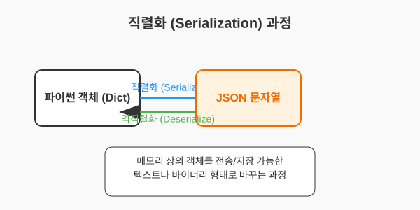

# 5주차: 데이터 처리 - JSON과 XML, 그리고 직렬화 📦

우리는 지난 시간 API를 통해 데이터를 주고받았습니다. 이때 사용한 JSON은 단순한 텍스트일 뿐입니다. 하지만 프로그램 내부에서는 이를 딕셔너리나 리스트 같은 '객체'로 다뤄야 합니다. 이번 시간에는 데이터를 저장/전송 가능한 형태로 바꾸는 **직렬화**와 대표적인 포맷인 **JSON, XML**을 배웁니다.

---

## 1. 직렬화 (Serialization)란?

직렬화는 **메모리 속에 존재하는 객체(Object)를 파일에 저장하거나 네트워크로 전송할 수 있도록 텍스트나 바이너리 형태로 변환하는 과정**을 말합니다. 반대로 변환된 데이터를 다시 객체로 만드는 것을 **역직렬화(Deserialization)**라고 합니다.



- **직렬화:** 파이썬 딕셔너리 $\rightarrow$ JSON 문자열
- **역직렬화:** JSON 문자열 $\rightarrow$ 파이썬 딕셔너리

---

## 2. JSON (JavaScript Object Notation)

JSON은 현재 전 세계적으로 가장 많이 쓰이는 데이터 교환 포맷입니다. 사람이 읽기 쉽고, 기계가 파싱하기 매우 빠르기 때문입니다.

### 2.1 파이썬에서 JSON 다루기 (`json` 모듈)
파이썬의 `json` 모듈을 사용하면 딕셔너리와 JSON 문자열을 서로 변환할 수 있습니다.

```python
import json

# 1. 파이썬 객체 -> JSON 문자열 (직렬화)
user_data = {"name": "지니", "age": 15, "city": "Seoul"}
json_string = json.dumps(user_data) 
print(json_string) # 결과: '{"name": "지니", "age": 15, "city": "Seoul"}'

# 2. JSON 문자열 -> 파이썬 객체 (역직렬화)
json_input = '{"name": "철수", "age": 17, "city": "Busan"}'
user_obj = json.loads(json_input)
print(user_obj["name"]) # 결과: 철수
```

- `json.dumps()`: 객체를 문자열로 변환 (Dump String)
- `json.loads()`: 문자열을 객체로 변환 (Load String)
- `json.dump()` / `json.load()`: 파일에 직접 쓰고 읽을 때 사용

---

## 3. XML (Extensible Markup Language)

XML은 HTML과 비슷하게 태그(`< >`)를 사용하여 데이터를 구조화하는 포맷입니다. JSON보다 무겁고 복잡하지만, 데이터의 의미를 더 명확하게 정의할 수 있어 오래된 시스템이나 기업용 설정 파일에서 여전히 사용됩니다.

### 3.1 XML 예시
```xml
<user>
    <name>지니</name>
    <age>15</age>
    <city>Seoul</city>
</user>
```

---

## 4. 🔍 Deep Dive: JSON vs XML vs Pickle

데이터를 직렬화하는 방법은 여러 가지가 있습니다. 상황에 맞는 선택이 중요합니다.

| 포맷 | 특징 | 장점 | 단점 |
| :--- | :--- | :--- | :--- |
| **JSON** | 텍스트 기반, 키-값 쌍 | 가볍고 범용적임 (표준) | 복잡한 객체 표현에 한계 |
| **XML** | 텍스트 기반, 태그 구조 | 구조가 엄격하고 상세함 | 매우 무겁고 파싱이 느림 |
| **Pickle** | 파이썬 전용 바이너리 | 파이썬의 모든 객체 저장 가능 | 파이썬에서만 사용 가능, 보안 위험 |

**⚠️ 주의: Pickle의 보안 위험**
`pickle` 모듈은 파이썬 객체를 그대로 저장하므로 매우 편리하지만, 신뢰할 수 없는 곳에서 받은 pickle 파일을 로드하면 **악성 코드가 실행될 위험**이 있습니다. 외부 데이터 교환에는 반드시 JSON을 사용하세요.

---

## ✍️ 이번 주 연습 문제

**문제 1.** 자신의 프로필 정보(이름, 나이, 취미 리스트, 좋아하는 음식 딕셔너리)를 딕셔너리로 만들고, 이를 `profile.json` 파일로 저장한 뒤 다시 읽어오는 프로그램을 작성해 보세요.

**문제 2.** JSON 문자열에서 특정 키의 값만 추출하여 출력하는 함수 `get_value(json_str, key)`를 구현해 보세요.

**문제 3.** (심화) `pickle` 모듈을 사용하여 파이썬의 클래스 인스턴스를 파일로 저장하고 다시 불러오는 코드를 작성해 보세요. 그리고 왜 이 방식이 JSON보다 강력하지만 위험한지 서술해 보세요.
---

## 🔍 Deep Dive: XML 트리 구조(DOM/SAX)와 JSON 직렬화의 직관성 대결

웹 세상에서 데이터를 구조화하여 전송하는 방식은 크게 XML과 JSON이 지배해 왔습니다.
- **XML**: 태그 기반의 트리 구조로 엄격한 유효성 검사(Schema)가 가능하지만, `<name>Jiny</name>` 처럼 여는 태그와 닫는 태그가 반복되어 패킷 용량이 무거워지고 가독성이 떨어집니다. 파이썬은 DOM(전체 메모리 로드) 방식과 SAX(스트리밍 파싱) 방식으로 XML을 제어합니다.
- **JSON**: 자바스크립트 객체 표기법에서 유래해 키와 값의 쌍으로만 이루어져 있으며 패킷이 가볍고 인간이 읽기 극단적으로 편합니다. 파이썬 딕셔너리와 1:1로 정확하게 매핑되는 완벽한 호환성 덕분에 현대 웹 서비스와 데이터 처리의 절대 강자가 되었습니다.

---

## ☕ Java vs Python 스나이퍼 비교

### JSON 직렬화 및 파싱 처리의 대조
*   **Java**: JSON을 내장 타입으로 인지하지 못합니다. 따라서 **Jackson** 이나 Google **Gson** 같은 라이브러리를 주입받아 DTO(Data Transfer Object) 자바 클래스를 먼저 매핑 선언하고, 리플렉션을 거쳐서 직렬화/역직렬화(Serialization/Deserialization)를 실행해야 하므로 코드 구조가 다소 무겁습니다.
*   **Python**: 내장 모듈 `json`을 사용하여 `json.dumps(dic_obj)` 단 한 줄로 텍스트 직렬화를 완성하고, `json.loads(text)` 한 줄로 파이썬 딕셔너리 객체로 환원시킬 수 있어 JSON 처리가 세상에서 가장 간결합니다.

---

## 🎧 Vibe Coding

> **🗣️ 학생 프롬프트 (AI에게 이렇게 명령해 보세요):**
> "파이썬으로 여러 학생의 성적 정보(이름, 국어, 영어 점수)가 담긴 복잡한 파이썬 딕셔너리를 작성해 줘. 그리고 이 데이터를 `json.dump`를 사용하여 로컬 `student.json` 파일에 쓰기(직렬화)하는 파이썬 코드를 구현해 줘."

---

## 코딩 영단어 학습 📝

*   **`Serialization`**: 직렬화, 마샬링. (메모리상에 떠 있는 객체 데이터를 파일 저장이나 네트워크 전송이 가능한 평면적인 바이트 스트림(텍스트) 형태로 변환하는 가공 절차입니다.)
*   **`Deserialization`**: 역직렬화. (직렬화되어 수신된 텍스트나 바이트 스트림 데이터를 해석하여, 메모리에 객체 인스턴스로 복원하고 활성화하는 가공 작업입니다.)
*   **`DOM` (Document Object Model)**: 문서 객체 모델. (XML이나 HTML 문서 전체를 메모리로 통째로 로드하여 노드 트리 형태로 구성해 읽고 편집할 수 있게 구조화한 프로그래밍 모델입니다.)


---

## 📖 교재 상세 학습: 69 탐정의 비밀 돋보기: 기초 패턴 만들기 (Meta Characters)

## 69 탐정의 비밀 돋보기: 기초 패턴 만들기

파이썬에서 `re` (Regular Expression의 약자) 모듈을 불러오면(`import re`), 우리는 텍스트를 검색하는 강력한 특수 언어를 쓸 수 있습니다. 이 언어의 핵심은 바로 글자가 아니라 규칙을 의미하는 **메타 문자(Meta Character)**라는 비밀 기호들입니다.

### 1. 어떤 글자를 찾을래? (문자 클래스)

- **`[ ]` (선택)**: 대괄호 안의 문자 중 **어느 하나라도** 맞으면 합격!
  - `[abc]` : "a, b, c 중 하나라도 있나?"
  - `[a-z]` : "영어 소문자 아무거나 다 나와!"
  - `[가-힣]` : "한글 글자는 다 걸려라!"
  
- **`[^ ]` (반대/부정)**: 괄호 안에 `^` 기호가 먼저 들어가면 "이것 빼고 다 가져와!"라는 뜻입니다.
  - `[^0-9]` : "제발 숫자만 빼고 전부 다!"

- **단축키 (축약 기호)**: 매번 `[0-9]` 라고 쓰기 귀찮아서 만든 친절한 단축키들!
  - **`\d`**: 숫자 (`[0-9]`와 완전 동일, digit)
  - **`\D`**: 숫자가 아닌 것들 (Non-digit)
  - **`\s`**: 띄어쓰기, 엔터(`\n`), 탭(`\t`) 같은 공백들 (space)
  - **`\w`**: 알파벳, 한글, 숫자 (특수문자 및 공백 제외, word)

---

### 2. "도대체 몇 개나 있어?" (수량자)

내가 찾는 문자가 연속으로 반복될 때는 수량자 기호를 뒤에 슬쩍 붙여줍니다.

- **`*`**: 0개 이상 (아예 없어도 합격이고, 엄청 많아도 OK)
- **`+`**: 1개 이상 (무조건 1개는 있어야 해!)
- **`?`**: 0개 아니면 1개 (있어도 그만, 없어도 그만 - 선택적 옵션)
- **`{m, n}`**: 딱 m개부터 최대 n개까지만 허용! (예: `\d{3,4}` → 숫자 3자리 혹은 4자리)

```python
import re

# "a 다음에 b가 무조건 1개 이상(+) 있는 패턴"
# compile()은 내 돋보기 규칙을 세팅하는 작업입니다.
pattern = re.compile("ab+")

print(pattern.search("abbbb").group()) # "abbbb" 한 번에 싹 다 찾음!
# print(pattern.search("acccc"))       # b가 없어서 못 찾고 터짐(None 에러)!
```

---

### 3. 좌표 찍기 (앵커 문자)

내가 찾는 단어가 문장 중간에 있는 건 싫고, 꼭 첫 머리이거나 꼬리에 있어야 할 때 씁니다.

- **`^`**: 문장의 **맨 처음**에서만 찾아라! (`^Hello` : 첫 단어가 Hello인지 검사)
  - *주의: `[ ]` 괄호 안의 `^`는 부정이지만, 괄호 밖에서는 '문자열의 처음'이라는 뜻입니다!*
- **`$`**: 문장의 **맨 끝**에서만 찾아라! (`Python$` : 가장 마지막 단어가 Python인지 검사)

---

### 4. 소그룹 묶어 이름표 달기 (Grouping)

전화번호("010-1234-5678")를 찾을 때, 전체 번호도 찾고 싶지만 '앞자리', '중간자리', '뒷자리'를 나중에 예쁘게 따로따로 빼서 보고 싶다면 필요한 부분을 괄호 `( )`로 묶어줍니다. 이것을 그룹화라고 합니다.

```python
import re

# 괄호 3개로 묶어서 그룹 3개를 만듭니다. (숫자뭉치)-(숫자뭉치)-(숫자뭉치)
phone_pattern = re.compile("(\d+)-(\d+)-(\d+)")
result = phone_pattern.search("안녕하세요 제 폰 번호는 010-9999-8888 입니다")

# .group()은 찾은 결과를 꺼내줍니다.
print("전체:", result.group()) # 010-9999-8888

# 괄호별로 순서대로 빼기!
print("1번 그룹(국번):", result.group(1)) # 010
print("2번 그룹(중간):", result.group(2)) # 9999
print("3번 그룹(뒷번):", result.group(3)) # 8888
```

> [!TIP]
> 괄호 맨 앞에 특별히 `?P<이름>`을 붙이면 그 그룹에 숫자가 아닌 별명을 지어줄 수 있습니다!
> `(?P<middle>\d+)` 라고 쓰면, 나중에 `result.group('middle')` 이라는 아주 직관적인 이름으로 편하게 값을 꺼낼 수 있답니다.


---

## 📖 교재 상세 학습: 70 실전 수사 돌입: re 모듈 함수와 옵션

## 70 실전 수사 돌입: `re` 모듈 함수와 옵션

패턴 암호(정규식)를 만들었으면, 이제 본격적으로 거대한 텍스트의 바다에 탐지기를 던져서 물고기를 낚아 올릴 차례입니다.

### 1. 탐지기 작동 방식 (패턴 검색 함수)

파이썬 `re` 모듈에는 목적에 딱 맞는 3가지 주요 돋보기 탐지기가 있습니다.

1. **`match(패턴, 문자열)`**: 문장의 **가장 첫 글자부터** 칼같이 맞아야만 인정합니다! 첫 단어가 다르면 중간에 아무리 일치하는 게 있어도 뒤는 쳐다보지도 않고 포기(None)합니다.
2. **`search(패턴, 문자열)`**: 문장을 처음부터 끝까지 쭉 훑다가 **가장 먼저 매칭되는 녀석 딱 1개**를 찾으면 뒤도 안 돌아보고 바로 멈춥니다.
3. **`findall(패턴, 문자열)`**: (가장 많이 씀) 텍스트 전체를 마지막까지 샅샅이 뒤져서 **매칭되는 모든 결과**를 무더기(리스트)로 주머니에 담아 가져옵니다!

```python
import re

text = "apple, banana, cherry, apple!"

# 1. search는 처음 찾은 사과 하나만 뽑고 퇴근합니다.
print(re.search("apple", text).group()) 
# 출력: apple

# 2. findall은 모든 사과를 맵 싹쓸이해서 리스트로 줍니다!
print(re.findall("apple", text)) 
# 출력: ['apple', 'apple']
```

`search`나 `match`로 찾은 결과는 단순히 글자가 아니라 **`Match` 객체**라는 마법의 보물상자에 담겨 옵니다. 이 상자 안에는 찾은 글자 값(`group()`), 텍스트 속성에서의 정확한 위치(`span()`, `start()`, `end()`) 같은 고급 정보가 듬뿍 들어있습니다.

---

### 2. 탐지 레이더 업그레이드 (컴파일 옵션 플래그)

`re.compile()`로 패턴을 미리 만들어둘 때, 뒤에 특별한 마법 부품(옵션 플래그)을 붙여주면 훨씬 똑똑해집니다.

- **`re.I` (`re.IGNORECASE`)**: 대문자/소문자를 쿨하게 무시합니다! ('A'를 찾으라 하면 'a'도 같이 찾아줌)
- **`re.M` (`re.MULTILINE`)**: 엔터(`\n`)로 여러 줄이 된 삼행시 같은 글을 검사할 때, 텍스트 전체의 처음/끝이 아니라 **'각 줄'의 `^처음`과 `끝$`을 따로따로 분리해서 다 검사**해줍니다.
- **`re.S` (`re.DOTALL`)**: 기본적으로 마침표(`.`) 기호는 줄바꿈(`\n`) 문자를 제외한 모든 것을 뜻하지만, 이 옵션을 켜면 줄바꿈 문자까지 자비 없이 포함시켜서 문자 그대로 '모든 것'을 찾아버립니다.

```python
import re

# 'python'을 찾을 건데, 대소문자 무시(re.I) 옵션을 켰습니다!
pattern = re.compile("python", re.I)

result = pattern.search("I love PYTHON and PyTHon!")
print(result.group()) # 대문자 PYTHON을 거뜬히 찾아냅니다!
```

---

### 3. 찾아서 곧바로 묻어버리기! (`sub`)

데이터 전처리 과정에서 너무나도 강력한 함수입니다. 단순히 찾는 걸 넘어서, 찾은 패턴의 글자들을 원하는 '다른 글자'로 흔적도 없이 싹 바꿔버리는 **`re.sub(패턴, 바꿀문자, 문자열)`** 함수입니다. 메모장이나 한글 파일의 '찾아 바꾸기'보다 100배는 더 훌륭합니다!

```python
import re

secret_note = "내 비밀번호는 1234, 네 비밀번호는 5678 이다!"

# 모든 숫자의 덩어리(\d+)를 찾아서, 강제로 "***" 로 마스킹(치환)해버립니다!
safe_note = re.sub("\d+", "***", secret_note)

print(safe_note)
# 출력: 내 비밀번호는 ***, 네 비밀번호는 *** 이다!
```

정규 표현식은 처음 배울 때는 마치 외계어처럼 보여서 조금 까다롭지만, 한 번 익혀두면 수십 줄짜리 지저분한 파이썬 `if-else` 코드를 단 한 줄로 깔끔하게 썰어버리는 놀랍도록 아름다운 마법의 도구랍니다! 데이터 과학이나 웹 백엔드 개발을 한다면 절대 피할 수 없는 필수 과목입니다.


---

## 📖 교재 상세 학습: 73 편지 봉투에 담아 통신하기: JSON 데이터 핸들링

## 73 규격화된 편지 봉투: JSON 인코딩과 파일 저장

이 세상 수많은 컴퓨터 서비스(웹사이트, 모바일 앱 등)끼리 정보를 통신할 때는 각자의 언어(파이썬, 자바 등)가 달라도 서로 알아먹을 수 있는 아주 표준화된 텍스트 편지가 한 장 필요합니다. 
그래서 전 세계 개발자들이 약속한 이 예쁜 표준 규격 편지봉투가 바로 **JSON (JavaScript Object Notation)**입니다.

JSON 데이터는 사실 파이썬의 **딕셔너리와 리스트 구조**와 거의 99% 비슷하게 생겼습니다만, 몇 가지 이름의 치환 약속이 있습니다. (예를 들어 파이썬의 `True`/`False`/`None` 은 JSON에서 무조건 소문자인 `true`/`false`/`null` 로 바뀝니다.)

### 1. 파이썬을 JSON 봉투로 납작하게 누르기 (`dumps`)

파이썬의 살아 움직이는 복잡한 딕셔너리를, 친구(다른 프로그래밍 언어 서버)에게 인터넷으로 전송하기 위해 빳빳한 단순 텍스트 문자열(JSON)로 납작하게 찍어내는 인코딩 기능이 **`json.dumps()`** 입니다. ('s'는 문자열 string 반환을 의미합니다)

```python
import json

# 평범한 파이썬 딕셔너리 가방
my_bag = {"name": "용사", "level": 10, "is_alive": True, "pet": None}

# 딕셔너리를 JSON 텍스트로 납작하게 인쇄 변환!
json_text = json.dumps(my_bag)

print(type(json_text)) # <class 'str'> 순수한 텍스트 문자열로 바뀜!
# 출력: {"name": "\uc6a9\uc0ac", "level": 10, "is_alive": true, "pet": null}
# (True가 true로, None이 null로 규칙에 맞게 자동 번역된 걸 확인하세요!)
```
가끔 한글이 `\uc6a9\uc0ac` 처럼 기괴한 영어(유니코드 방어 시스템)로 다 뭉개져 나온다면, `ensure_ascii=False` 옵션을 추가해주면 한글 있는 그대로 예쁘게 나옵니다! 보기 좋게 줄바꿈 정렬을 하려면 `indent=4` 옵션을 씁니다.

---

### 2. 낯선 편지 뜯어서 파이썬으로 가공하기 (`loads`)

인터넷 너머로 날아온 혹은 친구가 던져준 낯선 JSON 문자열을 그냥 글자로 놔두면 아무 작업도 못 합니다. 이걸 다시 우리가 써먹고 마음대로 주무를 수 있는 파이썬 딕셔너리로 뻥 튀겨야 합니다. 이 주문은 **`json.loads()`** (로드s) 입니다.

```python
import json

# 다른 기기에서 날아온 덩어리 JSON 텍스트 편지
incoming_json = '{"score": 99, "items": ["sword", "shield"]}'

# 파이썬에서 자유롭게 써먹을 수 있는 딕셔너리/리스트로 부활!
py_data = json.loads(incoming_json)

print(type(py_data))       # <class 'dict'>
print(py_data["items"][0]) # 출력: sword ! (깔끔하게 리스트 인덱싱에 성공!)
```

---

### 3. 디스크 창고에 JSON 파일로 박제 시키기 (`dump` & `load`)

`dumps`나 `loads` 끝에 붙어 있던 작은 꼬리표 `s`만 떼어내면, 메모장 허공이 아니라 **진짜 컴퓨터 내 하드디스크의 깊은 곳 물리적인 `.json` 확장자 파일**로 바로바로 밀어 넣거나 통째로 파일에서 파이썬 객체로 읽어오는 기능이 됩니다.

```python
import json

user_info = {'name': 'Hojin', 'points': 5000}

# 1. 파일 쓰기 모드('w')로 오픈: 
# (한글이 깨지지 않게 보장하는 ensure_ascii=False와 utf-8 옵션 조합 콤보!)
with open('user_data.json', 'w', encoding='utf-8') as file:
    # 2. 파이썬 user_info 창고를 JSON으로 압축해 곧바로 file에 밀어 던짐! (dump)
    json.dump(user_info, file, ensure_ascii=False, indent=2)

# --- 이제 저장된 창고 파일을 다시 까서 깨워볼까요? ---

with open('user_data.json', 'r', encoding='utf-8') as file:
    # 파일 안의 내용을 전부 빨아들여 살아 숨 쉬는 파이썬 딕셔너리로 부활! (load)
    loaded_data = json.load(file)
    print("불러온 포인트:", loaded_data['points']) # 5000
```

복잡한 내 웹 서비스의 사용자 정보나 통계 시스템 설정들을 컴퓨터 밖의 외부 시스템과 완벽하게 저장하고 공유하고 싶다면 이 `JSON` 처리 기술이 여러분의 최고의 구원자가 될 것입니다!


---

## 📖 교재 상세 학습: 74 엑셀과 친구 맺기: CSV 데이터 읽고 쓰기

## 74 엑셀과 친구 맺기: CSV 데이터 읽고 쓰기

엑셀 파일 수준의 방대한 고객 리스트나 물품 데이터를 통째로 다루고 싶을 때, 파이썬에서 가장 빠르고 간편하게 쓰는 포맷이 바로 **CSV (Comma-Separated Values, 쉼표로 분리된 값)**입니다.

CSV 파일 안에는 이렇게 무미건조한 텍스트만 잔뜩 들어있습니다.
`이름,나이,직업`
`파이썬,12,학생`
`자바,14,선생님`

파이썬의 내장 `csv` 모듈을 사용하면 이 문장들을 깔끔한 파이썬 리스트나 딕셔너리로 쫙쫙 뽑아낼 수 있습니다.

### 1. 기본 리스트로 뽑아내기 (`reader` & `writer`)

`csv.reader`를 거치면 한 줄 한 줄이 파이썬 리스트로 변신합니다.
단, 한 번 처음부터 끝까지 다 뽑아내고 나면 텅 비어버리는 반복자(Iterator) 성질이 있으니 주의하세요!

```python
import csv

# 1. 파일 열기 (한글 호환 옵션 장착!)
with open('students.csv', 'r', encoding='utf-8') as f:
    # 2. 파이썬 CSV 전용 해독기에 집어넣기
    data_reader = csv.reader(f)
    
    # 3. 한 줄씩 빙글빙글 뽑아오기
    for row in data_reader:
        print(row)
        # 1회차 출력: ['이름', '나이', '직업']
        # 2회차 출력: ['파이썬', '12', '학생']
```

새로운 데이터를 CSV 파일로 저장하려면 반대로 **`csv.writer`**를 쓰고 `.writerow()`를 반복해 주면 됩니다! (주의: 줄바꿈이 두 번씩 띄워지는 엑셀 고질병 에러를 막기 위해 `newline=''` 옵션을 꼭 열 때 넣어주세요!)

---

### 2. 헷갈리는 숫자 대신 직관적인 이름표 달기 (`DictReader`)

위의 기본 리스트로 뽑으면 `row[0]`, `row[1]`처럼 인덱스 숫자로 찾아야 해서 데이터가 20개가 넘어가면 내가 뭘 뽑는지 헷갈립니다. 맨 첫 줄에 있는 "이름", "나이" 같은 제목칸(헤더)을 활용해서 진짜 파이썬 객체인 **딕셔너리처럼 통째로 뽑아주는 고급 기능**이 바로 `DictReader` 입니다!

```python
import csv

with open('students.csv', 'r', encoding='utf-8') as f:
    # DictReader를 쓰면 똑똑한 딕셔너리로 변신합니다!
    reader = csv.DictReader(f)
    
    for row in reader:
        # 이제 숫자 인덱스(0,1) 대신 아주 직관적인 '이름' 태그로 꺼낼 수 있어요!
        print(row['이름'], "학생의 나이는", row['나이'])
```

---

### 3. 쌍둥이 형제, TSV 처리와 커스텀 사투리(Dialect)

쉼표(`,`) 대신 키보드의 넓은 `Tab` 키(간격 띄우기)로 데이터를 잘라놓은 파일을 **TSV(Tab-Separated Values)** 라고 부릅니다. 
파이썬에서는 `csv` 모듈을 그대로 똑같이 쓰되, "선생님, 이 파일은 쉼표가 아니라 탭(`\t`)으로 잘린 녀석이에요!" 라고 **`delimiter` 문자만 살짝 알려주면** 완벽하게 똑같은 위력을 낼 수 있습니다.

```python
import csv

with open('data.tsv', 'r', encoding='utf-8') as f:
    # delimiter='\t' 로 탭 구분자라고 파이썬에게 친절히 귀띔해줍니다!
    reader = csv.reader(f, delimiter='\t')
    for row in reader:
        print(row) # 탭으로 예쁘게 찢어져서 리스트로 잘 나옵니다.
```

만약 여러분의 상사가 쉼표도, 탭도 아닌 뜬금없이 세로막대기(`|`) 기호로 천만 건의 데이터를 분류해 가져왔다고 쳐봅시다!
이럴 땐 당황하지 말고, **나만의 사투리 규칙을 등록(`csv.register_dialect`)** 해버리면 한 큐에 처리가 가능합니다. 

```python
import csv

# 'my_boss_style' 이라는 특수한 CSV 해독 룰을 내가 발명해 냅니다!
csv.register_dialect(
    'my_boss_style',         # 룰 이름
    delimiter='|',           # 우리는 쉼표 대신 짝대기(|)로 분리한다!
    quotechar='"',           # 글자를 묶는 따옴표 표시는 큰따옴표
    skipinitialspace=True    # 쓰레기 띄어쓰기가 있으면 좀 무시해!
)

# 파일을 열 때 dialect='my_boss_style' 이라고만 말해주면 복잡한 룰이 한방에 적용 완료!
# reader = csv.reader(f, dialect='my_boss_style')
```

이렇듯 파이썬의 `csv` 모듈은 전 세계의 어떤 괴랄하고 이상한 형태의 텍스트 표일지라도, 여러분의 구미에 딱 맞게 정제된 데이터 리스트로 번역해 주는 강력한 조력자입니다.


---

## 📖 교재 상세 학습: 1. 쉼표로 정리하는 마법: CSV 읽기와 쓰기

## 1. 쉼표로 정리하는 마법: CSV 읽기와 쓰기

CSV 파일 안에는 이렇게 무미건조한 텍스트만 잔뜩 들어있습니다.
`이름,나이,직업`
`파이썬,12,학생`
`자바,14,선생님`

파이썬의 `csv` 모듈을 사용하면 이 문장들을 깔끔한 리스트나 딕셔너리로 쫙쫙 뽑아낼 수 있습니다.

### 1.1 기본 리스트로 뽑아내기 (`reader` & `writer`)

`csv.reader`를 거치면 한 줄 한 줄이 파이썬 리스트로 변신합니다.

> **[주의!]** CSV `reader`는 "반복자(Iterator)" 입니다. 무슨 말이냐고요? 한 번 처음부터 끝까지 다 읽어내고 나면 텅 비어버립니다! 두 번 출력하고 싶다면 파일을 다시 열거나 처음 위치로 되돌려야 해요.

```python
import csv

# 1. 파일 열기!
with open('students.csv', 'r') as f:
    # 2. CSV 해독기에 넣기
    data_reader = csv.reader(f)
    
    # 3. 한 줄씩 뽑아보기
    for row in data_reader:
        print(row)
        # 출력: ['이름', '나이', '직업']
        # 출력: ['파이썬', '12', '학생']
```

새로운 데이터를 CSV 파일로 저장하려면 `csv.writer`의 `writerow`를 씁니다!

```python
import csv

new_data = [
    ['Hero', 'Level', 'HP'],
    ['Warrior', '15', '300'],
    ['Mage', '12', '150']
]

# newline='' 을 넣어야 줄바꿈이 두 번 일어나는 걸 막을 수 있어요!
with open('game_stats.csv', 'w', newline='') as f:
    writer = csv.writer(f)
    for row in new_data:
        writer.writerow(row)
```

---

### 1.2 이름표 달고 뽑기 (`DictReader` & `DictWriter`)

리스트로 보면 `row[0]`, `row[1]`처럼 숫자(인덱스)로 찾아야 해서 헷갈릴 수 있습니다. 맨 첫 줄에 있는 "이름", "나이" 같은 제목(헤더)을 활용해서 딕셔너리처럼 뽑아주는 기능이 바로 `DictReader` 입니다!

```python
import csv

with open('students.csv', 'r') as f:
    # DictReader를 쓰면 딕셔너리로 변신합니다!
    reader = csv.DictReader(f)
    
    for row in reader:
        # 이제 숫자 대신 직관적인 '이메일'이나 '이름' 태그로 꺼낼 수 있어요!
        print(row['이름'], "학생의 나이는", row['나이'])
```

반대로 저장할 때도 `DictWriter`를 쓰면 됩니다. 단, 파일 맨 앞줄에 제목표(Header)를 써주는 `writeheader()` 함수를 꼭 불러줘야 한다는 점 잊지 마세요!

---

### 1.3 쌍둥이 형제, TSV 파일

쉼표(,) 대신 키보드의 `Tab` 키(간격 띄우기)로 데이터를 잘라놓은 파일을 **TSV(Tab-Separated Values)** 라고 부릅니다. 
파이썬에서는 `csv` 모듈을 그대로 쓰되, "이 파일은 탭(`\t`)으로 잘린 파일이야!" 라고 `delimiter` 옵션만 살짝 알려주면 똑같이 마법을 부릴 수 있습니다.

```python
import csv

with open('data.tsv', 'r') as f:
    # delimiter='\t' 로 탭 구분자라고 알려줍니다!
    reader = csv.reader(f, delimiter='\t')
    for row in reader:
        print(row)
```


---

## 📖 교재 상세 학습: 2. 내 맘대로 룰 정하기: 커스텀 규칙(Dialect)

## 2. 내 맘대로 룰 정하기: 커스텀 규칙(Dialect)

프로그래밍 세상에는 수많은 사람들이 규칙을 다르게 씁니다. 어떤 사람은 데이터를 쉼표(`,`)로 떨어뜨려 놓지만, 어떤 사람은 막대기 기호(`|`)나 세미콜론(`;`)으로 떨어뜨려 놓기도 합니다. 

또한, 데이터 안에 "사과, 배" 처럼 진짜 쉼표가 들어있을 땐 어떻게 할까요? 에러를 막기 위해 보통 문자열 양쪽을 큰따옴표(`"`) 기호로 무장시켜(인용부호) 놓곤 합니다.

이렇게 사람마다 다른 다양한 파일 작성 스타일(방언/사투리)을 파이썬에서는 **Dialect(다이얼렉트)** 라고 부릅니다.

### 2.1 나만의 특별한 번역 규칙 만들기

파일을 읽거나 쓸 때마다 "이건 막대기로 구분하고, 양옆 띄어쓰기는 무시하고..." 이렇게 옵션을 다 적으려면 손가락이 아픕니다. 이럴 때 **나만의 사투리 규칙을 등록(`register_dialect`)**해두면, 그 이름만 불러서 한 큐에 처리가 가능합니다!

```python
import csv

# 'my_style' 이라는 나만의 CSV 해독 룰을 만듭니다!
csv.register_dialect(
    'my_style',              # 내가 지은 룰 이름
    delimiter='|',           # 우리는 쉼표 대신 짝대기(|)로 분리한다!
    quotechar='"',           # 문자열을 감싸는 기호는 큰따옴표(")
    skipinitialspace=True    # 쉼표 뒤에 쓸데없는 띄어쓰기가 있으면 무시해!
)

# 룰이 잘 등록되었나 확인해 볼까요?
print(csv.list_dialects())
# 출력: ['excel', 'excel-tab', 'unix', 'my_style'] (내 규칙이 들어갔네요!)
```

### 2.2 등록한 룰 사용하기

이제 파일을 오픈할 때 파이썬에게 "이번에 여는 파일은 `my_style` 룰에 맞춰서 해독해 줘!" 라고 말해주면 끝입니다.

```python
import csv

# test_custom.csv 안에는 이런 데이터가 있다고 가정합니다.
# 이름|나이|직업
# 파이썬| 12 | 학생

with open('test_custom.csv', 'r') as f:
    # dialect='my_style' 이라고 알려줍니다!
    data_reader = csv.reader(f, dialect='my_style')
    
    for row in data_reader:
        # 막대기(|)로 깔끔하게 잘라서 리스트로 가져옵니다!
        print(row)
```

어떤 복잡하고 이상한 텍스트 파일이라도, 규칙만 딱딱 맞게 `dialect`로 정해주면 파이썬은 군말 없이 예쁜 데이터 리스트로 조립해 줍니다. 참 든든하죠?


---

## 📖 교재 상세 학습: 1. 편지 봉투 씌우기: JSON 인코딩과 디코딩

## 1. 편지 봉투 씌우기: JSON 인코딩과 디코딩

JSON은 사실 아주 단순하고 긴 '문자열'입니다. 중괄호 `{ }` 와 대괄호 `[ ]` 만 사용해서 파이썬의 딕셔너리나 리스트와 거의 비슷하게 생겼지만, 약간의 차이가 있습니다. 

| 파이썬 자료형     | JSON 으로 변하면?                |
| ----------------- | -------------------------------- |
| `dict` (딕셔너리) | `object` `{ }`                   |
| `list`, `tuple`   | `array` `[ ]`                    |
| `str` (문자열)    | `string` `" "`                   |
| `True`, `False`   | `true`, `false` (소문자로 변형!) |
| `None`            | `null` (아무것도 없다는 뜻)      |

### 1.1 파이썬을 JSON 봉투에 담기 (인코딩, dumps)

파이썬의 살아 움직이는 리스트나 딕셔너리를, 다른 컴퓨터로 전송하기 위해 텍스트 문자열(JSON)로 납작하게 찍어내는 마법 주문이 **`json.dumps()`** 입니다.

```python
import json

my_bag = {"name": "용사", "level": 10, "is_alive": True}

# 딕셔너리를 JSON 텍스트로 납작하게 변환! (인코딩)
json_text = json.dumps(my_bag)

print(type(json_text)) # <class 'str'> 문자열로 바뀜!
print(json_text)       
# 출력: {"name": "\uc6a9\uc0ac", "level": 10, "is_alive": true}
# (True가 true로 소문자로 바뀐 걸 확인하세요!)
```

보기 예쁘게 줄바꿈을 하려면 `indent=4` 같은 도구를 추가하면 됩니다.

---

### 1.2 봉투 뜯어서 파이썬으로 조립하기 (디코딩, loads)

인터넷 너머로 날아온 낯선 JSON 문자열을 받았다면, 이걸 다시 우리가 쓰기 편한 파이썬 딕셔너리로 뻥 튀겨야 합니다. 이 주문은 **`json.loads()`** (문자열에서 로드한다는 뜻의 s가 붙어요!) 입니다.

```python
import json

# 다른 곳에서 날아온 JSON 텍스트 편지
incoming_json = '{"score": 99, "items": ["sword", "shield"]}'

# 파이썬에서 써먹을 수 있는 딕셔너리로 부활! (디코딩)
py_data = json.loads(incoming_json)

print(type(py_data))       # <class 'dict'>
print(py_data["items"][0]) # 출력: sword ! 잘 조립되었네요!
```

---

### 1.3 내 로봇(클래스)도 JSON으로 보낼 수 있을까?

기본적으로 딕셔너리나 리스트만 JSON이 될 수 있습니다. 여러분이 새로 설계한 `로봇(클래스)` 객체를 넣으면 에러를 뿜어냅니다!
이때 "야, 내 로봇 객체는 내부의 `__dict__` 라는 설명서를 보고 딕셔너리 흉내를 내서 던져라!" 라고 해결해주는 도우미 함수를 심어놓을 수 있습니다.

```python
import json

class Robot:
    def __init__(self, name):
        self.name = name

# 도우미 함수: 클래스의 내부 속성 딕셔너리를 던져준다!
def robot_to_dict(obj):
    return obj.__dict__ 

my_bot = Robot("RX-78")

# 에러 없이 my_bot 객체를 JSON으로 인쇄해 냄!
print(json.dumps(my_bot, default=robot_to_dict))
# 출력: {"name": "RX-78"}
```


---

## 📖 교재 상세 학습: 2. 디스크 창고에 엽서 보관하기: 파일 입출력

## 2. 디스크 창고에 엽서 보관하기: 파일 입출력

`dumps`나 `loads` 끝에 붙어 있던 작은 `s`는 문자열(string)의 약자였습니다! 
만약 메모장 허공이 아니라 진짜 컴퓨터의 하드디스크 깊은 곳에 '파일'로 저장하고 싶거나, 거대한 JSON 파일에서 바로 딕셔너리로 깨우고 싶다면 꼬리표 `s`가 빠진 **`dump`** 와 **`load`** 를 씁니다!

### 2.1 파일로 냅다 쏘기! (`dump`)

파일 문을 열고 거기에 다이렉트로 JSON을 밀어 넣습니다.

```python
import json

user_info = {
    'name': 'Hojin',
    'points': 5000,
    'badges': ['Gold', 'Silver']
}

# 1. user_data.json 이라는 빈 파일을 쓰기 'w' 모드로 엶
with open('user_data.json', 'w') as file:
    # 2. user_info 파이썬 창고를 JSON으로 찌부시켜 file에 바로 던짐!
    json.dump(user_info, file)
    
print("파일이 무사히 생성되었습니다!")
```

---

### 2.2 잠자는 파일 깨우기! (`load`)

이번엔 반대로 파일 문을 열고 그 안에 잠든 JSON 텍스트를 바로 파이썬 딕셔너리로 부활시킵니다.

```python
import json

# 1. 파일 문을 읽기 'r' 모드로 엽니다.
with open('user_data.json', 'r') as file:
    # 2. 파일 정보를 쭈욱 빨아들여 파이썬 딕셔너리로 조립 완료!
    loaded_data = json.load(file)

print(loaded_data['points']) # 출력: 5000
```

---

### 2.3 🚨 한글이 다 깨져 보인다면? (유니코드 방어전)

파이썬 마법사는 너무 똑똑해서, 한글 "사과"를 JSON으로 인코딩할 때 전 세계 어느 브라우저에서도 박살 나지 않으라고 `"\uc0ac\uacfc"` 같은 기괴한 유니코드 암호(이스케이프 문자)로 바꿔서 보냅니다. 

코딩 프로그램 안에서는 어차피 파이썬이 다시 예쁘게 읽어오니 상관없지만, 윈도우 메모장으로 그 파일을 직접 열어볼 여러분은 눈이 아플 수 있습니다!

"파이썬아! 한글을 외계어로 바꾸지 말고 **그냥 생긴 대로 깔끔하게 폰트 안 깨지게 저장해 줘!**" 라고 명령하려면 `ensure_ascii=False` 마법과 파일의 `encoding='utf-8'` 조합을 써야 합니다!

```python
import json

korean_data = {'과일': '사과'}

# 1. 파일 열때 utf-8 로 폰트 깨짐 열쇠를 채우고
with open('korean.json', 'w', encoding='utf-8') as f:
    
    # 2. ASCII(영어) 강제 변환을 끄라고 지시합니다!! (핵심)
    json.dump(korean_data, f, ensure_ascii=False, indent=4)
```

이제 저장된 `korean.json` 파일을 열어보면 외계어 대신 예쁜 글꼴의 "사과"가 반겨줄 것입니다!


---

## 📖 교재 상세 학습: 1. 탐정의 돋보기 규칙: 기초 패턴 만들기

## 1. 탐정의 돋보기 규칙: 기초 패턴 만들기

파이썬에서 `re` 모듈을 불러오면(`import re`), 우리는 정규표현식이라는 특수 언어를 쓸 수 있습니다. 이 언어의 핵심은 바로 **메타 문자(Meta Character)**라는 비밀 기호들입니다.

### 1.1 비밀 기호 사용법 (문자 클래스)

- **`[ ]` (선택)**: 괄호 안의 문자 중 **하나**만 맞으면 합격!
  - `[abc]` : "a, b, c 중 하나라도 있나?"
  - `[a-z]` : "영어 소문자 아무거나!"
  - `[가-힣]` : "한글 아무거나!"
  
- **`[^ ]` (반대)**: 괄호 안에 `^`가 들어가면 "이것 빼고 다 가져와!"라는 뜻입니다.
  - `[^0-9]` : "숫자 빼고 전부 다!"

- **단축키 (축약 기호)**: 매번 `[0-9]` 쓰기 귀찮아서 만든 단축키들!
  - **`\d`**: 숫자 (`[0-9]`와 동일)
  - **`\D`**: 숫자 아닌 것들
  - **`\s`**: 띄어쓰기, 엔터 같은 공백들
  - **`\w`**: 글자 + 숫자 (특수문자 제외)

---

### 1.2 "몇 개나 있어?" (수량자)

내가 찾는 문자가 반복될 때는 수량자 기호를 붙입니다.

- **`*`**: 0개 이상 (없어도 되고 엄청 많아도 OK)
- **`+`**: 1개 이상 (무조건 1개는 있어야 해!)
- **`?`**: 0개 아니면 1개 (있어도 그만, 없어도 그만)
- **`{m, n}`**: 딱 m개부터 n개까지만! (예: `\d{3,4}` → 숫자 3~4개)

```python
import re

# "a 다음에 b가 1개 이상 있는 패턴"
pattern = re.compile("ab+")

print(pattern.search("abbbb").group()) # "abbbb" 찾음!
print(pattern.search("acccc"))         # 못 찾아서 터짐(None)!
```

---

### 1.3 좌표 찍기 (앵커 문자)

- **`^`**: 문장의 **맨 처음**에서만 찾아라! (`^Hello` : 첫 단어가 Hello인지 검사)
- **`$`**: 문장의 **맨 끝**에서만 찾아라! (`Python$` : 마지막 단어가 Python인지 검사)

---

### 1.4 소그룹 묶기와 이름 붙이기 (Grouping)

전화번호("010-1234-5678")를 찾을 때, 앞자리, 중간자리, 뒷자리를 나중에 따로따로 빼서 보고 싶다면 괄호 `( )`로 묶어줍니다.

```python
import re

# 괄호 3개로 묶어서 그룹 3개를 만듭니다.
phone_pattern = re.compile("(\d+)-(\d+)-(\d+)")
result = phone_pattern.search("내 번호는 010-9999-8888 이야")

# 전체 찾은 결과
print(result.group()) # 010-9999-8888

# 괄호별로 빼기!
print("국번:", result.group(2)) # 9999
```

> [!TIP]
> 괄호 맨 앞에 `?P<이름>`을 붙이면 그 그룹에 별명을 지어줄 수 있습니다!
> `(?P<middle>\d+)` 라고 쓰면, 나중에 `result.group('middle')`로 편하게 값을 꺼낼 수 있답니다.


---

## 📖 교재 상세 학습: 2. 실전 수사 돌입: 정규식 함수와 옵션

## 2. 실전 수사 돌입: 정규식 함수와 옵션

패턴 암호를 만들었으면 이제 본격적으로 텍스트 바다에 탐지기를 던져야 합니다.

### 2.1 탐지기 작동 방식 (패턴 함수)

파이썬 `re` 모듈에는 목적에 맞는 3가지 주요 탐지기가 있습니다.

1. **`match(패턴, 문자열)`**: 문장의 **가장 첫 글자부터** 칼같이 맞아야만 인정합니다! 첫 단어가 다르면 뒤는 보지도 않고 포기(None)합니다.
2. **`search(패턴, 문자열)`**: 문장을 처음부터 끝까지 훑다가 **가장 먼저 매칭되는 녀석 딱 1개**를 찾으면 바로 멈춥니다.
3. **`findall(패턴, 문자열)`**: 텍스트 전체를 샅샅이 뒤져서 **매칭되는 모든 결과**를 무더기(리스트)로 가져옵니다!

```python
import re

text = "apple, banana, cherry, apple!"

# 1. search는 처음 찾은 사과 하나만!
print(re.search("apple", text).group()) 
# 출력: apple

# 2. findall은 모든 사과를 싹쓸이!
print(re.findall("apple", text)) 
# 출력: ['apple', 'apple']
```

찾은 결과는 **Match 객체**라는 멋진 보물상자에 담겨 옵니다. 이 상자 안에는 찾은 값(`group()`), 찾은 위치의 시작점과 끝점(`span()`, `start()`, `end()`) 같은 고급 정보가 듬뿍 들어있습니다.

---

### 2.2 탐지 레이더 업그레이드 (컴파일 옵션)

`re.compile()`로 패턴을 만들 때, 뒤에 특별한 마법 부품(옵션)을 붙여주면 편해집니다.

- **`re.I` (IGNORECASE)**: 대문자/소문자를 쿨하게 무시합니다! (A를 찾으라 하면 a도 찾아줌)
- **`re.M` (MULTILINE)**: 엔터(\n)로 여러 줄이 된 글을 검사할 때, 각 줄의 `^처음`과 `끝$`을 따로따로 다 검사해줍니다.
- **`re.S` (DOTALL)**: 줄바꿈(\n) 문자도 포함시켜서 찾습니다.

```python
import re

# 'python'을 찾을건데, 대소문자 무시(re.I) 옵션을 켭니다!
pattern = re.compile("python", re.I)

result = pattern.search("I love PYTHON and PyTHon!")
print(result.group()) # 대문자 PYTHON을 거뜬히 찾아냅니다!
```

---

### 2.3 찾아서 바꿔버리기! (`sub`)

단순히 찾는 걸 넘어서, 찾은 패턴의 글자들을 원하는 다른 글자로 싹 바꿔버리는 `sub` 함수가 있습니다. 메모장의 '찾아 바꾸기'보다 100배는 더 강력합니다!

```python
import re

secret_note = "내 비밀번호는 1234, 네 비밀번호는 5678 이다!"

# 모든 숫자(\d+)를 찾아서 "***" 모양으로 바꿔버립니다!
safe_note = re.sub("\d+", "***", secret_note)

print(safe_note)
# 출력: 내 비밀번호는 ***, 네 비밀번호는 *** 이다!
```

정규표현식은 배우기는 외계어처럼 조금 까다롭지만, 한 번 익혀두면 수십 줄의 파이썬 코드를 단 한 줄로 줄여버리는 놀라운 마법의 도구랍니다!


---

## 📖 교재 상세 학습: 1. XML 왕국의 기본 법칙

## 1. XML 왕국의 기본 법칙

XML은 꺾쇠 괄호 `< >` 로 데이터를 예쁘게 이름표(Tag) 붙여 포장하는 방법입니다. 누구나 자기 마음대로 이름표를 만들 수 있지만, 기계들이 서로 해석하려면 깐깐한 몇 가지 규칙을 지켜야 합니다.

이 규칙들을 완벽하게 지킨 단정한 문서를 **웰 폼(Well-formed) 문서**라고 부릅니다. 

### 1.1 지켜야 할 철칙 3가지

1. **머리말 쓰기 (Prolog)**: 문서 맨 꼭대기에 "나는 XML이고, 버전 1.0이야!"라고 외쳐야 합니다.
   ```xml
   <?xml version="1.0" encoding="UTF-8" ?>
   ```
   
2. **오직 단 하나의 대왕 뿌리 (Root)**: 문서 전체를 감싸는 최상위 껍질(Root)은 딱 하나만 있어야 합니다.
   ```xml
   <root>
       <!-- 모든 데이터는 이 안에 들어가야 합니다! -->
       <child>안녕하세요</child>
   </root>
   ```
   
3. **열었으면 반드시 닫기!**: `<태그>`로 문을 열었으면, 반드시 `</태그>`로 닫아야 합니다.
   ```xml
   <name>파이썬</name>   <!-- 올바름! -->
   <name>자바스크립트    <!-- 틀림! 닫는 태그 부족 폭발! -->
   ```

---

### 1.2 이름 충돌 막기: 네임스페이스(Namespace)

여러 명이 만든 데이터를 합치다 보면, 우연히 똑같은 `<table/>` 이라는 태그를 쓸 수도 있습니다. 하나는 '데이터 표(table)'고, 하나는 '가구 책상(table)'일 수 있죠. 

이런 충돌을 막기 위해 가문의 성씨 역할을 하는 **네임스페이스**를 붙입니다.

```xml
<root 
  xmlns:html="http://www.w3.org/TR/html14/"  
  xmlns:furn="http://www.w3schools.com/furniture">
  
  <!-- html 가문의 표(table) -->
  <html:table>
    <html:tr><html:td>사과</html:td></html:tr>
  </html:table>

  <!-- 가구 가문의 책상(table) -->
  <furn:table>
    <furn:name>멋진 나무 탁자</furn:name>
    <furn:width>80</furn:width>
  </furn:table>

</root>
```

이렇게 하면 컴퓨터가 태그 이름이 같아도 절대 헷갈리지 않고 착착 분류해냅니다!


---

## 📖 교재 상세 학습: 2. 나무를 타고 노는 법: ElementTree

## 2. 나무를 타고 노는 법: ElementTree

파이썬에서 방대한 XML 데이터를 조작할 때 가장 사랑받는 도구가 바로 `xml.etree.ElementTree` 모듈입니다. 이 마법사는 평범한 XML 텍스트 문서를 데이터들이 구조적으로 연결된 아름다운 **생명의 나무 형태(Tree)**로 변신시켜 줍니다!

> **팁**: 편의를 위해 보통 `import xml.etree.ElementTree as ET` 로 줄여 부릅니다.

### 2.1 문서 나무 심기 (Parsing)

디스크에 있는 `data.xml` 파일을 읽어 멋진 파이썬 나무 트리로 만드는 마법 주문은 `parse` 입니다.

```python
import xml.etree.ElementTree as ET

# 파일에서 묘목(데이터)을 가져와 나무를 통째로 생성합니다.
tree = ET.parse('country_data.xml')

# 나무의 가장 꼭대기(줄기)인 Root 요소를 가져옵니다.
root = tree.getroot()

print("최상위 태그 이름:", root.tag)
# 출력: 최상위 태그 이름: data
```

---

### 2.2 거대한 나무에서 보물(태그) 찾기

나무 구조의 장점은 탐색이 무척 빠르고 직관적이라는 것입니다. 가지에서 또 다른 가지로 건너갈 수 있죠.

- **`for i in root:`** : 줄기 아래 달린 큰 가지(자식 노드)들을 하나씩 다 확인할 때!
- **`find('태그명')`** : 수많은 가지 중에 '태그명'과 똑같은 **첫 번째가지** 딱 하나만 찾고 싶을 때.
- **`findall('태그명')`** : '태그명'과 똑같은 **모든 가지**를 수확해서 리스트에 몽땅 담아올 때!

```python
# root 아래에 있는 몬스터 정보를 다 뽑아보자!
for monster in root.findall('monster'):
    # 속성(attribute) 읽어오기
    name = monster.get('name')
    
    # 텍스트(text) 값 가져오기
    hp = monster.find('hp').text
    
    print(f"야생의 {name}이(가) 나타났다! 체력: {hp}")
```

---

### 2.3 내 손으로 나무 기르기 (XML 작성)

우리가 파이썬 코드상에서 새로운 노드를 덧붙여서 완전한 XML 문서를 만들어낼 수도 있습니다. 다 완성된 나무 뼈대는 `tostring`으로 텍스트로 뽑아내거나, `write`로 파일로 저장하면 끝입니다.

```python
import xml.etree.ElementTree as ET

# 1. 뿌리 뼈대 세우기
root = ET.Element("game_data")

# 2. 새로운 서브 뼈대(자식) 붙이기
player1 = ET.SubElement(root, "player", level="99") # level은 속성!
player1.text = "Dragon Slayer" 

# 3. 콘솔 화면에 멋지게 텍스트로 뽑아보기!
xml_string = ET.tostring(root, encoding="unicode")
print(xml_string)
# 출력: <game_data><player level="99">Dragon Slayer</player></game_data>

# + 4. 파일로 저장하고 싶다면?
# tree = ET.ElementTree(root)
# tree.write('my_game.xml')
```

XML로 튼튼한 데이터 창고를 짓는 파이썬 요정의 마법, 훌륭하죠?
