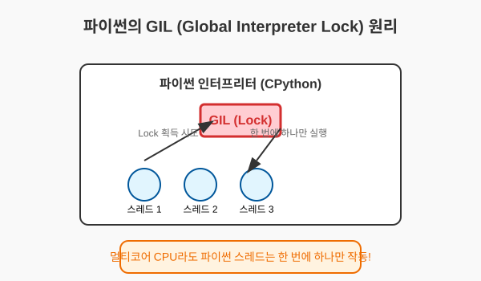

# 9주차: 멀티스레딩 (Threading) - 동시성 프로그래밍 🧵

우리는 지금까지 코드가 한 줄씩 순서대로 실행되는 '싱글 스레드' 방식으로 프로그래밍을 했습니다. 하지만 현대의 컴퓨터는 여러 개의 코어를 가지고 있습니다. 이 코어들을 활용해 여러 작업을 동시에 처리하는 **멀티스레딩(Multi-threading)**에 대해 배워보겠습니다.

---

## 1. 스레드 (Thread)란?

스레드는 프로세스 내에서 실행되는 **가장 작은 실행 단위**입니다. 하나의 프로그램(프로세스) 안에 여러 개의 스레드를 만들면, 여러 작업을 동시에 처리하는 것처럼 보이게 할 수 있습니다.

### 1.1 동시성(Concurrency) vs 병렬성(Parallelism)
- **동시성:** 여러 작업이 겹쳐서 진행되는 것. (실제로는 아주 빠르게 전환하며 실행)
- **병렬성:** 실제로 여러 작업이 동시에 물리적으로 실행되는 것. (멀티코어 CPU 필요)

---

## 2. 파이썬의 GIL (Global Interpreter Lock)

파이썬(CPython)을 공부할 때 반드시 마주하게 되는 거대한 벽이 바로 **GIL**입니다.

**GIL이란?**
파이썬 인터프리터가 한 번에 **단 하나의 스레드만** 파이썬 바이트코드를 실행하도록 제한하는 잠금 장치입니다.

#
---

## 🔍 Deep Dive: GIL (Global Interpreter Lock)의 내부 물리적 원리와 CPU 바운드 병목

멀티스레딩은 여러 실행 흐름을 띄우는 기법이지만, 파이썬에서는 독특한 제약이 있습니다.
- **GIL (글로벌 인터프리터 락)**: CPython 인터프리터는 힙(Heap) 메모리를 관리할 때 스레드 세이프(Thread-Safe)하게 만들기 위해, 한 번에 단 하나의 스레드만 파이썬 바이트코드를 실행할 수 있도록 독점 자물쇠(Mutex)를 채워버립니다.
- **CPU Bound의 절망**: 이로 인해 CPU 연산이 주를 이루는 연산 작업(행렬 연산, 이미지 렌더링 등)을 여러 스레드로 쪼개면, 코어 하나를 두고 스레드들이 서로 락을 빼앗으려 다투는 컨텍스트 스위칭 비용만 늘어나 오히려 싱글 스레드보다 속도가 느려집니다.
- **I/O Bound의 구원**: 다행히 네트워크 요청이나 파일 읽기 등 CPU가 노는 대기 시간(I/O Block) 동안에는 GIL이 자동으로 자물쇠를 풀어 다른 스레드가 연산하게 비켜주므로, 웹 크롤링이나 채팅 서버 등 I/O가 잦은 작업에는 여전히 멀티스레딩이 매우 유용합니다.

---

## ☕ Java vs Python/C++ 스나이퍼 비교

### 스레드 구동 모델과 동시성 한계
*   **Java**: JVM 가상머신 수준에서 운영체제의 물리 커널 스레드(Kernel Thread)와 1:1로 매핑되는 완전한 시스템 스레드를 지원합니다. GIL 같은 독점 자물쇠가 전혀 없으므로, 멀티코어 환경에서 4개의 코어에 멀티스레드를 균등하게 태워 초고속 병렬(Parallel) 연산을 손쉽게 돌릴 수 있습니다.
*   **C++**: `std::thread`를 통해 OS 네이티브 물리 스레드를 통제합니다. 역시 락 제약 없이 다중 코어 하드웨어를 극한으로 사용할 수 있습니다.
*   **Python**: CPython 엔진에 묶여 물리 스레드는 생성되나 연산은 단 하나의 코어만 교대로 점유(Concurrent but not Parallel)하는 외나무다리 구조입니다. 이를 깨고 진짜 멀티코어 연산을 하고 싶다면 `multiprocessing` 모듈을 사용해야 합니다.

---

## 🎧 Vibe Coding

> **🗣️ 학생 프롬프트 (AI에게 이렇게 명령해 보세요):**
> "파이썬의 `threading` 모듈을 사용하여 5개의 이미지 URL에서 비동기로 이미지를 동시 다운로드하는 멀티스레드 크롤러 프로그램을 작성해 줘. 각 스레드가 다운로드를 완료하면 어떤 스레드가 완료했는지 로그를 찍어 주는 코드를 짜 줘."

---

## 코딩 영단어 학습 📝

*   **`GIL` (Global Interpreter Lock)**: 글로벌 인터프리터 락. (파이썬 가비지 컬렉터의 메모리 카운터 오염을 방지하기 위해, 한 번에 오직 하나의 스레드에만 인터프리터 제어권을 허락하는 상호 배제 잠금 장치입니다.)
*   **`Concurrency`**: 동시성. (하나의 코어가 여러 작업을 잘게 쪼개어 아주 빠르게 교대로 실행함으로써 마치 동시에 일어나는 것처럼 보이게 하는 가상 병렬 개념입니다.)
*   **`Parallelism`**: 병렬성. (여러 개의 물리적인 CPU 코어가 실제로 여러 개의 독립된 작업을 동시에 물리적으로 한 치의 오차 없이 함께 구동하는 기술입니다.)
