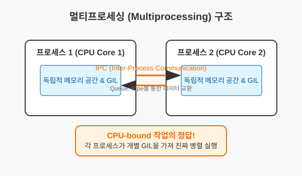

# 10주차: 멀티프로세싱 (Multiprocessing) - 진정한 병렬 처리 🚀

지난 시간에는 멀티스레딩을 배웠습니다. 하지만 파이썬의 GIL 때문에 CPU 연산이 많은 작업에서는 성능 향상이 없다는 것을 알게 되었습니다. 이 한계를 극복하고 멀티코어 CPU의 성능을 100% 활용하는 방법이 바로 **멀티프로세싱(Multiprocessing)**입니다.

---

## 1. 프로세스 (Process)란?

프로세스는 실행 중인 프로그램의 인스턴스입니다. 스레드와 가장 큰 차이점은 **메모리 공간을 공유하지 않는다**는 것입니다.



### 1.1 멀티프로세싱 vs 멀티스레딩
| 구분 | 멀티스레딩 (Threading) | 멀티프로세싱 (Multiprocessing) |
| :--- | :--- | :--- |
| **메모리** | 메모리 공간을 공유함 | 독립적인 메모리 공간을 가짐 |
| **GIL 영향** | GIL의 영향을 받음 (한 번에 하나만) | **GIL의 영향 없음 (프로세스별 GIL)** |
| **속도** | 컨텍스트 스위칭 비용이 낮음 | 프로세스 생성 비용이 높음 |
| **적합한 작업** | I/O Bound (네트워크, 파일) | **CPU Bound (복잡한 계산, 이미지 처리)** |

---

## 2. `multiprocessing` 모듈 사용법

파이썬의 `multiprocessing` 모듈을 사용하면 여러 개의 프로세스를 생성하여 작업을 분산 처리할 수 있습니다.

### 2.1 기본 사용법
```python
import multiprocessing
import time

def heavy_calc(n):
    print(f"계산 시작: {n}")
    result = sum(i * i for i in range(n))
    print(f"계산 완료: {n}")
    return result

if __name__ == "__main__": # 윈도우에서는 반드시 이 조건문이 필요합니다!
    # 프로세스 생성
    p1 = multiprocessing.Process(target=heavy_calc, args=(10**7,))
    p2 = multiprocessing.Process(target=heavy_calc, args=(10**7,))

    p1.start()
    p2.start()

    p1.join()
    p2.join()
    print("모든 병렬 계산 완료!")
```

---

## 3. 프로세스 간 통신 (IPC)

프로세스는 메모리를 공유하지 않기 때문에, 데이터를 주고받으려면 **IPC (Inter-Process Communication)** 도구가 필요합니다.

### 3.1 Queue와 Pipe
- **`Queue`**: 멀티프로세스 안전한 큐. 한 프로세스가 넣고 다른 프로세스가 꺼냅니다.
- **`Pipe`**: 두 프로세스 간의 양방향 통신 통로입니다.

```python
from multiprocessing import Process, Queue

def producer(q):
    q.put("Hello from Producer!")

def consumer(q):
    print(f"수신 데이터: {q.get()}")

if __name__ == "__main__":
    q = Queue()
    p1 = Process(target=producer, args=(q,))
    p2 = Process(target=consumer, args=(q,))
    
    p1.start()
    p2.start()
    p1.join()
    p2.join()
```

---

## 4. 🔍 Deep Dive: 프로세스 풀 (Process Pool)

매번 프로세스를 생성하고 종료하는 것은 비용이 많이 듭니다. 이를 해결하기 위해 미리 일정 수의 프로세스를 만들어 두고 작업을 할당하는 **Pool** 방식을 사용합니다.

```python
from multiprocessing import Pool

def square(n):
    return n * n

if __name__ == "__main__":
    with Pool(processes=4) as pool:
        # map 함수를 사용하여 리스트의 모든 요소에 함수 적용
        results = pool.map(square, [1, 2, 3, 4, 5])
    print(results) # 결과: [1, 4, 9, 16, 25]
```

---

## ✍️ 이번 주 연습 문제

**문제 1.** 1부터 1억까지의 숫자 중 소수의 개수를 구하는 프로그램을 작성하고, 싱글 스레드 vs 멀티스레드 vs 멀티프로세싱의 실행 시간을 각각 측정하여 비교해 보세요.

**문제 2.** `Queue`를 사용하여 생산자-소비자(Producer-Consumer) 패턴의 프로그램을 구현해 보세요. (생산자는 랜덤 숫자를 생성하고, 소비자는 그 숫자의 제곱을 출력)

**문제 3.** (심화) 멀티프로세싱 사용 시 `if __name__ == "__main__":` 구문이 왜 필수적인지, 특히 윈도우 환경의 `spawn` 방식과 관련하여 설명해 보세요.
---

## 🔍 Deep Dive: 프로세스 포크(Fork/Spawn)와 OS 공유 메모리 제어, 그리고 IPC의 한계

CPython의 GIL 한계를 극복하고 멀티 코어를 완전히 사용하기 위해 **멀티프로세싱**을 씁니다.
- **독립된 메모리**: 스레드는 한 프로세스의 메모리를 같이 쓰지만, 프로세스는 운영체제 수준에서 완전히 격리된 독립 주소 메모리 공간을 할당받습니다.
- **IPC (Inter-Process Communication)**: 메모리가 격리되어 있으므로 두 프로세스가 데이터를 주고받으려면 운영체제가 열어주는 특별한 다리인 파이프(Pipe), 큐(Queue) 또는 공유 메모리(Shared Memory) 같은 **IPC** 도구를 써야 합니다.
- **병목 원인**: 프로세스를 새로 만들 때는(Fork) 전체 메모리 레이아웃을 그대로 복제해야 하므로 스레드 생성보다 컴퓨터 리소스가 수십 배 무겁게 소모됩니다. 또한 데이터를 IPC 큐로 보낼 때 객체를 바이트로 직렬화(Pickle)하여 쏘고 다시 조립하는 비용이 동반되므로 신중하게 설계해야 합니다.

---

## ☕ Java vs Python 스나이퍼 비교

### 멀티코어 병렬 처리 접근 방식의 비교
*   **Java**: 프로세스 복제는 무겁고 리소스를 지나치게 잡아먹는다고 생각하여, 하나의 프로세스 내부에서 스레드 동기화 락(`Lock`, `Semaphore`)을 촘촘히 쪼개거나 튜닝한 동시성 컬렉션(`ConcurrentHashMap` 등)을 통해 멀티스레드로 모든 병렬처리를 처리하는 전통이 깊습니다.
*   **Python**: GIL로 인해 멀티스레드가 무력화되므로, 아예 주저하지 않고 여러 대의 독립된 서브 프로세스를 복제 실행하는 **`multiprocessing.Pool`** 기법을 메인 동시성 전략으로 삼아 CPU 연산 장벽을 완전히 돌파합니다.

---

## 🎧 Vibe Coding

> **🗣️ 학생 프롬프트 (AI에게 이렇게 명령해 보세요):**
> "파이썬 `multiprocessing` 모듈의 `Pool`을 사용하여 1부터 1억까지의 숫자 중 소수의 개수를 찾는 연산을 멀티코어로 분할 병렬 처리하여 연산 속도를 획기적으로 개선하는 코드를 작성해 줘."

---

## 코딩 영단어 학습 📝

*   **`Process`**: 프로세스. (운영체제로부터 메모리와 CPU 자원을 완전히 독립적으로 할당받아 실행 중인 하나의 독립된 컴퓨터 프로그램 실행 단위입니다.)
*   **`IPC` (Inter-Process Communication)**: 프로세스 간 통신. (메모리가 서로 격리되어 침범할 수 없는 다수의 프로세스들이 데이터를 상호 유통하기 위해 운영체제 파이프나 큐 채널을 공유하는 기술입니다.)
*   **`Pickle`**: 피클링. (파이썬에서 메모리상의 임의의 객체를 다른 파일이나 프로세스 전송을 위해 바이너리 바이트 스트림 파일로 납작하게 누르는 파이썬 고유 직렬화 모듈 기능입니다.)
